# DeepSeek R1部署与调用方法

> 来源：https://kq4b3vgg5b.feishu.cn/docx/I0R7dHOJQoFqNAxUDaBcynuynrh

## 课程说明

体验课内容节选自《2025大模型Agent智能体开发实战》完整版付费课程。

体验课时间有限，若想深度学习大模型技术，欢迎大家报名由我主讲的《2025大模型Agent智能体开发实战》：


此外，公开课全套学习资料，已上传至网盘（https://pan.baidu.com/s/1a7As3OrC6wls0-_n_42Q8Q?pwd=aaw5）。

需要更系统深入学习大模型可扫码⬆️添加助教咨询喔～

---

## 最强开源推理模型DeepSeek R1

## 本地部署指南

### DeepSeek R1上线公告

DeepSeek R1上线公告：https://api-docs.deepseek.com/zh-cn/news/news250120

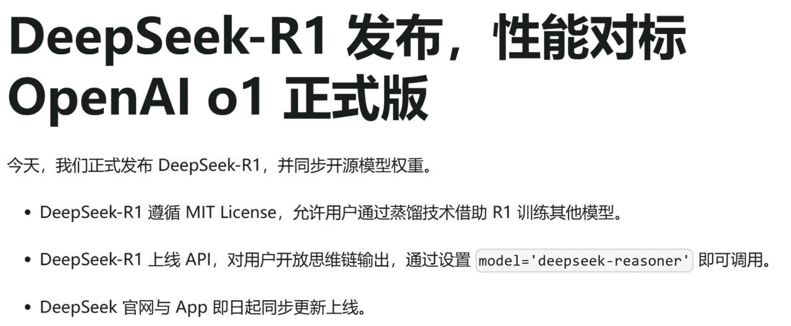

我第一时间也在B站上发布视频对R1模型进行了解读，详情请戳 https://www.bilibili.com/video/BV1UBwbe4E1D


DeepSeek-R1 在后训练阶段大规模使用了强化学习技术，在仅有极少标注数据的情况下，极大提升了模型推理能力。在数学、代码、自然语言推理等任务上，性能比肩 OpenAI o1 正式版。

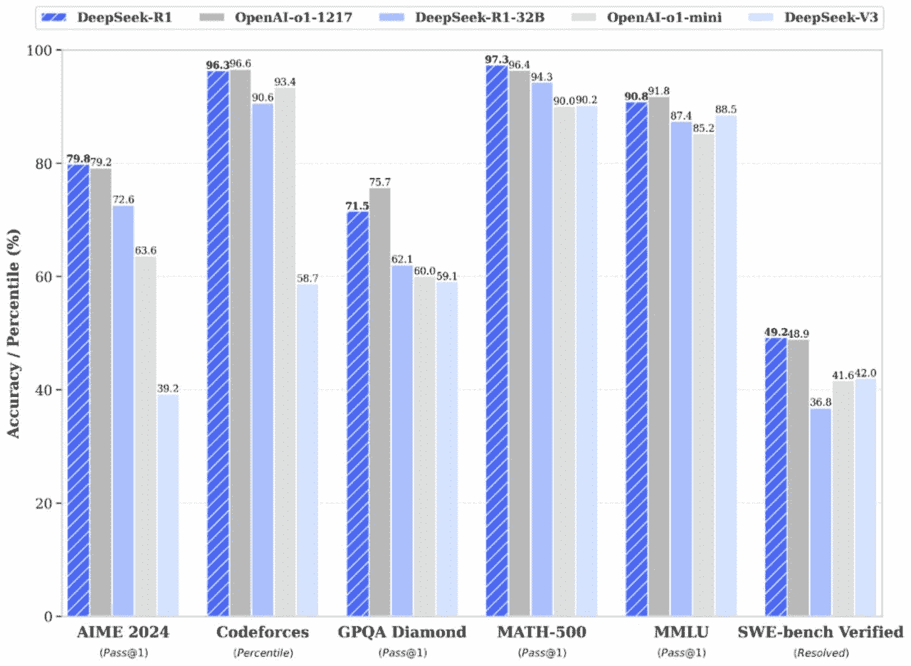

论文链接：https://github.com/deepseek-ai/DeepSeek-R1/blob/main/DeepSeek_R1.pdf

这次DeepSeek开源了DeepSeek-R1-Zero 和 DeepSeek-R1 两个 660B 模型的同时，通过 DeepSeek-R1 的输出，蒸馏了 6 个小模型开源给社区，其中 32B 和 70B 模型在多项能力上实现了对标 OpenAI o1-mini 的效果。

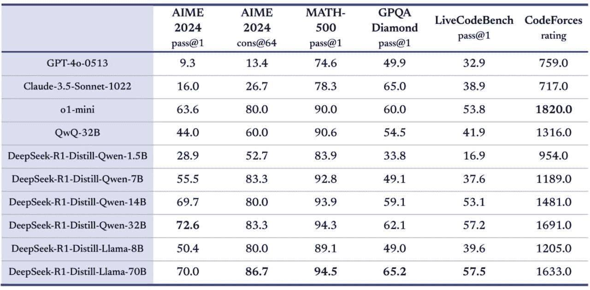

HuggingFace 链接：https://huggingface.co/deepseek-ai

DeepSeek官网：https://www.deepseek.com/

DeepSeek R1 GitHub项目地址：https://github.com/deepseek-ai/DeepSeek-R1

DeepSeek R1 Hugging Face项目地址：https://huggingface.co/deepseek-ai/DeepSeek-R1

DeepSeek R1魔搭社区地址：https://modelscope.cn/models/deepseek-ai/DeepSeek-R1

### DeepSeek R1开源情况介绍

DeepSeek R1 GitHub项目地址：https://github.com/deepseek-ai/DeepSeek-R1

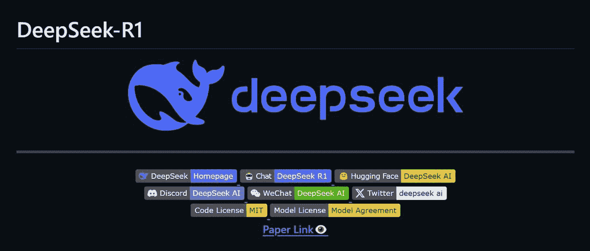

需要注意的是，DeepSeek R1采用了和DeepSeekV3完全相同的架构，只是训练过程和训练数据不同。

具体来说，DeepSeek R1是在DeepSeekV3 base模型基础上，先进行了有监督学习微调，然后再进行强化学习训练最终获得的模型，而同时开源的DeepSeek R1 Zero则是少了有监督微调步骤，直接从 DeepSeekV3 base上经过强化学习训练得到。

因此，我们看DeepSeek R1项目，其实并没有看到模型权重和推理脚本、以及本地部署方法等关键信息。其实也是因为这些信息都已经包含在DeepSeekV3模型项目中了，具体项目地址见：https://github.com/deepseek-ai/DeepSeek-V3

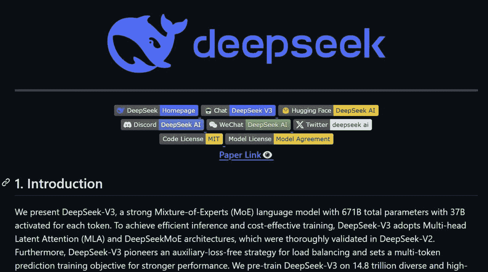

其中模型推理和架构的代码部分内容如下：

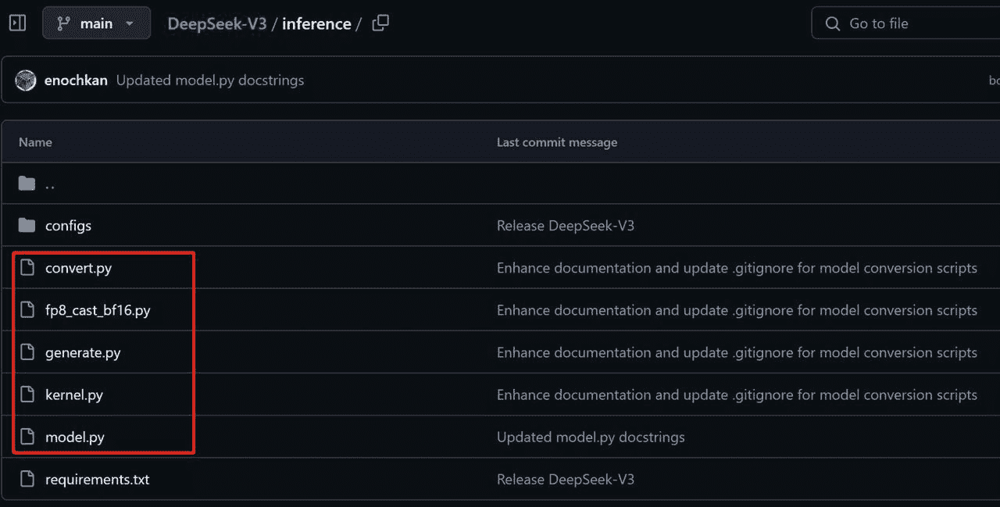

+ `convert.py`：用于进行格式转化，将一个已经训练好的模型检查点（`checkpoint`）文件从一个格式（比如 `safetensors`）转换并保存成一个适合特定模型并行度（`model parallelism`）和专家数（`n_experts`）的格式。

+ `fp8_cast_bf16.py`：代码的功能是将存储在 FP8 格式中的模型权重转换为 BF16 格式，并保存转换后的权重。它还更新了模型的索引文件，去除了 `scale_inv` 的引用。

+ `generate.py`：代码是一个用于生成文本的示例程序，支持交互式和批量文本生成。它使用一个 Transformer 模型并进行分布式训练。

+ `kernel.py`：代码主要涉及量化和矩阵乘法操作，使用了 Triton 库进行加速，特别是针对 FP8 精度（浮点8位）进行了优化。 Triton 是一个专为 GPU 上的高效自定义操作而设计的编程框架，支持 Python 和 PyTorch，可以通过简洁的代码来实现高效的 GPU 核心。

+ `model.py`： 定义了DeekSeekv3和R1的模型架构。

目前模型权重已经在hugging face上开源了，具体情况如下：

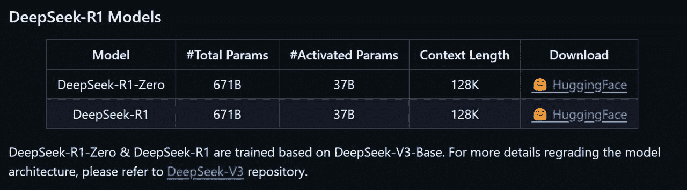

> DeepSeek-V3和R1模型在Hugging Face上的总大小为685B，其中包括671B的主模型权重和14B的多标记预测（MTP）模块权重。

> 为了确保最佳性能和灵活性，我们与开源社区和硬件供应商合作，提供多种在本地运行模型的方式。有关逐步指导，请参阅第6节：如何在本地运行（`How_to_Run_Locally`）。

> 对于希望深入了解的开发者，我们建议查阅`README_WEIGHTS.md`文件，了解主模型权重和多标记预测（MTP）模块的详细信息。请注意，MTP支持目前仍在社区内积极开发中，我们欢迎您的贡献和反馈。

并且还非常贴心的介绍了权重情况：https://github.com/deepseek-ai/DeepSeek-V3/blob/main/README_WEIGHTS.md

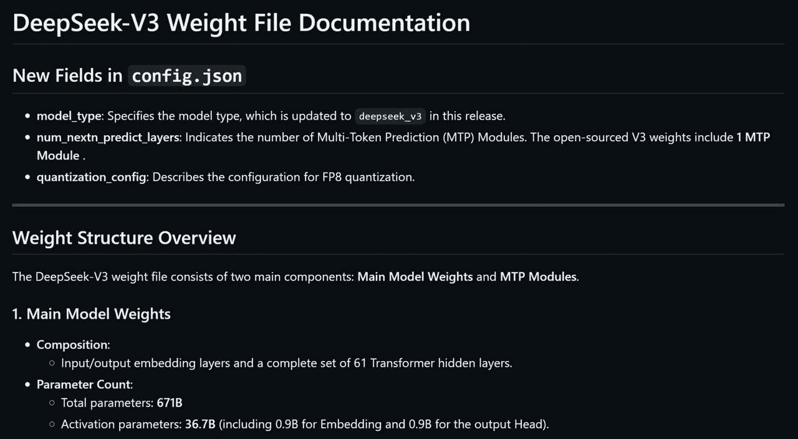

DeepSeek R1模型权重可在hugging face上主页上下载：https://huggingface.co/deepseek-ai/DeepSeek-R1，权重总共约650G大小。

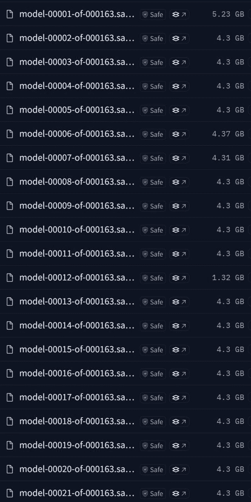

同时该页面中也包含蒸馏模型的下载地址：

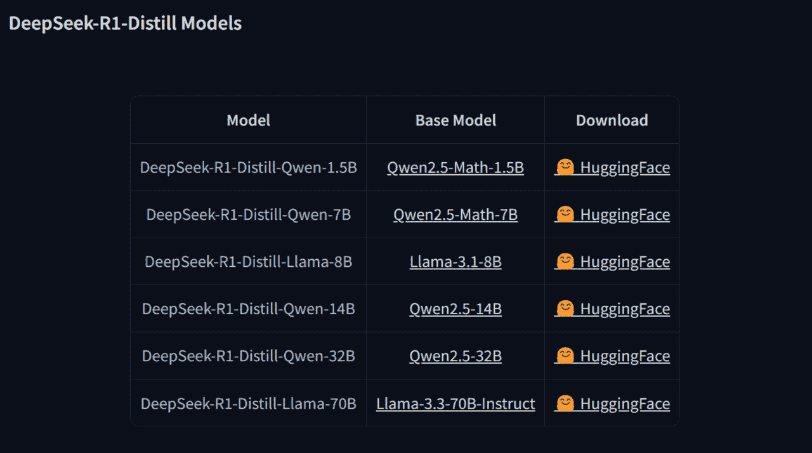

此外，也可在魔搭社区上下载：https://www.modelscope.cn/models/deepseek-ai/DeepSeek-R1

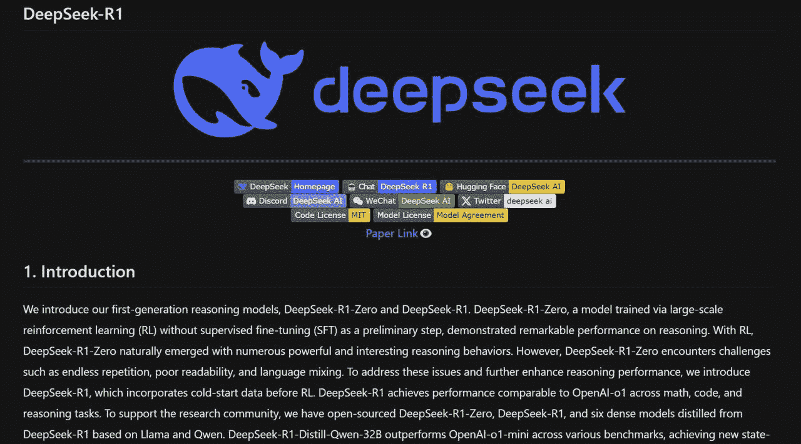

以及蒸馏模型的权重下载地址：

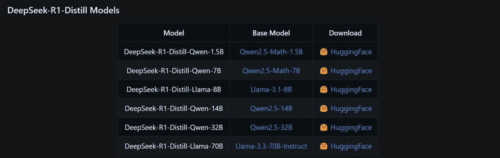

既然是权重全开源，那肯定是可以在本地运行的，以下官方介绍的本地运行方法：

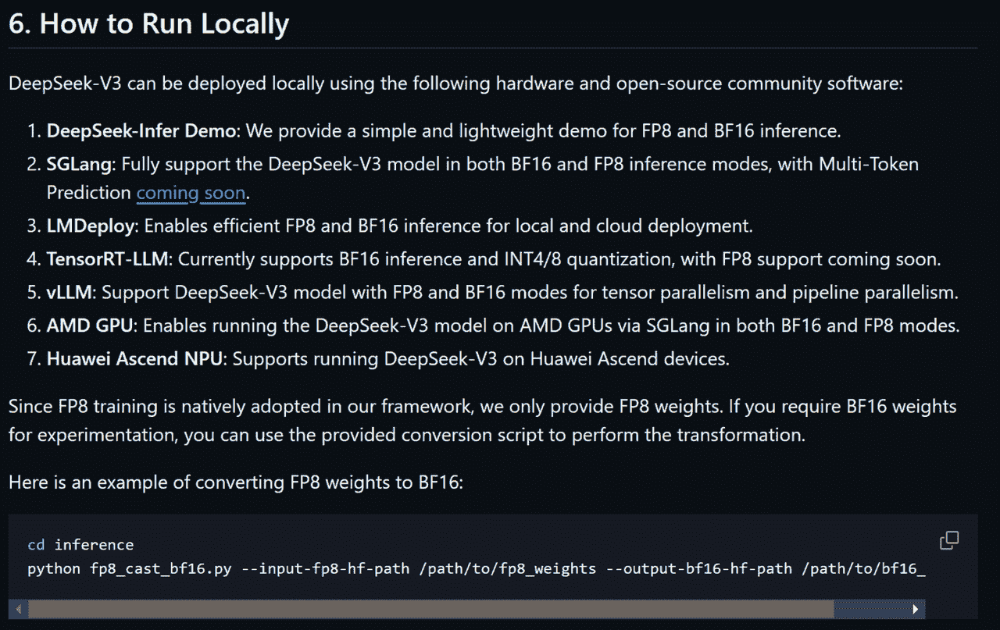

### 6. 如何在本地运行

DeepSeek-V3可以使用以下硬件和开源社区软件在本地部署：

+ `DeepSeek-Infer Demo`：我们提供了一个简单且轻量的演示，支持FP8和BF16推理。

+ `SGLang`：完全支持DeepSeek-V3模型在BF16和FP8推理模式下运行，且即将支持多标记预测（MTP）。

+ `LMDeploy`：支持高效的FP8和BF16推理，适用于本地和云端部署。

+ `TensorRT-LLM`：目前支持BF16推理和INT4/8量化，FP8支持即将推出。

+ `vLLM`：支持DeepSeek-V3模型在FP8和BF16模式下进行张量并行和流水线并行。

+ `AMD GPU`：通过`SGLang`，在BF16和FP8模式下支持在AMD GPU上运行DeepSeek-V3模型。

+ `华为Ascend NPU`：支持在华为Ascend设备上运行DeepSeek-V3模型。

> 由于我们的框架原生采用FP8训练，因此只提供FP8权重。如果您需要BF16权重进行实验，您可以使用提供的转换脚本进行转换。

由于DeepSeek R1的框架原生采用 FP8 训练，因此仅提供 FP8 权重，预估仅700GB+显存便可轻松运行。当然也可以转换到BF16，在半精度下，需1000GB+，而量化到int4时需要450GB+。以下是半精度下显存占用情况：（占用 490G 显存，需要 7张 80GA100，租赁成本约1000元1天）

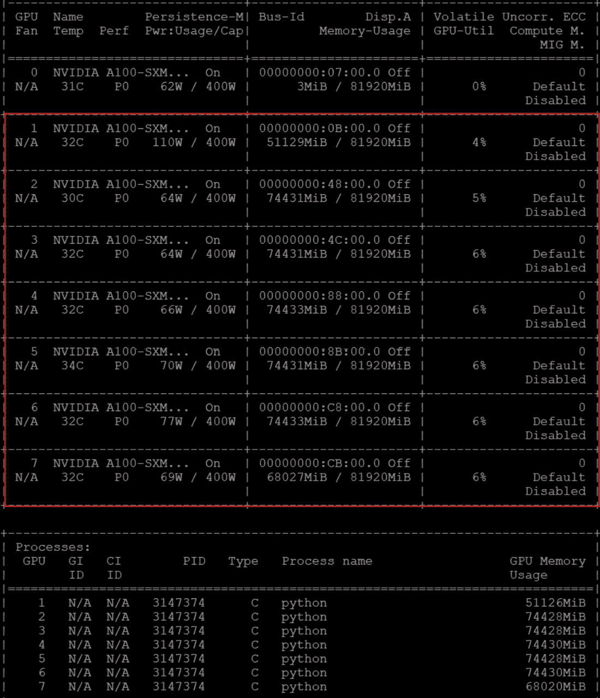

## DeepSeek R1本地部署与调用流程

本次DeepSeek R1的本地部署流程和DeepSeekV3完全相同，因此本教程只介绍DeepSeek R1部署流程与代码解释，具体模型调用的实机演示，参看DeepSeekV3部署调用流程：https://www.bilibili.com/video/BV1jjwVe4EKn/

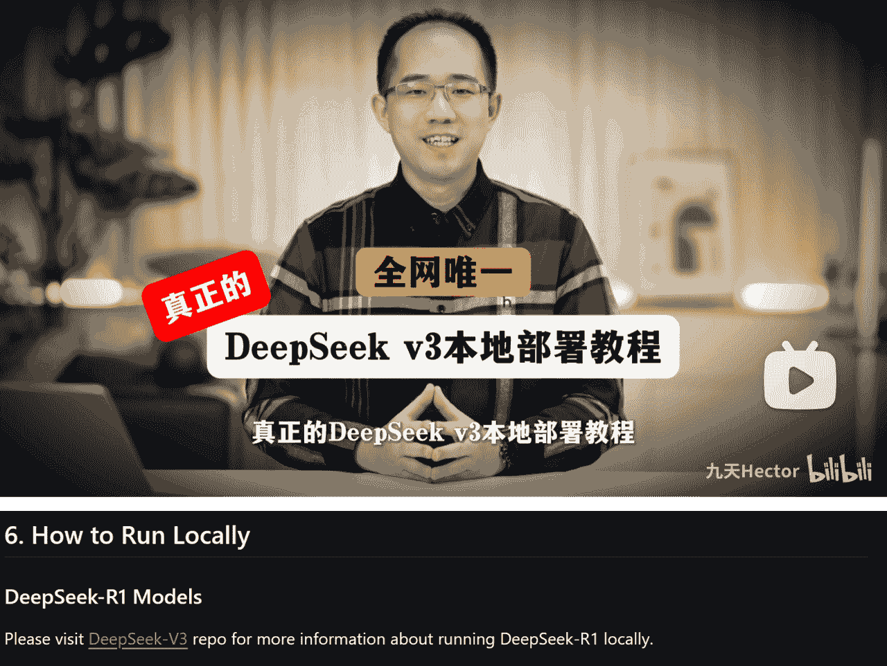

> 此外，硬件环境也可考虑在AutoDL上进行租赁，具体租赁方法可参考我的教程：《AutoDL快速入门与GPU租赁使用指南》 https://www.bilibili.com/video/BV1bxB7YYEST/

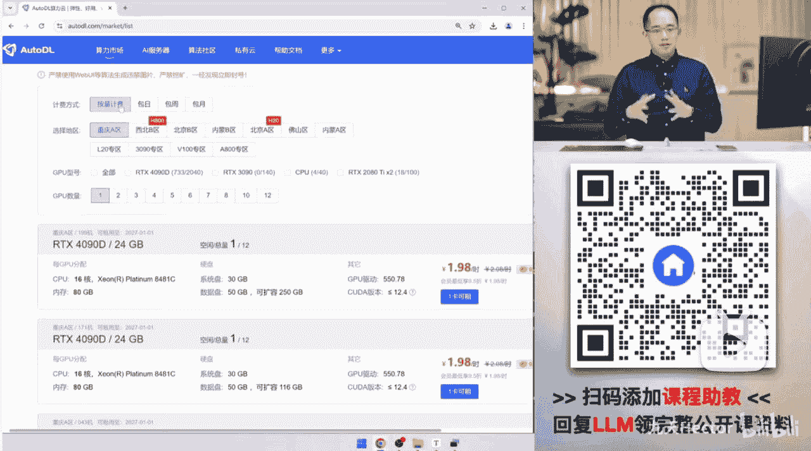

### 创建虚拟环境

`conda create --name dv3 python=3.11`

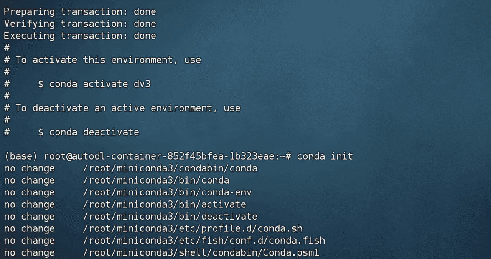

`conda install jupyterlab`
`conda install ipykernel`

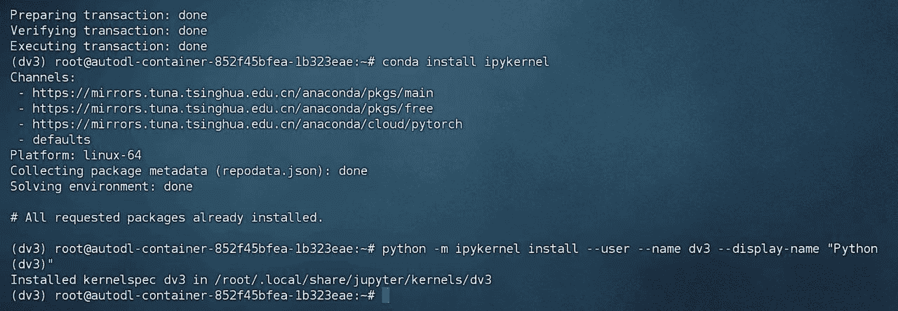

### 登录Github主页拉取项目

访问DeepSeek V3主页：https://github.com/deepseek-ai/DeepSeek-V3

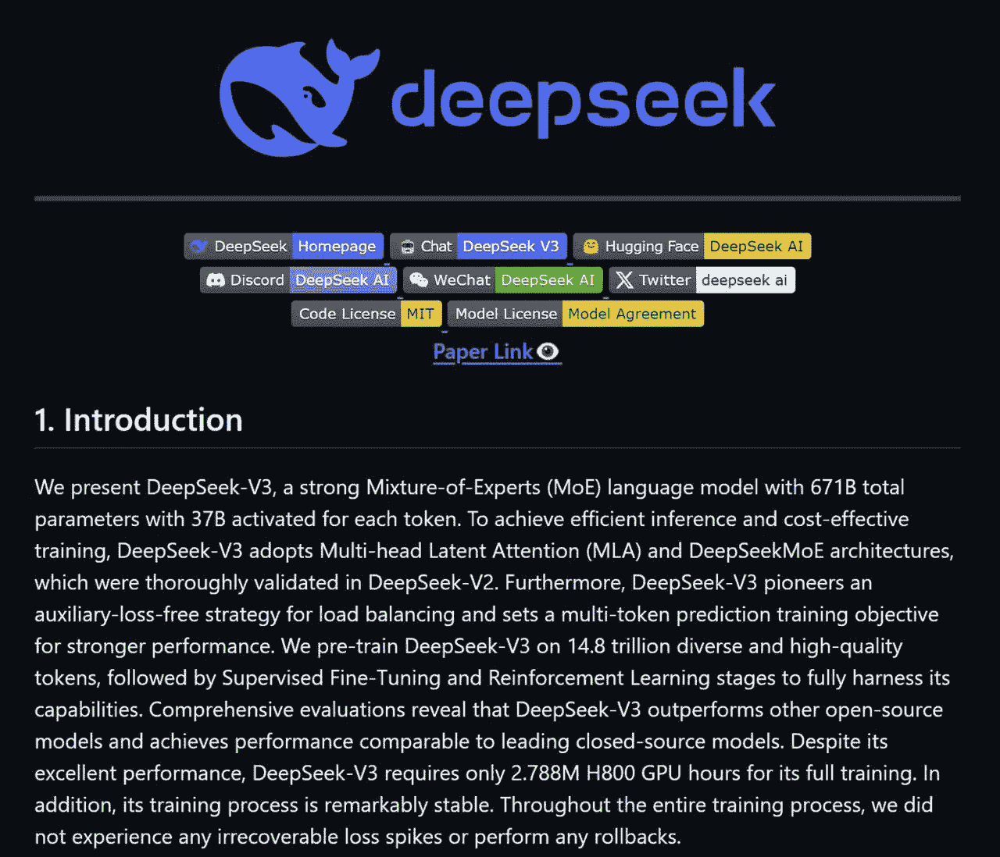

> 注，这里需要下载DeepSeekV3的项目源码，然后使用DeepSeek R1的权重进行调用。

`git clone https://github.com/deepseek-ai/DeepSeek-V3.git`

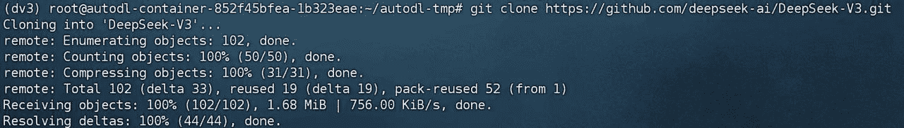

### 安装依赖

`cd DeepSeek-V3/inference`

### 下载模型权重

可以在HuggingFace或者魔搭社区上下载模型权重，考虑到国内网络情况，推荐使用魔搭社区进行下载。DeepSeek R1魔搭社区官网地址：https://www.modelscope.cn/models/deepseek-ai/DeepSeek-R1

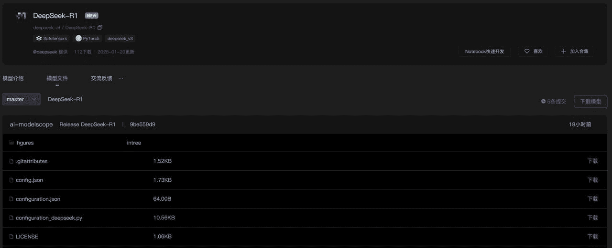

> 注，下载前需提前留出600G左右存储空间，用于保存模型权重

具体下载流程如下：

`pip install modelscope`

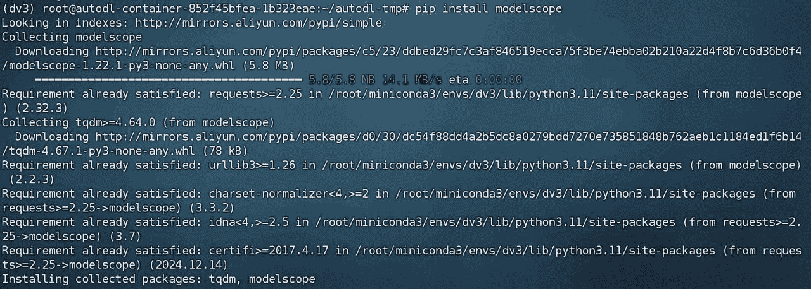

`mkdir ./deepseek`

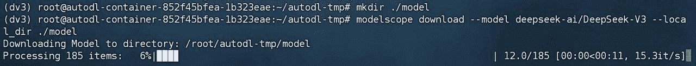

### 借助convert.py模型权重转化

`cd DeepSeek-V3/inference`

`python convert.py`：运行 `convert.py`脚本，这个脚本的作用是将Hugging Face格式的模型权重转换为另一个特定的格式。

`--hf-ckpt-path /path/to/DeepSeek-R1`：指定Hugging Face格式的模型检查点路径（即模型文件所在的位置）。在这个例子中是 `/path/to/DeepSeek-R1`。

`--save-path /path/to/DeepSeek-R1-Demo`：指定转换后的模型权重保存的路径，即你想将模型保存到哪里。

`--n-experts 256`：指定模型中的专家数量，这可能是与模型的分布式训练或者混合专家模型（Mixture of Experts, MoE）相关的参数，设置为256表示该模型将使用256个专家。

`--model-parallel 16`：这个参数指定模型并行的程度，通常是指将模型分布在16个GPU上进行训练或推理。

### 借助generate.py进行模型推理

```
torchrun --nnodes 2 --nproc-per-node 8 --node-rank $RANK --master-addr $ADDR generate.py --ckpt-path /path/to/DeepSeek-R1-Demo --config
```

这部分命令用于运行模型并生成文本。各个参数的含义如下：

+ `torchrun`：用于分布式训练或推理的命令。它会启动多个进程，支持跨多个节点（即多台机器）运行。

+ `--nnodes 2`：指定集群中的节点数目。在这个例子中，使用2个节点（即2台机器）。

+ `--nproc-per-node 8`：每个节点上运行的进程数。在每个节点上启动8个进程，通常是为了充分利用每个节点上的多个GPU。

+ `--node-rank $RANK`：当前节点在集群中的排名，用于区分不同节点。`$RANK` 是一个环境变量，代表当前节点的编号。

+ `--master-addr $ADDR`：指定主节点的地址。主节点通常负责协调所有其他节点的工作。`$ADDR` 是一个环境变量，表示主节点的IP地址或主机名。

+ `generate.py`：这是运行文本生成任务的脚本，它会使用模型进行推理生成文本

+ `--ckpt-path /path/to/DeepSeek-R1-Demo`：指定转换后的DeepSeek-R1模型检查点路径。这个路径是你之前在转换步骤中保存的模型文件。

+ `--config configs/config_671B.json`：指定模型的配置文件。配置文件包含模型的架构、超参数等信息。在这个例子中，配置文件是 `configs/config_671B.json`。

+ `--interactive`：启用交互模式，通常表示用户可以在命令行中输入内容，并实时获得模型的响应。


+   `--temperature` 0.7 ：生成的温度值，影响模型的输出随机性。温度越高，生成的文本越随机；温度越低，生成的文本越确定。0.7通常意味着适度的随机性。

+   `--max-new-tokens` 200 ：限制生成的最大新token数量，表示每次生成时最多生成200个新的词元。

然后即可完成推理。

## DeepSeek R1+Ollama部署方案

目前DeepSeek R1已支持使用Ollama进行调用，并且非常便捷的是，Ollama中集成了DeepSeek R1半精度版本，且集成了其他各蒸馏模型的`Q4_K_M`量化版本，支持`ollama run`命令一键下载与调用。

其中各模型在`Q4_K_M`量化情况下运行所需显存情况如下：

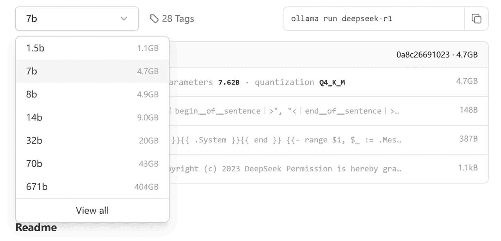

实际调用时，只需要在命令行输入`ollama run` + 模型版本即可，例如：

```
ollama run deepseek-r1:1.5b
```

即可运行1.5B蒸馏模型。而

```
ollama run deepseek-r1:671b
```

则可下载并运行半精度的DeepSeek R1模型。目前Ollama暂不支持全精度DeepSeek R1模型运行。

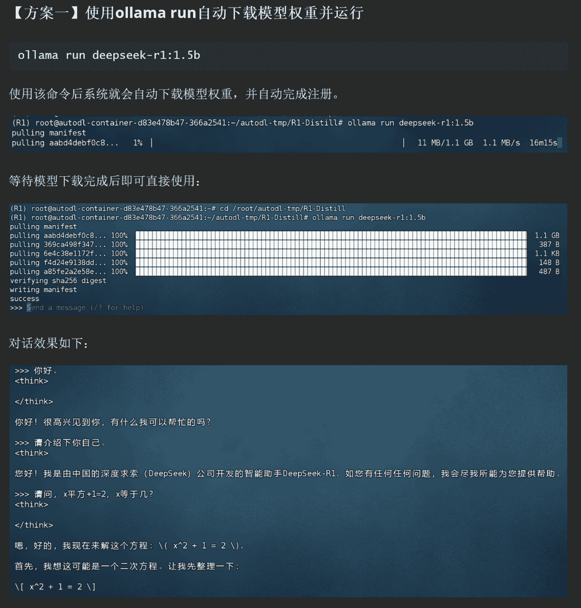

> 更多关于Ollama+DeepSeek R1蒸馏模型的调用方法，详见第二章内容讲解。

## DeepSeek R1+SGLang部署方案

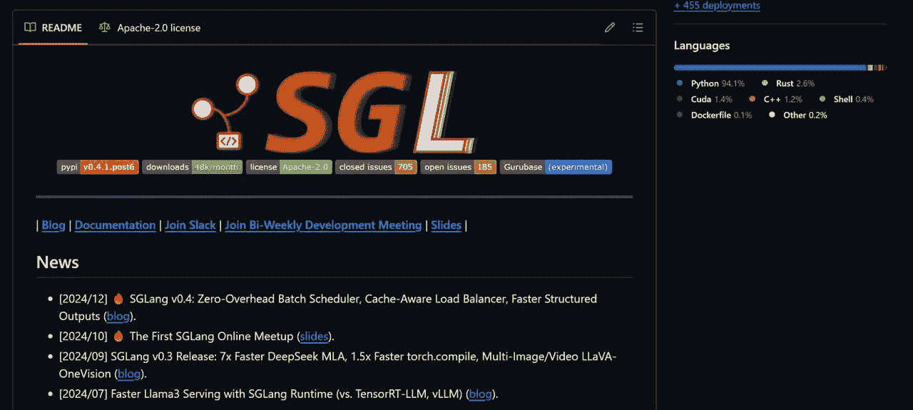

SGLang项目主页： [https://github.com/sgl-project/sglang](https://github.com/sgl-project/sglang)

SGLang 目前支持 `MLA` 优化、`DP Attention`、`FP8 (W8A8)`、`FP8 KV` 缓存和 `Torch Compile`，在开源框架中提供了领先的延迟和吞吐量性能。

需要注意的是，`SGLang v0.4.1` 完全支持在 `NVIDIA` 和 `AMD GPU` 上运行 `DeepSeek-V3` 和 `R1`，使其成为一个高度通用且稳健的解决方案。`SGLang` 还支持多节点张量并行，允许你在多个网络连接的机器上运行该模型。目前多标记预测（`MTP`）正在开发中，进展可以在优化计划中追踪。

+   安装`SGLang`

```
pip install "sglang[all]>=0.4.1.post5" --find-links https://flashinfer.ai/whl/cu124/torch2.4/flashinfer
```

+   调用`DeepSeek R1`

```
python3 -m sglang.launch_server --model deepseek-ai/DeepSeek-R1 --tp 8 --trust-remote-code
```

此时服务将在30000端口启动。接下来即可使用OpenAI风格API来调用DeepSeek R1模型了：

```
import openai
```

## DeepSeek R1+LMDeploy部署方案

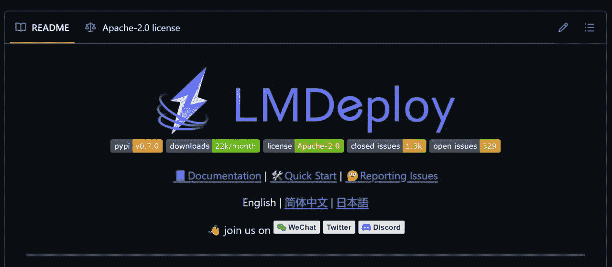

LMDeploy项目主页： [https://github.com/InternLM/lmdeploy](https://github.com/InternLM/lmdeploy)

LMDeploy 是一个灵活且高性能的推理与服务框架，专为大语言模型量身定制，现在支持`DeepSeek-R1`。它提供了离线管道处理和在线部署能力，能够与基于 `PyTorch` 的工作流无缝集成。具体使用LMDeploy调用DeepSeek R1流程如下：

+   安装`LMDeploy`

```
git clone -b support-dsv3 https://github.com/InternLM/lmdeploy.git
```

+   单任务推理，编写Python脚本执行

```
from lmdeploy import pipeline, PytorchEngineConfig
```

+   在线服务调用 先运行如下命令

```
# run
```

接下来即可在23333端口调用DeepSeek R1模型：

```
from openai import OpenAI
```

## DeepSeek R1+vLLM部署方案

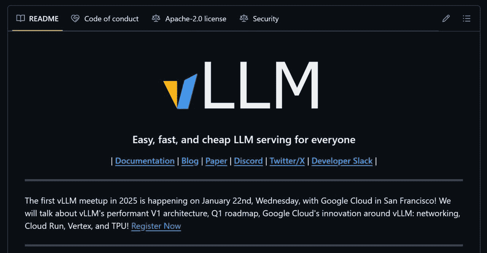

vLLM项目主页： [https://github.com/vllm-project/vllm](https://github.com/vllm-project/vllm)

`vLLM v0.6.6` 支持在 `NVIDIA` 和 `AMD GPU` 上以 `FP8` 和 `BF16` 模式进行 `DeepSeek-R1` 推理。除了标准技术外，`vLLM` 还提供了管道并行性，允许你在多个网络连接的机器上运行该模型。

+   `vLLM`安装

```
pip install vllm
```

+   `DeepSeek R1`调用

目前`vLLM`已支持`DeepSeek R1`模型调用，可以在[模型支持列表](https://docs.vllm.ai/en/latest/models/supported_models.html)中查看模型关键字。

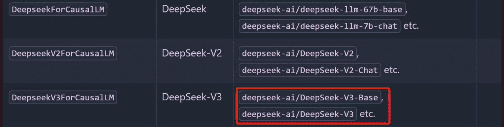

接下来即可使用如下代码进行调用：

```
from vllm import LLM
```
