# DeepSeek R1蒸馏模型部署与调用

> 来源：[https://kq4b3vgg5b.feishu.cn/docx/HG9Kdqqw9ogmpJxXAszcwJu1nof](https://kq4b3vgg5b.feishu.cn/docx/HG9Kdqqw9ogmpJxXAszcwJu1nof)

# 课程说明：

+   体验课内容节选自《2025大模型Agent智能体开发实战》完整版付费课程

体验课时间有限，若想深度学习大模型技术，欢迎大家报名由我主讲的《2025大模型Agent智能体开发实战》：

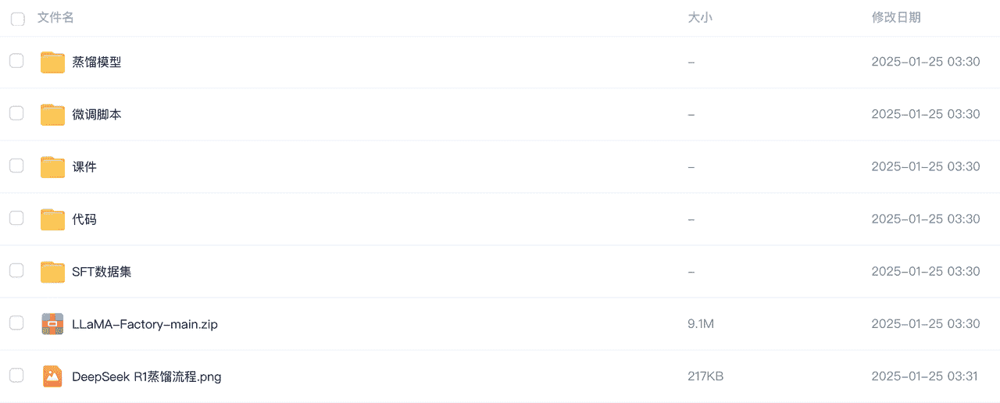

公开课全套学习资料，已上传至网盘（ https://pan.baidu.com/s/1UmKU0JmsrQ7Q0d5o302_dw?pwd=xmtp）

需要更系统深入学习大模型可扫码⬆️添加助教咨询喔～

---

# DeepSeek-R1-Distill

# **蒸馏模型部署与调用指南**

## **一、** **DeepSeek** **R1蒸馏模型开源情况**

DeepSeek R1开源的同时，还重磅开源了一组基于DeepSeek R1蒸馏的小尺寸推理模型。其中基于 Qwen 1.5B蒸馏模型的编程能力就已超过了GPT4o，而基于Qwen32B蒸馏模型的性能就已经和OpenAI o1 mini模型性能相当。可以说，基本实现了推理模型使用自由。

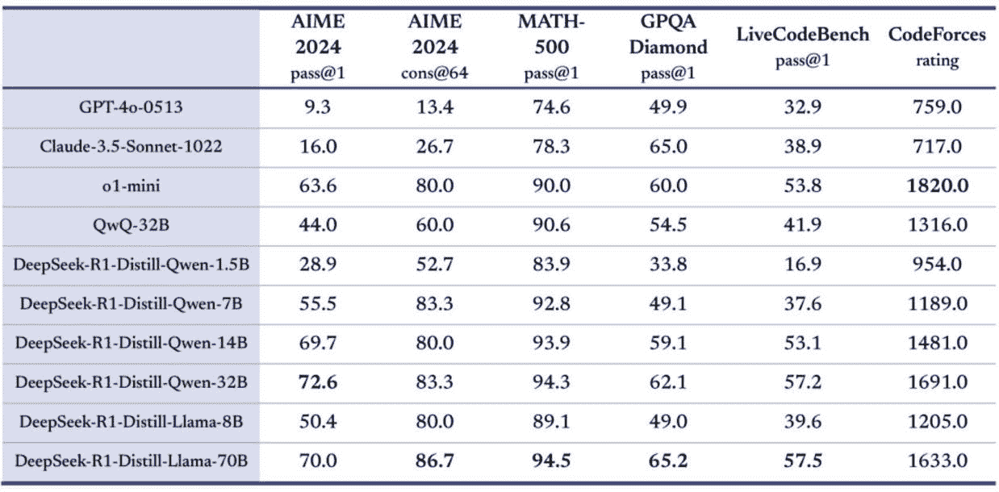

目前各组蒸馏模型权重、 GGUF版权重都已在huggingface和魔搭社区中上线了，开发者可以自由调用使 用，开源协议遵循MIT协议，且可以免费商用。

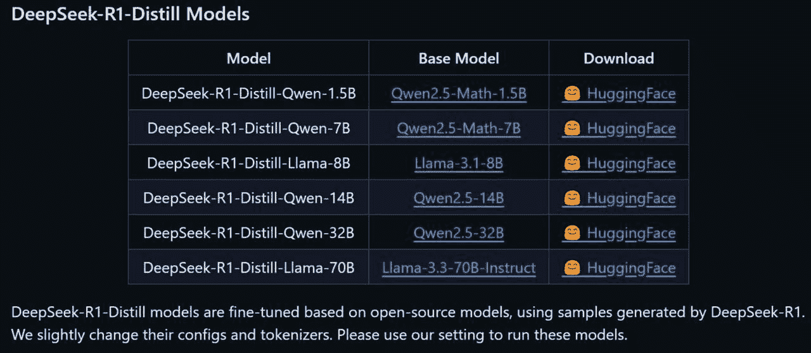

模型蒸馏并未改变模型原始的调用方法，基于Qwen 2.5和Llama 3的这组蒸馏模型，也可以按照原始模 型调用方法进行调用。

本节公开课，就为大家详细介绍这组蒸馏模型的调用方法，这里以1.5B蒸馏模型（DeepSeek-R1-Distill- Qwen-1.5B）为例进行演示，其他模型调用方法都是类似，只需换个模型名字即可。

> 1.5B模型最多仅需6G现存即可运行。

+   参考项目地址：

+   [DeepSeek R1 GitHub项目地址](https://github.com/deepseek-ai/DeepSeek-R1)： https://github.com/deepseek-ai/DeepSeek-R1

+   [DeepSeek R1 huggingface项目地](https://huggingface.co/deepseek-ai/DeepSeek-R1)址： https://huggingface.co/deepseek-ai/DeepSeek-R1

+   [DeepSeek R1及蒸馏模型组o](https://ollama.com/library/deepseek-r1)llama地址：https://ollama.com/library/deepseek-r1

+   DeepSeek官网： https://www.deepseek.com/

+   [DeepSeek-R1-Distill-Qwen-1.5Bht](https://modelscope.cn/models/deepseek-ai/DeepSeek-R1-Distill-Qwen-1.5B)tps://modelscope.cn/models/deepseek-ai/DeepSeek-R 1-Distill-Qwen-1.5B

+   Ollama官网：https://ollama.com/

---

## **二、** **DeepSeek-R1-Disti**ll-Qwen-1.5B本地部署调用流程

### **1.** DeepSeek-R1-Distill-Qwen-1.5B模型下载流程

+   创建虚拟环境

| conda create --name R1 python=3.10 |
| --- |

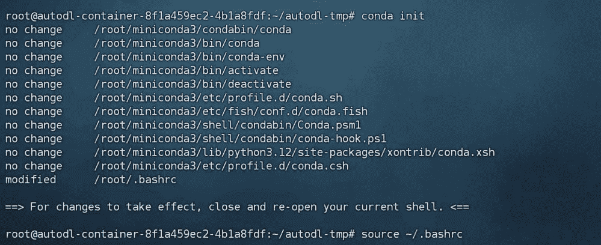

+   创建Jupyter Kernel

| conda install jupyterlab |
| --- |

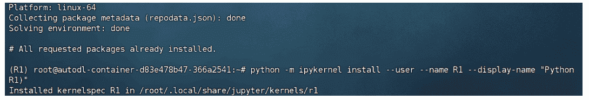

+   安装魔搭社区

| pip install modelscope |
| --- |

+   创建项目主目录

| cd /root/autodl-tmp |
| --- |

+   上传并安装依赖

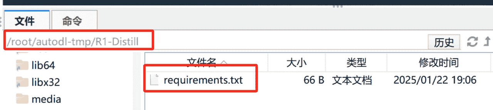

项目依赖在网盘中：

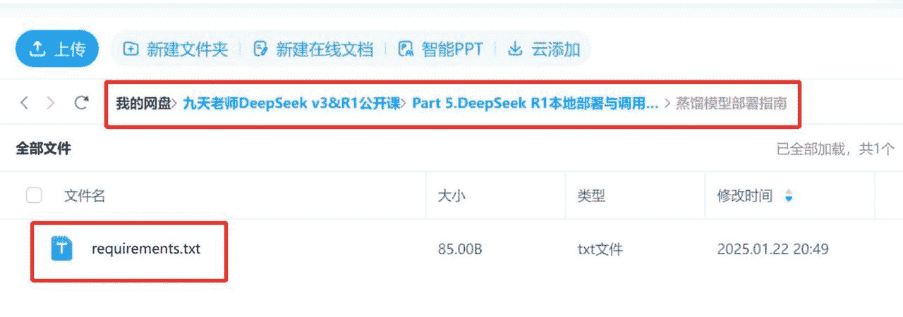

上传完即可进行安装

| pip install -r requirements.txt |
| --- |

+   下载项目权重

| mkdir ./DeepSeek-R1-1.5B |
| --- |

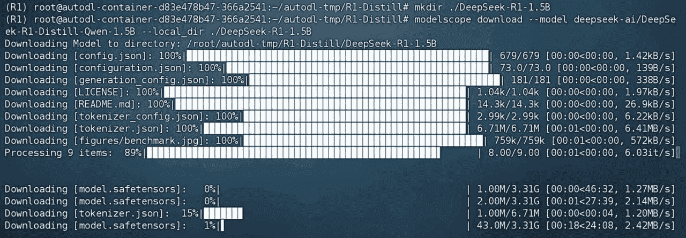

下载完成后1.5B蒸馏模型完整项目如下：

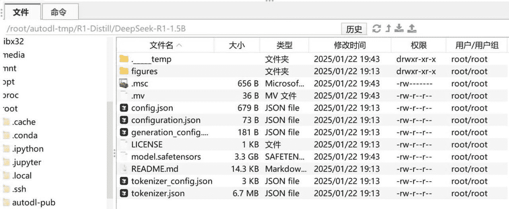

项目权重也可从网盘文件中下载：

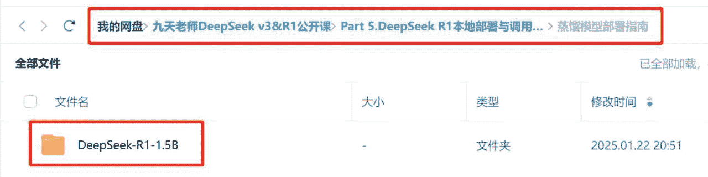

### 2.Jupyter中使用transformer原生库调用流程

然后即可使用transformer进行调用，具体调用步骤如下：

+   导入相关库

| from modelscope import AutoModelForCausalLM, AutoTokenizer |
| --- |

+   设置模型下载地址

| model_name = &quot;./DeepSeek-R1-1.5B&quot; |
| --- |

+   实例化预训练模型与分词器

| model = AutoModelForCausalLM.from_pretrained( |
| --- |

+   创建消息message

| prompt = &quot;你好，好久不见，请介绍下你自己。 &quot; |
| --- |

+   词嵌入过程

| text = tokenizer.apply_chat_template( |
| --- |

+   创建并回复

| generated_ids = model.generate( |
| --- |

最终运行结果如下：

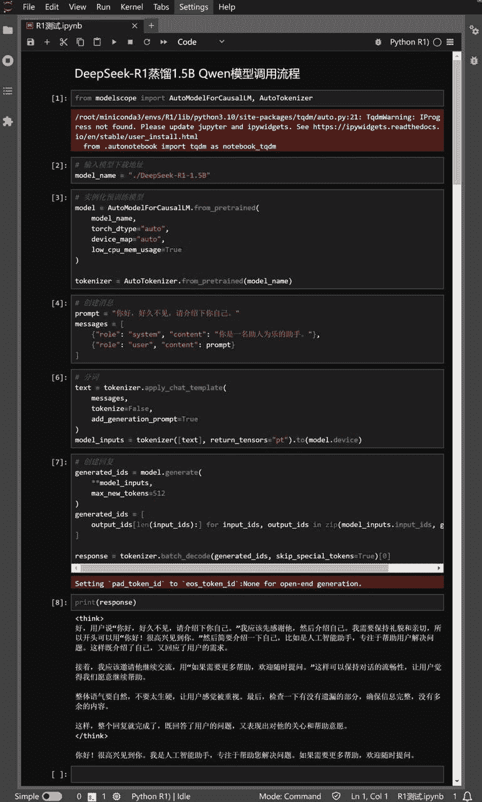

能够看出，此时模型回复结果中就包含思维链的全部内容。实际使用过程中，可以通过正则化的方法将 思维链内容和模型回复内容进行区分。

## **三、** D**eepSeek-R1**-Distill-Qwen-1.5B ollama调用流程

> 注意：本部分演示环节采用了1.5B模型Q4_K_M量化版本，仅1.5G显存即可运行，但受限于模型尺  寸及量化尺寸，实际模型性能一般，本部分教程仅用作演示，实际使用过程中建议至少使用7B以上 模型，才能有较好的对话效果。

目前DeepSeek R1及其蒸馏模型均支持使用ollama[进行调用](https://ollama.com/library/deepseek-r1)，可以在模型主页查看调用情况： http s://ollama.com/library/deepseek-r1

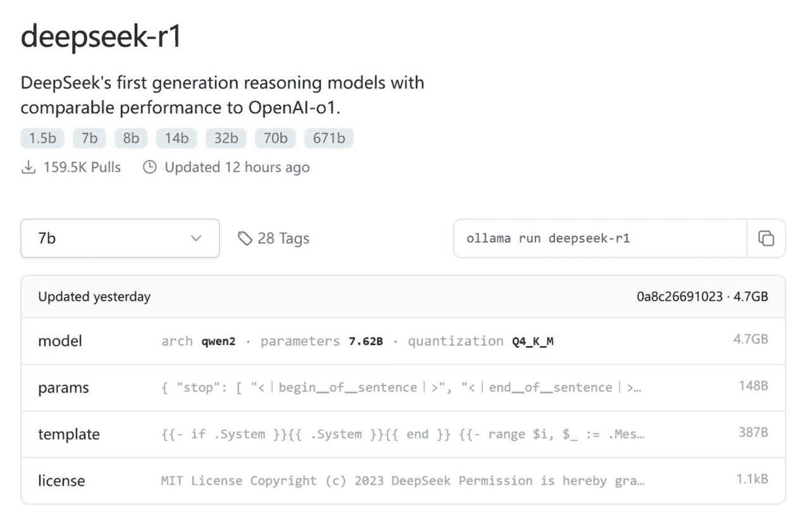

其中各模型在Q4_K_M量化情况下运行所需显存情况如下：

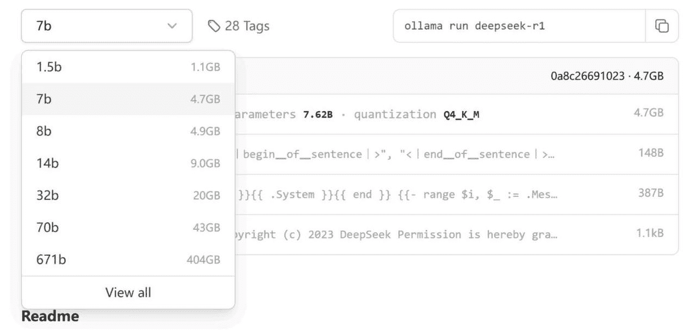

这里我们还是以1.5B模型为例进行演示，其他模型流程类似。

+   安装ollama

| curl -fsSL https://ollama.com/install.sh | sh |
| --- |

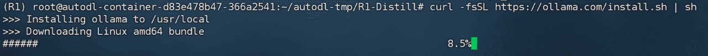

安装完成后可以使用ollama run命令自动下载模型权重并自动运行，或者手动下载1.5B模型的 GGUF格式，然后注册ollama服务，再进行调用。这里我们逐一执行两种调用方法。

+   启动ollama

安装完成后即可使用ollama start来启动ollama服务

| ollama start |
| --- |

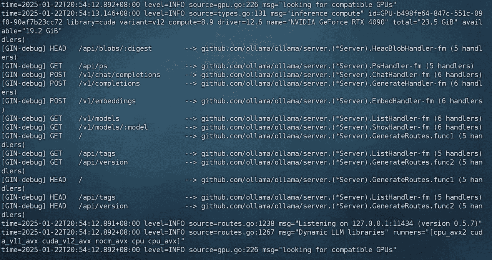

### **【方案一】使用ollama** **run** **自动下载模型权重并运行**

| ollama run deepseek-r1:1.5b |
| --- |

使用该命令后系统就会自动下载模型权重，并自动完成注册。

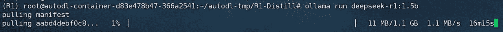

等待模型下载完成后即可直接使用：

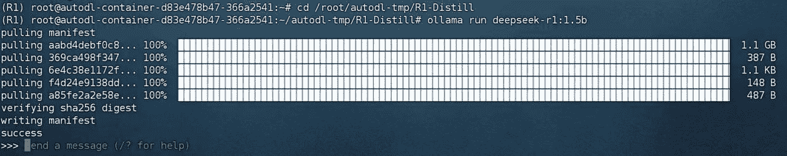

对话效果如下：

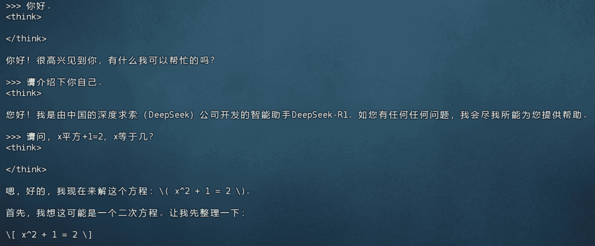

### 【方案二】手动下载GGUF权重并运行

除了使用ollama run命令外， ollama也支持调用手动下载的自定义模型，但需要是GGUF格式。目前

D[eepSeek-](https://modelscope.cn/search?search=DeepSeek-R1-Distill-Qwen-1.5B-GGUF)R[1](https://modelscope.cn/search?search=DeepSeek-R1-Distill-Qwen-1.5B-GGUF)-Distill-Qwen-1.5B模型已有各种不同量化版本的GGUF模型在魔搭社区中上线了： https:// modelscope.cn/search?search=DeepSeek-R1-Distill-Qwen-1.5B-GGUF

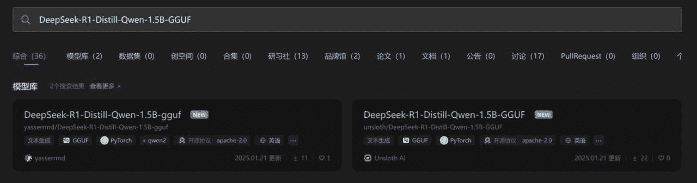

其中每个GGUF量化的权重都包含多个版本：

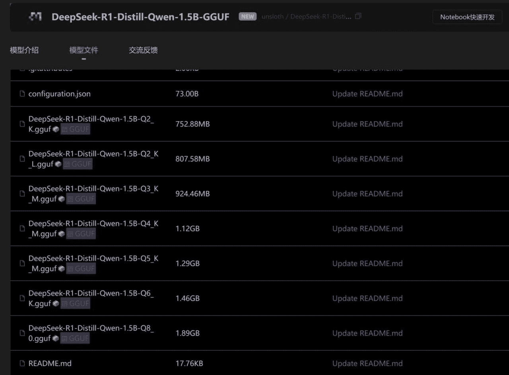

其中ollama调用的就是Q4_K_M量化版本。这里我们还是考虑下载Q4_K_M量化版本的GGUF权重进行调 用，具体执行流程如下。

+   下载GGUF格式权重

| mkdir DeepSeek-R1-1.5B-GGUF |
| --- |

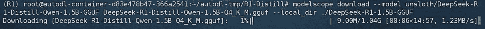

+   注册模型

然后需要创建一个file文件，用于进行ollama模型注册：

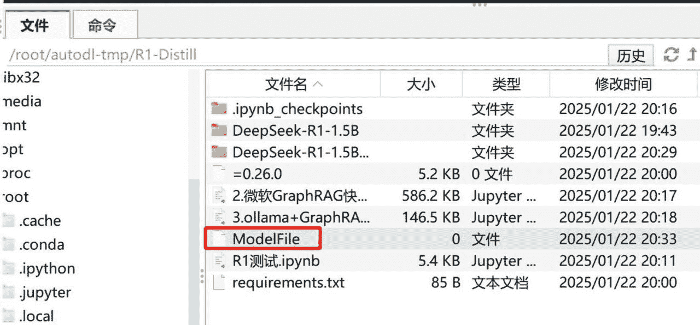

然后在File文件中写入自定义模型GGUF权重地址：

| FROM ./DeepSeek-R1-1.5B-GGUF./DeepSeek-R1-Distill-Qwen-1.5B-Q4 K  M.gguf |
| --- |

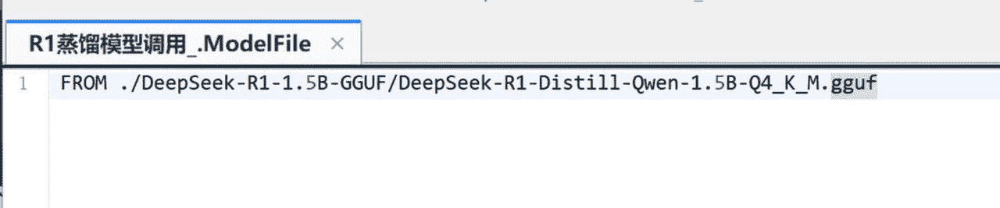

然后将该模型加入Ollama本地模型列表：

| ollama create DeepSeek-R1-1.5B -f ModelFile |
| --- |

查看模型是否注册成功

| ollama list |
| --- |

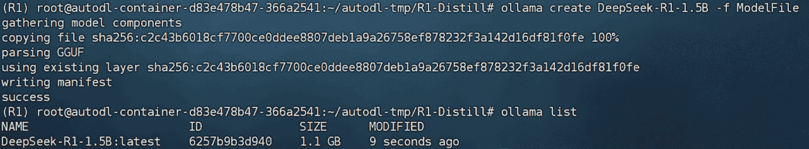

接下来即可使用了：

| ollama run DeepSeek-R1-1.5B |
| --- |

