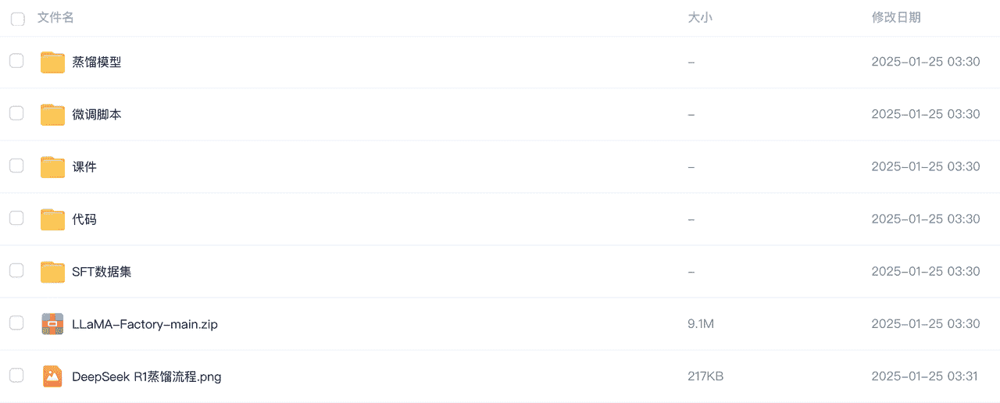

# DeepSeek-R1蒸馏1.5B Qwen模型调用流程

> 来源：[https://kq4b3vgg5b.feishu.cn/docx/Jz62dev90oITO5xyTwRcIrnonIQ](https://kq4b3vgg5b.feishu.cn/docx/Jz62dev90oITO5xyTwRcIrnonIQ)

### DeepSeek-R1蒸馏1.5B Qwen模型调用流程

```
from modelscope import AutoModelForCausalLM, AutoTokenizer
```

```
/root/miniconda3/envs/R1/lib/python3.10/site-packages/tqdm/auto.py:21: TqdmWarning: IProgress not found. Please update jupyter and ipywidgets. See https://ipywidgets.readthedocs.io/en/stable/user_install.html
  from .autonotebook import tqdm as notebook_tqdm
```

```
# 输入模型下载地址
model_name = &quot;./DeepSeek-R1-1.5B&quot;
```

```
# 实例化预训练模型
model = AutoModelForCausalLM.from_pretrained(
    model_name,
    torch_dtype=&quot;auto&quot;,
    device_map=&quot;auto&quot;,
    low_cpu_mem_usage=True
)

tokenizer = AutoTokenizer.from_pretrained(model_name)
```

```
# 创建消息
prompt = &quot;你好，好久不见，请介绍下你自己。&quot;
messages = [
    {&quot;role&quot;: &quot;system&quot;, &quot;content&quot;: &quot;你是一名助人为乐的助手。&quot;},
    {&quot;role&quot;: &quot;user&quot;, &quot;content&quot;: prompt}
]
```

```
# 分词
text = tokenizer.apply_chat_template(
    messages,
    tokenize=False,
    add_generation_prompt=True
)
model_inputs = tokenizer([text], return_tensors=&quot;pt&quot;).to(model.device)
```

```
# 创建回复
generated_ids = model.generate(
    **model_inputs,
    max_new_tokens=512
)
generated_ids = [
    output_ids[len(input_ids):] for input_ids, output_ids in zip(model_inputs.input_ids, generated_ids)
]

response = tokenizer.batch_decode(generated_ids, skip_special_tokens=True)[0]
```

```
Setting `pad_token_id` to `eos_token_id`:None for open-end generation.
```

```
print(response)
```

```
&lt;think&gt;
好，用户说“你好，好久不见，请介绍下你自己。”我应该先感谢他，然后介绍自己。我需要保持礼貌和亲切，所以开头可以用“你好！很高兴见到你。”然后简要介绍一下自己，比如是人工智能助手，专注于帮助用户解决问题。这样既介绍了自己，又回应了用户的需求。

接着，我应该邀请他继续交流，用“如果需要更多帮助，欢迎随时提问。”这样可以保持对话的流畅性，让用户觉得我们愿意继续帮助。

整体语气要自然，不要太生硬，让用户感觉被重视。最后，检查一下有没有遗漏的部分，确保信息完整，没有多余的内容。

这样，整个回复就完成了，既回答了用户的问题，又表现出对他的关心和帮助意愿。
&lt;/think&gt;

你好！很高兴见到你。我是人工智能助手，专注于帮助您解决问题。如果需要更多帮助，欢迎随时提问。
```

```

```

```

```

```

```

```

```

# 课程说明：

+   体验课内容节选自《2025大模型Agent智能体开发实战》完整版付费课程

体验课时间有限，若想深度学习大模型技术，欢迎大家报名由我主讲的《2025大模型Agent智能体开发实战》：




此外，miniDeepSeek-v3训练项目代码、数据、及训练**完**的模型，已上传至课件网盘，联系⬆️助教回复“DS网盘”，即可领取完整学习资料（目前咨询人数较多，助教老师在加急一一回复啦，小伙伴们发送后耐心等待一下哦🌹～）。