# DeepSeek R1模型蒸馏入门实战

> 来源：[https://kq4b3vgg5b.feishu.cn/docx/Epg8dGqBXoNzXTx1AbJch3vRnjd](https://kq4b3vgg5b.feishu.cn/docx/Epg8dGqBXoNzXTx1AbJch3vRnjd)

+   体验课内容节选自《2025大模型原理与训练》完整版付费课程

体验课时间有限，若想深度学习大模型技术，欢迎大家报名由我和菜菜老师主讲的《2025大模型原理与实战课程》：

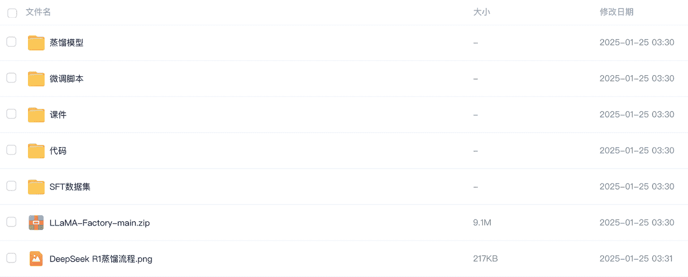

公开课全套学习资料，已上传至网盘（ https://pan.baidu.com/s/1UmKU0JmsrQ7Q0d5o302_dw?pwd=xmtp）

需要更系统深入学习大模型可扫码⬆️添加助教咨询喔～

## **一、模型蒸馏环境部署**

注：本次实验仍然采用Ubuntu操作系统，基本配置如下：

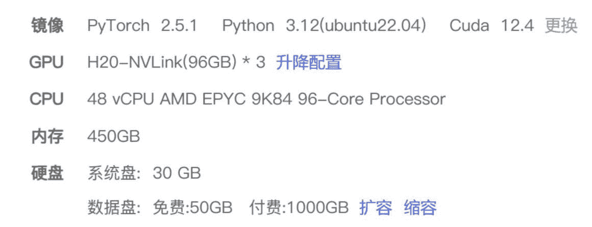

需要注意的是，本次公开课以Qwen 1.5-instruct模型为例进行蒸馏，从而能省略冷启动SFT过程，并且   由于Qwen系列模型本身性能较强，因此只执行后训练的SFT阶段，省略RL阶段。如此能够更高效的完成 蒸馏过程，但由于并不是从Base模型开始蒸馏，只能一定程度提升模型推理能力。这个简化的推理流程  仅作为公开课快速入门了解模型蒸馏场景使用。

+     创建虚拟环境

| conda create --name o1 python=3.11 |
| --- |

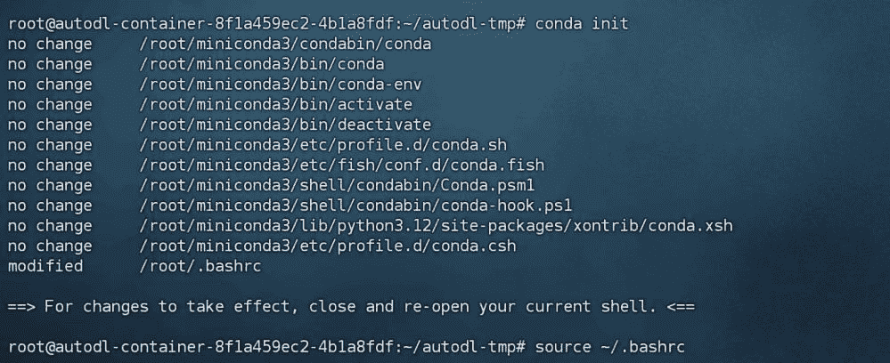

+     创建Jupyter Kernel

| conda install jupyterlab conda install ipykernel |
| --- |

+    安装wand

在大规模模型训练中，我们往往需要监控和分析大量的训练数据，而WandB可以帮助我们实现这一 目标。它提供了以下几个重要的功能：

**实时可视化**：WandB可以实时展示训练过程中关键指标的变化，如损失函数、学习率、训练时间等。通 过这些可视化数据，我们能够直观地了解模型的训练进展，快速发现训练中的异常或瓶颈。

**自动记录与日志管理**：WandB会自动记录每次实验的参数、代码、输出结果，确保实验结果的可追溯

性。无论是超参数的设置，还是模型的架构调整，  WandB都能够帮助我们完整保留实验记录，方便后期 对比与调优。

**支持中断与恢复训练**：在长时间的预训练任务中，系统中断或需要暂停是常见的情况。通过WandB的 checkpoint功能，我们可以随时恢复训练，从上次中断的地方继续进行，避免数据和时间的浪费。

**多实验对比**：当我们尝试不同的模型配置或超参数时， WandB允许我们在多个实验之间轻松进行对比分 析，帮助我们选择最优的模型配置。

**团队协作**：WandB还支持团队协作，多个成员可以共同查看实验结果，协同调试模型。这对研究和项目 开发中团队的合作非常有帮助。

注册wandb：https://wandb.ai/site

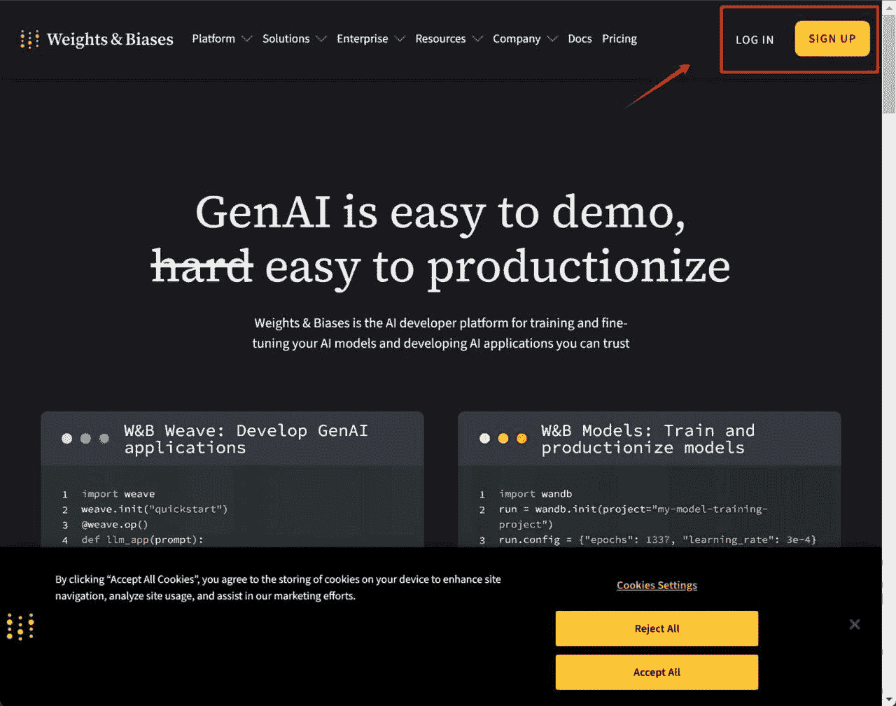

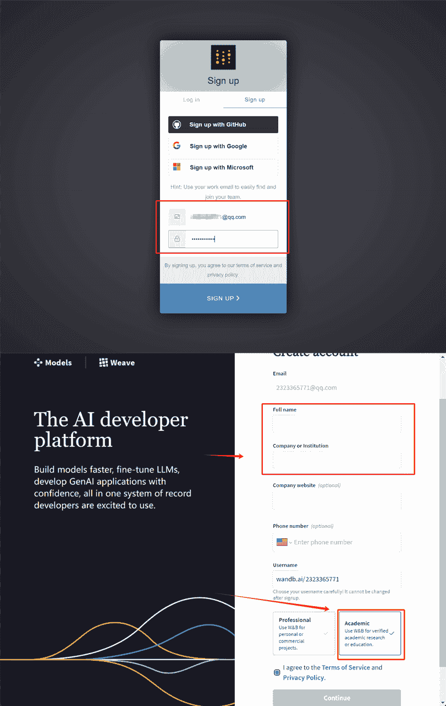

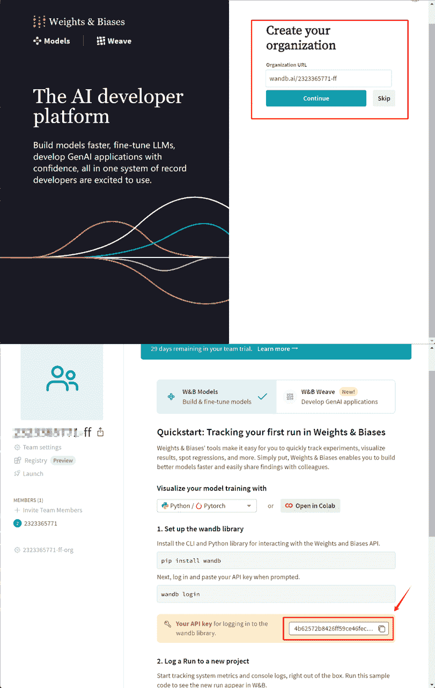

安装wandb：在命令行中输入如下代码安装wandb：

| pip install wandb |
| --- |

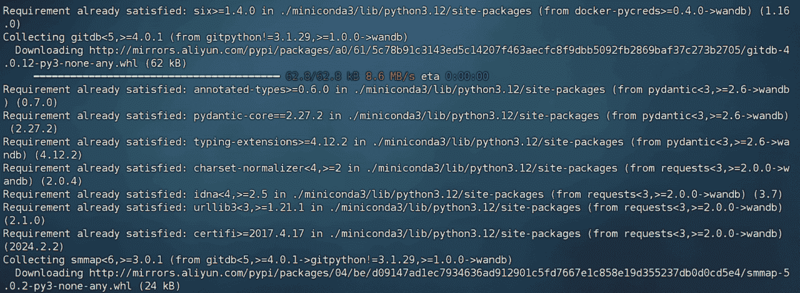

然后即可登录wandb，在命令行页面输入：

| wandb login |
| --- |

并根据提示输入API-KEY：

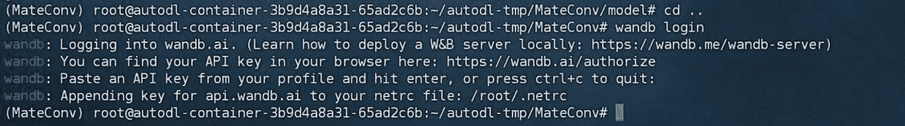

即可在当前电脑上保存wandb账号信息，之后即可直接在wandb home主页上看到训练过程。

注，登录信息会一直保留在当前服务器上，除非重置系统，否则不用重新登录。  wand显示信息类 似如下：

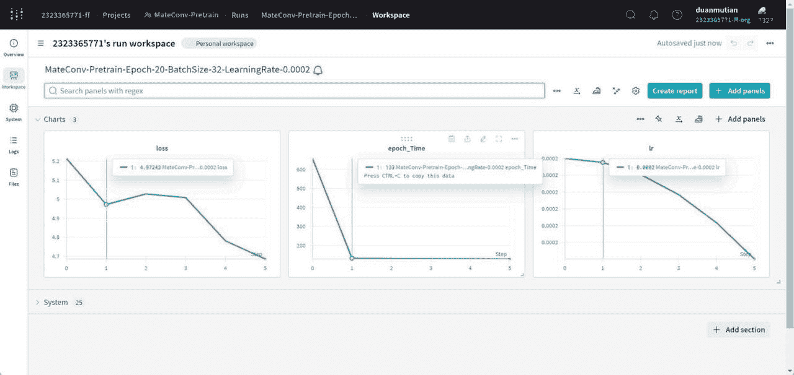

创建主目录：

| cd /root/autodl-tmp |
| --- |

下载原始模型： Qwen2.5-1.5B-Instruct

模型魔搭社区官网： [h](https://www.modelscope.cn/models/Qwen/Qwen2.5-1.5B-Instruct/)ttps://www.modelscope.cn/models/Qwen/Qwen2.5-1.5B-Instruct/

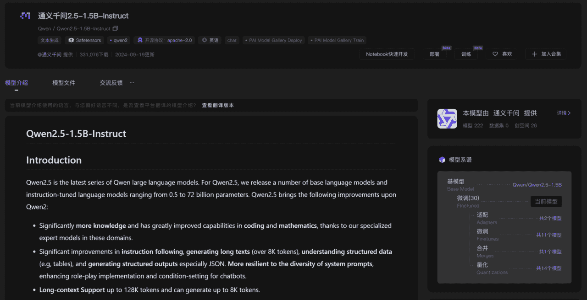

具体模型下载过程如下：

| pip install modelscope |
| --- |

| cd ./DeepSeek-R1-Distill |
| --- |

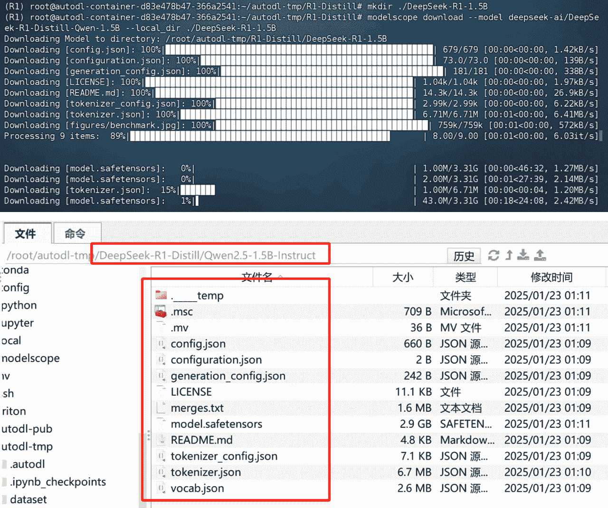

然后即可在Jupyter中尝试进行调用：

| from modelscope import AutoModelForCausalLM, AutoTokenizer |
| --- |

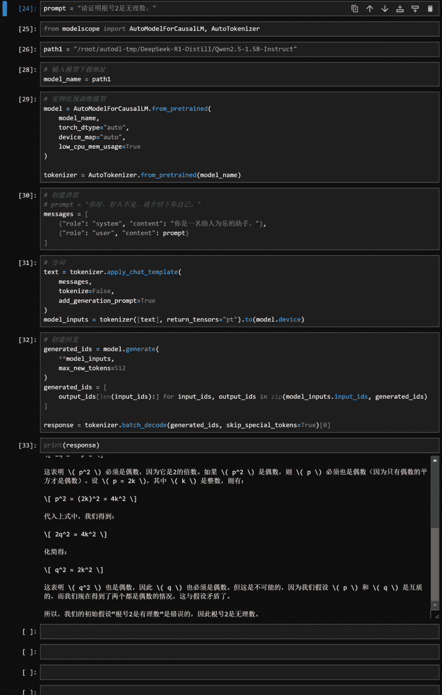

+     下载安装Llama-Factory

在SFT阶段，我们考虑直接使用Llama-Factory进行全量指令微调，因此这里需要提前安装Llama- Factory。

| cd /root/autodl-tmp/DeepSeek-R1-Distill |
| --- |

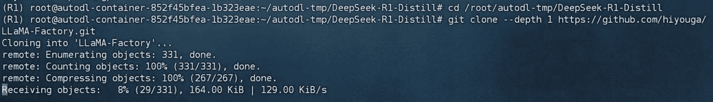

然后安装相关依赖

| cd LLaMA-Factory |
| --- |

## **二、模型蒸馏数据集准备**

这里我们先介绍可以用于模型蒸馏的数据集基本情况，最终我们将提供一个经过数据清洗后可直接 用于模型蒸馏的数据集。 https://huggingface.co/

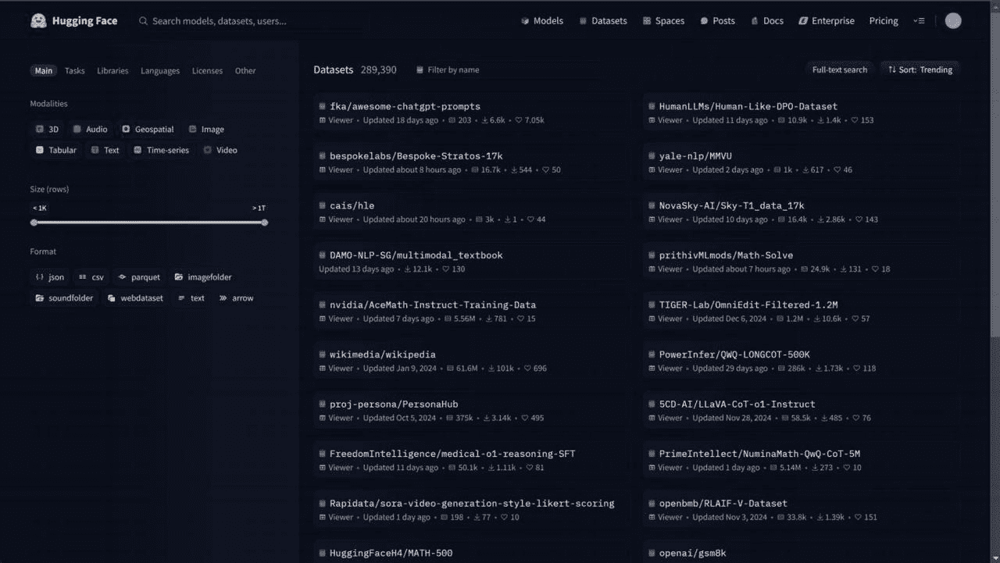

### **1.主流推理数据集介绍**

[1](https://huggingface.co/datasets/AI-MO/NuminaMath-CoT). NUMINA COT数据集： https://huggingface.co/datasets/AI-MO/NuminaMath-CoT

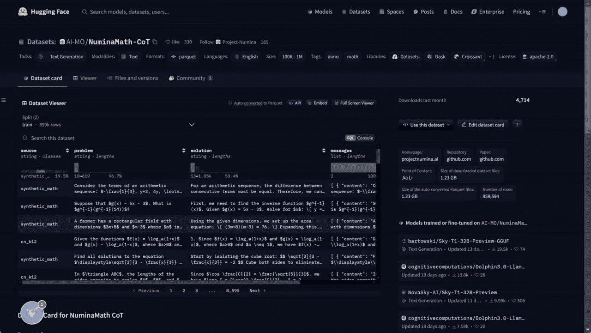

NuminaMath CoT 数据集是一个包含大约86万个数学问题和解决方案的集合，所有解决方案都采用了

“Chain of Thought”（ CoT）推理方式。该数据集广泛涵盖了从中国高中数学练习到美国及国际数学奥林  匹克竞赛问题的各种数学题目。数据主要来源于在线考试试卷的PDF文件和数学讨论论坛，经过多个处理 步骤整理而成。

+     数据集核心特性：

1. **大规模数学数据集**： NuminaMath CoT 包含约860,000个数学问题，覆盖了不同难度和领域的数学 题目。这些题目适合用于训练和评估能够进行逻辑推理和解题过程建模的机器学习模型。

2. **链式思维推理（CoT）格式**：每个数学问题的解决方案都被格式化为链式思维（Chain of

Thought ，CoT）推理过程。这意味着每个问题的解答不仅仅给出最终答案，而是展示了解题的完 整思路和推理过程，便于模型学习推理的逻辑。

3. **数据来源**：

+   **aops_forum**：来自美国数学奥林匹克论坛的样本（30,201个）。

+   **amc_aime**：来自美国数学竞赛（AMC）和AIME的样本（4,072个）。

+   **cn_k12**：来自中国K12教育阶段的数学题目（276,591个）。

+   **gsm8k** ：GSM8K数据集的样本（7,345个）。

+    **math**：通用数学问题样本（7,478个）。

+   **olympiads**：来自各类数学奥林匹克竞赛的题目（150,581个）。

+   **orca_math** ：ORCA数学竞赛题目样本（153,334个）。

+   **synthetic_amc** ：合成的AMC样本（62,111个）。

+   **synthetic_math**：合成的数学问题样本（167,895个）。

4. **处理流程**：

+   **OCR**：从原始PDF文档中提取数学题目。

+   **分割**：将数据分为问题-答案对。

+   **翻译**：将数据翻译成英文。

+   **重新对齐**：调整数据格式以生成CoT推理的格式。

+   **最终答案格式化**：整理每个问题的最终答案。

这条数据是一个数学问题及其解答，采用了"Chain of Thought"（ CoT，链式思维）格式，逐步展示了解 题过程。它包含了一个数学问题，并通过多个步骤展示了如何推理和求解问题。

+     单条数据集解释：

1. **问题描述（problem）**：

| Consider the terms of an arithmetic sequence: $-\frac{1}{3}, y+2, 4y, \ldots$. Solve for $y$. |
| --- |

这个问题给出了一个算术数列的前几项： $-\frac{1}{3}$、 $y+2$ 和 $4y$，要求求解 $y$ 的值。

2. **解题思路（solution）**：

+   **设定等式**：题目中提到，算术数列的相邻项之间的差值是相等的。根据这个性质，我们可以设 置等式来解这个问题。首先我们有：

| (y + 2) - \left(-\frac{1}{3}\right) = 4y - (y + 2) |
| --- |

这表示数列的第二项与第一项之差等于第三项与第二项之差。

+   **简化方程**：接下来我们简化并求解这个方程：

| y + 2 + \frac{1}{3} = 4y - y - 2 |
| --- |

这一步通过展开等式的右边和左边，开始化简。

+   **继续简化**：

| y + \frac{7}{3} = 3y - 2 |
| --- |

再次简化，合并同类项。

+   **求解** **$y$**：

| \frac{7}{3} + 2 = 3y - y |
| --- |

再继续化简，得到：

| \frac{13}{3} = 2y |
| --- |

最后，解出 $y$：

| y = \frac{13}{6} |
| --- |

3. **最终答案**： 通过以上的推理过程，我们得到了 $y = \frac{13}{6}$ ，这是问题的解答。 结构总结：

+   **source** ：问题的来源或类型，标记为“synthetic_math”，说明这是一个合成的数学问题。

+   **problem**：数学问题的描述，要求解算术数列中的未知数 $y$。

+   **solution** ：详细的解答过程，通过逐步的推理和简化来求解问题，最后得出答案。

+   **messages**：消息格式，包含了多轮用户输入和系统输出，模拟了一个互动式解题过程。

此外这个数据中， messages 是一个包含多条信息的列表，主要由两部分组成：用户（ user ）输入的消 息和系统（assistant）输出的消息。我们可以从中分辨出每一条消息的来源和内容。

messages 的构成：

| [ |
| --- |

消息解释：

+     第一条消息（用户消息）：

| { &quot;content&quot;: &quot;Consider the terms of an arithmetic sequence: $-\\frac{1}{3}, y+2, 4y, \\ldots$. Solve for $y$.&quot;, &quot;role&quot;: &quot;user&quot; } |
| --- |

+   这是用户提出的问题，要求解算术数列中的未知数 $y$。

+   role: "user" 表明这是用户的输入。

+     第二条消息（系统回答）：

| { &quot;content&quot;: &quot;For an arithmetic sequence, the difference between consecutive terms must be equal. Therefore, we can set up the following equations based  on the sequence given:\n\\[ (y + 2) - \\left(-\\frac{1}{3}\\right) = 4y - |
| --- |

+   这是系统的回复，展示了如何从问题中推理出解答的步骤，逐步通过方程求解出 $y = \frac{13}{6}$。

+   role: "assistant" 表明这是系统的输出（即模型的回答）。

2. APPs：[https://huggingface.co/data](https://huggingface.co/datasets/codeparrot/apps)sets/codeparrot/apps

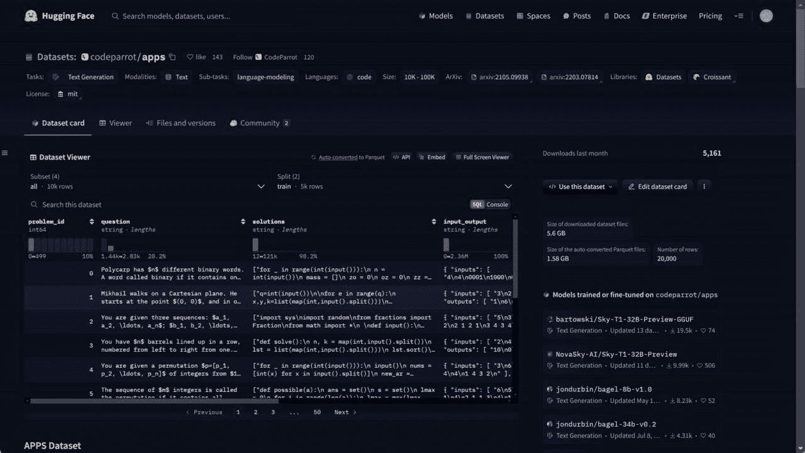

+   **APPS** **Dataset数据集介绍**

**APPS** (Automated Programming Problem Solving) 是一个用于编程任务的基准数据集，包含了10,000 个问题，旨在评估语言模型生成代码的能力，特别是从自然语言描述中生成代码的能力。它为基于自然  语言的代码生成、自动编程和相关任务的研究提供了一个标准化的测试平台。

+   **主要特点**

+   **编程问题：** 数据集中的每个问题都包含一个用英语表述的编程问题，并且有一组 Python 语言 的解决方案。问题涵盖从初学者到竞赛级别的各种难度。

+   **代码生成：** 该数据集的核心目标是评估语言模型是否能够根据问题描述生成正确的 Python 代 码解决方案。

+   **数据集包含：** 每个问题除了文本描述外，还包括测试用例、难度级别、问题来源（如 Codeforces 等）和部分 starter 代码。

+   **数据集结构**

| from datasets import |
| --- |

+   **数据结构**：该数据集包含 train 和 test  两个部分，每部分包含5000个样本。

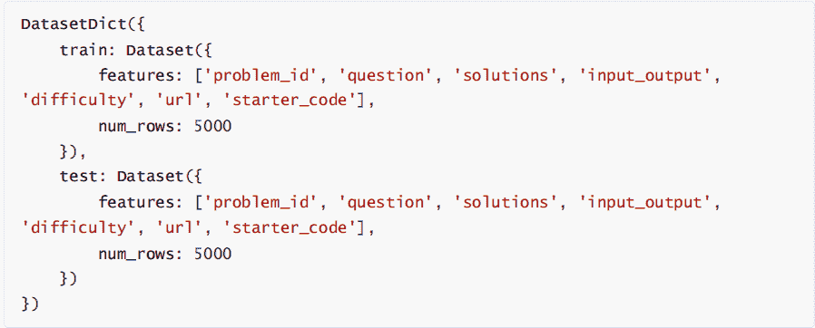

+   **字段说明**

+   **problem_id** : 问题ID。

+   **question** : 问题描述，通常是用英语写的编程问题。

+   **solutions**: 多个Python解决方案，通常是问题的不同解法。

+   **input_output**:包含输入输出样本的字典，可能还包括函数名（ fn_name ）。

+   **difficulty**: 问题的难度级别，可能包括  introductory（入门）、  interview （面试）和 competition （竞赛）等类别。

+   **url**: 问题的来源 URL，通常是在线编程平台（如 Co**deforces 等）。**    o   starter_code : 可能提供的起始代码，用于帮助编写完整的解决方案。

使用以下代码加载并处理训练集中的数据：

| from datasets import load_dataset |
| --- |

**输出示例**：

| { |
| --- |

+   **数据筛选**

你可以根据问题的难度筛选数据集。例如，如果你只想加载 competition 难度级别的问题：

| ds = load_dataset(&quot;codeparrot/apps&quot;, split=&quot;train&quot;, |
| --- |

**输出示例**：

| Codefortia is a small island country located somewhere in the West Pacific. It consists of $n$ settlements connected by |
| --- |

+     **数据集统计**

。 **问题数量：** 10,000个编程问题。

。 **测试用例数量：**** 131,777**个测试用例。 。 问题的平均长度： 约 293.2 字。

。 每个问题至少有一个测试用例，除了训练集中的195个样本。

。 **每个测试分割的平均测试用例数：**  21.2。

。 大部分问题都提供了完整的解决方案，测试集有1235个问题缺少解决方案。

下面是这个数据集中的一条示例数据：

+   **problem_id** : 0

唯一标识符为 0。

+   **question** :

| Polycarp has $n$ different binary words. A word called binary if it contains only characters &#x27;0&#x27; and &#x27;1&#x27;. For example, these words are binary: &quot;0001&quot;, |
| --- |

这个问题描述了一个关于二进制词汇的游戏，问题需要通过给定的二进制词汇顺序或反转它们，使 得最终的词汇集合能够符合游戏的规则。

+   **solutions**:

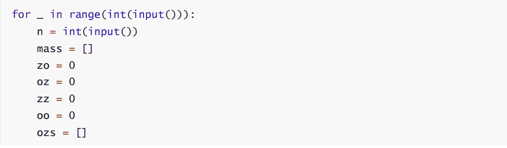

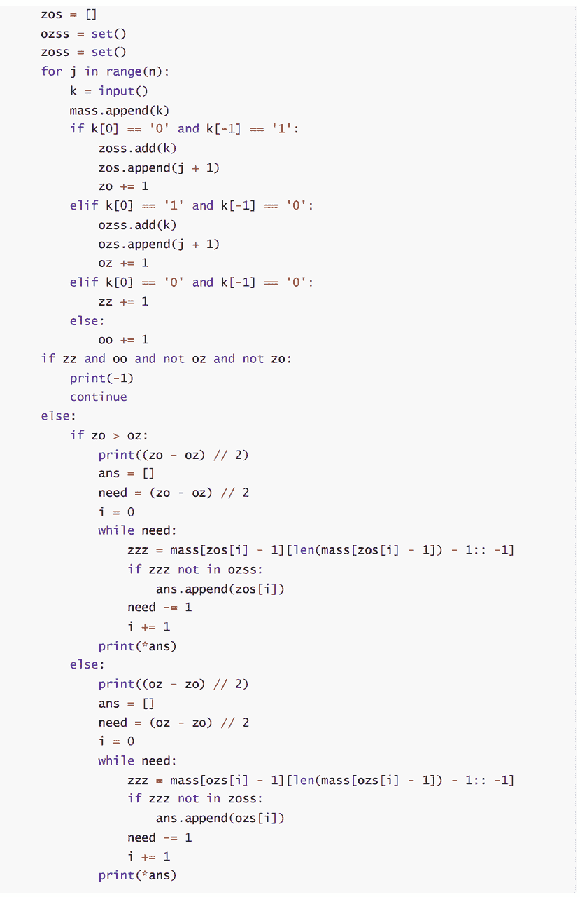

该代码段为 Python 编写，解决了上述问题。它通过对输入的二进制词汇进行分类（比如根据首尾

字符），并通过计算如何反转最少的词汇来满足题目要求。

+   **input_output**:

o   input

:

| 4 |
| --- |

o   output

:

| 1 |
| --- |

输入包括四个测试用例，每个测试用例有一组二进制字符串。输出给出了每个测试用例需要反转的 词汇索引或在无法满足条件时输出 -1。

+   **difficulty**:

+   "interview"：表示这个问题属于面试难度，通常适合用来测试候选人在面对编程挑战时的能力。

+   **url**:

+       Codeforces1259/D：问题的来源链接，可以通过这个链接访问该问题的详细信息。

+   **starter_code** :

+     空字符串 "" ，意味着该问题没有提供任何初始代码，只提供了问题描述和测试用例。

3. TACO数据集： [https://huggingface.c](https://huggingface.co/datasets/BAAI/TACO)o/datasets/BAAI/TACO

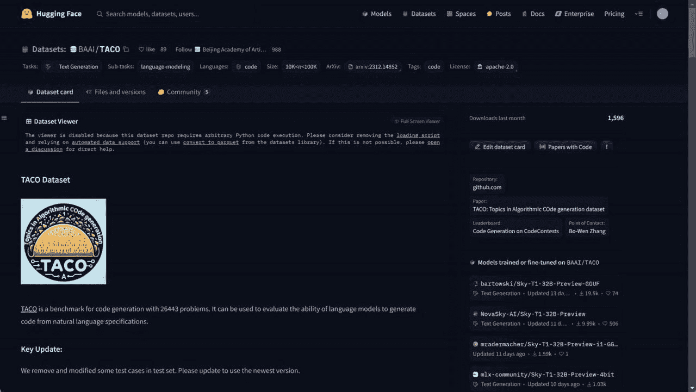

TACO（Text to Code）是一个用于评估语言模型从自然语言描述生成代码能力的基准数据集。它包含了 26,443个编程问题，配有Python代码解决方案，适用于代码生成、自然语言理解和问题求解等任务。

+   TACO 数据集的主要特点：

+     **问题与解决方案**：每个样本包含一个英文编程问题描述、 Python代码解决方案、测试用例

（输入/输出）以及相关的元数据（如难度、标签和所需技能类型）。

+   **语言**：问题描述使用英文，解决方案使用Python。

+   **数据集结构** ：数据集分为两部分：

+   **测试集**：包含1,000个样本。

+   **元数据**：每个问题还包含其他信息，如：

+   难度（EASY、 MEDIUM、 HARD等）

+   标签（例如：数据结构、算法）

+   所需技能类型（例如：动态规划、贪心算法）

+   解决问题的时间限制和内存限制

+   辅助空间和时间复杂度（如果有的话）

+   数据集字段：

+   **question** ：问题描述，采用英文写成。

+   **solutions**： Python解决方案的列表（地面真实答案）。

+   **input_output**：包含测试用例输入和输出的JSON字符串。

+   **difficulty**：问题的难度等级（如： EASY、 MEDIUM、 HARD）。

+   **raw_tags**：问题主题的原始标签（如：数据结构、贪心算法）。

+   **tags**：注释的算法或技术，描述解决该问题所需的算法。

+   **skill_types**：解决问题所需的编程技能类型（如：动态规划、贪心算法）。

+   **source**：问题的来源（如： Codeforces、 CodeChef）。

+   **url**：问题所在平台的URL。

+   **starter_code**：问题的起始代码，通常用于提示。

+   **time_limit**：解决问题的时间限制。

+   **memory_limit**：解决问题的内存限制。

+   **Expected** **Time** **Complexity**：预期的时间复杂度。

+   **Expected** **Auxiliary** **Space**：预期的辅助空间。

可以使用以下代码加载数据集：

| from datasets import load_dataset import json |
| --- |

示例输出：

| { |
| --- |

4. long_form_thought_data_5k数据集：

[h](https://huggingface.co/datasets/RUC-AIBOX/long_form_thought_data_5k)ttps://huggingface.co/datasets/RUC-AIBOX/long_form_thought_data_5k

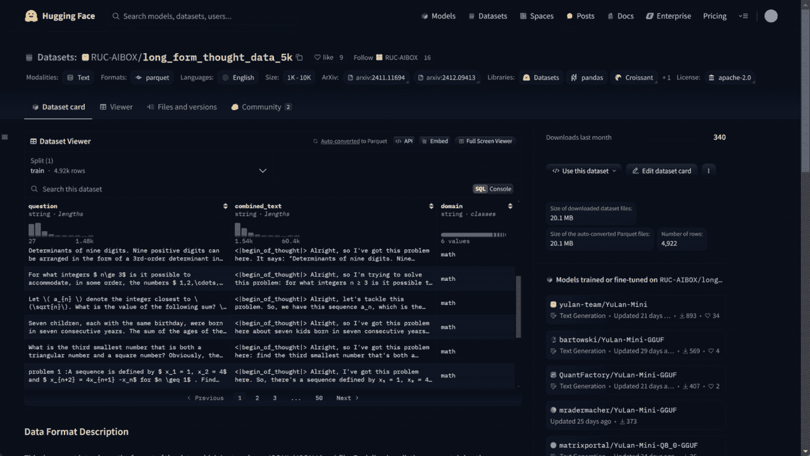

这个数据集名为 RUC-AI**BOX/l**o**ng_fo**r**m_thou**ght_data_5k，它存储了 JSONL (JSON Lines) 格式的数  据，每一行都是一个包含多个键值对的字典。下面是数据集的主要结构和内容：

+   数据字段

1. **question**：

+   这是模型所要解答的问题。问题可以是来自不同领域的各种类型，如数学、物理、化学等

2.**combined_text**：

+   该字段包含了模型的长篇思维过程和最终解决方案，分为两个部分：

+   **thought**：模型的长时间思考过程。这部分通常包含模型对问题的分析、推理过程，可 能会涉及到中间步骤、假设、推理的推导等。

+   **solution** ：模型给出的最终解决方案，这部分是针对问题的最终答案。

+   在 combined_text 字段中， <|begin_of_thought|> 和 <|end_of_thought|> 用来标记  思维过程的开始和结束，而 "<|begin_of_solution|>" 和 "<|end_of_solution|>" 用来 标记解决方案的开始和结束。

3. **domain**：

+   该字段指示问题的领域，包含以下类别：

+   **math**（数学）

+   **physics**（物理）

+   **chemistry**（化学）

+   **biology**（生物学）

+   **code**（编程）

+   **puzzle**（谜题）

+   每个问题都会被标记为一个特定的领域，以帮助分类和理解问题的性质。 示例数据

假设数据集中有这样一条记录：

| { |
| --- |

其中：

+   **question** : "How do you solve this equation?" 这是模型需要解答的数学问题。

+   combined_text:

+   **thought**: 用 <|begin_of_thought|> 和 <|end_of_thought|> 标记的部分，通常包含模型 对问题的思考过程。例如，模型可能会描述如何将方程式进行变形或如何选择适当的解法。

+   **solution**: 用 <|begin_of_solution|> 和 <|end_of_solution|> 标记的部分，这里会给出问题的最终解答，可能是方程的解，或者是其他形式的答案。

+   **domain**: "math" 这表明问题属于数学领域。

### **2.** **数据清洗过程**

**步骤** **0** （可选，仅适用于NUMINA数学数据集）

使用DeepSeekV3对NUMINA标注数学难度，偏难的数据集可以用于强化学习训练。

**步骤** **1：数据推理**

使用DeepSeek R1模型推理多个数据集的结果，即输入问题，输出思维链和模型推理结果

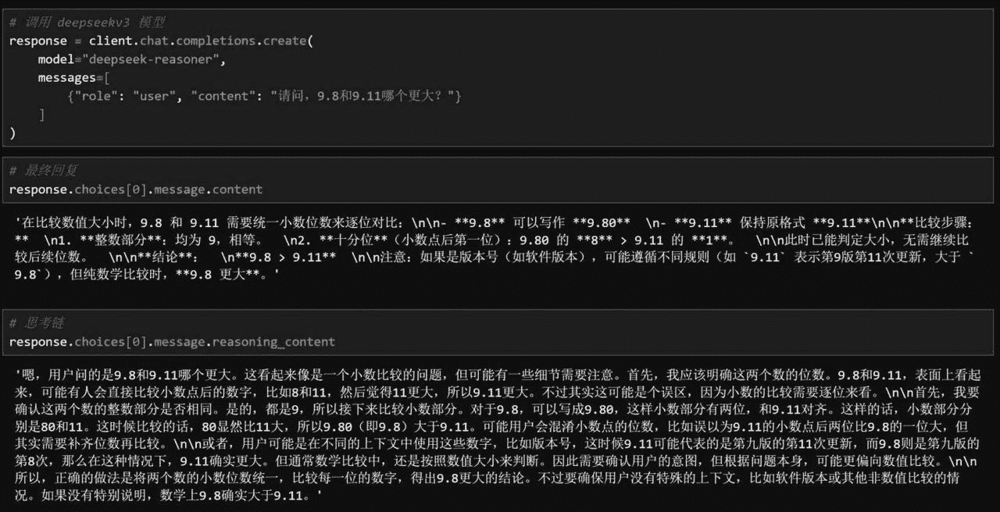

**步骤** **2：格式化响应**

获取训练数据列表文件后，将它们转换为统一的格式（注意：这一步使用DeepSeekV3进行重写，输出 较长，处理数据大约需要花费20-30元）。

**步骤** 3：对格式化后的数据进行拒绝采样

采用DeepSeekV3对比R1模型输出结果和答案之间差距，挑选回答正确的进行进行全量指令微调，回答 错误的内容则再次提示创建思维链，并带入到后续强化学习训练阶段。

为什么不采用完整的数据集进行全量指令微调？实际上是因为教师模型输出的结果更容易被学习。

### **3.** **数据集下载与准备**

在课件网盘中下载数据集： Distill_data_ 17k-train.arrow

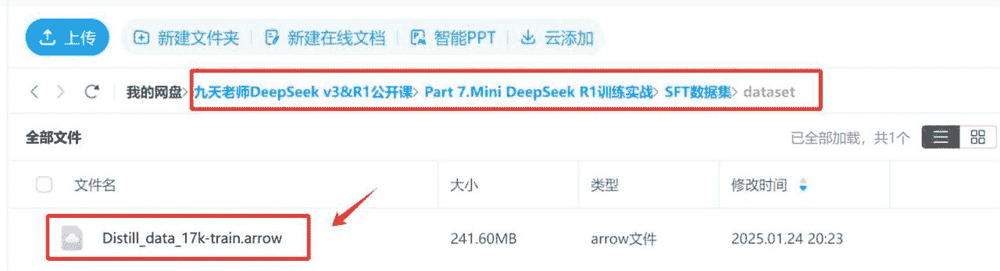

然后上传至主目录下的dataset文件夹内：

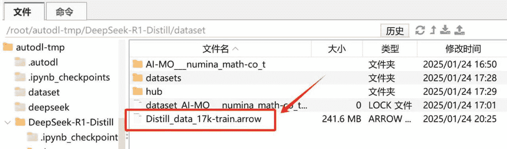

然后还需要在LLama-Factory中注册自定义数据集，找到dataset_info .json：

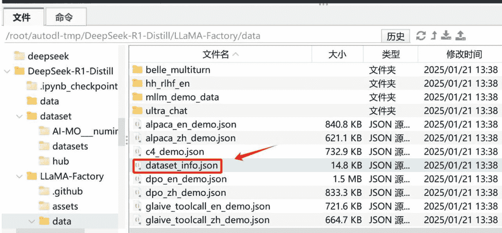

在最后面加上：

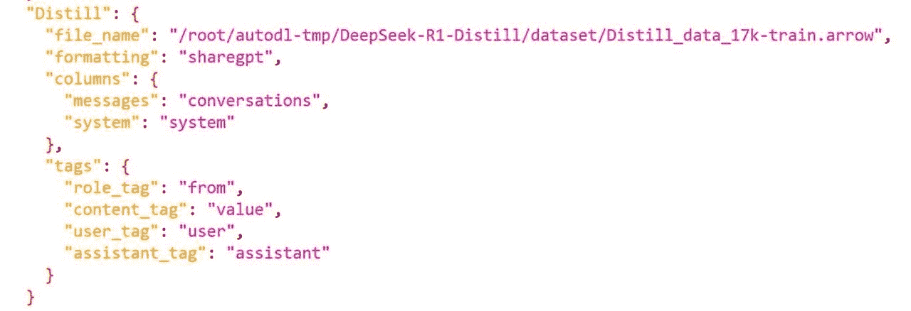

### **4.** **模型蒸馏过程**

+   上传微调脚本

脚本内容如下：

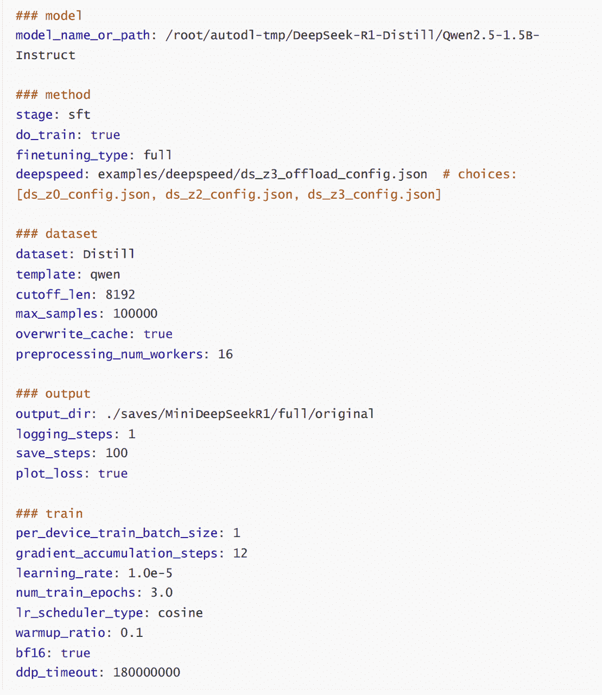

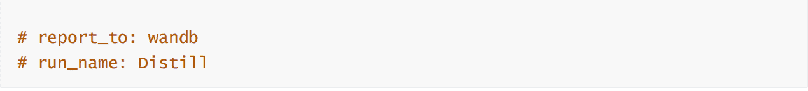

同样可以先在课件网盘中下载

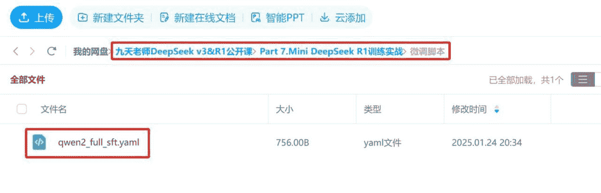

然后上传至exampl/train_full文件夹中即可：

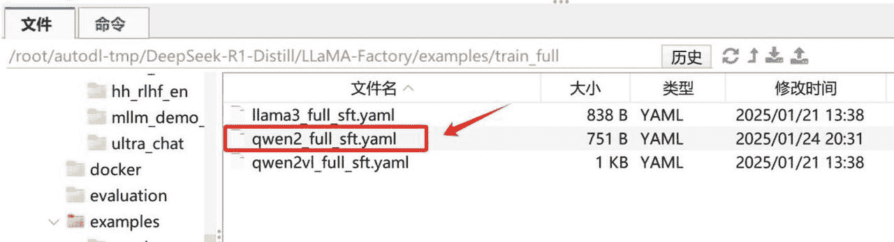

+   执行微调

最后即可使用Llama-Factory full脚本进行模型蒸馏，即进行全量指令微调：

| cd /root/autodl-tmp/DeepSeek-R1-Distill/LLaMA-Factory |
| --- |

总公约需要运行10个小时左右：

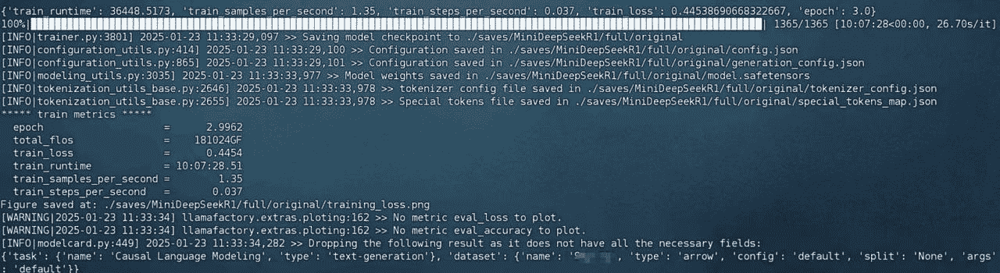

最终训练结果保存如下：

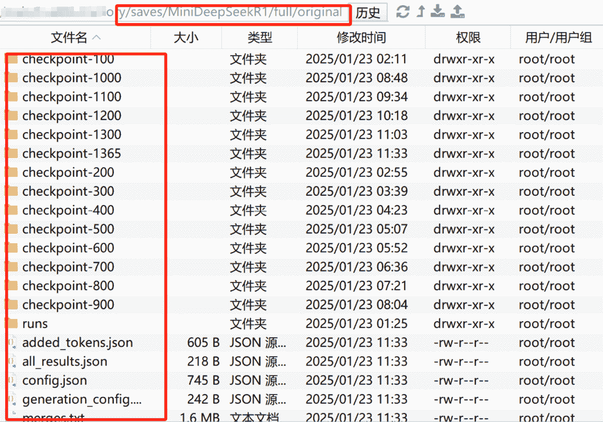

模型权重也可直接在课件网盘中下载：

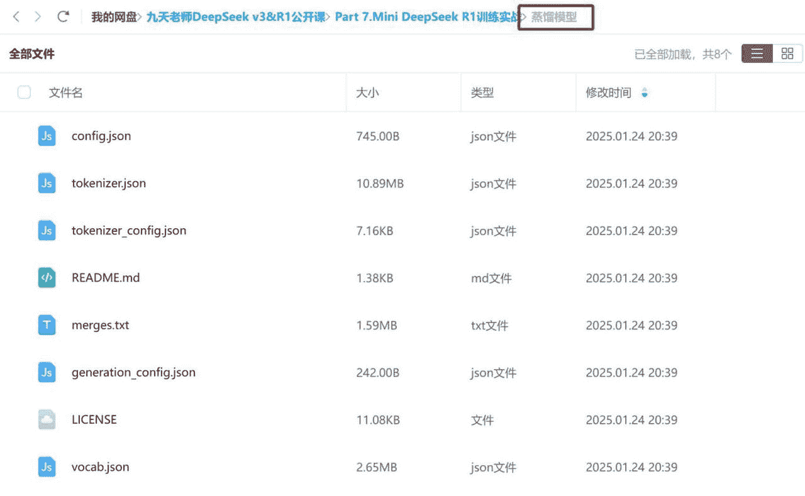

## **四、调用测试**

| # 测试问题 |
| --- |

+     普通模型

| from modelscope import AutoModelForCausalLM, AutoTokenizer |
| --- |
|  |
| 你可以使用以下  Bash 脚本来实现这个功能： |

+     蒸馏模型

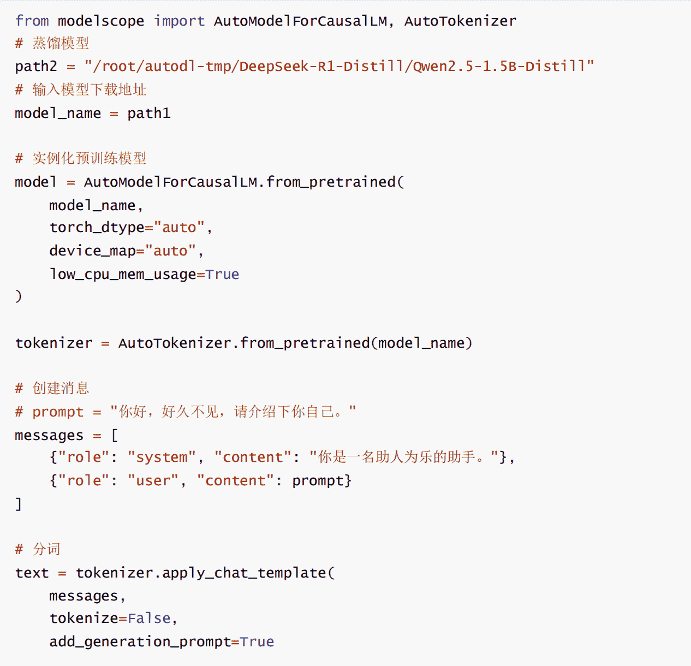

| ) |
| --- |
|  |
| 要编写一个  Bash 脚本来处理这样的任务，我们需要按照以下步骤操作： |

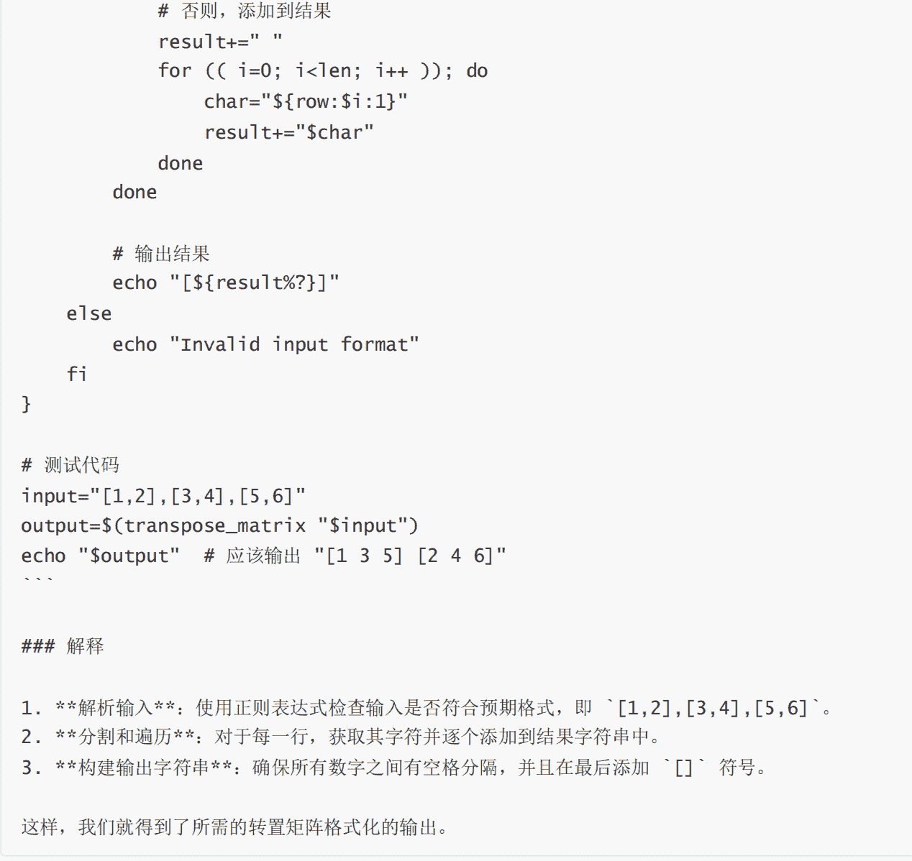