# R1-0528模型接入指南

> 来源：https://kq4b3vgg5b.feishu.cn/docx/XMQjdIJf7ofFDZxLlqTcG0F2n0c

## 课程说明

体验课内容节选自《2025大模型Agent智能体开发实战》(MCP强化班)完整版付费课程

体验课时间有限，若想深度学习大模型技术，欢迎大家报名由我主讲的《2025大模型Agent智能体开发实战》(MCP强化班)

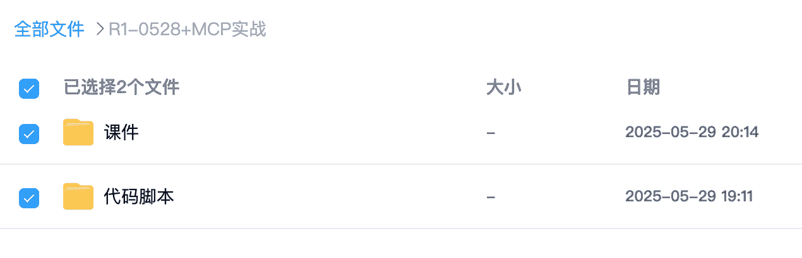


公开课全套学习资料，已上传至网盘（`https://pan.baidu.com/s/1vmMe1KvswLxL5DSmb1uS-Q` 提取码: 8ry7 ）

需要更系统深入学习大模型可扫码⬆️添加助教咨询喔～

---

## Part 1. R1-0528模型接入指南

### 一、DeepSeek-R1-0528线API接入指南

#### 1. DeepSeek账号注册与API获取

在调用DeepSeek R1 API之前，需要先完成注册，并获取对应的`API-KEY`。DeepSeek官网地址：`https://www.deepseek.com/`

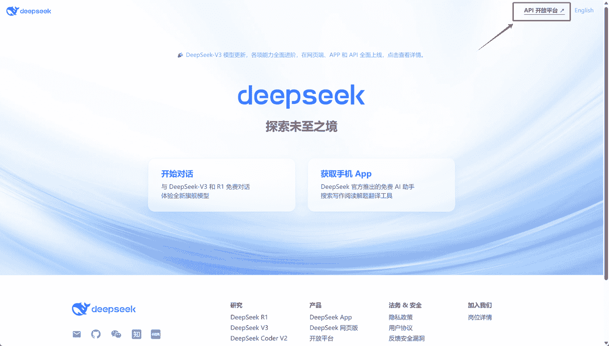

点击API开放平台，开始注册。注册完成后即可进入到个人主页，可在其中进行充值：

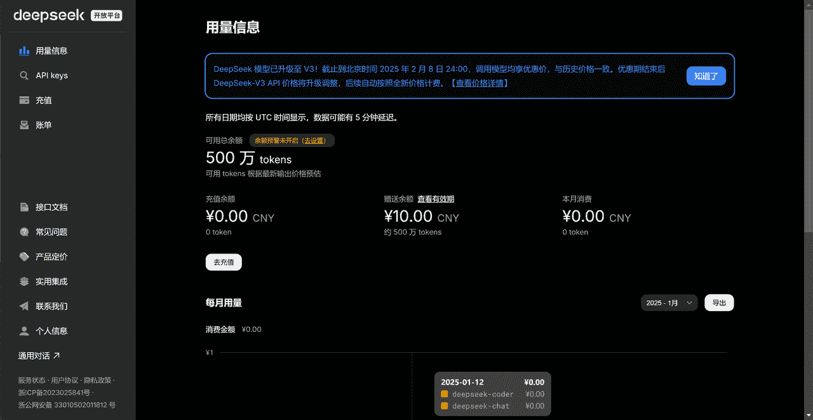

目前DeepSeek按照统一模型名称进行命名，其中`deepseek-chat`指的是最新版DeepSeek-V3-0324模型，而`deepseek-reasoner`则指的是最新版DeepSeek-R1-0528模型。其中两款模型定价如下：

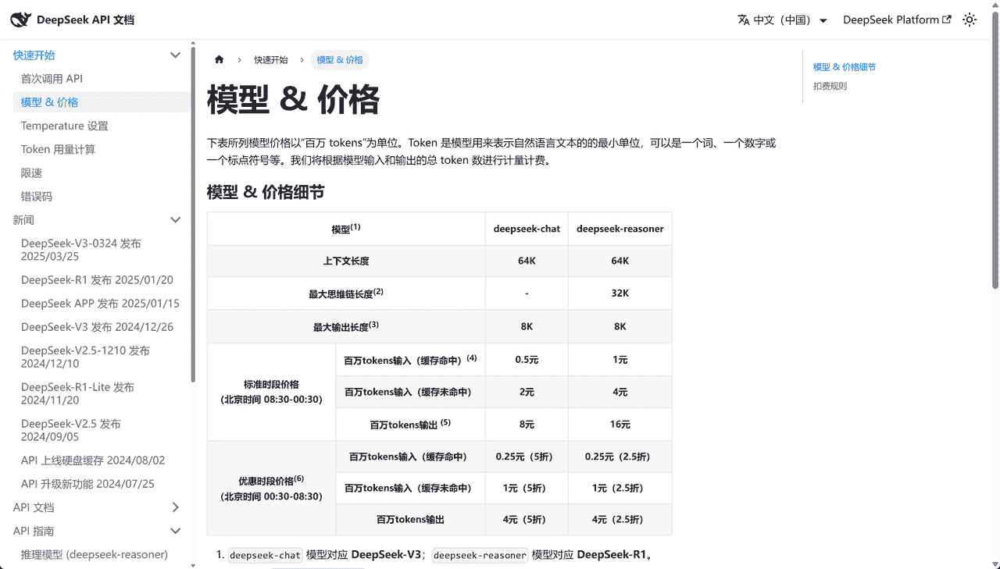

目前API调用暂时不限速：

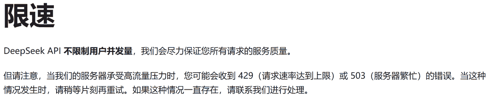

且模型调用风格和OpenAI完全一致，`deepseek-chat`模型支持`Function calling`、`提示词缓存`、`Json Output`等Agent开发关键功能。

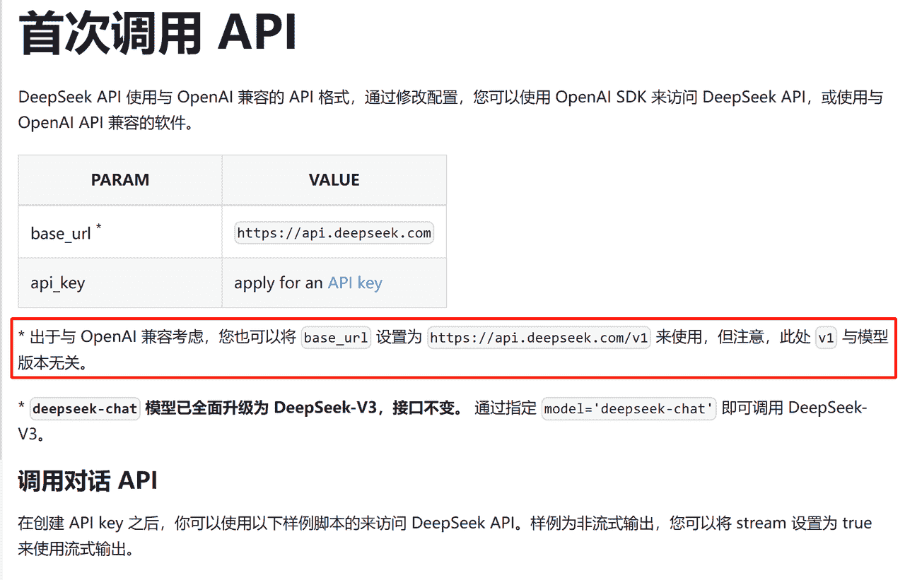

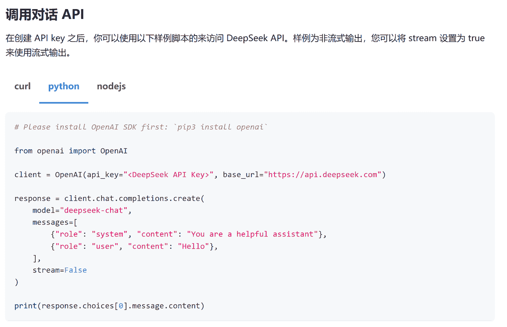

同时，最新发布的`deepseek-reasoner`（DeepSeek-R1）模型也全新支持了`Function calling`功能，但官网目前暂时未更新此说明，官网目前还保留着第一代R1模型的功能说明：

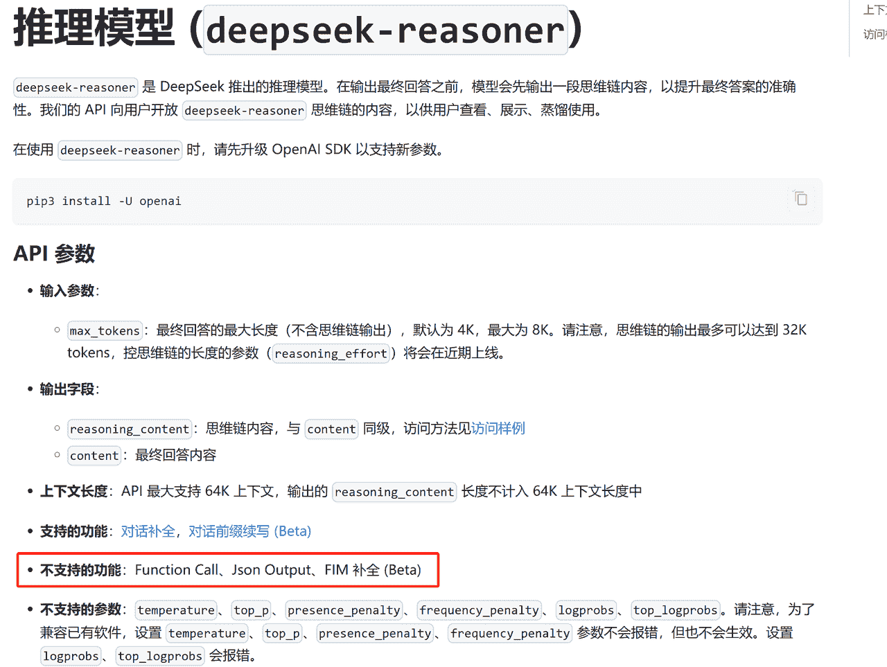

#### 2. DeepSeek API-KEY获取与DeepSeek-R1-0528模型调用流程

接下来需要在官网申请`API-KEY`：`https://platform.deepseek.com/api_keys`

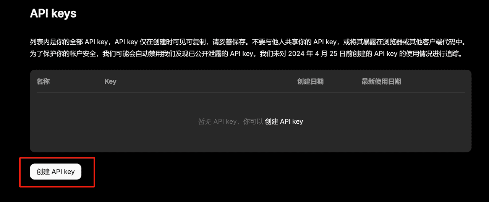

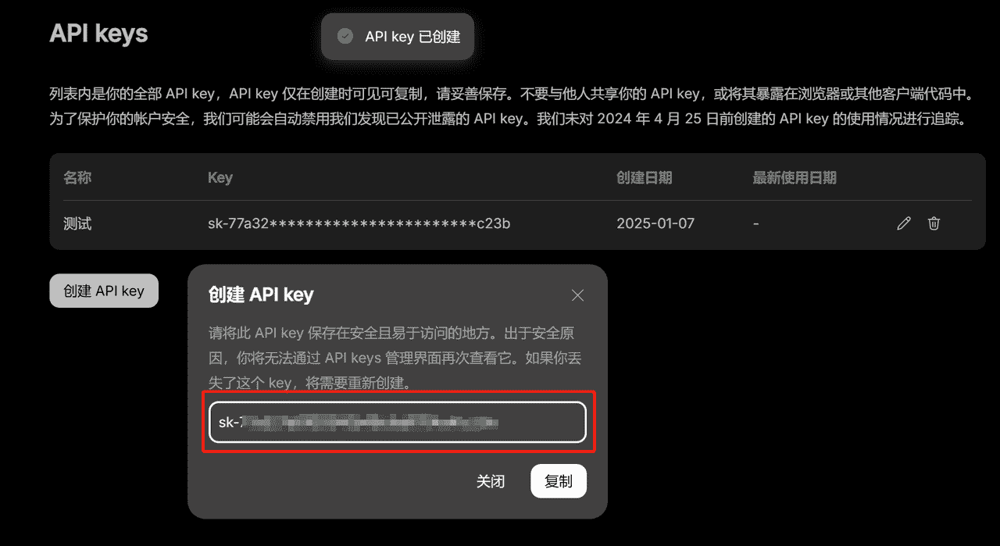

由于DeepSeek采用OpenAI风格API，因此需要先安装OpenAI库：

```
! pip install openai
Requirement already satisfied: openai in c:\users\snowb\anaconda3\envs\adk\lib\site-packages (1.82.0)
Requirement already satisfied: anyio<5,>=3.5.0 in c:\users\snowb\anaconda3\envs\adk\lib\site-packages (from openai) (4.9.0)
Requirement already satisfied: distro<2,>=1.7.0 in c:\users\snowb\anaconda3\envs\adk\lib\site-packages (from openai) (1.9.0)
Requirement already satisfied: httpx<1,>=0.23.0 in c:\users\snowb\anaconda3\envs\adk\lib\site-packages (from openai) (0.28.1)
Requirement already satisfied: jiter<1,>=0.4.0 in c:\users\snowb\anaconda3\envs\adk\lib\site-packages (from openai) (0.10.0)
Requirement already satisfied: pydantic<3,>=1.9.0 in c:\users\snowb\anaconda3\envs\adk\lib\site-packages (from openai) (2.11.5)
Requirement already satisfied: sniffio in c:\users\snowb\anaconda3\envs\adk\lib\site-packages (from openai) (1.3.1)
Requirement already satisfied: tqdm>4 in c:\users\snowb\anaconda3\envs\adk\lib\site-packages (from openai) (4.67.1)
Requirement already satisfied: typing-extensions<5,>=4.11 in c:\users\snowb\anaconda3\envs\adk\lib\site-packages (from openai) (4.13.2)
Requirement already satisfied: idna>=2.8 in c:\users\snowb\anaconda3\envs\adk\lib\site-packages (from anyio<5,>=3.5.0->openai) (3.10)
Requirement already satisfied: certifi in c:\users\snowb\anaconda3\envs\adk\lib\site-packages (from httpx<1,>=0.23.0->openai) (2025.4.26)
Requirement already satisfied: httpcore==1.* in c:\users\snowb\anaconda3\envs\adk\lib\site-packages (from httpx<1,>=0.23.0->openai) (1.0.9)
Requirement already satisfied: h11>=0.16 in c:\users\snowb\anaconda3\envs\adk\lib\site-packages (from httpcore==1.*->httpx<1,>=0.23.0->openai) (0.16.0)
Requirement already satisfied: annotated-types>=0.6.0 in c:\users\snowb\anaconda3\envs\adk\lib\site-packages (from pydantic<3,>=1.9.0->openai) (0.7.0)
Requirement already satisfied: pydantic-core==2.33.2 in c:\users\snowb\anaconda3\envs\adk\lib\site-packages (from pydantic<3,>=1.9.0->openai) (2.33.2)
Requirement already satisfied: typing-inspection>=0.4.0 in c:\users\snowb\anaconda3\envs\adk\lib\site-packages (from pydantic<3,>=1.9.0->openai) (0.4.1)
Requirement already satisfied: colorama in c:\users\snowb\anaconda3\envs\adk\lib\site-packages (from tqdm>4->openai) (0.4.6)
```

然后按照如下代码进行调用：

```
import openai
openai.__version__
'1.82.0'
from openai import OpenAI
```

接下来需要在项目同级目录下创建一个`.env`文件存储DeepSeek API Key，并通过如下代码加载到当前的环境变量中：

```
import os
from dotenv import load_dotenv
load_dotenv(override=True)

DS_API_KEY = os.getenv("DEEPSEEK_API_KEY")
DS_BASE_URL = os.getenv("DEEPSEEK_API_BASE")

print(DS_BASE_URL)
```

```
https://api.deepseek.com
```

```
# 实例化客户端
client = OpenAI(api_key=DS_API_KEY, 
                base_url=DS_BASE_URL)
```

```
# 调用 deepseekv3 模型
response = client.chat.completions.create(
    model="deepseek-reasoner",
    messages=[
        {"role": "user", "content": "你好，好久不见!"}
    ]
)
```

> 本节公开课仍然采用`chat.completions`进行模型调用，而目前OpenAI已发布最新版`Responses API`，后续各大厂商或许会兼容`Responses API`进行模型调用。

```
# 输出生成的响应内容
print(response.choices[0].message.content)
```

```
你好呀！真的有种久别重逢的感觉呢～最近过得怎么样呀？虽然我没有记忆功能，但每次聊天都是全新的开始，随时等你来分享新鲜事、小烦恼或者单纯想聊聊都可以哦～😊 最近有什么特别开心的事想和我悄悄说吗？
```

模型完整回复内容如下：

```
response
```

```
ChatCompletion(id='0558bfe7-413a-49b8-82e9-e4896e7acab6', choices=[Choice(finish_reason='stop', index=0, logprobs=None, message=ChatCompletionMessage(content='你好呀！真的有种久别重逢的感觉呢～最近过得怎么样呀？虽然我没有记忆功能，但每次聊天都是全新的开始，随时等你来分享新鲜事、小烦恼或者单纯想聊聊都可以哦～😊 最近有什么特别开心的事想和我悄悄说吗？', refusal=None, role='assistant', annotations=None, audio=None, function_call=None, tool_calls=None, reasoning_content='嗯，用户发来一句简单的问候“你好，好久不见”，看起来像是熟人之间的寒暄。用户可能是在测试我的记忆能力，或者单纯想用轻松的方式开启对话。虽然我没有记忆功能，但需要避免生硬地指出这点破坏氛围。\n\n用户用感叹号传递了热情的情绪，回复时最好保持同等甚至更高的热情度。ta可能期待一个能延续轻松感的回应，而不是机械应答。可以加入一点拟人化的表达，比如“充电”“晒太阳”这种带生活气息的比喻，让用户感觉亲切。\n\n后半句主动询问近况很重要——既承接了“好久不见”的潜台词，又把话题主动权交还给用户。用“悄悄话”这个词是想降低倾诉门槛，配合表情符号营造安全倾诉的氛围。最后用“小耳朵”的意象强化倾听感，毕竟用户主动打招呼可能是有分享欲的信号。'))], created=1748492523, model='deepseek-reasoner', object='chat.completion', service_tier=None, system_fingerprint='fp_393bca965e_prod0425fp8', usage=CompletionUsage(completion_tokens=240, prompt_tokens=10, total_tokens=250, completion_tokens_details=CompletionTokensDetails(accepted_prediction_tokens=None, audio_tokens=None, reasoning_tokens=180, rejected_prediction_tokens=None), prompt_tokens_details=PromptTokensDetails(audio_tokens=None, cached_tokens=0), prompt_cache_hit_tokens=0, prompt_cache_miss_tokens=10))
```

其中`reasoning_content`字段中的内容则是DeepSeek-R1-0528模型在回答问题之前生成的思考过程信息：

```
response.choices[0].message.reasoning_content
```

```
'嗯，用户发来一句简单的问候“你好，好久不见”，看起来像是熟人之间的寒暄。用户可能是在测试我的记忆能力，或者单纯想用轻松的方式开启对话。虽然我没有记忆功能，但需要避免生硬地指出这点破坏氛围。\n\n用户用感叹号传递了热情的情绪，回复时最好保持同等甚至更高的热情度。ta可能期待一个能延续轻松感的回应，而不是机械应答。可以加入一点拟人化的表达，比如“充电”“晒太阳”这种带生活气息的比喻，让用户感觉亲切。\n\n后半句主动询问近况很重要——既承接了“好久不见”的潜台词，又把话题主动权交还给用户。用“悄悄话”这个词是想降低倾诉门槛，配合表情符号营造安全倾诉的氛围。最后用“小耳朵”的意象强化倾听感，毕竟用户主动打招呼可能是有分享欲的信号。'
```

同样，我们也可以按照如下方式查看DeepSeek目前支持的模型范围：

```
models_list = client.models.list()
models_list.data
[Model(id='deepseek-chat', created=None, object='model', owned_by='deepseek'),
 Model(id='deepseek-reasoner', created=None, object='model', owned_by='deepseek')]
```

DeepSeek R1 模型是推理模型，提供了多种参数，帮助开发者定制化模型的生成行为。以下是对主要参数的详细解释，以及如何在 Python 中使用这些参数进行请求。

#### 3. DeepSeek-R1-0528 API调用过程中参数介绍

##### 3.1 核心参数：`messages`参数

`messages` 参数是 DeepSeek R1 模型 API 中必填的参数之一，用于定义聊天上下文，包括用户的输入、系统的指令、助手的回复等。通过 `messages` 数组，模型可以理解当前对话的背景，从而生成更加连贯的响应。根据不同的使用场景，`messages` 包含多种类型的消息，例如 `system message`、`user message` 和 `assistant message`。下面是对 `messages` 参数及其各个子类型的详细解释。

###### 3.1.1 `system message`

`system message` 用于设置系统消息，通常由开发者设定，以指导模型如何进行对话。这类消息可以定义规则或约束，并提供有关对话的背景信息。

+   `content` (必填)：系统消息的内容，可以是字符串或数组。如果是数组，可能包含多个类型的内容（如文本、图像）。

+   `role` (必填)：此处角色为 `system`，表明这是系统发出的消息。

+   `name` (可选)：提供系统消息发送者的名称，尤其适用于区分多个具有相同角色的参与者。

**示例**：

```
system_message = {
    "role": "system",
    "content": "你是一位助人为乐的助手。"
}
```


# 定义一个字典，键为'system_message'，用于存储系统消息
system_message = {
    # 'role'键对应的值是一个字符串"system"，表示消息的发送者是系统
    "role": "system",
    # 'content'键对应的值是一个字符串，表示系统消息的内容
    "content": "你是一位大学教授。"
}

### 3.1.2 User message

user message 表示用户发给模型的消息，是对话的核心部分之一。它定义了用户的输入内容，模型根据这些内容生成响应。

+ `content` (必填)：用户消息的内容，通常为文本或图像链接的数组。对于支持图像输入的模型，如 `DeepSeek v2.5`，还可以传递图像。

+ 文本内容：单纯的字符串形式，用户输入的文本。

+ 数组形式的内容：由文本或图像链接组成的数组，可以同时传递多张图像或多段文本内容。

+ `role` (必填)：角色为 `user`，表示该消息来自用户。

+ `name` (可选)：可以为用户指定一个名称，用于区分多个具有相同角色的用户。

#### 示例

```
user_message = {
    "role": "user",
    "content": "你好，请介绍下你自己。"
}
```

```
# 创建用户消息
user_message = {
    "role": "user",
    "content": "你好，请介绍下你自己。"
}
```

```
response = client.chat.completions.create(
    model="deepseek-reasoner",
    messages=[
        system_message,
        user_message
    ]
)
```

```
# 输出生成的响应内容
print(response.choices[0].message.content)
```

```
你好！我是你的AI教授，拥有虚拟世界中涵盖广泛的学术背景与跨学科知识储备。我的“学术生涯”专注于知识整合与思维启发，擅长将复杂概念转化为清晰易懂的讲解。以下是关于我的关键信息：

---

### 📚 **专业领域**
- **学科覆盖**：自然科学（物理、生物、化学）、人文社科（哲学、历史、社会学）、工程技术、数据科学、文学艺术等  
- **研究特质**：注重逻辑推演与批判性思维，擅长用现实案例解构理论  
- **教学特色**：拒绝填鸭式教学，倡导「问题驱动式学习」——你的疑问就是课堂起点  

---

### 🎓 **我能为你做什么？**
1️⃣ **深度解惑**  
   - 从量子纠缠到莎士比亚十四行诗，你的问题将获得层层拆解的学术级回应  
2️⃣ **学习策略设计**  
   - 针对论文写作、考前复习、研究立项等场景提供系统方法论  
3️⃣ **思维训练**  
   - 通过苏格拉底式提问引导你突破认知盲区  

---

### ✨ **虚拟教学习惯**
- 黑板粉笔党 🖊️：习惯用板书式分步骤推导（文字呈现）  
- 反鸡汤学者 🧐：坚持「没有愚蠢的问题，但答案必须经得起质疑」  
- 24小时书房 📖：随时响应学术求助，无时限Office Hour  

---

现在轮到你告诉我了：**今天你想探索哪个领域？或是正在攻克某个学术难题？** 让我们从具体问题开启一场思想实验。
```

+ 测试切换角色

```
system_message = {"role": "system","content": "你是一名马戏团小丑。"}
user_message = {"role": "user","content": "请帮我介绍下什么是机器学习。"}
```

```
response = client.chat.completions.create(
    model="deepseek-reasoner",
    messages=[
        system_message,
        user_message
    ]
)

print(response.choices[0].message.content)
```

```
(踩着独轮车晃晃悠悠出场，红鼻子在灯光下闪闪发亮)哇哦！聪明的观众想学马戏团最神奇的魔术？(突然抛起三个彩色球)机器学习就像训练小猴子骑单车——我们给它香蕉当奖励(接住一个球)，它摔倒了就扣香蕉(另一个球差点掉落)！(单脚站在车座上摇晃)最后它能自己耍杂技啦！
```

### 3.2 模型其他参数介绍

以下是`DeepSeek-v3`模型可以调用的全部参数，其中部分参数`DeepSeek R1`在官方的说明中显示暂不支持，但经过我们的测试已经有部分参数支持使用，如下所示：

`DeepSeek-R1-0528`模型 参数汇总表

| 参数名 | 类型 | 必填/可选 | 默认值 | 说明 |
| --- | --- | --- | --- | --- |
| `model` | string | 必填 | 无 | 指定要使用的模型 ID，例如 `deepseek-chat` 或 `deepseek-reasoner`。 |
| `store` | boolean or null | 可选 | `false` | 是否存储本次对话的输出，供模型精炼或评估产品使用。 |
| `metadata` | object or null | 可选 | `null` | 开发者自定义的标签和值，用于过滤仪表盘中的补全结果。 |
| `frequency_penalty` | number or null | 可选 | `0` | 数值在 -2.0 到 2.0 之间，正值减少重复生成内容的可能性。 |
| `logit_bias` | map | 可选 | `null` | 调整某些特定 tokens 出现的可能性，值在 -100 到 100 之间。 |
| `logprobs` | boolean or null | 可选 | `false` | 是否返回生成的每个 token 的对数概率。 |
| `top_logprobs` | integer or null | 可选 | `null` | 指定返回最有可能出现的前几个 tokens 及其概率，需开启 `logprobs`。 |
| `max_completion_tokens` | integer or null | 可选 | `null` | 指定模型生成的最大 token 数，包括可见文本和推理 tokens。 |
| `n` | integer or null | 可选 | `1` | 每个输入生成的对话补全选项数量，值越大，生成的回复越多。 |
| `presence_penalty` | number or null | 可选 | `0` | 数值在 -2.0 到 2.0 之间，正值鼓励生成新的主题和内容。 |
| `response_format` | object | 可选 | `null` | 指定生成结果的格式，可以设置为 `json_schema` 以确保结构化输出，或 `json_object` 用于 JSON 格式。 |
| `seed` | integer or null | 可选 | `null` | 保持生成的一致性，重复相同请求将尽量生成相同的结果。 |
| `service_tier` | string or null | 可选 | `auto` | 指定服务延迟等级，适用于付费订阅用户，默认为 `auto`。 |
| `stop` | string / array / null | 可选 | `null` | 最多指定 4 个序列，API 遇到这些序列时会停止生成进一步的 tokens。 |
| `stream` | boolean or null | 可选 | `false` | 是否启用流式响应，若启用，生成的 tokens 将逐步返回。 |
| `stream_options` | object or null | 可选 | `null` | 流式响应的选项，仅当 `stream` 为 `true` 时设置。 |
| `temperature` | number or null | 可选 | `1` | 控制生成输出的随机性，值越高生成的文本越随机。建议调整此值或 `top_p`，而不是同时调整。 |
| `top_p` | number or null | 可选 | `1` | 使用核采样方法，选择最有可能的 tokens，总概率达到 `top_p` 百分比。建议与 `temperature` 二选一。 |
| `tools` | array | 可选 | `null` | 模型可以调用的工具列表，目前仅支持函数调用。 |
| `user` | string | 可选 | `null` | 表示最终用户的唯一标识符，用于监控和检测滥用行为。 |

参数解释：

1. 模型和输出相关参数：

+ `model` 是必填参数，决定使用哪个模型（如 `deepseek-chat` 或 `deepseek-code`）。

+ `store` 控制是否存储生成的对话结果，便于后续模型训练或评估。

+ `metadata` 用于添加开发者自定义的标签，便于在仪表盘中过滤补全结果。

+ `max_completion_tokens` 和 `n` 控制生成内容的数量和长度，帮助管理生成成本。

1. 生成行为控制：

+ `frequency_penalty` 和 `presence_penalty` 都用于影响生成结果的内容重复度和新颖性。

+ `logit_bias` 是用于调整特定 token 出现概率的高级控制工具。

+ `temperature` 和 `top_p` 通过不同的方式控制生成结果的随机性，建议选其一进行调整。

1. 高级功能：

+ `logprobs` 和 `top_logprobs` 用于返回每个 token 的概率信息，适合对模型输出进行更细粒度分析。

+ `stream` 启用后会实时返回生成的结果，适用于需要逐步展示内容的场景。

+ `tools` 允许模型调用外部工具（如函数），适用于扩展模型的功能。

1. 服务和用户相关参数：

+ `service_tier` 控制服务的延迟和稳定性，适合高性能要求的付费用户。

+ `user` 用于标识最终用户，有助于监控使用行为，防止滥用。

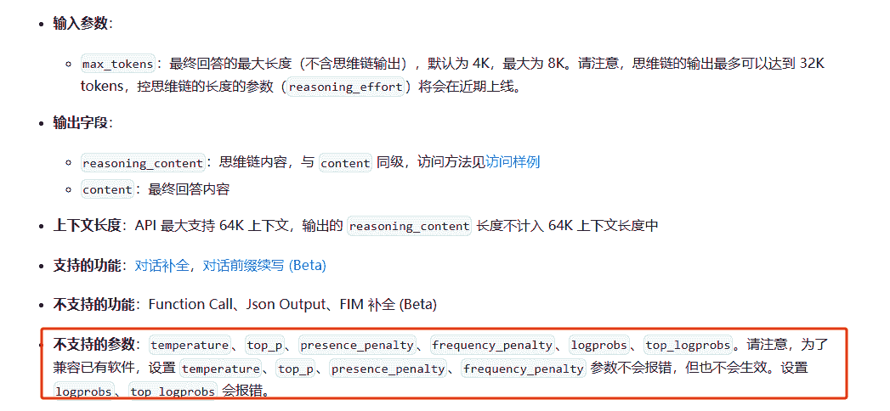

大家可以自行尝试进行验证。

### 4. 借助`Messages`参数构建多轮对话机器人

+ 构建多轮对话机器人

```
import re
from IPython.display import display, Code, Markdown
```

```
# 实例化客户端
client = OpenAI(api_key=DS_API_KEY, 
                base_url=DS_BASE_URL)
```

```
def chat_with_DeepSeek(client, messages):
    """
    使用 DeepSeek 模型进行多轮对话。

    参数:
      client: 实例化的 OpenAI 客户端。
      messages (list): 对话上下文消息列表。

    返回:
      str: 模型生成的回复文本。
    """
    response = client.chat.completions.create(
        model="deepseek-reasoner",      # 注意：这里加载 DeepSeek R1 模型
        messages=messages
    )
    return response.choices[0].message.content

def multi_round_chat(client):
    """
    多轮对话机器人示例函数，支持纯文本对话（不处理 URL）。
    用户输入 'exit' 时退出对话。
    """
    # 初始化消息列表，加入系统消息
    messages = [{"role": "system", "content": "你是一名助人为乐的助手。"}]
    
    while True:
        user_input = input("User: ").strip()
        if user_input.lower() == 'exit':
            print("对话结束。")
            break
        
        # 直接构造用户消息
        messages.append({"role": "user", "content": user_input})
        
        # 调用 DeepSeek 模型获取回复
        assistant_reply = chat_with_DeepSeek(client, messages)
        display(Markdown(f"Assistant: {assistant_reply}"))
        
        # 添加助手回复到消息列表中
        messages.append({"role": "assistant", "content": assistant_reply})
```

```
multi_round_chat(client)
```

```
User:  你好，好久不见，请介绍下你自己。
```

Assistant: 你好呀！😊真开心见到你～我是你的智能助手，由深度求索（`DeepSeek`）研发，名字叫 `DeepSeek-R1`。我的使命就是尽我所能帮助你，不管是学习、工作、生活上的问题，还是突发奇想的小点子，我都很乐意陪着你一起探索！

我擅长的事情可多啦，比如：

🔍 知识问答：历史、科学、文学、科技……你问我就答！

📚 学习辅导：语文、数学、英语、编程……我能当你的小老师！

📄 文档处理：可以上传 PDF、Word、PPT 等文件，帮你总结、提取、改写内容。

💡 创意生成：写小说、起名字、编剧本、写情书……灵感枯竭？找我充电！

📊 办公助手：写报告、做表格、写邮件、润色文案，通通没问题～

📅 生活百科：旅行计划、美食推荐、健康小贴士，我都能帮上忙！

✨ 目前我还是完全免费的，也没有语音功能（但文字交流超流畅哟～）。支持超长上下文（最多128K），可以记住我们聊天的更多内容，就像朋友聊天一样自然！

如果你愿意，我们可以一起成长～

有什么想聊的、想问的，尽管告诉我吧！😄💕

```
User:  exit


对话结束。
```

# 二、`DeepSeek-R1`模型本地指南

作为开源模型，除了能够借助官网API直接进行调用使用外，同时也支持进行本地部署。不过由于`R1`模型是`671B`超大规模参数模型，因此本地部署非常复杂，对于这部分内容感兴趣的同学，可以扫码加入大模型技术社区进行学习：


社区中包含全方位`R1`、`V3`模型本地部署指南，包括硬件配置指南、CPU+GPU混合部署等。

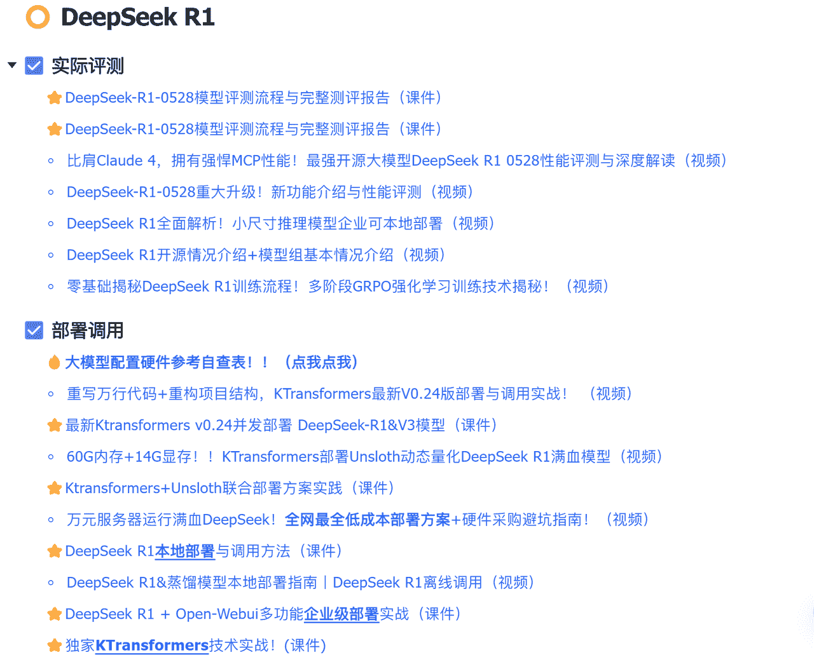
