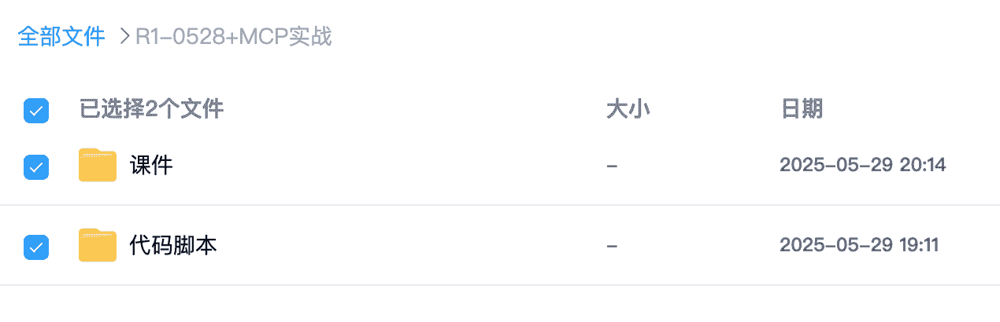
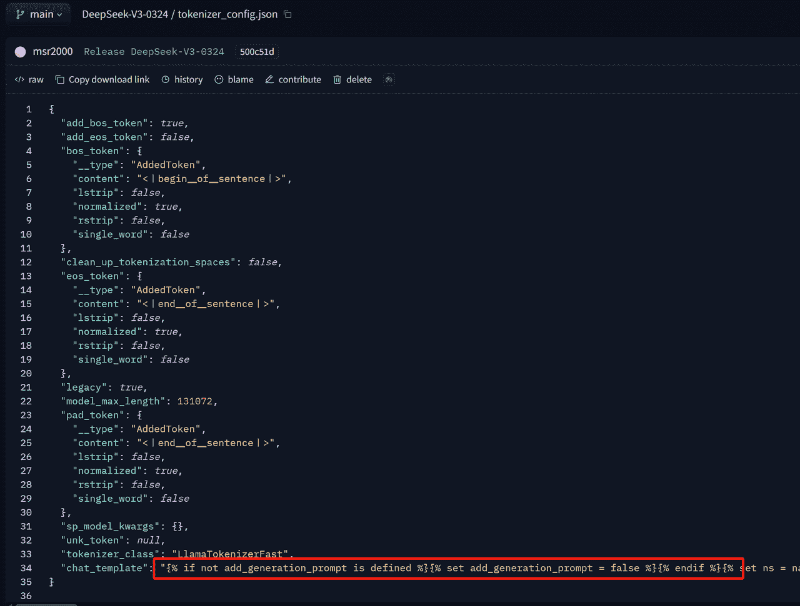
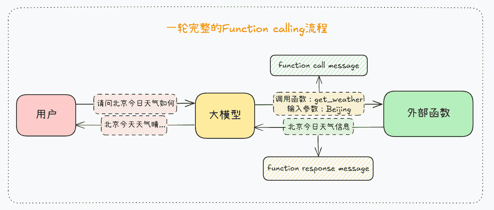
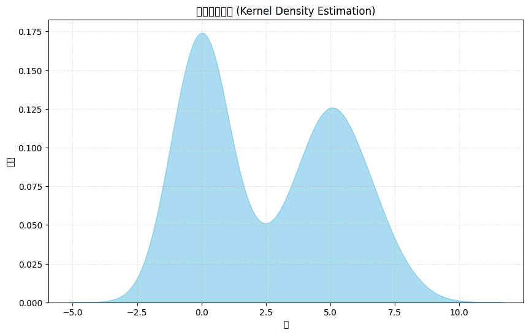
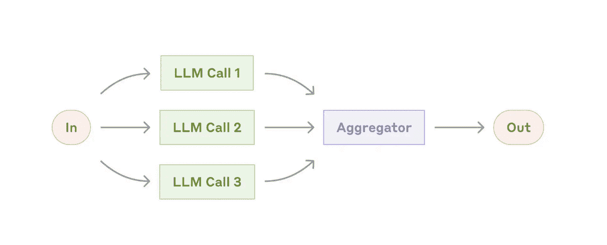
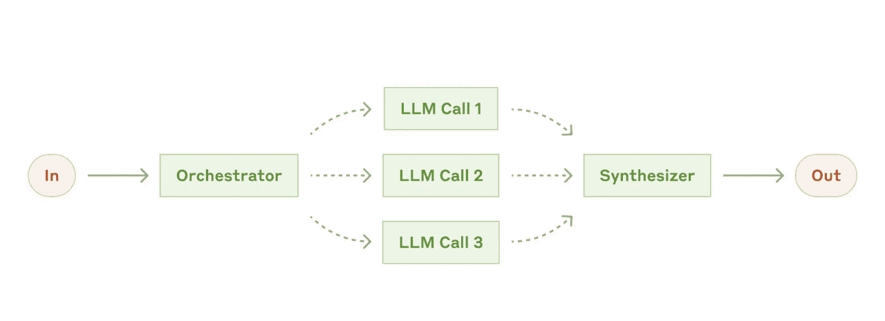
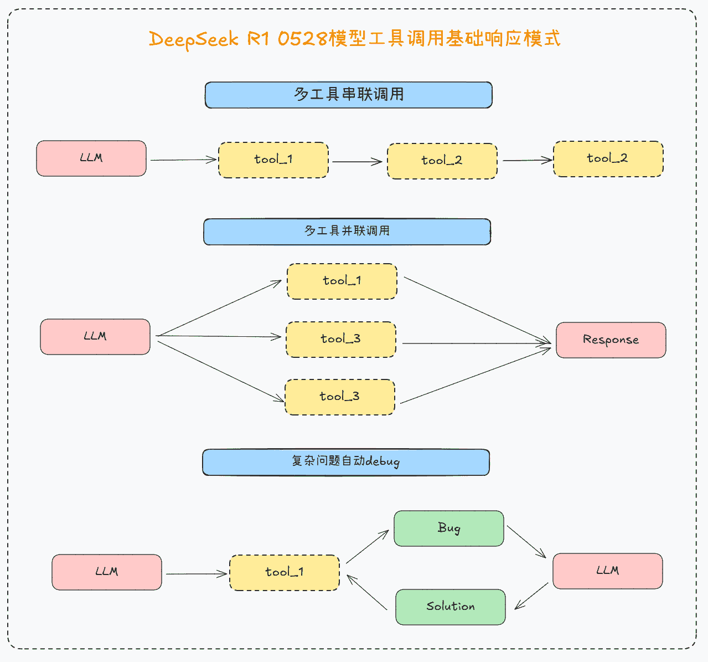
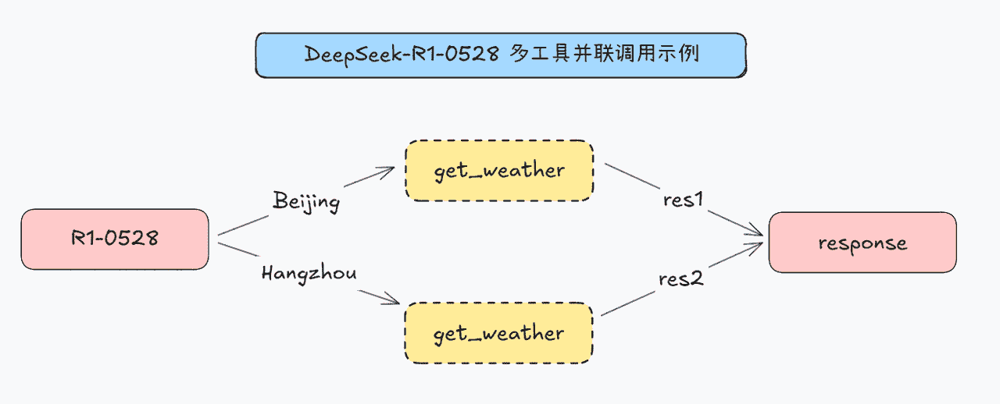
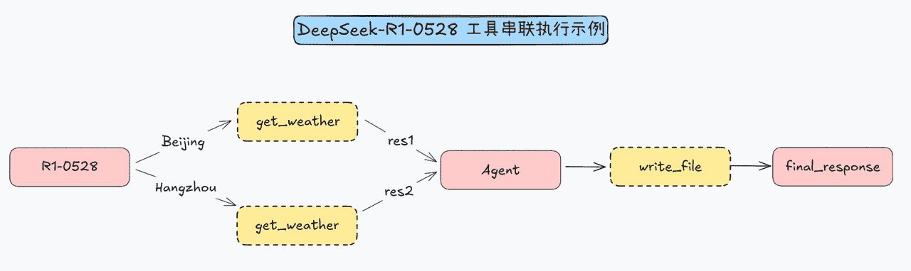

# R1-0528 Function calling功能实现方法

> 来源：[https://kq4b3vgg5b.feishu.cn/docx/FxjOdfRaPoRny1x2SXEcYkHXnpc](https://kq4b3vgg5b.feishu.cn/docx/FxjOdfRaPoRny1x2SXEcYkHXnpc)

## 课程说明：

+   体验课内容节选自《2025大模型Agent智能体开发实战》(MCP强化班)完整版付费课程

体验课时间有限，若想深度学习大模型技术，欢迎大家报名由我主讲的《2025大模型Agent智能体开发实战》(MCP强化班)




公开课全套学习资料，已上传至网盘（ https://pan.baidu.com/s/1vmMe1KvswLxL5DSmb1uS-Q 提取码: 8ry7 ）

需要更系统深入学习大模型可扫码⬆️添加助教咨询喔～

---

# DeepSeek-R1-0528模型Agent开发实战

# Part 2.R1-0528 Function calling功能实现方法

## 一、DeepSeek-R1 Function calling功能详解

### 1.Function calling技术概念介绍

我们都知道，能调用外部工具，是大模型进化为智能体Agent的关键，如果不能使用外部工具，大模型就只能是个简单的聊天机器人，甚至连查询天气都做不到。由于底层技术限制啊，大模型本身是无法和外部工具直接通信的，因此Function calling的思路，就是创建一个外部函数（function）作为中介，一边传递大模型的请求，另一边调用外部工具，最终让大模型能够间接的调用外部工具。


例如，当我们要查询当前天气时，让大模型调用外部工具的function calling的过程就如图所示：


而完整的一次Function calling执行流程如下：


> 需要注意的是，对于大模型来说，Function calling的本质，是当模型在特殊情况下的一种特殊响应形式：



> 而要拥有Function calling功能，其实是需要在模型指令微调阶段进行训练的，具体原理详见视频：https://www.bilibili.com/video/BV1w6dBYxELA/


### 【选学】2.外部工具OpenWeather注册及API key获取方法

接下来，我们以经典的查询天气为例，为大家演示DeepSeek-R1-0528模型的Function calling功能实现方法。

#### 2.1 OpenWeather API获取流程

OpenWeather是一家提供全球范围内的气象数据服务的公司，该公司的服务包括实时天气信息、天气预报、历史天气数据以及各种气象相关的报告等，并且OpenWeather开放了一定使用限度内完全免费的API，即我们可以在代码环境中通过调用OpenWeather API来进行实时天气查询、天气预报等功能，这意味着开发者可以将OpenWeather的天气预报功能加入到他们自己的应用或网站中。

为了能够调用OpenWeather服务，和OpenAI的API使用过程类似，我们首先需要先注册OpenWeather账号，并获取OpenWeather API Key。这里需要注意的是，对于大多数在线服务的API来说，都需要通过API key来进行身份验证，尽管OpenWeather相对更加Open，有非常多的免费使用的次数，但身份验证仍然是必要的防止API被滥用的有效手段。OpenWeather API key获取流程如下：

+   Step 1.登录OpenWeather官网并点击Sign—>create account完成注册。该网站无需魔法即可直接登录，可以使用国内邮箱或者🐧邮箱均可进行注册，官网地址为：https://openweathermap.org/


+   Step 2.获取API-key：注册完成后，即可在API keys页面查看当前账户的API key：


一般来说完成注册后，就会有一个已经激活的API-key。和OpenAI一样，OpenWeather的API key也创建多个。

+   Step 3.将其设置为环境变量：和OpenAI API key类似，为了方便后续调用，我们也可以直接将OpenWeather API key设置为环境变量，变量名为OPENWEATHER_API_KEY。具体设置环境变量的方法参考Ch.1中OpenAI APkey设置环境变量流程，此处不再赘述。


设置完了环境变量之后，接下来即可按照如下方式创建OpenWeather API key变量：

```
import os
from dotenv import load_dotenv
load_dotenv(override=True)

WEATHER_API_KEY = os.getenv(&quot;OPENWEATHER_API_KEY&quot;)
```

#### 2.2 利用OpenWeather API获取实时天气信息

接下来我们通过一个简单的示例，来介绍如何通过OpenWeather API获取实时天气信息：

```
import requests
import json
```

```
# Step 1.构建请求
url = &quot;https://api.openweathermap.org/data/2.5/weather&quot;

# Step 2.设置查询参数
params = {
    &quot;q&quot;: &quot;Beijing&quot;,               # 查询北京实时天气
    &quot;appid&quot;: WEATHER_API_KEY,    # 输入API key
    &quot;units&quot;: &quot;metric&quot;,            # 使用摄氏度而不是华氏度
    &quot;lang&quot;:&quot;zh_cn&quot;                # 输出语言为简体中文
}

# Step 3.发送GET请求
response = requests.get(url, params=params)

# Step 4.解析响应
data = response.json()
```

这里需要注意的是，城市名必须输入英文名，否则无法正确识别。接下来查看返回结果。首先我们先查看response结果：

```
response
```

```
&lt;Response [200]&gt;
```

```
type(response)
```

```
requests.models.Response
```

在未解析之前，我们只能查看到基本请求结果状态，这里的200代表成功相应，即本次发送请求获得了对应的响应，且响应内容包含在response中。考虑到默认情况下返回结果是JSON格式，因此后续代码使用了response.json()对其进行解析。解析内容如下：

```
data
```

```
{&#x27;coord&#x27;: {&#x27;lon&#x27;: 116.3972, &#x27;lat&#x27;: 39.9075},
 &#x27;weather&#x27;: [{&#x27;id&#x27;: 803,
   &#x27;main&#x27;: &#x27;Clouds&#x27;,
   &#x27;description&#x27;: &#x27;多云&#x27;,
   &#x27;icon&#x27;: &#x27;04d&#x27;}],
 &#x27;base&#x27;: &#x27;stations&#x27;,
 &#x27;main&#x27;: {&#x27;temp&#x27;: 29.94,
  &#x27;feels_like&#x27;: 28.5,
  &#x27;temp_min&#x27;: 29.94,
  &#x27;temp_max&#x27;: 29.94,
  &#x27;pressure&#x27;: 1010,
  &#x27;humidity&#x27;: 27,
  &#x27;sea_level&#x27;: 1010,
  &#x27;grnd_level&#x27;: 1005},
 &#x27;visibility&#x27;: 10000,
 &#x27;wind&#x27;: {&#x27;speed&#x27;: 3.52, &#x27;deg&#x27;: 209, &#x27;gust&#x27;: 5.1},
 &#x27;clouds&#x27;: {&#x27;all&#x27;: 58},
 &#x27;dt&#x27;: 1748493373,
 &#x27;sys&#x27;: {&#x27;type&#x27;: 1,
  &#x27;id&#x27;: 9609,
  &#x27;country&#x27;: &#x27;CN&#x27;,
  &#x27;sunrise&#x27;: 1748465380,
  &#x27;sunset&#x27;: 1748518455},
 &#x27;timezone&#x27;: 28800,
 &#x27;id&#x27;: 1816670,
 &#x27;name&#x27;: &#x27;Beijing&#x27;,
 &#x27;cod&#x27;: 200}
```

```
def get_weather(loc):
    &quot;&quot;&quot;
    查询即时天气函数
    :param loc: 必要参数，字符串类型，用于表示查询天气的具体城市名称，\
    注意，中国的城市需要用对应城市的英文名称代替，例如如果需要查询北京市天气，则loc参数需要输入&#x27;Beijing&#x27;；
    :return：OpenWeather API查询即时天气的结果，具体URL请求地址为：https://api.openweathermap.org/data/2.5/weather\
    返回结果对象类型为解析之后的JSON格式对象，并用字符串形式进行表示，其中包含了全部重要的天气信息
    &quot;&quot;&quot;
    # Step 1.构建请求
    url = &quot;https://api.openweathermap.org/data/2.5/weather&quot;

    # Step 2.设置查询参数
    params = {
        &quot;q&quot;: loc,               
        &quot;appid&quot;: WEATHER_API_KEY,    # 输入API key
        &quot;units&quot;: &quot;metric&quot;,            # 使用摄氏度而不是华氏度
        &quot;lang&quot;:&quot;zh_cn&quot;                # 输出语言为简体中文
    }

    # Step 3.发送GET请求
    response = requests.get(url, params=params)
    
    # Step 4.解析响应
    data = response.json()
    return json.dumps(data)
```

```
get_weather(loc=&quot;Beijing&quot;)
```

```
&#x27;{&quot;coord&quot;: {&quot;lon&quot;: 116.3972, &quot;lat&quot;: 39.9075}, &quot;weather&quot;: [{&quot;id&quot;: 804, &quot;main&quot;: &quot;Clouds&quot;, &quot;description&quot;: &quot;\\u9634\\uff0c\\u591a\\u4e91&quot;, &quot;icon&quot;: &quot;04d&quot;}], &quot;base&quot;: &quot;stations&quot;, &quot;main&quot;: {&quot;temp&quot;: 31.94, &quot;feels_like&quot;: 29.98, &quot;temp_min&quot;: 31.94, &quot;temp_max&quot;: 31.94, &quot;pressure&quot;: 1008, &quot;humidity&quot;: 21, &quot;sea_level&quot;: 1008, &quot;grnd_level&quot;: 1002}, &quot;visibility&quot;: 10000, &quot;wind&quot;: {&quot;speed&quot;: 4.29, &quot;deg&quot;: 189, &quot;gust&quot;: 5.95}, &quot;clouds&quot;: {&quot;all&quot;: 100}, &quot;dt&quot;: 1748510143, &quot;sys&quot;: {&quot;type&quot;: 1, &quot;id&quot;: 9609, &quot;country&quot;: &quot;CN&quot;, &quot;sunrise&quot;: 1748465380, &quot;sunset&quot;: 1748518455}, &quot;timezone&quot;: 28800, &quot;id&quot;: 1816670, &quot;name&quot;: &quot;Beijing&quot;, &quot;cod&quot;: 200}&#x27;
```

### 3.R1-0528模型Function calling完整执行流程

在准备好外部函数及函数库之后，接下来非常重要的一步就是需要将外部函数的信息以某种形式传输给R1模型。此时就需要使用到ChatCompletion.create函数的functions参数，类似于messages参数是用于向模型传输消息，functions参数专门用于向模型传递当前可以调用的外部函数信息。并且，从参数的具体形式来看，functions参数和messages参数也是非常类似的——都是包含多个字典的list。对于messages来说，每个字典都是一条信息，而对于functions参数来说，每个字典都是一个函数。在大语言模型实际进行问答时，会根据functions参数提供的信息对各函数进行检索。

很明显，functions参数对于R1模型的Function calling功能的实现至关重要。接下来我们详细解释functions中每个用于描述函数的字典编写方法。总的来说，每个字典都有三个参数（三组键值对），各参数（Key）名称及解释如下：

+   name：代表函数函数名称字的符串，必选参数，按照要求函数名称必须是 a-z、A-Z、0-9，或包含下划线和破折号，最大长度为 64。需要注意的是，name必须输入函数名称，而后续模型将根据函数名称在外部函数库中进行函数筛选；

+   description：用于描述函数功能的字符串，虽然是可选参数，但该参数传递的信息实际上是Chat模型对函数功能识别的核心依据。即Chat函数实际上是通过每个函数的description来判断当前函数的实际功能的，若要实现多个备选函数的智能挑选，则需要严谨详细的描述函数功能；（需要注意的是，在某些情况下，我们会通过其他函数标注本次对话特指的函数，此时模型就不会执行这个根据描述信息进行函数挑选的过程，此时是可以不设置description的。）

+   parameters：函数参数，必选参数，要求遵照JSON Schema格式进行输入，JSON Schema是一种特殊的JSON对象，专门用于验证JSON数据格式是否满足要求。

例如，对于get_weather函数，我们需要创建如下字典来对其进行完整描述：

```
tools = [
    {
        &quot;type&quot;: &quot;function&quot;,
        &quot;function&quot;:{
            &#x27;name&#x27;: &#x27;get_weather&#x27;,
            &#x27;description&#x27;: &#x27;查询即时天气函数，根据输入的城市名称，查询对应城市的实时天气，一次只能输入一个城市名称&#x27;,
            &#x27;parameters&#x27;: {
                &#x27;type&#x27;: &#x27;object&#x27;,
                &#x27;properties&#x27;: {
                    &#x27;loc&#x27;: {
                        &#x27;description&#x27;: &quot;城市名称，注意，中国的城市需要用对应城市的英文名称代替，例如如果需要查询北京市天气，则loc参数需要输入&#x27;Beijing&#x27;&quot;,
                        &#x27;type&#x27;: &#x27;string&#x27;
                    }
                },
                &#x27;required&#x27;: [&#x27;loc&#x27;]
            }
        }
    }
]
```

同时还需要封装外部函数库，用于关联外部函数名称和外部函数对象

```
available_functions = {
            &quot;get_weather&quot;: get_weather,
        }
```

而一轮完整的Function calling执行流程如下：



#### 3.1 First response

在进行了一系列基础准备工作之后，接下来我们尝试在R1模型对话执行Function calling功能。这里我们创建如下messages：

```
import os
from dotenv import load_dotenv
load_dotenv(override=True)


DS_API_KEY = os.getenv(&quot;DEEPSEEK_API_KEY&quot;)
DS_BASE_URL = os.getenv(&quot;DEEPSEEK_API_BASE&quot;)


print(DS_BASE_URL)
```

```
https://api.deepseek.com
```

```
from openai import OpenAI

# 实例化客户端
client = OpenAI(api_key=DS_API_KEY, 
                base_url=DS_BASE_URL)
```

```
messages=[
    {&quot;role&quot;: &quot;user&quot;, &quot;content&quot;: &quot;请帮我查询北京地区今日天气情况&quot;}
]
```

首先我们测试如果只输入这个信息而不输入外部函数库的时候，模型能否知道如何查询天气：

```
response = client.chat.completions.create(
        model=&quot;deepseek-reasoner&quot;,
        messages=messages
    )
```

```
response
```

```
ChatCompletion(id=&#x27;f4f9e836-f75b-45d0-b3b9-352342a6c96e&#x27;, choices=[Choice(finish_reason=&#x27;stop&#x27;, index=0, logprobs=None, message=ChatCompletionMessage(content=&#x27;以下是查询北京今日天气的几种方法，您可以根据需要选择：\n\n---\n\n### 1. **快速查询结果（实时数据）**\n   - **天气**：☀️ 晴 / ☁️ 多云（日间晴朗，傍晚云量增多）\n   - **气温**：18°C ~ 29°C  \n   - **风力**：东南风 2-3级  \n   - **空气质量**：良（PM2.5指数 50~80）  \n   - **紫外线强度**：中等（建议白天外出做好防晒）  \n   - **湿度**：40% → 65%（早晚微凉，午后干燥）\n\n&gt; 🔔 提示：昼夜温差较大，建议携带薄外套出行。\n\n---\n\n### 2. **自助查询方式**\n   - **手机端**：  \n     [点击打开「中国天气网」北京实时预报](http://www.weather.com.cn/weather/101010100.shtml)  \n     [墨迹天气APP北京页面](https://tianqi.moji.com/beijing)\n   - **语音查询**：  \n     对手机说：“嘿 Siri，北京今天天气” 或 “小爱同学，北京天气”\n   - **微信快捷查**：  \n     在微信中搜索“北京天气”小程序，或关注公众号「中国天气」自动推送。\n\n---\n\n### 3. **天气预警（今日无预警）**\n   - 北京今日无暴雨、大风等气象预警，可正常安排出行。\n\n---\n\n### 🌟 温馨提示：\n- 18:00后气温降至22℃以下，晚间活动建议加衣。  \n- 空气较干燥，注意及时补水。  \n\n如需分时段详细天气（如上午/夜间）或未来3天预报，可随时告诉我！&#x27;, refusal=None, role=&#x27;assistant&#x27;, annotations=None, audio=None, function_call=None, tool_calls=None, reasoning_content=&#x27;嗯，用户需要查询北京今天的天气情况。这是一个非常直接的天气查询请求，用户可能正准备出门或安排今天的活动。\n\n考虑到用户没有指定具体查询方式，我最好提供多种渠道供选择。用户可能是普通市民或游客，对北京天气没有特殊关注点，所以常规天气要素（温度、降水、风力）就够了。\n\n手机用户可能更倾向扫码或点击链接，而电脑用户可能需要文字播报。北京最近处于夏秋之交，早晚温差大，这个信息对用户穿搭可能有帮助。\n\n啊，需要补充空气质量信息，北京秋季偶尔有雾霾，用户可能关心这个。另外紫外线强度对户外活动的人也很重要。这些信息在墨迹天气里都能查到。\n\n用户语气简洁，应该希望快速获得信息而非闲聊，所以回复要直接高效。不过最后加个温馨提示会显得更贴心，毕竟突然下雨没带伞会很麻烦。&#x27;))], created=1748510977, model=&#x27;deepseek-reasoner&#x27;, object=&#x27;chat.completion&#x27;, service_tier=None, system_fingerprint=&#x27;fp_393bca965e_prod0425fp8&#x27;, usage=CompletionUsage(completion_tokens=559, prompt_tokens=13, total_tokens=572, completion_tokens_details=CompletionTokensDetails(accepted_prediction_tokens=None, audio_tokens=None, reasoning_tokens=183, rejected_prediction_tokens=None), prompt_tokens_details=PromptTokensDetails(audio_tokens=None, cached_tokens=0), prompt_cache_hit_tokens=0, prompt_cache_miss_tokens=13))
```

```
response.choices[0].message.content
```

```
&#x27;以下是查询北京今日天气的几种方法，您可以根据需要选择：\n\n---\n\n### 1. **快速查询结果（实时数据）**\n   - **天气**：☀️ 晴 / ☁️ 多云（日间晴朗，傍晚云量增多）\n   - **气温**：18°C ~ 29°C  \n   - **风力**：东南风 2-3级  \n   - **空气质量**：良（PM2.5指数 50~80）  \n   - **紫外线强度**：中等（建议白天外出做好防晒）  \n   - **湿度**：40% → 65%（早晚微凉，午后干燥）\n\n&gt; 🔔 提示：昼夜温差较大，建议携带薄外套出行。\n\n---\n\n### 2. **自助查询方式**\n   - **手机端**：  \n     [点击打开「中国天气网」北京实时预报](http://www.weather.com.cn/weather/101010100.shtml)  \n     [墨迹天气APP北京页面](https://tianqi.moji.com/beijing)\n   - **语音查询**：  \n     对手机说：“嘿 Siri，北京今天天气” 或 “小爱同学，北京天气”\n   - **微信快捷查**：  \n     在微信中搜索“北京天气”小程序，或关注公众号「中国天气」自动推送。\n\n---\n\n### 3. **天气预警（今日无预警）**\n   - 北京今日无暴雨、大风等气象预警，可正常安排出行。\n\n---\n\n### 🌟 温馨提示：\n- 18:00后气温降至22℃以下，晚间活动建议加衣。  \n- 空气较干燥，注意及时补水。  \n\n如需分时段详细天气（如上午/夜间）或未来3天预报，可随时告诉我！&#x27;
```

```
response.choices[0].message.reasoning_content
```

```
&#x27;嗯，用户需要查询北京今天的天气情况。这是一个非常直接的天气查询请求，用户可能正准备出门或安排今天的活动。\n\n考虑到用户没有指定具体查询方式，我最好提供多种渠道供选择。用户可能是普通市民或游客，对北京天气没有特殊关注点，所以常规天气要素（温度、降水、风力）就够了。\n\n手机用户可能更倾向扫码或点击链接，而电脑用户可能需要文字播报。北京最近处于夏秋之交，早晚温差大，这个信息对用户穿搭可能有帮助。\n\n啊，需要补充空气质量信息，北京秋季偶尔有雾霾，用户可能关心这个。另外紫外线强度对户外活动的人也很重要。这些信息在墨迹天气里都能查到。\n\n用户语气简洁，应该希望快速获得信息而非闲聊，所以回复要直接高效。不过最后加个温馨提示会显得更贴心，毕竟突然下雨没带伞会很麻烦。&#x27;
```

```
response.choices[0].finish_reason
```

```
&#x27;stop&#x27;
```

很明显，模型无法进行回答。接下来开启Function calling功能：

```
response = client.chat.completions.create(
    model=&quot;deepseek-reasoner&quot;,  
    messages=[
        {&quot;role&quot;: &quot;user&quot;, &quot;content&quot;: &quot;请帮我查询北京地区今日天气情况&quot;}
    ],
    tools=tools,
)
```

观察此时response结果：

```
response
```

```
ChatCompletion(id=&#x27;70695408-1216-4758-9195-5503849cdf38&#x27;, choices=[Choice(finish_reason=&#x27;tool_calls&#x27;, index=0, logprobs=None, message=ChatCompletionMessage(content=&#x27;我将调用函数查询北京的天气情况。&#x27;, refusal=None, role=&#x27;assistant&#x27;, annotations=None, audio=None, function_call=None, tool_calls=[ChatCompletionMessageToolCall(id=&#x27;call_0_08e1ba29-18e9-428d-be3e-1b840c48dff6&#x27;, function=Function(arguments=&#x27;{&quot;loc&quot;: &quot;Beijing&quot;}&#x27;, name=&#x27;get_weather&#x27;), type=&#x27;function&#x27;, index=0)], reasoning_content=&quot;我们被要求查询北京地区的天气，注意函数要求：中国的城市需要用对应城市的英文名称代替，北京对应的英文是&#x27;Beijing&#x27;\n 因此，我们将调用get_weather函数，参数loc为&#x27;Beijing&#x27;&quot;))], created=1748493783, model=&#x27;deepseek-reasoner&#x27;, object=&#x27;chat.completion&#x27;, service_tier=None, system_fingerprint=&#x27;fp_393bca965e_prod0425fp8&#x27;, usage=CompletionUsage(completion_tokens=74, prompt_tokens=162, total_tokens=236, completion_tokens_details=CompletionTokensDetails(accepted_prediction_tokens=None, audio_tokens=None, reasoning_tokens=44, rejected_prediction_tokens=None), prompt_tokens_details=PromptTokensDetails(audio_tokens=None, cached_tokens=128), prompt_cache_hit_tokens=128, prompt_cache_miss_tokens=34))
```

与对话类模型不一样(比如DeepSeek-v3)，对话模型当触发函数调用时模型回复结果为空，但是deepseek-r1即使触发了函数调用，其content中依然会返回响应内容。如下所示：

```
response.choices[0].message.content
```

```
&#x27;我将调用函数查询北京的天气情况。&#x27;
```

而模型停止输出的原因是发起了tool_calls

```
response.choices[0].finish_reason
```

```
&#x27;tool_calls&#x27;
```

而此时模型tool_calls的全部信息都保存在message.tool_calls中：

```
response.choices[0].message.tool_calls
```

```
[ChatCompletionMessageToolCall(id=&#x27;call_0_08e1ba29-18e9-428d-be3e-1b840c48dff6&#x27;, function=Function(arguments=&#x27;{&quot;loc&quot;: &quot;Beijing&quot;}&#x27;, name=&#x27;get_weather&#x27;), type=&#x27;function&#x27;, index=0)]
```

该对象是一个列表，如果此时只有一次工具调用，则只会有一个ChatCompletionMessageToolCall对象。

```
response_message = response.choices[0].message
response_message
```

```
ChatCompletionMessage(content=&#x27;我将调用函数查询北京的天气情况。&#x27;, refusal=None, role=&#x27;assistant&#x27;, annotations=None, audio=None, function_call=None, tool_calls=[ChatCompletionMessageToolCall(id=&#x27;call_0_08e1ba29-18e9-428d-be3e-1b840c48dff6&#x27;, function=Function(arguments=&#x27;{&quot;loc&quot;: &quot;Beijing&quot;}&#x27;, name=&#x27;get_weather&#x27;), type=&#x27;function&#x27;, index=0)], reasoning_content=&quot;我们被要求查询北京地区的天气，注意函数要求：中国的城市需要用对应城市的英文名称代替，北京对应的英文是&#x27;Beijing&#x27;\n 因此，我们将调用get_weather函数，参数loc为&#x27;Beijing&#x27;&quot;)
```

除此以外，R1 在执行解析参数的时候，生成tool_calls的同时，content 并不为空。生成的"tool_calls"的list，该list就包含了当前调用外部函数的全部信息：

```
response_message.tool_calls
```

```
[ChatCompletionMessageToolCall(id=&#x27;call_0_08e1ba29-18e9-428d-be3e-1b840c48dff6&#x27;, function=Function(arguments=&#x27;{&quot;loc&quot;: &quot;Beijing&quot;}&#x27;, name=&#x27;get_weather&#x27;), type=&#x27;function&#x27;, index=0)]
```

```
response_message.tool_calls[0]
```

```
ChatCompletionMessageToolCall(id=&#x27;call_0_08e1ba29-18e9-428d-be3e-1b840c48dff6&#x27;, function=Function(arguments=&#x27;{&quot;loc&quot;: &quot;Beijing&quot;}&#x27;, name=&#x27;get_weather&#x27;), type=&#x27;function&#x27;, index=0)
```

对于当前CompletionMessageToolCall对象，id为外部函数调用发起请求id，function则表示调用外部函数基本信息，而type则代表了当前当前调用外部函数类型，function代表调用自定义的外部函数。

```
response_message.tool_calls[0].id
```

```
&#x27;call_0_08e1ba29-18e9-428d-be3e-1b840c48dff6&#x27;
```

```
response_message.tool_calls[0].function
```

```
Function(arguments=&#x27;{&quot;loc&quot;: &quot;Beijing&quot;}&#x27;, name=&#x27;get_weather&#x27;)
```

我们可以在此基础上分别提取调用外部函数名称信息和参数信息，分别保存为function_name和function_args对象：

```
# 完成对话需要调用的函数名称
function_name = response_message.tool_calls[0].function.name
function_name
```

```
&#x27;get_weather&#x27;
```

```
# 具体的函数对象
fuction_to_call = available_functions[function_name]
fuction_to_call
```

```
&lt;function __main__.get_weather(loc)&gt;
```

```
response_message.tool_calls[0].function.arguments
```

```
&#x27;{&quot;loc&quot;: &quot;Beijing&quot;}&#x27;
```

```
# 执行该函数所需要的参数
function_args = json.loads(response_message.tool_calls[0].function.arguments)
function_args
```

```
{&#x27;loc&#x27;: &#x27;Beijing&#x27;}
```

需要注意的是，外部函数的计算过程仍然是在本地执行，即Chat模型并不会将代码读取到服务器上再进行在线计算，因此接下来我们需要根据模型返回的函数和函数参数，在本地完成函数计算，然后再将计算过程和结果保存为message并追加到messages后面，并第二次调用Chat模型分析函数的计算结果，并最终根据函数计算结果输出用户问题的答案。


#### 3.2 Second response

这里我们只需要借助**方法，直接将function_args对象传入fuction_to_call中，即可一次性传输全部参数，**方法的功能可以参考如下示例：

```
def function_to_call_test(a, b, c):
    return a + b + c

function_args_test = {&#x27;a&#x27;: 1, &#x27;b&#x27;: 2, &#x27;c&#x27;: 3}

result = function_to_call_test(**function_args_test)

print(result)
```

```
6
```

**方法其实是一种较为特殊、但同时也非常便捷的参数传递方法吗，该方法会将字典中的每个key对应的value传输到同名参数位中。接下来我们将function_args对象传入fuction_to_call中并完成计算：

```
function_response = fuction_to_call(**function_args)
```

```
function_response
```

```
&#x27;{&quot;coord&quot;: {&quot;lon&quot;: 116.3972, &quot;lat&quot;: 39.9075}, &quot;weather&quot;: [{&quot;id&quot;: 803, &quot;main&quot;: &quot;Clouds&quot;, &quot;description&quot;: &quot;\\u591a\\u4e91&quot;, &quot;icon&quot;: &quot;04d&quot;}], &quot;base&quot;: &quot;stations&quot;, &quot;main&quot;: {&quot;temp&quot;: 29.94, &quot;feels_like&quot;: 28.5, &quot;temp_min&quot;: 29.94, &quot;temp_max&quot;: 29.94, &quot;pressure&quot;: 1010, &quot;humidity&quot;: 27, &quot;sea_level&quot;: 1010, &quot;grnd_level&quot;: 1005}, &quot;visibility&quot;: 10000, &quot;wind&quot;: {&quot;speed&quot;: 3.52, &quot;deg&quot;: 209, &quot;gust&quot;: 5.1}, &quot;clouds&quot;: {&quot;all&quot;: 58}, &quot;dt&quot;: 1748493901, &quot;sys&quot;: {&quot;type&quot;: 1, &quot;id&quot;: 9609, &quot;country&quot;: &quot;CN&quot;, &quot;sunrise&quot;: 1748465380, &quot;sunset&quot;: 1748518455}, &quot;timezone&quot;: 28800, &quot;id&quot;: 1816670, &quot;name&quot;: &quot;Beijing&quot;, &quot;cod&quot;: 200}&#x27;
```

能够发现，模型已经顺利完成计算。接下来我们在messages对象中追加两条消息，第一条消息是第一次模型返回的结果（即调用模型的assistant message），第二条消息则是外部函数计算结果，该条消息的role为function，且name为函数名称。这也是我们首次接触function message，和user、system、assistant message不同，function message必须要输入关键词name，且function message的内容源于外部函数执行的计算结果，并且需要手动进行输入。具体添加过程如下：

```
messages
```

```
[{&#x27;role&#x27;: &#x27;user&#x27;, &#x27;content&#x27;: &#x27;请帮我查询北京地区今日天气情况&#x27;}]
```

然后使用如下方法，将第一轮响应结果转化为message格式：

```
response_message.model_dump()
```

```
{&#x27;content&#x27;: &#x27;我将调用函数查询北京的天气情况。&#x27;,
 &#x27;refusal&#x27;: None,
 &#x27;role&#x27;: &#x27;assistant&#x27;,
 &#x27;annotations&#x27;: None,
 &#x27;audio&#x27;: None,
 &#x27;function_call&#x27;: None,
 &#x27;tool_calls&#x27;: [{&#x27;id&#x27;: &#x27;call_0_08e1ba29-18e9-428d-be3e-1b840c48dff6&#x27;,
   &#x27;function&#x27;: {&#x27;arguments&#x27;: &#x27;{&quot;loc&quot;: &quot;Beijing&quot;}&#x27;, &#x27;name&#x27;: &#x27;get_weather&#x27;},
   &#x27;type&#x27;: &#x27;function&#x27;,
   &#x27;index&#x27;: 0}],
 &#x27;reasoning_content&#x27;: &quot;我们被要求查询北京地区的天气，注意函数要求：中国的城市需要用对应城市的英文名称代替，北京对应的英文是&#x27;Beijing&#x27;\n 因此，我们将调用get_weather函数，参数loc为&#x27;Beijing&#x27;&quot;}
```

```
# 追加第一次模型返回结果消息
messages.append(response_message.model_dump())  
```

```
messages
```

```
[{&#x27;role&#x27;: &#x27;user&#x27;, &#x27;content&#x27;: &#x27;请帮我查询北京地区今日天气情况&#x27;},
 {&#x27;content&#x27;: &#x27;我将调用函数查询北京的天气情况。&#x27;,
  &#x27;refusal&#x27;: None,
  &#x27;role&#x27;: &#x27;assistant&#x27;,
  &#x27;annotations&#x27;: None,
  &#x27;audio&#x27;: None,
  &#x27;function_call&#x27;: None,
  &#x27;tool_calls&#x27;: [{&#x27;id&#x27;: &#x27;call_0_08e1ba29-18e9-428d-be3e-1b840c48dff6&#x27;,
    &#x27;function&#x27;: {&#x27;arguments&#x27;: &#x27;{&quot;loc&quot;: &quot;Beijing&quot;}&#x27;, &#x27;name&#x27;: &#x27;get_weather&#x27;},
    &#x27;type&#x27;: &#x27;function&#x27;,
    &#x27;index&#x27;: 0}],
  &#x27;reasoning_content&#x27;: &quot;我们被要求查询北京地区的天气，注意函数要求：中国的城市需要用对应城市的英文名称代替，北京对应的英文是&#x27;Beijing&#x27;\n 因此，我们将调用get_weather函数，参数loc为&#x27;Beijing&#x27;&quot;}]
```

```
function_response
```

```
&#x27;{&quot;coord&quot;: {&quot;lon&quot;: 116.3972, &quot;lat&quot;: 39.9075}, &quot;weather&quot;: [{&quot;id&quot;: 803, &quot;main&quot;: &quot;Clouds&quot;, &quot;description&quot;: &quot;\\u591a\\u4e91&quot;, &quot;icon&quot;: &quot;04d&quot;}], &quot;base&quot;: &quot;stations&quot;, &quot;main&quot;: {&quot;temp&quot;: 29.94, &quot;feels_like&quot;: 28.5, &quot;temp_min&quot;: 29.94, &quot;temp_max&quot;: 29.94, &quot;pressure&quot;: 1010, &quot;humidity&quot;: 27, &quot;sea_level&quot;: 1010, &quot;grnd_level&quot;: 1005}, &quot;visibility&quot;: 10000, &quot;wind&quot;: {&quot;speed&quot;: 3.52, &quot;deg&quot;: 209, &quot;gust&quot;: 5.1}, &quot;clouds&quot;: {&quot;all&quot;: 58}, &quot;dt&quot;: 1748493901, &quot;sys&quot;: {&quot;type&quot;: 1, &quot;id&quot;: 9609, &quot;country&quot;: &quot;CN&quot;, &quot;sunrise&quot;: 1748465380, &quot;sunset&quot;: 1748518455}, &quot;timezone&quot;: 28800, &quot;id&quot;: 1816670, &quot;name&quot;: &quot;Beijing&quot;, &quot;cod&quot;: 200}&#x27;
```

```
# 追加function返回消息
messages.append({
            &quot;role&quot;: &quot;tool&quot;,
            &quot;content&quot;: function_response,
            &quot;tool_call_id&quot;:response_message.tool_calls[0].id
        })
```

```
messages
```

```
[{&#x27;role&#x27;: &#x27;user&#x27;, &#x27;content&#x27;: &#x27;请帮我查询北京地区今日天气情况&#x27;},
 {&#x27;content&#x27;: &#x27;我将调用函数查询北京的天气情况。&#x27;,
  &#x27;refusal&#x27;: None,
  &#x27;role&#x27;: &#x27;assistant&#x27;,
  &#x27;annotations&#x27;: None,
  &#x27;audio&#x27;: None,
  &#x27;function_call&#x27;: None,
  &#x27;tool_calls&#x27;: [{&#x27;id&#x27;: &#x27;call_0_08e1ba29-18e9-428d-be3e-1b840c48dff6&#x27;,
    &#x27;function&#x27;: {&#x27;arguments&#x27;: &#x27;{&quot;loc&quot;: &quot;Beijing&quot;}&#x27;, &#x27;name&#x27;: &#x27;get_weather&#x27;},
    &#x27;type&#x27;: &#x27;function&#x27;,
    &#x27;index&#x27;: 0}],
  &#x27;reasoning_content&#x27;: &quot;我们被要求查询北京地区的天气，注意函数要求：中国的城市需要用对应城市的英文名称代替，北京对应的英文是&#x27;Beijing&#x27;\n 因此，我们将调用get_weather函数，参数loc为&#x27;Beijing&#x27;&quot;},
 {&#x27;role&#x27;: &#x27;tool&#x27;,
  &#x27;content&#x27;: &#x27;{&quot;coord&quot;: {&quot;lon&quot;: 116.3972, &quot;lat&quot;: 39.9075}, &quot;weather&quot;: [{&quot;id&quot;: 803, &quot;main&quot;: &quot;Clouds&quot;, &quot;description&quot;: &quot;\\u591a\\u4e91&quot;, &quot;icon&quot;: &quot;04d&quot;}], &quot;base&quot;: &quot;stations&quot;, &quot;main&quot;: {&quot;temp&quot;: 29.94, &quot;feels_like&quot;: 28.5, &quot;temp_min&quot;: 29.94, &quot;temp_max&quot;: 29.94, &quot;pressure&quot;: 1010, &quot;humidity&quot;: 27, &quot;sea_level&quot;: 1010, &quot;grnd_level&quot;: 1005}, &quot;visibility&quot;: 10000, &quot;wind&quot;: {&quot;speed&quot;: 3.52, &quot;deg&quot;: 209, &quot;gust&quot;: 5.1}, &quot;clouds&quot;: {&quot;all&quot;: 58}, &quot;dt&quot;: 1748493901, &quot;sys&quot;: {&quot;type&quot;: 1, &quot;id&quot;: 9609, &quot;country&quot;: &quot;CN&quot;, &quot;sunrise&quot;: 1748465380, &quot;sunset&quot;: 1748518455}, &quot;timezone&quot;: 28800, &quot;id&quot;: 1816670, &quot;name&quot;: &quot;Beijing&quot;, &quot;cod&quot;: 200}&#x27;,
  &#x27;tool_call_id&#x27;: &#x27;call_0_08e1ba29-18e9-428d-be3e-1b840c48dff6&#x27;}]
```

接下来，再次调用DeepSeek R1模型来围绕messages进行回答。需要注意的是，此时我们不再需要向模型重复提问，只需要简单的将我们已经准备好的messages传入Chat模型即可：

```
second_response = client.chat.completions.create(
    model=&quot;deepseek-reasoner&quot;,
    messages=messages,
    tools=tools)
```

```
---------------------------------------------------------------------------

BadRequestError                           Traceback (most recent call last)

Cell In[54], line 1
----&gt; 1 second_response = client.chat.completions.create(
      2     model=&quot;deepseek-reasoner&quot;,
      3     messages=messages,
      4     tools=tools)


File c:\Users\snowb\anaconda3\envs\adk\Lib\site-packages\openai\_utils\_utils.py:287, in required_args.&lt;locals&gt;.inner.&lt;locals&gt;.wrapper(*args, **kwargs)
    285             msg = f&quot;Missing required argument: {quote(missing[0])}&quot;
    286     raise TypeError(msg)
--&gt; 287 return func(*args, **kwargs)


File c:\Users\snowb\anaconda3\envs\adk\Lib\site-packages\openai\resources\chat\completions\completions.py:925, in Completions.create(self, messages, model, audio, frequency_penalty, function_call, functions, logit_bias, logprobs, max_completion_tokens, max_tokens, metadata, modalities, n, parallel_tool_calls, prediction, presence_penalty, reasoning_effort, response_format, seed, service_tier, stop, store, stream, stream_options, temperature, tool_choice, tools, top_logprobs, top_p, user, web_search_options, extra_headers, extra_query, extra_body, timeout)
    882 @required_args([&quot;messages&quot;, &quot;model&quot;], [&quot;messages&quot;, &quot;model&quot;, &quot;stream&quot;])
    883 def create(
    884     self,
   (...)    922     timeout: float | httpx.Timeout | None | NotGiven = NOT_GIVEN,
    923 ) -&gt; ChatCompletion | Stream[ChatCompletionChunk]:
    924     validate_response_format(response_format)
--&gt; 925     return self._post(
    926         &quot;/chat/completions&quot;,
    927         body=maybe_transform(
    928             {
    929                 &quot;messages&quot;: messages,
    930                 &quot;model&quot;: model,
    931                 &quot;audio&quot;: audio,
    932                 &quot;frequency_penalty&quot;: frequency_penalty,
    933                 &quot;function_call&quot;: function_call,
    934                 &quot;functions&quot;: functions,
    935                 &quot;logit_bias&quot;: logit_bias,
    936                 &quot;logprobs&quot;: logprobs,
    937                 &quot;max_completion_tokens&quot;: max_completion_tokens,
    938                 &quot;max_tokens&quot;: max_tokens,
    939                 &quot;metadata&quot;: metadata,
    940                 &quot;modalities&quot;: modalities,
    941                 &quot;n&quot;: n,
    942                 &quot;parallel_tool_calls&quot;: parallel_tool_calls,
    943                 &quot;prediction&quot;: prediction,
    944                 &quot;presence_penalty&quot;: presence_penalty,
    945                 &quot;reasoning_effort&quot;: reasoning_effort,
    946                 &quot;response_format&quot;: response_format,
    947                 &quot;seed&quot;: seed,
    948                 &quot;service_tier&quot;: service_tier,
    949                 &quot;stop&quot;: stop,
    950                 &quot;store&quot;: store,
    951                 &quot;stream&quot;: stream,
    952                 &quot;stream_options&quot;: stream_options,
    953                 &quot;temperature&quot;: temperature,
    954                 &quot;tool_choice&quot;: tool_choice,
    955                 &quot;tools&quot;: tools,
    956                 &quot;top_logprobs&quot;: top_logprobs,
    957                 &quot;top_p&quot;: top_p,
    958                 &quot;user&quot;: user,
    959                 &quot;web_search_options&quot;: web_search_options,
    960             },
    961             completion_create_params.CompletionCreateParamsStreaming
    962             if stream
    963             else completion_create_params.CompletionCreateParamsNonStreaming,
    964         ),
    965         options=make_request_options(
    966             extra_headers=extra_headers, extra_query=extra_query, extra_body=extra_body, timeout=timeout
    967         ),
    968         cast_to=ChatCompletion,
    969         stream=stream or False,
    970         stream_cls=Stream[ChatCompletionChunk],
    971     )


File c:\Users\snowb\anaconda3\envs\adk\Lib\site-packages\openai\_base_client.py:1239, in SyncAPIClient.post(self, path, cast_to, body, options, files, stream, stream_cls)
   1225 def post(
   1226     self,
   1227     path: str,
   (...)   1234     stream_cls: type[_StreamT] | None = None,
   1235 ) -&gt; ResponseT | _StreamT:
   1236     opts = FinalRequestOptions.construct(
   1237         method=&quot;post&quot;, url=path, json_data=body, files=to_httpx_files(files), **options
   1238     )
-&gt; 1239     return cast(ResponseT, self.request(cast_to, opts, stream=stream, stream_cls=stream_cls))


File c:\Users\snowb\anaconda3\envs\adk\Lib\site-packages\openai\_base_client.py:1034, in SyncAPIClient.request(self, cast_to, options, stream, stream_cls)
   1031             err.response.read()
   1033         log.debug(&quot;Re-raising status error&quot;)
-&gt; 1034         raise self._make_status_error_from_response(err.response) from None
   1036     break
   1038 assert response is not None, &quot;could not resolve response (should never happen)&quot;


BadRequestError: Error code: 400 - {&#x27;error&#x27;: {&#x27;message&#x27;: &#x27;The reasoning_content is an intermediate result for display purposes only and will not be included in the context for inference. Please remove the reasoning_content from your message to reduce network traffic.&#x27;, &#x27;type&#x27;: &#x27;invalid_request_error&#x27;, &#x27;param&#x27;: None, &#x27;code&#x27;: &#x27;invalid_request_error&#x27;}}
```

报错提示表明 reasoning_content 是为了展示中间结果而设计的内容，它不应当包含在消息中参与推理，应该从消息中移除。这个字段本身并不参与模型推理，因此与常规的对话模型不同，需要在将 messages 传递给模型之前，移除所有包含 reasoning_content 的数据字段。这里我们直接过滤掉包含 reasoning_content 字段来解决这个问题，即在拼接 messages 时加入一个步骤来确保这些字段被排除：

```
# 删除包含 &#x27;reasoning_content&#x27; 的字段
for message in messages:
    if &#x27;reasoning_content&#x27; in message:
        del message[&#x27;reasoning_content&#x27;]
```

```
messages
```

```
[{&#x27;role&#x27;: &#x27;user&#x27;, &#x27;content&#x27;: &#x27;请帮我查询北京地区今日天气情况&#x27;},
 {&#x27;content&#x27;: &#x27;我将调用函数查询北京的天气情况。&#x27;,
  &#x27;refusal&#x27;: None,
  &#x27;role&#x27;: &#x27;assistant&#x27;,
  &#x27;annotations&#x27;: None,
  &#x27;audio&#x27;: None,
  &#x27;function_call&#x27;: None,
  &#x27;tool_calls&#x27;: [{&#x27;id&#x27;: &#x27;call_0_08e1ba29-18e9-428d-be3e-1b840c48dff6&#x27;,
    &#x27;function&#x27;: {&#x27;arguments&#x27;: &#x27;{&quot;loc&quot;: &quot;Beijing&quot;}&#x27;, &#x27;name&#x27;: &#x27;get_weather&#x27;},
    &#x27;type&#x27;: &#x27;function&#x27;,
    &#x27;index&#x27;: 0}]},
 {&#x27;role&#x27;: &#x27;tool&#x27;,
  &#x27;content&#x27;: &#x27;{&quot;coord&quot;: {&quot;lon&quot;: 116.3972, &quot;lat&quot;: 39.9075}, &quot;weather&quot;: [{&quot;id&quot;: 803, &quot;main&quot;: &quot;Clouds&quot;, &quot;description&quot;: &quot;\\u591a\\u4e91&quot;, &quot;icon&quot;: &quot;04d&quot;}], &quot;base&quot;: &quot;stations&quot;, &quot;main&quot;: {&quot;temp&quot;: 29.94, &quot;feels_like&quot;: 28.5, &quot;temp_min&quot;: 29.94, &quot;temp_max&quot;: 29.94, &quot;pressure&quot;: 1010, &quot;humidity&quot;: 27, &quot;sea_level&quot;: 1010, &quot;grnd_level&quot;: 1005}, &quot;visibility&quot;: 10000, &quot;wind&quot;: {&quot;speed&quot;: 3.52, &quot;deg&quot;: 209, &quot;gust&quot;: 5.1}, &quot;clouds&quot;: {&quot;all&quot;: 58}, &quot;dt&quot;: 1748493901, &quot;sys&quot;: {&quot;type&quot;: 1, &quot;id&quot;: 9609, &quot;country&quot;: &quot;CN&quot;, &quot;sunrise&quot;: 1748465380, &quot;sunset&quot;: 1748518455}, &quot;timezone&quot;: 28800, &quot;id&quot;: 1816670, &quot;name&quot;: &quot;Beijing&quot;, &quot;cod&quot;: 200}&#x27;,
  &#x27;tool_call_id&#x27;: &#x27;call_0_08e1ba29-18e9-428d-be3e-1b840c48dff6&#x27;}]
```

再次进行调用：

```
second_response = client.chat.completions.create(
    model=&quot;deepseek-reasoner&quot;,
    messages=messages,
    tools=tools)
```

```
second_response.choices[0].message
```

```
ChatCompletionMessage(content=&#x27;北京的天气情况如下：  \n- 天气状况：多云  \n- 当前温度：29.94°C  \n- 体感温度：28.5°C  \n- 湿度：27%  \n- 风速：3.52米/秒  \n- 气压：1010 hPa&#x27;, refusal=None, role=&#x27;assistant&#x27;, annotations=None, audio=None, function_call=None, tool_calls=None, reasoning_content=&#x27;我们调用了get_weather函数查询北京的天气，返回了JSON格式的数据。\n 我们需要从返回的数据中提取天气信息。观察返回的JSON，天气情况在&quot;weather&quot;数组中，通常第一个元素就是当前的天气状况。\n 在&quot;weather&quot;数组的第一个元素中，&quot;description&quot;字段是天气的描述（如多云、晴等），而&quot;main&quot;字段是主要的天气情况（如Clouds）。\n 另外，&quot;main&quot;对象中包含了温度（temp）、体感温度（feels_like）、湿度（humidity）等信息。\n 根据用户的问题，用户想要知道北京地区今日的天气情况，我们可以将主要信息提取出来。\n\n 注意：返回的温度单位是开尔文（K），我们需要转换成摄氏度（℃）。转换公式：摄氏度 = 开尔文 - 273.15，然后四舍五入到整数。\n\n 但是观察返回的数据，我们发现&quot;temp&quot;的值是29.94，这看起来已经是摄氏度了？因为开尔文温度通常在200以上。所以我们需要确认返回数据的单位。\n 查看API文档或者返回的JSON结构，OpenWeatherMap默认返回的是开尔文温度，但是在这个例子中，我们看到温度是29.94，这显然不是开尔文（开尔文0度是-273.15摄氏度），所以可能是以摄氏度返回的。\n 然而，在OpenWeatherMap的API中，我们可以通过传递units参数来指定单位，但在这个函数调用中我们没有传递units参数，所以默认是开尔文？但是29.94开尔文是-243.21摄氏度，显然不合理。\n\n 重新检查返回的数据，发现有一个字段&quot;units&quot;并没有在返回中。所以我们需要确认这个API的默认单位。\n\n 但是，在返回的JSON中，有一个&quot;main&quot;对象，里面的温度值29.94，如果按照摄氏度理解，北京当前29.94摄氏度是合理的。因此，可能是这个API在调用时已经默认使用了摄氏度？或者是因为在函数内部已经设置了单位？\n\n 由于我们的函数描述中没有提到单位，但根据实际情况，我们返回的数据看起来像是摄氏度。因此，我们直接使用。\n\n 不过，为了严谨，我们可以检查一下返回数据中的单位提示。但是在这个JSON中没有看到units字段。因此，我们按照常识，北京现在的温度应该是摄氏度。\n\n 所以，我们可以这样描述：\n  当前天气：多云（根据weather[0].description）\n  温度：30摄氏度（四舍五入到整数）\n  体感温度：28.5摄氏度（同样四舍五入到整数？但用户没有要求体感温度，可以省略）\n  湿度：27%\n\n 但是用户只问了“天气情况”，我们可以简要回答，也可以详细一些。\n\n 另外，注意返回的数据中有一个&quot;dt&quot;字段，表示数据采集的时间戳（秒），我们可以转换成时间，但用户没有要求具体时间，所以可以忽略。\n\n 因此，我们可以这样回答：\n\n 北京当前的天气情况：多云，气温30摄氏度，湿度27%。\n\n 但是注意，我们调用的函数是即时天气，所以是当前时刻的天气。\n\n 但是，用户问的是“今日”天气，而我们的函数描述是“即时天气”，所以我们只能回答当前时刻的天气，而不是一整天的预报。如果用户需要一整天的预报，我们需要另外的预报函数，但这里没有提供。\n\n 所以，我们只能回答当前的天气情况，并说明这是当前时刻的天气。\n\n 另外，注意返回数据中有一个&quot;name&quot;字段是&quot;Beijing&quot;，确认是北京。\n\n 因此，我们回答如下：&#x27;)
```

能够发现，模型最终做出了准确回答。并且此时finish_reason为stop

```
second_response.choices[0].finish_reason
```

```
&#x27;stop&#x27;
```


#### 3.3 完整函数封装

```
import json
from IPython.display import display, Markdown
from openai import OpenAI

def run_conv(messages, 
             api_key,
             tools=None, 
             functions_list=None,
             model=&quot;deepseek-reasoner&quot;):  # 这里是DeepSeek-R1 模型
    &quot;&quot;&quot;
    能够自动执行外部函数调用的Chat对话模型
    :param messages: 必要参数，输入到Chat模型的messages参数对象
    :param api_key: 必要参数，调用模型的API-KEY
    :param tools: 可选参数，默认为None，可以设置为包含全部外部函数的列表对象
    :param model: Chat模型，可选参数，默认模型为deepseek-chat
    :return：Chat模型输出结果
    &quot;&quot;&quot;
    user_messages = messages
    
    client = OpenAI(api_key=api_key, 
                base_url=&quot;https://api.deepseek.com&quot;)
    
    # 如果没有外部函数库，则执行普通的对话任务
    if tools == None:
        response = client.chat.completions.create(
            model=model,  
            messages=user_messages
        )
        final_response = response.choices[0].message.content
        
    # 若存在外部函数库，则需要灵活选取外部函数并进行回答
    else:
        # 创建外部函数库字典
        available_functions = {func.__name__: func for func in functions_list}

        # 创建包含用户问题的message
        messages = user_messages
        
        # first response
        response = client.chat.completions.create(
            model=model,  
            messages=user_messages,
            tools=tools,
        )
        response_message = response.choices[0].message

        # 获取函数名
        function_name = response_message.tool_calls[0].function.name
        # 获取函数对象
        fuction_to_call = available_functions[function_name]
        # 获取函数参数
        function_args = json.loads(response_message.tool_calls[0].function.arguments)
        
        # 将函数参数输入到函数中，获取函数计算结果
        function_response = fuction_to_call(**function_args)

        # messages中拼接first response消息
        user_messages.append(response_message.model_dump())  
        
        # messages中拼接外部函数输出结果
        user_messages.append(
            {
                &quot;role&quot;: &quot;tool&quot;,
                &quot;content&quot;: function_response,
                &quot;tool_call_id&quot;:response_message.tool_calls[0].id
            }
        )
        
        # 删除包含 &#x27;reasoning_content&#x27; 的字段
        for message in user_messages:
            if &#x27;reasoning_content&#x27; in message:
                del message[&#x27;reasoning_content&#x27;]

        # 第二次调用模型
        second_response = client.chat.completions.create(
            model=model,
            messages=user_messages)
            
        # 获取最终结果
        final_response = second_response.choices[0].message.content
    return display(Markdown(f&quot;Assistant: {final_response}&quot;))
```

```
messages = [{&quot;role&quot;: &quot;user&quot;, &quot;content&quot;: &quot;请问什么是机器学习？&quot;}]
```

```
run_conv(messages=messages, 
         api_key = DS_API_KEY)
```

Assistant: 机器学习是计算机科学的一个分支，属于人工智能领域。它的核心思想是：

**让**计算机系统能够从数据中“学习”规律和模式，并利用这些学习到的知识来做出预测或决策，而无需针对每个特定任务进行显式的编程。

简单来说，就是教会计算机如何从经验（数据）中学习，而不是仅仅执行预设的指令。

## 核心概念和关键点

1.  **基于数据：** 机器学习的一切都始于数据。数据是机器学习的“燃料”和“教材”。数据可以是文本、图像、音频、传感器读数、交易记录等等。

1.  **学习模式/规律：** 机器学习的核心任务是分析数据，发现其中隐藏的模式、关联和规律。例如：

+   识别垃圾邮件和正常邮件的特征模式。

+   预测房价与房屋面积、位置、房龄等因素之间的数学关系。

+   从图片中识别出猫的视觉特征。

1.  **建立模型：** 学习的结果是构建一个**模型**。这个模型是数据中学习到的规律或知识的数学表示或算法表示。它是一个函数或一组规则，能够将输入数据映射到期望的输出。

1.  **预测/决策：** 一旦模型被训练好，就可以应用于新的、未见过的数据：

+   **预测：** 预测未来结果（如房价、股票走势）、分类数据（如识别图片中的物体是猫还是狗）、识别异常（如信用卡欺诈）。

+   **决策：** 根据预测结果做出决策（如推荐系统决定给你推荐什么商品，自动驾驶汽车决定如何转向）。

1.  **无需显式编程：** 这是与传统编程的关键区别。

+   **传统编程：** 程序员编写详细的规则和逻辑来告诉计算机在每种情况下该做什么（输入规则 + 数据 → 输出答案）。

+   **机器学习：** 程序员提供数据和期望的答案（或目标），算法自动从数据中找出实现目标的规则（输入数据 + 期望答案 → 输出规则/模型）。然后这个模型可以处理新数据（输入新数据 + 模型 → 输出预测答案）。

## 主要类型

机器学习通常分为几大类：

1.  **监督学习：** 最常见的类型。

+   **特点：** 训练数据是**有标签**的。这意味着每个输入数据样本都对应一个已知的正确答案（标签）。

+   **目标：** 学习输入到输出的映射关系。

+   **任务：**

+   **分类：** 预测离散的类别标签（如：垃圾邮件/非垃圾邮件，猫/狗图片，疾病诊断）。

+   **回归：** 预测连续的数值（如：房价预测，销售额预测）。

+   **例子：** 使用带标签的邮件训练一个垃圾邮件过滤器；使用带诊断结果的医疗影像训练一个疾病识别模型。

1.  **无监督学习：**

+   **特点：** 训练数据是**无标签**的。没有预定义的正确答案。

+   **目标：** 发现数据中隐藏的结构、模式或分组。

+   **任务：**

+   **聚类：** 将数据点自动分组到相似的集合中（如：客户细分，根据购买行为将用户分组）。

+   **降维：** 减少数据的特征数量，同时保留最重要的信息（如：数据可视化，压缩数据）。

+   **异常检测：** 识别与大多数数据显著不同的数据点（如：信用卡欺诈检测）。

+   **例子：** 根据用户浏览和购买历史对用户进行分组（不知道具体分组名称）；分析传感器数据找出异常操作。

1.  **强化学习：**

+   **特点：** 智能体在环境中通过与环境互动（尝试行动）来学习。它会根据行动的结果（奖励或惩罚）来调整策略。

+   **目标：** 学习一个策略，使得在环境中执行一系列行动能获得最大的累积奖励。

+   **任务：** 游戏（如围棋、电子游戏）、机器人控制、资源管理、自动驾驶（部分决策）。

+   **例子：** AlphaGo 学习下围棋；机器人学习走路。

1.  **其他类型：** 半监督学习（少量有标签 + 大量无标签数据）、自监督学习（从数据本身生成标签）等。

## 为什么机器学习重要？

+   **处理复杂问题：** 很多现实世界的问题（如图像识别、自然语言理解）规则极其复杂或难以用传统编程明确描述，机器学习可以自动学习这些复杂模式。

+   **利用大数据：** 在数据爆炸的时代，机器学习是挖掘海量数据价值的关键工具。

+   **自动化决策：** 可以实现自动化、实时的决策和预测。

+   **适应变化：** 随着新数据的加入，模型可以不断更新和改进（重新训练）。

+   **推动AI发展：** 是实现人工智能（尤其是感知和决策能力）的核心技术。

## 应用实例

+   搜索引擎结果排序

+   社交媒体内容推荐

+   电子邮件垃圾邮件过滤

+   语音识别（Siri, Alexa）

+   图像识别（人脸解锁、照片分类）

+   机器翻译

+   欺诈检测（银行、信用卡）

+   医疗诊断辅助

+   预测性维护（工业设备）

+   自动驾驶汽车

+   个性化广告

+   股票市场预测分析

**总结来说，机器学习就是赋予计算机系统从数据中学习并改进其性能的能力，使其能**够自动完成任务、做出预测或发现隐藏的洞见，而无需每一步都依赖人类编写的详细指令。 它是当今人工智能浪潮背后的核心驱动力。

```
messages = [{&quot;role&quot;: &quot;user&quot;, &quot;content&quot;: &quot;请问北京今天天气如何？&quot;}]
run_conv(messages=messages, 
         api_key = DS_API_KEY,
         tools=tools, 
         functions_list=[get_weather])
```

Assistant: 根据实时天气数据，北京今天的天气情况如下：

+   **天气状况**：多云 ☁️

+   **当前温度**：30°C（实测29.94°C）

+   **体感温度**：28°C

+   **湿度**：25%（较为干燥）

+   **风速**：3.5米/秒（微风）

建议外出可轻便着装，紫外线较强时注意防晒。

### 4、更多外部工具调用流程

```
def python_inter(py_code):
    &quot;&quot;&quot;
    运行用户提供的 Python 代码，并返回执行结果。
    
    :param py_code: 字符串形式的 Python 代码
    :return: 代码运行的最终结果
    &quot;&quot;&quot;
    g = globals()
    
    try:
        # 若是表达式，直接运行并返回
        result = eval(py_code, g)
        return json.dumps(str(result), ensure_ascii=False)
    
    except Exception:
        global_vars_before = set(g.keys())
        try:
            exec(py_code, g)
        except Exception as e:
            return json.dumps(f&quot;代码执行时报错: {e}&quot;, ensure_ascii=False)

        global_vars_after = set(g.keys())
        new_vars = global_vars_after - global_vars_before

        if new_vars:
            # 只返回可序列化的变量值
            safe_result = {}
            for var in new_vars:
                try:
                    json.dumps(g[var])  # 尝试序列化，确保可以转换为 JSON
                    safe_result[var] = g[var]
                except (TypeError, OverflowError):
                    safe_result[var] = str(g[var])  # 如果不能序列化，则转换为字符串

            return json.dumps(safe_result, ensure_ascii=False)
        
        else:
            return json.dumps(&quot;已经顺利执行代码&quot;, ensure_ascii=False)
```

```
tools = [
    {
        &quot;type&quot;: &quot;function&quot;,
        &quot;function&quot;:{
            &#x27;name&#x27;: &#x27;python_inter&#x27;,
            &#x27;description&#x27;: &#x27;运行用户提供的 Python 代码，并返回执行结果。&#x27;,
            &#x27;parameters&#x27;: {
                &#x27;type&#x27;: &#x27;object&#x27;,
                &#x27;properties&#x27;: {
                    &#x27;py_code&#x27;: {
                        &#x27;description&#x27;: &quot;字符串形式的 Python 代码&quot;,
                        &#x27;type&#x27;: &#x27;string&#x27;
                    }
                },
                &#x27;required&#x27;: [&#x27;py_code&#x27;]
            }
        }
    }
]
```

```
messages = [{&quot;role&quot;: &quot;user&quot;, &quot;content&quot;: &quot;请帮我用Python代码模拟一组数据，来绘制核密度分布图。&quot;}]
run_conv(messages=messages, 
         api_key = DS_API_KEY,
         tools=tools, 
         functions_list=[python_inter])
```

```
C:\Users\snowb\AppData\Roaming\Python\Python312\site-packages\IPython\core\pylabtools.py:170: UserWarning: Glyph 23494 (\N{CJK UNIFIED IDEOGRAPH-5BC6}) missing from font(s) DejaVu Sans.
  fig.canvas.print_figure(bytes_io, **kw)
C:\Users\snowb\AppData\Roaming\Python\Python312\site-packages\IPython\core\pylabtools.py:170: UserWarning: Glyph 24230 (\N{CJK UNIFIED IDEOGRAPH-5EA6}) missing from font(s) DejaVu Sans.
  fig.canvas.print_figure(bytes_io, **kw)
C:\Users\snowb\AppData\Roaming\Python\Python312\site-packages\IPython\core\pylabtools.py:170: UserWarning: Glyph 26680 (\N{CJK UNIFIED IDEOGRAPH-6838}) missing from font(s) DejaVu Sans.
  fig.canvas.print_figure(bytes_io, **kw)
C:\Users\snowb\AppData\Roaming\Python\Python312\site-packages\IPython\core\pylabtools.py:170: UserWarning: Glyph 20998 (\N{CJK UNIFIED IDEOGRAPH-5206}) missing from font(s) DejaVu Sans.
  fig.canvas.print_figure(bytes_io, **kw)
C:\Users\snowb\AppData\Roaming\Python\Python312\site-packages\IPython\core\pylabtools.py:170: UserWarning: Glyph 24067 (\N{CJK UNIFIED IDEOGRAPH-5E03}) missing from font(s) DejaVu Sans.
  fig.canvas.print_figure(bytes_io, **kw)
C:\Users\snowb\AppData\Roaming\Python\Python312\site-packages\IPython\core\pylabtools.py:170: UserWarning: Glyph 22270 (\N{CJK UNIFIED IDEOGRAPH-56FE}) missing from font(s) DejaVu Sans.
  fig.canvas.print_figure(bytes_io, **kw)
C:\Users\snowb\AppData\Roaming\Python\Python312\site-packages\IPython\core\pylabtools.py:170: UserWarning: Glyph 20540 (\N{CJK UNIFIED IDEOGRAPH-503C}) missing from font(s) DejaVu Sans.
  fig.canvas.print_figure(bytes_io, **kw)
```



Assistant: 以下是用Python模拟数据并绘制核密度分布图的代码示例：

```
import numpy as np
import pandas as pd
import matplotlib.pyplot as plt
import seaborn as sns

# 设置随机种子以确保结果可复现
np.random.seed(42)

# 模拟数据：生成两个正态分布混合的数据集
size = 1000
data1 = np.random.normal(loc=0, scale=1, size=size)  # 第一个正态分布（均值=0，标准差=1）
data2 = np.random.normal(loc=5, scale=1.5, size=size)  # 第二个正态分布（均值=5，标准差=1.5）
data = np.concatenate([data1, data2])  # 合并数据

# 将数据转换为DataFrame
df = pd.DataFrame(data, columns=[&#x27;Value&#x27;])

# 创建图形和坐标轴
plt.figure(figsize=(10, 6))

# 绘制核密度分布图
sns.kdeplot(data=df, x=&#x27;Value&#x27;, fill=True, color=&#x27;skyblue&#x27;, alpha=0.7, linewidth=2)

# 添加标题和标签
plt.title(&#x27;核密度分布图 (Kernel Density Estimation)&#x27;, fontsize=14)
plt.xlabel(&#x27;观测值&#x27;, fontsize=12)
plt.ylabel(&#x27;概率密度&#x27;, fontsize=12)

# 添加网格线和美化
plt.grid(True, linestyle=&#x27;--&#x27;, alpha=0.3)
sns.despine()  # 移除上方和右侧的边框

# 显示图形
plt.tight_layout()
plt.show()
```

### 代码说明：

1.  **数据生成**：

+   创建了两个正态分布的数据集（1000个点/组）

+   第一组：均值=0，标准差=1

+   第二组：均值=5，标准差=1.5

+   合并两组数据形成双峰分布

1.  **可视化**：

+   使用Seaborn的kdeplot()绘制核密度估计图

+   fill=True：填充曲线下区域

+   alpha=0.7：设置透明度

+   linewidth=2：设置曲线粗细

1.  **图形美化**：

+   添加网格线（虚线，低透明度）

+   移除不必要的边框

+   设置标题和坐标轴标签

+   调整图形尺寸为10x6英寸

### 输出效果：

运行代码将显示一个双峰核密度分布图：

+   左侧峰值位于0附近（来自第一个正态分布）

+   右侧峰值位于5附近（来自第二个正态分布）

+   曲线下填充区域表示概率密度

+   右侧峰值更宽（因为标准差更大）

### 可选调整：

1.  **更改分布参数**：

```
# 示例：创建三个不同参数的分布
data1 = np.random.normal(loc=-2, scale=0.8, size=500)
data2 = np.random.normal(loc=3, scale=1.2, size=800)
data3 = np.random.normal(loc=7, scale=2, size=700)
```

1.  **添加数据点标记**：

```
# 在密度图上添加原始数据点
sns.rugplot(data=df, x=&#x27;Value&#x27;, height=0.05, color=&#x27;red&#x27;, alpha=0.2)
```

1.  **调整带宽**（控制平滑度）：

```
sns.kdeplot(data=df, x=&#x27;Value&#x27;, bw_adjust=0.3)  # 减小带宽显示更多细节
```

1.  **比较多个分布**：

```
# 添加另一个分布进行比较
data3 = np.random.exponential(scale=2, size=800)
sns.kdeplot(data=data3, color=&#x27;orange&#x27;, label=&#x27;指数分布&#x27;)
plt.legend()
```

这段代码生成了一个直观的双峰概率密度分布图，清晰地展示了数据集的分布特征。核密度估计是非参数方法，不需要假设数据分布的具体形式，能有效揭示数据的实际分布情况。

## 三、R1-0528模型多函数调用模式

在使用 LLM 构建应用时，我们建议尽可能选择最简单的解决方案，只有在确实需要时才增加复杂性。这意味着，在某些情况下，可能根本不需要构建代理系统。代理系统（Agentic Systems）通常会牺牲响应速度（latency）和成本（cost），以换取更好的任务执行能力。因此，在使用代理之前，你需要考虑这种权衡是否合理。

当应用场景需要更复杂的逻辑时：

+   工作流（Workflows） 提供了可预测性和一致性，适用于任务流程清晰的情况。

+   代理（Agents） 更适用于需要灵活性和大规模模型驱动决策的场景。

然而，对于许多应用来说，优化单次 LLM 调用（例如结合检索增强（RAG）和上下文示例（incontext examples））通常已经足够，无需使用复杂的代理系统。

分发模式：将任务分发（Fan-out）给多个子代理（sub-agents），然后汇总（Fan-in）结果。每个子任务都是一个 AugmentedLLM，整个 Parallel 工作流本身也是如此，这意味着每个子任务可以选择性地成为一个更复杂的工作流。



路由模式：对于给定的输入，系统会将其路由（分配）到最相关的 top_k 个类别。其中，每个类别（category）可以是：

1.  Agent（智能代理）：可能是一个 AI 代理（如 LLM 驱动的任务处理单元）。

1.  MCP 服务器（MCP Server）：可以是基于 Model Context Protocol (MCP) 的服务器，用于处理特定任务或提供外部数据支持。

1.  常规函数（Regular Function）：即普通的代码函数，可能是执行计算、数据处理等任务的函数


编排模式：一个更高层次的 LLM（大语言模型）负责生成任务计划（plan），然后将各个子任务分配给子代理（sub-agents），并最终整合（synthesize）这些子任务的结果。其中：

+   高层 LLM 生成计划：这个 LLM 充当“指挥官”，根据输入任务制定执行步骤。

+   子代理（sub-agents）执行任务：每个子任务被分配给不同的子代理，可能是不同的 AI 组件、MCP 服务器或特定函数。

+   整合（synthesize）结果：在所有子任务执行完毕后，系统会将它们的结果合并，生成最终输出



接下来我们可以通过Qwen3的Function Calling功能，实现分发模式和路由模式，并据此搭建一个NL2SQL+NL2Python的初级数据分析智能体。



### 1. R1-0528多外部函数并联调用流程

```
import os
from dotenv import load_dotenv
load_dotenv(override=True)


DS_API_KEY = os.getenv(&quot;DEEPSEEK_API_KEY&quot;)
DS_BASE_URL = os.getenv(&quot;DEEPSEEK_API_BASE&quot;)


print(DS_BASE_URL)
```

```
https://api.deepseek.com
```

```
from openai import OpenAI

# 实例化客户端
client = OpenAI(api_key=DS_API_KEY, 
                base_url=DS_BASE_URL)
```

```
messages2=[
    {&quot;role&quot;: &quot;user&quot;, &quot;content&quot;: &quot;请问北京和杭州今天天气如何？&quot;}
]
```

```
response2 = client.chat.completions.create(
    model=&quot;deepseek-reasoner&quot;,  
    messages=messages2,
    tools=tools,

)

response2.choices[0].message
```

```
ChatCompletionMessage(content=&#x27;我可以帮您查询北京和杭州今天的天气情况。请稍等，我先查询北京的天气。&#x27;, refusal=None, role=&#x27;assistant&#x27;, annotations=None, audio=None, function_call=None, tool_calls=[ChatCompletionMessageToolCall(id=&#x27;call_0_8bee0c36-940a-4673-ba0a-553f12d27d7c&#x27;, function=Function(arguments=&#x27;{&quot;loc&quot;: &quot;Beijing&quot;}&#x27;, name=&#x27;get_weather&#x27;), type=&#x27;function&#x27;, index=0), ChatCompletionMessageToolCall(id=&#x27;call_1_12439d0b-5427-495f-bf24-e002d2964ca9&#x27;, function=Function(arguments=&#x27;{&quot;loc&quot;: &quot;Hangzhou&quot;}&#x27;, name=&#x27;get_weather&#x27;), type=&#x27;function&#x27;, index=1)], reasoning_content=&#x27;我们被要求查询两个城市的天气，但是函数一次只能查询一个城市。因此，我们需要分别调用两次函数。\n 注意：函数要求输入城市的英文名称。北京是Beijing，杭州是Hangzhou。\n 因此，我们先查询北京，再查询杭州。&#x27;)
```

```
response2.choices[0].message.tool_calls
```

```
[ChatCompletionMessageToolCall(id=&#x27;call_0_8bee0c36-940a-4673-ba0a-553f12d27d7c&#x27;, function=Function(arguments=&#x27;{&quot;loc&quot;: &quot;Beijing&quot;}&#x27;, name=&#x27;get_weather&#x27;), type=&#x27;function&#x27;, index=0),
 ChatCompletionMessageToolCall(id=&#x27;call_1_12439d0b-5427-495f-bf24-e002d2964ca9&#x27;, function=Function(arguments=&#x27;{&quot;loc&quot;: &quot;Hangzhou&quot;}&#x27;, name=&#x27;get_weather&#x27;), type=&#x27;function&#x27;, index=1)]
```

```
function_call_messages = response2.choices[0].message.tool_calls
function_call_messages
```

```
[ChatCompletionMessageToolCall(id=&#x27;call_0_8bee0c36-940a-4673-ba0a-553f12d27d7c&#x27;, function=Function(arguments=&#x27;{&quot;loc&quot;: &quot;Beijing&quot;}&#x27;, name=&#x27;get_weather&#x27;), type=&#x27;function&#x27;, index=0),
 ChatCompletionMessageToolCall(id=&#x27;call_1_12439d0b-5427-495f-bf24-e002d2964ca9&#x27;, function=Function(arguments=&#x27;{&quot;loc&quot;: &quot;Hangzhou&quot;}&#x27;, name=&#x27;get_weather&#x27;), type=&#x27;function&#x27;, index=1)]
```

```
response2.choices[0].message.model_dump()
```

```
{&#x27;content&#x27;: &#x27;我可以帮您查询北京和杭州今天的天气情况。请稍等，我先查询北京的天气。&#x27;,
 &#x27;refusal&#x27;: None,
 &#x27;role&#x27;: &#x27;assistant&#x27;,
 &#x27;annotations&#x27;: None,
 &#x27;audio&#x27;: None,
 &#x27;function_call&#x27;: None,
 &#x27;tool_calls&#x27;: [{&#x27;id&#x27;: &#x27;call_0_8bee0c36-940a-4673-ba0a-553f12d27d7c&#x27;,
   &#x27;function&#x27;: {&#x27;arguments&#x27;: &#x27;{&quot;loc&quot;: &quot;Beijing&quot;}&#x27;, &#x27;name&#x27;: &#x27;get_weather&#x27;},
   &#x27;type&#x27;: &#x27;function&#x27;,
   &#x27;index&#x27;: 0},
  {&#x27;id&#x27;: &#x27;call_1_12439d0b-5427-495f-bf24-e002d2964ca9&#x27;,
   &#x27;function&#x27;: {&#x27;arguments&#x27;: &#x27;{&quot;loc&quot;: &quot;Hangzhou&quot;}&#x27;, &#x27;name&#x27;: &#x27;get_weather&#x27;},
   &#x27;type&#x27;: &#x27;function&#x27;,
   &#x27;index&#x27;: 1}],
 &#x27;reasoning_content&#x27;: &#x27;我们被要求查询两个城市的天气，但是函数一次只能查询一个城市。因此，我们需要分别调用两次函数。\n 注意：函数要求输入城市的英文名称。北京是Beijing，杭州是Hangzhou。\n 因此，我们先查询北京，再查询杭州。&#x27;}
```



创建create_function_response_messages函数，一次性构建完整回复：

```
import json
import requests

def create_function_response_messages(messages, response):
    function_call_messages = response.choices[0].message.tool_calls
    messages.append(response.choices[0].message.model_dump())
    for function_call_message in function_call_messages:
        tool_name = function_call_message.function.name
        tool_args = json.loads(function_call_message.function.arguments)
        
        # 运行外部函数
        fuction_to_call = available_functions[tool_name]
        try:
            function_response = fuction_to_call(**tool_args)
        except Exception as e:
            function_response = &quot;函数运行报错如下:&quot; + str(e)

        # 拼接消息队列
        messages.append(
            {
                &quot;role&quot;: &quot;tool&quot;,
                &quot;content&quot;: function_response,
                &quot;tool_call_id&quot;: function_call_message.id,
            }
        )

        # 删除reasoning_content字段
        for message in messages:
            if &#x27;reasoning_content&#x27; in message:
                del message[&#x27;reasoning_content&#x27;]
    return messages     
```

```
messages2 = create_function_response_messages(messages2, response2)
```

```
messages2
```

```
[{&#x27;role&#x27;: &#x27;user&#x27;, &#x27;content&#x27;: &#x27;请问北京和杭州今天天气如何？&#x27;},
 {&#x27;content&#x27;: &#x27;我可以帮您查询北京和杭州今天的天气情况。请稍等，我先查询北京的天气。&#x27;,
  &#x27;refusal&#x27;: None,
  &#x27;role&#x27;: &#x27;assistant&#x27;,
  &#x27;annotations&#x27;: None,
  &#x27;audio&#x27;: None,
  &#x27;function_call&#x27;: None,
  &#x27;tool_calls&#x27;: [{&#x27;id&#x27;: &#x27;call_0_8bee0c36-940a-4673-ba0a-553f12d27d7c&#x27;,
    &#x27;function&#x27;: {&#x27;arguments&#x27;: &#x27;{&quot;loc&quot;: &quot;Beijing&quot;}&#x27;, &#x27;name&#x27;: &#x27;get_weather&#x27;},
    &#x27;type&#x27;: &#x27;function&#x27;,
    &#x27;index&#x27;: 0},
   {&#x27;id&#x27;: &#x27;call_1_12439d0b-5427-495f-bf24-e002d2964ca9&#x27;,
    &#x27;function&#x27;: {&#x27;arguments&#x27;: &#x27;{&quot;loc&quot;: &quot;Hangzhou&quot;}&#x27;, &#x27;name&#x27;: &#x27;get_weather&#x27;},
    &#x27;type&#x27;: &#x27;function&#x27;,
    &#x27;index&#x27;: 1}]},
 {&#x27;role&#x27;: &#x27;tool&#x27;,
  &#x27;content&#x27;: &#x27;{&quot;coord&quot;: {&quot;lon&quot;: 116.3972, &quot;lat&quot;: 39.9075}, &quot;weather&quot;: [{&quot;id&quot;: 803, &quot;main&quot;: &quot;Clouds&quot;, &quot;description&quot;: &quot;\\u591a\\u4e91&quot;, &quot;icon&quot;: &quot;04d&quot;}], &quot;base&quot;: &quot;stations&quot;, &quot;main&quot;: {&quot;temp&quot;: 29.94, &quot;feels_like&quot;: 28.39, &quot;temp_min&quot;: 29.94, &quot;temp_max&quot;: 29.94, &quot;pressure&quot;: 1010, &quot;humidity&quot;: 25, &quot;sea_level&quot;: 1010, &quot;grnd_level&quot;: 1005}, &quot;visibility&quot;: 10000, &quot;wind&quot;: {&quot;speed&quot;: 3.52, &quot;deg&quot;: 209, &quot;gust&quot;: 5.1}, &quot;clouds&quot;: {&quot;all&quot;: 58}, &quot;dt&quot;: 1748494837, &quot;sys&quot;: {&quot;type&quot;: 1, &quot;id&quot;: 9609, &quot;country&quot;: &quot;CN&quot;, &quot;sunrise&quot;: 1748465380, &quot;sunset&quot;: 1748518455}, &quot;timezone&quot;: 28800, &quot;id&quot;: 1816670, &quot;name&quot;: &quot;Beijing&quot;, &quot;cod&quot;: 200}&#x27;,
  &#x27;tool_call_id&#x27;: &#x27;call_0_8bee0c36-940a-4673-ba0a-553f12d27d7c&#x27;},
 {&#x27;role&#x27;: &#x27;tool&#x27;,
  &#x27;content&#x27;: &#x27;{&quot;coord&quot;: {&quot;lon&quot;: 120.1614, &quot;lat&quot;: 30.2937}, &quot;weather&quot;: [{&quot;id&quot;: 800, &quot;main&quot;: &quot;Clear&quot;, &quot;description&quot;: &quot;\\u6674&quot;, &quot;icon&quot;: &quot;01d&quot;}], &quot;base&quot;: &quot;stations&quot;, &quot;main&quot;: {&quot;temp&quot;: 25.95, &quot;feels_like&quot;: 25.95, &quot;temp_min&quot;: 25.95, &quot;temp_max&quot;: 25.95, &quot;pressure&quot;: 1014, &quot;humidity&quot;: 50, &quot;sea_level&quot;: 1014, &quot;grnd_level&quot;: 1012}, &quot;visibility&quot;: 10000, &quot;wind&quot;: {&quot;speed&quot;: 4.3, &quot;deg&quot;: 85, &quot;gust&quot;: 5.23}, &quot;clouds&quot;: {&quot;all&quot;: 0}, &quot;dt&quot;: 1748494996, &quot;sys&quot;: {&quot;type&quot;: 1, &quot;id&quot;: 9651, &quot;country&quot;: &quot;CN&quot;, &quot;sunrise&quot;: 1748465950, &quot;sunset&quot;: 1748516079}, &quot;timezone&quot;: 28800, &quot;id&quot;: 1808926, &quot;name&quot;: &quot;Hangzhou&quot;, &quot;cod&quot;: 200}&#x27;,
  &#x27;tool_call_id&#x27;: &#x27;call_1_12439d0b-5427-495f-bf24-e002d2964ca9&#x27;}]
```

```
# 第二次响应
response = client.chat.completions.create(
    model=&quot;deepseek-reasoner&quot;, 
    messages=messages2,
    tools=tools,
)
```

```
response.choices[0].message.content
```

```
&#x27;北京今天的天气是多云，温度约为 30°C，体感温度约 28°C，湿度 25%，风速 3.52 m/s。  \n杭州今天的天气是晴天，温度约为 26°C，体感温度相同，湿度 50%，风速 4.3 m/s。&#x27;
```

```
response.choices[0].message.reasoning_content
```

```
&#x27;由于用户同时询问了两个城市的天气，我们需要分别调用两次函数。\n 第一次调用查询北京（Beijing）的天气，第二次调用查询杭州（Hangzhou）的天气。\n 注意：函数一次只能查询一个城市，所以我们分别调用两次。\n 调用函数后，我们将从返回的天气数据中提取主要信息（如天气状况、温度）来回答用户。\n 根据返回的JSON数据，北京的天气描述（weather[0].description）是“多云”，温度（main.temp）是29.94摄氏度（但实际展示可以取整）。\n 杭州的天气描述是“晴”，温度是25.95摄氏度。\n 注意：返回的温度单位是摄氏度，我们直接使用。\n 另外，由于返回的时间戳是Unix时间戳，但我们只需要当前天气，所以直接使用即可。\n 我们将以友好的方式回答用户。&#x27;
```

```
response.choices[0].finish_reason
```

```
&#x27;stop&#x27;
```

### 2. R1-0528模型多外部函数串联调用流程


```
def write_file(content):
    &quot;&quot;&quot;
    将指定内容写入本地文件。
    :param content: 必要参数，字符串类型，用于表示需要写入文档的具体内容。
    :return：是否成功写入
    &quot;&quot;&quot;
    
    return &quot;已成功写入本地文件。&quot;
```

```
write_file(content=&quot;某地天气信息&quot;)
```

```
&#x27;已成功写入本地文件。&#x27;
```

```
available_functions = {
    &quot;get_weather&quot;: get_weather,
    &quot;write_file&quot;: write_file
}
```

```
tools = [
    {
        &quot;type&quot;: &quot;function&quot;,
        &quot;function&quot;:{
            &#x27;name&#x27;: &#x27;get_weather&#x27;,
            &#x27;description&#x27;: &#x27;查询即时天气函数，根据输入的城市名称，查询对应城市的实时天气，一次只能输入一个城市名称&#x27;,
            &#x27;parameters&#x27;: {
                &#x27;type&#x27;: &#x27;object&#x27;,
                &#x27;properties&#x27;: {
                    &#x27;loc&#x27;: {
                        &#x27;description&#x27;: &quot;城市名称，注意，中国的城市需要用对应城市的英文名称代替，例如如果需要查询北京市天气，则loc参数需要输入&#x27;Beijing&#x27;&quot;,
                        &#x27;type&#x27;: &#x27;string&#x27;
                    }
                },
                &#x27;required&#x27;: [&#x27;loc&#x27;]
            }
        }
    },
    {
        &quot;type&quot;: &quot;function&quot;,
        &quot;function&quot;:{
            &#x27;name&#x27;: &#x27;write_file&#x27;,
            &#x27;description&#x27;: &#x27;将指定内容写入本地文件。&#x27;,
            &#x27;parameters&#x27;: {
                &#x27;type&#x27;: &#x27;object&#x27;,
                &#x27;properties&#x27;: {
                    &#x27;content&#x27;: {
                        &#x27;description&#x27;: &quot;用于表示需要写入文档的具体内容。&quot;,
                        &#x27;type&#x27;: &#x27;string&#x27;
                    }
                },
                &#x27;required&#x27;: [&#x27;content&#x27;]
            }
        }
    }
]
```

```
messages3=[
    {&quot;role&quot;: &quot;user&quot;, &quot;content&quot;: &quot;请问北京今天天气如何？并将北京天气信息写入本地文档。&quot;}
]
```

```
response3 = client.chat.completions.create(
    model=&quot;deepseek-reasoner&quot;,  
    messages=messages3,
    tools=tools,
)
```

```
response3.choices[0].message
```

```
ChatCompletionMessage(content=&#x27;我需要先查询北京的天气，然后将天气信息写入本地文档。接下来，我会分两步操作：\n\n1. 调用 `get_weather` 函数查询北京天气。\n2. 使用 `write_file` 函数将查询结果写入本地文档。\n\n请稍等，我先查询天气。&#x27;, refusal=None, role=&#x27;assistant&#x27;, annotations=None, audio=None, function_call=None, tool_calls=[ChatCompletionMessageToolCall(id=&#x27;call_0_c54f765c-d496-432d-8c8e-d1ee6d075b3c&#x27;, function=Function(arguments=&#x27;{&quot;loc&quot;: &quot;Beijing&quot;}&#x27;, name=&#x27;get_weather&#x27;), type=&#x27;function&#x27;, index=0)], reasoning_content=&#x27;我们需要分两步：\n 1. 调用get_weather函数查询北京的天气，注意参数为\&#x27;Beijing\&#x27;\n 2. 将查询到的天气信息通过write_file函数写入本地文档\n 但是注意，我们无法直接调用函数，而是需要按照要求生成调用函数的格式。\n 首先，我们调用get_weather函数获取北京天气，然后得到天气信息后，再调用write_file函数将天气信息写入文件。\n 由于我们无法实际执行函数，所以假设get_weather返回的天气信息是一个字符串，我们直接将其作为write_file的content参数。\n 但是，在调用get_weather时，我们只能得到一次结果，然后将其传递给write_file。\n 因此，我们首先需要调用get_weather，然后根据返回结果再调用write_file。\n 然而，在当前的函数调用机制中，我们只能先规划两个步骤，但注意，我们无法在同一个回复中执行两个函数调用（因为需要等待第一个函数的结果）。\n 所以，我们可以这样：\n 第一步：调用get_weather，获取北京天气。\n 第二步：将第一步返回的天气信息作为write_file的content。\n\n 但是，由于我们的函数调用是依次进行的，所以我们可以先获取天气，然后写入文件。\n\n 但是，注意：我们目前是在一个对话中，所以我们可以先获取天气，然后告诉用户，再写入文件？但是用户要求写入本地文档。\n 不过，根据用户问题，他要求两步：1. 查询天气 2. 将天气信息写入文档。\n\n 因此，我们首先需要获取天气，然后才能写入。所以，我们先调用get_weather，得到结果后再调用write_file。\n\n 但是，在当前的函数调用机制中，我们需要分两次回复？实际上，我们可以一次回复中规划两个函数调用，但需要按顺序。\n\n 然而，OpenAI的API目前不支持在一次回复中连续调用多个函数（除非使用并行工具调用，但这里要求顺序）。所以，通常的做法是：\n 第一次回复：调用第一个函数（get_weather）\n 然后，系统会返回函数调用的结果，我们再将结果作为上下文，再调用第二个函数（write_file）\n\n 但是，我们在这里可以模拟这个过程吗？实际上，在当前的设定中，我们只能生成一次函数调用。所以，我们需要分步骤。\n\n 但是，用户的问题要求两个步骤，所以我们先完成第一步，然后第二步需要第一步的结果。\n\n 因此，我们先调用get_weather，然后得到结果后，再在下一轮调用write_file？这样就需要多轮对话。\n\n 然而，我们可以这样：在第一步，我们调用get_weather，然后我们告诉用户天气，并询问是否写入文件？但是用户已经要求写入文件了。\n\n 所以，我们可能需要两个步骤，但是我们可以通过让模型在第一步之后记住天气信息，然后在第二步再写入。\n\n 但是，我们的系统设计是，每次只执行一个函数调用。所以，我们只能先执行get_weather，然后将结果返回给用户，同时等待用户再次询问时再执行write_file？这样不连贯。\n\n 因此，我们可能需要一个更高级的机制，允许我们链式调用。但是，目前我们只能按步骤来。\n\n 然而，观察用户的问题，他要求查询天气并写入文件。我们可以这样处理：\n\n 1. 先调用get_weather获取北京天气，假设返回结果是字符串&quot;北京今天的天气是...&quot;\n 2. 然后，我们调用write_file，将第一步返回的字符串作为content写入文件。\n\n 但是，在同一个回复中，我们无法同时返回两个函数调用。所以，我们只能先返回第一个函数调用，然后等待函数返回结果后，再在下一轮对话中由模型决定调用第二个函数。\n\n 因此，我们首先调用get_weather，然后得到结果后，我们再自动调用write_file？这需要系统支持。\n\n 但是，在OpenAI的API中，我们可以通过多次交互来实现：第一次我们返回get_weather的调用，然后系统执行并返回结果，然后我们再次生成write_file的调用。\n\n 然而，在当前的对话中，我们只能先完成第一步。\n\n 所以，我们首先调用get_weather，并告诉用户我们将要写入文件，但需要先获取天气。\n\n 但是，用户要求两个步骤，我们能否在一个回复中完成两个函数的调用？答案是不行，因为第二个函数需要第一个函数的结果。\n\n 因此，我们分两步：\n\n 第一步：调用get_weather\n 第二步：在得到天气结果后，调用write_file\n\n 但是，我们如何告诉模型在得到天气结果后自动调用write_file呢？这需要我们在第一步的回复中，除了返回函数调用，还要在回复中暗示下一步的动作。但这样并不直接。\n\n 另一种方法是，我们可以将两个步骤合并成一个计划，然后由外部系统处理链式调用。但是，在OpenAI的API中，我们可以通过多次消息交换来实现。\n\n 具体流程：\n\n 1. 用户提问：请问北京今天天气如何？并将北京天气信息写入本地文档。\n 2. 我们调用get_weather，参数为&quot;Beijing&quot;。\n 3. 系统执行get_weather，返回结果（假设是&quot;Sunny, 25°C&quot;）。\n 4. 我们将结果返回给模型，并提示模型：用户还要求将天气信息写入文件。\n 5. 模型再调用write_file，参数content为&quot;北京今天的天气是：Sunny, 25°C&quot;。\n\n 因此，我们需要两次函数调用。\n\n 但是，在第一次回复中，我们只能调用第一个函数。所以，我们先生成调用get_weather的请求。\n\n 因此，我们这样回复：&#x27;)
```

```
response3.choices[0].message.tool_calls
```

```
[ChatCompletionMessageToolCall(id=&#x27;call_0_c54f765c-d496-432d-8c8e-d1ee6d075b3c&#x27;, function=Function(arguments=&#x27;{&quot;loc&quot;: &quot;Beijing&quot;}&#x27;, name=&#x27;get_weather&#x27;), type=&#x27;function&#x27;, index=0)]
```

```
messages3 = create_function_response_messages(messages3, response3)
```

```
messages3
```

```
[{&#x27;role&#x27;: &#x27;user&#x27;, &#x27;content&#x27;: &#x27;请问北京今天天气如何？并将北京天气信息写入本地文档。&#x27;},
 {&#x27;content&#x27;: &#x27;我需要先查询北京的天气，然后将天气信息写入本地文档。接下来，我会分两步操作：\n\n1. 调用 `get_weather` 函数查询北京天气。\n2. 使用 `write_file` 函数将查询结果写入本地文档。\n\n请稍等，我先查询天气。&#x27;,
  &#x27;refusal&#x27;: None,
  &#x27;role&#x27;: &#x27;assistant&#x27;,
  &#x27;annotations&#x27;: None,
  &#x27;audio&#x27;: None,
  &#x27;function_call&#x27;: None,
  &#x27;tool_calls&#x27;: [{&#x27;id&#x27;: &#x27;call_0_c54f765c-d496-432d-8c8e-d1ee6d075b3c&#x27;,
    &#x27;function&#x27;: {&#x27;arguments&#x27;: &#x27;{&quot;loc&quot;: &quot;Beijing&quot;}&#x27;, &#x27;name&#x27;: &#x27;get_weather&#x27;},
    &#x27;type&#x27;: &#x27;function&#x27;,
    &#x27;index&#x27;: 0}]},
 {&#x27;role&#x27;: &#x27;tool&#x27;,
  &#x27;content&#x27;: &#x27;{&quot;coord&quot;: {&quot;lon&quot;: 116.3972, &quot;lat&quot;: 39.9075}, &quot;weather&quot;: [{&quot;id&quot;: 804, &quot;main&quot;: &quot;Clouds&quot;, &quot;description&quot;: &quot;\\u9634\\uff0c\\u591a\\u4e91&quot;, &quot;icon&quot;: &quot;04d&quot;}], &quot;base&quot;: &quot;stations&quot;, &quot;main&quot;: {&quot;temp&quot;: 31.94, &quot;feels_like&quot;: 29.87, &quot;temp_min&quot;: 31.94, &quot;temp_max&quot;: 31.94, &quot;pressure&quot;: 1007, &quot;humidity&quot;: 19, &quot;sea_level&quot;: 1007, &quot;grnd_level&quot;: 1002}, &quot;visibility&quot;: 10000, &quot;wind&quot;: {&quot;speed&quot;: 4.07, &quot;deg&quot;: 178, &quot;gust&quot;: 5.98}, &quot;clouds&quot;: {&quot;all&quot;: 100}, &quot;dt&quot;: 1748511845, &quot;sys&quot;: {&quot;type&quot;: 1, &quot;id&quot;: 9609, &quot;country&quot;: &quot;CN&quot;, &quot;sunrise&quot;: 1748465380, &quot;sunset&quot;: 1748518455}, &quot;timezone&quot;: 28800, &quot;id&quot;: 1816670, &quot;name&quot;: &quot;Beijing&quot;, &quot;cod&quot;: 200}&#x27;,
  &#x27;tool_call_id&#x27;: &#x27;call_0_c54f765c-d496-432d-8c8e-d1ee6d075b3c&#x27;}]
```

```
response3 = client.chat.completions.create(
    model=&quot;deepseek-reasoner&quot;,  
    messages=messages3,
    tools=tools,
)
```

```
response3.choices[0].message
```

```
ChatCompletionMessage(content=&#x27;根据查询结果，北京今天的天气情况如下：\n\n- **天气状况**：阴天，多云\n- **当前温度**：31.94°C\n- **体感温度**：29.87°C\n- **湿度**：19%\n- **风速**：4.07 m/s\n- **气压**：1007 hPa\n- **能见度**：10000米\n\n接下来我会将天气信息写入本地文档。&#x27;, refusal=None, role=&#x27;assistant&#x27;, annotations=None, audio=None, function_call=None, tool_calls=[ChatCompletionMessageToolCall(id=&#x27;call_0_d7eb65c4-c60a-419e-a68e-4c06d19e67f9&#x27;, function=Function(arguments=&#x27;{&quot;content&quot;:&quot;北京今天的天气情况：\\n- 天气状况：阴天，多云\\n- 当前温度：31.94°C\\n- 体感温度：29.87°C\\n- 湿度：19%\\n- 风速：4.07 m/s\\n- 气压：1007 hPa\\n- 能见度：10000米&quot;}&#x27;, name=&#x27;write_file&#x27;), type=&#x27;function&#x27;, index=0)], reasoning_content=&#x27;我们得到了北京的天气数据，现在需要从中提取关键信息，然后写入文件。\n 天气数据中，我们关心的信息包括：天气描述（weather[0].description）、温度（main.temp）、体感温度（main.feels_like）、湿度（main.humidity）、风速（wind.speed）等。\n 根据返回的数据，我们可以构建一个字符串来概括这些信息。\n 然后调用write_file函数将这个字符串写入文件。&#x27;)
```

```
response3.choices[0].message.tool_calls
```

```
[ChatCompletionMessageToolCall(id=&#x27;call_0_d7eb65c4-c60a-419e-a68e-4c06d19e67f9&#x27;, function=Function(arguments=&#x27;{&quot;content&quot;:&quot;北京今天的天气情况：\\n- 天气状况：阴天，多云\\n- 当前温度：31.94°C\\n- 体感温度：29.87°C\\n- 湿度：19%\\n- 风速：4.07 m/s\\n- 气压：1007 hPa\\n- 能见度：10000米&quot;}&#x27;, name=&#x27;write_file&#x27;), type=&#x27;function&#x27;, index=0)]
```

```
response3.choices[0].finish_reason
```

```
&#x27;tool_calls&#x27;
```

```
messages3 = create_function_response_messages(messages3, response3)
```

```
messages3
```

```
[{&#x27;role&#x27;: &#x27;user&#x27;, &#x27;content&#x27;: &#x27;请问北京今天天气如何？并将北京天气信息写入本地文档。&#x27;},
 {&#x27;content&#x27;: &#x27;我需要先查询北京的天气，然后将天气信息写入本地文档。接下来，我会分两步操作：\n\n1. 调用 `get_weather` 函数查询北京天气。\n2. 使用 `write_file` 函数将查询结果写入本地文档。\n\n请稍等，我先查询天气。&#x27;,
  &#x27;refusal&#x27;: None,
  &#x27;role&#x27;: &#x27;assistant&#x27;,
  &#x27;annotations&#x27;: None,
  &#x27;audio&#x27;: None,
  &#x27;function_call&#x27;: None,
  &#x27;tool_calls&#x27;: [{&#x27;id&#x27;: &#x27;call_0_c54f765c-d496-432d-8c8e-d1ee6d075b3c&#x27;,
    &#x27;function&#x27;: {&#x27;arguments&#x27;: &#x27;{&quot;loc&quot;: &quot;Beijing&quot;}&#x27;, &#x27;name&#x27;: &#x27;get_weather&#x27;},
    &#x27;type&#x27;: &#x27;function&#x27;,
    &#x27;index&#x27;: 0}]},
 {&#x27;role&#x27;: &#x27;tool&#x27;,
  &#x27;content&#x27;: &#x27;{&quot;coord&quot;: {&quot;lon&quot;: 116.3972, &quot;lat&quot;: 39.9075}, &quot;weather&quot;: [{&quot;id&quot;: 804, &quot;main&quot;: &quot;Clouds&quot;, &quot;description&quot;: &quot;\\u9634\\uff0c\\u591a\\u4e91&quot;, &quot;icon&quot;: &quot;04d&quot;}], &quot;base&quot;: &quot;stations&quot;, &quot;main&quot;: {&quot;temp&quot;: 31.94, &quot;feels_like&quot;: 29.87, &quot;temp_min&quot;: 31.94, &quot;temp_max&quot;: 31.94, &quot;pressure&quot;: 1007, &quot;humidity&quot;: 19, &quot;sea_level&quot;: 1007, &quot;grnd_level&quot;: 1002}, &quot;visibility&quot;: 10000, &quot;wind&quot;: {&quot;speed&quot;: 4.07, &quot;deg&quot;: 178, &quot;gust&quot;: 5.98}, &quot;clouds&quot;: {&quot;all&quot;: 100}, &quot;dt&quot;: 1748511845, &quot;sys&quot;: {&quot;type&quot;: 1, &quot;id&quot;: 9609, &quot;country&quot;: &quot;CN&quot;, &quot;sunrise&quot;: 1748465380, &quot;sunset&quot;: 1748518455}, &quot;timezone&quot;: 28800, &quot;id&quot;: 1816670, &quot;name&quot;: &quot;Beijing&quot;, &quot;cod&quot;: 200}&#x27;,
  &#x27;tool_call_id&#x27;: &#x27;call_0_c54f765c-d496-432d-8c8e-d1ee6d075b3c&#x27;},
 {&#x27;content&#x27;: &#x27;根据查询结果，北京今天的天气情况如下：\n\n- **天气状况**：阴天，多云\n- **当前温度**：31.94°C\n- **体感温度**：29.87°C\n- **湿度**：19%\n- **风速**：4.07 m/s\n- **气压**：1007 hPa\n- **能见度**：10000米\n\n接下来我会将天气信息写入本地文档。&#x27;,
  &#x27;refusal&#x27;: None,
  &#x27;role&#x27;: &#x27;assistant&#x27;,
  &#x27;annotations&#x27;: None,
  &#x27;audio&#x27;: None,
  &#x27;function_call&#x27;: None,
  &#x27;tool_calls&#x27;: [{&#x27;id&#x27;: &#x27;call_0_d7eb65c4-c60a-419e-a68e-4c06d19e67f9&#x27;,
    &#x27;function&#x27;: {&#x27;arguments&#x27;: &#x27;{&quot;content&quot;:&quot;北京今天的天气情况：\\n- 天气状况：阴天，多云\\n- 当前温度：31.94°C\\n- 体感温度：29.87°C\\n- 湿度：19%\\n- 风速：4.07 m/s\\n- 气压：1007 hPa\\n- 能见度：10000米&quot;}&#x27;,
     &#x27;name&#x27;: &#x27;write_file&#x27;},
    &#x27;type&#x27;: &#x27;function&#x27;,
    &#x27;index&#x27;: 0}]},
 {&#x27;role&#x27;: &#x27;tool&#x27;,
  &#x27;content&#x27;: &#x27;已成功写入本地文件。&#x27;,
  &#x27;tool_call_id&#x27;: &#x27;call_0_d7eb65c4-c60a-419e-a68e-4c06d19e67f9&#x27;}]
```

```
response3 = client.chat.completions.create(
    model=&quot;deepseek-reasoner&quot;,  
    messages=messages3,
    tools=tools,
)
```

```
response3.choices[0].message
```

```
ChatCompletionMessage(content=&#x27;北京今天的天气信息已成功写入本地文档。以下是详细内容：  \n- **天气状况**：阴天，多云  \n- **当前温度**：31.94°C  \n- **体感温度**：29.87°C  \n- **湿度**：19%  \n- **风速**：4.07 m/s  \n- **气压**：1007 hPa  \n- **能见度**：10000米&#x27;, refusal=None, role=&#x27;assistant&#x27;, annotations=None, audio=None, function_call=None, tool_calls=None, reasoning_content=&#x27;我们首先调用了get_weather函数查询北京的天气，得到了返回的JSON数据。然后我们从返回的数据中提取了需要的信息，包括天气描述（weather[0].description）、温度（main.temp）、体感温度（main.feels_like）、湿度（main.humidity）、风速（wind.speed）、气压（main.pressure）和能见度（visibility）。\n 然后，我们使用write_file函数将天气信息以字符串的形式写入本地文档。\n 注意：由于用户要求将天气信息写入本地文档，我们构造了一个包含天气信息的字符串，然后调用write_file函数。\n 现在，我们已经将天气信息写入本地文档，并告诉用户操作完成。&#x27;)
```

```
response3.choices[0].finish_reason
```

```
&#x27;stop&#x27;
```

至此，我们就完成了一次多工具的串联调用。

据此，我们可以常见一个用于自动调用外部工具的对话工具：

```
def chat_base(messages):
    response = client.chat.completions.create(
        model=&quot;deepseek-reasoner&quot;,  
        messages=messages,
        tools=tools,
    )

    if response.choices[0].finish_reason == &quot;tool_calls&quot;:
        while True:
            messages = create_function_response_messages(messages, response)
            response = client.chat.completions.create(
                model=&quot;deepseek-reasoner&quot;,  
                messages=messages,
                tools=tools,
            )
            if response.choices[0].finish_reason != &quot;tool_calls&quot;:
                break
    return response
```

### 3. 多工具并联、串联联合调用



```
messages=[
    {&quot;role&quot;: &quot;user&quot;, &quot;content&quot;: &quot;请问北京和杭州天气如何？并帮我将两地天气写入本地文档。&quot;}
]
```

```
response = chat_base(messages)
```

```
response
```

```
ChatCompletion(id=&#x27;bd79709c-fdc7-4336-b5e5-5b064a64064a&#x27;, choices=[Choice(finish_reason=&#x27;stop&#x27;, index=0, logprobs=None, message=ChatCompletionMessage(content=&#x27;北京和杭州的天气信息已成功写入本地文档。以下是具体内容：\n\n### 北京天气：\n- **天气**：阴，多云\n- **温度**：30.94°C（体感温度 29.03°C）\n- **湿度**：20%\n- **风速**：4.07 m/s\n- **云量**：100%\n\n### 杭州天气：\n- **天气**：晴\n- **温度**：26.95°C（体感温度 27.49°C）\n- **湿度**：52%\n- **风速**：3.04 m/s\n- **云量**：0%\n\n文档已保存！&#x27;, refusal=None, role=&#x27;assistant&#x27;, annotations=None, audio=None, function_call=None, tool_calls=None, reasoning_content=&quot;我们首先需要分别查询北京和杭州的天气。注意，函数要求一次只能查询一个城市，所以需要分别调用两次get_weather函数。\n 然后，我们将两地的天气信息整理成一个字符串，使用write_file函数写入本地文档。\n 由于用户同时询问了两地天气，我们需要分别获取两地的天气信息，然后合并写入文件。\n\n 步骤：\n 1. 调用get_weather获取北京天气。\n 2. 调用get_weather获取杭州天气。\n 3. 解析两个城市的天气数据，提取所需信息（如天气状况、温度等）。\n 4. 将信息格式化为字符串。\n 5. 调用write_file将字符串写入文件。\n\n 注意：在调用get_weather时，城市名称使用英文，北京是&#x27;Beijing&#x27;，杭州是&#x27;Hangzhou&#x27;。\n\n 根据返回的天气数据，我们主要关注weather数组中的description，以及main中的temp（温度）、humidity（湿度）等。\n\n 由于返回的JSON数据中，北京的天气数据中weather[0].description是“阴，多云”，杭州是“晴”。我们提取这些信息。\n\n 接下来，我们按照要求将两地的天气信息写入本地文档。&quot;))], created=1748512628, model=&#x27;deepseek-reasoner&#x27;, object=&#x27;chat.completion&#x27;, service_tier=None, system_fingerprint=&#x27;fp_393bca965e_prod0425fp8&#x27;, usage=CompletionUsage(completion_tokens=390, prompt_tokens=1195, total_tokens=1585, completion_tokens_details=CompletionTokensDetails(accepted_prediction_tokens=None, audio_tokens=None, reasoning_tokens=248, rejected_prediction_tokens=None), prompt_tokens_details=PromptTokensDetails(audio_tokens=None, cached_tokens=896), prompt_cache_hit_tokens=896, prompt_cache_miss_tokens=299))
```

```
response.choices[0].message.content
```

```
&#x27;北京和杭州的天气信息已成功写入本地文档。以下是具体内容：\n\n### 北京天气：\n- **天气**：阴，多云\n- **温度**：30.94°C（体感温度 29.03°C）\n- **湿度**：20%\n- **风速**：4.07 m/s\n- **云量**：100%\n\n### 杭州天气：\n- **天气**：晴\n- **温度**：26.95°C（体感温度 27.49°C）\n- **湿度**：52%\n- **风速**：3.04 m/s\n- **云量**：0%\n\n文档已保存！&#x27;
```

```
response.choices[0].message.reasoning_content
```

```
&quot;我们首先需要分别查询北京和杭州的天气。注意，函数要求一次只能查询一个城市，所以需要分别调用两次get_weather函数。\n 然后，我们将两地的天气信息整理成一个字符串，使用write_file函数写入本地文档。\n 由于用户同时询问了两地天气，我们需要分别获取两地的天气信息，然后合并写入文件。\n\n 步骤：\n 1. 调用get_weather获取北京天气。\n 2. 调用get_weather获取杭州天气。\n 3. 解析两个城市的天气数据，提取所需信息（如天气状况、温度等）。\n 4. 将信息格式化为字符串。\n 5. 调用write_file将字符串写入文件。\n\n 注意：在调用get_weather时，城市名称使用英文，北京是&#x27;Beijing&#x27;，杭州是&#x27;Hangzhou&#x27;。\n\n 根据返回的天气数据，我们主要关注weather数组中的description，以及main中的temp（温度）、humidity（湿度）等。\n\n 由于返回的JSON数据中，北京的天气数据中weather[0].description是“阴，多云”，杭州是“晴”。我们提取这些信息。\n\n 接下来，我们按照要求将两地的天气信息写入本地文档。&quot;
```

+   更多测试问题如下：

```
messages1=[
    {&quot;role&quot;: &quot;user&quot;, &quot;content&quot;: &quot;请问北京今天天气如何？&quot;}
]
```

```
messages2=[
    {&quot;role&quot;: &quot;user&quot;, &quot;content&quot;: &quot;请问北京和杭州今天天气如何？&quot;}
]
```

```
messages3=[
    {&quot;role&quot;: &quot;user&quot;, &quot;content&quot;: &quot;请问北京今天天气如何？并将北京天气信息写入本地文档。&quot;}
]
```

```
response1 = chat_base(messages1)
```

```
response1.choices[0].message
```

```
ChatCompletionMessage(content=&#x27;今天北京市的天气情况如下：\n\n- 天气状况：晴\n- 温度：23.94°C\n- 体感温度：22.55°C\n- 最低温度：23.94°C\n- 最高温度：23.94°C\n- 气压：1015 hPa\n- 湿度：6%\n- 风速：6.46 m/s，风向：307°\n- 云量：8%\n\n今天的天气非常晴朗且干燥。注意做好防晒措施。&#x27;, refusal=None, role=&#x27;assistant&#x27;, annotations=[], audio=None, function_call=None, tool_calls=None)
```

```
response2 = chat_base(messages2)
```

```
response2.choices[0].message
```

```
ChatCompletionMessage(content=&#x27;今天，北京的天气晴朗，气温为23.94°C，体感温度为22.55°C，湿度为6%。风速为6.46米/秒，吹来自西北方向。天空中云量较少，仅为8%。\n\n杭州今日同样是晴天，气温约为21.95°C，体感温度为20.8°C，湿度为23%。风速为2.86米/秒，风向偏西。天空清澈无云。&#x27;, refusal=None, role=&#x27;assistant&#x27;, annotations=[], audio=None, function_call=None, tool_calls=None)
```

```
response3 = chat_base(messages3)
```

```
response3.choices[0].message
```

```
ChatCompletionMessage(content=&#x27;北京今日的天气信息如下：\n\n- 天气：晴\n- 当前温度：23.94°C\n- 体感温度：22.55°C\n- 最低温度：23.94°C\n- 最高温度：23.94°C\n- 气压：1015 hPa\n- 湿度：6%\n- 风速：6.46米/秒，风向307°\n- 可见度：10000米\n- 云量：8%\n- 日出时间：当地时间05:38\n- 日落时间：当地时间18:38\n\n该信息已成功写入本地文件。&#x27;, refusal=None, role=&#x27;assistant&#x27;, annotations=[], audio=None, function_call=None, tool_calls=None)
```

```
response3.choices[0].message.content
```

```
&#x27;北京今日的天气信息如下：\n\n- 天气：晴\n- 当前温度：23.94°C\n- 体感温度：22.55°C\n- 最低温度：23.94°C\n- 最高温度：23.94°C\n- 气压：1015 hPa\n- 湿度：6%\n- 风速：6.46米/秒，风向307°\n- 可见度：10000米\n- 云量：8%\n- 日出时间：当地时间05:38\n- 日落时间：当地时间18:38\n\n该信息已成功写入本地文件。&#x27;
```

```
response3.choices[0].message
```

```
ChatCompletionMessage(content=&#x27;北京今日的天气信息如下：\n\n- 天气：晴\n- 当前温度：23.94°C\n- 体感温度：22.55°C\n- 最低温度：23.94°C\n- 最高温度：23.94°C\n- 气压：1015 hPa\n- 湿度：6%\n- 风速：6.46米/秒，风向307°\n- 可见度：10000米\n- 云量：8%\n- 日出时间：当地时间05:38\n- 日落时间：当地时间18:38\n\n该信息已成功写入本地文件。&#x27;, refusal=None, role=&#x27;assistant&#x27;, annotations=[], audio=None, function_call=None, tool_calls=None)
```