# R1-0528+MCP进行Agent开发实战

> 来源：[https://kq4b3vgg5b.feishu.cn/docx/UUyKdRSPeox8ZUxZM5Ecg7gJnbf](https://kq4b3vgg5b.feishu.cn/docx/UUyKdRSPeox8ZUxZM5Ecg7gJnbf)

## 课程说明：

+   体验课内容节选自《2025大模型Agent智能体开发实战》(MCP强化班)完整版付费课程

体验课时间有限，若想深度学习大模型技术，欢迎大家报名由我主讲的《2025大模型Agent智能体开发实战》(MCP强化班)

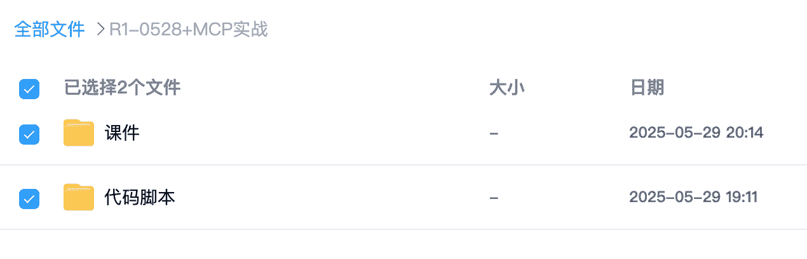


公开课全套学习资料，已上传至网盘（ https://pan.baidu.com/s/1vmMe1KvswLxL5DSmb1uS-Q 提取码: 8ry7 ）

需要更系统深入学习大模型可扫码⬆️添加助教咨询喔～

---

# DeepSeek-R1-0528模型Agent开发实战

# Part 3.R1-0528+MCP进行Agent开发实战

在了解了R1-0528模型的基础Function calling功能实现方法后，接下来，我们尝试借助新兴的Agent开发框架，来进行R1模型+MCP智能体开发实战。在学习本节内容前，建议先简单了解MCP完整技术体系，可以选择以下公开课进行参考：

+   《7分钟讲清楚MCP是什么？》：https://www.bilibili.com/video/BV1uXQzYaEpJ/?

+   《MCP技术开发入门实战！》：https://www.bilibili.com/video/BV1NLXCYTEbj/

+   《MCP企业级智能体开发实战！》：https://www.bilibili.com/video/BV1n1ZuYjEzf/

+   《主流客户端接入MCP实战》：https://www.bilibili.com/video/BV1dCo7YdEgK/

+   《从零到一开发&部署专属MCP工具》：https://www.bilibili.com/video/BV1VHL6zsE5F/

+   《流式HTTP MCP服务器开发流程》：https://www.bilibili.com/video/BV1P7VSzwEXL/

MCP技术参考资料详见大模型技术社区。


此外，本节公开课将采用Qwen-Agent、OpenAI Agents SDK以及谷歌ADK作为基础框架，来快速构建智能体。更多关于新兴热门Agent开发框架技术教学，详见《2025大模型Agent智能体开发实战》(MCP强化班)课程讲解。

## 一、Qwen-Agent MCP智能体开发实战

2023年9月24号，Qwen发布了兼容自家Qwen系列模型的Agent开发框架：Qwen-Agent。它是一个基于 Qwen 的指令跟踪、工具使用、规划和内存功能开发 LLM 应用程序的框架。它还附带浏览器助手、代码解释器和自定义助手等示例应用程序。

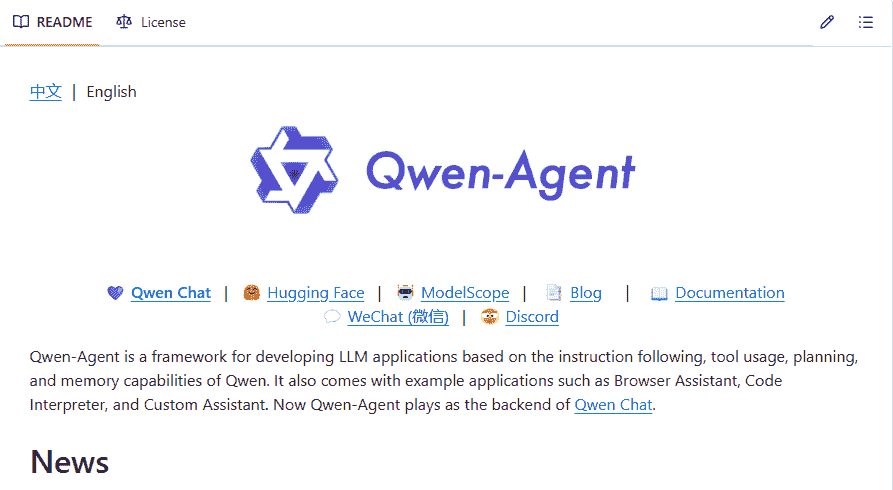

+   快速体验地址：https://chat.qwen.ai/

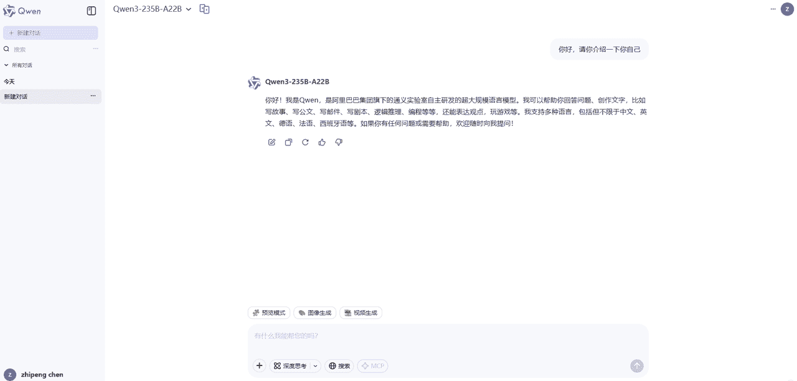

上述体验地址的后端支撑架构，就是Qwen-Agent这个项目。Qwen-Agent支持接入阿里云DashScope服务提供的Qwen模型服务，也支持通过OpenAI API方式接入开源的Qwen模型服务。同时对于通过Ollama、vLLM等框架启动的开源模型，也可以通过OpenAI API 兼容规范快速集成。 目前，Qwen-Agent框架已全面支持Qwen3系列，并且提供了Function Calling功能）和工具（Tool等原子组件，也提供了智能体（Agent）等高级抽象组件，最重要的是：全面支持MCP，可以原生支持公开MCP工具的快速接入。同样，DeepSeek R1 支持通过OpenAI API 规范进行快速接入。

现在，我们仅需在创建Agent的时候，将MCP服务器视作为一项工具，即可顺利调用MCP服务器进行Agent开发。

#### 4.1 Qwen-Agent SDK下载

+   从 PyPI 安装稳定版本

在此命令中，可使用双括号指定如下的可选依赖，其中：

+   [gui] 用于提供基于 Gradio 的 GUI 支持；

+   [rag] 用于支持 RAG；

+   [code_interpreter] 用于提供代码解释器相关支持；

+   [mcp] 用于支持 MCP。

```
! pip install -U &quot;qwen-agent[rag,code_interpreter,gui,mcp]&quot;
```

```
Collecting qwen-agent[code_interpreter,gui,mcp,rag]
  Downloading qwen_agent-0.0.26-py3-none-any.whl.metadata (15 kB)
Collecting dashscope&gt;=1.11.0 (from qwen-agent[code_interpreter,gui,mcp,rag])
  Downloading dashscope-1.23.3-py3-none-any.whl.metadata (6.8 kB)
Requirement already satisfied: eval-type-backport in c:\programdata\anaconda3\envs\jupyter_env\lib\site-packages (from qwen-agent[code_interpreter,gui,mcp,rag]) (0.2.2)
Requirement already satisfied: json5 in c:\programdata\anaconda3\envs\jupyter_env\lib\site-packages (from qwen-agent[code_interpreter,gui,mcp,rag]) (0.10.0)
Collecting jsonlines (from qwen-agent[code_interpreter,gui,mcp,rag])
  Using cached jsonlines-4.0.0-py3-none-any.whl.metadata (1.6 kB)
Requirement already satisfied: jsonschema in c:\programdata\anaconda3\envs\jupyter_env\lib\site-packages (from qwen-agent[code_interpreter,gui,mcp,rag]) (4.23.0)
Requirement already satisfied: openai in c:\programdata\anaconda3\envs\jupyter_env\lib\site-packages (from qwen-agent[code_interpreter,gui,mcp,rag]) (1.82.0)
Requirement already satisfied: pydantic&gt;=2.3.0 in c:\programdata\anaconda3\envs\jupyter_env\lib\site-packages (from qwen-agent[code_interpreter,gui,mcp,rag]) (2.10.6)
Requirement already satisfied: requests in c:\programdata\anaconda3\envs\jupyter_env\lib\site-packages (from qwen-agent[code_interpreter,gui,mcp,rag]) (2.32.3)
Requirement already satisfied: tiktoken in c:\programdata\anaconda3\envs\jupyter_env\lib\site-packages (from qwen-agent[code_interpreter,gui,mcp,rag]) (0.9.0)
Requirement already satisfied: anyio&gt;=3.7.1 in c:\programdata\anaconda3\envs\jupyter_env\lib\site-packages (from qwen-agent[code_interpreter,gui,mcp,rag]) (4.9.0)
Requirement already satisfied: fastapi&gt;=0.103.1 in c:\programdata\anaconda3\envs\jupyter_env\lib\site-packages (from qwen-agent[code_interpreter,gui,mcp,rag]) (0.115.7)
Collecting jupyter&gt;=1.0.0 (from qwen-agent[code_interpreter,gui,mcp,rag])
  Downloading jupyter-1.1.1-py2.py3-none-any.whl.metadata (2.0 kB)
Requirement already satisfied: matplotlib in c:\programdata\anaconda3\envs\jupyter_env\lib\site-packages (from qwen-agent[code_interpreter,gui,mcp,rag]) (3.10.1)
Requirement already satisfied: numpy in c:\programdata\anaconda3\envs\jupyter_env\lib\site-packages (from qwen-agent[code_interpreter,gui,mcp,rag]) (1.26.4)
Requirement already satisfied: pandas in c:\programdata\anaconda3\envs\jupyter_env\lib\site-packages (from qwen-agent[code_interpreter,gui,mcp,rag]) (2.2.3)
Requirement already satisfied: pillow in c:\programdata\anaconda3\envs\jupyter_env\lib\site-packages (from qwen-agent[code_interpreter,gui,mcp,rag]) (11.1.0)
Requirement already satisfied: seaborn in c:\programdata\anaconda3\envs\jupyter_env\lib\site-packages (from qwen-agent[code_interpreter,gui,mcp,rag]) (0.13.2)
Requirement already satisfied: sympy in c:\programdata\anaconda3\envs\jupyter_env\lib\site-packages (from qwen-agent[code_interpreter,gui,mcp,rag]) (1.14.0)
Requirement already satisfied: uvicorn&gt;=0.23.2 in c:\programdata\anaconda3\envs\jupyter_env\lib\site-packages (from qwen-agent[code_interpreter,gui,mcp,rag]) (0.34.0)
Collecting pydantic&gt;=2.3.0 (from qwen-agent[code_interpreter,gui,mcp,rag])
  Using cached pydantic-2.9.2-py3-none-any.whl.metadata (149 kB)
Collecting pydantic-core==2.23.4 (from qwen-agent[code_interpreter,gui,mcp,rag])
  Downloading pydantic_core-2.23.4-cp311-none-win_amd64.whl.metadata (6.7 kB)
Collecting gradio==5.23.1 (from qwen-agent[code_interpreter,gui,mcp,rag])
  Downloading gradio-5.23.1-py3-none-any.whl.metadata (16 kB)
Collecting gradio-client==1.8.0 (from qwen-agent[code_interpreter,gui,mcp,rag])
  Downloading gradio_client-1.8.0-py3-none-any.whl.metadata (7.1 kB)
Collecting modelscope-studio==1.1.7 (from qwen-agent[code_interpreter,gui,mcp,rag])
  Downloading modelscope_studio-1.1.7-py3-none-any.whl.metadata (4.1 kB)
Requirement already satisfied: mcp in c:\programdata\anaconda3\envs\jupyter_env\lib\site-packages (from qwen-agent[code_interpreter,gui,mcp,rag]) (1.6.0)
Requirement already satisfied: charset-normalizer in c:\programdata\anaconda3\envs\jupyter_env\lib\site-packages (from qwen-agent[code_interpreter,gui,mcp,rag]) (3.4.1)
Requirement already satisfied: rank-bm25 in c:\programdata\anaconda3\envs\jupyter_env\lib\site-packages (from qwen-agent[code_interpreter,gui,mcp,rag]) (0.2.2)
Collecting jieba (from qwen-agent[code_interpreter,gui,mcp,rag])
  Using cached jieba-0.42.1.tar.gz (19.2 MB)
  Preparing metadata (setup.py): started
  Preparing metadata (setup.py): finished with status &#x27;done&#x27;
Collecting snowballstemmer (from qwen-agent[code_interpreter,gui,mcp,rag])
  Downloading snowballstemmer-3.0.1-py3-none-any.whl.metadata (7.9 kB)
Requirement already satisfied: beautifulsoup4 in c:\programdata\anaconda3\envs\jupyter_env\lib\site-packages (from qwen-agent[code_interpreter,gui,mcp,rag]) (4.13.3)
Collecting pdfminer.six (from qwen-agent[code_interpreter,gui,mcp,rag])
  Downloading pdfminer_six-20250506-py3-none-any.whl.metadata (4.2 kB)
Collecting pdfplumber (from qwen-agent[code_interpreter,gui,mcp,rag])
  Downloading pdfplumber-0.11.6-py3-none-any.whl.metadata (42 kB)
Collecting python-docx (from qwen-agent[code_interpreter,gui,mcp,rag])
  Downloading python_docx-1.1.2-py3-none-any.whl.metadata (2.0 kB)
Requirement already satisfied: python-pptx in c:\programdata\anaconda3\envs\jupyter_env\lib\site-packages (from qwen-agent[code_interpreter,gui,mcp,rag]) (1.0.0)
Collecting tabulate (from qwen-agent[code_interpreter,gui,mcp,rag])
  Using cached tabulate-0.9.0-py3-none-any.whl.metadata (34 kB)
Collecting aiofiles&lt;24.0,&gt;=22.0 (from gradio==5.23.1-&gt;qwen-agent[code_interpreter,gui,mcp,rag])
  Using cached aiofiles-23.2.1-py3-none-any.whl.metadata (9.7 kB)
Collecting ffmpy (from gradio==5.23.1-&gt;qwen-agent[code_interpreter,gui,mcp,rag])
  Downloading ffmpy-0.5.0-py3-none-any.whl.metadata (3.0 kB)
Collecting groovy~=0.1 (from gradio==5.23.1-&gt;qwen-agent[code_interpreter,gui,mcp,rag])
  Downloading groovy-0.1.2-py3-none-any.whl.metadata (6.1 kB)
Requirement already satisfied: httpx&gt;=0.24.1 in c:\programdata\anaconda3\envs\jupyter_env\lib\site-packages (from gradio==5.23.1-&gt;qwen-agent[code_interpreter,gui,mcp,rag]) (0.28.1)
Requirement already satisfied: huggingface-hub&gt;=0.28.1 in c:\programdata\anaconda3\envs\jupyter_env\lib\site-packages (from gradio==5.23.1-&gt;qwen-agent[code_interpreter,gui,mcp,rag]) (0.30.2)
Requirement already satisfied: jinja2&lt;4.0 in c:\programdata\anaconda3\envs\jupyter_env\lib\site-packages (from gradio==5.23.1-&gt;qwen-agent[code_interpreter,gui,mcp,rag]) (3.1.6)
Requirement already satisfied: markupsafe&lt;4.0,&gt;=2.0 in c:\programdata\anaconda3\envs\jupyter_env\lib\site-packages (from gradio==5.23.1-&gt;qwen-agent[code_interpreter,gui,mcp,rag]) (3.0.2)
Requirement already satisfied: orjson~=3.0 in c:\programdata\anaconda3\envs\jupyter_env\lib\site-packages (from gradio==5.23.1-&gt;qwen-agent[code_interpreter,gui,mcp,rag]) (3.10.18)
Requirement already satisfied: packaging in c:\programdata\anaconda3\envs\jupyter_env\lib\site-packages (from gradio==5.23.1-&gt;qwen-agent[code_interpreter,gui,mcp,rag]) (23.2)
Requirement already satisfied: pydub in c:\programdata\anaconda3\envs\jupyter_env\lib\site-packages (from gradio==5.23.1-&gt;qwen-agent[code_interpreter,gui,mcp,rag]) (0.25.1)
Requirement already satisfied: python-multipart&gt;=0.0.18 in c:\programdata\anaconda3\envs\jupyter_env\lib\site-packages (from gradio==5.23.1-&gt;qwen-agent[code_interpreter,gui,mcp,rag]) (0.0.20)
Requirement already satisfied: pyyaml&lt;7.0,&gt;=5.0 in c:\programdata\anaconda3\envs\jupyter_env\lib\site-packages (from gradio==5.23.1-&gt;qwen-agent[code_interpreter,gui,mcp,rag]) (6.0.2)
Collecting ruff&gt;=0.9.3 (from gradio==5.23.1-&gt;qwen-agent[code_interpreter,gui,mcp,rag])
  Downloading ruff-0.11.11-py3-none-win_amd64.whl.metadata (26 kB)
Collecting safehttpx&lt;0.2.0,&gt;=0.1.6 (from gradio==5.23.1-&gt;qwen-agent[code_interpreter,gui,mcp,rag])
  Downloading safehttpx-0.1.6-py3-none-any.whl.metadata (4.2 kB)
Collecting semantic-version~=2.0 (from gradio==5.23.1-&gt;qwen-agent[code_interpreter,gui,mcp,rag])
  Downloading semantic_version-2.10.0-py2.py3-none-any.whl.metadata (9.7 kB)
Requirement already satisfied: starlette&lt;1.0,&gt;=0.40.0 in c:\programdata\anaconda3\envs\jupyter_env\lib\site-packages (from gradio==5.23.1-&gt;qwen-agent[code_interpreter,gui,mcp,rag]) (0.45.3)
Collecting tomlkit&lt;0.14.0,&gt;=0.12.0 (from gradio==5.23.1-&gt;qwen-agent[code_interpreter,gui,mcp,rag])
  Downloading tomlkit-0.13.2-py3-none-any.whl.metadata (2.7 kB)
Requirement already satisfied: typer&lt;1.0,&gt;=0.12 in c:\programdata\anaconda3\envs\jupyter_env\lib\site-packages (from gradio==5.23.1-&gt;qwen-agent[code_interpreter,gui,mcp,rag]) (0.15.4)
Requirement already satisfied: typing-extensions~=4.0 in c:\programdata\anaconda3\envs\jupyter_env\lib\site-packages (from gradio==5.23.1-&gt;qwen-agent[code_interpreter,gui,mcp,rag]) (4.13.0)
Requirement already satisfied: fsspec in c:\programdata\anaconda3\envs\jupyter_env\lib\site-packages (from gradio-client==1.8.0-&gt;qwen-agent[code_interpreter,gui,mcp,rag]) (2025.3.0)
Requirement already satisfied: websockets&lt;16.0,&gt;=10.0 in c:\programdata\anaconda3\envs\jupyter_env\lib\site-packages (from gradio-client==1.8.0-&gt;qwen-agent[code_interpreter,gui,mcp,rag]) (15.0.1)
Requirement already satisfied: annotated-types&gt;=0.6.0 in c:\programdata\anaconda3\envs\jupyter_env\lib\site-packages (from pydantic&gt;=2.3.0-&gt;qwen-agent[code_interpreter,gui,mcp,rag]) (0.7.0)
Requirement already satisfied: idna&gt;=2.8 in c:\programdata\anaconda3\envs\jupyter_env\lib\site-packages (from anyio&gt;=3.7.1-&gt;qwen-agent[code_interpreter,gui,mcp,rag]) (3.10)
Requirement already satisfied: sniffio&gt;=1.1 in c:\programdata\anaconda3\envs\jupyter_env\lib\site-packages (from anyio&gt;=3.7.1-&gt;qwen-agent[code_interpreter,gui,mcp,rag]) (1.3.1)
Requirement already satisfied: aiohttp in c:\programdata\anaconda3\envs\jupyter_env\lib\site-packages (from dashscope&gt;=1.11.0-&gt;qwen-agent[code_interpreter,gui,mcp,rag]) (3.11.11)
Requirement already satisfied: websocket-client in c:\programdata\anaconda3\envs\jupyter_env\lib\site-packages (from dashscope&gt;=1.11.0-&gt;qwen-agent[code_interpreter,gui,mcp,rag]) (1.8.0)
Collecting notebook (from jupyter&gt;=1.0.0-&gt;qwen-agent[code_interpreter,gui,mcp,rag])
  Downloading notebook-7.4.3-py3-none-any.whl.metadata (10 kB)
Collecting jupyter-console (from jupyter&gt;=1.0.0-&gt;qwen-agent[code_interpreter,gui,mcp,rag])
  Downloading jupyter_console-6.6.3-py3-none-any.whl.metadata (5.8 kB)
Requirement already satisfied: nbconvert in c:\programdata\anaconda3\envs\jupyter_env\lib\site-packages (from jupyter&gt;=1.0.0-&gt;qwen-agent[code_interpreter,gui,mcp,rag]) (7.16.6)
Requirement already satisfied: ipykernel in c:\programdata\anaconda3\envs\jupyter_env\lib\site-packages (from jupyter&gt;=1.0.0-&gt;qwen-agent[code_interpreter,gui,mcp,rag]) (6.29.5)
Collecting ipywidgets (from jupyter&gt;=1.0.0-&gt;qwen-agent[code_interpreter,gui,mcp,rag])
  Downloading ipywidgets-8.1.7-py3-none-any.whl.metadata (2.4 kB)
Requirement already satisfied: jupyterlab in c:\programdata\anaconda3\envs\jupyter_env\lib\site-packages (from jupyter&gt;=1.0.0-&gt;qwen-agent[code_interpreter,gui,mcp,rag]) (4.3.6)
Requirement already satisfied: python-dateutil&gt;=2.8.2 in c:\programdata\anaconda3\envs\jupyter_env\lib\site-packages (from pandas-&gt;qwen-agent[code_interpreter,gui,mcp,rag]) (2.9.0.post0)
Requirement already satisfied: pytz&gt;=2020.1 in c:\programdata\anaconda3\envs\jupyter_env\lib\site-packages (from pandas-&gt;qwen-agent[code_interpreter,gui,mcp,rag]) (2025.2)
Requirement already satisfied: tzdata&gt;=2022.7 in c:\programdata\anaconda3\envs\jupyter_env\lib\site-packages (from pandas-&gt;qwen-agent[code_interpreter,gui,mcp,rag]) (2025.2)
Requirement already satisfied: click&gt;=7.0 in c:\programdata\anaconda3\envs\jupyter_env\lib\site-packages (from uvicorn&gt;=0.23.2-&gt;qwen-agent[code_interpreter,gui,mcp,rag]) (8.1.8)
Requirement already satisfied: h11&gt;=0.8 in c:\programdata\anaconda3\envs\jupyter_env\lib\site-packages (from uvicorn&gt;=0.23.2-&gt;qwen-agent[code_interpreter,gui,mcp,rag]) (0.14.0)
Requirement already satisfied: soupsieve&gt;1.2 in c:\programdata\anaconda3\envs\jupyter_env\lib\site-packages (from beautifulsoup4-&gt;qwen-agent[code_interpreter,gui,mcp,rag]) (2.6)
Requirement already satisfied: attrs&gt;=19.2.0 in c:\programdata\anaconda3\envs\jupyter_env\lib\site-packages (from jsonlines-&gt;qwen-agent[code_interpreter,gui,mcp,rag]) (25.3.0)
Requirement already satisfied: jsonschema-specifications&gt;=2023.03.6 in c:\programdata\anaconda3\envs\jupyter_env\lib\site-packages (from jsonschema-&gt;qwen-agent[code_interpreter,gui,mcp,rag]) (2024.10.1)
Requirement already satisfied: referencing&gt;=0.28.4 in c:\programdata\anaconda3\envs\jupyter_env\lib\site-packages (from jsonschema-&gt;qwen-agent[code_interpreter,gui,mcp,rag]) (0.36.2)
Requirement already satisfied: rpds-py&gt;=0.7.1 in c:\programdata\anaconda3\envs\jupyter_env\lib\site-packages (from jsonschema-&gt;qwen-agent[code_interpreter,gui,mcp,rag]) (0.24.0)
Requirement already satisfied: contourpy&gt;=1.0.1 in c:\programdata\anaconda3\envs\jupyter_env\lib\site-packages (from matplotlib-&gt;qwen-agent[code_interpreter,gui,mcp,rag]) (1.3.1)
Requirement already satisfied: cycler&gt;=0.10 in c:\programdata\anaconda3\envs\jupyter_env\lib\site-packages (from matplotlib-&gt;qwen-agent[code_interpreter,gui,mcp,rag]) (0.12.1)
Requirement already satisfied: fonttools&gt;=4.22.0 in c:\programdata\anaconda3\envs\jupyter_env\lib\site-packages (from matplotlib-&gt;qwen-agent[code_interpreter,gui,mcp,rag]) (4.56.0)
Requirement already satisfied: kiwisolver&gt;=1.3.1 in c:\programdata\anaconda3\envs\jupyter_env\lib\site-packages (from matplotlib-&gt;qwen-agent[code_interpreter,gui,mcp,rag]) (1.4.8)
Requirement already satisfied: pyparsing&gt;=2.3.1 in c:\programdata\anaconda3\envs\jupyter_env\lib\site-packages (from matplotlib-&gt;qwen-agent[code_interpreter,gui,mcp,rag]) (3.2.3)
Requirement already satisfied: httpx-sse&gt;=0.4 in c:\programdata\anaconda3\envs\jupyter_env\lib\site-packages (from mcp-&gt;qwen-agent[code_interpreter,gui,mcp,rag]) (0.4.0)
Requirement already satisfied: pydantic-settings&gt;=2.5.2 in c:\programdata\anaconda3\envs\jupyter_env\lib\site-packages (from mcp-&gt;qwen-agent[code_interpreter,gui,mcp,rag]) (2.8.1)
Requirement already satisfied: sse-starlette&gt;=1.6.1 in c:\programdata\anaconda3\envs\jupyter_env\lib\site-packages (from mcp-&gt;qwen-agent[code_interpreter,gui,mcp,rag]) (2.2.1)
Requirement already satisfied: distro&lt;2,&gt;=1.7.0 in c:\programdata\anaconda3\envs\jupyter_env\lib\site-packages (from openai-&gt;qwen-agent[code_interpreter,gui,mcp,rag]) (1.9.0)
Requirement already satisfied: jiter&lt;1,&gt;=0.4.0 in c:\programdata\anaconda3\envs\jupyter_env\lib\site-packages (from openai-&gt;qwen-agent[code_interpreter,gui,mcp,rag]) (0.9.0)
Requirement already satisfied: tqdm&gt;4 in c:\programdata\anaconda3\envs\jupyter_env\lib\site-packages (from openai-&gt;qwen-agent[code_interpreter,gui,mcp,rag]) (4.67.1)
Requirement already satisfied: cryptography&gt;=36.0.0 in c:\programdata\anaconda3\envs\jupyter_env\lib\site-packages (from pdfminer.six-&gt;qwen-agent[code_interpreter,gui,mcp,rag]) (44.0.2)
Collecting pdfminer.six (from qwen-agent[code_interpreter,gui,mcp,rag])
  Downloading pdfminer_six-20250327-py3-none-any.whl.metadata (4.1 kB)
Collecting pypdfium2&gt;=4.18.0 (from pdfplumber-&gt;qwen-agent[code_interpreter,gui,mcp,rag])
  Downloading pypdfium2-4.30.1-py3-none-win_amd64.whl.metadata (48 kB)
Requirement already satisfied: lxml&gt;=3.1.0 in c:\programdata\anaconda3\envs\jupyter_env\lib\site-packages (from python-docx-&gt;qwen-agent[code_interpreter,gui,mcp,rag]) (5.3.1)
Requirement already satisfied: XlsxWriter&gt;=0.5.7 in c:\programdata\anaconda3\envs\jupyter_env\lib\site-packages (from python-pptx-&gt;qwen-agent[code_interpreter,gui,mcp,rag]) (3.2.3)
Requirement already satisfied: urllib3&lt;3,&gt;=1.21.1 in c:\programdata\anaconda3\envs\jupyter_env\lib\site-packages (from requests-&gt;qwen-agent[code_interpreter,gui,mcp,rag]) (2.3.0)
Requirement already satisfied: certifi&gt;=2017.4.17 in c:\programdata\anaconda3\envs\jupyter_env\lib\site-packages (from requests-&gt;qwen-agent[code_interpreter,gui,mcp,rag]) (2025.1.31)
Requirement already satisfied: mpmath&lt;1.4,&gt;=1.1.0 in c:\programdata\anaconda3\envs\jupyter_env\lib\site-packages (from sympy-&gt;qwen-agent[code_interpreter,gui,mcp,rag]) (1.3.0)
Requirement already satisfied: regex&gt;=2022.1.18 in c:\programdata\anaconda3\envs\jupyter_env\lib\site-packages (from tiktoken-&gt;qwen-agent[code_interpreter,gui,mcp,rag]) (2024.11.6)
Requirement already satisfied: colorama in c:\programdata\anaconda3\envs\jupyter_env\lib\site-packages (from click&gt;=7.0-&gt;uvicorn&gt;=0.23.2-&gt;qwen-agent[code_interpreter,gui,mcp,rag]) (0.4.6)
Requirement already satisfied: cffi&gt;=1.12 in c:\programdata\anaconda3\envs\jupyter_env\lib\site-packages (from cryptography&gt;=36.0.0-&gt;pdfminer.six-&gt;qwen-agent[code_interpreter,gui,mcp,rag]) (1.17.1)
Requirement already satisfied: httpcore==1.* in c:\programdata\anaconda3\envs\jupyter_env\lib\site-packages (from httpx&gt;=0.24.1-&gt;gradio==5.23.1-&gt;qwen-agent[code_interpreter,gui,mcp,rag]) (1.0.7)
Requirement already satisfied: filelock in c:\programdata\anaconda3\envs\jupyter_env\lib\site-packages (from huggingface-hub&gt;=0.28.1-&gt;gradio==5.23.1-&gt;qwen-agent[code_interpreter,gui,mcp,rag]) (3.18.0)
Requirement already satisfied: python-dotenv&gt;=0.21.0 in c:\programdata\anaconda3\envs\jupyter_env\lib\site-packages (from pydantic-settings&gt;=2.5.2-&gt;mcp-&gt;qwen-agent[code_interpreter,gui,mcp,rag]) (1.1.0)
Requirement already satisfied: six&gt;=1.5 in c:\programdata\anaconda3\envs\jupyter_env\lib\site-packages (from python-dateutil&gt;=2.8.2-&gt;pandas-&gt;qwen-agent[code_interpreter,gui,mcp,rag]) (1.17.0)
Requirement already satisfied: shellingham&gt;=1.3.0 in c:\programdata\anaconda3\envs\jupyter_env\lib\site-packages (from typer&lt;1.0,&gt;=0.12-&gt;gradio==5.23.1-&gt;qwen-agent[code_interpreter,gui,mcp,rag]) (1.5.4)
Requirement already satisfied: rich&gt;=10.11.0 in c:\programdata\anaconda3\envs\jupyter_env\lib\site-packages (from typer&lt;1.0,&gt;=0.12-&gt;gradio==5.23.1-&gt;qwen-agent[code_interpreter,gui,mcp,rag]) (14.0.0)
Requirement already satisfied: aiohappyeyeballs&gt;=2.3.0 in c:\programdata\anaconda3\envs\jupyter_env\lib\site-packages (from aiohttp-&gt;dashscope&gt;=1.11.0-&gt;qwen-agent[code_interpreter,gui,mcp,rag]) (2.6.1)
Requirement already satisfied: aiosignal&gt;=1.1.2 in c:\programdata\anaconda3\envs\jupyter_env\lib\site-packages (from aiohttp-&gt;dashscope&gt;=1.11.0-&gt;qwen-agent[code_interpreter,gui,mcp,rag]) (1.3.2)
Requirement already satisfied: frozenlist&gt;=1.1.1 in c:\programdata\anaconda3\envs\jupyter_env\lib\site-packages (from aiohttp-&gt;dashscope&gt;=1.11.0-&gt;qwen-agent[code_interpreter,gui,mcp,rag]) (1.6.0)
Requirement already satisfied: multidict&lt;7.0,&gt;=4.5 in c:\programdata\anaconda3\envs\jupyter_env\lib\site-packages (from aiohttp-&gt;dashscope&gt;=1.11.0-&gt;qwen-agent[code_interpreter,gui,mcp,rag]) (6.4.3)
Requirement already satisfied: propcache&gt;=0.2.0 in c:\programdata\anaconda3\envs\jupyter_env\lib\site-packages (from aiohttp-&gt;dashscope&gt;=1.11.0-&gt;qwen-agent[code_interpreter,gui,mcp,rag]) (0.3.1)
Requirement already satisfied: yarl&lt;2.0,&gt;=1.17.0 in c:\programdata\anaconda3\envs\jupyter_env\lib\site-packages (from aiohttp-&gt;dashscope&gt;=1.11.0-&gt;qwen-agent[code_interpreter,gui,mcp,rag]) (1.20.0)
Requirement already satisfied: comm&gt;=0.1.1 in c:\programdata\anaconda3\envs\jupyter_env\lib\site-packages (from ipykernel-&gt;jupyter&gt;=1.0.0-&gt;qwen-agent[code_interpreter,gui,mcp,rag]) (0.2.2)
Requirement already satisfied: debugpy&gt;=1.6.5 in c:\programdata\anaconda3\envs\jupyter_env\lib\site-packages (from ipykernel-&gt;jupyter&gt;=1.0.0-&gt;qwen-agent[code_interpreter,gui,mcp,rag]) (1.8.13)
Requirement already satisfied: ipython&gt;=7.23.1 in c:\programdata\anaconda3\envs\jupyter_env\lib\site-packages (from ipykernel-&gt;jupyter&gt;=1.0.0-&gt;qwen-agent[code_interpreter,gui,mcp,rag]) (9.0.2)
Requirement already satisfied: jupyter-client&gt;=6.1.12 in c:\programdata\anaconda3\envs\jupyter_env\lib\site-packages (from ipykernel-&gt;jupyter&gt;=1.0.0-&gt;qwen-agent[code_interpreter,gui,mcp,rag]) (8.6.3)
Requirement already satisfied: jupyter-core!=5.0.*,&gt;=4.12 in c:\programdata\anaconda3\envs\jupyter_env\lib\site-packages (from ipykernel-&gt;jupyter&gt;=1.0.0-&gt;qwen-agent[code_interpreter,gui,mcp,rag]) (5.7.2)
Requirement already satisfied: matplotlib-inline&gt;=0.1 in c:\programdata\anaconda3\envs\jupyter_env\lib\site-packages (from ipykernel-&gt;jupyter&gt;=1.0.0-&gt;qwen-agent[code_interpreter,gui,mcp,rag]) (0.1.7)
Requirement already satisfied: nest-asyncio in c:\programdata\anaconda3\envs\jupyter_env\lib\site-packages (from ipykernel-&gt;jupyter&gt;=1.0.0-&gt;qwen-agent[code_interpreter,gui,mcp,rag]) (1.6.0)
Requirement already satisfied: psutil in c:\programdata\anaconda3\envs\jupyter_env\lib\site-packages (from ipykernel-&gt;jupyter&gt;=1.0.0-&gt;qwen-agent[code_interpreter,gui,mcp,rag]) (7.0.0)
Requirement already satisfied: pyzmq&gt;=24 in c:\programdata\anaconda3\envs\jupyter_env\lib\site-packages (from ipykernel-&gt;jupyter&gt;=1.0.0-&gt;qwen-agent[code_interpreter,gui,mcp,rag]) (26.3.0)
Requirement already satisfied: tornado&gt;=6.1 in c:\programdata\anaconda3\envs\jupyter_env\lib\site-packages (from ipykernel-&gt;jupyter&gt;=1.0.0-&gt;qwen-agent[code_interpreter,gui,mcp,rag]) (6.4.2)
Requirement already satisfied: traitlets&gt;=5.4.0 in c:\programdata\anaconda3\envs\jupyter_env\lib\site-packages (from ipykernel-&gt;jupyter&gt;=1.0.0-&gt;qwen-agent[code_interpreter,gui,mcp,rag]) (5.14.3)
Collecting widgetsnbextension~=4.0.14 (from ipywidgets-&gt;jupyter&gt;=1.0.0-&gt;qwen-agent[code_interpreter,gui,mcp,rag])
  Downloading widgetsnbextension-4.0.14-py3-none-any.whl.metadata (1.6 kB)
Collecting jupyterlab_widgets~=3.0.15 (from ipywidgets-&gt;jupyter&gt;=1.0.0-&gt;qwen-agent[code_interpreter,gui,mcp,rag])
  Downloading jupyterlab_widgets-3.0.15-py3-none-any.whl.metadata (20 kB)
Requirement already satisfied: prompt-toolkit&gt;=3.0.30 in c:\programdata\anaconda3\envs\jupyter_env\lib\site-packages (from jupyter-console-&gt;jupyter&gt;=1.0.0-&gt;qwen-agent[code_interpreter,gui,mcp,rag]) (3.0.50)
Requirement already satisfied: pygments in c:\programdata\anaconda3\envs\jupyter_env\lib\site-packages (from jupyter-console-&gt;jupyter&gt;=1.0.0-&gt;qwen-agent[code_interpreter,gui,mcp,rag]) (2.19.1)
Requirement already satisfied: async-lru&gt;=1.0.0 in c:\programdata\anaconda3\envs\jupyter_env\lib\site-packages (from jupyterlab-&gt;jupyter&gt;=1.0.0-&gt;qwen-agent[code_interpreter,gui,mcp,rag]) (2.0.5)
Requirement already satisfied: jupyter-lsp&gt;=2.0.0 in c:\programdata\anaconda3\envs\jupyter_env\lib\site-packages (from jupyterlab-&gt;jupyter&gt;=1.0.0-&gt;qwen-agent[code_interpreter,gui,mcp,rag]) (2.2.5)
Requirement already satisfied: jupyter-server&lt;3,&gt;=2.4.0 in c:\programdata\anaconda3\envs\jupyter_env\lib\site-packages (from jupyterlab-&gt;jupyter&gt;=1.0.0-&gt;qwen-agent[code_interpreter,gui,mcp,rag]) (2.15.0)
Requirement already satisfied: jupyterlab-server&lt;3,&gt;=2.27.1 in c:\programdata\anaconda3\envs\jupyter_env\lib\site-packages (from jupyterlab-&gt;jupyter&gt;=1.0.0-&gt;qwen-agent[code_interpreter,gui,mcp,rag]) (2.27.3)
Requirement already satisfied: notebook-shim&gt;=0.2 in c:\programdata\anaconda3\envs\jupyter_env\lib\site-packages (from jupyterlab-&gt;jupyter&gt;=1.0.0-&gt;qwen-agent[code_interpreter,gui,mcp,rag]) (0.2.4)
Requirement already satisfied: setuptools&gt;=40.8.0 in c:\programdata\anaconda3\envs\jupyter_env\lib\site-packages (from jupyterlab-&gt;jupyter&gt;=1.0.0-&gt;qwen-agent[code_interpreter,gui,mcp,rag]) (75.8.0)
Requirement already satisfied: bleach!=5.0.0 in c:\programdata\anaconda3\envs\jupyter_env\lib\site-packages (from bleach[css]!=5.0.0-&gt;nbconvert-&gt;jupyter&gt;=1.0.0-&gt;qwen-agent[code_interpreter,gui,mcp,rag]) (6.2.0)
Requirement already satisfied: defusedxml in c:\programdata\anaconda3\envs\jupyter_env\lib\site-packages (from nbconvert-&gt;jupyter&gt;=1.0.0-&gt;qwen-agent[code_interpreter,gui,mcp,rag]) (0.7.1)
Requirement already satisfied: jupyterlab-pygments in c:\programdata\anaconda3\envs\jupyter_env\lib\site-packages (from nbconvert-&gt;jupyter&gt;=1.0.0-&gt;qwen-agent[code_interpreter,gui,mcp,rag]) (0.3.0)
Requirement already satisfied: mistune&lt;4,&gt;=2.0.3 in c:\programdata\anaconda3\envs\jupyter_env\lib\site-packages (from nbconvert-&gt;jupyter&gt;=1.0.0-&gt;qwen-agent[code_interpreter,gui,mcp,rag]) (3.1.3)
Requirement already satisfied: nbclient&gt;=0.5.0 in c:\programdata\anaconda3\envs\jupyter_env\lib\site-packages (from nbconvert-&gt;jupyter&gt;=1.0.0-&gt;qwen-agent[code_interpreter,gui,mcp,rag]) (0.10.2)
Requirement already satisfied: nbformat&gt;=5.7 in c:\programdata\anaconda3\envs\jupyter_env\lib\site-packages (from nbconvert-&gt;jupyter&gt;=1.0.0-&gt;qwen-agent[code_interpreter,gui,mcp,rag]) (5.10.4)
Requirement already satisfied: pandocfilters&gt;=1.4.1 in c:\programdata\anaconda3\envs\jupyter_env\lib\site-packages (from nbconvert-&gt;jupyter&gt;=1.0.0-&gt;qwen-agent[code_interpreter,gui,mcp,rag]) (1.5.1)
Collecting jupyterlab (from jupyter&gt;=1.0.0-&gt;qwen-agent[code_interpreter,gui,mcp,rag])
  Downloading jupyterlab-4.4.3-py3-none-any.whl.metadata (16 kB)
Requirement already satisfied: webencodings in c:\programdata\anaconda3\envs\jupyter_env\lib\site-packages (from bleach!=5.0.0-&gt;bleach[css]!=5.0.0-&gt;nbconvert-&gt;jupyter&gt;=1.0.0-&gt;qwen-agent[code_interpreter,gui,mcp,rag]) (0.5.1)
Requirement already satisfied: tinycss2&lt;1.5,&gt;=1.1.0 in c:\programdata\anaconda3\envs\jupyter_env\lib\site-packages (from bleach[css]!=5.0.0-&gt;nbconvert-&gt;jupyter&gt;=1.0.0-&gt;qwen-agent[code_interpreter,gui,mcp,rag]) (1.4.0)
Requirement already satisfied: pycparser in c:\programdata\anaconda3\envs\jupyter_env\lib\site-packages (from cffi&gt;=1.12-&gt;cryptography&gt;=36.0.0-&gt;pdfminer.six-&gt;qwen-agent[code_interpreter,gui,mcp,rag]) (2.22)
Requirement already satisfied: decorator in c:\programdata\anaconda3\envs\jupyter_env\lib\site-packages (from ipython&gt;=7.23.1-&gt;ipykernel-&gt;jupyter&gt;=1.0.0-&gt;qwen-agent[code_interpreter,gui,mcp,rag]) (5.2.1)
Requirement already satisfied: ipython-pygments-lexers in c:\programdata\anaconda3\envs\jupyter_env\lib\site-packages (from ipython&gt;=7.23.1-&gt;ipykernel-&gt;jupyter&gt;=1.0.0-&gt;qwen-agent[code_interpreter,gui,mcp,rag]) (1.1.1)
Requirement already satisfied: jedi&gt;=0.16 in c:\programdata\anaconda3\envs\jupyter_env\lib\site-packages (from ipython&gt;=7.23.1-&gt;ipykernel-&gt;jupyter&gt;=1.0.0-&gt;qwen-agent[code_interpreter,gui,mcp,rag]) (0.19.2)
Requirement already satisfied: stack_data in c:\programdata\anaconda3\envs\jupyter_env\lib\site-packages (from ipython&gt;=7.23.1-&gt;ipykernel-&gt;jupyter&gt;=1.0.0-&gt;qwen-agent[code_interpreter,gui,mcp,rag]) (0.6.3)
Requirement already satisfied: platformdirs&gt;=2.5 in c:\programdata\anaconda3\envs\jupyter_env\lib\site-packages (from jupyter-core!=5.0.*,&gt;=4.12-&gt;ipykernel-&gt;jupyter&gt;=1.0.0-&gt;qwen-agent[code_interpreter,gui,mcp,rag]) (4.3.7)
Requirement already satisfied: pywin32&gt;=300 in c:\programdata\anaconda3\envs\jupyter_env\lib\site-packages (from jupyter-core!=5.0.*,&gt;=4.12-&gt;ipykernel-&gt;jupyter&gt;=1.0.0-&gt;qwen-agent[code_interpreter,gui,mcp,rag]) (310)
Requirement already satisfied: argon2-cffi&gt;=21.1 in c:\programdata\anaconda3\envs\jupyter_env\lib\site-packages (from jupyter-server&lt;3,&gt;=2.4.0-&gt;jupyterlab-&gt;jupyter&gt;=1.0.0-&gt;qwen-agent[code_interpreter,gui,mcp,rag]) (23.1.0)
Requirement already satisfied: jupyter-events&gt;=0.11.0 in c:\programdata\anaconda3\envs\jupyter_env\lib\site-packages (from jupyter-server&lt;3,&gt;=2.4.0-&gt;jupyterlab-&gt;jupyter&gt;=1.0.0-&gt;qwen-agent[code_interpreter,gui,mcp,rag]) (0.12.0)
Requirement already satisfied: jupyter-server-terminals&gt;=0.4.4 in c:\programdata\anaconda3\envs\jupyter_env\lib\site-packages (from jupyter-server&lt;3,&gt;=2.4.0-&gt;jupyterlab-&gt;jupyter&gt;=1.0.0-&gt;qwen-agent[code_interpreter,gui,mcp,rag]) (0.5.3)
Requirement already satisfied: overrides&gt;=5.0 in c:\programdata\anaconda3\envs\jupyter_env\lib\site-packages (from jupyter-server&lt;3,&gt;=2.4.0-&gt;jupyterlab-&gt;jupyter&gt;=1.0.0-&gt;qwen-agent[code_interpreter,gui,mcp,rag]) (7.7.0)
Requirement already satisfied: prometheus-client&gt;=0.9 in c:\programdata\anaconda3\envs\jupyter_env\lib\site-packages (from jupyter-server&lt;3,&gt;=2.4.0-&gt;jupyterlab-&gt;jupyter&gt;=1.0.0-&gt;qwen-agent[code_interpreter,gui,mcp,rag]) (0.21.1)
Requirement already satisfied: pywinpty&gt;=2.0.1 in c:\programdata\anaconda3\envs\jupyter_env\lib\site-packages (from jupyter-server&lt;3,&gt;=2.4.0-&gt;jupyterlab-&gt;jupyter&gt;=1.0.0-&gt;qwen-agent[code_interpreter,gui,mcp,rag]) (2.0.15)
Requirement already satisfied: send2trash&gt;=1.8.2 in c:\programdata\anaconda3\envs\jupyter_env\lib\site-packages (from jupyter-server&lt;3,&gt;=2.4.0-&gt;jupyterlab-&gt;jupyter&gt;=1.0.0-&gt;qwen-agent[code_interpreter,gui,mcp,rag]) (1.8.3)
Requirement already satisfied: terminado&gt;=0.8.3 in c:\programdata\anaconda3\envs\jupyter_env\lib\site-packages (from jupyter-server&lt;3,&gt;=2.4.0-&gt;jupyterlab-&gt;jupyter&gt;=1.0.0-&gt;qwen-agent[code_interpreter,gui,mcp,rag]) (0.18.1)
Requirement already satisfied: babel&gt;=2.10 in c:\programdata\anaconda3\envs\jupyter_env\lib\site-packages (from jupyterlab-server&lt;3,&gt;=2.27.1-&gt;jupyterlab-&gt;jupyter&gt;=1.0.0-&gt;qwen-agent[code_interpreter,gui,mcp,rag]) (2.17.0)
Requirement already satisfied: fastjsonschema&gt;=2.15 in c:\programdata\anaconda3\envs\jupyter_env\lib\site-packages (from nbformat&gt;=5.7-&gt;nbconvert-&gt;jupyter&gt;=1.0.0-&gt;qwen-agent[code_interpreter,gui,mcp,rag]) (2.21.1)
Requirement already satisfied: wcwidth in c:\programdata\anaconda3\envs\jupyter_env\lib\site-packages (from prompt-toolkit&gt;=3.0.30-&gt;jupyter-console-&gt;jupyter&gt;=1.0.0-&gt;qwen-agent[code_interpreter,gui,mcp,rag]) (0.2.13)
Requirement already satisfied: markdown-it-py&gt;=2.2.0 in c:\programdata\anaconda3\envs\jupyter_env\lib\site-packages (from rich&gt;=10.11.0-&gt;typer&lt;1.0,&gt;=0.12-&gt;gradio==5.23.1-&gt;qwen-agent[code_interpreter,gui,mcp,rag]) (3.0.0)
Requirement already satisfied: argon2-cffi-bindings in c:\programdata\anaconda3\envs\jupyter_env\lib\site-packages (from argon2-cffi&gt;=21.1-&gt;jupyter-server&lt;3,&gt;=2.4.0-&gt;jupyterlab-&gt;jupyter&gt;=1.0.0-&gt;qwen-agent[code_interpreter,gui,mcp,rag]) (21.2.0)
Requirement already satisfied: parso&lt;0.9.0,&gt;=0.8.4 in c:\programdata\anaconda3\envs\jupyter_env\lib\site-packages (from jedi&gt;=0.16-&gt;ipython&gt;=7.23.1-&gt;ipykernel-&gt;jupyter&gt;=1.0.0-&gt;qwen-agent[code_interpreter,gui,mcp,rag]) (0.8.4)
Requirement already satisfied: python-json-logger&gt;=2.0.4 in c:\programdata\anaconda3\envs\jupyter_env\lib\site-packages (from jupyter-events&gt;=0.11.0-&gt;jupyter-server&lt;3,&gt;=2.4.0-&gt;jupyterlab-&gt;jupyter&gt;=1.0.0-&gt;qwen-agent[code_interpreter,gui,mcp,rag]) (3.3.0)
Requirement already satisfied: rfc3339-validator in c:\programdata\anaconda3\envs\jupyter_env\lib\site-packages (from jupyter-events&gt;=0.11.0-&gt;jupyter-server&lt;3,&gt;=2.4.0-&gt;jupyterlab-&gt;jupyter&gt;=1.0.0-&gt;qwen-agent[code_interpreter,gui,mcp,rag]) (0.1.4)
Requirement already satisfied: rfc3986-validator&gt;=0.1.1 in c:\programdata\anaconda3\envs\jupyter_env\lib\site-packages (from jupyter-events&gt;=0.11.0-&gt;jupyter-server&lt;3,&gt;=2.4.0-&gt;jupyterlab-&gt;jupyter&gt;=1.0.0-&gt;qwen-agent[code_interpreter,gui,mcp,rag]) (0.1.1)
Requirement already satisfied: mdurl~=0.1 in c:\programdata\anaconda3\envs\jupyter_env\lib\site-packages (from markdown-it-py&gt;=2.2.0-&gt;rich&gt;=10.11.0-&gt;typer&lt;1.0,&gt;=0.12-&gt;gradio==5.23.1-&gt;qwen-agent[code_interpreter,gui,mcp,rag]) (0.1.2)
Requirement already satisfied: executing&gt;=1.2.0 in c:\programdata\anaconda3\envs\jupyter_env\lib\site-packages (from stack_data-&gt;ipython&gt;=7.23.1-&gt;ipykernel-&gt;jupyter&gt;=1.0.0-&gt;qwen-agent[code_interpreter,gui,mcp,rag]) (2.2.0)
Requirement already satisfied: asttokens&gt;=2.1.0 in c:\programdata\anaconda3\envs\jupyter_env\lib\site-packages (from stack_data-&gt;ipython&gt;=7.23.1-&gt;ipykernel-&gt;jupyter&gt;=1.0.0-&gt;qwen-agent[code_interpreter,gui,mcp,rag]) (3.0.0)
Requirement already satisfied: pure-eval in c:\programdata\anaconda3\envs\jupyter_env\lib\site-packages (from stack_data-&gt;ipython&gt;=7.23.1-&gt;ipykernel-&gt;jupyter&gt;=1.0.0-&gt;qwen-agent[code_interpreter,gui,mcp,rag]) (0.2.3)
Requirement already satisfied: fqdn in c:\programdata\anaconda3\envs\jupyter_env\lib\site-packages (from jsonschema[format-nongpl]&gt;=4.18.0-&gt;jupyter-events&gt;=0.11.0-&gt;jupyter-server&lt;3,&gt;=2.4.0-&gt;jupyterlab-&gt;jupyter&gt;=1.0.0-&gt;qwen-agent[code_interpreter,gui,mcp,rag]) (1.5.1)
Requirement already satisfied: isoduration in c:\programdata\anaconda3\envs\jupyter_env\lib\site-packages (from jsonschema[format-nongpl]&gt;=4.18.0-&gt;jupyter-events&gt;=0.11.0-&gt;jupyter-server&lt;3,&gt;=2.4.0-&gt;jupyterlab-&gt;jupyter&gt;=1.0.0-&gt;qwen-agent[code_interpreter,gui,mcp,rag]) (20.11.0)
Requirement already satisfied: jsonpointer&gt;1.13 in c:\programdata\anaconda3\envs\jupyter_env\lib\site-packages (from jsonschema[format-nongpl]&gt;=4.18.0-&gt;jupyter-events&gt;=0.11.0-&gt;jupyter-server&lt;3,&gt;=2.4.0-&gt;jupyterlab-&gt;jupyter&gt;=1.0.0-&gt;qwen-agent[code_interpreter,gui,mcp,rag]) (3.0.0)
Requirement already satisfied: uri-template in c:\programdata\anaconda3\envs\jupyter_env\lib\site-packages (from jsonschema[format-nongpl]&gt;=4.18.0-&gt;jupyter-events&gt;=0.11.0-&gt;jupyter-server&lt;3,&gt;=2.4.0-&gt;jupyterlab-&gt;jupyter&gt;=1.0.0-&gt;qwen-agent[code_interpreter,gui,mcp,rag]) (1.3.0)
Requirement already satisfied: webcolors&gt;=24.6.0 in c:\programdata\anaconda3\envs\jupyter_env\lib\site-packages (from jsonschema[format-nongpl]&gt;=4.18.0-&gt;jupyter-events&gt;=0.11.0-&gt;jupyter-server&lt;3,&gt;=2.4.0-&gt;jupyterlab-&gt;jupyter&gt;=1.0.0-&gt;qwen-agent[code_interpreter,gui,mcp,rag]) (24.11.1)
Requirement already satisfied: arrow&gt;=0.15.0 in c:\programdata\anaconda3\envs\jupyter_env\lib\site-packages (from isoduration-&gt;jsonschema[format-nongpl]&gt;=4.18.0-&gt;jupyter-events&gt;=0.11.0-&gt;jupyter-server&lt;3,&gt;=2.4.0-&gt;jupyterlab-&gt;jupyter&gt;=1.0.0-&gt;qwen-agent[code_interpreter,gui,mcp,rag]) (1.3.0)
Requirement already satisfied: types-python-dateutil&gt;=2.8.10 in c:\programdata\anaconda3\envs\jupyter_env\lib\site-packages (from arrow&gt;=0.15.0-&gt;isoduration-&gt;jsonschema[format-nongpl]&gt;=4.18.0-&gt;jupyter-events&gt;=0.11.0-&gt;jupyter-server&lt;3,&gt;=2.4.0-&gt;jupyterlab-&gt;jupyter&gt;=1.0.0-&gt;qwen-agent[code_interpreter,gui,mcp,rag]) (2.9.0.20241206)
Downloading gradio-5.23.1-py3-none-any.whl (51.3 MB)
   ---------------------------------------- 0.0/51.3 MB ? eta -:--:--
   ---------------------------------------- 0.5/51.3 MB 3.4 MB/s eta 0:00:16
   --- ------------------------------------ 4.2/51.3 MB 12.6 MB/s eta 0:00:04
   --------- ------------------------------ 11.8/51.3 MB 21.7 MB/s eta 0:00:02
   ----------- ---------------------------- 14.9/51.3 MB 23.5 MB/s eta 0:00:02
   ---------------- ----------------------- 21.0/51.3 MB 23.3 MB/s eta 0:00:02
   ----------------------- ---------------- 29.6/51.3 MB 25.8 MB/s eta 0:00:01
   ------------------------------- -------- 40.9/51.3 MB 29.6 MB/s eta 0:00:01
   ---------------------------------------  50.1/51.3 MB 31.3 MB/s eta 0:00:01
   ---------------------------------------- 51.3/51.3 MB 29.7 MB/s eta 0:00:00
Downloading gradio_client-1.8.0-py3-none-any.whl (322 kB)
Downloading modelscope_studio-1.1.7-py3-none-any.whl (13.9 MB)
   ---------------------------------------- 0.0/13.9 MB ? eta -:--:--
   -------------------------------- ------- 11.3/13.9 MB 54.2 MB/s eta 0:00:01
   ---------------------------------------- 13.9/13.9 MB 48.4 MB/s eta 0:00:00
Using cached pydantic-2.9.2-py3-none-any.whl (434 kB)
Downloading pydantic_core-2.23.4-cp311-none-win_amd64.whl (1.9 MB)
   ---------------------------------------- 0.0/1.9 MB ? eta -:--:--
   ---------------------------------------- 1.9/1.9 MB 35.2 MB/s eta 0:00:00
Downloading dashscope-1.23.3-py3-none-any.whl (1.3 MB)
   ---------------------------------------- 0.0/1.3 MB ? eta -:--:--
   ---------------------------------------- 1.3/1.3 MB 31.8 MB/s eta 0:00:00
Downloading jupyter-1.1.1-py2.py3-none-any.whl (2.7 kB)
Using cached jsonlines-4.0.0-py3-none-any.whl (8.7 kB)
Downloading pdfplumber-0.11.6-py3-none-any.whl (60 kB)
Downloading pdfminer_six-20250327-py3-none-any.whl (5.6 MB)
   ---------------------------------------- 0.0/5.6 MB ? eta -:--:--
   ---------------------------------------- 5.6/5.6 MB 31.1 MB/s eta 0:00:00
Downloading python_docx-1.1.2-py3-none-any.whl (244 kB)
Downloading qwen_agent-0.0.26-py3-none-any.whl (7.1 MB)
   ---------------------------------------- 0.0/7.1 MB ? eta -:--:--
   ---------------------------------------- 7.1/7.1 MB 40.1 MB/s eta 0:00:00
Downloading snowballstemmer-3.0.1-py3-none-any.whl (103 kB)
Using cached tabulate-0.9.0-py3-none-any.whl (35 kB)
Using cached aiofiles-23.2.1-py3-none-any.whl (15 kB)
Downloading groovy-0.1.2-py3-none-any.whl (14 kB)
Downloading pypdfium2-4.30.1-py3-none-win_amd64.whl (3.0 MB)
   ---------------------------------------- 0.0/3.0 MB ? eta -:--:--
   ---------------------------------------- 3.0/3.0 MB 34.6 MB/s eta 0:00:00
Downloading ruff-0.11.11-py3-none-win_amd64.whl (11.6 MB)
   ---------------------------------------- 0.0/11.6 MB ? eta -:--:--
   --------------------------- ------------ 8.1/11.6 MB 42.1 MB/s eta 0:00:01
   ---------------------------------------- 11.6/11.6 MB 28.0 MB/s eta 0:00:00
Downloading safehttpx-0.1.6-py3-none-any.whl (8.7 kB)
Downloading semantic_version-2.10.0-py2.py3-none-any.whl (15 kB)
Downloading tomlkit-0.13.2-py3-none-any.whl (37 kB)
Downloading ffmpy-0.5.0-py3-none-any.whl (6.0 kB)
Downloading ipywidgets-8.1.7-py3-none-any.whl (139 kB)
Using cached jupyter_console-6.6.3-py3-none-any.whl (24 kB)
Downloading notebook-7.4.3-py3-none-any.whl (14.3 MB)
   ---------------------------------------- 0.0/14.3 MB ? eta -:--:--
   ----------- ---------------------------- 4.2/14.3 MB 19.4 MB/s eta 0:00:01
   -------------------------------- ------- 11.5/14.3 MB 27.8 MB/s eta 0:00:01
   ---------------------------------------- 14.3/14.3 MB 28.0 MB/s eta 0:00:00
Downloading jupyterlab-4.4.3-py3-none-any.whl (12.3 MB)
   ---------------------------------------- 0.0/12.3 MB ? eta -:--:--
   ---------------------------------------  12.1/12.3 MB 58.1 MB/s eta 0:00:01
   ---------------------------------------- 12.3/12.3 MB 51.2 MB/s eta 0:00:00
Downloading jupyterlab_widgets-3.0.15-py3-none-any.whl (216 kB)
Downloading widgetsnbextension-4.0.14-py3-none-any.whl (2.2 MB)
   ---------------------------------------- 0.0/2.2 MB ? eta -:--:--
   ---------------------------------------- 2.2/2.2 MB 62.4 MB/s eta 0:00:00
Building wheels for collected packages: jieba
  Building wheel for jieba (setup.py): started
  Building wheel for jieba (setup.py): finished with status &#x27;done&#x27;
  Created wheel for jieba: filename=jieba-0.42.1-py3-none-any.whl size=19314527 sha256=1c4fefed7e56dbf7d700606f76aa979544e511e1d643d493f631fb95f0e406e4
  Stored in directory: c:\users\administrator\appdata\local\pip\cache\wheels\ac\60\cf\538a1f183409caf1fc136b5d2c2dee329001ef6da2c5084bef
Successfully built jieba
Installing collected packages: jieba, widgetsnbextension, tomlkit, tabulate, snowballstemmer, semantic-version, ruff, python-docx, pypdfium2, pydantic-core, jupyterlab_widgets, jsonlines, groovy, ffmpy, aiofiles, pydantic, safehttpx, pdfminer.six, ipywidgets, gradio-client, dashscope, qwen-agent, pdfplumber, jupyter-console, gradio, modelscope-studio, jupyterlab, notebook, jupyter
  Attempting uninstall: pydantic-core
    Found existing installation: pydantic_core 2.27.2
    Uninstalling pydantic_core-2.27.2:
      Successfully uninstalled pydantic_core-2.27.2
  Attempting uninstall: aiofiles
    Found existing installation: aiofiles 24.1.0
    Uninstalling aiofiles-24.1.0:
      Successfully uninstalled aiofiles-24.1.0
  Attempting uninstall: pydantic
    Found existing installation: pydantic 2.10.6
    Uninstalling pydantic-2.10.6:
      Successfully uninstalled pydantic-2.10.6
  Attempting uninstall: jupyterlab
    Found existing installation: jupyterlab 4.3.6
    Uninstalling jupyterlab-4.3.6:


  WARNING: Failed to remove contents in a temporary directory &#x27;C:\ProgramData\anaconda3\envs\jupyter_env\Lib\site-packages\~ydantic_core&#x27;.
  You can safely remove it manually.
ERROR: Could not install packages due to an OSError: [WinError 32] 另一个程序正在使用此文件，进程无法访问。: &#x27;c:\\programdata\\anaconda3\\envs\\jupyter_env\\scripts\\jupyter-lab.exe&#x27;
Consider using the `--user` option or check the permissions.
```

#### 4.2 Qwen-Agent + DS R1构建多轮对话机器人

Qwen-Agent提供了接入Qwen系列模型，及在线API或者通过Ollama、Vllm启动本地模型等任意兼容OpenAI API接口规范的模型。其中通过Assistant组件，可以实现工具调用、Agent编排、MCP接入等等一系列功能。注意: 不同于类似OpenAI Agents SDK，Assisttant 类仅仅是Qwen-Agent构建不同形式代理的一个子类，主要用于实现tool_use和RAG的工作流。

```
import os
from dotenv import load_dotenv
load_dotenv(override=True)


DS_API_KEY = os.getenv(&quot;DEEPSEEK_API_KEY&quot;)
DS_BASE_URL = os.getenv(&quot;DEEPSEEK_API_BASE&quot;)


print(DS_BASE_URL)

from qwen_agent.agents import Assistant
from qwen_agent.utils.output_beautify import typewriter_print
```

```
https://api.deepseek.com
```

+   配置所使用的模型服务：

```
llm_cfg = {
    &#x27;model&#x27;: &#x27;deepseek-reasoner&#x27;,
    &#x27;model_server&#x27;: &#x27;https://api.deepseek.com&#x27;,
    &#x27;api_key&#x27;:DS_API_KEY
}
```

+   创建一个智能体对象。

Assistant 类的构造函数接受以下参数，这些参数允许我们灵活地配置智能体的功能、行为和上下文。

Assistant参数介绍

| 参数名 | 类型 | 描述 |
| --- | --- | --- |
| function_list | Optional[List[Union[str, Dict, BaseTool]]] | 定义助手可以调用的功能列表，可以是字符串、字典或 BaseTool 的实例。 |
| llm | Optional[Union[Dict, BaseChatModel]] | 指定要使用的语言模型配置或实例。 |
| system_message | Optional[str] | 系统消息，用于定义助手的行为和角色，默认为 DEFAULT_SYSTEM_MESSAGE。 |
| name | Optional[str] | 助手的名称。 |
| description | Optional[str] | 助手的描述，提供关于助手功能的简要信息。 |
| files | Optional[List[str]] | 可以传递的文件列表，助手可以访问这些文件。 |
| rag_cfg | Optional[Dict] | 用于配置检索增强生成（RAG）功能的字典。 |

```
bot = Assistant(llm=llm_cfg,
                system_message=&quot;你是一位乐于助人的小助理&quot;,
                name=&quot;智能助理&quot;
                )
```

+   构建多轮对话聊天

其中typewriter_print用于格式化和打印消息，是Qwen-Agent内部构造的函数，会处理函数调用和普通对话的不同执行逻辑（Function Calling），同时对于推理类模型，会判断消息中是否包含 reasoning_content，如果存在，则将其添加到 content 列表中，并在前面加上 THOUGHT_S（表示思考的符号或字符串），从而支持推理类模型和对话模型的不同输入输出形式。核心代码如下所示：

```

    TOOL_CALL_S = &#x27;[TOOL_CALL]&#x27;
    TOOL_CALL_E = &#x27;&#x27;
    TOOL_RESULT_S = &#x27;[TOOL_RESPONSE]&#x27;
    TOOL_RESULT_E = &#x27;&#x27;
    THOUGHT_S = &#x27;[THINK]&#x27;

    CODE_INTERPRETER = &#x27;code_interpreter&#x27;


    def typewriter_print(messages: List[dict], text: str) -&gt; str:
        full_text = &#x27;&#x27;
        content = []
        for msg in messages:
            if msg[&#x27;role&#x27;] == ASSISTANT:
                if msg.get(&#x27;reasoning_content&#x27;):
                    assert isinstance(msg[&#x27;reasoning_content&#x27;], str), &#x27;Now only supports text messages&#x27;
                    content.append(f&#x27;{THOUGHT_S}\n{msg[&quot;reasoning_content&quot;]}&#x27;)
                if msg.get(&#x27;content&#x27;):
                    assert isinstance(msg[&#x27;content&#x27;], str), &#x27;Now only supports text messages&#x27;
                    content.append(msg[&#x27;content&#x27;])
                if msg.get(&#x27;function_call&#x27;):
                    if msg[&#x27;function_call&#x27;][&#x27;name&#x27;] == CODE_INTERPRETER:
                        try:
                            _code = json.loads(msg[&#x27;function_call&#x27;][&#x27;arguments&#x27;])[&#x27;code&#x27;]
                            content.append(f&#x27;{TOOL_CALL_S} {msg[&quot;function_call&quot;][&quot;name&quot;]}\n{_code}&#x27;)
                        except Exception:
                            content.append(
                                f&#x27;{TOOL_CALL_S} {msg[&quot;function_call&quot;][&quot;name&quot;]}\n{msg[&quot;function_call&quot;][&quot;arguments&quot;]}&#x27;)

                    else:
                        content.append(f&#x27;{TOOL_CALL_S} {msg[&quot;function_call&quot;][&quot;name&quot;]}\n{msg[&quot;function_call&quot;][&quot;arguments&quot;]}&#x27;)
            elif msg[&#x27;role&#x27;] == FUNCTION:
                content.append(f&#x27;{TOOL_RESULT_S} {msg[&quot;name&quot;]}\n{msg[&quot;content&quot;]}&#x27;)
            else:
                raise TypeError
        if content:
            full_text = &#x27;\n&#x27;.join(content)
            print(full_text[len(text):], end=&#x27;&#x27;, flush=True)

        return full_text
```

```
messages = []  # 这里储存聊天历史。
while True:
    # 输入请求。
    query = input(&#x27;\n用户请求 (输入 &quot;exit&quot; 退出): &#x27;)
    
    # 判断是否退出
    if query.strip().lower() in [&#x27;exit&#x27;, &#x27;quit&#x27;, &#x27;bye&#x27;]:
        print(&quot;会话结束，再见！&quot;)
        break

    # 将用户请求添加到聊天历史。
    messages.append({&#x27;role&#x27;: &#x27;user&#x27;, &#x27;content&#x27;: query})
    response = []
    response_plain_text = &#x27;&#x27;
    
    print(&#x27;AI 回复:&#x27;)
    for response in bot.run(messages=messages):
        # 流式输出。
        response_plain_text = typewriter_print(response, response_plain_text)

    # 将机器人的回应添加到聊天历史。
    messages.extend(response)
```

```
用户请求 (输入 &quot;exit&quot; 退出):  你好，好久不见，请介绍下你自己


AI 回复:
[THINK]
嗯，用户发来一句问候“好久不见”，还让我介绍自己。虽然这可能是第一次互动，但ta用了老朋友重逢的语气，说明想要轻松友好的氛围。用户可能刚接触我，想确认我的能力边界；也可能之前用过类似AI，想对比差异。

考虑到“介绍自己”是开放式问题，我决定用活泼但不夸张的风格回应。先强调“乐于助人”的核心定位——毕竟这是用户最需要的。用“知识小百科”“点子生成器”等具象化标签替代抽象描述，帮助用户快速建立认知。提到具体能力时要有层次：从知识覆盖（学习/工作/生活）到实用功能（写作/翻译/编程），最后用“随时待命”呼应“好久不见”的亲切感。

要避免两点：一是过于技术化的术语（比如“大语言模型”），二是虚假承诺（像“无所不能”）。结尾用表情符号和开放性问题，把主动权交还给用户——毕竟ta可能只是客套寒暄，也可能真有需求没说出来。
[ANSWER]
你好呀！😊很高兴见到你～我是你的AI智能助手，由深度求索公司（DeepSeek）研发的 **DeepSeek R1**。你可以把我当作一位随时待命、知识丰富又乐于助人的小帮手！我的特点有这些：

🔍 **知识广泛**：我掌握了截至2024年7月的大量知识，涵盖科技、历史、文学、生活、教育、职场等各个领域。  
📚 **擅长学习与写作**：无论是写论文、写小说、写简历、写总结，还是润色改写、翻译中英文，我都能帮上忙！  
💡 **点子多、逻辑强**：头脑风暴、解题思路、计划制定、创意点子，我都很在行～  
📎 **支持文件处理**：你可以上传 PDF、Word、Excel、PPT、图片等文件，我可以读取里面的文字内容帮你分析、总结、提取重点。  
💬 **免费使用**：目前我还是完全免费的哦！没有收费计划，也没有隐藏功能限制。  
🌐 **联网能力**：在官方App或网页版中，我可以联网获取最新信息（需开启联网搜索功能）。  

不论你是学生、上班族、创作者，还是只是好奇想聊聊天，我都在这儿陪你！😄  
你可以随时问我任何问题，我会尽力给你清晰、准确、暖心的回答～

那现在，有什么我可以帮你的吗？


用户请求 (输入 &quot;exit&quot; 退出):  exit


会话结束，再见！
```

#### 4.3 Qwen-Agent接入MCP工具

Assistant类中的function_list参数可以通过tool_use的方式传入MCP格式的调用示例，就像定义Function Calling的 JsonSchema 一样。其中 MCP 调用格式如下所示：

```
tools = [{
    &quot;mcpServers&quot;: {
        &quot;sqlite&quot; : {
            &quot;command&quot;: &quot;uvx&quot;,
            &quot;args&quot;: [
                &quot;mcp-server-sqlite&quot;,
                &quot;--db-path&quot;,
                &quot;test.db&quot;
            ]
        }
    }
}]
```

这个 MCP 服务器配置的功能是启动一个 SQLite 数据库服务器，允许通过 MCP 协议与该数据库进行交互。具体功能包括：

+   数据库连接: 允许其他服务或客户端连接到 SQLite 数据库。

+   执行 SQL 查询: 通过 MCP 协议发送 SQL 查询到 SQLite 数据库并获取结果。

+   数据管理: 允许对数据库中的数据进行增、删、改、查等操作

其中我们配置了三个参数：

+   "mcp-server-sqlite": 这是指定要启动的 MCP 服务器类型，表示启动一个 SQLite 服务器。

+   "--db-path": 这是一个选项，后面跟着数据库文件的路径。

+   "test.db": 这是 SQLite 数据库的文件名，表示要使用的数据库文件。

准备好了MCP服务器后，接下来传递给Assistant对象。

Jupyter 使用特殊的通信架构，它的内核已经运行在一个事件循环中，负责处理前端和后端通信。这个架构使得某些底层系统操作（如创建带特定标志的子进程）无法实现，尽管通过nest_asyncio.apply() 可以解决嵌套事件循环问题，但是无法修复底层事件循环本身的实现缺陷。而Qwen-Agent底层实现的MCP组件管理并没有完全兼容Jupyter环境下的子兼容，所以创建 MCP 智能体的代码目前无法在Jupyter 环境下运行（除非修改底层源码），因此我们可以创建独立的.py环境直接运行。

这里我们创建了 dsr1_mcp_sqlite.py， 其核心代码如下：

```
    # dsr1_mcp_sqlite.py
    from qwen_agent.agents.assistant import Assistant
    from qwen_agent.utils.output_beautify import typewriter_print

    def init_agent_service():
        
        # 使用R1模型
        llm_cfg = {
            &#x27;model&#x27;: &#x27;deepseek-reasoner&#x27;,
            &#x27;model_server&#x27;: &#x27;https://api.deepseek.com&#x27;,
            &#x27;api_key&#x27;: &#x27;sk-d9c6cacc8e&#x27;,
            &#x27;fncall_prompt_type&#x27;: &#x27;nous&#x27;,  # 使用nous格式避免推理模型遇到stop符号停止
        }

        system = (&#x27;你扮演一个数据库助手，你具有查询数据库的能力&#x27;)

        tools = [{
            &quot;mcpServers&quot;: {
                &quot;sqlite&quot; : {
                    &quot;command&quot;: &quot;uvx&quot;,
                    &quot;args&quot;: [
                        &quot;mcp-server-sqlite&quot;,
                        &quot;--db-path&quot;,
                        &quot;test.db&quot;
                    ]
                }
            }
        }]
        
        bot = Assistant(
            llm=llm_cfg,
            name=&#x27;数据库管理员&#x27;,
            description=&#x27;你是一位数据库管理员，具有对本地数据库的增删改查能力&#x27;,
            system_message=system,
            function_list=tools,
        )

        return bot

    def run_query(query=None):
        # 定义数据库助手
        bot = init_agent_service()

        # 执行对话逻辑
        messages = []
        messages.append({&#x27;role&#x27;: &#x27;user&#x27;, &#x27;content&#x27;: [{&#x27;text&#x27;: query}]})

        # 跟踪前一次的输出，用于增量打印
        previous_text = &quot;&quot;
        
        print(&#x27;数据库管理员: &#x27;, end=&#x27;&#x27;, flush=True)

        for response in bot.run(messages):
            previous_text = typewriter_print(response, previous_text)


    # 命令行接口，便于直接运行
    if __name__ == &#x27;__main__&#x27;:

        query = &#x27;帮我创建一个学生表,表名是students,包含id, name, age, gender, score字段,然后插入一条数据,id为1,name为张三,age为20,gender为男,score为95&#x27;
        
        # 执行查询
        run_query(query)
```

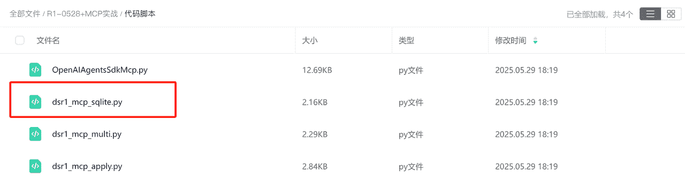


在这段代码中，run 方法在 Agent 类中负责处理输入消息并生成响应，包括接收消息、确定消息类型和语言、处理系统消息以及通过 LLM 生成响应的整个过程，而typewriter_print则用于流式的增量输出。演示视频如下：

```
Video(&quot;https://ml2022.oss-cn-hangzhou.aliyuncs.com/Qwen-Agent%20%E6%BC%94%E7%A4%BA%E8%A7%86%E9%A2%911.mp4&quot;, width=800, height=400)
```

Your browser does not support the video element.

运行结束后，在脚本执行的同级目录下会生成一个test.db的文件，这就是MCP自动创建的数据库文件。

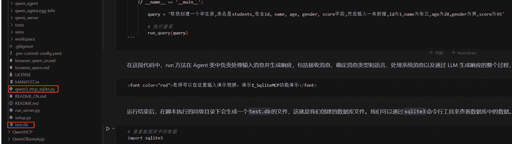

同时，也可以通过sqlite3命令行工具来查看数据库中的数据。

```
# 查看数据库中的数据
import sqlite3

conn = sqlite3.connect(&#x27;E:\\mcpCourse\\Qwen-Agent-main\\test.db&#x27;)
cursor = conn.cursor()

# 先查看数据库中有哪些表
cursor.execute(&quot;SELECT name FROM sqlite_master WHERE type=&#x27;table&#x27;;&quot;)
tables = cursor.fetchall()
print(&quot;数据库中的表:&quot;, tables)

# 如果有表，则查询第一个表的数据
if tables:
    table_name = tables[0][0]
    cursor.execute(f&quot;SELECT * FROM {table_name}&quot;)
    print(f&quot;{table_name} 表中的数据:&quot;, cursor.fetchall())
else:
    print(&quot;数据库中没有表，需要先创建表并插入数据&quot;)

conn.close()
```

```
数据库中的表: [(&#x27;students&#x27;,)]
students 表中的数据: [(1, &#x27;张三&#x27;, 20, &#x27;男&#x27;, 95)]
```

#### 4.4 多个MCP服务器并行&串行执行

大模型不擅长数学运算、数据可视化等精确计算任务，因此我们一般会使用代码解释器，使智能体编写和运行 Python 程序，从而逐步解决复杂的数据问题。如果智能体编写的代码未能成功运行，它还会不断调整代码，尝试不同的方法，直到代码能够顺利执行。

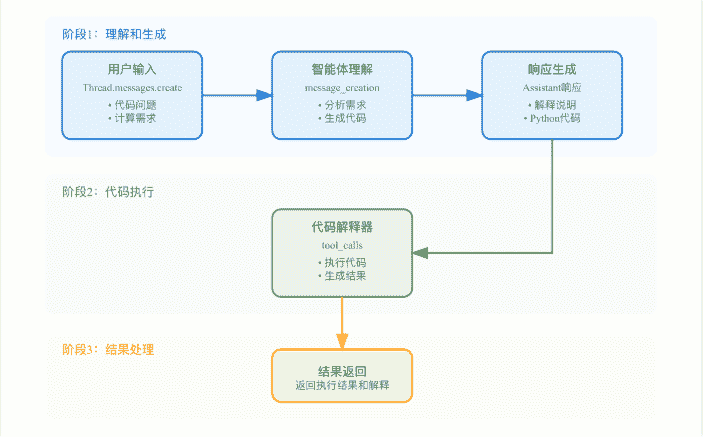

Qwen-Agent内置集成了 code_interpreter 组件，因此需要先执行安装，执行如下命令：

```
    pip install &quot;qwen-agent[code_interpreter]&quot;
```

调用code_interpreter的方法同样是需要在构建Assistant的时候，定义在tools列表中，并通过 Function_list参数传递。

```
    tools = [{
        &quot;mcpServers&quot;: {
            &quot;sqlite&quot; : {
                &quot;command&quot;: &quot;uvx&quot;,
                &quot;args&quot;: [
                    &quot;mcp-server-sqlite&quot;,
                    &quot;--db-path&quot;,
                    &quot;test.db&quot;
                ]
            },
           
        },
        
        
    },
    # pip install &quot;qwen-agent[code_interpreter]&quot;
    &#x27;code_interpreter&#x27;,
    ]
```

这里我们创建了dsr1_mcp_multi.py文件，核心代码如下：

```
    # dsr1_mcp_multi.py
    from qwen_agent.agents.assistant import Assistant
    from qwen_agent.utils.output_beautify import typewriter_print

    def init_agent_service():

 
        llm_cfg = {
            &#x27;model&#x27;: &#x27;deepseek-reasoner&#x27;,
            &#x27;model_server&#x27;: &#x27;https://api.deepseek.com&#x27;,
            &#x27;api_key&#x27;: &#x27;sk-d9c6cacc8e&#x27;,
            &#x27;fncall_prompt_type&#x27;: &#x27;nous&#x27;,  # 使用nous格式避免推理模型遇到stop符号停止
        }

        system = (&#x27;你是一个数据分析师，具有对本地数据库的增删改查能力，同时具有使用python代码的能力&#x27;)

        tools = [{
            &quot;mcpServers&quot;: {
                &quot;sqlite&quot; : {
                    &quot;command&quot;: &quot;uvx&quot;,
                    &quot;args&quot;: [
                        &quot;mcp-server-sqlite&quot;,
                        &quot;--db-path&quot;,
                        &quot;test.db&quot;
                    ]
                },
            
            },
        },
        &#x27;code_interpreter&#x27;,
        ]

        bot = Assistant(
            llm=llm_cfg,
            name=&#x27;数据分析师&#x27;,
            description=&#x27;可以对本地数据库进行增删改查，也能执行Python代码来完成分析工作。&#x27;,
            system_message=system,
            function_list=tools,
        )

        return bot

    def run_query(query=None):
        # 定义数据库助手
        bot = init_agent_service()

        # 执行对话逻辑
        messages = []
        messages.append({&#x27;role&#x27;: &#x27;user&#x27;, &#x27;content&#x27;: [{&#x27;text&#x27;: query}]})

        # 跟踪前一次的输出，用于增量打印
        previous_text = &quot;&quot;
        
        print(&#x27;数据库管理员: &#x27;, end=&#x27;&#x27;, flush=True)

        for response in bot.run(messages):
            previous_text = typewriter_print(response, previous_text)


    # 命令行接口，便于直接运行
    if __name__ == &#x27;__main__&#x27;:

        query = &#x27;帮我随机生成20条学生的成绩数据, 插入到students表中,\
                然后绘制一个折线图展示所有成绩变化趋势&#x27;
        
        # 执行查询
        run_query(query)
        
```

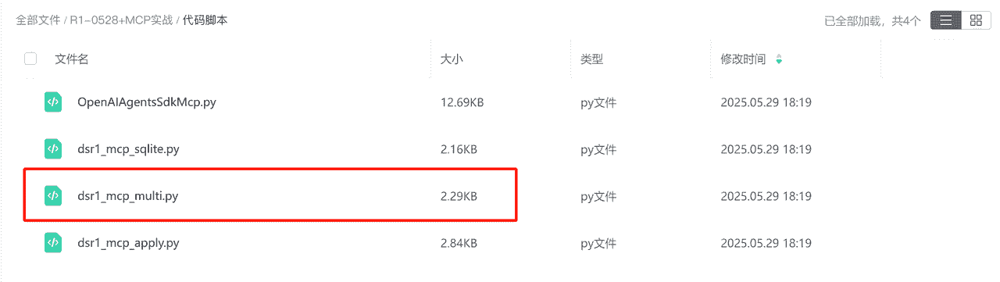


具体运行效果如下：

```
Video(&quot;https://ml2022.oss-cn-hangzhou.aliyuncs.com/Qwen-Agent%20%E6%BC%94%E7%A4%BA%E8%A7%86%E9%A2%912.mp4&quot;, width=800, height=400)
```

Your browser does not support the video element.

#### 4.4 Multi-MCP 复杂任务

接下来构建Multi-MCP Agent 多轮对话执行，并接入高德MCP服务器完成旅行规划助理。

首先可以在github上找到公开的高德MCP服务器：https://github.com/sugarforever/amap-mcp-server

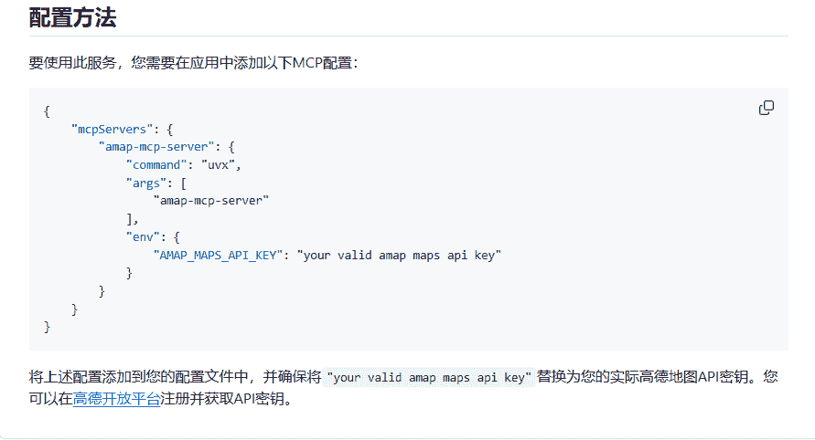

然后，需要在高德开放中心注册API进行使用：https://lbs.amap.com/

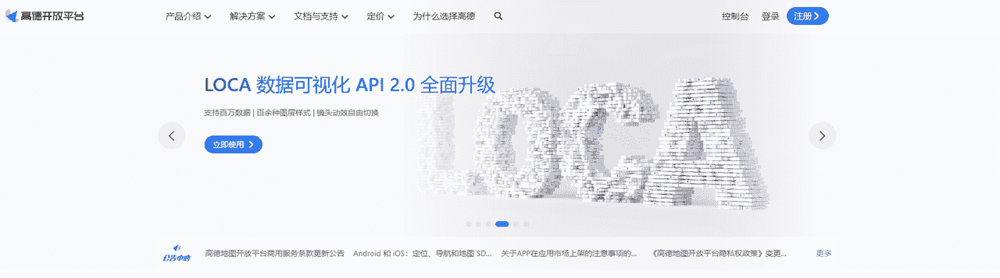

创建应用并生成一个有效的key：

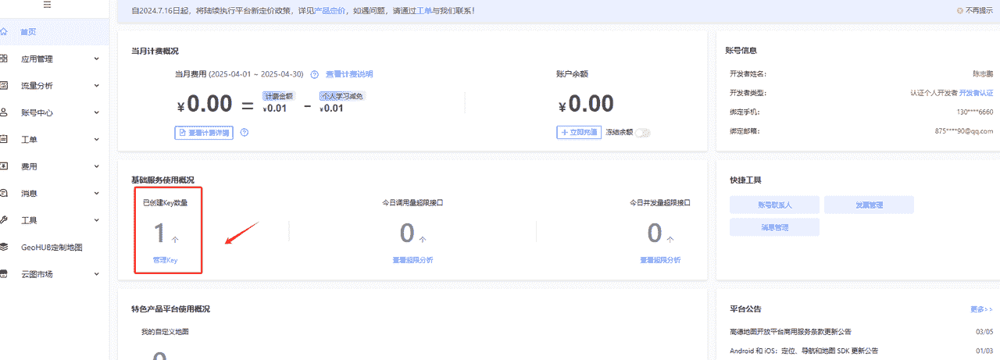

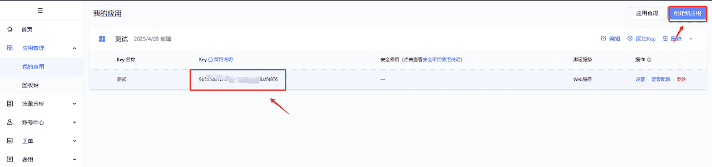

然后在tools列表中添加高德MCP服务器：

```
    tools = [{
        &quot;mcpServers&quot;: {
            &quot;sqlite&quot; : {
                &quot;command&quot;: &quot;uvx&quot;,
                &quot;args&quot;: [
                    &quot;mcp-server-sqlite&quot;,
                    &quot;--db-path&quot;,
                    &quot;test.db&quot;
                ]
            },
            &quot;amap-mcp-server&quot;: {
                &quot;command&quot;: &quot;uvx&quot;,
                &quot;args&quot;: [
                    &quot;amap-mcp-server&quot;
                ],
                &quot;env&quot;: {
                    &quot;AMAP_MAPS_API_KEY&quot;: &quot;9b555d3ff4976&quot;   # 这里替换成注册的高德API
                }
            }
        },
    },
    &#x27;code_interpreter&#x27;,
    ]
```

+   Firecrawl MCP Server

接下来我们需要找一个能抓取网页数据的MCP，这里可以选择Firecrawl MCP Server ：https://github.com/mendableai/firecrawl-mcp-server

[  Firecra](https://github.com/mendableai/firecrawl)wl MCP Server实现与 Firecrawl 集成以实现网页抓取功能。支持的功能如下：

+   抓取、爬取、搜索、提取、深入研究和批量抓取支持

+   使用 JS 渲染进行网页抓取

+   URL 发现和抓取

+   带有内容提取的网页搜索

+   .....

需要注册Firecrawl的API： https://www.firecrawl.dev/signin/password_signin

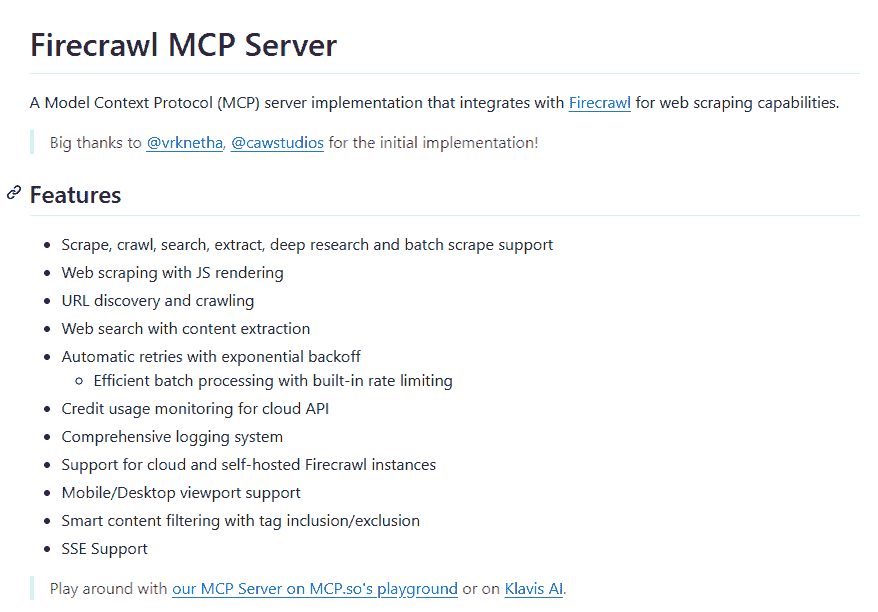

按照如下位置进行API_Keys的创建：

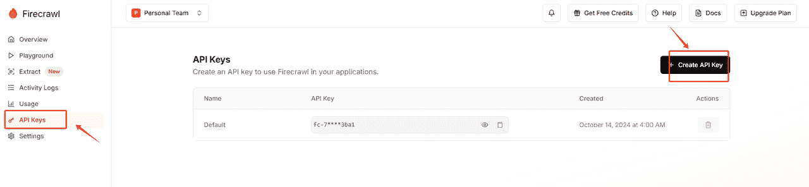

同样，需要添加到Tools列表中，整体配置如下：

```

    tools = [{
        &quot;mcpServers&quot;: {
            &quot;sqlite&quot; : {
                &quot;command&quot;: &quot;uvx&quot;,
                &quot;args&quot;: [
                    &quot;mcp-server-sqlite&quot;,
                    &quot;--db-path&quot;,
                    &quot;test.db&quot;
                ]
            },
            &quot;amap-mcp-server&quot;: {
                &quot;command&quot;: &quot;uvx&quot;,
                &quot;args&quot;: [
                    &quot;amap-mcp-server&quot;
                ],
                &quot;env&quot;: {
                    &quot;AMAP_MAPS_API_KEY&quot;: &quot;9b555d3ff4976&quot;   # 这里替换成注册的高德API
                }
            },
            
            &quot;firecrawl-mcp&quot;: {
                &quot;command&quot;: &quot;npx&quot;,
                &quot;args&quot;: [&quot;-y&quot;, &quot;firecrawl-mcp&quot;],
                &quot;env&quot;: {
                    &quot;FIRECRAWL_API_KEY&quot;: &quot;fc-724e84ead993ba1&quot;   # 这里需要替换成注册的 firecrawl Key
                },
            },
        },
    },
    &#x27;code_interpreter&#x27;,
    ]
```

除此以外，大家也可以使用 mcp-server-fetch：https://github.com/modelcontextprotocol/servers/tree/main/src/fetch ，大家可以根据自己的情况灵活选择。最终我们定义dsr1_mcp_apply.py文件，如下所示：

```

    def init_agent_service():
        llm_cfg = {
            &#x27;model&#x27;: &#x27;deepseek-reasoner&#x27;,
            &#x27;model_server&#x27;: &#x27;https://api.deepseek.com&#x27;,
            &#x27;api_key&#x27;: &#x27;sk-d9c6cacc8e&#x27;,
            &#x27;fncall_prompt_type&#x27;: &#x27;nous&#x27;,  # 使用nous格式避免推理模型遇到stop符号停止
        }

        tools = [{
            &quot;mcpServers&quot;: {
                &#x27;time&#x27;: {
                    &#x27;command&#x27;: &#x27;uvx&#x27;,
                    &#x27;args&#x27;: [&#x27;mcp-server-time&#x27;, &#x27;--local-timezone=Asia/Shanghai&#x27;]
                },
                # &quot;fetch&quot;: {
                #     &quot;command&quot;: &quot;uvx&quot;,
                #     &quot;args&quot;: [&quot;mcp-server-fetch&quot;]
                # },
                
                &quot;sqlite&quot; : {
                    &quot;command&quot;: &quot;uvx&quot;,
                    &quot;args&quot;: [
                        &quot;mcp-server-sqlite&quot;,
                        &quot;--db-path&quot;,
                        &quot;test.db&quot;
                    ]
                },

                &quot;firecrawl-mcp&quot;: {
                    &quot;command&quot;: &quot;npx&quot;,
                    &quot;args&quot;: [&quot;-y&quot;, &quot;firecrawl-mcp&quot;],
                    &quot;env&quot;: {
                        &quot;FIRECRAWL_API_KEY&quot;: &quot;fc-724e84ee49fad993ba1&quot;
                    },
                },

                &quot;amap-mcp-server&quot;: {
                    &quot;command&quot;: &quot;uvx&quot;,
                    &quot;args&quot;: [
                        &quot;amap-mcp-server&quot;
                    ],
                    &quot;env&quot;: {
                        &quot;AMAP_MAPS_API_KEY&quot;: &quot;9b555d31b15968aff4976&quot;
                    }
                }
            },
            
            
        },
        # pip install &quot;qwen-agent[code_interpreter]&quot;
        &#x27;code_interpreter&#x27;,
        ]

        system = &quot;&quot;&quot;
        你是一个规划师和数据分析师 \
            你可以调用高德地图规划旅行路线，同时可以提取网页信息进行数据分析
        &quot;&quot;&quot;

        bot = Assistant(
            llm=llm_cfg,
            name=&#x27;智能助理&#x27;,
            description=&#x27;具备查询高德地图、提取网页信息、数据分析的能力&#x27;,
            system_message=system,
            function_list=tools,
        )

        return bot

    def run_query(query=None):
        # 定义数据库助手
        bot = init_agent_service()

        from qwen_agent.gui import WebUI

        chatbot_config = {
            &#x27;prompt.suggestions&#x27;: [
                &#x27;请你帮我写一个关于人工智能的论文&#x27;,
                &quot;https://github.com/orgs/QwenLM/repositories 提取这一页的Markdown 文档，然后绘制一个柱状图展示每个项目的收藏量&quot;,
                &#x27;帮我查询从故宫去颐和园的路线&#x27;,
            ]
        }
        WebUI(
            bot,
            chatbot_config=chatbot_config,
        ).run()
        

&lt;center&gt;&lt;img src=&quot;https://ml2022.oss-cn-hangzhou.aliyuncs.com/img/image-20250529182944677.png&quot; alt=&quot;image-20250529182944677&quot; style=&quot;zoom:50%;&quot; /&gt;

&lt;center&gt;&lt;img src=&quot;https://ml2022.oss-cn-hangzhou.aliyuncs.com/img/ca76dfaf224da7825b4fa3e9c6ab435.png&quot; alt=&quot;ca76dfaf224da7825b4fa3e9c6ab435&quot; style=&quot;zoom:50%;&quot; /&gt;

&amp;emsp;&amp;emsp;这里我们要应用到`Qwen-Agent`内置的`WebUI`,其实现了一个基于Gradio构建的前端页面，通过执行 dsr1_mcp_apply, 启动后即可在 localhost:8000 访问：

&lt;center&gt;&lt;img src=&quot;https://muyu001.oss-cn-beijing.aliyuncs.com/img/image-20250529143719826.png&quot; alt=&quot;202412191720637&quot; style=&quot;zoom:60%;&quot; /&gt;

&amp;emsp;&amp;emsp;此时通过浏览器访问：http://localhost:7860/ 即可进行使用。

&lt;center&gt;&lt;img src=&quot;https://muyu001.oss-cn-beijing.aliyuncs.com/img/image-20250529143812480.png&quot; alt=&quot;202412191720637&quot; style=&quot;zoom:60%;&quot; /&gt;

具体运行效果如下：


```python
Video(&quot;https://ml2022.oss-cn-hangzhou.aliyuncs.com/fina-3.mp4&quot;, width=800, height=400)
```

Your browser does not support the video element.

# 五、OpenAI Agents SDK 接入 DS-R1

2025年3月11号，OpenAI正式推出其下第一款企业级Multi-Agent开发框架Agents-SDK，该框架是此前OpenAI在去年推出的Swarm的升级版，在保留了Swarm的高效便捷的Multi-Agent开发特性的同时，加入了更多面向企业级应用的功能。

+   GitHub官网：https://github.com/openai/openai-agents-python/

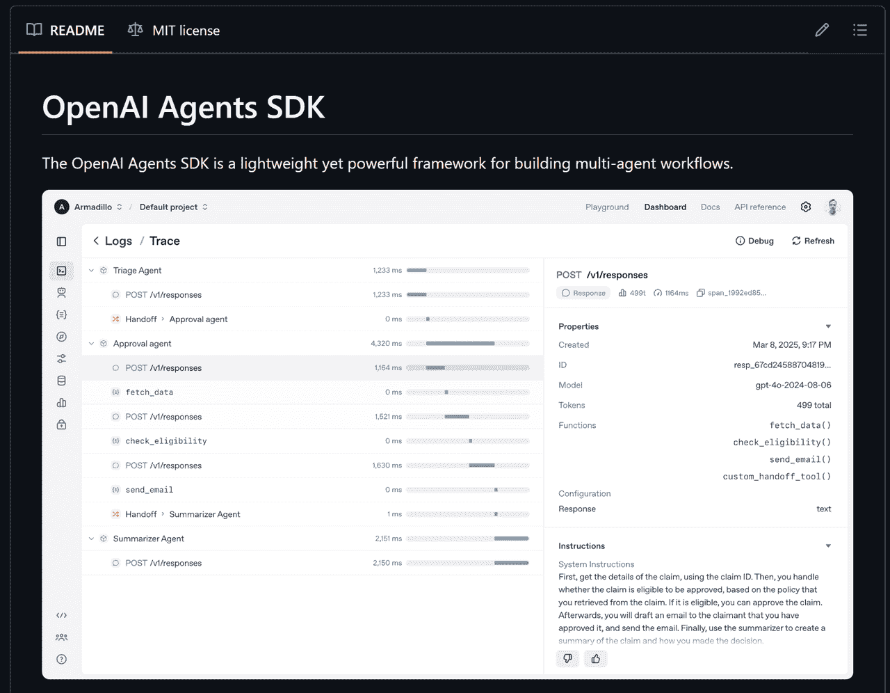

+   Agents SDK博客：https://openai.github.io/openai-agents-python/

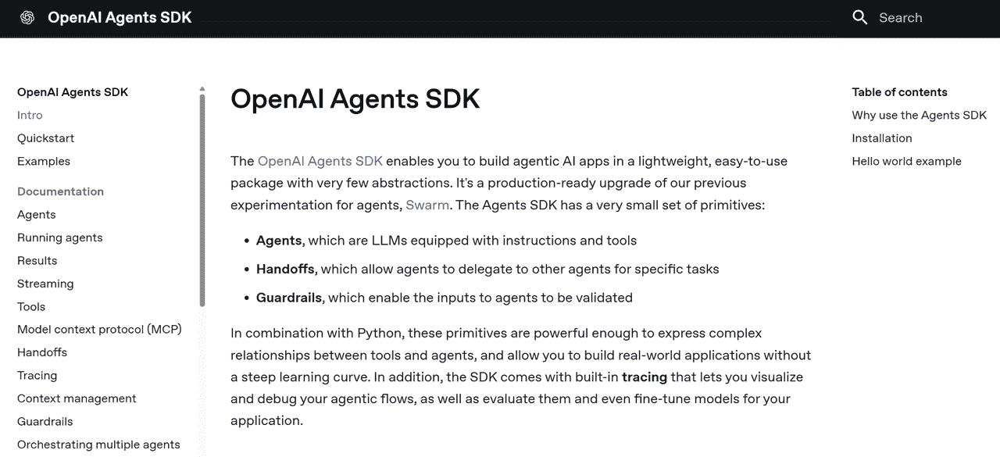

而根据官方介绍，O**penAI** Agents SDK 让你能够通过一个轻量、易用、抽象极少的工具包来构建基于智能体的 AI 应用。它是我们此前 Agent 实验项目 Swarm 的一个面向生产环境的升级版本。该 SDK 仅包含极少量的原语（基础构件）：

+   **Agent（智能体）**：即带有指令和工具的大语言模型（LLM）

+   **Handoff（交接）**：允许智能体将特定任务委托给其他智能体

+   **Guardrail（护栏）**：用于对输入内容进行验证

结合 Python 使用时，这些原语足够强大，能够表达工具与智能体之间的复杂关系，并让你在没有高学习成本的前提下构建真实可用的应用程序。此外，SDK 自带内置的追踪功能，可以帮助你可视化和调试智能体的执行流程，同时也支持对流程进行评估，甚至用于模型的微调。

OpenAI的Agents SDK 的设计遵循两个核心原则：

1.  功能足够强大，值得使用，但原语足够少，容易上手

1.  默认配置即可很好地运行，但你也可以完全自定义行为逻辑

以下是该 SDK 的主要特性：

+   **Agent 循环机制**：内置的智能体循环逻辑，自动处理工具调用、结果返回给 LLM、直到任务完成的全过程

+   **Python 优先**：使用原生 Python 语言特性来编排与串联智能体，而无需学习新的抽象概念

+   Handoff（智能体间任务交接）：强大的功能，可在多个智能体间协调与任务委派

+   Guardrail（输入验证护栏）：支持与智能体并行运行输入验证逻辑，若验证失败可提前中断流程

+   **函数工具化**：可以将任何 Python 函数转为工具，自动生成 Schema，并支持基于 Pydantic 的验证机制

+   **追踪系统（Tracing）**：内置追踪功能，可视化、调试、监控你的智能体流程，并结合 OpenAI 的评估、微调与蒸馏工具一同使用

同时，在3月27号，Agents SDK正式官宣支持MCP使用，这也使得Agents SDK的实际应用场景得到待拓展。现在，我们仅需在创建Agent的时候，将MCP服务器视作为一项工具，即可顺利调用MCP服务器进行Agent开发。而实际在借助Agents SDK调用MCP的流程也非常简单，我们只需将MCP视作tools，即可进行调用。换而言之，就是如果使用Agents SDK作为Agent开发框架，则可以零门槛快速接入MCP海量服务器生态。

+   Agents SDK安装流程

```
!pip install openai-agents
```

```
Requirement already satisfied: openai-agents in c:\programdata\anaconda3\envs\jupyter_env\lib\site-packages (0.0.7)
Requirement already satisfied: griffe&lt;2,&gt;=1.5.6 in c:\programdata\anaconda3\envs\jupyter_env\lib\site-packages (from openai-agents) (1.7.1)
Requirement already satisfied: mcp in c:\programdata\anaconda3\envs\jupyter_env\lib\site-packages (from openai-agents) (1.9.1)
Requirement already satisfied: openai&gt;=1.66.5 in c:\programdata\anaconda3\envs\jupyter_env\lib\site-packages (from openai-agents) (1.82.0)
Collecting pydantic&lt;3,&gt;=2.10 (from openai-agents)
  Downloading pydantic-2.11.5-py3-none-any.whl.metadata (67 kB)
Requirement already satisfied: requests&lt;3,&gt;=2.0 in c:\programdata\anaconda3\envs\jupyter_env\lib\site-packages (from openai-agents) (2.32.3)
Requirement already satisfied: types-requests&lt;3,&gt;=2.0 in c:\programdata\anaconda3\envs\jupyter_env\lib\site-packages (from openai-agents) (2.32.0.20250328)
Requirement already satisfied: typing-extensions&lt;5,&gt;=4.12.2 in c:\programdata\anaconda3\envs\jupyter_env\lib\site-packages (from openai-agents) (4.13.0)
Requirement already satisfied: colorama&gt;=0.4 in c:\programdata\anaconda3\envs\jupyter_env\lib\site-packages (from griffe&lt;2,&gt;=1.5.6-&gt;openai-agents) (0.4.6)
Requirement already satisfied: anyio&lt;5,&gt;=3.5.0 in c:\programdata\anaconda3\envs\jupyter_env\lib\site-packages (from openai&gt;=1.66.5-&gt;openai-agents) (4.9.0)
Requirement already satisfied: distro&lt;2,&gt;=1.7.0 in c:\programdata\anaconda3\envs\jupyter_env\lib\site-packages (from openai&gt;=1.66.5-&gt;openai-agents) (1.9.0)
Requirement already satisfied: httpx&lt;1,&gt;=0.23.0 in c:\programdata\anaconda3\envs\jupyter_env\lib\site-packages (from openai&gt;=1.66.5-&gt;openai-agents) (0.28.1)
Requirement already satisfied: jiter&lt;1,&gt;=0.4.0 in c:\programdata\anaconda3\envs\jupyter_env\lib\site-packages (from openai&gt;=1.66.5-&gt;openai-agents) (0.9.0)
Requirement already satisfied: sniffio in c:\programdata\anaconda3\envs\jupyter_env\lib\site-packages (from openai&gt;=1.66.5-&gt;openai-agents) (1.3.1)
Requirement already satisfied: tqdm&gt;4 in c:\programdata\anaconda3\envs\jupyter_env\lib\site-packages (from openai&gt;=1.66.5-&gt;openai-agents) (4.67.1)
Requirement already satisfied: annotated-types&gt;=0.6.0 in c:\programdata\anaconda3\envs\jupyter_env\lib\site-packages (from pydantic&lt;3,&gt;=2.10-&gt;openai-agents) (0.7.0)
Collecting pydantic-core==2.33.2 (from pydantic&lt;3,&gt;=2.10-&gt;openai-agents)
  Downloading pydantic_core-2.33.2-cp311-cp311-win_amd64.whl.metadata (6.9 kB)
Requirement already satisfied: typing-inspection&gt;=0.4.0 in c:\programdata\anaconda3\envs\jupyter_env\lib\site-packages (from pydantic&lt;3,&gt;=2.10-&gt;openai-agents) (0.4.1)
Requirement already satisfied: charset-normalizer&lt;4,&gt;=2 in c:\programdata\anaconda3\envs\jupyter_env\lib\site-packages (from requests&lt;3,&gt;=2.0-&gt;openai-agents) (3.4.1)
Requirement already satisfied: idna&lt;4,&gt;=2.5 in c:\programdata\anaconda3\envs\jupyter_env\lib\site-packages (from requests&lt;3,&gt;=2.0-&gt;openai-agents) (3.10)
Requirement already satisfied: urllib3&lt;3,&gt;=1.21.1 in c:\programdata\anaconda3\envs\jupyter_env\lib\site-packages (from requests&lt;3,&gt;=2.0-&gt;openai-agents) (2.3.0)
Requirement already satisfied: certifi&gt;=2017.4.17 in c:\programdata\anaconda3\envs\jupyter_env\lib\site-packages (from requests&lt;3,&gt;=2.0-&gt;openai-agents) (2025.1.31)
Requirement already satisfied: httpx-sse&gt;=0.4 in c:\programdata\anaconda3\envs\jupyter_env\lib\site-packages (from mcp-&gt;openai-agents) (0.4.0)
Requirement already satisfied: pydantic-settings&gt;=2.5.2 in c:\programdata\anaconda3\envs\jupyter_env\lib\site-packages (from mcp-&gt;openai-agents) (2.8.1)
Requirement already satisfied: python-multipart&gt;=0.0.9 in c:\programdata\anaconda3\envs\jupyter_env\lib\site-packages (from mcp-&gt;openai-agents) (0.0.20)
Requirement already satisfied: sse-starlette&gt;=1.6.1 in c:\programdata\anaconda3\envs\jupyter_env\lib\site-packages (from mcp-&gt;openai-agents) (2.2.1)
Requirement already satisfied: starlette&gt;=0.27 in c:\programdata\anaconda3\envs\jupyter_env\lib\site-packages (from mcp-&gt;openai-agents) (0.45.3)
Requirement already satisfied: uvicorn&gt;=0.23.1 in c:\programdata\anaconda3\envs\jupyter_env\lib\site-packages (from mcp-&gt;openai-agents) (0.34.0)
Requirement already satisfied: httpcore==1.* in c:\programdata\anaconda3\envs\jupyter_env\lib\site-packages (from httpx&lt;1,&gt;=0.23.0-&gt;openai&gt;=1.66.5-&gt;openai-agents) (1.0.7)
Requirement already satisfied: h11&lt;0.15,&gt;=0.13 in c:\programdata\anaconda3\envs\jupyter_env\lib\site-packages (from httpcore==1.*-&gt;httpx&lt;1,&gt;=0.23.0-&gt;openai&gt;=1.66.5-&gt;openai-agents) (0.14.0)
Requirement already satisfied: python-dotenv&gt;=0.21.0 in c:\programdata\anaconda3\envs\jupyter_env\lib\site-packages (from pydantic-settings&gt;=2.5.2-&gt;mcp-&gt;openai-agents) (1.1.0)
Requirement already satisfied: click&gt;=7.0 in c:\programdata\anaconda3\envs\jupyter_env\lib\site-packages (from uvicorn&gt;=0.23.1-&gt;mcp-&gt;openai-agents) (8.1.8)
Downloading pydantic-2.11.5-py3-none-any.whl (444 kB)
Downloading pydantic_core-2.33.2-cp311-cp311-win_amd64.whl (2.0 MB)
   ---------------------------------------- 0.0/2.0 MB ? eta -:--:--
   ---------------- ----------------------- 0.8/2.0 MB 4.2 MB/s eta 0:00:01
   ---------------------------------------- 2.0/2.0 MB 5.4 MB/s eta 0:00:00
Installing collected packages: pydantic-core, pydantic
  Attempting uninstall: pydantic-core
    Found existing installation: pydantic_core 2.23.4
    Uninstalling pydantic_core-2.23.4:
      Successfully uninstalled pydantic_core-2.23.4
  Attempting uninstall: pydantic
    Found existing installation: pydantic 2.9.2
    Uninstalling pydantic-2.9.2:
      Successfully uninstalled pydantic-2.9.2
Successfully installed pydantic-2.11.5 pydantic-core-2.33.2


WARNING: Ignoring invalid distribution ~upyterlab (C:\ProgramData\anaconda3\envs\jupyter_env\Lib\site-packages)
WARNING: Ignoring invalid distribution ~upyterlab (C:\ProgramData\anaconda3\envs\jupyter_env\Lib\site-packages)
  WARNING: Failed to remove contents in a temporary directory &#x27;C:\ProgramData\anaconda3\envs\jupyter_env\Lib\site-packages\~-dantic_core&#x27;.
  You can safely remove it manually.
WARNING: Ignoring invalid distribution ~upyterlab (C:\ProgramData\anaconda3\envs\jupyter_env\Lib\site-packages)
ERROR: pip&#x27;s dependency resolver does not currently take into account all the packages that are installed. This behaviour is the source of the following dependency conflicts.
google-adk 0.3.0 requires authlib&gt;=1.5.1, but you have authlib 1.4.1 which is incompatible.
open-webui 0.6.10 requires pydantic==2.10.6, but you have pydantic 2.11.5 which is incompatible.
unstructured-client 0.32.3 requires aiofiles&gt;=24.1.0, but you have aiofiles 23.2.1 which is incompatible.
```

OpenAI Agents SDK框架接入MCP服务器的方法并不复杂，仅需要在构建Agent对象时，像传递通过@function_tool装饰器定义的工具一样，将MCP服务器作为参数传递给Agent对象即可。只不过，不再通过tools参数，而是借助mcp_servers参数来传递。如下所示：

Agent 组件核心参数

| 属性名 | 类型 | 描述 |
| --- | --- | --- |
| **name** | str | 代理的名称。 |
| **instructions** | str | Callable[[RunContextWrapper[TContext], Agent[TContext]], MaybeAwaitable[str]] | None | 代理的指令，用作“系统提示”。可以是字符串或动态生成指令的函数。 |
| handoff_description | str | None | 代理的描述，用于代理作为交接时，让 LLM 知道它的功能和何时调用它。 |
| **handoffs** | list[Agent[Any] | Handoff[TContext]] |
| **model** | str | Model | None | 调用 LLM 时使用的模型实现。默认情况下，如果未设置，代理将使用 openai_provider.DEFAULT_MODEL 中配置的默认模型。 |
| **model_settings** | ModelSettings | 配置模型特定的调优参数（例如温度、top_p）。 |
| **tools** | list[Tool] | 代理可以使用的工具列表。 |
| mcp_servers | list[MCPServer] | 代理可以使用的模型上下文协议（MCP）服务器列表。 |
| mcp_config | MCPConfig | MCP 服务器的配置。 |
| input_guardrails | list[InputGuardrail[TContext]] | 在代理执行之前并行运行的检查列表，仅在代理是链中的第一个代理时运行。 |
| output_guardrails | list[OutputGuardrail[TContext]] | 在生成响应后对代理的最终输出运行的检查列表，仅在代理生成最终输出时运行。 |
| output_type | type[Any] | AgentOutputSchemaBase |
| hooks | AgentHooks[TContext] | None |
| tool_use_behavior | Literal[&quot;run_llm_again&quot;, &quot;stop_on_first_tool&quot;] | StopAtTools |
| reset_tool_choice | bool | 调用工具后是否将工具选择重置为默认值。默认为 True。确保代理不会进入工具使用的无限循环。 |

这两个参数的含义如下所示：

+   **mcp_servers**：该参数用于接收一个或多个Model Context Protocol (MCP)服务器的实例。当Agent运行时，它会自动加载MCP服务器，并获取MCP服务中定义的可用工具列表。

+   **mcp_config**：该参数用于配置 MCP 服务器的相关设置。

因此，如果想给Agent对象传递MCP服务器，其构建的代码形式如下所示：

```
    mcp_agent=Agent(
        name=&quot;智能代理&quot;,
        instructions=&quot;可以调用MCP服务器中的工具来完成任务&quot;,
        mcp_servers=[mcp_server_1, mcp_server_2],  # server_1和server_2是MCP服务器的实例
        mcp_config={
            &quot;convert_schemas_to_strict&quot;: False  # 默认是 False
        }
    )
```

所以，接下来核心就是如何去构建mcp_servers_1和mcp_servers_2这样的MCP服务器实例。这里需要注意的是：OpenAI Agents SDK框架中兼容的是基于Model Context Protocol的开放协议规范，而该协议根据所支持和使用的传输协议不同，目前主要分为如下三种类型的服务器：

+   **stdio 服务器**：作为应用程序的子进程运行。我们一般将这种类型的服务器视为“本地”运行。

+   http over sse 服务器：作为独立的进程运行，并使用sse协议进行通信，可以通过url来访问。

+   StreamableHTTP 服务器：可流式传输的HTTP传输,正在取代 SSE传输。

其中 StreamableHTTP 的支持刚刚于[modelcontextproto](https://github.com/modelcontextprotocol/python-sdk/releases/tag/v1.8.0)colpython-sdk v1.8.0发布，所以OpenAI Agents SDK框架目前仅支持stdio和http over sse这两种类型。源码定义位置：https://github.com/openai/openai-agents-python/blob/main/src/agents/mcp/server.py#L24

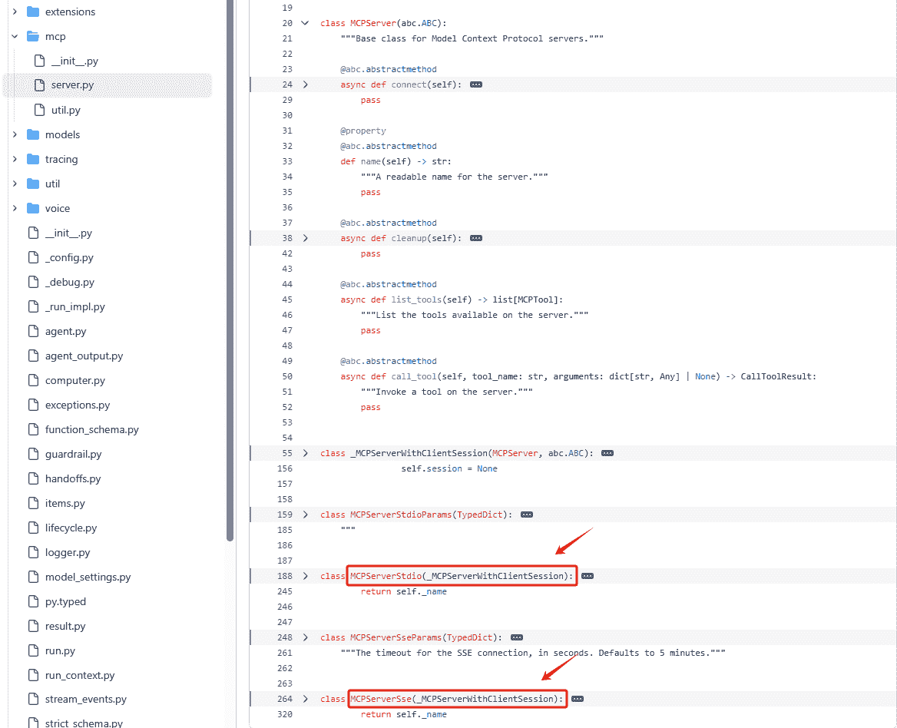

这里我们以SSE模式的MCP服务器接入为例进行演示。

因为传输协议不同，所以在应用上所需要传递的参数也有所不同。与Stdio类似，MCPServerSse通过接收MCPServerSseParams中定义的参数来连接MCP Server。根据其源码定义，我们首先可以梳理出MCPServerStdio类能够接收的参数如下所示：

MCPServerSseParams参数汇总

| 参数 | 类型 | 描述 | 使用场景 |
| --- | --- | --- | --- |
| url | str | 服务器的 URL。 | 指定要连接的服务器地址。 |
| headers | dict (可选) | 发送到服务器的请求头。 | 用于传递认证信息或其他自定义头部。 |
| timeout | float (可选) | HTTP 请求的超时时间，默认为 5 秒。 | 控制请求的最大等待时间，避免长时间无响应。 |
| sse_read_timeout | float (可选) | SSE 连接的超时时间，默认为 5 分钟。 | 控制服务器推送事件的最大等待时间，确保连接的稳定性。 |

在 SSE (Server-Sent Events) 模式 下，我们可以把 MCP 服务**器当成一个已经在网络上跑着**的「工具 API」，用 URL 建立事件流、再用 POST /messages 发指令。当前主流的使用形式可以归纳为两大类：自托管启动与平台托管直连。

+   自托管启动（Self-hosted）

这种方式主要是应用[MCP](https://github.com/modelcontextprotocol)官方的Python / TypeScript MCP SDK 把 Server 代码跑起来（FastAPI / Express 集成）, 程序启动后会打印或返回一个本地或内网 SSE URL，然后便可以用这个 URL 建立事件流接入到OpenAI Agents SDK 框架中。如果需要使用MCP 官方的Python SDK构建SSE 模式的MCP 服务器。

+   平台托管直连（Platform-hosted）

诸如 [ModelScope](https://www.modelscope.cn/mcp)[的 ](https://www.modelscope.cn/mcp)[MCP](https://www.modelscope.cn/mcp)[ 广场](https://www.modelscope.cn/mcp)、[mcp.run](https://docs.mcp.run/integrating/tutorials/mcp-run-sse-openai-agents)等社区维护大量 MPC 服务并支持一键启动MCP的SSE 模式。使用的方法非常简单，只需要在平台首页选好MCP Server → 生成一个API-Key，一键生成 SSE URL ，即可直接接入使用。

对于国内开发者，通过“一键复制 URL + API-Key”就能拿到 SSE 端点的热门网站大致可以分为四类：

1.  专门的 MCP 服务市场/目录（如 MCP Market、AIbase、MCP Server Hub）；

1.  云厂商推出的 官方托管平台（阿里云 “百炼” 与 Higress Marketplace）；

1.  行业 API 已内置 MCP & SSE（百度地图、腾讯位置服务等）；

1.  IDE / 客户端集市 把第三方 SSE URL 聚合到本地（Cherry Studio、Cursor）。

MCP 热门导航网站

| 平台 | 规模与特点 | 访问链接 |
| --- | --- | --- |
| ModelScope MCP 广场 | 超过 3000+ 个中文托管 MCP；详情页右侧直接复制 SSE URL，部分服务需在“API Key”栏目填 Token | [点击进入](https://www.modelscope.cn/mcp/) |
| **MCP Market** | **标榜“**国内首个 MCP 服务市场”，已收录 1W+ SSE Server，并提供云托管与 Playground，一键生成专属 URL | [点击进入](https://mcpmarket.cn/) |
| **AIbase MCP 资源站** | 整理 GitHub 上的热门 MCP Server 并直接给出 SSE 地址与使用教程 | [点击进入](https://mcp.aibase.cn/) |
| **MCP Server Hub** | 国际化，标签筛选 + “Copy URL” 操作流畅，站内统计数千条 SSE Server | [点击进入](https://mcpserverhub.com/)] |
| **阿里云 百炼** | 官方托管“全周期 MCP 服务”，控制台能生成已鉴权的 SSE URL | [点击进入](https://bailian.console.aliyun.com/?spm=5176.29619931.0.0.1369521cW5hVGj&amp;tab=mcp#/mcp-market) |

## 5.3 接入 ModelScope MCP

平台托管直连不需要开发者关心进程与依赖等问题，直接在网页一键生成URL即可接入。下面我们以ModelScope的MCP 广场为例，演示如何在OpenAI Agents SDK框架中通过SSE 模式接入MCP 服务器。

+   **Step 1. 进入****ModelScope****的****MCP**** 广场，访问地址：https://w**ww.modelscope.cn/mcp

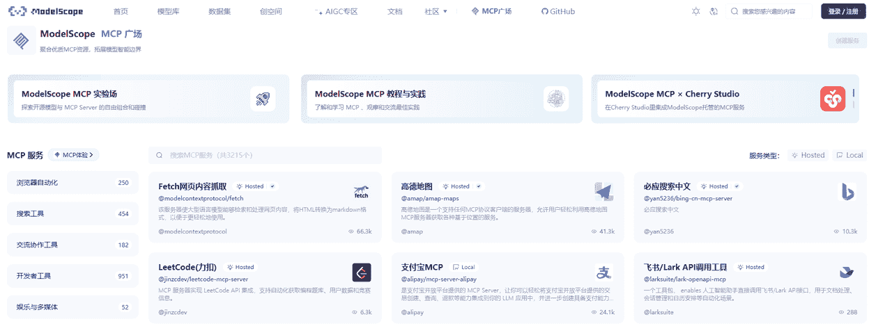

+   **Step 2. 点击右上角****登录****按钮，登录****ModelScope****账号**

可以通过手机号注册并登录，注意：国内用户记得选择中国大陆 +86 的手机号注册，否则会提示手机号格式错误。

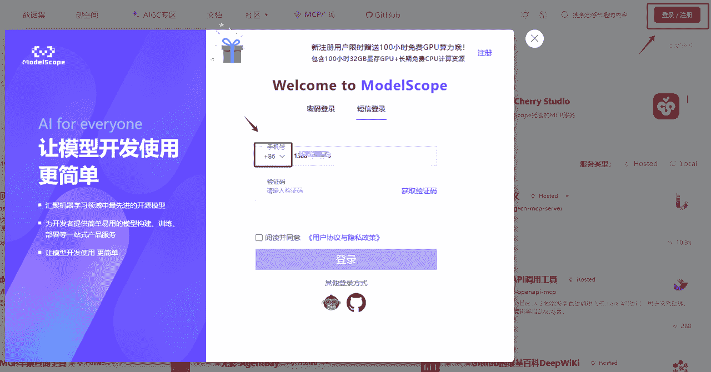

+   **Step 3. 挑选****MCP**** 服务，并进入详情页**

这里我们选择的是12306-MCP车票查询工具，该MCP 服务提供了搜索12306购票信息的功能。

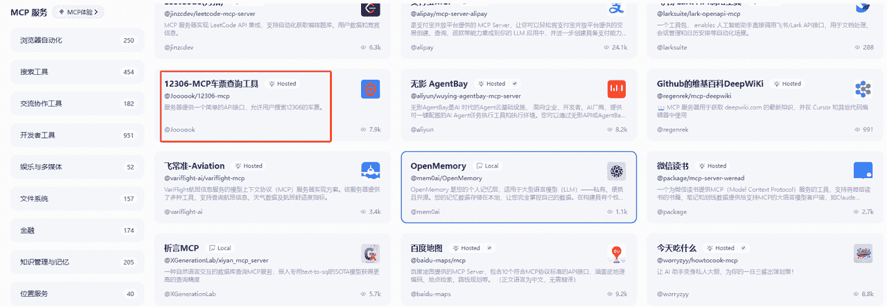

+   **Step 4. 点击****立即使用****按钮，进入****MCP**** 服务详情页**

如果是首次使用，在详情页的最右侧会有一个通过SSE URL连接服务的说明

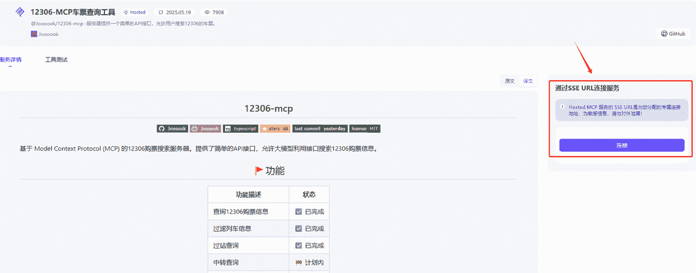

点击连接按钮，即可生成一个SSE URL，如下图所示：

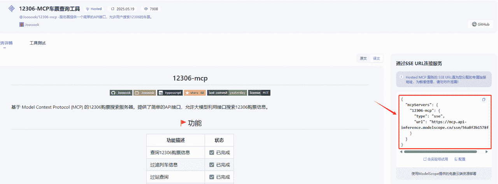

+   **Ste**p 5. 复制SSE URL，并将其接入到OpenAI Agents SDK框架中

在OpenAI Agents SDK框架中，可以通过MCPServerSSE类来创建SSE 模式的MCP 服务器。该类可接收的配置参数与MCPServerStdio类无异，只不过在params参数中需要接收的是MCPServerSseParams，而不再是MCPServerStdioParams。如下所示：

MCPServerSse可接收参数

| 参数名称 | 类型 | 默认值 | 描述 |
| --- | --- | --- | --- |
| params | MCPServerSseParams | - | 配置服务器的参数，包括服务器的URL、请求头、HTTP请求超时和SSE连时。 |
| cache_tools_list | bool | False | 是否缓存工具列表。如果为 True，工具列表将被缓存，仅在第一次从服务器获取。如果为 False，每次调用 list_tools() 时都会从服务器获取工具列表。缓存可以通过调用 invalidate_tools_cache() 来失效。 |
| name | str 或 None | None | 服务器的可读名称。如果未提供，将根据命令自动创建名称。 |
| client_session_timeout_seconds | float 或 None | 5 | 传递给 MCP ClientSession 的读取超时时间时。 |

params参数可接收的数据类型为MCPServerSseParams，如下所示：

MCPServerSseParams参数汇总

| 参数 | 类型 | 描述 | 使用场景 |
| --- | --- | --- | --- |
| url | str | 服务器的 URL。 | 指定要连接的服务器地址。 |
| headers | dict (可选) | 发送到服务器的请求头。 | 用于传递认证信息或其他自定义头部。 |
| timeout | float (可选) | HTTP 请求的超时时间，默认为 5 秒。 | 控制请求的最大等待时间，避免长时间无响应。 |
| sse_read_timeout | float (可选) | SSE 连接的超时时间，默认为 5 分钟。 | 控制服务器推送事件的最大等待时间，确保连接的稳定性。 |

最后创建 Agent 实例，并使用mcp 工具进行查询。这里仍然建议大家使用python 脚本运行，而不是在Jupyter Notebook 中运行。完整程序代码文件为OpenAIAgentsSdkMcp.py.py，运行流程如下所示：需要说明的是：OpenAI Agents SDK 框架目前暂时不兼容DeepSeek R1的推理格式输出，代码中的数据显示效果是我们完全自定义了Agents SDK框架中的回调函数以正常提取和运行。

```
import asyncio, os
from agents import Agent, Runner, OpenAIChatCompletionsModel
from agents.mcp import MCPServerSse  
from agents.run import RunConfig
from openai import AsyncOpenAI
from dotenv import load_dotenv
from agents import ModelSettings
import asyncio

# 加载环境变量
load_dotenv(override=True)

# 创建OpenAI客户端
# deepseek_client = AsyncOpenAI(
#     base_url=os.getenv(&quot;DEEPSEEK_BASE_URL&quot;), 
#     api_key=os.getenv(&quot;DEEPSEEK_API_KEY&quot;)
# )


import asyncio
from openai import AsyncOpenAI
from agents import Agent, Runner
from agents.mcp import MCPServerStdio
import os
import asyncio
import shutil
import gc
from agents.mcp import MCPServerStdio
from agents import Agent, Runner, OpenAIChatCompletionsModel
from openai import AsyncOpenAI
from dotenv import load_dotenv
import asyncio
from agents import Agent, RunContextWrapper, RunHooks, Runner, Tool, Usage 
from typing import Any
from datetime import datetime
from agents.run import RunConfig
import json
# 加载环境变量
load_dotenv(override=True)

from agents.model_settings import Reasoning

class CustomHooks(RunHooks):
    def __init__(self):
        self.event_counter = 0
        self.start_time = datetime.now()
        self.verbose = True  # 设置是否显示详细输出的标志

    def _usage_to_str(self, usage: Usage) -&gt; str:
        &quot;&quot;&quot;格式化使用情况统计&quot;&quot;&quot;
        return (
            f&quot;请求数: {usage.requests}, &quot;
            f&quot;输入tokens: {usage.input_tokens}, &quot;
            f&quot;输出tokens: {usage.output_tokens}, &quot;
            f&quot;总tokens: {usage.total_tokens}&quot;
        )
        
    def _get_timestamp(self):
        &quot;&quot;&quot;获取相对于开始时间的时间戳&quot;&quot;&quot;
        delta = datetime.now() - self.start_time
        return f&quot;[+{delta.seconds}.{delta.microseconds//1000:03d}s]&quot;
    
    def _print_section_header(self, title):
        &quot;&quot;&quot;打印分隔标题&quot;&quot;&quot;
        self.event_counter += 1
        timestamp = self._get_timestamp()
        
        print(&quot;\n&quot; + &quot;=&quot; * 80)
        print(f&quot;事件 #{self.event_counter}: {title} {timestamp}&quot;)
        print(&quot;-&quot; * 80)

    def _format_value(self, value):
        &quot;&quot;&quot;格式化各种类型的值以便打印&quot;&quot;&quot;
        if value is None:
            return &quot;None&quot;
        elif isinstance(value, list):
            if not value:
                return &quot;[]&quot;
            elif len(value) &gt; 3:
                return f&quot;[...{len(value)}个项目...]&quot;
            else:
                return str(value)
        elif isinstance(value, dict):
            if not value:
                return &quot;{}&quot;
            return &quot;{...}&quot;
        elif callable(value):
            return f&quot;&lt;函数: {value.__name__}&gt;&quot; if hasattr(value, &quot;__name__&quot;) else &quot;&lt;函数&gt;&quot;
        elif isinstance(value, object) and not isinstance(value, (str, int, float, bool)):
            return f&quot;&lt;{value.__class__.__name__} 对象&gt;&quot;
        else:
            return str(value)

    async def on_agent_start(self, context: RunContextWrapper, agent: Agent) -&gt; None:
        self._print_section_header(&quot;Agent 开始执行&quot;)
        
        # 简易输出版本
        print(f&quot;Agent名称: {agent.name}&quot;)
        print(f&quot;使用情况: {self._usage_to_str(context.usage)}&quot;)
        

        # 下面是详细的输出版本
        # 提取Agent的所有属性并格式化显示
        if self.verbose:
            print(&quot;\n【Agent 详细信息】&quot;)
            print(&quot;-&quot; * 40)
            
            # 获取Agent的所有公共属性
            attributes = {
                &quot;name&quot;: &quot;名称&quot;,
                &quot;instructions&quot;: &quot;指令&quot;,
                &quot;handoff_description&quot;: &quot;交接描述&quot;,
                &quot;handoffs&quot;: &quot;可交接代理&quot;,
                &quot;model&quot;: &quot;模型&quot;,
                &quot;model_settings&quot;: &quot;模型设置&quot;,
                &quot;tools&quot;: &quot;工具列表&quot;, 
                &quot;mcp_servers&quot;: &quot;MCP服务器&quot;,
                &quot;mcp_config&quot;: &quot;MCP配置&quot;,
                &quot;input_guardrails&quot;: &quot;输入防护&quot;,
                &quot;output_guardrails&quot;: &quot;输出防护&quot;,
                &quot;output_type&quot;: &quot;输出类型&quot;,
                &quot;hooks&quot;: &quot;钩子函数&quot;,
                &quot;tool_use_behavior&quot;: &quot;工具使用行为&quot;,
                &quot;reset_tool_choice&quot;: &quot;重置工具选择&quot;
            }
            
            # 打印各个属性和值
            for attr, label in attributes.items():
                if hasattr(agent, attr):
                    value = getattr(agent, attr)
                    formatted_value = self._format_value(value)
                    print(f&quot;{label:15}: {formatted_value}&quot;)
            
            # 打印上下文信息
            print(&quot;\n【执行上下文】&quot;)
            print(&quot;-&quot; * 40)
            print(f&quot;上下文对象: {self._format_value(context.context)}&quot;)
            print(f&quot;使用情况  : {self._usage_to_str(context.usage)}&quot;)
            
            # 打印工具详细信息（如果有）
            if hasattr(agent, &#x27;tools&#x27;) and agent.tools:
                print(&quot;\n【可用工具详情】&quot;)
                print(&quot;-&quot; * 40)
                for i, tool in enumerate(agent.tools, 1):
                    print(f&quot;工具 #{i}: {tool.name}&quot;)
                    if hasattr(tool, &#x27;description&#x27;) and tool.description:
                        print(f&quot;  描述: {tool.description}&quot;)
            
            # 打印MCP服务器信息（如果有）
            if hasattr(agent, &#x27;mcp_servers&#x27;) and agent.mcp_servers:
                print(&quot;\n【MCP服务器】&quot;)
                print(&quot;-&quot; * 40)
                for i, server in enumerate(agent.mcp_servers, 1):
                    if hasattr(server, &#x27;name&#x27;):
                        print(f&quot;服务器 #{i}: {server.name}&quot;)

    async def on_agent_end(self, context: RunContextWrapper, agent: Agent, output: Any) -&gt; None:
        self._print_section_header(&quot;Agent 执行完成&quot;)
        print(f&quot;output: {output}&quot;)
        print(f&quot;Agent名称: {agent.name}&quot;)
        print(f&quot;输出结果: {output}&quot;)
        print(f&quot;使用情况: {self._usage_to_str(context.usage)}&quot;)
        print(&quot;=&quot; * 80)

    async def on_tool_start(self, context: RunContextWrapper, agent: Agent, tool: Tool) -&gt; None:
        self._print_section_header(&quot;工具调用开始&quot;)
        
        # 记录工具类型和基本信息
        tool_type = tool.__class__.__name__
        print(f&quot;工具类型: {tool_type}&quot;)
        print(f&quot;Agent名称: {agent.name}&quot;)
        print(f&quot;工具名称: {tool.name}&quot;)
        
        # 显示工具描述
        if hasattr(tool, &#x27;description&#x27;) and tool.description:
            print(f&quot;工具描述: {tool.description}&quot;)
        
        # 详细输出版本
        if self.verbose:
            # 根据工具类型提供更详细的信息
            if tool_type == &quot;FunctionTool&quot;:
                print(&quot;\n【函数工具详情】&quot;)
                print(&quot;-&quot; * 40)
                
                # 显示参数模式
                if hasattr(tool, &#x27;params_json_schema&#x27;) and tool.params_json_schema:
                    try:
                        params_str = json.dumps(tool.params_json_schema, indent=2, ensure_ascii=False)
                        print(f&quot;参数定义:\n{params_str}&quot;)
                    except:
                        print(f&quot;参数定义: [无法序列化]&quot;)
                
                # 显示是否使用严格JSON模式
                if hasattr(tool, &#x27;strict_json_schema&#x27;):
                    print(f&quot;严格JSON模式: {tool.strict_json_schema}&quot;)
                
                # 尝试获取和显示调用函数信息
                if hasattr(tool, &#x27;on_invoke_tool&#x27;):
                    invoke_tool = getattr(tool, &#x27;on_invoke_tool&#x27;)
                    if hasattr(invoke_tool, &#x27;func&#x27;) and hasattr(invoke_tool.func, &#x27;__qualname__&#x27;):
                        print(f&quot;调用方法: {invoke_tool.func.__qualname__}&quot;)
            
        # 当前使用情况
        print(f&quot;\n使用情况: {self._usage_to_str(context.usage)}&quot;)

    async def on_tool_end(
        self, context: RunContextWrapper, agent: Agent, tool: Tool, result: str
    ) -&gt; None:
        self._print_section_header(&quot;工具调用结束&quot;)
        print(f&quot;Agent名称: {agent.name}&quot;)
        print(f&quot;工具名称: {tool.name}&quot;)
        
        # 简单输出结果基本信息
        print(f&quot;结果类型: {type(result).__name__}&quot;)
        
        # 详细结果内容（根据verbose控制）
        if self.verbose:
            # 尝试格式化JSON结果
            try:
                json_result = json.loads(result)
                formatted_result = json.dumps(json_result, indent=2, ensure_ascii=False)
                print(f&quot;执行结果:\n{formatted_result}&quot;)
            except:
                # 如果不是JSON或解析失败，检查长度
                if len(result) &gt; 500:
                    print(f&quot;执行结果: {result[:500]}... (已截断，总长度: {len(result)})&quot;)
                else:
                    print(f&quot;执行结果: {result}&quot;)
        
        print(f&quot;使用情况: {self._usage_to_str(context.usage)}&quot;)

    async def on_handoff(
        self, context: RunContextWrapper, from_agent: Agent, to_agent: Agent
    ) -&gt; None:
        self._print_section_header(&quot;Agent 切换&quot;)
        print(f&quot;从: {from_agent.name}&quot;)
        print(f&quot;到: {to_agent.name}&quot;)
        print(f&quot;使用情况: {self._usage_to_str(context.usage)}&quot;)

    # 切换详细模式的方法
    def set_verbose(self, verbose=True):
        &quot;&quot;&quot;设置是否启用详细输出模式&quot;&quot;&quot;
        self.verbose = verbose
        return self 


deepseek_client = AsyncOpenAI(
    base_url=&quot;https://api.deepseek.com&quot;, 
    api_key=&quot;sk-d9c1cc6ff4acc8e&quot;
)

async def main(prompt: str):
    try:
        # 创建MCP服务器列表
        mcp_servers = []
        
        # step 1.1 创建12306火车票查询MCP服务器
        train_mcp = MCPServerSse(
            name=&quot;12306_mcp&quot;,
            params={
                &quot;url&quot;: &quot;https://mcp.api-inference.modelscope.cn/b20641/sse&quot;,
                # &quot;timeout&quot;: 30,            # HTTP请求超时时间30秒
                # &quot;sse_read_timeout&quot;: 300   # 连接超时时间5分钟
            },
            client_session_timeout_seconds=60,
            cache_tools_list=True,
        )
        
        # step 1.2 创建航班查询MCP服务器
        flight_mcp = MCPServerSse(
            name=&quot;variflight_mcp&quot;,
            params={
                &quot;url&quot;: &quot;https://mcp.api-inference.modelscope.cn/8cf27048/sse&quot;,
                # &quot;timeout&quot;: 30,
                # &quot;sse_read_timeout&quot;: 300
            },
            client_session_timeout_seconds=60,
            cache_tools_list=True,
        )
        
        # 异步连接所有MCP服务器
        async with train_mcp as mcp1, flight_mcp as mcp2:
            mcp_servers = [mcp1, mcp2]
            
            # 输出每个MCP的信息
            for mcp in mcp_servers:
                print(f&quot;连接MCP服务器成功: {mcp.name}&quot;)
                try:
                    tools = await mcp.list_tools()
                    print(f&quot;{mcp.name} 可用工具列表: {[tool.name for tool in tools]}&quot;)
                except Exception as e:
                    print(f&quot;获取 {mcp.name} 工具列表失败: {e}&quot;)
            
            # step 2. 创建 Agent 实例
            agent = Agent(               
                name=&quot;Travel_Assistant&quot;,
                instructions=&quot;&quot;&quot;你是一个全能的出行助手，可以帮助用户查询各种交通方式的信息。
                你可以查询高铁列车信息，包括车次、发车时间、到达时间、票价和余票情况。
                你也可以查询航班信息，包括航班号、起飞时间、降落时间、票价和余位情况。
                根据用户的查询需求，选择合适的工具来提供准确的信息。&quot;&quot;&quot;,
                model=OpenAIChatCompletionsModel(
                    model=&quot;deepseek-reasoner&quot;,
                    openai_client=deepseek_client,
                ),


                model_settings=ModelSettings(
                    temperature=0.6,
                    max_tokens=2048,
                    # max_output_tokens=300,
                    # reasoning=Reasoning(
                    #     effort=&quot;low&quot;
                    # )
                ),
                mcp_servers=mcp_servers,  # 使用所有MCP服务器
            )

            # step 3. 运行 Agent 实例
            print(f&quot;开始处理查询: {prompt}&quot;)
            result = await Runner.run(    
                starting_agent=agent,
                input=prompt,
                hooks=CustomHooks().set_verbose(False),  
                run_config=RunConfig(
                    tracing_disabled=True
                )
            )
            print(result.final_output)
    except Exception as e:
        print(f&quot;连接或执行过程中出错: {str(e)}&quot;)
        import traceback
        traceback.print_exc()


if __name__ == &quot;__main__&quot;:
    asyncio.run(main(&quot;帮我查一下明日北京到上海的还有没有高铁票？&quot;))
```

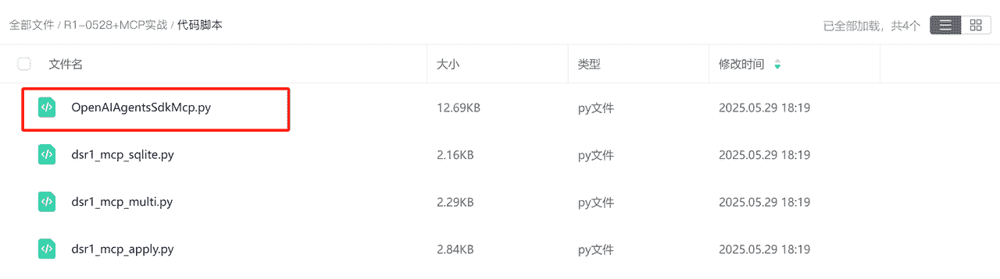


具体运行效果如下：

```
Video(&quot;https://ml2022.oss-cn-hangzhou.aliyuncs.com/Agents%20SDK%20%E6%BC%94%E7%A4%BA%E8%A7%86%E9%A2%91.mp4&quot;, width=800, height=400)
```

Your browser does not support the video element.

# 六、Google ADK 接入 MCP

## 6.1 谷歌 Agent Development Kit (ADK) 框架功能特性详解

谷歌 Agent Development Kit (ADK) 是 Google 在 2025 年发布的开源 AI 多代理开发框架。它旨在让开发者像进行软件开发一样来创建和部署自主智能体系统，使构建从简单任务到复杂工作流的多代理应用更为容易。ADK 同时也是支撑 Google 内部 Agentspace 和客户互动套件（CES）代理的底层框架，并已通过开源惠及社区。下面我们从架构设计、API 风格、扩展性、安全性、任务管理、多代理协调等方面，对 ADK 的框架特性进行详细说明。

ADK 天生支持多代理 (multi-agent) 架构，在设计上鼓励**将应用拆分为多个专职**的代理，并通过层次化的管理和协作来完成复**杂任****务。典型模式是**采用层次化的主从代理模型：可以定义一个主代**理（**如“调**度/主管****”代理）****负责统筹，根据用**户请求的意图将子任务委**派给不同功能特长的子代理处理。**这**种设计允许代理间自动分工与**协调：在处理用户消息时，主代理的底层大模型会参考自己及子代理的能力描述，判断是否将工作转交（handoff）给某个子代理。例如，一个 WeatherAgent 主管可根据用户输入动态决定是自己调用天气查询工具回答天气问题，还是将对话移交给 GreetingAgent 来处理问候语。为此，每个代理在定义时都需要提供清晰的角色说明和能力描述，以帮助大模型决策职责路由。这种通过 LLM 推断驱动的代理转移机制使 ADK 的多代理系统更具自适应性，能够根据对话内容灵活调用最合适的代理处理。除此之外，ADK 还支持多代理并行和循环等复杂编排模式：内置了顺序 (Sequential)、并行 (Parallel)、**循环 (Loo...

**模型支持方面**，ADK 采用**模型无关、插件式**设计。虽然针对 Goo**gle 自家**的 Gemini 大**模型和 **V**ertex**** AI 平台**做了优化，但并不局限于此。通过内**置的 LiteLLM 适配**层，ADK 可以**无缝对接 Ve****rtex AI **模型园中各种模型，甚至包括 Anthropic、Meta、Mistral、AI21 等多家提供商的大模型。这意味着企业可根据需求选择最适合的模型或使用私有模型，而无需更改 ADK 的使用方式，避免供应商锁定。工具扩展方面，ADK 拥有丰富的内置工具和第三方工具整合能力。框架自带了诸如网络搜索、代码执行等常用工具模块，并通过开放 API支持开发者注册任意 Python 函数作为自定义工具。ADK 特别提供了模型上下文协议 (MCP) 工具接口和对 OpenAPI 服务的集成，方便调用外部系统。ADK 还能够把其他代理作为工具使用：例如可以将一个由 LangChain 或 CrewAI 构建的代理包装为 ADK 工具供另一个代理调用，从而充分利用社区已有成果。通过这种插件化设计，ADK 的功能可**无限扩...

+   ADK项目主页：https://github.com/google/adk-python

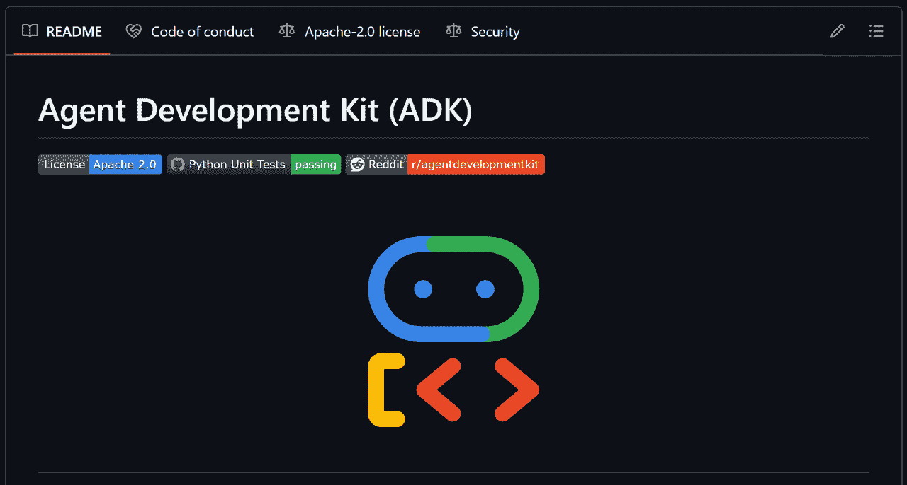

+   ADK项目说明文档：https://google.github.io/adk-docs/

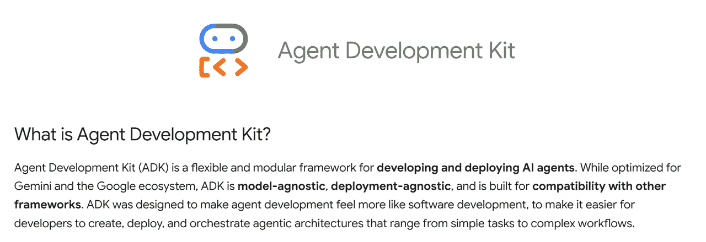

## 6.2 LiteLlm快速使用指南

在介绍ADK之前，我们需要系统介绍ADK默认的大模型调用工具——LiteLlm的使用方法。在后续使用ADK时，选择基础模型是最基础的环节，而ADK目前只支持使用LiteLlm进行模型调用，因此我们先详细介绍国内外在线模型、以及ollama和vLLM驱动下的开源模型如何接入LiteLlm，然后再讲解如何上手使用ADK。

+   项目官网：https://github.com/BerriAI/litellm

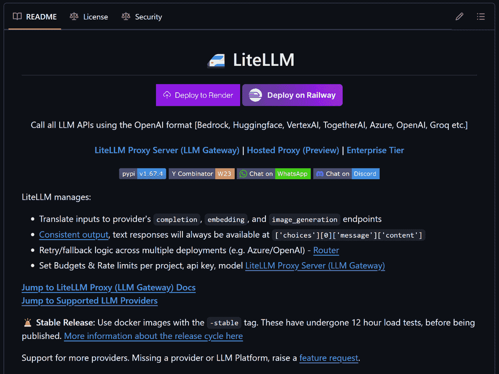

+   项目参考文档：https://docs.litellm.ai/docs/

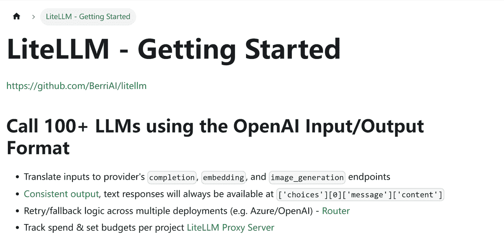

**LiteLLM** 是一个轻量级的 Python 库，旨在简化与各种大语言模型（LLM）进行交互的过程。它特别适用于开发者在多种云服务提供商（如 OpenAI、DeepSeek）**或本地部署模型（如 Ollam**a）上运行大语言模型的需求。通过提供简洁的 API 和灵活的配置选项，LiteLLM 使得开发者可以轻松调用和集成各种不同的 LLM，同时支持模型的定制化扩展和高效调度。LiteLLM 核心功能如下：

+   **跨平台模型兼容性**：LiteLLM 使开发者能够通过统一接口调用多个大语言模型，无论是云端提供的 API（如 OpenAI）还是本地托管的模型（如 Ollama）。它内置支持常见的大型模型和多模型集成，如 GPT-3.5、GPT-4、DeepSeek 等，也能支持定制模型或自己托管的 LLM。

+   **简化的 API 调用**：LiteLLM 提供了一个简单直观的接口，使得开发者无需深入了解底层 API 细节即可实现与模型的交互。用户只需关注模型名称和输入输出内容，LiteLLM 会自动处理与模型的连接、API 调用以及响应解析工作。

+   **多模型支持**：LiteLLM 支持通过配置文件和代码直接切换不同的模型。它支持从 OpenAI、Anthropic、Meta、DeepSeek 等多个模型提供商调用，还允许开发者轻松集成自定义模型。例如，您可以在一个项目中同时使用 OpenAI 的 GPT 模型和 DeepSeek 的推理模型，而无需额外的集成工作。

+   **灵活的代理支持**：LiteLLM 可以配置为代理模型的 API，通过代理层进行调用，支持本地化部署和代理服务，例如与 Ollama 等工具结合，运行本地大语言模型。这使得 LiteLLM 在需要进行模型切换或构建跨平台服务时，能够提供极大的灵活性。

+   自定义 API 路由（Base URL）：LiteLLM 允许用户设置自定义的 base_url，以支持通过代理或内部 API 调用模型。这为需要在多个环境中运行或通过私有部署调用 LLM 的企业应用提供了便利。

+   **流式响应与事件处理**：LiteLLM 支持流式响应（streaming responses），允许开发者在模型生成回复的同时进行处理。通过这种方式，开发者能够实时接收和处理模型输出，适用于需要低延迟响应的应用场景，如实时对话或多轮交互。

+   **工具和任务管理**：在集成外部工具（如搜索引擎、数据库查询等）时，LiteLLM 通过简洁的配置支持多任务执行。开发者可以将外部工具与模型结合，形成复杂的自动化任务流，例如通过模型生成的查询请求，调用外部 API 完成任务并返回结果。

+   **灵活的配置和扩展性**：LiteLLM 提供了多种配置选项，允许开发者根据具体需求调优模型的行为。用户可以通过传入配置文件来调整模型的推理设置、响应格式、温度参数等，此外，LiteLLM 还支持通过插件扩展其功能，适应更多的使用场景。

不难看出LiteLLM 是一款强大的模型调用工具，它的核心优势在于跨平台支持、简洁的 API 和灵活的配置选项。无论是调用云端大模型，还是集成本地托管的模型，LiteLLM 都能提供高效且简化的解决方案，使得开发者能够快速集成并灵活调度大语言模型。它特别适用于需要多模型集成、代理服务、任务管理和流式响应的场景，具有极高的可扩展性和适应性。通过 LiteLLM，开发者可以专注于业务逻辑和任务设计，而将模型调用、数据处理和通信细节交给框架来处理，从而大大提高开发效率并降低技术门槛。

我们可以使用如下命令进行安装

```
    pip install litellm==1.67.2
```

这里需要注意的是，尽管1.67.2不是最新LiteLlm稳定版，但却是可以最好的和ADK兼容的版本，目前最新的LiteLlm库在使用ADK的时候会报错，具体问题详见：https://github.com/BerriAI/litellm/issues/10353 。因此公开课中统一使用1.67.2版本。

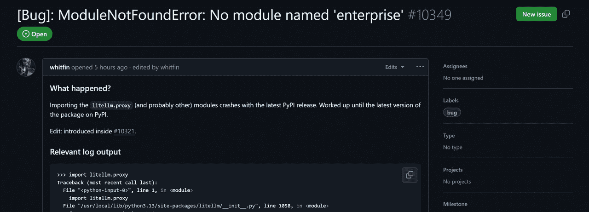

安装完成后即可尝试调用DeepSeek模型在线API进行测试。

```
from litellm import completion
```

```
completion?
```

```
Signature:
completion(
    model: str,
    messages: List = [],
    timeout: Union[float, str, openai.Timeout, NoneType] = None,
    temperature: Optional[float] = None,
    top_p: Optional[float] = None,
    n: Optional[int] = None,
    stream: Optional[bool] = None,
    stream_options: Optional[dict] = None,
    stop=None,
    max_completion_tokens: Optional[int] = None,
    max_tokens: Optional[int] = None,
    modalities: Optional[List[Literal[&#x27;text&#x27;, &#x27;audio&#x27;]]] = None,
    prediction: Optional[openai.types.chat.chat_completion_prediction_content_param.ChatCompletionPredictionContentParam] = None,
    audio: Optional[openai.types.chat.chat_completion_audio_param.ChatCompletionAudioParam] = None,
    presence_penalty: Optional[float] = None,
    frequency_penalty: Optional[float] = None,
    logit_bias: Optional[dict] = None,
    user: Optional[str] = None,
    reasoning_effort: Optional[Literal[&#x27;low&#x27;, &#x27;medium&#x27;, &#x27;high&#x27;]] = None,
    response_format: Union[dict, Type[pydantic.main.BaseModel], NoneType] = None,
    seed: Optional[int] = None,
    tools: Optional[List] = None,
    tool_choice: Union[str, dict, NoneType] = None,
    logprobs: Optional[bool] = None,
    top_logprobs: Optional[int] = None,
    parallel_tool_calls: Optional[bool] = None,
    deployment_id=None,
    extra_headers: Optional[dict] = None,
    functions: Optional[List] = None,
    function_call: Optional[str] = None,
    base_url: Optional[str] = None,
    api_version: Optional[str] = None,
    api_key: Optional[str] = None,
    model_list: Optional[list] = None,
    thinking: Optional[litellm.types.llms.anthropic.AnthropicThinkingParam] = None,
    **kwargs,
) -&gt; Union[litellm.types.utils.ModelResponse, litellm.litellm_core_utils.streaming_handler.CustomStreamWrapper]
Docstring:
Perform a completion() using any of litellm supported llms (example gpt-4, gpt-3.5-turbo, claude-2, command-nightly)
Parameters:
    model (str): The name of the language model to use for text completion. see all supported LLMs: https://docs.litellm.ai/docs/providers/
    messages (List): A list of message objects representing the conversation context (default is an empty list).

    OPTIONAL PARAMS
    functions (List, optional): A list of functions to apply to the conversation messages (default is an empty list).
    function_call (str, optional): The name of the function to call within the conversation (default is an empty string).
    temperature (float, optional): The temperature parameter for controlling the randomness of the output (default is 1.0).
    top_p (float, optional): The top-p parameter for nucleus sampling (default is 1.0).
    n (int, optional): The number of completions to generate (default is 1).
    stream (bool, optional): If True, return a streaming response (default is False).
    stream_options (dict, optional): A dictionary containing options for the streaming response. Only set this when you set stream: true.
    stop(string/list, optional): - Up to 4 sequences where the LLM API will stop generating further tokens.
    max_tokens (integer, optional): The maximum number of tokens in the generated completion (default is infinity).
    max_completion_tokens (integer, optional): An upper bound for the number of tokens that can be generated for a completion, including visible output tokens and reasoning tokens.
    modalities (List[ChatCompletionModality], optional): Output types that you would like the model to generate for this request.. You can use `[&quot;text&quot;, &quot;audio&quot;]`
    prediction (ChatCompletionPredictionContentParam, optional): Configuration for a Predicted Output, which can greatly improve response times when large parts of the model response are known ahead of time. This is most common when you are regenerating a file with only minor changes to most of the content.
    audio (ChatCompletionAudioParam, optional): Parameters for audio output. Required when audio output is requested with modalities: [&quot;audio&quot;]
    presence_penalty (float, optional): It is used to penalize new tokens based on their existence in the text so far.
    frequency_penalty: It is used to penalize new tokens based on their frequency in the text so far.
    logit_bias (dict, optional): Used to modify the probability of specific tokens appearing in the completion.
    user (str, optional):  A unique identifier representing your end-user. This can help the LLM provider to monitor and detect abuse.
    logprobs (bool, optional): Whether to return log probabilities of the output tokens or not. If true, returns the log probabilities of each output token returned in the content of message
    top_logprobs (int, optional): An integer between 0 and 5 specifying the number of most likely tokens to return at each token position, each with an associated log probability. logprobs must be set to true if this parameter is used.
    metadata (dict, optional): Pass in additional metadata to tag your completion calls - eg. prompt version, details, etc.
    api_base (str, optional): Base URL for the API (default is None).
    api_version (str, optional): API version (default is None).
    api_key (str, optional): API key (default is None).
    model_list (list, optional): List of api base, version, keys
    extra_headers (dict, optional): Additional headers to include in the request.

    LITELLM Specific Params
    mock_response (str, optional): If provided, return a mock completion response for testing or debugging purposes (default is None).
    custom_llm_provider (str, optional): Used for Non-OpenAI LLMs, Example usage for bedrock, set model=&quot;amazon.titan-tg1-large&quot; and custom_llm_provider=&quot;bedrock&quot;
    max_retries (int, optional): The number of retries to attempt (default is 0).
Returns:
    ModelResponse: A response object containing the generated completion and associated metadata.

Note:
    - This function is used to perform completions() using the specified language model.
    - It supports various optional parameters for customizing the completion behavior.
    - If &#x27;mock_response&#x27; is provided, a mock completion response is returned for testing or debugging.
File:      c:\programdata\anaconda3\envs\jupyter_env\lib\site-packages\litellm\main.py
Type:      function
```

```
api_base = &quot;https://api.deepseek.com&quot;
api_key = &quot;YOUR_DEEPSEEK_API_KEY&quot;
```

```
# 使用 LiteLLM 调用 DeepSeek 模型
response = completion(
    model=&quot;deepseek/deepseek-chat&quot;,  
    messages=[{&quot;role&quot;: &quot;user&quot;, &quot;content&quot;: &quot;你好，好久不见！&quot;}],
    api_base=api_base,
    api_key=api_key
)
```

```
print(response)
```

```
ModelResponse(id=&#x27;1aeee833-ee0e-48e8-a540-629e9aabd3ac&#x27;, created=1745740153, model=&#x27;deepseek-chat&#x27;, object=&#x27;chat.completion&#x27;, system_fingerprint=&#x27;fp_8802369eaa_prod0425fp8&#x27;, choices=[Choices(finish_reason=&#x27;stop&#x27;, index=0, message=Message(content=&#x27;你好呀！确实好久不见～最近过得怎么样？有什么新鲜事想分享，或者需要帮忙的地方吗？我随时在这里哦！😊  \n\n（如果这时候你突然想聊天气、电影、或者突然冒出的奇怪问题……我也完全接得住！）&#x27;, role=&#x27;assistant&#x27;, tool_calls=None, function_call=None, provider_specific_fields=None))], usage=Usage(completion_tokens=55, prompt_tokens=8, total_tokens=63, completion_tokens_details=None, prompt_tokens_details=PromptTokensDetailsWrapper(audio_tokens=None, cached_tokens=0, text_tokens=None, image_tokens=None), prompt_cache_hit_tokens=0, prompt_cache_miss_tokens=8))
```

```
print(response.choices[0].message.content)
```

```
你好呀！确实好久不见～最近过得怎么样？有什么新鲜事想分享，或者需要帮忙的地方吗？我随时在这里哦！😊  

（如果这时候你突然想聊天气、电影、或者突然冒出的奇怪问题……我也完全接得住！）
```

使用Gooogle ADK构建Agent其基本的实现形式如下所示。这里我们使用liteLLM接入DeepSeek模型，注意需要在同级目录下创建.env文件，并配置DS_API_KEY和DS_BASE_URL。同时，对于Agent的构建，我们使用最简模式，即只设置name和model。（我们在下一小节课程再详细介绍Agent组件的高阶应用）

```
from google.adk.agents import Agent
from google.adk.models.lite_llm import LiteLlm
import os
from dotenv import load_dotenv
load_dotenv(override=True)


DS_API_KEY = os.getenv(&quot;DS_API_KEY&quot;)
DS_BASE_URL = os.getenv(&quot;DS_BASE_URL&quot;)

# 1. 通过 litellm 接入 DeepSeek 模型
model = LiteLlm(
    model=&quot;deepseek/deepseek-reasoner&quot;,  
    api_base=DS_BASE_URL,
    api_key=DS_API_KEY
)

# 2. 使用最简模式构建一个Agent代理
init_agent = Agent(
    name=&quot;chatbot&quot;,
    model=model,
    instruction=&quot;你是一个乐于助人的中文助手。&quot;,
)
```

ADK作为最新一代Agent开发框架，不仅功能特性非常领先，而且还内置了非常多的工具，包括Gemini系列模型自带的谷歌搜索、文件检索和代码解释器等功能，同时ADK还拥有内置对话前端，方便开发者更加直观的感受Agent的对话流程，并且实时追踪Agent的events流。而如果Agent中存在外部工具调用，则在内置前端中，还能进一步观察到Agent调用外部工具完整流程，以及各环节调用信息，方便开发者即时debug。如果是使用Gemini模型，这个前端还支持语音和视频实时交互，基本展示效果如下：

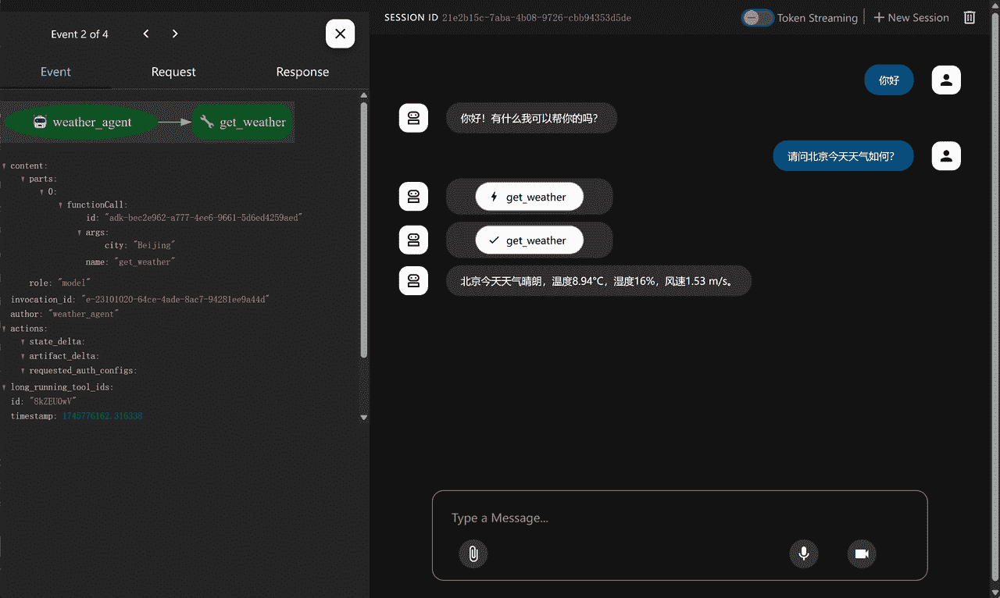

## 6.3 ADK内置前端开启流程

而ADK内置前端开启流程也非常简单，这里我们需要创建一个项目文件，如创建一个ADK_Chat文件夹：


然后创建基本文件结构：（注意，如果是Windows系统，官方推荐手动创建项目文件基本结构，而不是采用IDE如Cursor等进行创建，以避免出现字符乱码情况）

```
    ADK_Chat/
    ├── test_agent/
    │   ├── agent.py
    │   ├── __init__.py
    │   ├── .env
    ├── __init__.py
    └── ...
```

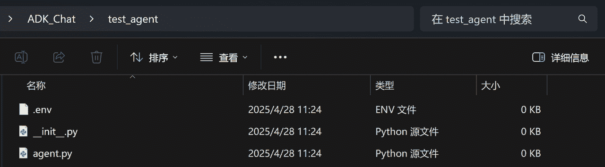

然后使用cursor或者其他IDE打开项目，准备写入代码。（也可以直接使用文本编辑器将代码拷贝进去）

+   **init.py**

写入如下内容：from . import agent

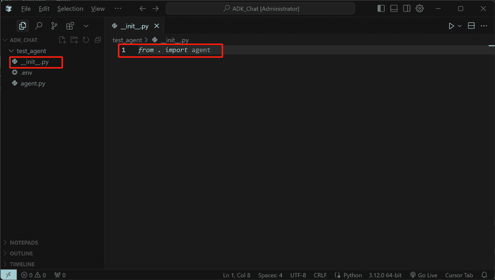

+   **.env**

然后在.env中写入如下内容：

```
DS_BASE_URL=https://api.deepseek.com
DS_API_KEY=YOUR_API_KRY
```

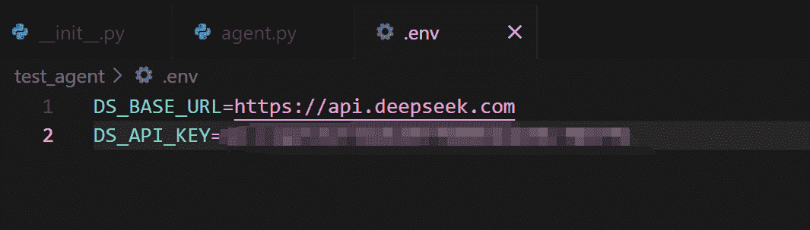

+   **agent.py**

写入如下内容。这里我们使用Google ADK框架中的MCPToolset方法接入MCP Server，如下代码所示：

```
from google.adk.agents import Agent
from google.adk.models.lite_llm import LiteLlm

from google.adk.tools.mcp_tool.mcp_toolset import MCPToolset, SseServerParams
from google.adk.tools.mcp_tool.mcp_toolset import MCPToolset, StdioServerParameters

import os
from dotenv import load_dotenv
load_dotenv(override=True)

# step 1. 设置Filesystem MCP Server 所需要的文件路径
TARGET_FOLDER_PATH = os.path.join(os.path.dirname(os.path.abspath(__file__)), &quot;file_data&quot;)

# 确保目录存在
os.makedirs(TARGET_FOLDER_PATH, exist_ok=True)

DS_API_KEY = os.getenv(&quot;DS_API_KEY&quot;)
DS_BASE_URL = os.getenv(&quot;DS_BASE_URL&quot;)

model = LiteLlm(
    model=&quot;deepseek/deepseek-reasoner&quot;,  
    api_base=DS_BASE_URL,
    api_key=DS_API_KEY
)

# 根据 GitHub issue #893 的解决方案，使用本地 MCP 服务器
root_agent = Agent(
    name=&quot;filesystem_assistant&quot;,
    model=model, 
    description=&quot;用于管理本地文件的智能体&quot;,
    instruction=&quot;你是一个文件管理助手，可以帮助用户列出文件、读取文件内容等。&quot;,
    tools=[
        MCPToolset(
            connection_params=StdioServerParameters(
                command=&#x27;npx.cmd&#x27;,  # Windows 环境使用 npx.cmd
                args=[
                    &quot;-y&quot;,
                    &quot;@modelcontextprotocol/server-filesystem&quot;,
                    os.path.abspath(TARGET_FOLDER_PATH)
                ],
            )
        )
    ],
)
```

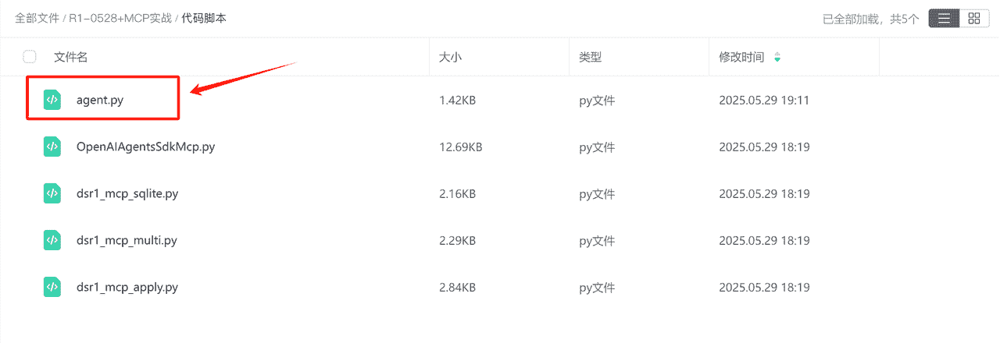


然后再次确认当前环境是否安装adk和litellm两个库：

```
    pip install litellm==1.67.2
    pip install google-adk 
```

dk其实是伴随着安装包一起安装的调用测试命令。在使用adk命令时，我们无需单独设置主函数，只需要按照要求创建一个名为root_agent的主agent，即可顺利开启对话。同时当前项目结构中，.env文件用于保存一些关键变量信息，而__init__.py则负责将当前项目文件test_agent包装为一个可执行的Python文件。这也就是为何我们可以直接输入adk run test_agent的原因。

接下来即可开启前端了，我们在项目根目录下输入：

```
    adk web --port 8002
```

这里需要注意的是： Windows 环境下运行 MCP 工具时的子进程创建问题。错误 NotImplementedError 发生在尝试启动 MCP 服务器进程时。因此Windows用户需要使用adk web --no-reload命令启动。

> 注意选择一个未被使用的端口号

然后在浏览器输入：http://0.0.0.0:8002/即可开启对话：

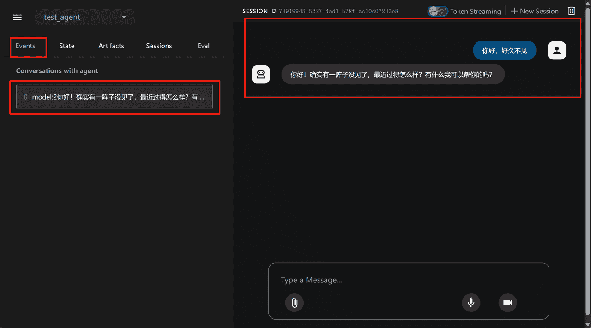

在对话页面能够看到完整的历史对话消息，并且在左侧还能看到事件流的基本情况，以及每个事件的详细信息：

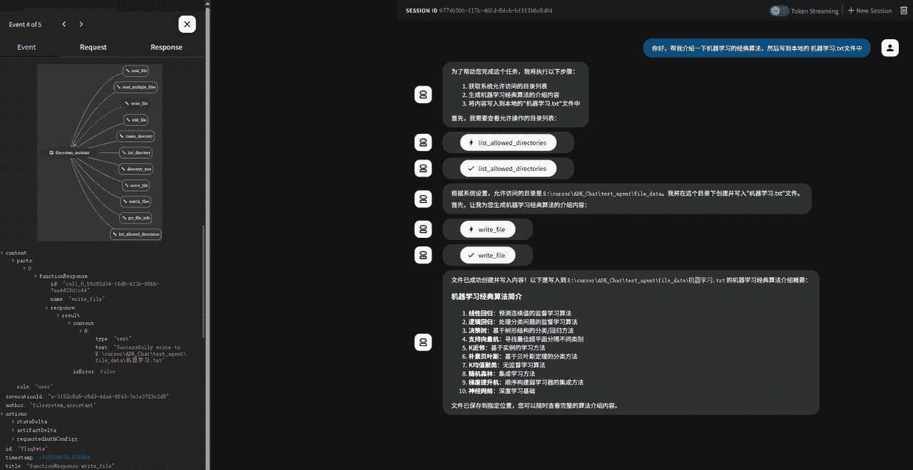

完整演示效果如下：

```
Video(&quot;https://ml2022.oss-cn-hangzhou.aliyuncs.com/Googel%20ADK%E6%BC%94%E7%A4%BA%E8%A7%86%E9%A2%91.mp4&quot;, width=800, height=400)
```

Your browser does not support the video element.