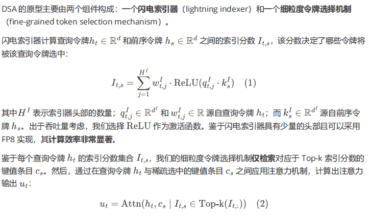
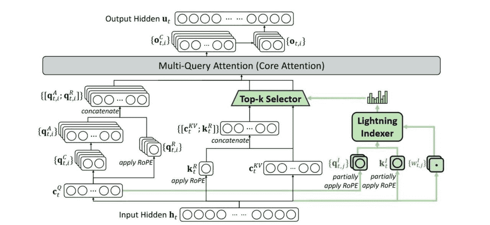
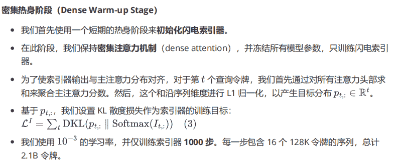
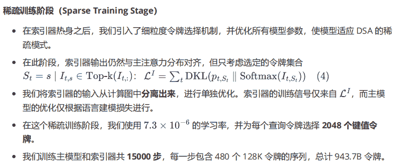
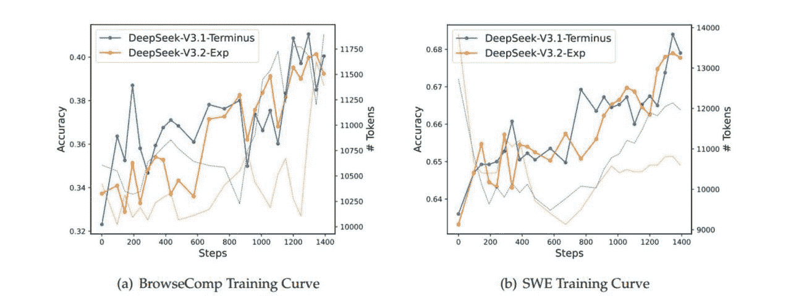
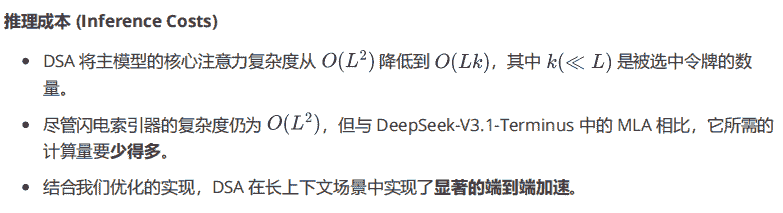
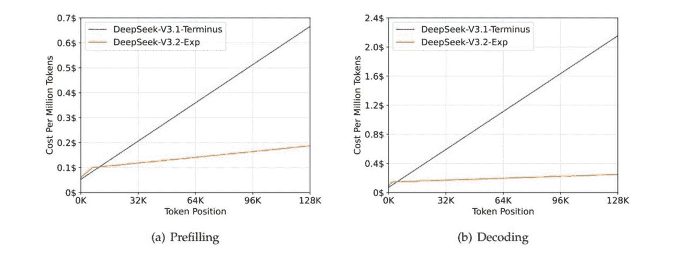
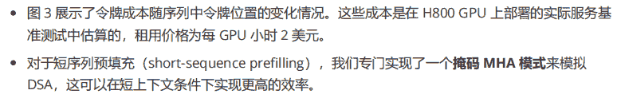
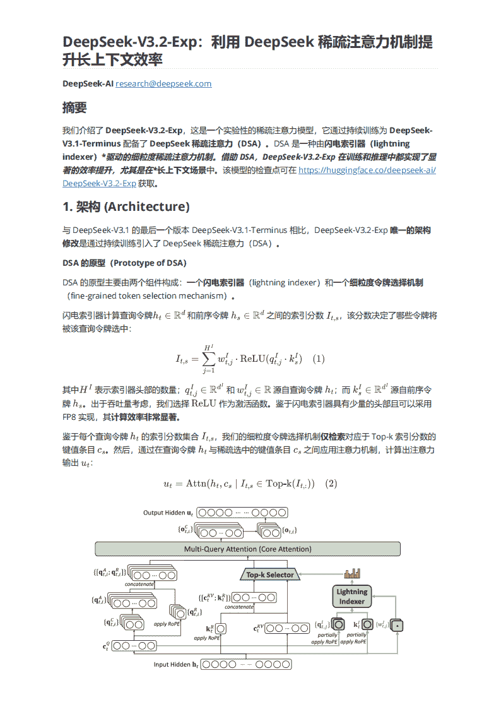

# DeepSeek-V3.2-Exp：利用 DeepSeek 稀疏注意力机制提升长上下文效率

> 来源：[https://kq4b3vgg5b.feishu.cn/docx/XEM7d3W0kozWWLx1oR0cX2N5nxb](https://kq4b3vgg5b.feishu.cn/docx/XEM7d3W0kozWWLx1oR0cX2N5nxb)

---

**DeepSeek-AI **research@deepseek.com

## **摘要**

我们介绍了 DeepSeek-V3.2-**Exp，这是一个实验性的稀疏注**意力模型，它通过持续训练为 DeepSeek- V3.1-Terminus 配备了 DeepSeek 稀疏注意力（DSA）。 DSA 是一种由闪电索引器（lightning

**indexer）* ****驱****动的细粒度稀疏注意力机制。借助 ****D****SA ，DeepSeek****-V3.2-**Exp  在训练和推理中都实现了显 著的效率提升，尤其是在*长上下文场景中。该模型的检查点可在https://huggingface.co/deepseek-ai/ DeepSeek-V3.2-Exp 获取。

## 1. 架构 (Architecture)

与** DeepSee**k-V3.1 的最后一个版本 DeepSeek-V3.1-Terminus 相比， DeepSeek-V3.2-Exp 唯一的架构 修改是通过持续训练引入了 DeepSeek 稀疏注意力（DSA）。

DSA 的原型（Prototype of DSA）

**DSA 的****原型主要由两个组件构**成： 一个闪电索引器（lightning indexer）和一个细粒度令牌选择机制 （fine-grained token selection mechanism）

**在 MLA 下实例化 DSA (Instan**tiate DSA Under MLA)

考**虑到从 Dee**pSeek-V3.1-Terminus 进行持续训练，我们为 DeepSeek-V3.2-Exp 基于 MLA (DeepSeek- AI, 2024) 实例化了 DSA。在内核层面，出于计算效率考虑，每个键值条目必须在多个查询之间共享

(Yuan et al., 2025)。因此，我们在 MLA 的 MQA (Multi-Query Attention) 模式 (Shazeer, 2019) 下实 现了 DSA，在这种模式下，每个潜在向量（MLA 的键值条目）将由查询令牌的所有查询头部共享。图 1 展示了基于 MLA 的 DSA 架构。（注：图 1 中绿色部分说明了 DSA 如何根据索引器选择 Top-k 键值条    目）。

## 2. 训练 (Training)

我们从 DeepSeek-V3.1-Terminus 的基础检查点开始，该模型的上下文长度已扩展到 128K。我们执行了 持续预训练，随后进行了后训练，以创建 DeepSeek-V3.2-Exp。

### 2.1. 持续预训练 (Continued Pre-Training)

持**续预训练包括两个训练阶段。**这两个阶段的训练数据分布与 DeepSeek-V3.1-Terminus 所使用的 128K 长上下文扩展数据完全一致。

### 2.2. 后训练 (Post-Training)

在持续**预训练之后，我们执行后训练以创建最终的 De**epSeek-V3.2-Exp。 DeepSeek-V3.2-Exp 的后训练 也采用了与稀疏持续预训练阶段相同的方式的稀疏注意力。为了严格评估引入 DSA 的影响， DeepSeek- V3.2-Exp 保持了与 DeepSeek-V3.1-Terminus 相同的后训练流程、算法和数据。

专家蒸馏（Specialist Distillation）

+   对于每项任务，我们最初开发了一个专门针对该特定领域的专业模型，所有专业模型均从相同的预 训练 DeepSeek-V3.2 基础检查点进行微调。

+   我们的框架涵盖五种专业领域： 数学、竞争性编程、通用逻辑推理、代理式编码和代理式搜索，此 外还有写作任务和通用问答。

+   每个专家都使用大规模强化学习（RL）计算进行训练。

+   我们使用不同的模型来生成用于**长链式思维推理 **（思考模式）和**直接响应生成 **（非思考模式）的训 练数据。

+   专家模型用于为最终检查点生成特定领域的数据。在蒸馏数据上训练的模型性能仅略低于特定领域 专家，并且通过随后的 RL 训练有效地消除了性能差距。

混合 RL 训练（Mixed RL Training）

对于 DeepSeek-V3.2-Exp，我们仍然采用群组相对策略优化（GRPO）(DeepSeek-AI, 2025; Shao et al., 2024) 作为 RL 训练算法。

+   与之前采用多阶段强化学习训练的 DeepSeek 模型不同，我们将推理、代理和人类对齐训练合并到 一个 RL 阶段。

+   **这种方法有效地**平衡了跨域性能，同时避免了通常与多阶段训练范式相关的灾难性遗忘问题。

+   对于推理和代理任务，我们采用基于规则的结果奖励、长度惩罚和语言一致性奖励。

+   对于一般任务，我们采用生成式奖励模型，其中每个提示都有自己的评估标准。

+   **我们的奖励设计仔细平**衡了**两个关键的权衡： (1) **长度与准确性和 (2) 语言一致性与准确性。

## 3. 评估 (Evaluations)

模型能力 (Model Capabilities)

我们在专注于各种能力的基准套件上评估了 DeepSeek-V3.2-Exp，并在表 1 中将其与 DeepSeek-V3.1- Terminus 进行了比较。尽管 DeepSeek-V3.2-Exp 显著提高了长序列的计算效率，但我们观察到与

DeepSeek-V3.1-Termi**nus 相比，在短**上下文和长上下文任务上没有明显的性能下降。

表 1 总结了评估结果：

| **基准测试 (指标)** | DeepSeek-V3.1- Terminus | DeepSeek-V3.2- Exp |
| --- | --- | --- |
| **通用** |  |  |
| MMLU-Pro (EM) | 85.0 | 85.0 |
| GPQA-Diamond (Pass@1) | 80.7 | 79.9 |
| Humanity’s Last Exam (Pass@1) | 21.7 | 19.8 |
| **搜索代理** |  |  |
| BrowseComp (Acc.) | 38.5 | 40.1 |
| BrowseComp_zh (Acc.) | 45.0 | 47.9 |
| SimpleQA (Acc.) | 96.8 | 97.1 |
| **代码** |  |  |
| LiveCodeBench (2408-2505) (Pass@1) | 74.9 | 74.1 |
| Codeforces-Div1 (Rating) | 2046 | **2121** |
| Aider-Polyglot (Acc.) | 76.1 | 74.5 |
| **代码代理** |  |  |
| SWE Verified (Agent mode) | 68.4 | 67.8 |
| SWE-bench Multilingual (Agent mode) | 57.8 | 57.9 |
| Terminal-bench (Terminus 1 framework) | 36.7 | 37.7 |
| **数学** |  |  |
| AIME 2025 (Pass@1) | 88.4 | **89.3** |
| HMMT 2025 (Pass@1) | 86.1 | 83.6 |

DeepSeek-V3.2-Exp 在 GPQA、 HLE 和 HMMT 2025** 上的性能低于** DeepSeek-V3.1-Terminus，这是因 为它生成了更少的推理令牌。然而，当使用生成相当数量令牌的中间检查点时，这个性能差距就会消

除。

图 2** 显示**了 DeepSeek-V3.2-Exp 和 DeepSeek-V3.1-Terminus 在 BrowseComp 和 SWE Verified 上的 RL 训练曲线。这两个模型在整个训练过程中性能稳步提高，曲线紧密对齐，这反映了 DSA 训练的稳定性。

**现实世界的未来验证 (Future Valid**ation in Real World)

尽管我们的内部评估显示 DeepSeek-V3.2-Exp 的结果很有前景，但我们正在积极寻求在现实世界场景中 进行进一步的大规模测试，以发现稀疏注意力架构的潜在局限性。

## **附录 A. MLA 的 MHA 和 MQA 模式 (MHAa**nd MQA Modes of MLA)

图 4 说明了 MLA 的 MHA（ Multi-Head Attention）和 MQA（ Multi-Query Attention）模式，以及它们 之间的转换。对于 DeepSeek-V3.1-Terminus ， MHA 模式用于训练和预填充（prefilling） ，而 MQA   模式用于解码（decoding）。

[DeepSeek-V3.2-Exp：利用 DeepSeek 稀疏注意力机制提升长上下文效率.pdf](https://internal-api-drive-stream.feishu.cn/space/api/box/stream/download/all/XGWpbmTDyoujXtxI4DfctSyLn5f)