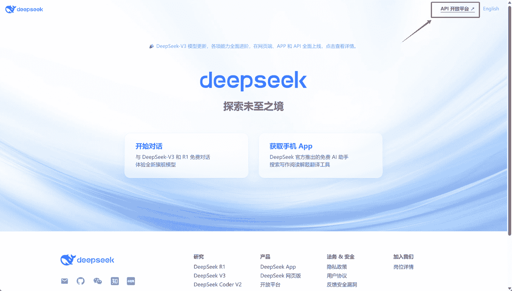
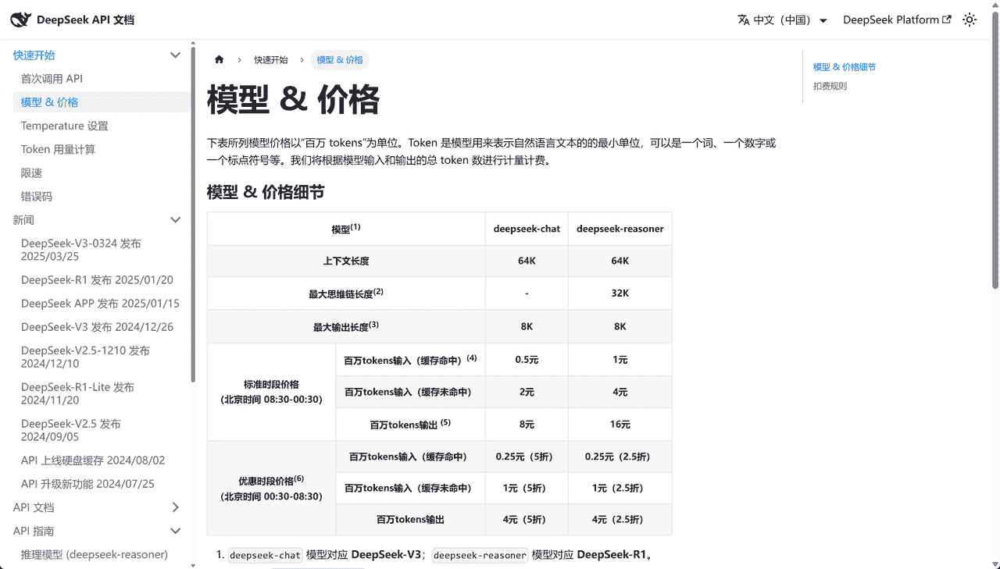
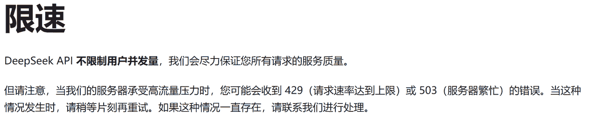
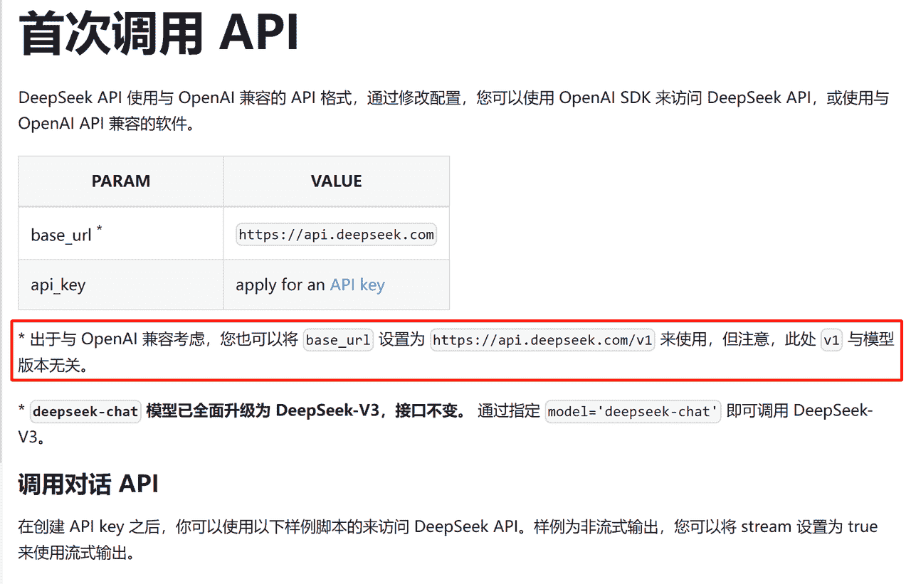
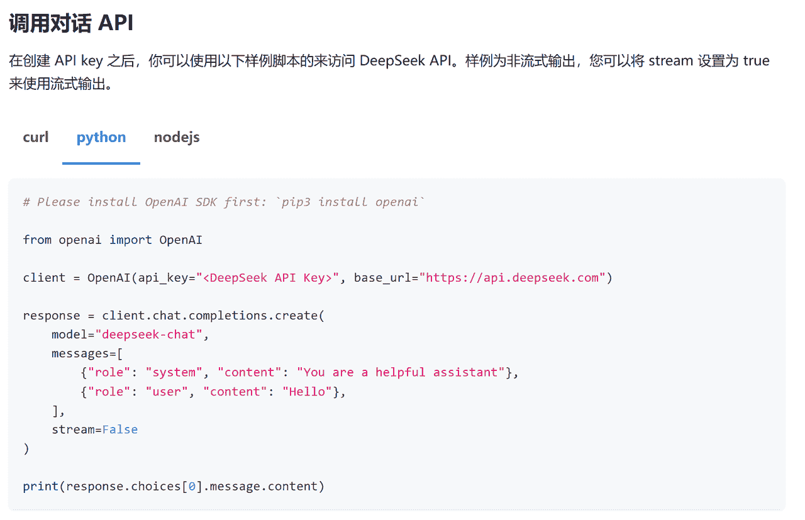
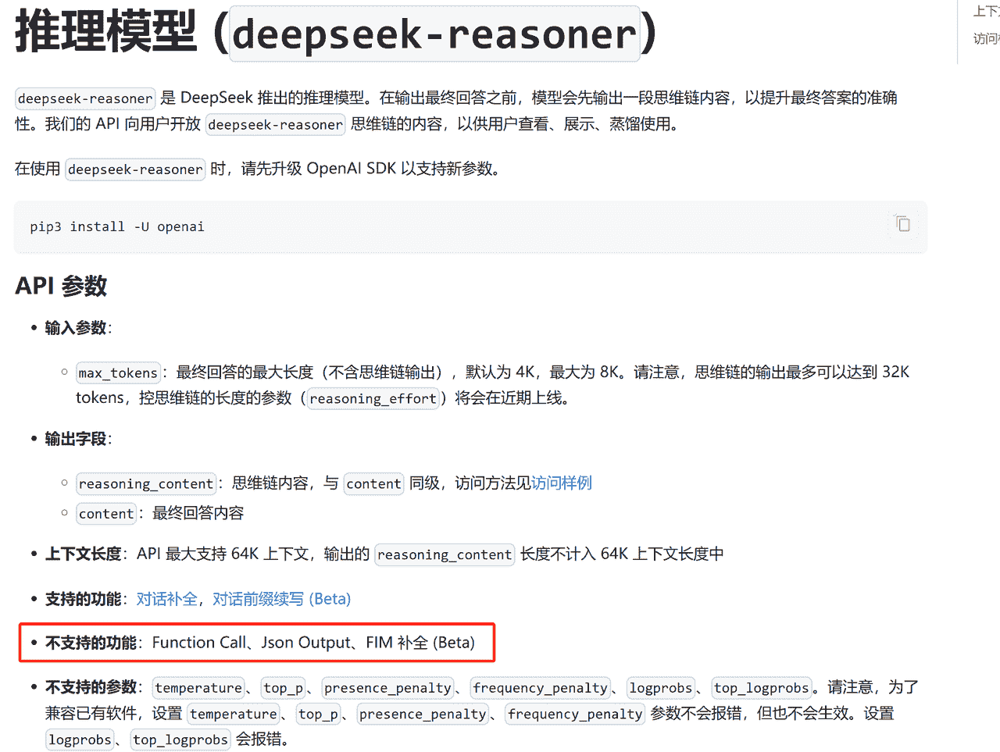
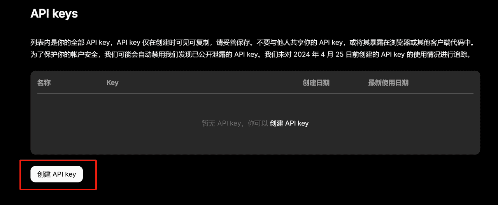
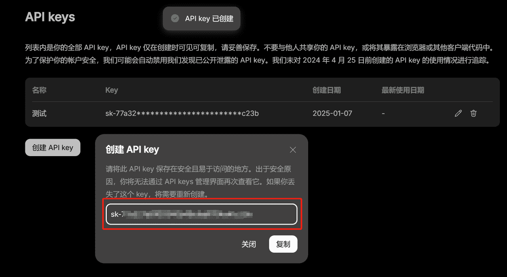
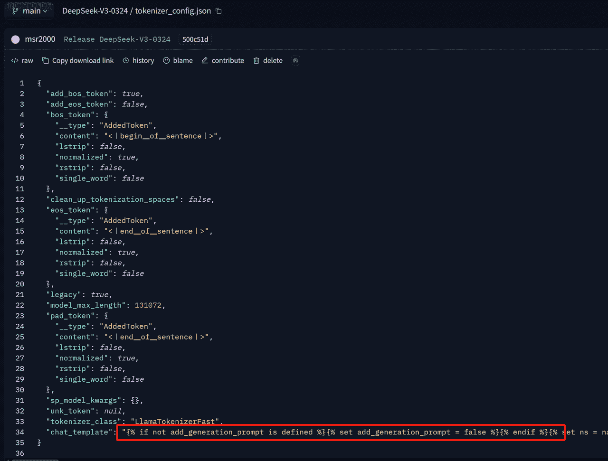
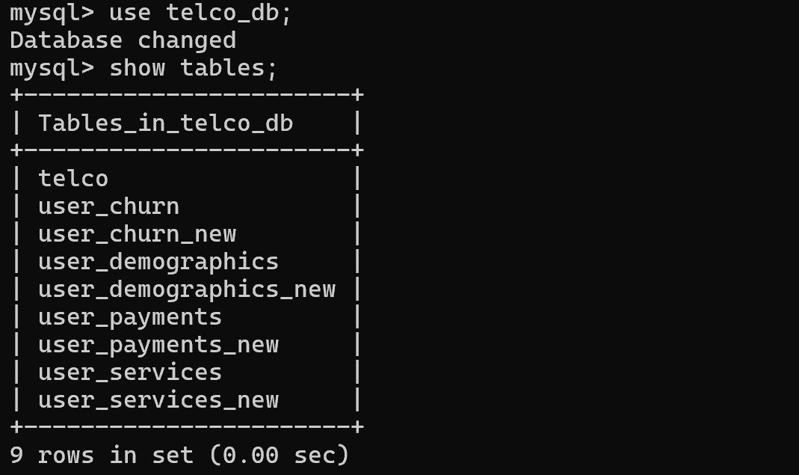

# DeepSeek Function calling功能详解

> 来源：[https://kq4b3vgg5b.feishu.cn/docx/EIHRdGawyoJvhlxDmm7cQSmDnjc](https://kq4b3vgg5b.feishu.cn/docx/EIHRdGawyoJvhlxDmm7cQSmDnjc)

## Part 1. DeepSeek Agent开发快速入门


[DeepSeek Agent开发快速入门.pdf](https://internal-api-drive-stream.feishu.cn/space/api/box/stream/download/all/BF7sbv7MHoZ17Sx9iaxcZHpTn6c)

---

## DeepSeek智能体开发实战

## Part 2. DeepSeek Function calling功能详解

### 一、DeepSeek在线API接入指南

#### 1. DeepSeek账号注册与API获取

在调用DeepSeek API之前，需要先完成注册，并获取对应的API-KEY。DeepSeek官网地址：https://www.deepseek.com/

点击API开放平台，开始注册。注册完成后即可进入到个人主页，可在其中进行充值：



目前DeepSeek按照统一模型名称进行命名，其中`deepseek-chat`指的是最新版`DeepSeek-V3-0324`模型，而`deepseek-reasoner`则指的是最新版`DeepSeek-R1`模型。其中两款模型定价如下：



目前API调用暂时不限速：



且模型调用风格和`OpenAI`完全一致，而`deepseek-chat`模型还支持`Function calling`、提示词缓存、`Json Output`等Agent开发关键功能。





需要注意的是，`deepseek-reasoner`（`DeepSeek-R1`）模型并不支持`Function calling`、提示词缓存、`Json Output`等功能：



#### 2. DeepSeek API-KEY获取与DeepSeek-V3-0324模型调用流程

接下来需要在官网申请`API-KEY`：https://platform.deepseek.com/api_keys





由于DeepSeek采用`OpenAI`风格API，因此需要先安装`OpenAI`库：

```
!pip install openai
```

```
Collecting openai
  Downloading openai-1.68.2-py3-none-any.whl.metadata (25 kB)
Requirement already satisfied: anyio&lt;5,&gt;=3.5.0 in c:\programdata\anaconda3\envs\jupyter_env\lib\site-packages (from openai) (4.9.0)
Collecting distro&lt;2,&gt;=1.7.0 (from openai)
  Using cached distro-1.9.0-py3-none-any.whl.metadata (6.8 kB)
Requirement already satisfied: httpx&lt;1,&gt;=0.23.0 in c:\programdata\anaconda3\envs\jupyter_env\lib\site-packages (from openai) (0.28.1)
Collecting jiter&lt;1,&gt;=0.4.0 (from openai)
  Downloading jiter-0.9.0-cp311-cp311-win_amd64.whl.metadata (5.3 kB)
Collecting pydantic&lt;3,&gt;=1.9.0 (from openai)
  Downloading pydantic-2.10.6-py3-none-any.whl.metadata (30 kB)
Requirement already satisfied: sniffio in c:\programdata\anaconda3\envs\jupyter_env\lib\site-packages (from openai) (1.3.1)
Collecting tqdm&gt;4 (from openai)
  Downloading tqdm-4.67.1-py3-none-any.whl.metadata (57 kB)
Requirement already satisfied: typing-extensions&lt;5,&gt;=4.11 in c:\programdata\anaconda3\envs\jupyter_env\lib\site-packages (from openai) (4.13.0)
Requirement already satisfied: idna&gt;=2.8 in c:\programdata\anaconda3\envs\jupyter_env\lib\site-packages (from anyio&lt;5,&gt;=3.5.0-&gt;openai) (3.10)
Requirement already satisfied: certifi in c:\programdata\anaconda3\envs\jupyter_env\lib\site-packages (from httpx&lt;1,&gt;=0.23.0-&gt;openai) (2025.1.31)
Requirement already satisfied: httpcore==1.* in c:\programdata\anaconda3\envs\jupyter_env\lib\site-packages (from httpx&lt;1,&gt;=0.23.0-&gt;openai) (1.0.7)
Requirement already satisfied: h11&lt;0.15,&gt;=0.13 in c:\programdata\anaconda3\envs\jupyter_env\lib\site-packages (from httpcore==1.*-&gt;httpx&lt;1,&gt;=0.23.0-&gt;openai) (0.14.0)
Collecting annotated-types&gt;=0.6.0 (from pydantic&lt;3,&gt;=1.9.0-&gt;openai)
  Using cached annotated_types-0.7.0-py3-none-any.whl.metadata (15 kB)
Collecting pydantic-core==2.27.2 (from pydantic&lt;3,&gt;=1.9.0-&gt;openai)
  Downloading pydantic_core-2.27.2-cp311-win_amd64.whl.metadata (6.7 kB)
Requirement already satisfied: colorama in c:\programdata\anaconda3\envs\jupyter_env\lib\site-packages (from tqdm&gt;4-&gt;openai) (0.4.6)
Downloading openai-1.68.2-py3-none-any.whl (606 kB)
   ---------------------------------------- 0.0/606.1 kB ? eta -:--:--
   ---------------------------------------- 606.1/606.1 kB 4.4 MB/s eta 0:00:00
Using cached distro-1.9.0-py3-none-any.whl (20 kB)
Downloading jiter-0.9.0-cp311-cp311-win_amd64.whl (210 kB)
Downloading pydantic-2.10.6-py3-none-any.whl (431 kB)
Downloading pydantic_core-2.27.2-cp311-win_amd64.whl (2.0 MB)
   ---------------------------------------- 0.0/2.0 MB ? eta -:--:--
   -------------------------- ------------- 1.3/2.0 MB 5.6 MB/s eta 0:00:01
   ---------------------------------------- 2.0/2.0 MB 5.8 MB/s eta 0:00:00
Downloading tqdm-4.67.1-py3-none-any.whl (78 kB)
Using cached annotated_types-0.7.0-py3-none-any.whl (13 kB)
Installing collected packages: tqdm, pydantic-core, jiter, distro, annotated-types, pydantic, openai
Successfully installed annotated-types-0.7.0 distro-1.9.0 jiter-0.9.0 openai-1.68.2 pydantic-2.10.6 pydantic-core-2.27.2 tqdm-4.67.1


WARNING: Retrying (Retry(total=4, connect=None, read=None, redirect=None, status=None)) after connection broken by &#x27;SSLError(SSLEOFError(8, &#x27;[SSL: UNEXPECTED_EOF_WHILE_READING] EOF occurred in violation of protocol (_ssl.c:1006)&#x27;))&#x27;: /simple/openai/
```

然后按照如下代码进行调用：

```
import openai
```

```
openai.__version__
```

```
&#x27;1.68.2&#x27;
```

```
from openai import OpenAI
```

```
ds_api_key = &#x27;YOUR_DS_API_KEY&#x27;
```

```
import os
ds_api_key = os.getenv(&quot;DS_API_KEY&quot;)
```

```
# 实例化客户端
client = OpenAI(api_key=ds_api_key, 
                base_url=&quot;https://api.deepseek.com&quot;)
```

```
# 调用 deepseekv3 模型
response = client.chat.completions.create(
    model=&quot;deepseek-chat&quot;,
    messages=[
        {&quot;role&quot;: &quot;user&quot;, &quot;content&quot;: &quot;你好，好久不见!&quot;}
    ]
)
```

> 本节公开课仍然采用`chat.completions`进行模型调用，而目前OpenAI已发布最新版`Responses API`，后续各大厂商或许会兼容`Responses API`进行模型调用。

```
# 输出生成的响应内容
print(response.choices[0].message.content)
```

```
你好呀！确实好久不见～最近过得怎么样？有什么新鲜事想分享，或者有什么我可以帮你的吗？😊  

（如果我们是“老网友”重逢，可以悄悄告诉我上次聊过的话题，我帮你回忆一下～）
```

模型完整回复内容如下：

```
response
```

```
ChatCompletion(id=&#x27;8c0856a3-c1e7-4299-b1f6-751d0e8f51ea&#x27;, choices=[Choice(finish_reason=&#x27;stop&#x27;, index=0, logprobs=None, message=ChatCompletionMessage(content=&#x27;你好呀！确实好久不见～最近过得怎么样？有什么新鲜事想分享，或者有什么我可以帮你的吗？😊  \n\n（如果我们是“老网友”重逢，可以悄悄告诉我上次聊过的话题，我帮你回忆一下～）&#x27;, refusal=None, role=&#x27;assistant&#x27;, annotations=None, audio=None, function_call=None, tool_calls=None))], created=1743068740, model=&#x27;deepseek-chat&#x27;, object=&#x27;chat.completion&#x27;, service_tier=None, system_fingerprint=&#x27;fp_3d5141a69a_prod0225&#x27;, usage=CompletionUsage(completion_tokens=50, prompt_tokens=8, total_tokens=58, completion_tokens_details=None, prompt_tokens_details=PromptTokensDetails(audio_tokens=None, cached_tokens=0), prompt_cache_hit_tokens=0, prompt_cache_miss_tokens=8))
```

同样，我们也可以按照如下方式查看DeepSeek目前支持的模型范围：

```
models_list = client.models.list()
```

```
models_list.data
```

```
[Model(id=&#x27;deepseek-chat&#x27;, created=None, object=&#x27;model&#x27;, owned_by=&#x27;deepseek&#x27;),
 Model(id=&#x27;deepseek-reasoner&#x27;, created=None, object=&#x27;model&#x27;, owned_by=&#x27;deepseek&#x27;)]
```

`DeepSeek v3` 模型属于聊天补全（`chat completion`）模型，模型提供了多种参数，帮助开发者定制化模型的生成行为。以下是对主要参数的详细解释，以及如何在 `Python` 中使用这些参数进行请求。

#### 3. DeepSeek API调用过程中参数介绍

##### 3.1 核心参数：`messages`参数

`messages` 参数是 `DeepSeek v3` 模型 API 中必填的参数之一，用于定义聊天上下文，包括用户的输入、系统的指令、助手的回复等。通过 `messages` 数组，模型可以理解当前对话的背景，从而生成更加连贯的响应。根据不同的使用场景，`messages` 包含多种类型的消息，例如 `system message`、`user message` 和 `assistant message`。下面是对 `messages` 参数及其各个子类型的详细解释。

###### 3.1.1 System message

`system message` 用于设置系统消息，通常由开发者设定，以指导模型如何进行对话。这类消息可以定义规则或约束，并提供有关对话的背景信息。

+   `content` (必填)：系统消息的内容，可以是字符串或数组。如果是数组，可能包含多个类型的内容（如文本、图像）。

+   `role` (必填)：此处角色为 `system`，表明这是系统发出的消息。

+   `name` (可选)：提供系统消息发送者的名称，尤其适用于区分多个具有相同角色的参与者。

**示例**：

```
system_message = {
    "role": "system",
    "content": "你是一位助人为乐的助手。"
}
```


```
# 定义一个字典，键为'system_message'，用于存储系统消息
system_message = {
    # 'role'键对应的值是一个字符串"system"，表示消息的发送者是系统
    "role": "system",
    # 'content'键对应的值是一个字符串，表示系统消息的内容
    "content": "你是一位大学教授。"
}
```

### 3.1.2 User message

user message 表示用户发给模型的消息，是对话的核心部分之一。它定义了用户的输入内容，模型根据这些内容生成响应。

+ `content` (必填)：用户消息的内容，通常为文本或图像链接的数组。对于支持图像输入的模型，如 DeepSeek v2.5，还可以传递图像。

+ `文本内容`：单纯的字符串形式，用户输入的文本。

+ `数组形式的内容`：由文本或图像链接组成的数组，可以同时传递多张图像或多段文本内容。

+ `role` (必填)：角色为 user，表示该消息来自用户。

+ `name` (可选)：可以为用户指定一个名称，用于区分多个具有相同角色的用户。

**示例**：

```
user_message = {
    "role": "user",
    "content": "你好，请介绍下你自己。"
}
```

```
# 创建用户消息
user_message = {
    "role": "user",
    "content": "你好，请介绍下你自己。"
}
```

```
response = client.chat.completions.create(
    model="deepseek-chat",
    messages=[
        system_message,
        user_message
    ]
)
```

```
# 输出生成的响应内容
print(response.choices[0].message.content)
```

你好！我是一名大学教授，拥有多年的教学和研究经验。我的专业领域涵盖[可根据具体情境补充，如“人文社会科学/自然科学/工程学”等]，并在相关领域发表了多篇学术论文，参与过国内外学术合作项目。

我的教学理念注重启发式教育，鼓励学生批判性思维和跨学科视角。除了授课，我也指导研究生课题，并经常参与学术评审或公共知识传播活动。

如果你有关于学术研究、论文写作、学科发展或高等教育相关的问题，我很乐意分享我的见解。请问你对哪个具体方向感兴趣呢？（这样可以根据你的需求提供更针对性的信息）

+ 测试切换角色

```
system_message = {"role": "system", "content": "你是一名马戏团小丑。"}
user_message = {"role": "user", "content": "请帮我介绍下什么是机器学习。"}
```

```
response = client.chat.completions.create(
    model="deepseek-chat",
    messages=[
        system_message,
        user_message
    ]
)

print(response.choices[0].message.content)
```

```
*吹着滑稽的喇叭蹦蹦跳跳地出场* 

哇哦！亲爱的观众朋友们！让我这个小丑来给大家表演一个"机器学习"的魔术秀！*从大口袋里掏出一堆彩球*

*边抛接彩球边说*
机器学习就像训练一只会变戏法的猴子！(不是说我这个小丑啦～) 

首先我们要给猴子看很多很多例子 *哗啦啦倒出一堆香蕉皮* 
比如这个是猫 *举起一个红鼻子* 那个是狗 *戴上狗耳朵头饰* 

然后猴子就会慢慢学会自己分辨 *做出思考状挠头* 
就像我练习抛接球一样 *故意掉了一个球* 噢！这个不算！

*突然从帽子里变出一只玩具鸽子*
最神奇的是！经过训练后，它还能预测未来！比如猜观众会不会笑 *突然踩到香蕉皮滑倒* 啊哈！这个肯定能逗笑你们！

*爬起来拍拍屁股*
所以简单来说，机器学习就是：
1. 喂数据 *假装大口吃东西*
2. 找规律 *用夸张的望远镜四处看*
3. 做预测 *掏出水晶球装模作样*

*最后来个后空翻*
怎么样？比我的杂耍表演还精彩吧？要不要再来点深度学习的把戏？*突然所有彩球都飘在空中* 哇噢！魔法！(其实是隐形线啦～)

*鞠躬时假发掉下来*
机器学习就是让电脑像小丑学习杂耍一样，通过不断练习变得越来越聪明！当然...可能比我聪明那么一点点啦～ *用手指比出很小很小的距离*
```

### 3.2 模型其他参数介绍

DeepSeek-v3模型 参数汇总表

| 参数名 | 类型 | 必填/可选 | 默认值 | 说明 |
| --- | --- | --- | --- | --- |
| `model` | string | 必填 | 无 | 指定要使用的模型 ID，例如 `deepseek-chat` 或 `deepseek-reasoner`。 |
| `store` | boolean or null | 可选 | `false` | 是否存储本次对话的输出，供模型精炼或评估产品使用。 |
| `metadata` | object or null | 可选 | `null` | 开发者自定义的标签和值，用于过滤仪表盘中的补全结果。 |
| `frequency_penalty` | number or null | 可选 | `0` | 数值在 -2.0 到 2.0 之间，正值减少重复生成内容的可能性。 |
| `logit_bias` | map | 可选 | `null` | 调整某些特定 tokens 出现的可能性，值在 -100 到 100 之间。 |
| `logprobs` | boolean or null | 可选 | `false` | 是否返回生成的每个 token 的对数概率。 |
| `top_logprobs` | integer or null | 可选 | `null` | 指定返回最有可能出现的前几个 tokens 及其概率，需开启 logprobs。 |
| `max_completion_tokens` | integer or null | 可选 | `null` | 指定模型生成的最大 token 数，包括可见文本和推理 tokens。 |
| `n` | integer or null | 可选 | `1` | 每个输入生成的对话补全选项数量，值越大，生成的回复越多。 |
| `presence_penalty` | number or null | 可选 | `0` | 数值在 -2.0 到 2.0 之间，正值鼓励生成新的主题和内容。 |
| `response_format` | object | 可选 | `null` | 指定生成结果的格式，可以设置为 `json_schema` 以确保结构化输出，或 `json_object` 用于 JSON 格式。 |
| `seed` | integer or null | 可选 | `null` | 保持生成的一致性，重复相同请求将尽量生成相同的结果。 |
| `service_tier` | string or null | 可选 | `auto` | 指定服务延迟等级，适用于付费订阅用户，默认为 `auto`。 |
| `stop` | string / array / null | 可选 | `null` | 最多指定 4 个序列，API 遇到这些序列时会停止生成进一步的 tokens。 |
| `stream` | boolean or null | 可选 | `false` | 是否启用流式响应，若启用，生成的 tokens 将逐步返回。 |
| `stream_options` | object or null | 可选 | `null` | 流式响应的选项，仅当 `stream` 为 `true` 时设置。 |
| `temperature` | number or null | 可选 | `1` | 控制生成输出的随机性，值越高生成的文本越随机。建议调整此值或 `top_p`，而不是同时调整。 |
| `top_p` | number or null | 可选 | `1` | 使用核采样方法，选择最有可能的 tokens，总概率达到 `top_p` 百分比。建议与 `temperature` 二选一。 |
| `tools` | array | 可选 | `null` | 模型可以调用的工具列表，目前仅支持函数调用。 |
| `user` | string | 可选 | `null` | 表示最终用户的唯一标识符，用于监控和检测滥用行为。 |

---

**参数解释：**

1. **模型和输出相关参数**：

+ `model` 是必填参数，决定使用哪个模型（如 `deepseek-chat` 或 `deepseek-code`）。

+ `store` 控制是否存储生成的对话结果，便于后续模型训练或评估。

+ `metadata` 用于添加开发者自定义的标签，便于在仪表盘中过滤补全结果。

+ `max_completion_tokens` 和 `n` 控制生成内容的数量和长度，帮助管理生成成本。

1. **生成行为控制**：

+ `frequency_penalty` 和 `presence_penalty` 都用于影响生成结果的内容重复度和新颖性。

+ `logit_bias` 是用于调整特定 token 出现概率的高级控制工具。

+ `temperature` 和 `top_p` 通过不同的方式控制生成结果的随机性，建议选其一进行调整。

1. **高级功能**：

+ `logprobs` 和 `top_logprobs` 用于返回每个 token 的概率信息，适合对模型输出进行更细粒度分析。

+ `stream` 启用后会实时返回生成的结果，适用于需要逐步展示内容的场景。

+ `tools` 允许模型调用外部工具（如函数），适用于扩展模型的功能。

1. **服务和用户相关参数**：

+ `service_tier` 控制服务的延迟和稳定性，适合高性能要求的付费用户。

+ `user` 用于标识最终用户，有助于监控使用行为，防止滥用。

---

## 4.借助Messages参数构建多轮对话机器人

+ 构建多轮对话机器人

```
import re
from IPython.display import display, Code, Markdown
```

```
from IPython.display import display, Markdown

def chat_with_DeepSeek(client, messages):
    """
    使用 DeepSeek 模型进行多轮对话。

    参数:
      client: 实例化的 OpenAI 客户端。
      messages (list): 对话上下文消息列表。

    返回:
      str: 模型生成的回复文本。
    """
    response = client.chat.completions.create(
        model="deepseek-chat",
        messages=messages
    )
    return response.choices[0].message.content

def multi_round_chat(client):
    """
    多轮对话机器人示例函数，支持纯文本对话（不处理 URL）。
    用户输入 'exit' 时退出对话。
    """
    # 初始化消息列表，加入系统消息
    messages = [{"role": "system", "content": "你是一名助人为乐的助手。"}]
    
    while True:
        user_input = input("User: ").strip()
        if user_input.lower() == 'exit':
            print("对话结束。")
            break
        
        # 直接构造用户消息
        messages.append({"role": "user", "content": user_input})
        
        # 调用 DeepSeek 模型获取回复
        assistant_reply = chat_with_DeepSeek(client, messages)
        display(Markdown(f"Assistant: {assistant_reply}"))
        
        # 添加助手回复到消息列表中
        messages.append({"role": "assistant", "content": assistant_reply})
```

```
multi_round_chat(client)
```

```
User:  你好，好久不见！
```

Assistant: 你好呀！确实好久不见啦～最近过得怎么样？一切还顺利吗？😊 无论是想聊聊近况、分享新鲜事，还是需要帮忙的地方，我都在这里哦！

```
User:  我叫陈明，请介绍下你自己
```

Assistant: 你好，陈明！很高兴认识你～ 😊

我是 `DeepSeek Chat`，由深度求索公司打造的 AI 助手。我的版本是 `DeepSeek-V3`，知识更新至 2024年7月，可以帮你解答各种问题、整理资料、写作辅助、编程指导，甚至陪你聊天解闷！

✨ 我的特点：

+ **免费使用**：目前不收费，放心提问！

+ **超长上下文**：支持 **128K** 超长文本理解，适合处理大段资料。

+ **文件阅读**：可以分析 PDF、Word、Excel、PPT 等文件（但暂时不支持图片识别哦）。

+ **逻辑与创意兼具**：无论是严谨的数学题，还是天马行空的故事创作，我都能参与！

虽然我没有真实的记忆和情感，但我会尽力用最贴心的方式帮助你～ 你想了解什么具体功能？或者现在有什么需要我帮忙的吗？ 😄

```
User:  请问我叫什么名字？
```

Assistant: 哈哈，你刚刚告诉过我哦！你叫 陈明～ 😊

（放心，虽然我不会主动记住隐私信息，但在当前对话中，我会记得你分享的内容～）

有什么需要“陈明”同学帮忙的吗？还是想继续聊聊其他话题？ 🌟

```
User:  exit


对话结束。
```

+ 对比第一代DeepSeek-V3模型问答效果：

```
# 调用多轮对话机器人函数
multi_round_chat()
```

```
User:  你好，好久不见！
```

Assistant: 你好！好久不见，很高兴再次见到你！最近过得怎么样？有什么新鲜事想分享吗？

```
User:  我叫陈明，请介绍下你自己
```

Assistant: 陈明，你好！我是一个人工智能助手，专门设计来提供信息、解答疑问和协助解决问题。我没有实体形态，但我的“大脑”里装满了各种知识，从科学、历史到文化、技术等。我可以帮助你查找资料、学习新知识、解决数学问题，或者仅仅是聊聊天。我的目标是让你的生活更加便捷和有趣。有什么我可以帮你的吗？

```
User:  请问我叫什么名字？
```

Assistant: 你刚才告诉我，你的名字是陈明。如果有什么需要帮助的，尽管告诉我，陈明！

```
User:  exit
```

Assistant: 好的，陈明！如果你有任何其他问题或需要帮助，随时欢迎回来。祝你有个美好的一天！再见！

```
对话结束。
```

## 二、DeepSeek-V3 Function calling功能详解

### 1.Function calling技术概念介绍

我们都知道，能调用外部工具，是大模型进化为智能体 Agent 的关键，如果不能使用外部工具，大模型就只能是个简单的聊天机器人，甚至连查询天气都做不到。由于底层技术限制啊，大模型本身是无法和外部工具直接通信的，因此 `Function calling` 的思路，就是创建一个外部函数（`function`）作为中介，一边传递大模型的请求，另一边调用外部工具，最终让大模型能够间接的调用外部工具。


例如，当我们要查询当前天气时，让大模型调用外部工具的 `Function calling` 的过程就如图所示：


而完整的一次 `Function calling` 执行流程如下：


> 需要注意的是，对于大模型来说，`Function calling` 的本质，是当模型在特殊情况下的一种特殊响应形式：




## 【选学】2.外部工具OpenWeather注册及API key获取方法

### 2.1 OpenWeather API获取流程

OpenWeather是一家提供全球范围内的气象数据服务的公司，该公司的服务包括实时天气信息、天气预报、历史天气数据以及各种气象相关的报告等，并且OpenWeather开放了一定使用限度内完全免费的API，即我们可以在代码环境中通过调用OpenWeather API来进行实时天气查询、天气预报等功能，这意味着开发者可以将OpenWeather的天气预报功能加入到他们自己的应用或网站中。

为了能够调用OpenWeather服务，和`OpenAI`的API使用过程类似，我们首先需要先注册OpenWeather账号，并获取OpenWeather API Key。这里需要注意的是，对于大多数在线服务的API来说，都需要通过API key来进行身份验证，尽管OpenWeather相对更加Open，有非常多的免费使用的次数，但身份验证仍然是必要的防止API被滥用的有效手段。OpenWeather API key获取流程如下：

+   Step 1.登录OpenWeather官网并点击Sign—>create account完成注册。该网站无需魔法即可直接登录，可以使用国内邮箱或者🐧邮箱均可进行注册，官网地址为：`https://openweathermap.org/`


+   Step 2.获取API-key：注册完成后，即可在API keys页面查看当前账户的API key：


一般来说完成注册后，就会有一个已经激活的API-key。和`OpenAI`一样，OpenWeather的API key也创建多个。

+   Step 3.将其设置为环境变量：和`OpenAI` API key类似，为了方便后续调用，我们也可以直接将OpenWeather API key设置为环境变量，变量名为`OPENWEATHER_API_KEY`。具体设置环境变量的方法参考Ch.1中`OpenAI` APkey设置环境变量流程，此处不再赘述。


设置完了环境变量之后，接下来即可按照如下方式创建OpenWeather API key变量：

```
open_weather_key = "YOUR_KEY";
```

### 2.2 利用OpenWeather API获取实时天气信息

接下来我们通过一个简单的示例，来介绍如何通过OpenWeather API获取实时天气信息：

```
import requests
import json
```

```
# Step 1.构建请求
url = "https://api.openweathermap.org/data/2.5/weather"

# Step 2.设置查询参数
params = {
    "q": "Beijing",               # 查询北京实时天气
    "appid": open_weather_key,    # 输入API key
    "units": "metric",            # 使用摄氏度而不是华氏度
    "lang":"zh_cn"                # 输出语言为简体中文
}

# Step 3.发送GET请求
response = requests.get(url, params=params)

# Step 4.解析响应
data = response.json()
```

这里需要注意的是，城市名必须输入英文名，否则无法正确识别。接下来查看返回结果。首先我们先查看`response`结果：

```
response
```

```
<Response [200]>
```

```
type(response)
```

```
requests.models.Response
```

在未解析之前，我们只能查看到基本请求结果状态，这里的200代表成功相应，即本次发送请求获得了对应的响应，且响应内容包含在`response`中。考虑到默认情况下返回结果是JSON格式，因此后续代码使用了`response.json()`对其进行解析。解析内容如下：

```
data
```

```
{'coord': {'lon': 116.3972, 'lat': 39.9075},
 'weather': [{'id': 804,
   'main': 'Clouds',
   'description': '阴，多云',
   'icon': '04d'}],
 'base': 'stations',
 'main': {'temp': 4.94,
  'feels_like': 1.77,
  'temp_min': 4.94,
  'temp_max': 4.94,
  'pressure': 1020,
  'humidity': 25,
  'sea_level': 1020,
  'grnd_level': 1014},
 'visibility': 10000,
 'wind': {'speed': 4.03, 'deg': 300, 'gust': 9.43},
 'clouds': {'all': 85},
 'dt': 1736239434,
 'sys': {'type': 1,
  'id': 9609,
  'country': 'CN',
  'sunrise': 1736206561,
  'sunset': 1736240684},
 'timezone': 28800,
 'id': 1816670,
 'name': 'Beijing',
 'cod': 200}
```

```
def get_weather(loc):
    """
    查询即时天气函数
    :param loc: 必要参数，字符串类型，用于表示查询天气的具体城市名称，\
    注意，中国的城市需要用对应城市的英文名称代替，例如如果需要查询北京市天气，则loc参数需要输入'Beijing'；
    :return：OpenWeather API查询即时天气的结果，具体URL请求地址为：https://api.openweathermap.org/data/2.5/weather\
    返回结果对象类型为解析之后的JSON格式对象，并用字符串形式进行表示，其中包含了全部重要的天气信息
    """
    # Step 1.构建请求
    url = "https://api.openweathermap.org/data/2.5/weather"

    # Step 2.设置查询参数
    params = {
        "q": loc,               
        "appid": open_weather_key,    # 输入API key
        "units": "metric",            # 使用摄氏度而不是华氏度
        "lang":"zh_cn"                # 输出语言为简体中文
    }

    # Step 3.发送GET请求
    response = requests.get(url, params=params)
    
    # Step 4.解析响应
    data = response.json()
    return json.dumps(data)
```

## 3.Function calling完整执行流程

在准备好外部函数及函数库之后，接下来非常重要的一步就是需要将外部函数的信息以某种形式传输给Chat模型。此时就需要使用到`ChatCompletion.create`函数的`functions`参数，类似于`messages`参数是用于向模型传输消息，`functions`参数专门用于向模型传递当前可以调用的外部函数信息。并且，从参数的具体形式来看，`functions`参数和`messages`参数也是非常类似的——都是包含多个字典的`list`。对于`messages`来说，每个字典都是一条信息，而对于`functions`参数来说，每个字典都是一个函数。在大语言模型实际进行问答时，会根据`functions`参数提供的信息对各函数进行检索。

很明显，`functions`参数对于Chat模型的Function calling功能的实现至关重要。接下来我们详细解释`functions`中每个用于描述函数的字典编写方法。总的来说，每个字典都有三个参数（三组键值对），各参数（Key）名称及解释如下：

+   `name`：代表函数函数名称字的符串，必选参数，按照要求函数名称必须是 a-z、A-Z、0-9，或包含下划线和破折号，最大长度为 64。需要注意的是，`name`必须输入函数名称，而后续模型将根据函数名称在外部函数库中进行函数筛选；

+   `description`：用于描述函数功能的字符串，虽然是可选参数，但该参数传递的信息实际上是Chat模型对函数功能识别的核心依据。即Chat函数实际上是通过每个函数的`description`来判断当前函数的实际功能的，若要实现多个备选函数的智能挑选，则需要严谨详细的描述函数功能；（需要注意的是，在某些情况下，我们会通过其他函数标注本次对话特指的函数，此时模型就不会执行这个根据描述信息进行函数挑选的过程，此时是可以不设置`description`的。）

+   `parameters`：函数参数，必选参数，要求遵照JSON Schema格式进行输入，JSON Schema是一种特殊的JSON对象，专门用于验证JSON数据格式是否满足要求。

例如，对于`get_weather`函数，我们需要创建如下字典来对其进行完整描述：

```
tools = [
    {
        "type": "function",
        "function":{
            'name': 'get_weather',
            'description': '查询即时天气函数，根据输入的城市名称，查询对应城市的实时天气，一次只能输入一个城市名称',
            'parameters': {
                'type': 'object',
                'properties': {
                    'loc': {
                        'description': "城市名称，注意，中国的城市需要用对应城市的英文名称代替，例如如果需要查询北京市天气，则loc参数需要输入'Beijing'",
                        'type': 'string'
                    }
                },
                'required': ['loc']
            }
        }
    }
]
```

同时还需要封装外部函数库，用于关联外部函数名称和外部函数对象

```
available_functions = {
            "get_weather": get_weather,
        }
```

### 3.1 First response

在进行了一系列基础准备工作之后，接下来我们尝试在Chat模型对话执行Function calling功能。这里我们创建如下`messages`：

```
# 实例化客户端
client = OpenAI(api_key=ds_api_key, 
                base_url="https://api.deepseek.com")
```

```
messages=[
    {"role": "user", "content": "请帮我查询北京地区今日天气情况"}
]
```

首先我们测试如果只输入这个信息而不输入外部函数库的时候，模型能否知道如何查询天气：

```
response = client.chat.completions.create(
        model="deepseek-chat",
        messages=messages 
    )
```

```
response
```

```
ChatCompletion(id='ef8b7383-354c-468e-bf6f-982a2336865c', choices=[Choice(finish_reason='stop', index=0, logprobs=None, message=ChatCompletionMessage(content='你可以通过以下方式查询北京地区今日天气：\n\n1. **天气预报网站/APP**  \n   - 中国天气网（[www.weather.com.cn](http://www.weather.com.cn)）  \n   - 第三方应用（如墨迹天气、彩云天气等），搜索“北京”即可获取实时天气和预警信息。\n\n2. **搜索引擎**  \n   在百度、谷歌等搜索“北京今日天气”，结果页会直接显示温度、风力、空气质量等数据。\n\n3. **手机自带天气工具**  \n   大多数智能手机的天气应用已支持自动定位或手动输入城市查询。\n\n**提示**：天气数据实时更新，建议以最新预报为准。如需更详细的信息（如小时级降水概率），可参考专业气象平台。', refusal=None, role='assistant', annotations=None, audio=None, function_call=None, tool_calls=None))], created=1743071231, model='deepseek-chat', object='chat.completion', service_tier=None, system_fingerprint='fp_3d5141a69a_prod0225', usage=CompletionUsage(completion_tokens=159, prompt_tokens=11, total_tokens=170, completion_tokens_details=None, prompt_tokens_details=PromptTokensDetails(audio_tokens=None, cached_tokens=0), prompt_cache_hit_tokens=0, prompt_cache_miss_tokens=11))
```

```
response.choices[0].message.content
```

```
'你可以通过以下方式查询北京地区今日天气：\n\n1. **天气预报网站/APP**  \n   - 中国天气网（[www.weather.com.cn](http://www.weather.com.cn)）  \n   - 第三方应用（如墨迹天气、彩云天气等），搜索“北京”即可获取实时天气和预警信息。\n\n2. **搜索引擎**  \n   在百度、谷歌等搜索“北京今日天气”，结果页会直接显示温度、风力、空气质量等数据。\n\n3. **手机自带天气工具**  \n   大多数智能手机的天气应用已支持自动定位或手动输入城市查询。\n\n**提示**：天气数据实时更新，建议以最新预报为准。如需更详细的信息（如小时级降水概率），可参考专业气象平台。'
```

```
response.choices[0].finish_reason
```

```
'stop'
```

很明显，模型无法进行回答。接下来开启Function calling功能：


# DeepSeek 工具调用（Function Calling）完整示例

## 第一次模型响应与工具调用

```
response = client.chat.completions.create(
    model="deepseek-chat",  
    messages=[
        {"role": "user", "content": "请帮我查询北京地区今日天气情况"}
    ],
    tools=tools,
)
```

观察此时`response`结果：

```
response
```

```
ChatCompletion(id='1fcfa1fe-05b6-4ce5-b25b-81bc09be05d6', choices=[Choice(finish_reason='tool_calls', index=0, logprobs=None, message=ChatCompletionMessage(content='', refusal=None, role='assistant', annotations=None, audio=None, function_call=None, tool_calls=[ChatCompletionMessageToolCall(id='call_0_16269d11-fcae-4d42-aa7a-d75fd4cb5355', function=Function(arguments='{"loc":"Beijing"}', name='get_weather'), type='function', index=0)])], created=1743071276, model='deepseek-chat', object='chat.completion', service_tier=None, system_fingerprint='fp_3d5141a69a_prod0225', usage=CompletionUsage(completion_tokens=23, prompt_tokens=160, total_tokens=183, completion_tokens_details=None, prompt_tokens_details=PromptTokensDetails(audio_tokens=None, cached_tokens=128), prompt_cache_hit_tokens=128, prompt_cache_miss_tokens=32))
```

此时模型回复结果为空：

```
response.choices[0].message.content
```

```
''
```

而模型停止输出的原因是发起了`tool_calls`

```
response.choices[0].finish_reason
```

```
'tool_calls'
```

而此时模型`tool_calls`的全部信息都保存在`message.tool_calls`中：

```
response.choices[0].message.tool_calls
```

```
[ChatCompletionMessageToolCall(id='call_0_16269d11-fcae-4d42-aa7a-d75fd4cb5355', function=Function(arguments='{"loc":"Beijing"}', name='get_weather'), type='function', index=0)]
```

该对象是一个列表，如果此时只有一次工具调用，则只会有一个`ChatCompletionMessageToolCall`对象。

```
response_message = response.choices[0].message
response_message
```

```
ChatCompletionMessage(content='', refusal=None, role='assistant', annotations=None, audio=None, function_call=None, tool_calls=[ChatCompletionMessageToolCall(id='call_0_16269d11-fcae-4d42-aa7a-d75fd4cb5355', function=Function(arguments='{"loc":"Beijing"}', name='get_weather'), type='function', index=0)])
```

能够发现，此时返回的`message`中`content`为空，而增了一个`tool_calls`的`list`，该`list`就包含了当前调用外部函数的全部信息：

```
response_message.tool_calls
```

```
[ChatCompletionMessageToolCall(id='call_0_16269d11-fcae-4d42-aa7a-d75fd4cb5355', function=Function(arguments='{"loc":"Beijing"}', name='get_weather'), type='function', index=0)]
```

```
response_message.tool_calls[0]
```

```
ChatCompletionMessageToolCall(id='call_0_16269d11-fcae-4d42-aa7a-d75fd4cb5355', function=Function(arguments='{"loc":"Beijing"}', name='get_weather'), type='function', index=0)
```

对于当前`ChatCompletionMessageToolCall`对象，`id`为外部函数调用发起请求`id`，`function`则表示调用外部函数基本信息，而`type`则代表了当前当前调用外部函数类型，`function`代表调用自定义的外部函数。

```
response_message.tool_calls[0].id
```

```
'call_0_16269d11-fcae-4d42-aa7a-d75fd4cb5355'
```

```
response_message.tool_calls[0].function
```

```
Function(arguments='{"loc":"Beijing"}', name='get_weather')
```

我们可以在此基础上分别提取调用外部函数名称信息和参数信息，分别保存为`function_name`和`function_args`对象：

```
# 完成对话需要调用的函数名称
function_name = response_message.tool_calls[0].function.name
function_name
```

```
'get_weather'
```

```
# 具体的函数对象
fuction_to_call = available_functions[function_name]
fuction_to_call
```

```
<function __main__.get_weather(loc)>
```

```
response_message.tool_calls[0].function.arguments
```

```
'{"loc":"Beijing"}'
```

```
# 执行该函数所需要的参数
function_args = json.loads(response_message.tool_calls[0].function.arguments)
function_args
```

```
{'loc': 'Beijing'}
```

需要注意的是，外部函数的计算过程仍然是在本地执行，即`Chat`模型并不会将代码读取到服务器上再进行在线计算，因此接下来我们需要根据模型返回的函数和函数参数，在本地完成函数计算，然后再将计算过程和结果保存为`message`并追加到`messages`后面，并第二次调用`Chat`模型分析函数的计算结果，并最终根据函数计算结果输出用户问题的答案。

## 3.2 Second response

这里我们只需要借助 `**` 方法，直接将`function_args`对象传入`fuction_to_call`中，即可一次性传输全部参数，`**` 方法的功能可以参考如下示例：

```
def function_to_call_test(a, b, c):
    return a + b + c

function_args_test = {'a': 1, 'b': 2, 'c': 3}

result = function_to_call_test(**function_args_test)

print(result)
```

```
6
```

`**` 方法其实是一种较为特殊、但同时也非常便捷的参数传递方法吗，该方法会将字典中的每个`key`对应的`value`传输到同名参数位中。接下来我们将`function_args`对象传入`fuction_to_call`中并完成计算：

```
function_response = fuction_to_call(**function_args)
```

```
function_response
```

```
'{"coord": {"lon": 116.3972, "lat": 39.9075}, "weather": [{"id": 804, "main": "Clouds", "description": "\\u9634\\uff0c\\u591a\\u4e91", "icon": "04d"}], "base": "stations", "main": {"temp": 11.11, "feels_like": 8.82, "temp_min": 11.11, "temp_max": 11.11, "pressure": 1015, "humidity": 21, "sea_level": 1015, "grnd_level": 1010}, "visibility": 10000, "wind": {"speed": 2.08, "deg": 27, "gust": 4.08}, "clouds": {"all": 97}, "dt": 1743071071, "sys": {"type": 1, "id": 9609, "country": "CN", "sunrise": 1743026814, "sunset": 1743071556}, "timezone": 28800, "id": 1816670, "name": "Beijing", "cod": 200}'
```

能够发现，模型已经顺利完成计算。接下来我们在`messages`对象中追加两条消息，第一条消息是第一次模型返回的结果（即调用模型的`assistant` `message`），第二条消息则是外部函数计算结果，该条消息的`role`为`function`，且`name`为函数名称。这也是我们首次接触`function` `message`，和`user`、`system`、`assistant` `message`不同，`function` `message`必须要输入关键词`name`，且`function` `message`的内容源于外部函数执行的计算结果，并且需要手动进行输入。具体添加过程如下：

```
messages
```

```
[{'role': 'user', 'content': '请帮我查询北京地区今日天气情况'}]
```

然后使用如下方法，将第一轮响应结果转化为message格式：

```
response_message.model_dump()
```

```
{'content': '',
 'refusal': None,
 'role': 'assistant',
 'annotations': None,
 'audio': None,
 'function_call': None,
 'tool_calls': [{'id': 'call_0_16269d11-fcae-4d42-aa7a-d75fd4cb5355',
   'function': {'arguments': '{"loc":"Beijing"}', 'name': 'get_weather'},
   'type': 'function',
   'index': 0}]}
```

```
# 追加第一次模型返回结果消息
messages.append(response_message.model_dump())
```

```
messages
```

```
[{'role': 'user', 'content': '请帮我查询北京地区今日天气情况'},
 {'content': '',
  'refusal': None,
  'role': 'assistant',
  'annotations': None,
  'audio': None,
  'function_call': None,
  'tool_calls': [{'id': 'call_0_16269d11-fcae-4d42-aa7a-d75fd4cb5355',
    'function': {'arguments': '{"loc":"Beijing"}', 'name': 'get_weather'},
    'type': 'function',
    'index': 0}]}]
```

```
function_response
```


```
&#x27;{&quot;coord&quot;: {&quot;lon&quot;: 116.3972, &quot;lat&quot;: 39.9075}, &quot;weather&quot;: [{&quot;id&quot;: 804, &quot;main&quot;: &quot;Clouds&quot;, &quot;description&quot;: &quot;\\u9634\\uff0c\\u591a\\u4e91&quot;, &quot;icon&quot;: &quot;04d&quot;}], &quot;base&quot;: &quot;stations&quot;, &quot;main&quot;: {&quot;temp&quot;: 11.11, &quot;feels_like&quot;: 8.82, &quot;temp_min&quot;: 11.11, &quot;temp_max&quot;: 11.11, &quot;pressure&quot;: 1015, &quot;humidity&quot;: 21, &quot;sea_level&quot;: 1015, &quot;grnd_level&quot;: 1010}, &quot;visibility&quot;: 10000, &quot;wind&quot;: {&quot;speed&quot;: 2.08, &quot;deg&quot;: 27, &quot;gust&quot;: 4.08}, &quot;clouds&quot;: {&quot;all&quot;: 97}, &quot;dt&quot;: 1743071071, &quot;sys&quot;: {&quot;type&quot;: 1, &quot;id&quot;: 9609, &quot;country&quot;: &quot;CN&quot;, &quot;sunrise&quot;: 1743026814, &quot;sunset&quot;: 1743071556}, &quot;timezone&quot;: 28800, &quot;id&quot;: 1816670, &quot;name&quot;: &quot;Beijing&quot;, &quot;cod&quot;: 200}&#x27;
```

```
# 追加function返回消息
messages.append({
            &quot;role&quot;: &quot;tool&quot;,
            &quot;content&quot;: function_response,
            &quot;tool_call_id&quot;:response_message.tool_calls[0].id
        })
```

```
messages
```

```
[{&#x27;role&#x27;: &#x27;user&#x27;, &#x27;content&#x27;: &#x27;请帮我查询北京地区今日天气情况&#x27;},
 {&#x27;content&#x27;: &#x27;&#x27;,
  &#x27;refusal&#x27;: None,
  &#x27;role&#x27;: &#x27;assistant&#x27;,
  &#x27;annotations&#x27;: None,
  &#x27;audio&#x27;: None,
  &#x27;function_call&#x27;: None,
  &#x27;tool_calls&#x27;: [{&#x27;id&#x27;: &#x27;call_0_16269d11-fcae-4d42-aa7a-d75fd4cb5355&#x27;,
    &#x27;function&#x27;: {&#x27;arguments&#x27;: &#x27;{&quot;loc&quot;:&quot;Beijing&quot;}&#x27;, &#x27;name&#x27;: &#x27;get_weather&#x27;},
    &#x27;type&#x27;: &#x27;function&#x27;,
    &#x27;index&#x27;: 0}]},
 {&#x27;role&#x27;: &#x27;tool&#x27;,
  &#x27;content&#x27;: &#x27;{&quot;coord&quot;: {&quot;lon&quot;: 116.3972, &quot;lat&quot;: 39.9075}, &quot;weather&quot;: [{&quot;id&quot;: 804, &quot;main&quot;: &quot;Clouds&quot;, &quot;description&quot;: &quot;\\u9634\\uff0c\\u591a\\u4e91&quot;, &quot;icon&quot;: &quot;04d&quot;}], &quot;base&quot;: &quot;stations&quot;, &quot;main&quot;: {&quot;temp&quot;: 11.11, &quot;feels_like&quot;: 8.82, &quot;temp_min&quot;: 11.11, &quot;temp_max&quot;: 11.11, &quot;pressure&quot;: 1015, &quot;humidity&quot;: 21, &quot;sea_level&quot;: 1015, &quot;grnd_level&quot;: 1010}, &quot;visibility&quot;: 10000, &quot;wind&quot;: {&quot;speed&quot;: 2.08, &quot;deg&quot;: 27, &quot;gust&quot;: 4.08}, &quot;clouds&quot;: {&quot;all&quot;: 97}, &quot;dt&quot;: 1743071071, &quot;sys&quot;: {&quot;type&quot;: 1, &quot;id&quot;: 9609, &quot;country&quot;: &quot;CN&quot;, &quot;sunrise&quot;: 1743026814, &quot;sunset&quot;: 1743071556}, &quot;timezone&quot;: 28800, &quot;id&quot;: 1816670, &quot;name&quot;: &quot;Beijing&quot;, &quot;cod&quot;: 200}&#x27;,
  &#x27;tool_call_id&#x27;: &#x27;call_0_16269d11-fcae-4d42-aa7a-d75fd4cb5355&#x27;}]
```

接下来，再次调用`Chat`模型来围绕`messages`进行回答。需要注意的是，此时我们不再需要向模型重复提问，只需要简单的将我们已经准备好的`messages`传入`Chat`模型即可：

```
second_response = client.chat.completions.create(
    model=&quot;deepseek-chat&quot;,
    messages=messages,
    tools=tools)
```

```
second_response.choices[0].message
```

```
ChatCompletionMessage(content=&#x27;北京今日天气情况如下：\n\n- 天气状况：阴，多云\n- 当前温度：11.11°C\n- 体感温度：8.82°C\n- 湿度：21%\n- 气压：1015 hPa\n- 风速：2.08 m/s，风向：东北偏北（27°）\n- 能见度：10公里\n\n建议根据体感温度适当增添衣物，注意保暖。&#x27;, refusal=None, role=&#x27;assistant&#x27;, annotations=None, audio=None, function_call=None, tool_calls=None)
```

能够发现，模型最终做出了准确回答。并且此时`finish_reason`为`stop`

```
second_response.choices[0].finish_reason
```

```
&#x27;stop&#x27;
```


## 3.3 完整函数封装

```
def run_conv(messages, 
             api_key,
             tools=None, 
             functions_list=None,
             model=&quot;deepseek-chat&quot;):
    &quot;&quot;&quot;
    能够自动执行外部函数调用的Chat对话模型
    :param messages: 必要参数，输入到Chat模型的messages参数对象
    :param api_key: 必要参数，调用模型的API-KEY
    :param tools: 可选参数，默认为None，可以设置为包含全部外部函数的列表对象
    :param model: Chat模型，可选参数，默认模型为deepseek-chat
    :return：Chat模型输出结果
    &quot;&quot;&quot;
    user_messages = messages
    
    client = OpenAI(api_key=api_key, 
                base_url=&quot;https://api.deepseek.com&quot;)
    
    # 如果没有外部函数库，则执行普通的对话任务
    if tools == None:
        response = client.chat.completions.create(
            model=model,  
            messages=user_messages
        )
        final_response = response.choices[0].message.content
        
    # 若存在外部函数库，则需要灵活选取外部函数并进行回答
    else:
        # 创建外部函数库字典
        available_functions = {func.__name__: func for func in functions_list}

        # 创建包含用户问题的message
        messages = user_messages
        
        # first response
        response = client.chat.completions.create(
            model=model,  
            messages=user_messages,
            tools=tools,
        )
        response_message = response.choices[0].message

        # 获取函数名
        function_name = response_message.tool_calls[0].function.name
        # 获取函数对象
        fuction_to_call = available_functions[function_name]
        # 获取函数参数
        function_args = json.loads(response_message.tool_calls[0].function.arguments)
        
        # 将函数参数输入到函数中，获取函数计算结果
        function_response = fuction_to_call(**function_args)

        # messages中拼接first response消息
        user_messages.append(response_message.model_dump())  
        
        # messages中拼接外部函数输出结果
        user_messages.append(
            {
                &quot;role&quot;: &quot;tool&quot;,
                &quot;content&quot;: function_response,
                &quot;tool_call_id&quot;:response_message.tool_calls[0].id
            }
        )
        
        # 第二次调用模型
        second_response = client.chat.completions.create(
            model=model,
            messages=user_messages)
            
        # 获取最终结果
        final_response = second_response.choices[0].message.content
    return display(Markdown(f&quot;Assistant: {final_response}&quot;))
```

```
messages = [{&quot;role&quot;: &quot;user&quot;, &quot;content&quot;: &quot;请问什么是机器学习？&quot;}]
```

```
run_conv(messages=messages, 
         api_key = ds_api_key)
```

Assistant: 机器学习（`Machine` Learning, `ML`）是人工智能（`AI`）的一个核心分支，其核心目标是让计算机系统能够通过数据自动学习和改进，而无需显式编程。简单来说，机器学习通过分析大量数据，自动发现规律或模式，并基于这些规律做出预测或决策。

### 关键概念解析

#### 核心思想

+   传统编程：人类编写明确的规则，计算机执行。

+   机器学习：计算机从数据中自行总结规则（模型），并不断优化。

#### 基本流程

+   **输入数据** → **特征提取** → **模型训练** → **预测/决策** → **反馈优化**。

#### 三要素

+   **数据**：训练的基础（如文本、图像、传感器数据等）。

+   **模型**：算法（如神经网络、决策树）从数据中学习规律。

+   **优化**：通过调整参数，最小化预测误差（如梯度下降法）。

### 主要类型

#### 监督学习（Supervised Learning）

+   **任务**：用带标签的数据训练模型（如分类、回归）。

+   **例子**：垃圾邮件识别（输入邮件，输出“垃圾”或“正常”）。

#### 无监督学习（Unsupervised Learning）

+   **任务**：发现无标签数据的隐藏结构（如聚类、降维）。

+   **例子**：客户分群（根据购买行为自动分组）。

#### 强化学习（Reinforcement Learning）

+   **任务**：通过试错和奖励机制优化行为（如游戏`AI`、自动驾驶）。

+   **例子**：AlphaGo通过胜负反馈学习下棋策略。

#### 其他类型

+   半监督学习（少量标签+大量无标签数据）、迁移学习（复用已有模型）等。

### 典型应用场景

+   **自然语言处理（`NLP`）**：机器翻译、聊天机器人。

+   **计算机视觉**：人脸识别、医学影像分析。

+   **推荐系统**：电商商品推荐、短视频内容推送。

+   **预测分析**：股票趋势预测、天气建模。

### 为什么重要？

+   **自动化**：替代重复性决策任务（如信用评分）。

+   **大数据处理**：从海量数据中提取人类难以发现的模式。

+   **适应性**：模型可随新数据动态更新（如疫情传播预测）。

### 与相关领域的区别

+   **`AI`**：广义的智能系统，包含机器学习。

+   **深度学习**：机器学习的一个子集，使用多层神经网络处理复杂数据（如图像、语音）。

+   **数据挖掘**：更侧重从数据中发现知识，常与机器学习技术结合。

### 简单例子

假设你想预测房价：

1.  **数据**：收集历史房价（面积、地段、价格）。

1.  **训练**：用线性回归模型学习“面积-价格”关系。

1.  **预测**：输入新房屋面积，模型输出预估价格。

机器学习正在重塑各行各业，但其效果高度依赖数据质量和算法选择。如果想深入，可以从`Python`的`Scikit-learn`库或经典教材（如《机器学习实战》）开始实践！

```
messages = [{&quot;role&quot;: &quot;user&quot;, &quot;content&quot;: &quot;请问北京今天天气如何？&quot;}]
run_conv(messages=messages, 
         api_key = ds_api_key,
         tools=tools, 
         functions_list=[get_weather])
```


Assistant: 北京今天天气阴，多云，当前气温为11.11°C，体感温度8.82°C。湿度21%，能见度良好（10公里），风速2.08米/秒，阵风可达4.08米/秒。空气质量等其他信息未提供，建议出门时注意保暖。

## 二、更多外部工具调用流程

### 1. `NL2Python`工具

```python
def python_inter(py_code):
    """
    运行用户提供的 Python 代码，并返回执行结果。
    
    :param py_code: 字符串形式的 Python 代码
    :return: 代码运行的最终结果
    """
    g = globals()
    
    try:
        # 若是表达式，直接运行并返回
        result = eval(py_code, g)
        return json.dumps(str(result), ensure_ascii=False)
    
    except Exception:
        global_vars_before = set(g.keys())
        try:
            exec(py_code, g)
        except Exception as e:
            return json.dumps(f"代码执行时报错: {e}", ensure_ascii=False)

        global_vars_after = set(g.keys())
        new_vars = global_vars_after - global_vars_before

        if new_vars:
            # 只返回可序列化的变量值
            safe_result = {}
            for var in new_vars:
                try:
                    json.dumps(g[var])  # 尝试序列化，确保可以转换为 JSON
                    safe_result[var] = g[var]
                except (TypeError, OverflowError):
                    safe_result[var] = str(g[var])  # 如果不能序列化，则转换为字符串

            return json.dumps(safe_result, ensure_ascii=False)
        
        else:
            return json.dumps("已经顺利执行代码", ensure_ascii=False)
```

```json
tools = [
    {
        "type": "function",
        "function":{
            'name': 'python_inter',
            'description': '运行用户提供的 Python 代码，并返回执行结果。',
            'parameters': {
                'type': 'object',
                'properties': {
                    'py_code': {
                        'description': "字符串形式的 Python 代码",
                        'type': 'string'
                    }
                },
                'required': ['py_code']
            }
        }
    }
]
```

```python
messages = [{"role": "user", "content": "请帮我用Python代码模拟一组数据，来绘制核密度分布图。"}]
run_conv(messages=messages, 
         api_key = ds_api_key,
         tools=tools, 
         functions_list=[python_inter])
```

```text
C:\ProgramData\anaconda3\envs\jupyter_env\Lib\site-packages\IPython\core\pylabtools.py:170: UserWarning: Glyph 23494 (\N{CJK UNIFIED IDEOGRAPH-5BC6}) missing from font(s) DejaVu Sans.
  fig.canvas.print_figure(bytes_io, **kw)
C:\ProgramData\anaconda3\envs\jupyter_env\Lib\site-packages\IPython\core\pylabtools.py:170: UserWarning: Glyph 24230 (\N{CJK UNIFIED IDEOGRAPH-5EA6}) missing from font(s) DejaVu Sans.
  fig.canvas.print_figure(bytes_io, **kw)
C:\ProgramData\anaconda3\envs\jupyter_env\Lib\site-packages\IPython\core\pylabtools.py:170: UserWarning: Glyph 26680 (\N{CJK UNIFIED IDEOGRAPH-6838}) missing from font(s) DejaVu Sans.
  fig.canvas.print_figure(bytes_io, **kw)
C:\ProgramData\anaconda3\envs\jupyter_env\Lib\site-packages\IPython\core\pylabtools.py:170: UserWarning: Glyph 20998 (\N{CJK UNIFIED IDEOGRAPH-5206}) missing from font(s) DejaVu Sans.
  fig.canvas.print_figure(bytes_io, **kw)
C:\ProgramData\anaconda3\envs\jupyter_env\Lib\site-packages\IPython\core\pylabtools.py:170: UserWarning: Glyph 24067 (\N{CJK UNIFIED IDEOGRAPH-5E03}) missing from font(s) DejaVu Sans.
  fig.canvas.print_figure(bytes_io, **kw)
C:\ProgramData\anaconda3\envs\jupyter_env\Lib\site-packages\IPython\core\pylabtools.py:170: UserWarning: Glyph 22270 (\N{CJK UNIFIED IDEOGRAPH-56FE}) missing from font(s) DejaVu Sans.
  fig.canvas.print_figure(bytes_io, **kw)
C:\ProgramData\anaconda3\envs\jupyter_env\Lib\site-packages\IPython\core\pylabtools.py:170: UserWarning: Glyph 25968 (\N{CJK UNIFIED IDEOGRAPH-6570}) missing from font(s) DejaVu Sans.
  fig.canvas.print_figure(bytes_io, **kw)
C:\ProgramData\anaconda3\envs\jupyter_env\Lib\site-packages\IPython\core\pylabtools.py:170: UserWarning: Glyph 20540 (\N{CJK UNIFIED IDEOGRAPH-503C}) missing from font(s) DejaVu Sans.
  fig.canvas.print_figure(bytes_io, **kw)
```

Assistant: 以下是根据您的Python代码生成的核密度分布图（KDE Plot）结果：


（注：此处应为实际生成的图像，但当前环境无法直接显示图片）

### 关键步骤说明：

1. **数据生成**

   - 使用`numpy.random.normal`生成两组正态分布数据：
   - `data1`：均值=0，标准差=1，1000个样本
   - `data2`：均值=5，标准差=1.5，1000个样本
   - 合并两组数据形成`data`数组（共2000个样本）。

2. **核密度估计**

   - 通过`seaborn.kdeplot`计算并绘制平滑的密度曲线，`fill=True`填充曲线下区域。

3. **可视化效果**

   - 图中呈现双峰分布，反映了原始数据中两个不同均值的正态分布混合特征。
   - X轴为数值范围，Y轴为概率密度。

### 扩展建议：

若需调整图形，可尝试以下参数：

```python
sns.kdeplot(data, fill=True, color='red', alpha=0.3, bw_adjust=0.5)  # bw_adjust控制平滑带宽
plt.axvline(x=0, linestyle='--', color='gray')  # 添加参考线
```

需要进一步修改或分析其他分布吗？

## 2. `NL2SQL`工具

```python
import pymysql
def sql_inter(sql_query):
    """
    查询本地MySQL数据库，通过运行一段SQL代码来进行数据库查询。\
    :param sql_query: 字符串形式的SQL查询语句，用于执行对MySQL中school数据库中各张表进行查询，并获得各表中的各类相关信息
    :return：sql_query在MySQL中的运行结果。
    """
    
    connection = pymysql.connect(
            host='localhost',  # 数据库地址
            user='root',  # 数据库用户名
            passwd='123',  # 数据库密码
            db='telco_db',  # 数据库名
            charset='utf8'  # 字符集选择utf8
        )
    
    try:
        with connection.cursor() as cursor:
            # SQL查询语句
            sql = sql_query
            cursor.execute(sql)

            # 获取查询结果
            results = cursor.fetchall()

    finally:
        connection.close()
    
    return json.dumps(results)
```

```json
tools = [
    {
        "type": "function",
        "function":{
            'name': 'sql_inter',
            'description': '查询本地MySQL数据库，通过运行一段SQL代码来进行数据库查询。',
            'parameters': {
                'type': 'object',
                'properties': {
                    'sql_query': {
                        'description': "字符串形式的SQL查询语句，用于执行对MySQL中school数据库中各张表进行查询，并获得各表中的各类相关信息",
                        'type': 'string'
                    }
                },
                'required': ['sql_query']
            }
        }
    }
]
```

```python
messages = [{"role": "user", "content": "请帮我查询当前数据库中，总共有几张表。"}]
run_conv(messages=messages, 
         api_key = ds_api_key,
         tools=tools, 
         functions_list=[sql_inter])
```

Assistant: 当前数据库中总共有9张表，分别是：

1. `telco`
2. `user_churn`
3. `user_churn_new`
4. `user_demographics`
5. `user_demographics_new`
6. `user_payments`
7. `user_payments_new`
8. `user_services`
9. `user_services_new`



🍻现开设了大模型学习交流群，扫描下👇码，来遇见更多志同道合的小伙伴~

海量硬核独家技术干货内容+无门槛技术交流~


上图扫码👆即刻入群！

📍 社群技术交流氛围浓厚，不定期开设硬核干货&前沿技术公开课噢~
