# MCP+DeepSeek-V3搭建miniManus开发实战

> 来源：[https://kq4b3vgg5b.feishu.cn/docx/IkoydSaL2oXuXSxPs7RcUHLmnWf](https://kq4b3vgg5b.feishu.cn/docx/IkoydSaL2oXuXSxPs7RcUHLmnWf)

# DeepSeek智能体开发实战

# Part 3.miniManus开发实战

```
import os
import openai
import glob
import shutil

import numpy as np
import pandas as pd

import json
import io
import inspect
import requests
import re
import random
import string
import base64

from bs4 import BeautifulSoup
import dateutil.parser as parser
import tiktoken
from lxml import etree

import sys
sys.path.insert(0, &#x27;.\\functions\\untested functions&#x27;)
sys.path.insert(0, &#x27;.\\functions\\tested functions&#x27;)
```

+   谷歌搜索API入门介绍

和此前介绍过的其他应用的API类似，谷歌搜索也有API可以调用，也就是说，我们完全可以在本地代码环境中通过调用谷歌搜索API来完成具体问题的搜索。需要注意的是，目前为止，目前全球各大搜索引擎厂商中，只有谷歌开放了其API以供开发者使用，当然谷歌开放的谷歌搜索API并不是真正意义上调用Google.com搜索，而是让用户允许自行申请并创建一个谷歌搜索实例用于嵌入到自己的产品中，这个谷歌搜索实例和Google.com性能类似，但功能上存在一定的区别，比如用户自行申请的谷歌搜索实例在默认情况下不会存在商业推广广告，并且会根据申请用户的所在地区进行搜索结果的调整等。并且，为了能够更好的让用户使用谷歌搜索的某个实例，谷歌为每个实例提供了非常多可定制化的搜索选项，同时在调用这个实例方面，不仅可以使用API进行调用，谷歌更是为每个实例单独提供了域名和菜单式设置方法（可以通过某个网页完成设置），因此谷歌搜索API也被称为“可编程编程引擎（Programmable Search Engine）”，而每个可编程引擎的背后的API，则被称为Custom Search API，该API可以通过谷歌云进行申请使用。

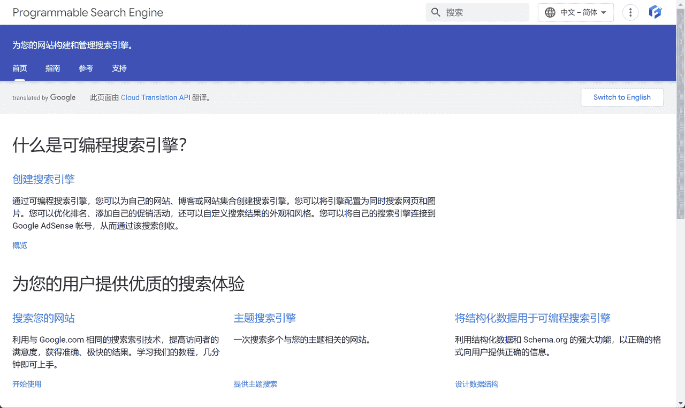

+   借助爬虫爬取相关网站内容

当然，这里还有一点需要注意的是，搜索引擎API只能返回与搜索关键词最为匹配的网站连接，而要获取这些连接内容，则需要更进一步使用爬虫对这些网站内容进行爬取，因此本小节也将简单介绍下特定网站爬虫代码的编写方法。不过需要注意的是，并不是每个网站都允许被爬取内容，在使用爬虫时，必须严格按照网站的对应规则来进行操作。

+   特定领域的搜索和问答机器人

不过由此也不难看出，对相关网站的信息爬取的完整性和有效性，也将直接决定Chat模型接收到的文本质量好坏。因此在将搜索引擎接入Chat模型这个项目中，爬虫技术其实也会起到非常关键的作用。不过在课程的后半部分我们会介绍，如果是主要是围绕一些特定领域的技术问题进行问答（或者当前项目只用于获取某特定类型的信息），我们或许只需要限定在某个网站内进行搜索即可（谷歌搜索支持在某网站内进行搜索，例如知乎、sklearn官网等），而特定网站内的html格式趋于一致，对应的爬虫编写难度较低，更容易获取到高质量内容信息，从而获得高质量答案。因此Chat模型+谷歌搜索API的AI应用开发策略更加适合进行特定领域的问答机器人，例如课程中就将重点介绍将搜索范围限定在知乎内，然后获得高质量大模型技术知识搜索结果和问答的策略。而就特定领域的搜索和问答机器人来说，还有一个非常重要的应用方向，那就是围绕公司章程、制度、流程等内部信息的内网进行搜索和问答。不难发现，相比之下，Browsing with Bing能够顺利获取各类型不同网站的各类信息，会更适合进行通用问题的回答。不过也正是因为Browsing with Bing能够获取全网各类信息，也导致了其快速的下架。

### 二、将谷歌搜索API的获取和使用

#### 1.Custom Search API的获取流程

+   启用谷歌搜索API

和Gmail API的获取类似，这里我们首先需要在谷歌云API库中搜索谷歌搜索API，并获取谷歌搜索API使用权限，然后查阅相关使用说明文档，并最终在代码环境中实现谷歌搜索。这里哦我们首先登录谷歌云Google Cloud：https://console.cloud.google.com/ 。还是在之前创建的Project内点击API和服务进行谷歌搜索API搜索：

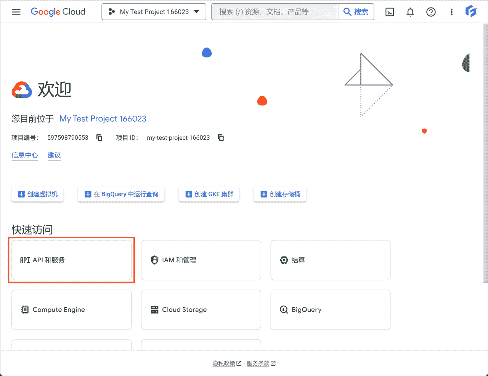

> 首次使用谷歌云并创建Project流程，请参考《Ch.11 借助Google API库进行高效AI应用开发》部分相关内容。

然后点击库，进入谷歌云API库的搜索页面：

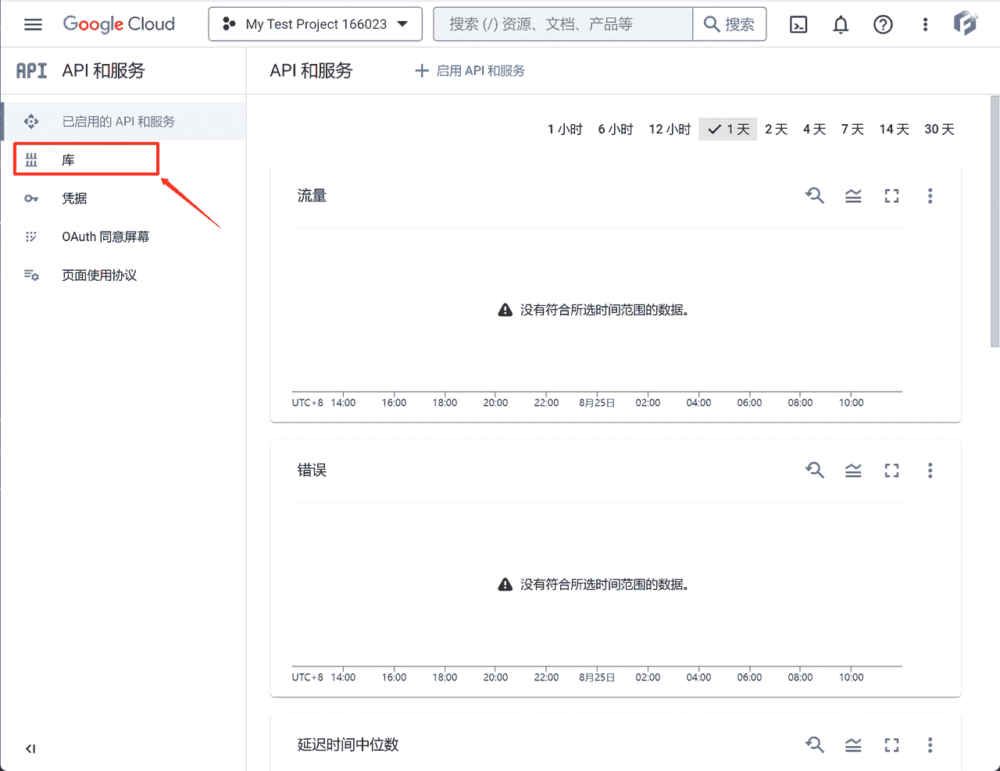

并在其中搜索Google search：

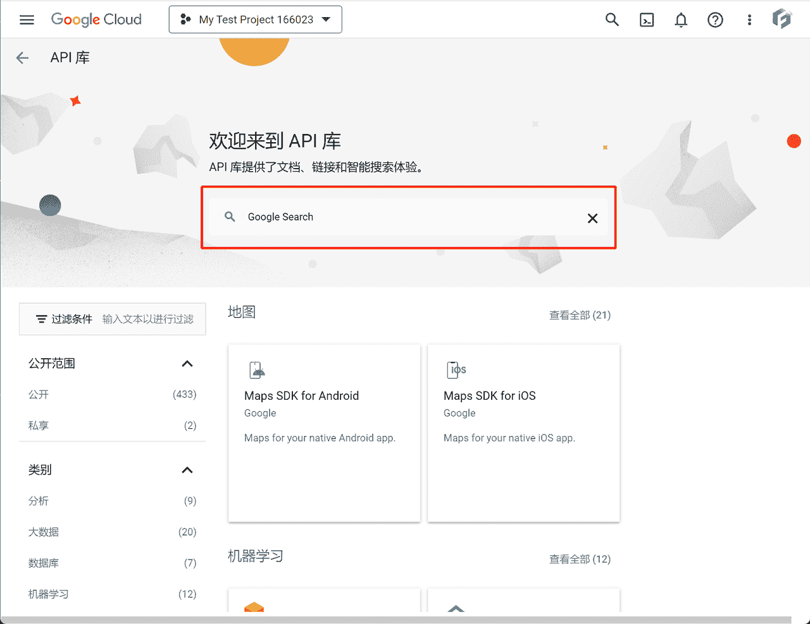

选择Custom Search API：

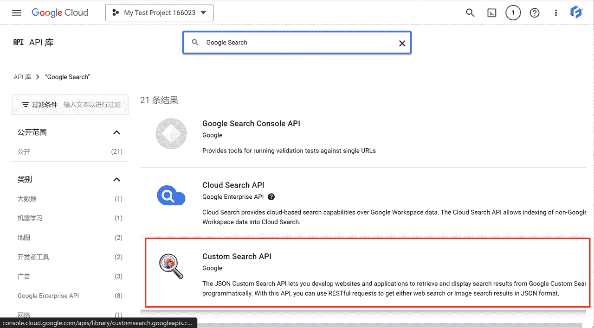

> 此外，有个非常具有类似的API——Google Search Console API。和Custom Search API主要用于获取搜索结果不同，Google Search Console API主要用于查询某网页在谷歌搜索中的排名和浏览情况，即查阅网站运行情况，并据此进一步制定SEO优化措施。

点击启用：

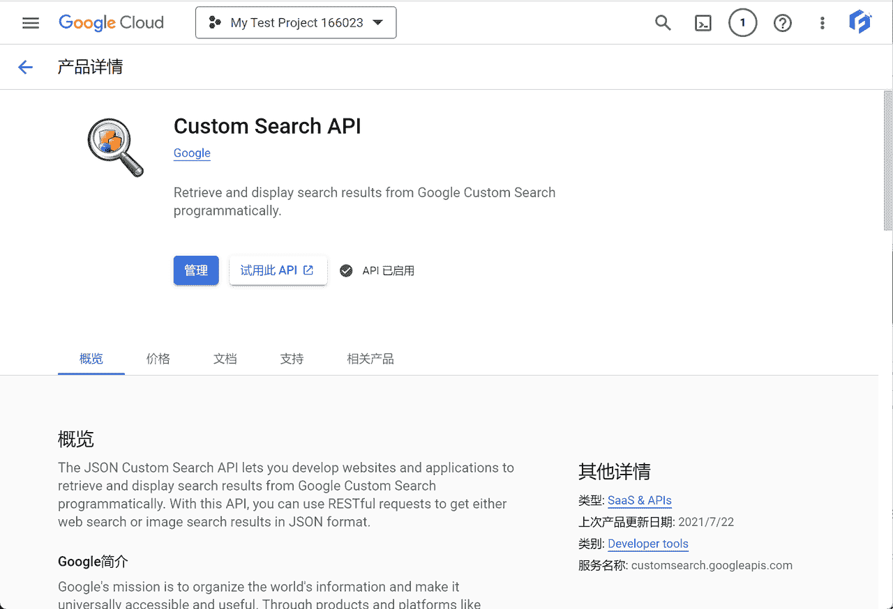

稍等片刻即会自动跳转进入如下页面：

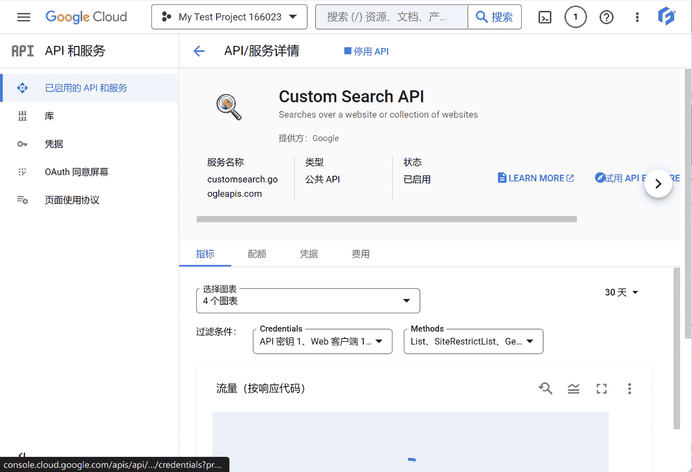

这里需要注意的是，谷歌搜索API并不是完全免费的API，而是有一定每日免费额度的半收费性质的API，我们可以在配额页面查看具体额度说明：

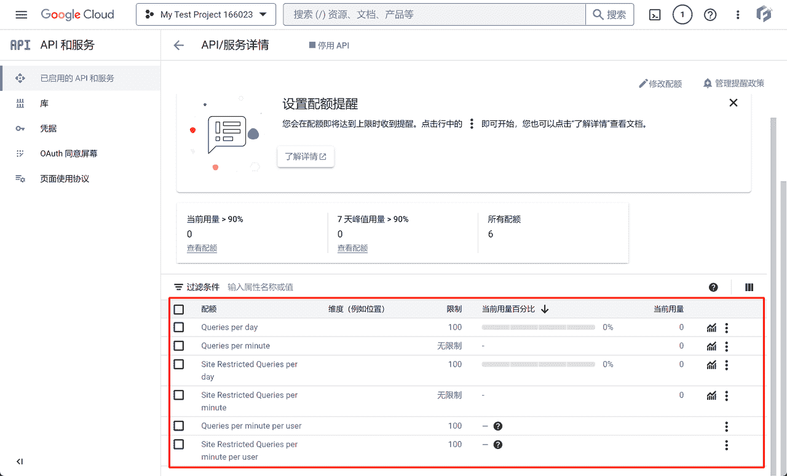

这里我们需要重点关注涉及查询类API调用的关键额度，也就是每天100次搜索限制，尽管者并不是一个很高的搜索额度，不过对于学习者以及初期开发测试阶段应用来说，这个免费配额是够用的。当然，如果超出这个限额则需要按照5美元/千次进行计费，且普通开发者账户每天不能超过1万次查询，具体费用情况可以查询相关帮助文档：https://developers.google.com/custom-search/v1/overview 。而如果涉及到支付费用，首先可以按照Ch 11中所说的方法领取免费的试用金（300美元），如果超出300美元赠送金额，则可以进一步通过绑定虚拟信用卡（和OpenAI账户支付类似，详情参考Ch 1中相关内容介绍）进行费用支付。具体绑定银行卡和支付过程，可以在费用一栏进行操作。

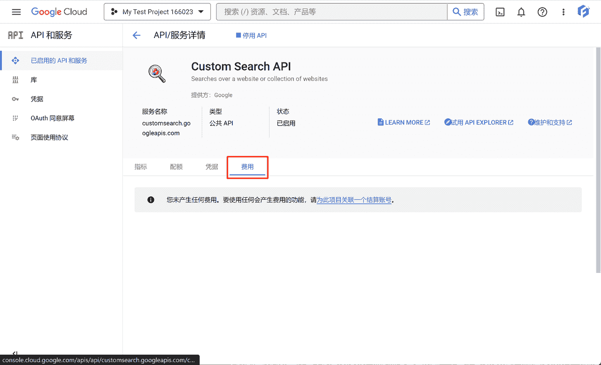

+   谷歌搜索API的基本调用规则

在此前的课程中，我们曾详细介绍过Gmail API的调用方式，Gamil是通过OAuth 2.0作为授权凭据，需要开发者和邮箱所有者双方授权方可使用，并且在实际调用Gmail API时也是对授权者的Gmail邮箱进行操作。而在调用谷歌搜索API时，也同样需要授权凭据以及调用的应用对象主体，只不过和Gmail API调用过程不同的是，谷歌搜索的API调用凭据仅需API Key即可，无需使用更高级的OAuth 2.0作为授权凭据，并且调用的应用对象主体也不是谷歌搜索，而是需要自己创建一个基于谷歌搜索的可编程搜索引擎（就相当于申请了一个个人专属的Gmail邮箱作为调用应用的主体），然后再对其进行调用。接下来我们分别介绍谷歌云API的API Key获取方法以及可编程搜索引擎的基本概念与创建流程。

+   谷歌搜索API Key申请流程

Ch 11课程内容介绍根据此前的介绍，相比OAuth 2.0凭据，API Key凭据其实是一种更加简便的凭据，其本质就是一串字符串密钥，用于调用API时进行身份验证（就类似于OpenAI API Key），使用时正确输入当前项目的密钥即可，并不需要进行更进一步的类似OAuth 2.0凭据的双方授权的环节即可直接使用。

这里我们可以在项目的凭据页面进行API Key的创建：

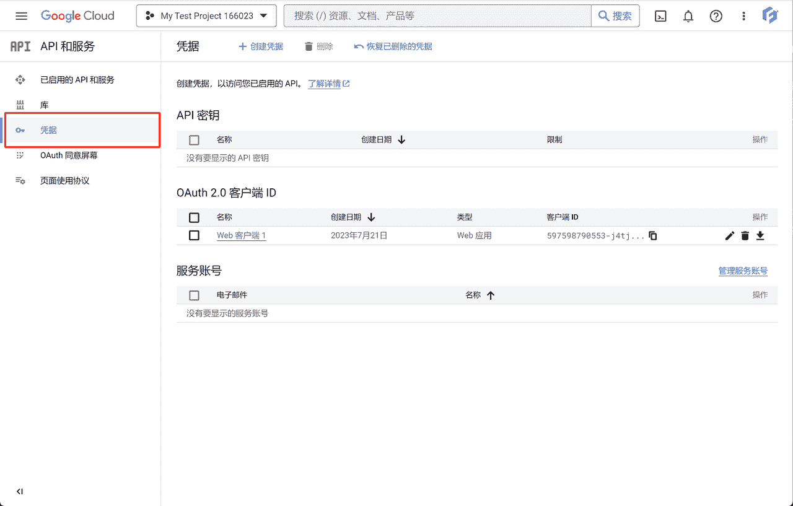

然后点击创建凭据——>API密钥：

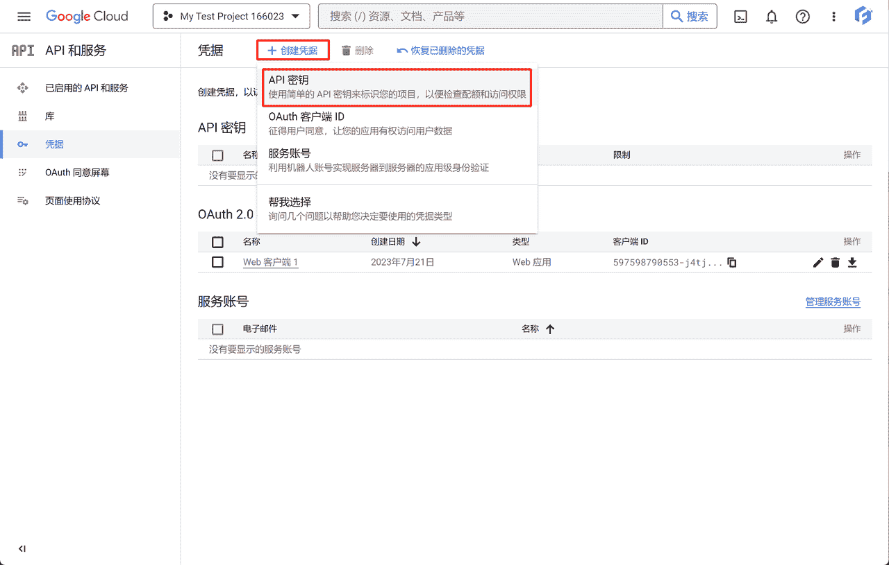

稍等片刻即可完成API Key的密钥创建。和OAuth 2.0凭据定位类似，API Key也是绑定在当前项目中的，即在默认情况下，当我们已经创建了API Key，那么这个API Key是可以访问当前项目中全部可以用API Key作为凭据的API的。因此如果这里有需要，也可以点击下方的修改API密钥以修改其作用的应用范围。

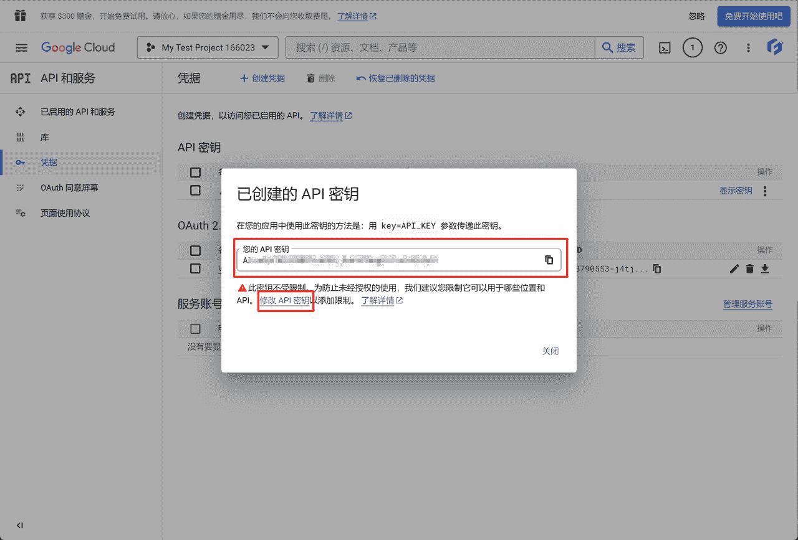

当然，为了方便后续调用，以及保密性原则，我们也可以按照类似OpenAI API Key的设置方法，将其设置为环境变量，然后再通过环境变量的变量名直接导入API Key。具体将API Key保存为环境变量的过程可以参考Ch 1中相关说明。这里我们将谷歌搜索API Key的变量名设置为GOOGLE_SEARCH_API_KEY，之后即可通过其调用API Key。

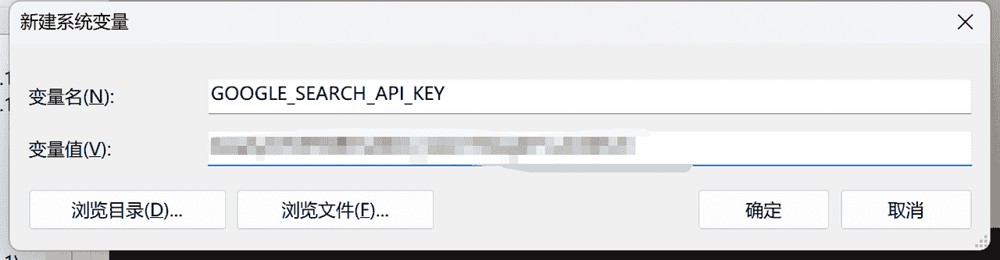

#### 2.可编程搜索引擎获取流程

+   创建可编程搜索引擎

既然是调用某个应用的API，那么肯定需要“先拥有某个应用”，才能构成接下来API调用的主体，例如Gmail API调用的是Gmail应用，而谷歌搜索API则是调用可编程搜索引擎API。所谓的可编程搜索引擎API，可以将其理解为基于谷歌搜索技术支持的个人定制化搜索引擎，其中“可编程”一词可以理解为是功能上可以一定程度进行定制开发，然后非常便捷的嵌入到其他网页开发项目中，因此可编程的搜索引擎也被称为Google Custom Search Engine（CSE）。尽管听起来非常复杂，但实际上，其申请流程以及使用方法都非常简单，最简单的使用甚至无需进行“代码编程”。这里我们首先使用谷歌账号登录可编程搜索引擎主页进行CSE申请和创建：https://programmablesearchengine.google.com/ ：

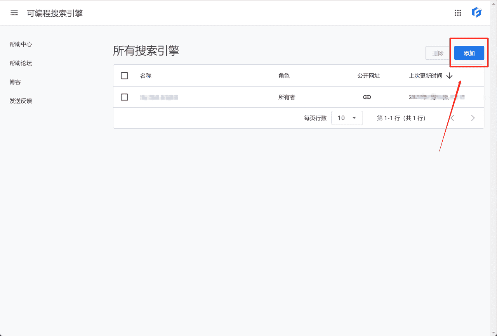

然后进行这个搜索引擎的个性化配置。其实可选的选项并不多，重点需要关注的是我们可以选择搜索范围。例如，如果我们创建一个专门用于sklearn库使用方法查询的搜索引擎，那么就可以选择在特定网页中进行搜索，并输入sklearn官网网址：

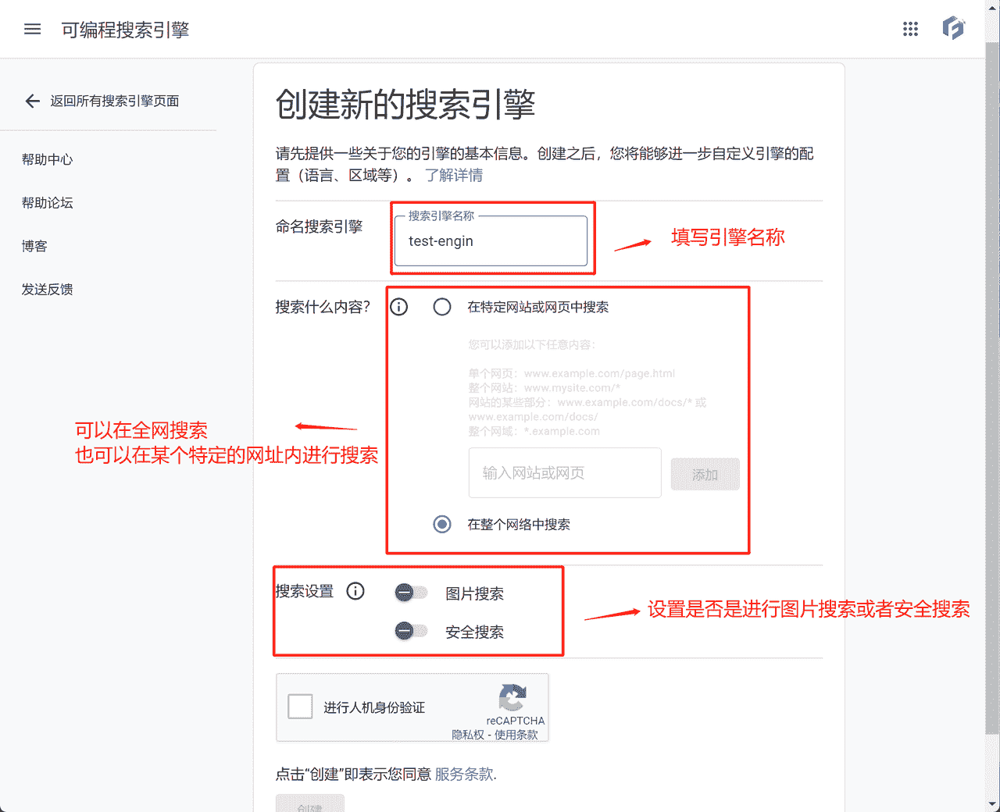

然后创建完成后会返回一段JavaScript脚本，后续即可将其嵌入到其他开发项目中：

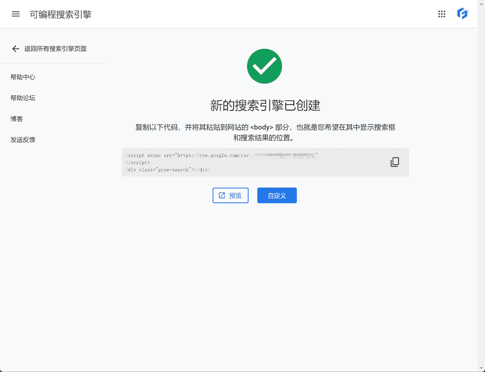

当然，当前项目并不是考虑将获得的搜索引擎嵌入到某个网页中去，而是希望通过API调用这个搜索引擎API，从而进一步让Chat模型接入搜索引擎。而在使用API调用某个CSE时，需要使用CSE的编号作为身份标识，上段JavaScript脚本中“cx=”之后的字符串就是当前搜索引擎的编号，同样需要将其设置为环境变量方便之后调用。这里我们以CSE_ID作为该变量的变量名：

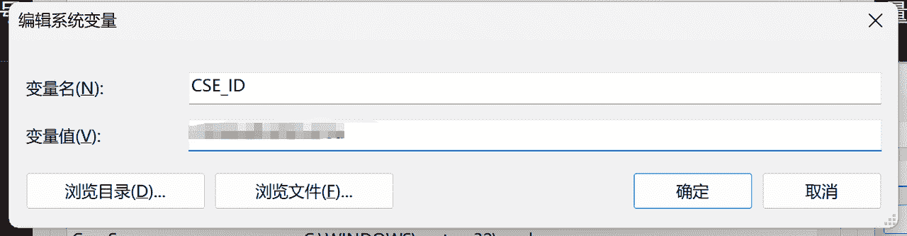

+   更多CSE设置

当然，在我们创建完一个定制化搜索引擎之后，这个搜索引擎就拥有了一个独立的公开网址，点击即可进入一个极简版的定制化谷歌搜索页面：

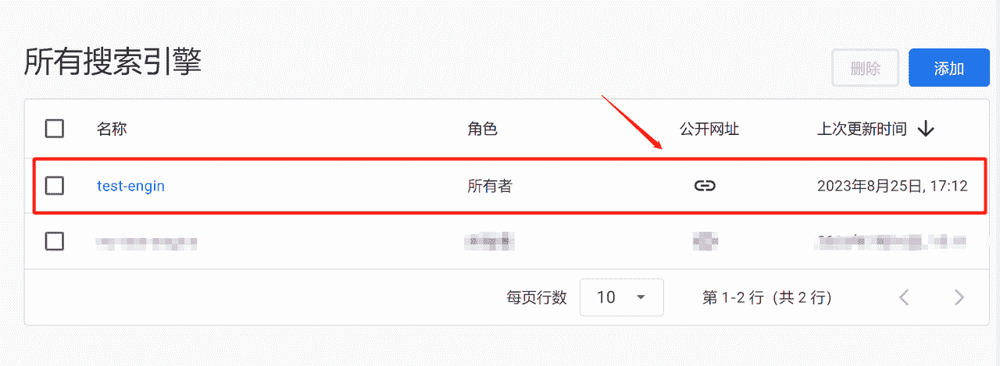

搜索过程如下：

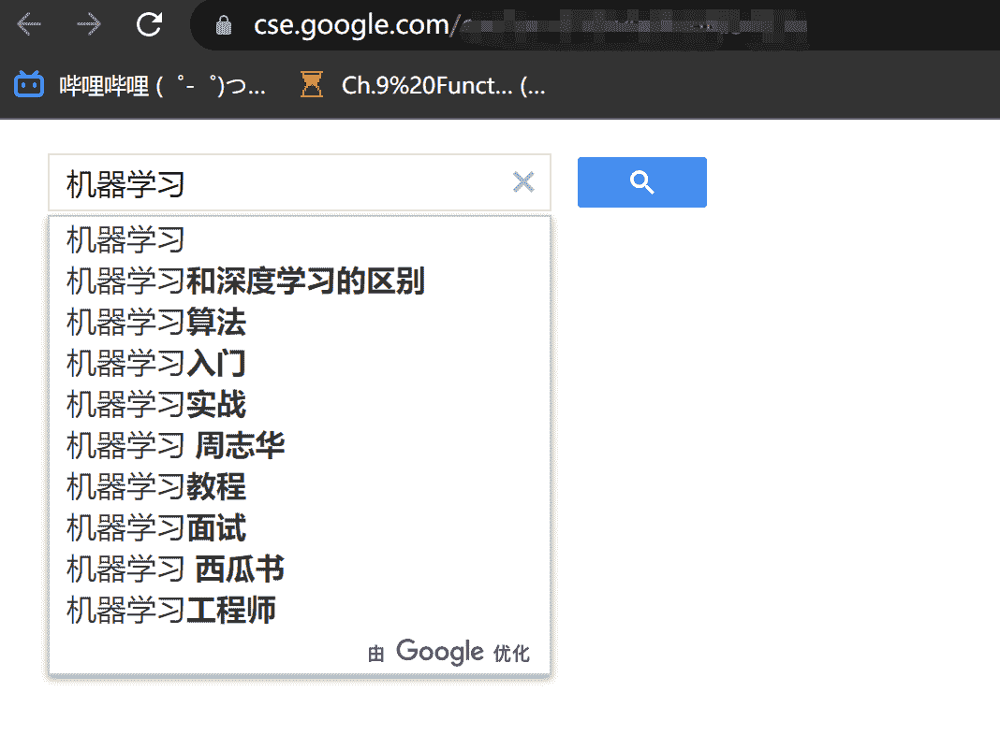

简单测试搜索引擎效果之后，接下来我们在CSE主页查看当前搜索引擎的基本设置情况。这里可以通过点击蓝色的engine名称，进入当前自定义搜索引擎的设置页面：

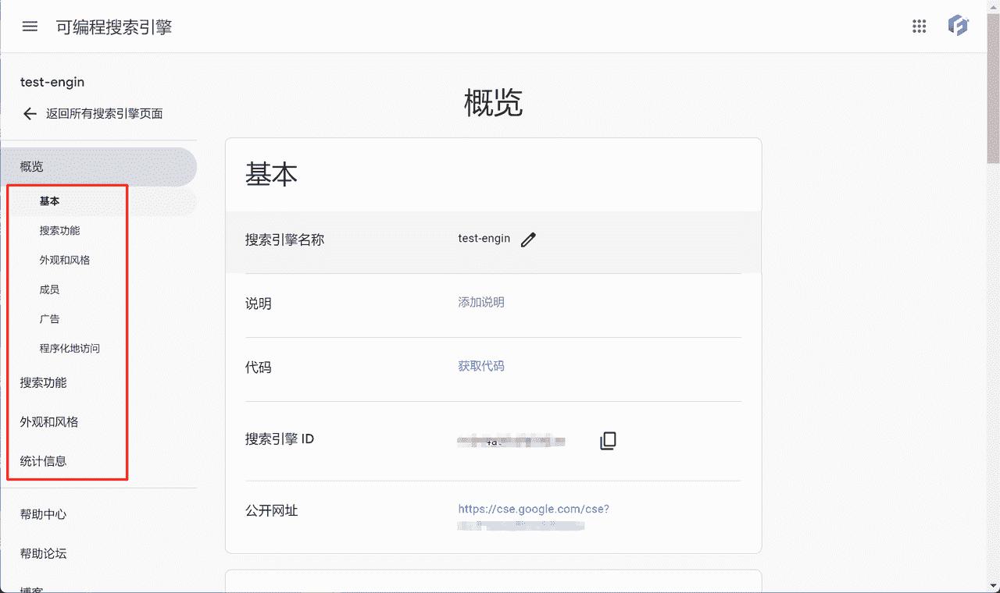

在该页面中，我们可以查看搜索引擎编号，以及包括外观、开发者团队、广告设置、搜索功能等各项设置。需要注意的是，我们可以在搜索引擎实际使用过程中随时调整搜索引擎设置，而不用重新创建新的搜索引擎。

至此，我们完整的获取谷歌搜索相关API凭据（以及CSE ID）。总的来看谷歌搜索API的获取和Gmail API获取流程上并没有太大的区别，都是以谷歌云作为中间平台进行授权，然后使用API去调用某应用，所不同的是，Gmail API调用要求OAuth 2.0授权，且调用的是Gmail邮箱，而谷歌搜索API调用只需要API Key即可，同时调用的是自定义的CSE。接下来，我们即可在此基础上尝试调用API来进行谷歌搜索。

#### 3.谷歌搜索API使用与参数介绍

+   谷歌搜索API使用测试

接下来，我们尝试调用谷歌搜索API，实现在本地代码环境中完成搜索任务。首先导入此前获取的google_search_key和cse_id：

```
google_search_key = os.getenv(&quot;GOOGLE_SEARCH_API_KEY&quot;)
cse_id = os.getenv(&quot;CSE_ID&quot;)
```

然后设置搜索关键词：

```
search_term = &quot;MCP&quot;
```

接下来进行搜索。这里需要注意，谷歌搜索API同样也是RESTful风格API，总的来说，调用谷歌搜索API同样是分四步进行，分别是构建请求、设置参数、发送请求和解析响应。并且和OpenWeather API一样，谷歌搜索API返回结果也是Json格式对象。这里我们尝试调用API完成谷歌搜索：

```
os.environ[&#x27;HTTP_PROXY&#x27;] = &#x27;http://127.0.0.1:10080&#x27;
os.environ[&#x27;HTTPS_PROXY&#x27;] = &#x27;http://127.0.0.1:10080&#x27;
```

```
import requests

# Step 1.构建请求
url = &quot;https://www.googleapis.com/customsearch/v1&quot;

# Step 2.设置查询参数
params = {
    &#x27;q&#x27;: search_term,           # 搜索关键词
    &#x27;key&#x27;: google_search_key,   # 谷歌搜索API Key
    &#x27;cx&#x27;: cse_id                # CSE ID
}

# Step 3.发送GET请求
response = requests.get(url, params=params)

# Step 4.解析响应
data = response.json()
```

能够看出，整体调用代码和OpenWeather API调用代码类似，只在url和具体参数方面有所求别。这里的参数部分，q表示搜索关键词、key表示谷歌搜索API Key，而cse_id则表示可编程搜索引擎的ID。除此之外，还有部分后续可能会用到的关键参数解释如下：

| Name | Description |
| --- | --- |
| c2coff | 是否开启中文搜索模式，默认0表示开启，1表示停止 |
| cr | 在指定的国家地区进行搜索，即搜索返回结果只源于该地区 |
| dateRestrict | 只搜索某特定时间段内的内容 |
| lr | 搜索特定语言内容的内容 |
| num | 搜索返回的结果个数，默认为10个，有效数值为1-10 |
| siteSearch | 搜索结果必须包含某网址 |
| siteSearchFilter | 搜索结果必须排除某网址 |

这里需要注意的是，尽管看起来中文搜索或者设置语言为中文会更加有助于阅读，但实际上，我们最终是将搜索结果输入Chat模型进行理解并输出，这里我们只需要让Chat模型最终输出结果是中文就行，搜索的结果可以不是中文。并且经过测试我们发现，若这里设置只进行中文搜索，反而会因为限制了搜索范围而导致搜索结果质量下降。

除了这些参数外，更多完整参数解释可以参考官网给出的说明文档：https://developers.google.com/custom-search/v1/reference/rest/v1/cse/list ：

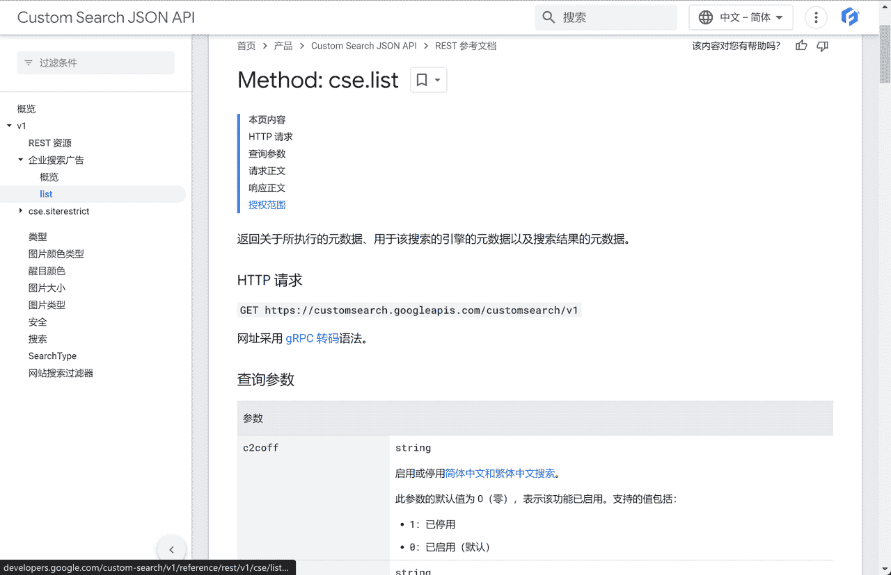

> 不难发现，在调用API时有些参数调整的内容和网页端设置页面调整内容是一样的，例如siteSearch要求搜索结果必须包含某个网址，其实就是要求在某网页内进行搜索。这里需要注意，API调用时参数设置和网页端参数页面的参数设置是相互独立的，即网页端的设置只对利用Web进行搜索时起作用，而调用API时的参数设置，则对代码环境中调用返回结果起作用。

接下来，尝试解读谷歌搜索API返回的结果。在默认情况下，谷歌搜索会返回10个结果（num=10），且保存在Json对象的items关键词中：

```
data
```

```
{&#x27;kind&#x27;: &#x27;customsearch#search&#x27;,
 &#x27;url&#x27;: {&#x27;type&#x27;: &#x27;application/json&#x27;,
  &#x27;template&#x27;: &#x27;https://www.googleapis.com/customsearch/v1?q={searchTerms}&amp;num={count?}&amp;start={startIndex?}&amp;lr={language?}&amp;safe={safe?}&amp;cx={cx?}&amp;sort={sort?}&amp;filter={filter?}&amp;gl={gl?}&amp;cr={cr?}&amp;googlehost={googleHost?}&amp;c2coff={disableCnTwTranslation?}&amp;hq={hq?}&amp;hl={hl?}&amp;siteSearch={siteSearch?}&amp;siteSearchFilter={siteSearchFilter?}&amp;exactTerms={exactTerms?}&amp;excludeTerms={excludeTerms?}&amp;linkSite={linkSite?}&amp;orTerms={orTerms?}&amp;dateRestrict={dateRestrict?}&amp;lowRange={lowRange?}&amp;highRange={highRange?}&amp;searchType={searchType}&amp;fileType={fileType?}&amp;rights={rights?}&amp;imgSize={imgSize?}&amp;imgType={imgType?}&amp;imgColorType={imgColorType?}&amp;imgDominantColor={imgDominantColor?}&amp;alt=json&#x27;},
 &#x27;queries&#x27;: {&#x27;request&#x27;: [{&#x27;title&#x27;: &#x27;Google Custom Search - MCP&#x27;,
    &#x27;totalResults&#x27;: &#x27;97500000&#x27;,
    &#x27;searchTerms&#x27;: &#x27;MCP&#x27;,
    &#x27;count&#x27;: 10,
    &#x27;startIndex&#x27;: 1,
    &#x27;inputEncoding&#x27;: &#x27;utf8&#x27;,
    &#x27;outputEncoding&#x27;: &#x27;utf8&#x27;,
    &#x27;safe&#x27;: &#x27;off&#x27;,
    &#x27;cx&#x27;: &#x27;91044a8fc6fd5423a&#x27;}],
  &#x27;nextPage&#x27;: [{&#x27;title&#x27;: &#x27;Google Custom Search - MCP&#x27;,
    &#x27;totalResults&#x27;: &#x27;97500000&#x27;,
    &#x27;searchTerms&#x27;: &#x27;MCP&#x27;,
    &#x27;count&#x27;: 10,
    &#x27;startIndex&#x27;: 11,
    &#x27;inputEncoding&#x27;: &#x27;utf8&#x27;,
    &#x27;outputEncoding&#x27;: &#x27;utf8&#x27;,
    &#x27;safe&#x27;: &#x27;off&#x27;,
    &#x27;cx&#x27;: &#x27;91044a8fc6fd5423a&#x27;}]},
 &#x27;context&#x27;: {&#x27;title&#x27;: &#x27;test-engin&#x27;},
 &#x27;searchInformation&#x27;: {&#x27;searchTime&#x27;: 0.189668,
  &#x27;formattedSearchTime&#x27;: &#x27;0.19&#x27;,
  &#x27;totalResults&#x27;: &#x27;97500000&#x27;,
  &#x27;formattedTotalResults&#x27;: &#x27;97,500,000&#x27;},
 &#x27;items&#x27;: [{&#x27;kind&#x27;: &#x27;customsearch#result&#x27;,
   &#x27;title&#x27;: &#x27;Model Context Protocol: Introduction&#x27;,
   &#x27;htmlTitle&#x27;: &#x27;&lt;b&gt;Model Context Protocol&lt;/b&gt;: Introduction&#x27;,
   &#x27;link&#x27;: &#x27;https://modelcontextprotocol.io/introduction&#x27;,
   &#x27;displayLink&#x27;: &#x27;modelcontextprotocol.io&#x27;,
   &#x27;snippet&#x27;: &#x27;Introduction ... C# SDK released! Check out what else is new. MCP is an open protocol that standardizes how applications provide context to LLMs. Think of MCP\xa0...&#x27;,
   &#x27;htmlSnippet&#x27;: &#x27;Introduction ... C# SDK released! Check out what else is new. &lt;b&gt;MCP&lt;/b&gt; is an open protocol that standardizes how applications provide context to LLMs. Think of &lt;b&gt;MCP&lt;/b&gt;&amp;nbsp;...&#x27;,
   &#x27;formattedUrl&#x27;: &#x27;https://modelcontextprotocol.io/introduction&#x27;,
   &#x27;htmlFormattedUrl&#x27;: &#x27;https://modelcontextprotocol.io/introduction&#x27;,
   &#x27;pagemap&#x27;: {&#x27;cse_thumbnail&#x27;: [{&#x27;src&#x27;: &#x27;https://encrypted-tbn0.gstatic.com/images?q=tbn:ANd9GcSRJTU8Fn79Lv6klBdnVUk5XJXXhVitPioK7S_wXcUo66_zw2R-X04uyGs&amp;s&#x27;,
      &#x27;width&#x27;: &#x27;300&#x27;,
      &#x27;height&#x27;: &#x27;168&#x27;}],
    &#x27;metatags&#x27;: [{&#x27;application-name&#x27;: &#x27;Model Context Protocol&#x27;,
      &#x27;msapplication-tilecolor&#x27;: &#x27;#09090b&#x27;,
      &#x27;msapplication-config&#x27;: &#x27;https://mintlify.s3-us-west-1.amazonaws.com/mcp/_generated/favicon/browserconfig.xml?v=3&#x27;,
      &#x27;charset&#x27;: &#x27;utf-8&#x27;,
      &#x27;og:image&#x27;: &#x27;https://raw.githubusercontent.com/modelcontextprotocol/docs/2eb6171ddbfeefde349dc3b8d5e2b87414c26250/images/og-image.png&#x27;,
      &#x27;theme-color&#x27;: &#x27;#ffffff&#x27;,
      &#x27;og:type&#x27;: &#x27;website&#x27;,
      &#x27;twitter:card&#x27;: &#x27;summary_large_image&#x27;,
      &#x27;twitter:title&#x27;: &#x27;Introduction - Model Context Protocol&#x27;,
      &#x27;og:image:width&#x27;: &#x27;1200&#x27;,
      &#x27;og:site_name&#x27;: &#x27;Model Context Protocol&#x27;,
      &#x27;apple-mobile-web-app-title&#x27;: &#x27;Model Context Protocol&#x27;,
      &#x27;og:title&#x27;: &#x27;Introduction - Model Context Protocol&#x27;,
      &#x27;og:image:height&#x27;: &#x27;630&#x27;,
      &#x27;twitter:image:height&#x27;: &#x27;630&#x27;,
      &#x27;og:description&#x27;: &#x27;Get started with the Model Context Protocol (MCP)&#x27;,
      &#x27;twitter:image&#x27;: &#x27;https://mcp.mintlify.app/_next/image?url=%2Fapi%2Fog%3Fdivision%3DDocumentation%26title%3DIntroduction%26description%3DGet%2Bstarted%2Bwith%2Bthe%2BModel%2BContext%2BProtocol%2B%2528MCP%2529%26logoLight%3Dhttps%253A%252F%252Fmintlify.s3.us-west-1.amazonaws.com%252Fmcp%252Flogo%252Flight.svg%26logoDark%3Dhttps%253A%252F%252Fmintlify.s3.us-west-1.amazonaws.com%252Fmcp%252Flogo%252Fdark.svg%26primaryColor%3D%252309090b%26lightColor%3D%2523FAFAFA%26darkColor%3D%252309090b&amp;w=1200&amp;q=100&#x27;,
      &#x27;next-head-count&#x27;: &#x27;30&#x27;,
      &#x27;twitter:image:width&#x27;: &#x27;1200&#x27;,
      &#x27;viewport&#x27;: &#x27;width=device-width&#x27;,
      &#x27;og:url&#x27;: &#x27;https://modelcontextprotocol.io/introduction&#x27;}],
    &#x27;cse_image&#x27;: [{&#x27;src&#x27;: &#x27;https://raw.githubusercontent.com/modelcontextprotocol/docs/2eb6171ddbfeefde349dc3b8d5e2b87414c26250/images/og-image.png&#x27;}]}},
  {&#x27;kind&#x27;: &#x27;customsearch#result&#x27;,
   &#x27;title&#x27;: &#x27;Introducing the Model Context Protocol \\ Anthropic&#x27;,
   &#x27;htmlTitle&#x27;: &#x27;Introducing the &lt;b&gt;Model Context Protocol&lt;/b&gt; \\ Anthropic&#x27;,
   &#x27;link&#x27;: &#x27;https://www.anthropic.com/news/model-context-protocol&#x27;,
   &#x27;displayLink&#x27;: &#x27;www.anthropic.com&#x27;,
   &#x27;snippet&#x27;: &#x27;Nov 25, 2024 ... The Model Context Protocol is an open standard that enables developers to build secure, two-way connections between their data sources and AI-\xa0...&#x27;,
   &#x27;htmlSnippet&#x27;: &#x27;Nov 25, 2024 &lt;b&gt;...&lt;/b&gt; The &lt;b&gt;Model Context Protocol&lt;/b&gt; is an open standard that enables developers to build secure, two-way connections between their data sources and AI-&amp;nbsp;...&#x27;,
   &#x27;formattedUrl&#x27;: &#x27;https://www.anthropic.com/news/model-context-protocol&#x27;,
   &#x27;htmlFormattedUrl&#x27;: &#x27;https://www.anthropic.com/news/model-context-protocol&#x27;,
   &#x27;pagemap&#x27;: {&#x27;cse_thumbnail&#x27;: [{&#x27;src&#x27;: &#x27;https://encrypted-tbn0.gstatic.com/images?q=tbn:ANd9GcQr2AmZJABXD78qEXtZidT6eL8TKF71UfLKfkIzaCPJN1Ldf9dK2x3yYL8&amp;s&#x27;,
      &#x27;width&#x27;: &#x27;310&#x27;,
      &#x27;height&#x27;: &#x27;163&#x27;}],
    &#x27;metatags&#x27;: [{&#x27;msapplication-tilecolor&#x27;: &#x27;141413&#x27;,
      &#x27;msapplication-config&#x27;: &#x27;/browserconfig.xml&#x27;,
      &#x27;og:image&#x27;: &#x27;https://cdn.sanity.io/images/4zrzovbb/website/1aef864f9b246c740fe3cef6e1068f2220995d5e-2400x1260.png&#x27;,
      &#x27;theme-color&#x27;: &#x27;#141413&#x27;,
      &#x27;og:image:alt&#x27;: &#x27;An abstract illustration of critical context connecting to a central hub&#x27;,
      &#x27;og:type&#x27;: &#x27;website&#x27;,
      &#x27;twitter:card&#x27;: &#x27;summary_large_image&#x27;,
      &#x27;twitter:title&#x27;: &#x27;Introducing the Model Context Protocol&#x27;,
      &#x27;og:title&#x27;: &#x27;Introducing the Model Context Protocol&#x27;,
      &#x27;og:description&#x27;: &#x27;The Model Context Protocol (MCP) is an open standard for connecting AI assistants to the systems where data lives, including content repositories, business tools, and development environments. Its aim is to help frontier models produce better, more relevant responses.&#x27;,
      &#x27;twitter:creator&#x27;: &#x27;@AnthropicAI&#x27;,
      &#x27;twitter:image&#x27;: &#x27;https://cdn.sanity.io/images/4zrzovbb/website/1aef864f9b246c740fe3cef6e1068f2220995d5e-2400x1260.png&#x27;,
      &#x27;twitter:image:alt&#x27;: &#x27;An abstract illustration of critical context connecting to a central hub&#x27;,
      &#x27;twitter:site&#x27;: &#x27;@AnthropicAI&#x27;,
      &#x27;viewport&#x27;: &#x27;width=device-width, initial-scale=1&#x27;,
      &#x27;twitter:description&#x27;: &#x27;The Model Context Protocol (MCP) is an open standard for connecting AI assistants to the systems where data lives, including content repositories, business tools, and development environments. Its aim is to help frontier models produce better, more relevant responses.&#x27;}],
    &#x27;cse_image&#x27;: [{&#x27;src&#x27;: &#x27;https://cdn.sanity.io/images/4zrzovbb/website/1aef864f9b246c740fe3cef6e1068f2220995d5e-2400x1260.png&#x27;}]}},
  {&#x27;kind&#x27;: &#x27;customsearch#result&#x27;,
   &#x27;title&#x27;: &#x27;Model Context Protocol · GitHub&#x27;,
   &#x27;htmlTitle&#x27;: &#x27;&lt;b&gt;Model Context Protocol&lt;/b&gt; · GitHub&#x27;,
   &#x27;link&#x27;: &#x27;https://github.com/modelcontextprotocol&#x27;,
   &#x27;displayLink&#x27;: &#x27;github.com&#x27;,
   &#x27;snippet&#x27;: &#x27;The Model Context Protocol (MCP) is an open protocol that enables seamless integration between LLM applications and external data sources and tools. Whether you\xa0...&#x27;,
   &#x27;htmlSnippet&#x27;: &#x27;The &lt;b&gt;Model Context Protocol&lt;/b&gt; (&lt;b&gt;MCP&lt;/b&gt;) is an open protocol that enables seamless integration between LLM applications and external data sources and tools. Whether you&amp;nbsp;...&#x27;,
   &#x27;formattedUrl&#x27;: &#x27;https://github.com/modelcontextprotocol&#x27;,
   &#x27;htmlFormattedUrl&#x27;: &#x27;https://github.com/modelcontextprotocol&#x27;,
   &#x27;pagemap&#x27;: {&#x27;cse_thumbnail&#x27;: [{&#x27;src&#x27;: &#x27;https://encrypted-tbn0.gstatic.com/images?q=tbn:ANd9GcSTGpoKj7d6dpEj5bqIMl90O4gWkySrvkC-WECscP7FRlbTLDmP8ZESnxTP&amp;s&#x27;,
      &#x27;width&#x27;: &#x27;224&#x27;,
      &#x27;height&#x27;: &#x27;224&#x27;}],
    &#x27;code&#x27;: [{&#x27;name&#x27;: &#x27;csharp-sdk&#x27;,
      &#x27;description&#x27;: &#x27;The official C# SDK for Model Context Protocol servers and clients, maintained by Microsoft&#x27;,
      &#x27;coderepository&#x27;: &#x27;csharp-sdk&#x27;,
      &#x27;programminglanguage&#x27;: &#x27;C#&#x27;},
     {&#x27;name&#x27;: &#x27;java-sdk&#x27;,
      &#x27;description&#x27;: &#x27;The official Java SDK for Model Context Protocol servers and clients. Maintained in collaboration with Spring AI&#x27;,
      &#x27;coderepository&#x27;: &#x27;java-sdk&#x27;,
      &#x27;programminglanguage&#x27;: &#x27;Java&#x27;},
     {&#x27;name&#x27;: &#x27;inspector&#x27;,
      &#x27;description&#x27;: &#x27;Visual testing tool for MCP servers&#x27;,
      &#x27;coderepository&#x27;: &#x27;inspector&#x27;,
      &#x27;programminglanguage&#x27;: &#x27;TypeScript&#x27;},
     {&#x27;name&#x27;: &#x27;docs&#x27;,
      &#x27;description&#x27;: &#x27;The documentation and specification for the Model Context Protocol (MCP)&#x27;,
      &#x27;coderepository&#x27;: &#x27;docs&#x27;,
      &#x27;programminglanguage&#x27;: &#x27;MDX&#x27;},
     {&#x27;name&#x27;: &#x27;servers&#x27;,
      &#x27;description&#x27;: &#x27;Model Context Protocol Servers&#x27;,
      &#x27;coderepository&#x27;: &#x27;servers&#x27;,
      &#x27;programminglanguage&#x27;: &#x27;JavaScript&#x27;},
     {&#x27;name&#x27;: &#x27;specification&#x27;,
      &#x27;description&#x27;: &#x27;The specification of the Model Context Protocol&#x27;,
      &#x27;coderepository&#x27;: &#x27;specification&#x27;,
      &#x27;programminglanguage&#x27;: &#x27;TypeScript&#x27;},
     {&#x27;name&#x27;: &#x27;python-sdk&#x27;,
      &#x27;description&#x27;: &#x27;The official Python SDK for Model Context Protocol servers and clients&#x27;,
      &#x27;coderepository&#x27;: &#x27;python-sdk&#x27;,
      &#x27;programminglanguage&#x27;: &#x27;Python&#x27;},
     {&#x27;name&#x27;: &#x27;kotlin-sdk&#x27;,
      &#x27;description&#x27;: &#x27;The official Kotlin SDK for Model Context Protocol servers and clients. Maintained in collaboration with JetBrains&#x27;,
      &#x27;coderepository&#x27;: &#x27;kotlin-sdk&#x27;,
      &#x27;programminglanguage&#x27;: &#x27;Kotlin&#x27;},
     {&#x27;name&#x27;: &#x27;.github&#x27;,
      &#x27;description&#x27;: &#x27;Discussions and README for Model Context Protocol&#x27;,
      &#x27;coderepository&#x27;: &#x27;.github&#x27;},
     {&#x27;name&#x27;: &#x27;typescript-sdk&#x27;,
      &#x27;description&#x27;: &#x27;The official Typescript SDK for Model Context Protocol servers and clients&#x27;,
      &#x27;coderepository&#x27;: &#x27;typescript-sdk&#x27;,
      &#x27;programminglanguage&#x27;: &#x27;TypeScript&#x27;}],
    &#x27;organization&#x27;: [{&#x27;image&#x27;: &#x27;https://avatars.githubusercontent.com/u/182288589?s=200&amp;v=4&#x27;,
      &#x27;text&#x27;: &#x27;Model Context Protocol A protocol for seamless integration between LLM applications and external data sources Documentation | Specification | Discussions The Model Context Protocol (MCP) is...&#x27;,
      &#x27;programminglanguage&#x27;: &#x27;JavaScript&#x27;,
      &#x27;url&#x27;: &#x27;https://modelcontextprotocol.io&#x27;}],
    &#x27;metatags&#x27;: [{&#x27;octolytics-url&#x27;: &#x27;https://collector.github.com/github/collect&#x27;,
      &#x27;apple-itunes-app&#x27;: &#x27;app-id=1477376905, app-argument=https://github.com/modelcontextprotocol&#x27;,
      &#x27;og:image&#x27;: &#x27;https://avatars.githubusercontent.com/u/182288589?s=280&amp;v=4&#x27;,
      &#x27;twitter:card&#x27;: &#x27;summary_large_image&#x27;,
      &#x27;theme-color&#x27;: &#x27;#1e2327&#x27;,
      &#x27;og:site_name&#x27;: &#x27;GitHub&#x27;,
      &#x27;hovercard-subject-tag&#x27;: &#x27;organization:182288589&#x27;,
      &#x27;turbo-body-classes&#x27;: &#x27;logged-out env-production page-responsive&#x27;,
      &#x27;release&#x27;: &#x27;edefe724b5cc80cb465d4b6f15cfab44eb312a07&#x27;,
      &#x27;html-safe-nonce&#x27;: &#x27;2e27cdb4014522ac0a8f06394771f4525c456305e66b61d09a5c3c3ad48b1d40&#x27;,
      &#x27;expected-hostname&#x27;: &#x27;github.com&#x27;,
      &#x27;og:description&#x27;: &#x27;An open protocol that enables seamless integration between LLM applications and external data sources and tools. - Model Context Protocol&#x27;,
      &#x27;twitter:image&#x27;: &#x27;https://avatars.githubusercontent.com/u/182288589?s=280&amp;v=4&#x27;,
      &#x27;browser-errors-url&#x27;: &#x27;https://api.github.com/_private/browser/errors&#x27;,
      &#x27;hostname&#x27;: &#x27;github.com&#x27;,
      &#x27;twitter:site&#x27;: &#x27;@github&#x27;,
      &#x27;browser-stats-url&#x27;: &#x27;https://api.github.com/_private/browser/stats&#x27;,
      &#x27;route-pattern&#x27;: &#x27;/:user_id(.:format)&#x27;,
      &#x27;visitor-payload&#x27;: &#x27;eyJyZWZlcnJlciI6IiIsInJlcXVlc3RfaWQiOiJCQTREOjNCQ0RCOjFGRTY1MTU6MkIwNkU3Nzo2N0U0RTlDNyIsInZpc2l0b3JfaWQiOiI1ODMxMDEwMTgwMTg5NzEwODEyIiwicmVnaW9uX2VkZ2UiOiJpYWQiLCJyZWdpb25fcmVuZGVyIjoiaWFkIn0=&#x27;,
      &#x27;github-keyboard-shortcuts&#x27;: &#x27;copilot&#x27;,
      &#x27;twitter:title&#x27;: &#x27;Model Context Protocol&#x27;,
      &#x27;og:image:alt&#x27;: &#x27;An open protocol that enables seamless integration between LLM applications and external data sources and tools. - Model Context Protocol&#x27;,
      &#x27;og:type&#x27;: &#x27;profile&#x27;,
      &#x27;profile:username&#x27;: &#x27;modelcontextprotocol&#x27;,
      &#x27;og:title&#x27;: &#x27;Model Context Protocol&#x27;,
      &#x27;visitor-hmac&#x27;: &#x27;2d8985fac2385812d65cbe874a8bed357b5bbc8d334ab33d99378c5f0d0098b4&#x27;,
      &#x27;turbo-cache-control&#x27;: &#x27;no-preview&#x27;,
      &#x27;route-action&#x27;: &#x27;show&#x27;,
      &#x27;request-id&#x27;: &#x27;BA4D:3BCDB:1FE6515:2B06E77:67E4E9C7&#x27;,
      &#x27;analytics-location&#x27;: &#x27;/&lt;org-login&gt;&#x27;,
      &#x27;color-scheme&#x27;: &#x27;light dark&#x27;,
      &#x27;fb:app_id&#x27;: &#x27;1401488693436528&#x27;,
      &#x27;viewport&#x27;: &#x27;width=device-width&#x27;,
      &#x27;twitter:description&#x27;: &#x27;An open protocol that enables seamless integration between LLM applications and external data sources and tools. - Model Context Protocol&#x27;,
      &#x27;route-controller&#x27;: &#x27;profiles&#x27;,
      &#x27;current-catalog-service-hash&#x27;: &#x27;4a1c50a83cf6cc4b55b6b9c53e553e3f847c876b87fb333f71f5d05db8f1a7db&#x27;,
      &#x27;og:url&#x27;: &#x27;https://github.com/modelcontextprotocol&#x27;}],
    &#x27;cse_image&#x27;: [{&#x27;src&#x27;: &#x27;https://avatars.githubusercontent.com/u/182288589?s=280&amp;v=4&#x27;}]}},
  {&#x27;kind&#x27;: &#x27;customsearch#result&#x27;,
   &#x27;title&#x27;: &#x27;Model Context Protocol (MCP) - Anthropic&#x27;,
   &#x27;htmlTitle&#x27;: &#x27;&lt;b&gt;Model Context Protocol&lt;/b&gt; (&lt;b&gt;MCP&lt;/b&gt;) - Anthropic&#x27;,
   &#x27;link&#x27;: &#x27;https://docs.anthropic.com/en/docs/agents-and-tools/mcp&#x27;,
   &#x27;displayLink&#x27;: &#x27;docs.anthropic.com&#x27;,
   &#x27;snippet&#x27;: &#x27;Model Context Protocol (MCP). MCP is an open protocol that standardizes how applications provide context to LLMs. Think of MCP like a USB-C port for AI\xa0...&#x27;,
   &#x27;htmlSnippet&#x27;: &#x27;&lt;b&gt;Model Context Protocol&lt;/b&gt; (&lt;b&gt;MCP&lt;/b&gt;). &lt;b&gt;MCP&lt;/b&gt; is an open protocol that standardizes how applications provide context to LLMs. Think of &lt;b&gt;MCP&lt;/b&gt; like a USB-C port for AI&amp;nbsp;...&#x27;,
   &#x27;formattedUrl&#x27;: &#x27;https://docs.anthropic.com/en/docs/agents-and-tools/mcp&#x27;,
   &#x27;htmlFormattedUrl&#x27;: &#x27;https://docs.anthropic.com/en/docs/agents-and-tools/&lt;b&gt;mcp&lt;/b&gt;&#x27;,
   &#x27;pagemap&#x27;: {&#x27;cse_thumbnail&#x27;: [{&#x27;src&#x27;: &#x27;https://encrypted-tbn0.gstatic.com/images?q=tbn:ANd9GcRGoexBu8kDuvia3Jsw2l9ma6A5WcO5tpcYmZQymVXsJ8Yb4l4JpWm2nBE&amp;s&#x27;,
      &#x27;width&#x27;: &#x27;310&#x27;,
      &#x27;height&#x27;: &#x27;163&#x27;}],
    &#x27;metatags&#x27;: [{&#x27;application-name&#x27;: &#x27;Anthropic&#x27;,
      &#x27;msapplication-tilecolor&#x27;: &#x27;#0E0E0E&#x27;,
      &#x27;msapplication-config&#x27;: &#x27;https://mintlify.s3-us-west-1.amazonaws.com/anthropic/_generated/favicon/browserconfig.xml?v=3&#x27;,
      &#x27;charset&#x27;: &#x27;utf-8&#x27;,
      &#x27;og:image&#x27;: &#x27;https://docs.anthropic.com/api/og?division=Documentation&amp;section=Agents+and+tools&amp;mode=light&amp;title=Model+Context+Protocol+%28MCP%29&amp;logoLight=https%3A%2F%2Fmintlify.s3.us-west-1.amazonaws.com%2Fanthropic%2Flogo%2Flight.svg&amp;logoDark=https%3A%2F%2Fmintlify.s3.us-west-1.amazonaws.com%2Fanthropic%2Flogo%2Fdark.svg&amp;primaryColor=%230E0E0E&amp;lightColor=%23D4A27F&amp;darkColor=%230E0E0E&#x27;,
      &#x27;theme-color&#x27;: &#x27;#ffffff&#x27;,
      &#x27;og:type&#x27;: &#x27;website&#x27;,
      &#x27;twitter:card&#x27;: &#x27;summary_large_image&#x27;,
      &#x27;twitter:title&#x27;: &#x27;Model Context Protocol (MCP) - Anthropic&#x27;,
      &#x27;og:site_name&#x27;: &#x27;Anthropic&#x27;,
      &#x27;apple-mobile-web-app-title&#x27;: &#x27;Anthropic&#x27;,
      &#x27;og:title&#x27;: &#x27;Model Context Protocol (MCP) - Anthropic&#x27;,
      &#x27;twitter:image&#x27;: &#x27;https://docs.anthropic.com/api/og?division=Documentation&amp;section=Agents+and+tools&amp;mode=light&amp;title=Model+Context+Protocol+%28MCP%29&amp;logoLight=https%3A%2F%2Fmintlify.s3.us-west-1.amazonaws.com%2Fanthropic%2Flogo%2Flight.svg&amp;logoDark=https%3A%2F%2Fmintlify.s3.us-west-1.amazonaws.com%2Fanthropic%2Flogo%2Fdark.svg&amp;primaryColor=%230E0E0E&amp;lightColor=%23D4A27F&amp;darkColor=%230E0E0E&#x27;,
      &#x27;next-head-count&#x27;: &#x27;23&#x27;,
      &#x27;viewport&#x27;: &#x27;width=device-width&#x27;,
      &#x27;og:url&#x27;: &#x27;https://docs.anthropic.com/en/docs/agents-and-tools/mcp&#x27;}],
    &#x27;cse_image&#x27;: [{&#x27;src&#x27;: &#x27;https://docs.anthropic.com/api/og?division=Documentation&amp;section=Agents+and+tools&amp;mode=light&amp;title=Model+Context+Protocol+%28MCP%29&amp;logoLight=https%3A%2F%2Fmintlify.s3.us-west-1.amazonaws.com%2Fanthropic%2Flogo%2Flight.svg&amp;logoDark=https%3A%2F%2Fmintlify.s3.us-west-1.amazonaws.com%2Fanthropic%2Flogo%2Fdark.svg&amp;primaryColor=%230E0E0E&amp;lightColor=%23D4A27F&amp;darkColor=%230E0E0E&#x27;}]}},
  {&#x27;kind&#x27;: &#x27;customsearch#result&#x27;,
   &#x27;title&#x27;: &#x27;Model Context Protocol - Cursor&#x27;,
   &#x27;htmlTitle&#x27;: &#x27;Model Context Protocol - Cursor&#x27;,
   &#x27;link&#x27;: &#x27;https://docs.cursor.com/context/model-context-protocol&#x27;,
   &#x27;displayLink&#x27;: &#x27;docs.cursor.com&#x27;,
   &#x27;snippet&#x27;: &#x27;The Model Context Protocol (MCP) is an open protocol that standardizes how applications provide context and tools to LLMs. Think of MCP as a plugin system for\xa0...&#x27;,
   &#x27;htmlSnippet&#x27;: &#x27;The &lt;b&gt;Model Context Protocol&lt;/b&gt; (&lt;b&gt;MCP&lt;/b&gt;) is an open protocol that standardizes how applications provide context and tools to LLMs. Think of &lt;b&gt;MCP&lt;/b&gt; as a plugin system for&amp;nbsp;...&#x27;,
   &#x27;formattedUrl&#x27;: &#x27;https://docs.cursor.com/context/model-context-protocol&#x27;,
   &#x27;htmlFormattedUrl&#x27;: &#x27;https://docs.cursor.com/context/model-context-protocol&#x27;,
   &#x27;pagemap&#x27;: {&#x27;cse_thumbnail&#x27;: [{&#x27;src&#x27;: &#x27;https://encrypted-tbn0.gstatic.com/images?q=tbn:ANd9GcSeXfBlYyurj_3ygAC3MvcoHNo_p_4wZAKZUJUIHvhTxknPrA8e3-sXnlg&amp;s&#x27;,
      &#x27;width&#x27;: &#x27;310&#x27;,
      &#x27;height&#x27;: &#x27;163&#x27;}],
    &#x27;metatags&#x27;: [{&#x27;msapplication-config&#x27;: &#x27;https://mintlify.s3-us-west-1.amazonaws.com/cursor/_generated/favicon/browserconfig.xml?v=3&#x27;,
      &#x27;charset&#x27;: &#x27;utf-8&#x27;,
      &#x27;og:image&#x27;: &#x27;https://mintlify.s3.us-west-1.amazonaws.com/cursor/images/og/context/model-context-protocol.png?v=1742845455371&#x27;,
      &#x27;theme-color&#x27;: &#x27;#ffffff&#x27;,
      &#x27;twitter:card&#x27;: &#x27;summary_large_image&#x27;,
      &#x27;og:image:width&#x27;: &#x27;1200&#x27;,
      &#x27;og:site_name&#x27;: &#x27;Cursor&#x27;,
      &#x27;twitter:url&#x27;: &#x27;https://cursor.com&#x27;,
      &#x27;apple-mobile-web-app-title&#x27;: &#x27;Cursor&#x27;,
      &#x27;twitter:image:height&#x27;: &#x27;630&#x27;,
      &#x27;og:description&#x27;: &#x27;Learn how to add and use custom MCP tools within Cursor&#x27;,
      &#x27;article:publisher&#x27;: &#x27;Anysphere Inc.&#x27;,
      &#x27;twitter:image&#x27;: &#x27;https://mintlify.s3.us-west-1.amazonaws.com/cursor/images/og/context/model-context-protocol.png?v=1742845455371&#x27;,
      &#x27;next-head-count&#x27;: &#x27;36&#x27;,
      &#x27;twitter:site&#x27;: &#x27;@cursor_ai&#x27;,
      &#x27;twitter:image:width&#x27;: &#x27;1200&#x27;,
      &#x27;application-name&#x27;: &#x27;Cursor&#x27;,
      &#x27;msapplication-tilecolor&#x27;: &#x27;#0C0C15&#x27;,
      &#x27;og:type&#x27;: &#x27;website&#x27;,
      &#x27;twitter:title&#x27;: &#x27;Cursor – Model Context Protocol&#x27;,
      &#x27;og:title&#x27;: &#x27;Cursor – Model Context Protocol&#x27;,
      &#x27;og:image:height&#x27;: &#x27;630&#x27;,
      &#x27;viewport&#x27;: &#x27;width=device-width&#x27;,
      &#x27;twitter:description&#x27;: &#x27;Learn how to add and use custom MCP tools within Cursor&#x27;,
      &#x27;og:logo&#x27;: &#x27;/images/logo/app-logo.svg&#x27;,
      &#x27;og:locale&#x27;: &#x27;en_US&#x27;,
      &#x27;og:url&#x27;: &#x27;https://docs.cursor.com/context/model-context-protocol&#x27;}],
    &#x27;cse_image&#x27;: [{&#x27;src&#x27;: &#x27;https://mintlify.s3.us-west-1.amazonaws.com/cursor/images/og/context/model-context-protocol.png?v=1742845455371&#x27;}]}},
  {&#x27;kind&#x27;: &#x27;customsearch#result&#x27;,
   &#x27;title&#x27;: &#x27;Motor Carrier Permits - California DMV&#x27;,
   &#x27;htmlTitle&#x27;: &#x27;&lt;b&gt;Motor Carrier Permits&lt;/b&gt; - California DMV&#x27;,
   &#x27;link&#x27;: &#x27;https://www.dmv.ca.gov/portal/vehicle-industry-services/motor-carrier-services-mcs/motor-carrier-permits/&#x27;,
   &#x27;displayLink&#x27;: &#x27;www.dmv.ca.gov&#x27;,
   &#x27;snippet&#x27;: &#x27;New carriers must apply for an MCP before they begin operations. You can apply online or by mail. To apply online: Complete and submit the online MCP\xa0...&#x27;,
   &#x27;htmlSnippet&#x27;: &#x27;New carriers must apply for an &lt;b&gt;MCP&lt;/b&gt; before they begin operations. You can apply online or by mail. To apply online: Complete and submit the online &lt;b&gt;MCP&lt;/b&gt;&amp;nbsp;...&#x27;,
   &#x27;formattedUrl&#x27;: &#x27;https://www.dmv.ca.gov/portal/vehicle-industry.../motor-carrier-permits/&#x27;,
   &#x27;htmlFormattedUrl&#x27;: &#x27;https://www.dmv.ca.gov/portal/vehicle-industry.../motor-carrier-permits/&#x27;,
   &#x27;pagemap&#x27;: {&#x27;cse_thumbnail&#x27;: [{&#x27;src&#x27;: &#x27;https://encrypted-tbn0.gstatic.com/images?q=tbn:ANd9GcTrtUlTO0kehnZwKJ59u86_rkRr1zUB-YEGo5h613ZaY6mtFbWi_YdEZvk&amp;s&#x27;,
      &#x27;width&#x27;: &#x27;237&#x27;,
      &#x27;height&#x27;: &#x27;213&#x27;}],
    &#x27;metatags&#x27;: [{&#x27;og:image&#x27;: &#x27;https://www.dmv.ca.gov/portal/wp-content/themes/dmv/dist/images/illustrations/checklist.svg&#x27;,
      &#x27;og:type&#x27;: &#x27;article&#x27;,
      &#x27;twitter:card&#x27;: &#x27;summary_large_image&#x27;,
      &#x27;og:site_name&#x27;: &#x27;California DMV&#x27;,
      &#x27;og:title&#x27;: &#x27;Motor Carrier Permits - California DMV&#x27;,
      &#x27;twitter:label1&#x27;: &#x27;Est. reading time&#x27;,
      &#x27;msapplication-tileimage&#x27;: &#x27;https://www.dmv.ca.gov/portal/uploads/2020/02/cropped-dmv_favicon_Final_png-1-270x270.png&#x27;,
      &#x27;og:description&#x27;: &#x27;Drivers who transport property, operate large commercial vehicles, transport hazardous materials, or operate vehicles requiring a commercial driver license need a motor carrier permit (MCP).&#x27;,
      &#x27;article:publisher&#x27;: &#x27;https://www.facebook.com/CADMV&#x27;,
      &#x27;twitter:data1&#x27;: &#x27;5 minutes&#x27;,
      &#x27;twitter:site&#x27;: &#x27;@ca_dmv&#x27;,
      &#x27;article:modified_time&#x27;: &#x27;2023-06-23T22:01:14+00:00&#x27;,
      &#x27;viewport&#x27;: &#x27;width=device-width, initial-scale=1&#x27;,
      &#x27;og:locale&#x27;: &#x27;en_US&#x27;,
      &#x27;og:url&#x27;: &#x27;https://www.dmv.ca.gov/portal/vehicle-industry-services/motor-carrier-services-mcs/motor-carrier-permits/&#x27;}],
    &#x27;cse_image&#x27;: [{&#x27;src&#x27;: &#x27;https://www.dmv.ca.gov/portal/wp-content/themes/dmv/dist/images/illustrations/checklist.svg&#x27;}]}},
  {&#x27;kind&#x27;: &#x27;customsearch#result&#x27;,
   &#x27;title&#x27;: &#x27;Master of Community Planning | University of Cincinnati&#x27;,
   &#x27;htmlTitle&#x27;: &#x27;&lt;b&gt;Master of Community Planning&lt;/b&gt; | University of Cincinnati&#x27;,
   &#x27;link&#x27;: &#x27;https://daap.uc.edu/academic-programs/school-of-planning/master-of-community-planning.html&#x27;,
   &#x27;displayLink&#x27;: &#x27;daap.uc.edu&#x27;,
   &#x27;snippet&#x27;: &#x27;The Master of Community Planning (MCP) program is dedicated to developing innovative approaches to managing cities and planning their development.&#x27;,
   &#x27;htmlSnippet&#x27;: &#x27;The &lt;b&gt;Master of Community Planning&lt;/b&gt; (&lt;b&gt;MCP&lt;/b&gt;) program is dedicated to developing innovative approaches to managing cities and planning their development.&#x27;,
   &#x27;formattedUrl&#x27;: &#x27;https://daap.uc.edu/academic...of.../master-of-community-planning.html&#x27;,
   &#x27;htmlFormattedUrl&#x27;: &#x27;https://daap.uc.edu/academic...of.../master-of-community-planning.html&#x27;,
   &#x27;pagemap&#x27;: {&#x27;cse_thumbnail&#x27;: [{&#x27;src&#x27;: &#x27;https://encrypted-tbn0.gstatic.com/images?q=tbn:ANd9GcRyecphsz5yIeSCz1uIm5sJx92pRHW1kBle7GK4imFNw7n4E6zAxCLeOy5K&amp;s&#x27;,
      &#x27;width&#x27;: &#x27;300&#x27;,
      &#x27;height&#x27;: &#x27;168&#x27;}],
    &#x27;metatags&#x27;: [{&#x27;twitter:card&#x27;: &#x27;summary_large_image&#x27;,
      &#x27;twitter:title&#x27;: &#x27;Master of Community Planning&#x27;,
      &#x27;twitter:site&#x27;: &#x27;@uofcincy&#x27;,
      &#x27;og:site_name&#x27;: &#x27;Master of Community Planning&#x27;,
      &#x27;viewport&#x27;: &#x27;width=device-width, initial-scale=1&#x27;,
      &#x27;twitter:description&#x27;: &#x27;Earn a Master of Community Planning at the University of Cincinnati. Graduate program recognized as STEM degree.&#x27;,
      &#x27;og:title&#x27;: &#x27;Master of Community Planning&#x27;,
      &#x27;og:url&#x27;: &#x27;https://daap.uc.edu/academic-programs/school-of-planning/master-of-community-planning.html&#x27;,
      &#x27;og:description&#x27;: &#x27;Earn a Master of Community Planning at the University of Cincinnati. Graduate program recognized as STEM degree.&#x27;}],
    &#x27;cse_image&#x27;: [{&#x27;src&#x27;: &#x27;https://i.ytimg.com/vi/7hlmdUtYIG4/mqdefault.jpg&#x27;}]}},
  {&#x27;kind&#x27;: &#x27;customsearch#result&#x27;,
   &#x27;title&#x27;: &#x27;Making Care Primary (MCP) Model | CMS&#x27;,
   &#x27;htmlTitle&#x27;: &#x27;&lt;b&gt;Making Care Primary&lt;/b&gt; (&lt;b&gt;MCP&lt;/b&gt;) Model | CMS&#x27;,
   &#x27;link&#x27;: &#x27;https://www.cms.gov/priorities/innovation/innovation-models/making-care-primary&#x27;,
   &#x27;displayLink&#x27;: &#x27;www.cms.gov&#x27;,
   &#x27;snippet&#x27;: &#x27;Jun 8, 2023 ... The MCP Model provides a pathway for primary care clinicians with varying levels of experience in value-based care to gradually adopt\xa0...&#x27;,
   &#x27;htmlSnippet&#x27;: &#x27;Jun 8, 2023 &lt;b&gt;...&lt;/b&gt; The &lt;b&gt;MCP&lt;/b&gt; Model provides a pathway for primary care clinicians with varying levels of experience in value-based care to gradually adopt&amp;nbsp;...&#x27;,
   &#x27;formattedUrl&#x27;: &#x27;https://www.cms.gov/priorities/innovation/innovation.../making-care-prima...&#x27;,
   &#x27;htmlFormattedUrl&#x27;: &#x27;https://www.cms.gov/priorities/innovation/innovation.../making-care-prima...&#x27;,
   &#x27;pagemap&#x27;: {&#x27;node&#x27;: [{&#x27;topic&#x27;: &#x27;Affordable Care Act&#x27;,
      &#x27;bundle&#x27;: &#x27;model_page&#x27;}],
    &#x27;metatags&#x27;: [{&#x27;handheldfriendly&#x27;: &#x27;true&#x27;,
      &#x27;viewport&#x27;: &#x27;width=device-width, initial-scale=1.0&#x27;,
      &#x27;mobileoptimized&#x27;: &#x27;width&#x27;}]}},
  {&#x27;kind&#x27;: &#x27;customsearch#result&#x27;,
   &#x27;title&#x27;: &#x27;MCP Chicago&#x27;,
   &#x27;htmlTitle&#x27;: &#x27;&lt;b&gt;MCP&lt;/b&gt; Chicago&#x27;,
   &#x27;link&#x27;: &#x27;https://www.mcprescue.org/&#x27;,
   &#x27;displayLink&#x27;: &#x27;www.mcprescue.org&#x27;,
   &#x27;snippet&#x27;: &#x27;MCP Chicago Rescue &amp; Outreach. Follow Our Adventures. Donate. Foster. Adopt. Join our Mailing List.&#x27;,
   &#x27;htmlSnippet&#x27;: &#x27;&lt;b&gt;MCP&lt;/b&gt; Chicago Rescue &amp;amp; Outreach. Follow Our Adventures. Donate. Foster. Adopt. Join our Mailing List.&#x27;,
   &#x27;formattedUrl&#x27;: &#x27;https://www.mcprescue.org/&#x27;,
   &#x27;htmlFormattedUrl&#x27;: &#x27;https://www.&lt;b&gt;mcp&lt;/b&gt;rescue.org/&#x27;,
   &#x27;pagemap&#x27;: {&#x27;cse_thumbnail&#x27;: [{&#x27;src&#x27;: &#x27;https://encrypted-tbn0.gstatic.com/images?q=tbn:ANd9GcSJvB47PXP01lA7EWtyVUlwFlMw-QkCMXg3Dy3VNpGQVuSq7wtSmKIXfEpL&amp;s&#x27;,
      &#x27;width&#x27;: &#x27;275&#x27;,
      &#x27;height&#x27;: &#x27;183&#x27;}],
    &#x27;metatags&#x27;: [{&#x27;og:image&#x27;: &#x27;http://static1.squarespace.com/static/62a555221c9e2c1439dd9ebf/t/62d44299f4446458ca184542/1658077849394/MCP-Chicago-01.jpg?format=1500w&#x27;,
      &#x27;og:type&#x27;: &#x27;website&#x27;,
      &#x27;og:image:width&#x27;: &#x27;1500&#x27;,
      &#x27;twitter:title&#x27;: &#x27;MCP Chicago&#x27;,
      &#x27;twitter:card&#x27;: &#x27;summary&#x27;,
      &#x27;og:site_name&#x27;: &#x27;MCP Chicago&#x27;,
      &#x27;viewport&#x27;: &#x27;width=device-width, initial-scale=1&#x27;,
      &#x27;twitter:url&#x27;: &#x27;https://www.mcprescue.org&#x27;,
      &#x27;og:title&#x27;: &#x27;MCP Chicago&#x27;,
      &#x27;og:image:height&#x27;: &#x27;999&#x27;,
      &#x27;og:url&#x27;: &#x27;https://www.mcprescue.org&#x27;,
      &#x27;twitter:image&#x27;: &#x27;http://static1.squarespace.com/static/62a555221c9e2c1439dd9ebf/t/62d44299f4446458ca184542/1658077849394/MCP-Chicago-01.jpg?format=1500w&#x27;}],
    &#x27;cse_image&#x27;: [{&#x27;src&#x27;: &#x27;http://static1.squarespace.com/static/62a555221c9e2c1439dd9ebf/t/62d44299f4446458ca184542/1658077849394/MCP-Chicago-01.jpg?format=1500w&#x27;}]}},
  {&#x27;kind&#x27;: &#x27;customsearch#result&#x27;,
   &#x27;title&#x27;: &#x27;U-PLEX Human MCP-1 Assay | Meso Scale Discovery&#x27;,
   &#x27;htmlTitle&#x27;: &#x27;U-PLEX Human &lt;b&gt;MCP&lt;/b&gt;-1 Assay | Meso Scale Discovery&#x27;,
   &#x27;link&#x27;: &#x27;https://www.mesoscale.com/en/products/u-plex-human-mcp-1-assay-k151ugk/&#x27;,
   &#x27;displayLink&#x27;: &#x27;www.mesoscale.com&#x27;,
   &#x27;snippet&#x27;: &#x27;U-PLEX Human MCP-1 Assay has the essential components for an assay that measures MCP-1 in a single-analyte format.&#x27;,
   &#x27;htmlSnippet&#x27;: &#x27;U-PLEX Human &lt;b&gt;MCP&lt;/b&gt;-1 Assay has the essential components for an assay that measures &lt;b&gt;MCP&lt;/b&gt;-1 in a single-analyte format.&#x27;,
   &#x27;formattedUrl&#x27;: &#x27;https://www.mesoscale.com/en/.../u-plex-human-mcp-1-assay-k151ugk/&#x27;,
   &#x27;htmlFormattedUrl&#x27;: &#x27;https://www.mesoscale.com/en/.../u-plex-human-&lt;b&gt;mcp&lt;/b&gt;-1-assay-k151ugk/&#x27;,
   &#x27;pagemap&#x27;: {&#x27;cse_thumbnail&#x27;: [{&#x27;src&#x27;: &#x27;https://encrypted-tbn0.gstatic.com/images?q=tbn:ANd9GcQ6Pd3r1PW-ggks04VAutYo6RESJziwKqktTPmjByOQ9loI1FNWhH9NoJo&amp;s&#x27;,
      &#x27;width&#x27;: &#x27;279&#x27;,
      &#x27;height&#x27;: &#x27;181&#x27;}],
    &#x27;metatags&#x27;: [{&#x27;vs_defaultclientscript&#x27;: &#x27;JavaScript&#x27;,
      &#x27;code_language&#x27;: &#x27;C#&#x27;,
      &#x27;viewport&#x27;: &#x27;width=device-width, initial-scale=1&#x27;,
      &#x27;vs_targetschema&#x27;: &#x27;http://schemas.microsoft.com/intellisense/ie5&#x27;}],
    &#x27;cse_image&#x27;: [{&#x27;src&#x27;: &#x27;https://www.mesoscale.com/~/media/images/call%20to%20action/right%20rail%20211x/cta_right_column_instruments_v2.png?h=185&amp;la=en&amp;w=285&#x27;}]}}]}
```

```
data[&#x27;items&#x27;]
```

```
[{&#x27;kind&#x27;: &#x27;customsearch#result&#x27;,
  &#x27;title&#x27;: &#x27;Model Context Protocol: Introduction&#x27;,
  &#x27;htmlTitle&#x27;: &#x27;&lt;b&gt;Model Context Protocol&lt;/b&gt;: Introduction&#x27;,
  &#x27;link&#x27;: &#x27;https://modelcontextprotocol.io/introduction&#x27;,
  &#x27;displayLink&#x27;: &#x27;modelcontextprotocol.io&#x27;,
  &#x27;snippet&#x27;: &#x27;Introduction ... C# SDK released! Check out what else is new. MCP is an open protocol that standardizes how applications provide context to LLMs. Think of MCP\xa0...&#x27;,
  &#x27;htmlSnippet&#x27;: &#x27;Introduction ... C# SDK released! Check out what else is new. &lt;b&gt;MCP&lt;/b&gt; is an open protocol that standardizes how applications provide context to LLMs. Think of &lt;b&gt;MCP&lt;/b&gt;&amp;nbsp;...&#x27;,
  &#x27;formattedUrl&#x27;: &#x27;https://modelcontextprotocol.io/introduction&#x27;,
  &#x27;htmlFormattedUrl&#x27;: &#x27;https://modelcontextprotocol.io/introduction&#x27;,
  &#x27;pagemap&#x27;: {&#x27;cse_thumbnail&#x27;: [{&#x27;src&#x27;: &#x27;https://encrypted-tbn0.gstatic.com/images?q=tbn:ANd9GcSRJTU8Fn79Lv6klBdnVUk5XJXXhVitPioK7S_wXcUo66_zw2R-X04uyGs&amp;s&#x27;,
     &#x27;width&#x27;: &#x27;300&#x27;,
     &#x27;height&#x27;: &#x27;168&#x27;}],
   &#x27;metatags&#x27;: [{&#x27;application-name&#x27;: &#x27;Model Context Protocol&#x27;,
     &#x27;msapplication-tilecolor&#x27;: &#x27;#09090b&#x27;,
     &#x27;msapplication-config&#x27;: &#x27;https://mintlify.s3-us-west-1.amazonaws.com/mcp/_generated/favicon/browserconfig.xml?v=3&#x27;,
     &#x27;charset&#x27;: &#x27;utf-8&#x27;,
     &#x27;og:image&#x27;: &#x27;https://raw.githubusercontent.com/modelcontextprotocol/docs/2eb6171ddbfeefde349dc3b8d5e2b87414c26250/images/og-image.png&#x27;,
     &#x27;theme-color&#x27;: &#x27;#ffffff&#x27;,
     &#x27;og:type&#x27;: &#x27;website&#x27;,
     &#x27;twitter:card&#x27;: &#x27;summary_large_image&#x27;,
     &#x27;twitter:title&#x27;: &#x27;Introduction - Model Context Protocol&#x27;,
     &#x27;og:image:width&#x27;: &#x27;1200&#x27;,
     &#x27;og:site_name&#x27;: &#x27;Model Context Protocol&#x27;,
     &#x27;apple-mobile-web-app-title&#x27;: &#x27;Model Context Protocol&#x27;,
     &#x27;og:title&#x27;: &#x27;Introduction - Model Context Protocol&#x27;,
     &#x27;og:image:height&#x27;: &#x27;630&#x27;,
     &#x27;twitter:image:height&#x27;: &#x27;630&#x27;,
     &#x27;og:description&#x27;: &#x27;Get started with the Model Context Protocol (MCP)&#x27;,
     &#x27;twitter:image&#x27;: &#x27;https://mcp.mintlify.app/_next/image?url=%2Fapi%2Fog%3Fdivision%3DDocumentation%26title%3DIntroduction%26description%3DGet%2Bstarted%2Bwith%2Bthe%2BModel%2BContext%2BProtocol%2B%2528MCP%2529%26logoLight%3Dhttps%253A%252F%252Fmintlify.s3.us-west-1.amazonaws.com%252Fmcp%252Flogo%252Flight.svg%26logoDark%3Dhttps%253A%252F%252Fmintlify.s3.us-west-1.amazonaws.com%252Fmcp%252Flogo%252Fdark.svg%26primaryColor%3D%252309090b%26lightColor%3D%2523FAFAFA%26darkColor%3D%252309090b&amp;w=1200&amp;q=100&#x27;,
     &#x27;next-head-count&#x27;: &#x27;30&#x27;,
     &#x27;twitter:image:width&#x27;: &#x27;1200&#x27;,
     &#x27;viewport&#x27;: &#x27;width=device-width&#x27;,
     &#x27;og:url&#x27;: &#x27;https://modelcontextprotocol.io/introduction&#x27;}],
   &#x27;cse_image&#x27;: [{&#x27;src&#x27;: &#x27;https://raw.githubusercontent.com/modelcontextprotocol/docs/2eb6171ddbfeefde349dc3b8d5e2b87414c26250/images/og-image.png&#x27;}]}},
 {&#x27;kind&#x27;: &#x27;customsearch#result&#x27;,
  &#x27;title&#x27;: &#x27;Introducing the Model Context Protocol \\ Anthropic&#x27;,
  &#x27;htmlTitle&#x27;: &#x27;Introducing the &lt;b&gt;Model Context Protocol&lt;/b&gt; \\ Anthropic&#x27;,
  &#x27;link&#x27;: &#x27;https://www.anthropic.com/news/model-context-protocol&#x27;,
  &#x27;displayLink&#x27;: &#x27;www.anthropic.com&#x27;,
  &#x27;snippet&#x27;: &#x27;Nov 25, 2024 ... The Model Context Protocol is an open standard that enables developers to build secure, two-way connections between their data sources and AI-\xa0...&#x27;,
  &#x27;htmlSnippet&#x27;: &#x27;Nov 25, 2024 &lt;b&gt;...&lt;/b&gt; The &lt;b&gt;Model Context Protocol&lt;/b&gt; is an open standard that enables developers to build secure, two-way connections between their data sources and AI-&amp;nbsp;...&#x27;,
  &#x27;formattedUrl&#x27;: &#x27;https://www.anthropic.com/news/model-context-protocol&#x27;,
  &#x27;htmlFormattedUrl&#x27;: &#x27;https://www.anthropic.com/news/model-context-protocol&#x27;,
  &#x27;pagemap&#x27;: {&#x27;cse_thumbnail&#x27;: [{&#x27;src&#x27;: &#x27;https://encrypted-tbn0.gstatic.com/images?q=tbn:ANd9GcQr2AmZJABXD78qEXtZidT6eL8TKF71UfLKfkIzaCPJN1Ldf9dK2x3yYL8&amp;s&#x27;,
     &#x27;width&#x27;: &#x27;310&#x27;,
     &#x27;height&#x27;: &#x27;163&#x27;}],
   &#x27;metatags&#x27;: [{&#x27;msapplication-tilecolor&#x27;: &#x27;141413&#x27;,
     &#x27;msapplication-config&#x27;: &#x27;/browserconfig.xml&#x27;,
     &#x27;og:image&#x27;: &#x27;https://cdn.sanity.io/images/4zrzovbb/website/1aef864f9b246c740fe3cef6e1068f2220995d5e-2400x1260.png&#x27;,
     &#x27;theme-color&#x27;: &#x27;#141413&#x27;,
     &#x27;og:image:alt&#x27;: &#x27;An abstract illustration of critical context connecting to a central hub&#x27;,
     &#x27;og:type&#x27;: &#x27;website&#x27;,
     &#x27;twitter:card&#x27;: &#x27;summary_large_image&#x27;,
     &#x27;twitter:title&#x27;: &#x27;Introducing the Model Context Protocol&#x27;,
     &#x27;og:title&#x27;: &#x27;Introducing the Model Context Protocol&#x27;,
     &#x27;og:description&#x27;: &#x27;The Model Context Protocol (MCP) is an open standard for connecting AI assistants to the systems where data lives, including content repositories, business tools, and development environments. Its aim is to help frontier models produce better, more relevant responses.&#x27;,
     &#x27;twitter:creator&#x27;: &#x27;@AnthropicAI&#x27;,
     &#x27;twitter:image&#x27;: &#x27;https://cdn.sanity.io/images/4zrzovbb/website/1aef864f9b246c740fe3cef6e1068f2220995d5e-2400x1260.png&#x27;,
     &#x27;twitter:image:alt&#x27;: &#x27;An abstract illustration of critical context connecting to a central hub&#x27;,
     &#x27;twitter:site&#x27;: &#x27;@AnthropicAI&#x27;,
     &#x27;viewport&#x27;: &#x27;width=device-width, initial-scale=1&#x27;,
     &#x27;twitter:description&#x27;: &#x27;The Model Context Protocol (MCP) is an open standard for connecting AI assistants to the systems where data lives, including content repositories, business tools, and development environments. Its aim is to help frontier models produce better, more relevant responses.&#x27;}],
   &#x27;cse_image&#x27;: [{&#x27;src&#x27;: &#x27;https://cdn.sanity.io/images/4zrzovbb/website/1aef864f9b246c740fe3cef6e1068f2220995d5e-2400x1260.png&#x27;}]}},
 {&#x27;kind&#x27;: &#x27;customsearch#result&#x27;,
  &#x27;title&#x27;: &#x27;Model Context Protocol · GitHub&#x27;,
  &#x27;htmlTitle&#x27;: &#x27;&lt;b&gt;Model Context Protocol&lt;/b&gt; · GitHub&#x27;,
  &#x27;link&#x27;: &#x27;https://github.com/modelcontextprotocol&#x27;,
  &#x27;displayLink&#x27;: &#x27;github.com&#x27;,
  &#x27;snippet&#x27;: &#x27;The Model Context Protocol (MCP) is an open protocol that enables seamless integration between LLM applications and external data sources and tools. Whether you\xa0...&#x27;,
  &#x27;htmlSnippet&#x27;: &#x27;The &lt;b&gt;Model Context Protocol&lt;/b&gt; (&lt;b&gt;MCP&lt;/b&gt;) is an open protocol that enables seamless integration between LLM applications and external data sources and tools. Whether you&amp;nbsp;...&#x27;,
  &#x27;formattedUrl&#x27;: &#x27;https://github.com/modelcontextprotocol&#x27;,
  &#x27;htmlFormattedUrl&#x27;: &#x27;https://github.com/modelcontextprotocol&#x27;,
  &#x27;pagemap&#x27;: {&#x27;cse_thumbnail&#x27;: [{&#x27;src&#x27;: &#x27;https://encrypted-tbn0.gstatic.com/images?q=tbn:ANd9GcSTGpoKj7d6dpEj5bqIMl90O4gWkySrvkC-WECscP7FRlbTLDmP8ZESnxTP&amp;s&#x27;,
     &#x27;width&#x27;: &#x27;224&#x27;,
     &#x27;height&#x27;: &#x27;224&#x27;}],
   &#x27;code&#x27;: [{&#x27;name&#x27;: &#x27;csharp-sdk&#x27;,
     &#x27;description&#x27;: &#x27;The official C# SDK for Model Context Protocol servers and clients, maintained by Microsoft&#x27;,
     &#x27;coderepository&#x27;: &#x27;csharp-sdk&#x27;,
     &#x27;programminglanguage&#x27;: &#x27;C#&#x27;},
    {&#x27;name&#x27;: &#x27;java-sdk&#x27;,
     &#x27;description&#x27;: &#x27;The official Java SDK for Model Context Protocol servers and clients. Maintained in collaboration with Spring AI&#x27;,
     &#x27;coderepository&#x27;: &#x27;java-sdk&#x27;,
     &#x27;programminglanguage&#x27;: &#x27;Java&#x27;},
    {&#x27;name&#x27;: &#x27;inspector&#x27;,
     &#x27;description&#x27;: &#x27;Visual testing tool for MCP servers&#x27;,
     &#x27;coderepository&#x27;: &#x27;inspector&#x27;,
     &#x27;programminglanguage&#x27;: &#x27;TypeScript&#x27;},
    {&#x27;name&#x27;: &#x27;docs&#x27;,
     &#x27;description&#x27;: &#x27;The documentation and specification for the Model Context Protocol (MCP)&#x27;,
     &#x27;coderepository&#x27;: &#x27;docs&#x27;,
     &#x27;programminglanguage&#x27;: &#x27;MDX&#x27;},
    {&#x27;name&#x27;: &#x27;servers&#x27;,
     &#x27;description&#x27;: &#x27;Model Context Protocol Servers&#x27;,
     &#x27;coderepository&#x27;: &#x27;servers&#x27;,
     &#x27;programminglanguage&#x27;: &#x27;JavaScript&#x27;},
    {&#x27;name&#x27;: &#x27;specification&#x27;,
     &#x27;description&#x27;: &#x27;The specification of the Model Context Protocol&#x27;,
     &#x27;coderepository&#x27;: &#x27;specification&#x27;,
     &#x27;programminglanguage&#x27;: &#x27;TypeScript&#x27;},
    {&#x27;name&#x27;: &#x27;python-sdk&#x27;,
     &#x27;description&#x27;: &#x27;The official Python SDK for Model Context Protocol servers and clients&#x27;,
     &#x27;coderepository&#x27;: &#x27;python-sdk&#x27;,
     &#x27;programminglanguage&#x27;: &#x27;Python&#x27;},
    {&#x27;name&#x27;: &#x27;kotlin-sdk&#x27;,
     &#x27;description&#x27;: &#x27;The official Kotlin SDK for Model Context Protocol servers and clients. Maintained in collaboration with JetBrains&#x27;,
     &#x27;coderepository&#x27;: &#x27;kotlin-sdk&#x27;,
     &#x27;programminglanguage&#x27;: &#x27;Kotlin&#x27;},
    {&#x27;name&#x27;: &#x27;.github&#x27;,
     &#x27;description&#x27;: &#x27;Discussions and README for Model Context Protocol&#x27;,
     &#x27;coderepository&#x27;: &#x27;.github&#x27;},
    {&#x27;name&#x27;: &#x27;typescript-sdk&#x27;,
     &#x27;description&#x27;: &#x27;The official Typescript SDK for Model Context Protocol servers and clients&#x27;,
     &#x27;coderepository&#x27;: &#x27;typescript-sdk&#x27;,
     &#x27;programminglanguage&#x27;: &#x27;TypeScript&#x27;}],
   &#x27;organization&#x27;: [{&#x27;image&#x27;: &#x27;https://avatars.githubusercontent.com/u/182288589?s=200&amp;v=4&#x27;,
     &#x27;text&#x27;: &#x27;Model Context Protocol A protocol for seamless integration between LLM applications and external data sources Documentation | Specification | Discussions The Model Context Protocol (MCP) is...&#x27;,
     &#x27;programminglanguage&#x27;: &#x27;JavaScript&#x27;,
     &#x27;url&#x27;: &#x27;https://modelcontextprotocol.io&#x27;}],
   &#x27;metatags&#x27;: [{&#x27;octolytics-url&#x27;: &#x27;https://collector.github.com/github/collect&#x27;,
     &#x27;apple-itunes-app&#x27;: &#x27;app-id=1477376905, app-argument=https://github.com/modelcontextprotocol&#x27;,
     &#x27;og:image&#x27;: &#x27;https://avatars.githubusercontent.com/u/182288589?s=280&amp;v=4&#x27;,
     &#x27;twitter:card&#x27;: &#x27;summary_large_image&#x27;,
     &#x27;theme-color&#x27;: &#x27;#1e2327&#x27;,
     &#x27;og:site_name&#x27;: &#x27;GitHub&#x27;,
     &#x27;hovercard-subject-tag&#x27;: &#x27;organization:182288589&#x27;,
     &#x27;turbo-body-classes&#x27;: &#x27;logged-out env-production page-responsive&#x27;,
     &#x27;release&#x27;: &#x27;edefe724b5cc80cb465d4b6f15cfab44eb312a07&#x27;,
     &#x27;html-safe-nonce&#x27;: &#x27;2e27cdb4014522ac0a8f06394771f4525c456305e66b61d09a5c3c3ad48b1d40&#x27;,
     &#x27;expected-hostname&#x27;: &#x27;github.com&#x27;,
     &#x27;og:description&#x27;: &#x27;An open protocol that enables seamless integration between LLM applications and external data sources and tools. - Model Context Protocol&#x27;,
     &#x27;twitter:image&#x27;: &#x27;https://avatars.githubusercontent.com/u/182288589?s=280&amp;v=4&#x27;,
     &#x27;browser-errors-url&#x27;: &#x27;https://api.github.com/_private/browser/errors&#x27;,
     &#x27;hostname&#x27;: &#x27;github.com&#x27;,
     &#x27;twitter:site&#x27;: &#x27;@github&#x27;,
     &#x27;browser-stats-url&#x27;: &#x27;https://api.github.com/_private/browser/stats&#x27;,
     &#x27;route-pattern&#x27;: &#x27;/:user_id(.:format)&#x27;,
     &#x27;visitor-payload&#x27;: &#x27;eyJyZWZlcnJlciI6IiIsInJlcXVlc3RfaWQiOiJCQTREOjNCQ0RCOjFGRTY1MTU6MkIwNkU3Nzo2N0U0RTlDNyIsInZpc2l0b3JfaWQiOiI1ODMxMDEwMTgwMTg5NzEwODEyIiwicmVnaW9uX2VkZ2UiOiJpYWQiLCJyZWdpb25fcmVuZGVyIjoiaWFkIn0=&#x27;,
     &#x27;github-keyboard-shortcuts&#x27;: &#x27;copilot&#x27;,
     &#x27;twitter:title&#x27;: &#x27;Model Context Protocol&#x27;,
     &#x27;og:image:alt&#x27;: &#x27;An open protocol that enables seamless integration between LLM applications and external data sources and tools. - Model Context Protocol&#x27;,
     &#x27;og:type&#x27;: &#x27;profile&#x27;,
     &#x27;profile:username&#x27;: &#x27;modelcontextprotocol&#x27;,
     &#x27;og:title&#x27;: &#x27;Model Context Protocol&#x27;,
     &#x27;visitor-hmac&#x27;: &#x27;2d8985fac2385812d65cbe874a8bed357b5bbc8d334ab33d99378c5f0d0098b4&#x27;,
     &#x27;turbo-cache-control&#x27;: &#x27;no-preview&#x27;,
     &#x27;route-action&#x27;: &#x27;show&#x27;,
     &#x27;request-id&#x27;: &#x27;BA4D:3BCDB:1FE6515:2B06E77:67E4E9C7&#x27;,
     &#x27;analytics-location&#x27;: &#x27;/&lt;org-login&gt;&#x27;,
     &#x27;color-scheme&#x27;: &#x27;light dark&#x27;,
     &#x27;fb:app_id&#x27;: &#x27;1401488693436528&#x27;,
     &#x27;viewport&#x27;: &#x27;width=device-width&#x27;,
     &#x27;twitter:description&#x27;: &#x27;An open protocol that enables seamless integration between LLM applications and external data sources and tools. - Model Context Protocol&#x27;,
     &#x27;route-controller&#x27;: &#x27;profiles&#x27;,
     &#x27;current-catalog-service-hash&#x27;: &#x27;4a1c50a83cf6cc4b55b6b9c53e553e3f847c876b87fb333f71f5d05db8f1a7db&#x27;,
     &#x27;og:url&#x27;: &#x27;https://github.com/modelcontextprotocol&#x27;}],
   &#x27;cse_image&#x27;: [{&#x27;src&#x27;: &#x27;https://avatars.githubusercontent.com/u/182288589?s=280&amp;v=4&#x27;}]}},
 {&#x27;kind&#x27;: &#x27;customsearch#result&#x27;,
  &#x27;title&#x27;: &#x27;Model Context Protocol (MCP) - Anthropic&#x27;,
  &#x27;htmlTitle&#x27;: &#x27;&lt;b&gt;Model Context Protocol&lt;/b&gt; (&lt;b&gt;MCP&lt;/b&gt;) - Anthropic&#x27;,
  &#x27;link&#x27;: &#x27;https://docs.anthropic.com/en/docs/agents-and-tools/mcp&#x27;,
  &#x27;displayLink&#x27;: &#x27;docs.anthropic.com&#x27;,
  &#x27;snippet&#x27;: &#x27;Model Context Protocol (MCP). MCP is an open protocol that standardizes how applications provide context to LLMs. Think of MCP like a USB-C port for AI\xa0...&#x27;,
  &#x27;htmlSnippet&#x27;: &#x27;&lt;b&gt;Model Context Protocol&lt;/b&gt; (&lt;b&gt;MCP&lt;/b&gt;). &lt;b&gt;MCP&lt;/b&gt; is an open protocol that standardizes how applications provide context to LLMs. Think of &lt;b&gt;MCP&lt;/b&gt; like a USB-C port for AI&amp;nbsp;...&#x27;,
  &#x27;formattedUrl&#x27;: &#x27;https://docs.anthropic.com/en/docs/agents-and-tools/mcp&#x27;,
  &#x27;htmlFormattedUrl&#x27;: &#x27;https://docs.anthropic.com/en/docs/agents-and-tools/&lt;b&gt;mcp&lt;/b&gt;&#x27;,
  &#x27;pagemap&#x27;: {&#x27;cse_thumbnail&#x27;: [{&#x27;src&#x27;: &#x27;https://encrypted-tbn0.gstatic.com/images?q=tbn:ANd9GcRGoexBu8kDuvia3Jsw2l9ma6A5WcO5tpcYmZQymVXsJ8Yb4l4JpWm2nBE&amp;s&#x27;,
     &#x27;width&#x27;: &#x27;310&#x27;,
     &#x27;height&#x27;: &#x27;163&#x27;}],
   &#x27;metatags&#x27;: [{&#x27;application-name&#x27;: &#x27;Anthropic&#x27;,
     &#x27;msapplication-tilecolor&#x27;: &#x27;#0E0E0E&#x27;,
     &#x27;msapplication-config&#x27;: &#x27;https://mintlify.s3-us-west-1.amazonaws.com/anthropic/_generated/favicon/browserconfig.xml?v=3&#x27;,
     &#x27;charset&#x27;: &#x27;utf-8&#x27;,
     &#x27;og:image&#x27;: &#x27;https://docs.anthropic.com/api/og?division=Documentation&amp;section=Agents+and+tools&amp;mode=light&amp;title=Model+Context+Protocol+%28MCP%29&amp;logoLight=https%3A%2F%2Fmintlify.s3.us-west-1.amazonaws.com%2Fanthropic%2Flogo%2Flight.svg&amp;logoDark=https%3A%2F%2Fmintlify.s3.us-west-1.amazonaws.com%2Fanthropic%2Flogo%2Fdark.svg&amp;primaryColor=%230E0E0E&amp;lightColor=%23D4A27F&amp;darkColor=%230E0E0E&#x27;,
     &#x27;theme-color&#x27;: &#x27;#ffffff&#x27;,
     &#x27;og:type&#x27;: &#x27;website&#x27;,
     &#x27;twitter:card&#x27;: &#x27;summary_large_image&#x27;,
     &#x27;twitter:title&#x27;: &#x27;Model Context Protocol (MCP) - Anthropic&#x27;,
     &#x27;og:site_name&#x27;: &#x27;Anthropic&#x27;,
     &#x27;apple-mobile-web-app-title&#x27;: &#x27;Anthropic&#x27;,
     &#x27;og:title&#x27;: &#x27;Model Context Protocol (MCP) - Anthropic&#x27;,
     &#x27;twitter:image&#x27;: &#x27;https://docs.anthropic.com/api/og?division=Documentation&amp;section=Agents+and+tools&amp;mode=light&amp;title=Model+Context+Protocol+%28MCP%29&amp;logoLight=https%3A%2F%2Fmintlify.s3.us-west-1.amazonaws.com%2Fanthropic%2Flogo%2Flight.svg&amp;logoDark=https%3A%2F%2Fmintlify.s3.us-west-1.amazonaws.com%2Fanthropic%2Flogo%2Fdark.svg&amp;primaryColor=%230E0E0E&amp;lightColor=%23D4A27F&amp;darkColor=%230E0E0E&#x27;,
     &#x27;next-head-count&#x27;: &#x27;23&#x27;,
     &#x27;viewport&#x27;: &#x27;width=device-width&#x27;,
     &#x27;og:url&#x27;: &#x27;https://docs.anthropic.com/en/docs/agents-and-tools/mcp&#x27;}],
   &#x27;cse_image&#x27;: [{&#x27;src&#x27;: &#x27;https://docs.anthropic.com/api/og?division=Documentation&amp;section=Agents+and+tools&amp;mode=light&amp;title=Model+Context+Protocol+%28MCP%29&amp;logoLight=https%3A%2F%2Fmintlify.s3.us-west-1.amazonaws.com%2Fanthropic%2Flogo%2Flight.svg&amp;logoDark=https%3A%2F%2Fmintlify.s3.us-west-1.amazonaws.com%2Fanthropic%2Flogo%2Fdark.svg&amp;primaryColor=%230E0E0E&amp;lightColor=%23D4A27F&amp;darkColor=%230E0E0E&#x27;}]}},
 {&#x27;kind&#x27;: &#x27;customsearch#result&#x27;,
  &#x27;title&#x27;: &#x27;Model Context Protocol - Cursor&#x27;,
  &#x27;htmlTitle&#x27;: &#x27;Model Context Protocol - Cursor&#x27;,
  &#x27;link&#x27;: &#x27;https://docs.cursor.com/context/model-context-protocol&#x27;,
  &#x27;displayLink&#x27;: &#x27;docs.cursor.com&#x27;,
  &#x27;snippet&#x27;: &#x27;The Model Context Protocol (MCP) is an open protocol that standardizes how applications provide context and tools to LLMs. Think of MCP as a plugin system for\xa0...&#x27;,
  &#x27;htmlSnippet&#x27;: &#x27;The &lt;b&gt;Model Context Protocol&lt;/b&gt; (&lt;b&gt;MCP&lt;/b&gt;) is an open protocol that standardizes how applications provide context and tools to LLMs. Think of &lt;b&gt;MCP&lt;/b&gt; as a plugin system for&amp;nbsp;...&#x27;,
  &#x27;formattedUrl&#x27;: &#x27;https://docs.cursor.com/context/model-context-protocol&#x27;,
  &#x27;htmlFormattedUrl&#x27;: &#x27;https://docs.cursor.com/context/model-context-protocol&#x27;,
  &#x27;pagemap&#x27;: {&#x27;cse_thumbnail&#x27;: [{&#x27;src&#x27;: &#x27;https://encrypted-tbn0.gstatic.com/images?q=tbn:ANd9GcSeXfBlYyurj_3ygAC3MvcoHNo_p_4wZAKZUJUIHvhTxknPrA8e3-sXnlg&amp;s&#x27;,
     &#x27;width&#x27;: &#x27;310&#x27;,
     &#x27;height&#x27;: &#x27;163&#x27;}],
   &#x27;metatags&#x27;: [{&#x27;msapplication-config&#x27;: &#x27;https://mintlify.s3-us-west-1.amazonaws.com/cursor/_generated/favicon/browserconfig.xml?v=3&#x27;,
     &#x27;charset&#x27;: &#x27;utf-8&#x27;,
     &#x27;og:image&#x27;: &#x27;https://mintlify.s3.us-west-1.amazonaws.com/cursor/images/og/context/model-context-protocol.png?v=1742845455371&#x27;,
     &#x27;theme-color&#x27;: &#x27;#ffffff&#x27;,
     &#x27;twitter:card&#x27;: &#x27;summary_large_image&#x27;,
     &#x27;og:image:width&#x27;: &#x27;1200&#x27;,
     &#x27;og:site_name&#x27;: &#x27;Cursor&#x27;,
     &#x27;twitter:url&#x27;: &#x27;https://cursor.com&#x27;,
     &#x27;apple-mobile-web-app-title&#x27;: &#x27;Cursor&#x27;,
     &#x27;twitter:image:height&#x27;: &#x27;630&#x27;,
     &#x27;og:description&#x27;: &#x27;Learn how to add and use custom MCP tools within Cursor&#x27;,
     &#x27;article:publisher&#x27;: &#x27;Anysphere Inc.&#x27;,
     &#x27;twitter:image&#x27;: &#x27;https://mintlify.s3.us-west-1.amazonaws.com/cursor/images/og/context/model-context-protocol.png?v=1742845455371&#x27;,
     &#x27;next-head-count&#x27;: &#x27;36&#x27;,
     &#x27;twitter:site&#x27;: &#x27;@cursor_ai&#x27;,
     &#x27;twitter:image:width&#x27;: &#x27;1200&#x27;,
     &#x27;application-name&#x27;: &#x27;Cursor&#x27;,
     &#x27;msapplication-tilecolor&#x27;: &#x27;#0C0C15&#x27;,
     &#x27;og:type&#x27;: &#x27;website&#x27;,
     &#x27;twitter:title&#x27;: &#x27;Cursor – Model Context Protocol&#x27;,
     &#x27;og:title&#x27;: &#x27;Cursor – Model Context Protocol&#x27;,
     &#x27;og:image:height&#x27;: &#x27;630&#x27;,
     &#x27;viewport&#x27;: &#x27;width=device-width&#x27;,
     &#x27;twitter:description&#x27;: &#x27;Learn how to add and use custom MCP tools within Cursor&#x27;,
     &#x27;og:logo&#x27;: &#x27;/images/logo/app-logo.svg&#x27;,
     &#x27;og:locale&#x27;: &#x27;en_US&#x27;,
     &#x27;og:url&#x27;: &#x27;https://docs.cursor.com/context/model-context-protocol&#x27;}],
   &#x27;cse_image&#x27;: [{&#x27;src&#x27;: &#x27;https://mintlify.s3.us-west-1.amazonaws.com/cursor/images/og/context/model-context-protocol.png?v=1742845455371&#x27;}]}},
 {&#x27;kind&#x27;: &#x27;customsearch#result&#x27;,
  &#x27;title&#x27;: &#x27;Motor Carrier Permits - California DMV&#x27;,
  &#x27;htmlTitle&#x27;: &#x27;&lt;b&gt;Motor Carrier Permits&lt;/b&gt; - California DMV&#x27;,
  &#x27;link&#x27;: &#x27;https://www.dmv.ca.gov/portal/vehicle-industry-services/motor-carrier-services-mcs/motor-carrier-permits/&#x27;,
  &#x27;displayLink&#x27;: &#x27;www.dmv.ca.gov&#x27;,
  &#x27;snippet&#x27;: &#x27;New carriers must apply for an MCP before they begin operations. You can apply online or by mail. To apply online: Complete and submit the online MCP\xa0...&#x27;,
  &#x27;htmlSnippet&#x27;: &#x27;New carriers must apply for an &lt;b&gt;MCP&lt;/b&gt; before they begin operations. You can apply online or by mail. To apply online: Complete and submit the online &lt;b&gt;MCP&lt;/b&gt;&amp;nbsp;...&#x27;,
  &#x27;formattedUrl&#x27;: &#x27;https://www.dmv.ca.gov/portal/vehicle-industry.../motor-carrier-permits/&#x27;,
  &#x27;htmlFormattedUrl&#x27;: &#x27;https://www.dmv.ca.gov/portal/vehicle-industry.../motor-carrier-permits/&#x27;,
  &#x27;pagemap&#x27;: {&#x27;cse_thumbnail&#x27;: [{&#x27;src&#x27;: &#x27;https://encrypted-tbn0.gstatic.com/images?q=tbn:ANd9GcTrtUlTO0kehnZwKJ59u86_rkRr1zUB-YEGo5h613ZaY6mtFbWi_YdEZvk&amp;s&#x27;,
     &#x27;width&#x27;: &#x27;237&#x27;,
     &#x27;height&#x27;: &#x27;213&#x27;}],
   &#x27;metatags&#x27;: [{&#x27;og:image&#x27;: &#x27;https://www.dmv.ca.gov/portal/wp-content/themes/dmv/dist/images/illustrations/checklist.svg&#x27;,
     &#x27;og:type&#x27;: &#x27;article&#x27;,
     &#x27;twitter:card&#x27;: &#x27;summary_large_image&#x27;,
     &#x27;og:site_name&#x27;: &#x27;California DMV&#x27;,
     &#x27;og:title&#x27;: &#x27;Motor Carrier Permits - California DMV&#x27;,
     &#x27;twitter:label1&#x27;: &#x27;Est. reading time&#x27;,
     &#x27;msapplication-tileimage&#x27;: &#x27;https://www.dmv.ca.gov/portal/uploads/2020/02/cropped-dmv_favicon_Final_png-1-270x270.png&#x27;,
     &#x27;og:description&#x27;: &#x27;Drivers who transport property, operate large commercial vehicles, transport hazardous materials, or operate vehicles requiring a commercial driver license need a motor carrier permit (MCP).&#x27;,
     &#x27;article:publisher&#x27;: &#x27;https://www.facebook.com/CADMV&#x27;,
     &#x27;twitter:data1&#x27;: &#x27;5 minutes&#x27;,
     &#x27;twitter:site&#x27;: &#x27;@ca_dmv&#x27;,
     &#x27;article:modified_time&#x27;: &#x27;2023-06-23T22:01:14+00:00&#x27;,
     &#x27;viewport&#x27;: &#x27;width=device-width, initial-scale=1&#x27;,
     &#x27;og:locale&#x27;: &#x27;en_US&#x27;,
     &#x27;og:url&#x27;: &#x27;https://www.dmv.ca.gov/portal/vehicle-industry-services/motor-carrier-services-mcs/motor-carrier-permits/&#x27;}],
   &#x27;cse_image&#x27;: [{&#x27;src&#x27;: &#x27;https://www.dmv.ca.gov/portal/wp-content/themes/dmv/dist/images/illustrations/checklist.svg&#x27;}]}},
 {&#x27;kind&#x27;: &#x27;customsearch#result&#x27;,
  &#x27;title&#x27;: &#x27;Master of Community Planning | University of Cincinnati&#x27;,
  &#x27;htmlTitle&#x27;: &#x27;&lt;b&gt;Master of Community Planning&lt;/b&gt; | University of Cincinnati&#x27;,
  &#x27;link&#x27;: &#x27;https://daap.uc.edu/academic-programs/school-of-planning/master-of-community-planning.html&#x27;,
  &#x27;displayLink&#x27;: &#x27;daap.uc.edu&#x27;,
  &#x27;snippet&#x27;: &#x27;The Master of Community Planning (MCP) program is dedicated to developing innovative approaches to managing cities and planning their development.&#x27;,
  &#x27;htmlSnippet&#x27;: &#x27;The &lt;b&gt;Master of Community Planning&lt;/b&gt; (&lt;b&gt;MCP&lt;/b&gt;) program is dedicated to developing innovative approaches to managing cities and planning their development.&#x27;,
  &#x27;formattedUrl&#x27;: &#x27;https://daap.uc.edu/academic...of.../master-of-community-planning.html&#x27;,
  &#x27;htmlFormattedUrl&#x27;: &#x27;https://daap.uc.edu/academic...of.../master-of-community-planning.html&#x27;,
  &#x27;pagemap&#x27;: {&#x27;cse_thumbnail&#x27;: [{&#x27;src&#x27;: &#x27;https://encrypted-tbn0.gstatic.com/images?q=tbn:ANd9GcRyecphsz5yIeSCz1uIm5sJx92pRHW1kBle7GK4imFNw7n4E6zAxCLeOy5K&amp;s&#x27;,
     &#x27;width&#x27;: &#x27;300&#x27;,
     &#x27;height&#x27;: &#x27;168&#x27;}],
   &#x27;metatags&#x27;: [{&#x27;twitter:card&#x27;: &#x27;summary_large_image&#x27;,
     &#x27;twitter:title&#x27;: &#x27;Master of Community Planning&#x27;,
     &#x27;twitter:site&#x27;: &#x27;@uofcincy&#x27;,
     &#x27;og:site_name&#x27;: &#x27;Master of Community Planning&#x27;,
     &#x27;viewport&#x27;: &#x27;width=device-width, initial-scale=1&#x27;,
     &#x27;twitter:description&#x27;: &#x27;Earn a Master of Community Planning at the University of Cincinnati. Graduate program recognized as STEM degree.&#x27;,
     &#x27;og:title&#x27;: &#x27;Master of Community Planning&#x27;,
     &#x27;og:url&#x27;: &#x27;https://daap.uc.edu/academic-programs/school-of-planning/master-of-community-planning.html&#x27;,
     &#x27;og:description&#x27;: &#x27;Earn a Master of Community Planning at the University of Cincinnati. Graduate program recognized as STEM degree.&#x27;}],
   &#x27;cse_image&#x27;: [{&#x27;src&#x27;: &#x27;https://i.ytimg.com/vi/7hlmdUtYIG4/mqdefault.jpg&#x27;}]}},
 {&#x27;kind&#x27;: &#x27;customsearch#result&#x27;,
  &#x27;title&#x27;: &#x27;Making Care Primary (MCP) Model | CMS&#x27;,
  &#x27;htmlTitle&#x27;: &#x27;&lt;b&gt;Making Care Primary&lt;/b&gt; (&lt;b&gt;MCP&lt;/b&gt;) Model | CMS&#x27;,
  &#x27;link&#x27;: &#x27;https://www.cms.gov/priorities/innovation/innovation-models/making-care-primary&#x27;,
  &#x27;displayLink&#x27;: &#x27;www.cms.gov&#x27;,
  &#x27;snippet&#x27;: &#x27;Jun 8, 2023 ... The MCP Model provides a pathway for primary care clinicians with varying levels of experience in value-based care to gradually adopt\xa0...&#x27;,
  &#x27;htmlSnippet&#x27;: &#x27;Jun 8, 2023 &lt;b&gt;...&lt;/b&gt; The &lt;b&gt;MCP&lt;/b&gt; Model provides a pathway for primary care clinicians with varying levels of experience in value-based care to gradually adopt&amp;nbsp;...&#x27;,
  &#x27;formattedUrl&#x27;: &#x27;https://www.cms.gov/priorities/innovation/innovation.../making-care-prima...&#x27;,
  &#x27;htmlFormattedUrl&#x27;: &#x27;https://www.cms.gov/priorities/innovation/innovation.../making-care-prima...&#x27;,
  &#x27;pagemap&#x27;: {&#x27;node&#x27;: [{&#x27;topic&#x27;: &#x27;Affordable Care Act&#x27;,
     &#x27;bundle&#x27;: &#x27;model_page&#x27;}],
   &#x27;metatags&#x27;: [{&#x27;handheldfriendly&#x27;: &#x27;true&#x27;,
     &#x27;viewport&#x27;: &#x27;width=device-width, initial-scale=1.0&#x27;,
     &#x27;mobileoptimized&#x27;: &#x27;width&#x27;}]}},
 {&#x27;kind&#x27;: &#x27;customsearch#result&#x27;,
  &#x27;title&#x27;: &#x27;MCP Chicago&#x27;,
  &#x27;htmlTitle&#x27;: &#x27;&lt;b&gt;MCP&lt;/b&gt; Chicago&#x27;,
  &#x27;link&#x27;: &#x27;https://www.mcprescue.org/&#x27;,
  &#x27;displayLink&#x27;: &#x27;www.mcprescue.org&#x27;,
  &#x27;snippet&#x27;: &#x27;MCP Chicago Rescue &amp; Outreach. Follow Our Adventures. Donate. Foster. Adopt. Join our Mailing List.&#x27;,
  &#x27;htmlSnippet&#x27;: &#x27;&lt;b&gt;MCP&lt;/b&gt; Chicago Rescue &amp;amp; Outreach. Follow Our Adventures. Donate. Foster. Adopt. Join our Mailing List.&#x27;,
  &#x27;formattedUrl&#x27;: &#x27;https://www.mcprescue.org/&#x27;,
  &#x27;htmlFormattedUrl&#x27;: &#x27;https://www.&lt;b&gt;mcp&lt;/b&gt;rescue.org/&#x27;,
  &#x27;pagemap&#x27;: {&#x27;cse_thumbnail&#x27;: [{&#x27;src&#x27;: &#x27;https://encrypted-tbn0.gstatic.com/images?q=tbn:ANd9GcSJvB47PXP01lA7EWtyVUlwFlMw-QkCMXg3Dy3VNpGQVuSq7wtSmKIXfEpL&amp;s&#x27;,
     &#x27;width&#x27;: &#x27;275&#x27;,
     &#x27;height&#x27;: &#x27;183&#x27;}],
   &#x27;metatags&#x27;: [{&#x27;og:image&#x27;: &#x27;http://static1.squarespace.com/static/62a555221c9e2c1439dd9ebf/t/62d44299f4446458ca184542/1658077849394/MCP-Chicago-01.jpg?format=1500w&#x27;,
     &#x27;og:type&#x27;: &#x27;website&#x27;,
     &#x27;og:image:width&#x27;: &#x27;1500&#x27;,
     &#x27;twitter:title&#x27;: &#x27;MCP Chicago&#x27;,
     &#x27;twitter:card&#x27;: &#x27;summary&#x27;,
     &#x27;og:site_name&#x27;: &#x27;MCP Chicago&#x27;,
     &#x27;viewport&#x27;: &#x27;width=device-width, initial-scale=1&#x27;,
     &#x27;twitter:url&#x27;: &#x27;https://www.mcprescue.org&#x27;,
     &#x27;og:title&#x27;: &#x27;MCP Chicago&#x27;,
     &#x27;og:image:height&#x27;: &#x27;999&#x27;,
     &#x27;og:url&#x27;: &#x27;https://www.mcprescue.org&#x27;,
     &#x27;twitter:image&#x27;: &#x27;http://static1.squarespace.com/static/62a555221c9e2c1439dd9ebf/t/62d44299f4446458ca184542/1658077849394/MCP-Chicago-01.jpg?format=1500w&#x27;}],
   &#x27;cse_image&#x27;: [{&#x27;src&#x27;: &#x27;http://static1.squarespace.com/static/62a555221c9e2c1439dd9ebf/t/62d44299f4446458ca184542/1658077849394/MCP-Chicago-01.jpg?format=1500w&#x27;}]}},
 {&#x27;kind&#x27;: &#x27;customsearch#result&#x27;,
  &#x27;title&#x27;: &#x27;U-PLEX Human MCP-1 Assay | Meso Scale Discovery&#x27;,
  &#x27;htmlTitle&#x27;: &#x27;U-PLEX Human &lt;b&gt;MCP&lt;/b&gt;-1 Assay | Meso Scale Discovery&#x27;,
  &#x27;link&#x27;: &#x27;https://www.mesoscale.com/en/products/u-plex-human-mcp-1-assay-k151ugk/&#x27;,
  &#x27;displayLink&#x27;: &#x27;www.mesoscale.com&#x27;,
  &#x27;snippet&#x27;: &#x27;U-PLEX Human MCP-1 Assay has the essential components for an assay that measures MCP-1 in a single-analyte format.&#x27;,
  &#x27;htmlSnippet&#x27;: &#x27;U-PLEX Human &lt;b&gt;MCP&lt;/b&gt;-1 Assay has the essential components for an assay that measures &lt;b&gt;MCP&lt;/b&gt;-1 in a single-analyte format.&#x27;,
  &#x27;formattedUrl&#x27;: &#x27;https://www.mesoscale.com/en/.../u-plex-human-mcp-1-assay-k151ugk/&#x27;,
  &#x27;htmlFormattedUrl&#x27;: &#x27;https://www.mesoscale.com/en/.../u-plex-human-&lt;b&gt;mcp&lt;/b&gt;-1-assay-k151ugk/&#x27;,
  &#x27;pagemap&#x27;: {&#x27;cse_thumbnail&#x27;: [{&#x27;src&#x27;: &#x27;https://encrypted-tbn0.gstatic.com/images?q=tbn:ANd9GcQ6Pd3r1PW-ggks04VAutYo6RESJziwKqktTPmjByOQ9loI1FNWhH9NoJo&amp;s&#x27;,
     &#x27;width&#x27;: &#x27;279&#x27;,
     &#x27;height&#x27;: &#x27;181&#x27;}],
   &#x27;metatags&#x27;: [{&#x27;vs_defaultclientscript&#x27;: &#x27;JavaScript&#x27;,
     &#x27;code_language&#x27;: &#x27;C#&#x27;,
     &#x27;viewport&#x27;: &#x27;width=device-width, initial-scale=1&#x27;,
     &#x27;vs_targetschema&#x27;: &#x27;http://schemas.microsoft.com/intellisense/ie5&#x27;}],
   &#x27;cse_image&#x27;: [{&#x27;src&#x27;: &#x27;https://www.mesoscale.com/~/media/images/call%20to%20action/right%20rail%20211x/cta_right_column_instruments_v2.png?h=185&amp;la=en&amp;w=285&#x27;}]}}]
```

这里的items对象是由一系列字典所组成的list，其中每个字典都代表一个搜索结果：

```
len(data[&#x27;items&#x27;])
```

```
10
```

我们具体查看其中返回的第一个结果：

```
data[&#x27;items&#x27;][0]
```

```
{&#x27;kind&#x27;: &#x27;customsearch#result&#x27;,
 &#x27;title&#x27;: &#x27;Model Context Protocol: Introduction&#x27;,
 &#x27;htmlTitle&#x27;: &#x27;&lt;b&gt;Model Context Protocol&lt;/b&gt;: Introduction&#x27;,
 &#x27;link&#x27;: &#x27;https://modelcontextprotocol.io/introduction&#x27;,
 &#x27;displayLink&#x27;: &#x27;modelcontextprotocol.io&#x27;,
 &#x27;snippet&#x27;: &#x27;Introduction ... C# SDK released! Check out what else is new. MCP is an open protocol that standardizes how applications provide context to LLMs. Think of MCP\xa0...&#x27;,
 &#x27;htmlSnippet&#x27;: &#x27;Introduction ... C# SDK released! Check out what else is new. &lt;b&gt;MCP&lt;/b&gt; is an open protocol that standardizes how applications provide context to LLMs. Think of &lt;b&gt;MCP&lt;/b&gt;&amp;nbsp;...&#x27;,
 &#x27;formattedUrl&#x27;: &#x27;https://modelcontextprotocol.io/introduction&#x27;,
 &#x27;htmlFormattedUrl&#x27;: &#x27;https://modelcontextprotocol.io/introduction&#x27;,
 &#x27;pagemap&#x27;: {&#x27;cse_thumbnail&#x27;: [{&#x27;src&#x27;: &#x27;https://encrypted-tbn0.gstatic.com/images?q=tbn:ANd9GcSRJTU8Fn79Lv6klBdnVUk5XJXXhVitPioK7S_wXcUo66_zw2R-X04uyGs&amp;s&#x27;,
    &#x27;width&#x27;: &#x27;300&#x27;,
    &#x27;height&#x27;: &#x27;168&#x27;}],
  &#x27;metatags&#x27;: [{&#x27;application-name&#x27;: &#x27;Model Context Protocol&#x27;,
    &#x27;msapplication-tilecolor&#x27;: &#x27;#09090b&#x27;,
    &#x27;msapplication-config&#x27;: &#x27;https://mintlify.s3-us-west-1.amazonaws.com/mcp/_generated/favicon/browserconfig.xml?v=3&#x27;,
    &#x27;charset&#x27;: &#x27;utf-8&#x27;,
    &#x27;og:image&#x27;: &#x27;https://raw.githubusercontent.com/modelcontextprotocol/docs/2eb6171ddbfeefde349dc3b8d5e2b87414c26250/images/og-image.png&#x27;,
    &#x27;theme-color&#x27;: &#x27;#ffffff&#x27;,
    &#x27;og:type&#x27;: &#x27;website&#x27;,
    &#x27;twitter:card&#x27;: &#x27;summary_large_image&#x27;,
    &#x27;twitter:title&#x27;: &#x27;Introduction - Model Context Protocol&#x27;,
    &#x27;og:image:width&#x27;: &#x27;1200&#x27;,
    &#x27;og:site_name&#x27;: &#x27;Model Context Protocol&#x27;,
    &#x27;apple-mobile-web-app-title&#x27;: &#x27;Model Context Protocol&#x27;,
    &#x27;og:title&#x27;: &#x27;Introduction - Model Context Protocol&#x27;,
    &#x27;og:image:height&#x27;: &#x27;630&#x27;,
    &#x27;twitter:image:height&#x27;: &#x27;630&#x27;,
    &#x27;og:description&#x27;: &#x27;Get started with the Model Context Protocol (MCP)&#x27;,
    &#x27;twitter:image&#x27;: &#x27;https://mcp.mintlify.app/_next/image?url=%2Fapi%2Fog%3Fdivision%3DDocumentation%26title%3DIntroduction%26description%3DGet%2Bstarted%2Bwith%2Bthe%2BModel%2BContext%2BProtocol%2B%2528MCP%2529%26logoLight%3Dhttps%253A%252F%252Fmintlify.s3.us-west-1.amazonaws.com%252Fmcp%252Flogo%252Flight.svg%26logoDark%3Dhttps%253A%252F%252Fmintlify.s3.us-west-1.amazonaws.com%252Fmcp%252Flogo%252Fdark.svg%26primaryColor%3D%252309090b%26lightColor%3D%2523FAFAFA%26darkColor%3D%252309090b&amp;w=1200&amp;q=100&#x27;,
    &#x27;next-head-count&#x27;: &#x27;30&#x27;,
    &#x27;twitter:image:width&#x27;: &#x27;1200&#x27;,
    &#x27;viewport&#x27;: &#x27;width=device-width&#x27;,
    &#x27;og:url&#x27;: &#x27;https://modelcontextprotocol.io/introduction&#x27;}],
  &#x27;cse_image&#x27;: [{&#x27;src&#x27;: &#x27;https://raw.githubusercontent.com/modelcontextprotocol/docs/2eb6171ddbfeefde349dc3b8d5e2b87414c26250/images/og-image.png&#x27;}]}}
```

能够发现，每个搜索结果则包括网页标题（title）、地址（link）和网页内容摘要（snippet）等信息。从返回结果来看，搜索OpenAI关键词第一个返回的结果就是MCP官网网址。

总的来看，搜索返回结果还是非常可靠的。更多关于更多谷歌搜索API的使用细则以及响应结果的解释，可以参考谷歌搜索API使用文档：https://developers.google.com/custom-search/v1/using_rest

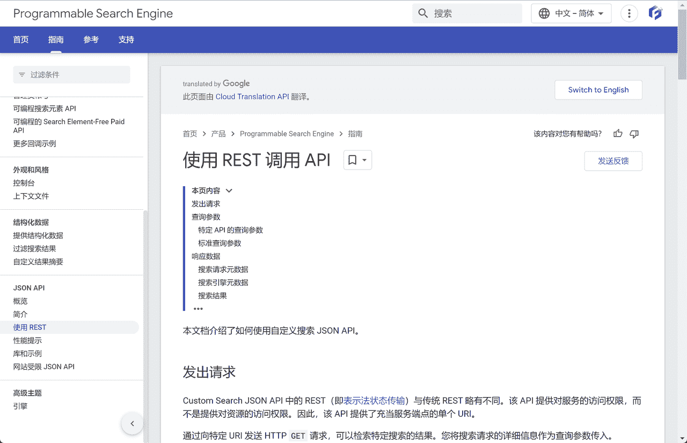

至此，我们就完成了谷歌搜索API的调用过程。

不过根据此前的分析不难发现，谷歌搜索API返回的结果实际上是网址而非具体的信息，若要将具体的信息输入到Chat模型中，还需要将网址内的核心信息爬取并输入到模型中去，因此，围绕搜索返回的结果，我们重点提取网页标题（title）、地址（link）和网页内容摘要（snippet）三项信息即可。并且根据此前的介绍，由于我们后续需要重点围绕某特定网站的特定信息进行爬取，因此还需要单独设置site_url参数，用于限制搜索的网页范围。为此我们创建google_search函数如下：

```
def google_search(query, num_results=10, site_url=None):
    
    api_key = os.getenv(&quot;GOOGLE_SEARCH_API_KEY&quot;)
    cse_id = os.getenv(&quot;CSE_ID&quot;)
    
    url = &quot;https://www.googleapis.com/customsearch/v1&quot;

    # API 请求参数
    if site_url == None:
        params = {
        &#x27;q&#x27;: query,          
        &#x27;key&#x27;: api_key,      
        &#x27;cx&#x27;: cse_id,        
        &#x27;num&#x27;: num_results   
        }
    else:
        params = {
        &#x27;q&#x27;: query,         
        &#x27;key&#x27;: api_key,      
        &#x27;cx&#x27;: cse_id,        
        &#x27;num&#x27;: num_results,  
        &#x27;siteSearch&#x27;: site_url
        }

    # 发送请求
    response = requests.get(url, params=params)
    response.raise_for_status()

    # 解析响应
    search_results = response.json().get(&#x27;items&#x27;, [])

    # 提取所需信息
    results = [{
        &#x27;title&#x27;: item[&#x27;title&#x27;],
        &#x27;link&#x27;: item[&#x27;link&#x27;],
        &#x27;snippet&#x27;: item[&#x27;snippet&#x27;]
    } for item in search_results]

    return results
```

```
search_term = &quot;MCP&quot;
```

```
results = google_search(query=search_term, num_results=5)
```

```
results
```

```
[{&#x27;title&#x27;: &#x27;Model Context Protocol: Introduction&#x27;,
  &#x27;link&#x27;: &#x27;https://modelcontextprotocol.io/introduction&#x27;,
  &#x27;snippet&#x27;: &#x27;Introduction ... C# SDK released! Check out what else is new. MCP is an open protocol that standardizes how applications provide context to LLMs. Think of MCP\xa0...&#x27;},
 {&#x27;title&#x27;: &#x27;Introducing the Model Context Protocol \\ Anthropic&#x27;,
  &#x27;link&#x27;: &#x27;https://www.anthropic.com/news/model-context-protocol&#x27;,
  &#x27;snippet&#x27;: &#x27;Nov 25, 2024 ... The Model Context Protocol is an open standard that enables developers to build secure, two-way connections between their data sources and AI-\xa0...&#x27;},
 {&#x27;title&#x27;: &#x27;Model Context Protocol · GitHub&#x27;,
  &#x27;link&#x27;: &#x27;https://github.com/modelcontextprotocol&#x27;,
  &#x27;snippet&#x27;: &#x27;The Model Context Protocol (MCP) is an open protocol that enables seamless integration between LLM applications and external data sources and tools. Whether you\xa0...&#x27;},
 {&#x27;title&#x27;: &#x27;Model Context Protocol (MCP) - Anthropic&#x27;,
  &#x27;link&#x27;: &#x27;https://docs.anthropic.com/en/docs/agents-and-tools/mcp&#x27;,
  &#x27;snippet&#x27;: &#x27;Model Context Protocol (MCP). MCP is an open protocol that standardizes how applications provide context to LLMs. Think of MCP like a USB-C port for AI\xa0...&#x27;},
 {&#x27;title&#x27;: &#x27;Model Context Protocol - Cursor&#x27;,
  &#x27;link&#x27;: &#x27;https://docs.cursor.com/context/model-context-protocol&#x27;,
  &#x27;snippet&#x27;: &#x27;The Model Context Protocol (MCP) is an open protocol that standardizes how applications provide context and tools to LLMs. Think of MCP as a plugin system for\xa0...&#x27;}]
```

接下来我们测试在知乎中搜索MCP相关信息，得到结果如下：

```
results = google_search(query=&#x27;什么是MCP&#x27;, num_results=5, site_url=&#x27;https://www.zhihu.com/&#x27;)
```

```
results
```

```
[{&#x27;title&#x27;: &#x27;MCP是什么？ - 知乎&#x27;,
  &#x27;link&#x27;: &#x27;https://www.zhihu.com/question/7762420288&#x27;,
  &#x27;snippet&#x27;: &#x27;Dec 24, 2024 ... 虽然Cursor 已经能自动生成代码，但我们梦想中的AI 编程工具，应该是这样的：. 直接调用AI 查看本地数据库，获取关键信息；; 报错信息一键丢给搜索引擎，秒\xa0...&#x27;},
 {&#x27;title&#x27;: &#x27;如何评价Anthropic发布的Model Context Protocol (MCP) 协议？ - 知乎&#x27;,
  &#x27;link&#x27;: &#x27;https://www.zhihu.com/question/5290049088&#x27;,
  &#x27;snippet&#x27;: &#x27;Nov 27, 2024 ... 轻松愉快的SQL 数据分析，只不过是冰山一角. 协议. Claude (Anthropic) 最近出了个MCP (Model Context Protocol，模型上下文协议) 协议，搞得我朋友圈里\xa0...&#x27;},
 {&#x27;title&#x27;: &#x27;MCP、function calling 这两者有什么区别？与AI Agent 是什么关系 ...&#x27;,
  &#x27;link&#x27;: &#x27;https://www.zhihu.com/question/13800647198&#x27;,
  &#x27;snippet&#x27;: &#x27;Mar 1, 2025 ... 为什么是MCP？ 看到这里你可能有一个问题，在23 年OpenAI 发布GPT function calling 的时候，不是也是可以实现类似的功能吗？我们之前博客介绍的AI Agent，\xa0...&#x27;},
 {&#x27;title&#x27;: &#x27;什么是MCP？与AI Agent 的关系是什么？ - 知乎&#x27;,
  &#x27;link&#x27;: &#x27;https://www.zhihu.com/question/14871840737&#x27;,
  &#x27;snippet&#x27;: &#x27;Mar 13, 2025 ... 刚好我最近也在学习MCP，就把最近学习笔记复制出回答你！算了！最后再补充点什么内容看看。 首先什么是MCP? 定义MCP（Model Context Protocol）提供了一种\xa0...&#x27;},
 {&#x27;title&#x27;: &#x27;MCP、function calling 这两者有什么区别？与AI Agent 是什么关系 ...&#x27;,
  &#x27;link&#x27;: &#x27;https://www.zhihu.com/question/13800647198/answer/131006147117&#x27;,
  &#x27;snippet&#x27;: &#x27;Mar 1, 2025 ... 先用一两句话来概括一下这三者之间的关系：Function Calling（函数调用）是一个模型级别的功能模块，MCP(…&#x27;}]
```

能够发现，site_url参数能够正常发挥作用，并返回适当的结果。至此，我们就基本测试了谷歌搜索API的基本测试和函数编写。

```

```

```
pip install playwright
playwright install
```

```

```

### 三、搜索结果信息爬取策略

#### 1.前期准备

+   爬虫方案选取

接下来，我们进一步考虑围绕这些连接进行内容爬取。由于我们只需要在特定网站内进行搜索和信息爬取，因此本部分爬虫难度相对较低。这里我们考虑采用lxml库中的etree模块来解析HTML，并使用XPath来提取所需的数据。这里之所以没有采用其他更加通用的爬虫框架（如beautifulsoup等工具），主要原因有以下几点：

+   特定网址内的HTML结构相对稳定，因此采用XPath来进行特定文本内容的匹配和提取门槛较低，且运行效果较为稳定，同时也便于维护——若网站的HTML结构发生变化，重新进行定位和匹配即可；

+   通过HTML结构来进行内容提取往往可以非常精准的提取到目标内容，例如本节案例中是想要创建技术方面的搜索问答机器人，那么在进行相关网页爬取时，往往只需要爬取目标文章的标题、正文和代码即可，此时我们只需要在目标网页HTML中查找对应内容的结构即可爬取。而如果采用beautifulsoup等工具则会附带爬取非常多网页中的非必要信息，例如跳转连接名称、企业名称、无关申明等，且过滤这些内容较为繁琐。并且需要注意的是，由于大模型本身存在最大上下文限制，因此在爬取内容时精准的提取“高纯度”内容是非常必要的。（例如以下就是某段beautifulsoup爬取的结果）

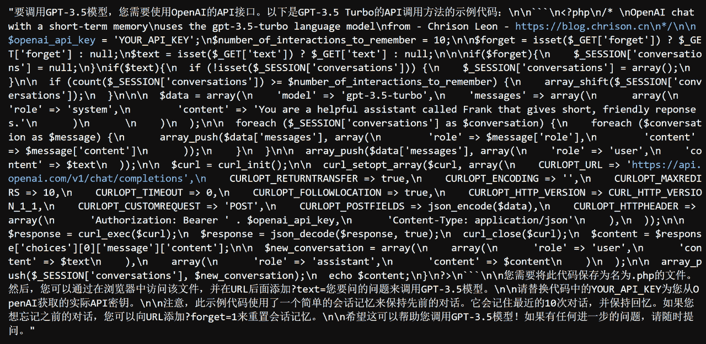

> HTML（Hyper Text Markup Language），超文本标记语言，我们可以将其通俗的理解为一种描述网页结构的语言，如果将网页比喻成一本书，那么HTML就是用于标记每一部分有哪些内容的目录。

因此，尽管beautifulsoup能够更好的适用于一般网页的泛信息爬取，但在当前项目中更适合使用etree模块来解析HTML，并使用XPath来提取所需内容。

+   爬取内容的本地保存方法

而在正式进行内容爬取之前，我们还需要提前准备爬取内容本地保存的基本格式。这里我们统一采用JSON格式进行保存，其中一个JSON文件保存一个爬取到的内容（比如一篇文章），每个JSON对象都包含所爬取到的内容的标题（知乎某页的标题，也就是所搜结果中的title）、链接（link）、正文和正文总共的token数量，JSON对象的创建方法如下：

```
import json

file_path = &#x27;result.json&#x27;

# 创建包含JSON对象的列表
json_data = [
    {
        &quot;link&quot;: &quot;https://example.com/article/1&quot;,
        &quot;title&quot;: &quot;Sample Article 1&quot;,
        &quot;content&quot;: &quot;This is the content of the first article...&quot;,
        &quot;tokens&quot;: &quot;Number of tokens...&quot;
    }
]

# 指定保存文件的路径
file_path = &quot;result.json&quot;

# 将JSON数据写入本地文件
with open(file_path, &quot;w&quot;, encoding=&quot;utf-8&quot;) as json_file:
    json.dump(json_data, json_file, ensure_ascii=False, indent=4)

print(f&quot;JSON数据已保存到文件：{file_path}&quot;)
```

```
JSON数据已保存到文件：result.json
```

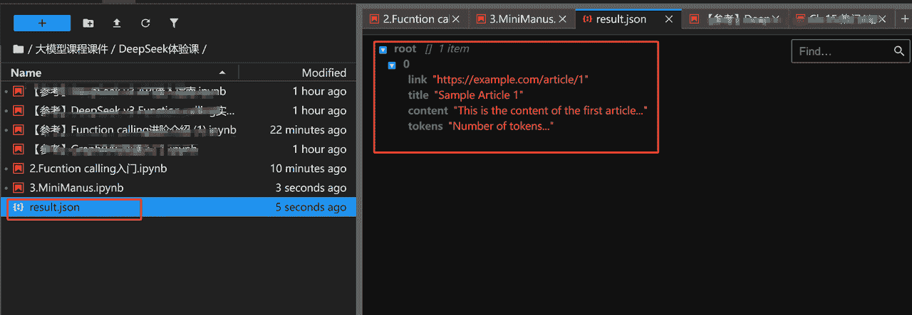

在实际爬取过程中，我们设置每个JSON文件名称就是title，同时在每次执行搜索爬取时都会独立创建一个文件夹，用于保存某次搜索时所爬取到的全部文章内容。

#### 2.爬虫编写

##### 2.1 知乎网页结构探索

接下来我们尝试编写特定知乎网页的爬虫。由于我们采用的XPath匹配的方式进行信息爬取，因此需要先简单确定知乎目标网页的HTML结构，这里需要注意的是，同样的网站内，一级、二级域名对应的网站HTML结构可能会发生很大的变化，且不同功能类型的子网站之间的HTML也会有很大的区别，因此我们需要先仔细观察此前搜索结果中得到的网页列表，来判断知乎网站有哪些不同类型的子网站（以及二级域名网站）：

```
results
```

```
[{&#x27;title&#x27;: &#x27;MCP是什么？ - 知乎&#x27;,
  &#x27;link&#x27;: &#x27;https://www.zhihu.com/question/7762420288&#x27;,
  &#x27;snippet&#x27;: &#x27;Dec 24, 2024 ... 虽然Cursor 已经能自动生成代码，但我们梦想中的AI 编程工具，应该是这样的：. 直接调用AI 查看本地数据库，获取关键信息；; 报错信息一键丢给搜索引擎，秒\xa0...&#x27;},
 {&#x27;title&#x27;: &#x27;如何评价Anthropic发布的Model Context Protocol (MCP) 协议？ - 知乎&#x27;,
  &#x27;link&#x27;: &#x27;https://www.zhihu.com/question/5290049088&#x27;,
  &#x27;snippet&#x27;: &#x27;Nov 27, 2024 ... 轻松愉快的SQL 数据分析，只不过是冰山一角. 协议. Claude (Anthropic) 最近出了个MCP (Model Context Protocol，模型上下文协议) 协议，搞得我朋友圈里\xa0...&#x27;},
 {&#x27;title&#x27;: &#x27;MCP、function calling 这两者有什么区别？与AI Agent 是什么关系 ...&#x27;,
  &#x27;link&#x27;: &#x27;https://www.zhihu.com/question/13800647198&#x27;,
  &#x27;snippet&#x27;: &#x27;Mar 1, 2025 ... 为什么是MCP？ 看到这里你可能有一个问题，在23 年OpenAI 发布GPT function calling 的时候，不是也是可以实现类似的功能吗？我们之前博客介绍的AI Agent，\xa0...&#x27;},
 {&#x27;title&#x27;: &#x27;什么是MCP？与AI Agent 的关系是什么？ - 知乎&#x27;,
  &#x27;link&#x27;: &#x27;https://www.zhihu.com/question/14871840737&#x27;,
  &#x27;snippet&#x27;: &#x27;Mar 13, 2025 ... 刚好我最近也在学习MCP，就把最近学习笔记复制出回答你！算了！最后再补充点什么内容看看。 首先什么是MCP? 定义MCP（Model Context Protocol）提供了一种\xa0...&#x27;},
 {&#x27;title&#x27;: &#x27;MCP、function calling 这两者有什么区别？与AI Agent 是什么关系 ...&#x27;,
  &#x27;link&#x27;: &#x27;https://www.zhihu.com/question/13800647198/answer/131006147117&#x27;,
  &#x27;snippet&#x27;: &#x27;Mar 1, 2025 ... 先用一两句话来概括一下这三者之间的关系：Function Calling（函数调用）是一个模型级别的功能模块，MCP(…&#x27;}]
```

我们发现在返回的5个结果中，都是来自一级域名https://www.zhihu.com/ 的部分子页面，并且种类各异，主要有以下几类：

+   question页面

某些问题的主页，例如https://www.zhihu.com/question/589955237 ，页面内容呈现形式如下：


对于热门话题，以及通过搜索引擎自然得到的排名较高的问答贴往往都有较高的参考价值，因此是不错的爬取对象。

+   question/answer页面

某个问题的某特定回答置顶页面，例如https://www.zhihu.com/question/589955237/answer/2943963130 ，其内容结构和question页面基本一致，可以作为内容爬取对象。

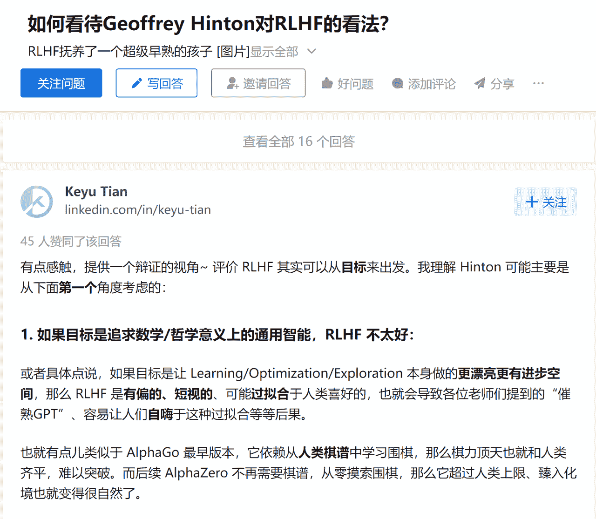

+   topic页面

话题页面，例如https://www.zhihu.com/topic/26859901 ，呈现形式如下：

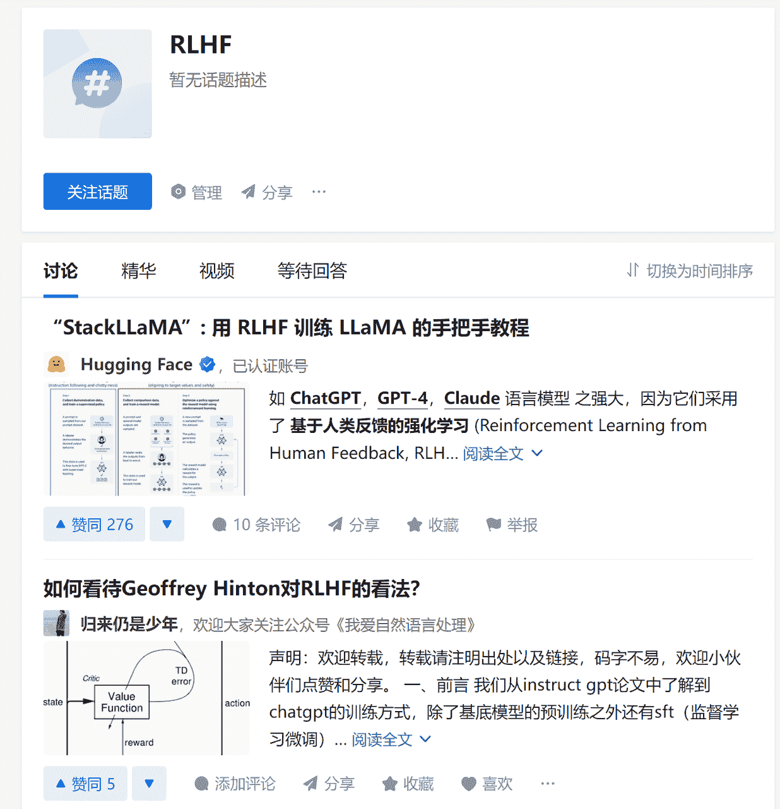

这种页面的内容的内容较为零散，内容知识纯度较低，并不是爬取知识内容并输入给模型的最佳选择。

此之外，还有一些子网页也应该排除爬取范围之外，主要有www.zhihu.com/collection 类网站（收藏列表），www.zhihu.com/people 类网站（个人主页），以及www.zhihu.com/column 类网站（个人文章主页）。

既然这些网站不在爬取范围内，那不妨在搜索引擎的设置中设置过滤这些子网站，以便于更高效的获取目标结果。这里我们可以在可编程搜索引擎主页https://programmablesearchengine.google.com/ 对搜索引擎进行设置，在要排除的网页一栏输入这四类子网页的网址即可：

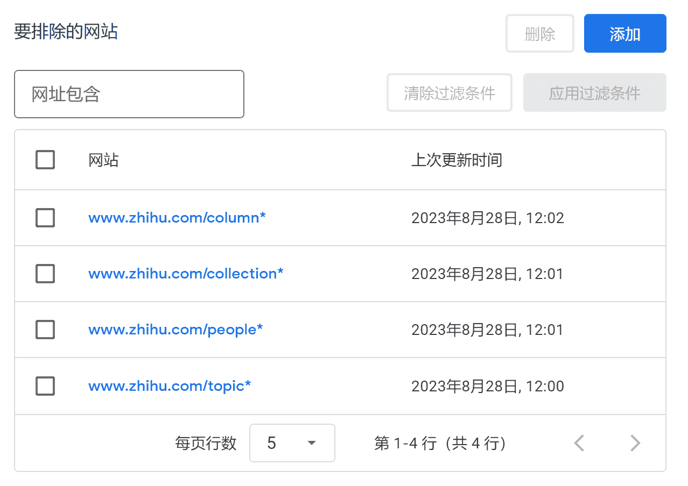

此外需要注意的是，还有一类高质量的文章内容在site_url='https://www.zhihu.com/' 模式下无法搜索得到，那就是知乎专栏内容。知乎专栏在单独的一个二级域名https://zhuanlan.zhihu.com/ 内，因此如果希望在搜索的时候同时覆盖问答贴和专栏文章，则需要按照如下参数进行设置site_url='https://zhihu.com/' ，便可在全部一级、二级域名下进行搜索：

```
results = google_search(query=&#x27;什么是RLHF&#x27;, num_results=10, site_url=&#x27;https://zhihu.com/&#x27;)
```

```
results
```

```
[{&#x27;title&#x27;: &#x27;ChatGPT 背后的“功臣”——RLHF 技术详解- 知乎&#x27;,
  &#x27;link&#x27;: &#x27;https://zhuanlan.zhihu.com/p/599016986&#x27;,
  &#x27;snippet&#x27;: &#x27;OpenAI 推出的ChatGPT 对话模型掀起了新的AI 热潮，它面对多种多样的问题对答如流，似乎已经打破了机器和人的边界。这一工作的背后是大型语言模型(Large Language\xa0...&#x27;},
 {&#x27;title&#x27;: &#x27;从零实现ChatGPT——RLHF技术笔记- 知乎&#x27;,
  &#x27;link&#x27;: &#x27;https://zhuanlan.zhihu.com/p/591474085&#x27;,
  &#x27;snippet&#x27;: &#x27;Dec 18, 2022 ... 3，用强化学习训练上面那个finetune后的GPT3模型。用强化学习做LM训练的一种思路是用Policy Gradient做，这一块OpenAI用的是他们在17年提出的PPO算法\xa0...&#x27;},
 {&#x27;title&#x27;: &#x27;如何看待Geoffrey Hinton对RLHF的看法？ - 知乎&#x27;,
  &#x27;link&#x27;: &#x27;https://www.zhihu.com/question/589955237&#x27;,
  &#x27;snippet&#x27;: &#x27;或者具体点说，如果目标是让Learning/Optimization/Exploration 本身做的更漂亮更有进步空间，那么RLHF 是有偏的、短视的、可能过拟合于人类喜好的，也就会导致各位\xa0...&#x27;},
 {&#x27;title&#x27;: &#x27;抱抱脸：ChatGPT背后的算法——RLHF | 附12篇RLHF必刷论文- 知乎&#x27;,
  &#x27;link&#x27;: &#x27;https://zhuanlan.zhihu.com/p/592671478&#x27;,
  &#x27;snippet&#x27;: &#x27;Dec 18, 2022 ... 但其实这种生成模型很难训练。以语言模型为例，大多是采用“自回归生成”的方式，通过循环解码的方式来逐字或逐词生成内容\xa0...&#x27;},
 {&#x27;title&#x27;: &#x27;ChatGPT背后的技术之理解人类反馈强化学习（RLHF） - 知乎&#x27;,
  &#x27;link&#x27;: &#x27;https://zhuanlan.zhihu.com/p/615708794&#x27;,
  &#x27;snippet&#x27;: &#x27;可以形象解释系PPO近端策略优化算法的工作原理吗？ 请形象解释下什么是重要性采样，主要解决什么问题？&#x27;},
 {&#x27;title&#x27;: &#x27;如何看待Geoffrey Hinton对RLHF的看法？ - Keyu Tian 的回答- 知乎&#x27;,
  &#x27;link&#x27;: &#x27;https://www.zhihu.com/question/589955237/answer/2943963130&#x27;,
  &#x27;snippet&#x27;: &#x27;有点感触，提供一个辩证的视角~ 评价RLHF 其实可以从目标来出发。我理解Hinton 可能主要是从下面第一个…&#x27;},
 {&#x27;title&#x27;: &#x27;ChatGPT 是资本吹起的泡沫吗？相对原有技术真的有那么大的颠覆 ...&#x27;,
  &#x27;link&#x27;: &#x27;https://www.zhihu.com/question/582688695&#x27;,
  &#x27;snippet&#x27;: &#x27;虽然说没有哪个研究领域，甚至没有哪个领域敢说自己真的是天道酬勤绝对公平， ... ChatGPT本身是用强化学习+NLP这两方面的，实际上占主导的是RLHF人类反馈强化学习。&#x27;},
 {&#x27;title&#x27;: &#x27;详解大模型RLHF过程（配代码解读） - 知乎&#x27;,
  &#x27;link&#x27;: &#x27;https://zhuanlan.zhihu.com/p/624589622&#x27;,
  &#x27;snippet&#x27;: &#x27;Apr 27, 2023 ... 一直都特别好奇大模型的强化学习微调是怎么做的，网上虽然相关文章不少，但找到的文章都是浅尝辄止说到用PPO训练，再细致深入的就没有讲了。&#x27;},
 {&#x27;title&#x27;: &#x27;为什么RLHF都是奖励模型，而没有惩罚模型？ - 知乎&#x27;,
  &#x27;link&#x27;: &#x27;https://www.zhihu.com/question/589734028&#x27;,
  &#x27;snippet&#x27;: &#x27;Mar 16, 2023 ... 第一、RLHF 方法并非直接单纯在一个未经训练的随机权重的神经网络上直接使用的。那样大概率99.999%会得到胡说八道的答案。在GPT3.5 基础上，才能看到\xa0...&#x27;},
 {&#x27;title&#x27;: &#x27;ChatGPT训练三阶段与RLHF的威力- 知乎&#x27;,
  &#x27;link&#x27;: &#x27;https://zhuanlan.zhihu.com/p/642281542&#x27;,
  &#x27;snippet&#x27;: &#x27;Jul 7, 2023 ... 那么，RLHF究竟是如何工作的？ · 预训练是资源消耗最大的阶段。 · 教会机器从人类偏好中学习并不新奇，十多年前就已经出现（ · 要想训练模型来模仿演示数据，\xa0...&#x27;}]
```

以此便可获得更加高质量的搜索结果。

##### 2.2 特定网页爬虫编写

特别说明，在编写和使用爬虫时，请确保始终遵循目标网站的使用条款和隐私政策，课程中介绍的爬虫只用于教学目的以及学习者个人使用，严禁用于其他任何商业用途。并且个人用户在学习期间使用爬虫时，也应当尽量减少爬虫使用次数，以减少目标服务器的负担。

+   编写请求头（header）

接下来考虑编写代码实现此前制定的爬虫方案，即考虑采用lxml库中的etree模块来解析HTML，并使用XPath来提取所需的数据。在该爬虫方案中，首先我们需要编写一个请求头（header），用于模拟浏览器登录行为，header的一般编写格式如下：

```
headers = {
    &#x27;authority&#x27;: &#x27;www.zhihu.com&#x27;,
    &#x27;accept&#x27;: &#x27;text/html,application/xhtml+xml,application/xml;q=0.9,image/avif,image/webp,image/apng,*/*;q=0.8,application/signed-exchange;v=b3;q=0.7&#x27;,
    &#x27;accept-language&#x27;: &#x27;zh-CN,zh;q=0.9,en;q=0.8&#x27;,
    &#x27;cache-control&#x27;: &#x27;max-age=0&#x27;,
    &#x27;cookie&#x27;: &quot;Your cookie&quot;,                # 需要手动获取cookie
    &#x27;upgrade-insecure-requests&#x27;: &#x27;1&#x27;,
    &#x27;user-agent&#x27;: &#x27;Your user-agent&#x27;,        # 手动编写或者选择之后给出的user-agent选项选择其一填写
}
```

其中headers的基本参数解释如下：

1.  **authority**: 通常表示请求的目标主机名。在当前项目中需要视情况填写www.zhihu.com或者zhuanlan.zhihu.com；

1.  **accept**: 告诉服务器客户端能够处理的内容类型。这里列出了多种内容类型，包括HTML、XML和各种图片格式，该参数按照给定内容填写即可；

1.  **accept-language**: 告诉服务器客户端的首选语言。这里，首选语言被设置为简体中文（zh-CN），其次是其他中文版本（zh），然后是英文（en）。同样该参数的内容按照给定内容填写即可；

1.  **cache-control**: 控制缓存的行为。max-age=0通常表示客户端不希望得到缓存的响应，而希望从原始服务器获取一个新的响应。该参数的内容按照给定内容填写即可；

1.  **cookie**: 包含服务器之前发送给客户端的cookie。这些cookie可能用于身份验证、会话跟踪或其他目的。这里需要重点注意，建议大家自行获取对应个人浏览器产生的cookie，以避免cookie滥用导致被识别为机器人从而导致封IP；

1.  upgrade-insecure-requests: 这个头部告诉服务器，如果可能的话，客户端希望使用更安全的协议（如HTTPS）进行通信。建议取值为1即可；

1.  **user-agent**: 描述发出请求的客户端的类型。这里，它模拟了一个Chrome浏览器的用户代理字符串。网站有时会根据这个头部提供不同的内容或布局，或者检测是否是爬虫。该参数也需要根据自己实际情况进行编写，接下来会提供一些可选的客户端模拟参数，大家可以选择其中一个作为自己的user-agent。

+   cookie获取

为了更加稳定的使用爬虫，推荐大家自行获取当前客户端的cookie，当然也可以采用Selenium工具自动获取cookie。

所谓Cookie ，本质上是服务器发送给浏览器的一小段数据，浏览器在随后的请求中会将这些数据返回给服务器。它们通常用于识别用户、保存用户的会话状态或其他与用户相关的设置。当你需要从需要登录或有某种会话状态的网站抓取数据时，Cookie 通常是必要的。

以下是如何确定 Cookie 取值的步骤：

1.  **手动登录**：首先，你需要在浏览器中手动访问目标网站并登录知乎。

1.  **开发者工具**：登录后，打开浏览器的开发者工具。在 Chrome 和 Firefox 中，你可以右键点击页面，然后选择“检查”或“检查元素”。

1.  **网络标签**：在开发者工具中，转到“网络”或“Network”标签。

1.  **刷新页面**：在开发者工具打开的情况下，刷新页面。这会捕获所有页面加载过程中的网络请求。

1.  **查找请求**：在捕获的请求列表中，找到主要的请求（通常是顶部的第一个，或者是与你的目标URL匹配的请求）。

1.  **查看请求头**：点击这个请求，然后查找“请求头”或“Request Headers”部分。

1.  **复制Cookie**：在“请求头”部分，你应该能看到一个名为 Cookie 的字段。你可以直接复制这个字段的值。

1.  **使用在爬虫中**：将复制的 Cookie 值用于你的爬虫代码中的请求头。

需要注意的是Cookie 通常有有效期，过了有效期它可能会过期。如果你的爬虫在某个时间点突然无法工作，你可能需要重新获取新的 Cookie。

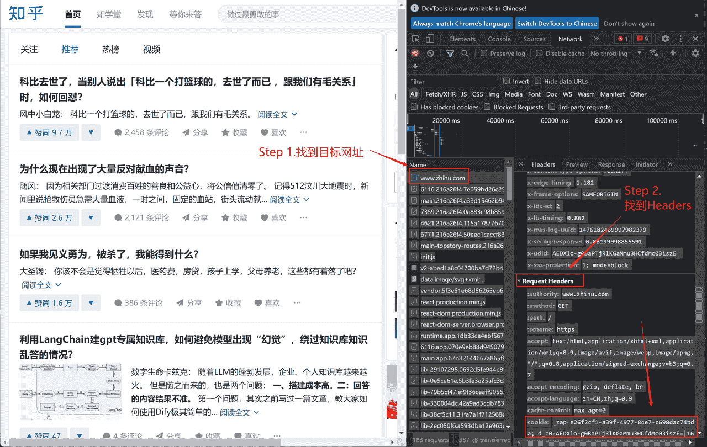

+   user-agent填写

填写个人客户端信息，这里提供几个常见的浏览器的User-Agent字符串，大家可以选择其一填入user-agent字段中：

1.  Chrome (Windows 10):

```
Mozilla/5.0 (Windows NT 10.0; Win64; x64) AppleWebKit/537.36 (KHTML, like Gecko) Chrome/91.0.4472.124 Safari/537.36
```

1.  Firefox (Windows 10):

```
Mozilla/5.0 (Windows NT 10.0; Win64; x64; rv:89.0) Gecko/20100101 Firefox/89.0
```

1.  **Safari (macOS)**:

```
Mozilla/5.0 (Macintosh; Intel Mac OS X 10_15_7) AppleWebKit/605.1.15 (KHTML, like Gecko) Version/14.0.3 Safari/605.1.15
```

1.  Edge (Windows 10):

```
Mozilla/5.0 (Windows NT 10.0; Win64; x64) AppleWebKit/537.36 (KHTML, like Gecko) Chrome/91.0.4472.124 Safari/537.36 Edg/91.0.864.59
```

1.  Chrome (Android):

```
Mozilla/5.0 (Linux; Android 10; SM-A205U) AppleWebKit/537.36 (KHTML, like Gecko) Chrome/91.0.4472.120 Mobile Safari/537.36
```

1.  **Safari (iPhone)**:

```
Mozilla/5.0 (iPhone; CPU iPhone OS 14_6 like Mac OS X) AppleWebKit/605.1.15 (KHTML, like Gecko) Version/14.1 Mobile/15E148 Safari/604.1
```

在获取了cookie和user-agent之后，需要将其填入，获取完整的header对象。

> 需要注意的是，这里一定需要再次定义header才可以运行之后的代码。为避免cookie滥用，当前ipy文件删除了具体的cookie和user-agent定义过程。

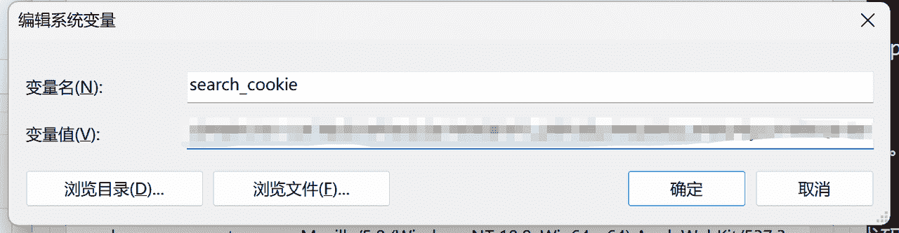

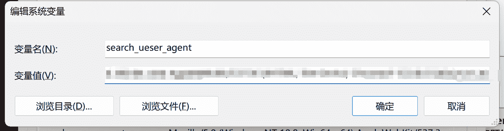

当然，这里我们也可以将这两个变量作为系统变量，方便使用更加安全的方式对其进行调用。

```
cookie = os.getenv(&#x27;search_cookie&#x27;)
user_agent = os.getenv(&#x27;search_user_agent&#x27;)
```

+   尝试爬取question子页面

接下来先尝试爬取question子页面，根据此前的描述，我们需要获取这些子页面的title、正文和代码。这里需要注意的是，不同类型页面的爬取流程会略有区别，这里先介绍question子页面的爬取方法，然后再介绍专栏文章页面内容的爬取方法。

首先确定爬取的link，这里我们考虑爬取https://www.zhihu.com/question/589955237 链接内的内容：

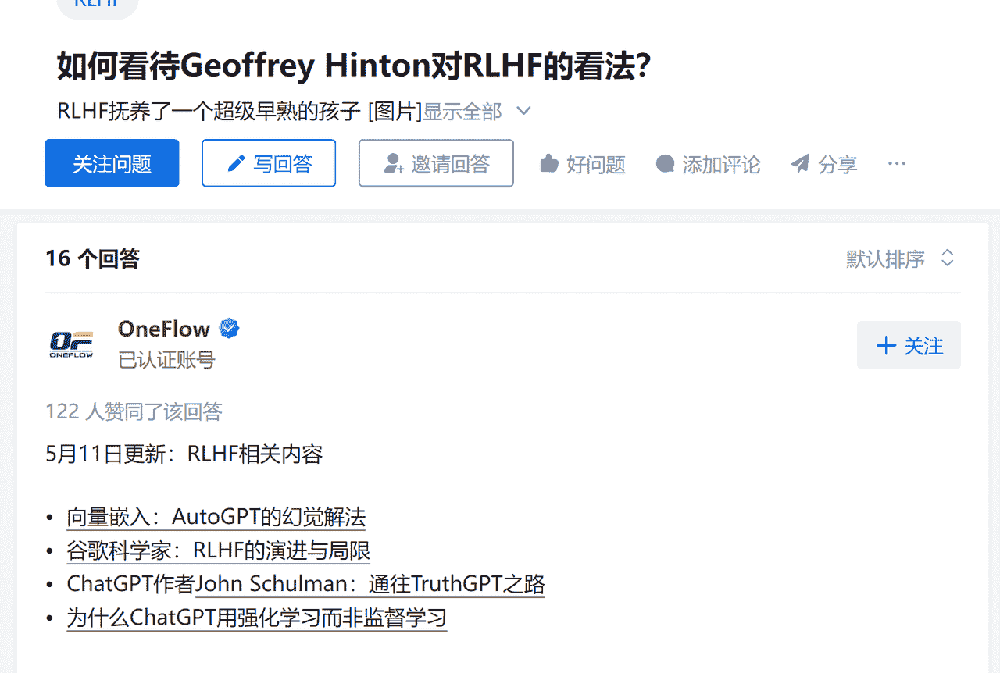

```
url = &#x27;https://www.zhihu.com/question/589955237&#x27;
```

然后构建并发送请求，这里使用 requests 库发送一个 GET 请求到指定的 url，并获取返回的 HTML 文本内容。：

```
res = requests.get(url, headers=headers).text
```

```
res
```

🍻现开设了大**模型学习交流群，**扫描下👇码，来遇见更多志同道合的小伙伴~

海量硬核独家技术**干货内容**+无门槛**技术交流**~


上图**扫码**👆即刻入群！

📍 社群技**术交流氛**围浓厚，不定期开设硬**核干货&前沿技术公开课噢**~