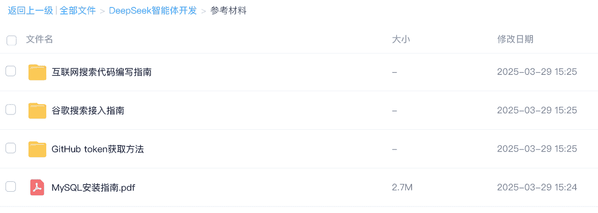

# DeepSeek Function calling响应模式介绍

> 来源：[https://kq4b3vgg5b.feishu.cn/docx/N7wfdxe5hoZtX9xesG1cUFdJn5d](https://kq4b3vgg5b.feishu.cn/docx/N7wfdxe5hoZtX9xesG1cUFdJn5d)

# 课程说明：

+   体验课内容节选自【春季班】大模型Agent智能体开发实战完整版付费课程

体验课时间有限，若想深度学习大模型技术，欢迎大家报名由我主讲的【春季班】大模型Agent智能体开发实战：




此外，公开课全套学习资料，已上传至网盘

（https://pan.baidu.com/s/1DBMhVi9VYnDQRP2AGP0ZZw?pwd=6j57）

需要更系统深入学习大模型可扫码⬆️添加助教咨询喔～

---

# DeepSeek智能体开发实战

# Part 3.DeepSeek Function calling响应模式介绍

```
import os
import openai
import glob
import shutil

import numpy as np
import pandas as pd
import pymysql

import json
import io
import inspect
import requests
import re
import random
import string
import base64

from bs4 import BeautifulSoup
import dateutil.parser as parser
import tiktoken
from lxml import etree

import sys
from dotenv import load_dotenv
from openai import OpenAI

import matplotlib
import matplotlib.pyplot as plt
import seaborn as sns
from IPython.display import display, Code, Markdown, Image
from IPython import get_ipython
```

### 1.parallel_tool_use模式测试


```
def get_weather(loc):
    &quot;&quot;&quot;
    查询即时天气函数
    :param loc: 必要参数，字符串类型，用于表示查询天气的具体城市名称，\
    注意，中国的城市需要用对应城市的英文名称代替，例如如果需要查询北京市天气，则loc参数需要输入&#x27;Beijing&#x27;；
    :return：OpenWeather API查询即时天气的结果，具体URL请求地址为：https://api.openweathermap.org/data/2.5/weather\
    返回结果对象类型为解析之后的JSON格式对象，并用字符串形式进行表示，其中包含了全部重要的天气信息
    &quot;&quot;&quot;
    # Step 1.构建请求
    url = &quot;https://api.openweathermap.org/data/2.5/weather&quot;

    # Step 2.设置查询参数
    params = {
        &quot;q&quot;: loc,               
        &quot;appid&quot;: os.getenv(&quot;OPENWEATHER_API_KEY&quot;),    # 输入API key
        &quot;units&quot;: &quot;metric&quot;,            # 使用摄氏度而不是华氏度
        &quot;lang&quot;:&quot;zh_cn&quot;                # 输出语言为简体中文
    }

    # Step 3.发送GET请求
    response = requests.get(url, params=params)
    
    # Step 4.解析响应
    data = response.json()
    return json.dumps(data)
```

```
get_weather(loc=&quot;Beijing&quot;)
```

```
&#x27;{&quot;coord&quot;: {&quot;lon&quot;: 116.3972, &quot;lat&quot;: 39.9075}, &quot;weather&quot;: [{&quot;id&quot;: 803, &quot;main&quot;: &quot;Clouds&quot;, &quot;description&quot;: &quot;\\u591a\\u4e91&quot;, &quot;icon&quot;: &quot;04d&quot;}], &quot;base&quot;: &quot;stations&quot;, &quot;main&quot;: {&quot;temp&quot;: 9.57, &quot;feels_like&quot;: 7.17, &quot;temp_min&quot;: 9.57, &quot;temp_max&quot;: 9.57, &quot;pressure&quot;: 1021, &quot;humidity&quot;: 16, &quot;sea_level&quot;: 1021, &quot;grnd_level&quot;: 1016}, &quot;visibility&quot;: 10000, &quot;wind&quot;: {&quot;speed&quot;: 4.69, &quot;deg&quot;: 321, &quot;gust&quot;: 8.84}, &quot;clouds&quot;: {&quot;all&quot;: 83}, &quot;dt&quot;: 1743145567, &quot;sys&quot;: {&quot;type&quot;: 2, &quot;id&quot;: 2000403, &quot;country&quot;: &quot;CN&quot;, &quot;sunrise&quot;: 1743113116, &quot;sunset&quot;: 1743158016}, &quot;timezone&quot;: 28800, &quot;id&quot;: 1816670, &quot;name&quot;: &quot;Beijing&quot;, &quot;cod&quot;: 200}&#x27;
```

```
available_functions = {
            &quot;get_weather&quot;: get_weather,
        }
```

```
tools = [
    {
        &quot;type&quot;: &quot;function&quot;,
        &quot;function&quot;:{
            &#x27;name&#x27;: &#x27;get_weather&#x27;,
            &#x27;description&#x27;: &#x27;查询即时天气函数，根据输入的城市名称，查询对应城市的实时天气，一次只能输入一个城市名称&#x27;,
            &#x27;parameters&#x27;: {
                &#x27;type&#x27;: &#x27;object&#x27;,
                &#x27;properties&#x27;: {
                    &#x27;loc&#x27;: {
                        &#x27;description&#x27;: &quot;城市名称，注意，中国的城市需要用对应城市的英文名称代替，例如如果需要查询北京市天气，则loc参数需要输入&#x27;Beijing&#x27;&quot;,
                        &#x27;type&#x27;: &#x27;string&#x27;
                    }
                },
                &#x27;required&#x27;: [&#x27;loc&#x27;]
            }
        }
    }
]
```

```
messages2=[
    {&quot;role&quot;: &quot;user&quot;, &quot;content&quot;: &quot;请问北京和杭州今天天气如何？&quot;}
]
```

```
response2 = client.chat.completions.create(
    model=MODEL,  
    messages=messages2,
    tools=tools,
)
```

```
response2.choices[0].message
```

```
ChatCompletionMessage(content=&#x27;&#x27;, refusal=None, role=&#x27;assistant&#x27;, annotations=None, audio=None, function_call=None, tool_calls=[ChatCompletionMessageToolCall(id=&#x27;call_0_4ae4acdf-319e-42a0-a1fd-c673d756bec3&#x27;, function=Function(arguments=&#x27;{&quot;loc&quot;: &quot;Beijing&quot;}&#x27;, name=&#x27;get_weather&#x27;), type=&#x27;function&#x27;, index=0), ChatCompletionMessageToolCall(id=&#x27;call_1_5189e5b5-2e72-422f-8745-fcb1f6fe2781&#x27;, function=Function(arguments=&#x27;{&quot;loc&quot;: &quot;Hangzhou&quot;}&#x27;, name=&#x27;get_weather&#x27;), type=&#x27;function&#x27;, index=1)])
```

```
response2.choices[0].message.tool_calls
```

```
[ChatCompletionMessageToolCall(id=&#x27;call_0_4ae4acdf-319e-42a0-a1fd-c673d756bec3&#x27;, function=Function(arguments=&#x27;{&quot;loc&quot;: &quot;Beijing&quot;}&#x27;, name=&#x27;get_weather&#x27;), type=&#x27;function&#x27;, index=0),
 ChatCompletionMessageToolCall(id=&#x27;call_1_5189e5b5-2e72-422f-8745-fcb1f6fe2781&#x27;, function=Function(arguments=&#x27;{&quot;loc&quot;: &quot;Hangzhou&quot;}&#x27;, name=&#x27;get_weather&#x27;), type=&#x27;function&#x27;, index=1)]
```

```
function_call_messages = response2.choices[0].message.tool_calls
function_call_messages
```

```
[ChatCompletionMessageToolCall(id=&#x27;call_0_4ae4acdf-319e-42a0-a1fd-c673d756bec3&#x27;, function=Function(arguments=&#x27;{&quot;loc&quot;: &quot;Beijing&quot;}&#x27;, name=&#x27;get_weather&#x27;), type=&#x27;function&#x27;, index=0),
 ChatCompletionMessageToolCall(id=&#x27;call_1_5189e5b5-2e72-422f-8745-fcb1f6fe2781&#x27;, function=Function(arguments=&#x27;{&quot;loc&quot;: &quot;Hangzhou&quot;}&#x27;, name=&#x27;get_weather&#x27;), type=&#x27;function&#x27;, index=1)]
```

```
response2.choices[0].message.model_dump()
```

```
{&#x27;content&#x27;: &#x27;&#x27;,
 &#x27;refusal&#x27;: None,
 &#x27;role&#x27;: &#x27;assistant&#x27;,
 &#x27;annotations&#x27;: None,
 &#x27;audio&#x27;: None,
 &#x27;function_call&#x27;: None,
 &#x27;tool_calls&#x27;: [{&#x27;id&#x27;: &#x27;call_0_4ae4acdf-319e-42a0-a1fd-c673d756bec3&#x27;,
   &#x27;function&#x27;: {&#x27;arguments&#x27;: &#x27;{&quot;loc&quot;: &quot;Beijing&quot;}&#x27;, &#x27;name&#x27;: &#x27;get_weather&#x27;},
   &#x27;type&#x27;: &#x27;function&#x27;,
   &#x27;index&#x27;: 0},
  {&#x27;id&#x27;: &#x27;call_1_5189e5b5-2e72-422f-8745-fcb1f6fe2781&#x27;,
   &#x27;function&#x27;: {&#x27;arguments&#x27;: &#x27;{&quot;loc&quot;: &quot;Hangzhou&quot;}&#x27;, &#x27;name&#x27;: &#x27;get_weather&#x27;},
   &#x27;type&#x27;: &#x27;function&#x27;,
   &#x27;index&#x27;: 1}]}
```

创建create_function_response_messages函数，一次性构建完整回复：

```
messages2=[
    {&quot;role&quot;: &quot;user&quot;, &quot;content&quot;: &quot;请问北京和杭州今天天气如何？&quot;}
]
messages2
```

```
[{&#x27;role&#x27;: &#x27;user&#x27;, &#x27;content&#x27;: &#x27;请问北京和杭州今天天气如何？&#x27;}]
```

```
response2
```

```
ChatCompletion(id=&#x27;ee27f92d-d09c-4be5-920a-440b8395a1e3&#x27;, choices=[Choice(finish_reason=&#x27;tool_calls&#x27;, index=0, logprobs=None, message=ChatCompletionMessage(content=&#x27;&#x27;, refusal=None, role=&#x27;assistant&#x27;, annotations=None, audio=None, function_call=None, tool_calls=[ChatCompletionMessageToolCall(id=&#x27;call_0_4ae4acdf-319e-42a0-a1fd-c673d756bec3&#x27;, function=Function(arguments=&#x27;{&quot;loc&quot;: &quot;Beijing&quot;}&#x27;, name=&#x27;get_weather&#x27;), type=&#x27;function&#x27;, index=0), ChatCompletionMessageToolCall(id=&#x27;call_1_5189e5b5-2e72-422f-8745-fcb1f6fe2781&#x27;, function=Function(arguments=&#x27;{&quot;loc&quot;: &quot;Hangzhou&quot;}&#x27;, name=&#x27;get_weather&#x27;), type=&#x27;function&#x27;, index=1)]))], created=1743145906, model=&#x27;deepseek-chat&#x27;, object=&#x27;chat.completion&#x27;, service_tier=None, system_fingerprint=&#x27;fp_3d5141a69a_prod0225&#x27;, usage=CompletionUsage(completion_tokens=41, prompt_tokens=160, total_tokens=201, completion_tokens_details=None, prompt_tokens_details=PromptTokensDetails(audio_tokens=None, cached_tokens=0), prompt_cache_hit_tokens=0, prompt_cache_miss_tokens=160))
```

```
def create_function_response_messages(messages, response):
    function_call_messages = response.choices[0].message.tool_calls
    messages.append(response.choices[0].message.model_dump())
    for function_call_message in function_call_messages:
        tool_name = function_call_message.function.name
        tool_args = json.loads(function_call_message.function.arguments)
        
        # 运行外部函数
        fuction_to_call = available_functions[tool_name]
        try:
            function_response = fuction_to_call(**tool_args)
        except Exception as e:
            function_response = &quot;函数运行报错如下:&quot; + str(e)

        # 拼接消息队列
        messages.append(
            {
                &quot;role&quot;: &quot;tool&quot;,
                &quot;content&quot;: function_response,
                &quot;tool_call_id&quot;: function_call_message.id,
            }
        )
    return messages     
```

```
messages2 = create_function_response_messages(messages2, response2)
```

```
messages2
```

```
[{&#x27;role&#x27;: &#x27;user&#x27;, &#x27;content&#x27;: &#x27;请问北京和杭州今天天气如何？&#x27;},
 {&#x27;content&#x27;: &#x27;&#x27;,
  &#x27;refusal&#x27;: None,
  &#x27;role&#x27;: &#x27;assistant&#x27;,
  &#x27;annotations&#x27;: None,
  &#x27;audio&#x27;: None,
  &#x27;function_call&#x27;: None,
  &#x27;tool_calls&#x27;: [{&#x27;id&#x27;: &#x27;call_0_4ae4acdf-319e-42a0-a1fd-c673d756bec3&#x27;,
    &#x27;function&#x27;: {&#x27;arguments&#x27;: &#x27;{&quot;loc&quot;: &quot;Beijing&quot;}&#x27;, &#x27;name&#x27;: &#x27;get_weather&#x27;},
    &#x27;type&#x27;: &#x27;function&#x27;,
    &#x27;index&#x27;: 0},
   {&#x27;id&#x27;: &#x27;call_1_5189e5b5-2e72-422f-8745-fcb1f6fe2781&#x27;,
    &#x27;function&#x27;: {&#x27;arguments&#x27;: &#x27;{&quot;loc&quot;: &quot;Hangzhou&quot;}&#x27;, &#x27;name&#x27;: &#x27;get_weather&#x27;},
    &#x27;type&#x27;: &#x27;function&#x27;,
    &#x27;index&#x27;: 1}]},
 {&#x27;role&#x27;: &#x27;tool&#x27;,
  &#x27;content&#x27;: &#x27;{&quot;coord&quot;: {&quot;lon&quot;: 116.3972, &quot;lat&quot;: 39.9075}, &quot;weather&quot;: [{&quot;id&quot;: 803, &quot;main&quot;: &quot;Clouds&quot;, &quot;description&quot;: &quot;\\u591a\\u4e91&quot;, &quot;icon&quot;: &quot;04d&quot;}], &quot;base&quot;: &quot;stations&quot;, &quot;main&quot;: {&quot;temp&quot;: 9.57, &quot;feels_like&quot;: 7.17, &quot;temp_min&quot;: 9.57, &quot;temp_max&quot;: 9.57, &quot;pressure&quot;: 1021, &quot;humidity&quot;: 16, &quot;sea_level&quot;: 1021, &quot;grnd_level&quot;: 1016}, &quot;visibility&quot;: 10000, &quot;wind&quot;: {&quot;speed&quot;: 4.69, &quot;deg&quot;: 321, &quot;gust&quot;: 8.84}, &quot;clouds&quot;: {&quot;all&quot;: 83}, &quot;dt&quot;: 1743145567, &quot;sys&quot;: {&quot;type&quot;: 2, &quot;id&quot;: 2000403, &quot;country&quot;: &quot;CN&quot;, &quot;sunrise&quot;: 1743113116, &quot;sunset&quot;: 1743158016}, &quot;timezone&quot;: 28800, &quot;id&quot;: 1816670, &quot;name&quot;: &quot;Beijing&quot;, &quot;cod&quot;: 200}&#x27;,
  &#x27;tool_call_id&#x27;: &#x27;call_0_4ae4acdf-319e-42a0-a1fd-c673d756bec3&#x27;},
 {&#x27;role&#x27;: &#x27;tool&#x27;,
  &#x27;content&#x27;: &#x27;{&quot;coord&quot;: {&quot;lon&quot;: 120.1614, &quot;lat&quot;: 30.2937}, &quot;weather&quot;: [{&quot;id&quot;: 804, &quot;main&quot;: &quot;Clouds&quot;, &quot;description&quot;: &quot;\\u9634\\uff0c\\u591a\\u4e91&quot;, &quot;icon&quot;: &quot;04d&quot;}], &quot;base&quot;: &quot;stations&quot;, &quot;main&quot;: {&quot;temp&quot;: 6, &quot;feels_like&quot;: 3.98, &quot;temp_min&quot;: 6, &quot;temp_max&quot;: 6, &quot;pressure&quot;: 1024, &quot;humidity&quot;: 77, &quot;sea_level&quot;: 1024, &quot;grnd_level&quot;: 1021}, &quot;visibility&quot;: 10000, &quot;wind&quot;: {&quot;speed&quot;: 2.63, &quot;deg&quot;: 329, &quot;gust&quot;: 4.3}, &quot;clouds&quot;: {&quot;all&quot;: 100}, &quot;dt&quot;: 1743145811, &quot;sys&quot;: {&quot;type&quot;: 1, &quot;id&quot;: 9651, &quot;country&quot;: &quot;CN&quot;, &quot;sunrise&quot;: 1743112421, &quot;sunset&quot;: 1743156905}, &quot;timezone&quot;: 28800, &quot;id&quot;: 1808926, &quot;name&quot;: &quot;Hangzhou&quot;, &quot;cod&quot;: 200}&#x27;,
  &#x27;tool_call_id&#x27;: &#x27;call_1_5189e5b5-2e72-422f-8745-fcb1f6fe2781&#x27;}]
```

```
# 第二次响应
response = client.chat.completions.create(
    model=MODEL,  
    messages=messages2,
    tools=tools,
)
```

```
response.choices[0].message
```

```
ChatCompletionMessage(content=&#x27;今天北京的天气是多云，气温为9.57°C，体感温度为7.17°C，湿度为16%，风速为4.69 m/s。\n\n杭州的天气是阴天，多云，气温为6°C，体感温度为3.98°C，湿度为77%，风速为2.63 m/s。&#x27;, refusal=None, role=&#x27;assistant&#x27;, annotations=None, audio=None, function_call=None, tool_calls=None)
```

```
response.choices[0].finish_reason
```

```
&#x27;stop&#x27;
```

### 2.parallel_tool_use模式测试


```
def write_file(content):
    &quot;&quot;&quot;
    将指定内容写入本地文件。
    :param content: 必要参数，字符串类型，用于表示需要写入文档的具体内容。
    :return：是否成功写入
    &quot;&quot;&quot;
    
    return &quot;已成功写入本地文件。&quot;
```

```
write_file(content=&quot;某地天气信息&quot;)
```

```
&#x27;已成功写入本地文件。&#x27;
```

```
available_functions = {
    &quot;get_weather&quot;: get_weather,
    &quot;write_file&quot;: write_file
}
```

```
tools = [
    {
        &quot;type&quot;: &quot;function&quot;,
        &quot;function&quot;:{
            &#x27;name&#x27;: &#x27;get_weather&#x27;,
            &#x27;description&#x27;: &#x27;查询即时天气函数，根据输入的城市名称，查询对应城市的实时天气，一次只能输入一个城市名称&#x27;,
            &#x27;parameters&#x27;: {
                &#x27;type&#x27;: &#x27;object&#x27;,
                &#x27;properties&#x27;: {
                    &#x27;loc&#x27;: {
                        &#x27;description&#x27;: &quot;城市名称，注意，中国的城市需要用对应城市的英文名称代替，例如如果需要查询北京市天气，则loc参数需要输入&#x27;Beijing&#x27;&quot;,
                        &#x27;type&#x27;: &#x27;string&#x27;
                    }
                },
                &#x27;required&#x27;: [&#x27;loc&#x27;]
            }
        }
    },
    {
        &quot;type&quot;: &quot;function&quot;,
        &quot;function&quot;:{
            &#x27;name&#x27;: &#x27;write_file&#x27;,
            &#x27;description&#x27;: &#x27;将指定内容写入本地文件。&#x27;,
            &#x27;parameters&#x27;: {
                &#x27;type&#x27;: &#x27;object&#x27;,
                &#x27;properties&#x27;: {
                    &#x27;content&#x27;: {
                        &#x27;description&#x27;: &quot;用于表示需要写入文档的具体内容。&quot;,
                        &#x27;type&#x27;: &#x27;string&#x27;
                    }
                },
                &#x27;required&#x27;: [&#x27;content&#x27;]
            }
        }
    }
]
```

```
messages3=[
    {&quot;role&quot;: &quot;user&quot;, &quot;content&quot;: &quot;请问北京今天天气如何？请先查询天气信息，然后再把查询到的信息写入本地文档&quot;}
]
```

```
response3 = client.chat.completions.create(
    model=MODEL,  
    messages=messages3,
    tools=tools,
)
```

```
response3.choices[0].message
```

```
ChatCompletionMessage(content=&#x27;&#x27;, refusal=None, role=&#x27;assistant&#x27;, annotations=None, audio=None, function_call=None, tool_calls=[ChatCompletionMessageToolCall(id=&#x27;call_0_686f37e7-09ae-4f74-ac8d-e063d6fd88f8&#x27;, function=Function(arguments=&#x27;{&quot;loc&quot;:&quot;Beijing&quot;}&#x27;, name=&#x27;get_weather&#x27;), type=&#x27;function&#x27;, index=0)])
```

```
response3.choices[0].message.tool_calls
```

```
[ChatCompletionMessageToolCall(id=&#x27;call_0_686f37e7-09ae-4f74-ac8d-e063d6fd88f8&#x27;, function=Function(arguments=&#x27;{&quot;loc&quot;:&quot;Beijing&quot;}&#x27;, name=&#x27;get_weather&#x27;), type=&#x27;function&#x27;, index=0)]
```

```
messages3 = create_function_response_messages(messages3, response3)
```

```
messages3
```

```
[{&#x27;role&#x27;: &#x27;user&#x27;, &#x27;content&#x27;: &#x27;请问北京今天天气如何？请先查询天气信息，然后再把查询到的信息写入本地文档&#x27;},
 {&#x27;content&#x27;: &#x27;&#x27;,
  &#x27;refusal&#x27;: None,
  &#x27;role&#x27;: &#x27;assistant&#x27;,
  &#x27;annotations&#x27;: None,
  &#x27;audio&#x27;: None,
  &#x27;function_call&#x27;: None,
  &#x27;tool_calls&#x27;: [{&#x27;id&#x27;: &#x27;call_0_686f37e7-09ae-4f74-ac8d-e063d6fd88f8&#x27;,
    &#x27;function&#x27;: {&#x27;arguments&#x27;: &#x27;{&quot;loc&quot;:&quot;Beijing&quot;}&#x27;, &#x27;name&#x27;: &#x27;get_weather&#x27;},
    &#x27;type&#x27;: &#x27;function&#x27;,
    &#x27;index&#x27;: 0}]},
 {&#x27;role&#x27;: &#x27;tool&#x27;,
  &#x27;content&#x27;: &#x27;{&quot;coord&quot;: {&quot;lon&quot;: 116.3972, &quot;lat&quot;: 39.9075}, &quot;weather&quot;: [{&quot;id&quot;: 803, &quot;main&quot;: &quot;Clouds&quot;, &quot;description&quot;: &quot;\\u591a\\u4e91&quot;, &quot;icon&quot;: &quot;04d&quot;}], &quot;base&quot;: &quot;stations&quot;, &quot;main&quot;: {&quot;temp&quot;: 9.57, &quot;feels_like&quot;: 7.17, &quot;temp_min&quot;: 9.57, &quot;temp_max&quot;: 9.57, &quot;pressure&quot;: 1021, &quot;humidity&quot;: 16, &quot;sea_level&quot;: 1021, &quot;grnd_level&quot;: 1016}, &quot;visibility&quot;: 10000, &quot;wind&quot;: {&quot;speed&quot;: 4.69, &quot;deg&quot;: 321, &quot;gust&quot;: 8.84}, &quot;clouds&quot;: {&quot;all&quot;: 83}, &quot;dt&quot;: 1743146181, &quot;sys&quot;: {&quot;type&quot;: 2, &quot;id&quot;: 2000403, &quot;country&quot;: &quot;CN&quot;, &quot;sunrise&quot;: 1743113116, &quot;sunset&quot;: 1743158016}, &quot;timezone&quot;: 28800, &quot;id&quot;: 1816670, &quot;name&quot;: &quot;Beijing&quot;, &quot;cod&quot;: 200}&#x27;,
  &#x27;tool_call_id&#x27;: &#x27;call_0_686f37e7-09ae-4f74-ac8d-e063d6fd88f8&#x27;}]
```

```
response3 = client.chat.completions.create(
    model=MODEL,  
    messages=messages3,
    tools=tools,
)
```

```
response3.choices[0].message
```

```
ChatCompletionMessage(content=&#x27;&#x27;, refusal=None, role=&#x27;assistant&#x27;, annotations=None, audio=None, function_call=None, tool_calls=[ChatCompletionMessageToolCall(id=&#x27;call_0_de55eb77-ef3b-4832-b623-6eaaa4d82f60&#x27;, function=Function(arguments=&#x27;{&quot;content&quot;:&quot;北京今天的天气情况如下：\\n\\n- 天气状况：多云\\n- 当前温度：9.57°C\\n- 体感温度：7.17°C\\n- 最低温度：9.57°C\\n- 最高温度：9.57°C\\n- 湿度：16%\\n- 气压：1021 hPa\\n- 风速：4.69 m/s，风向：321°\\n- 能见度：10000 米\\n\\n日出时间：06:45，日落时间：18:33。&quot;}&#x27;, name=&#x27;write_file&#x27;), type=&#x27;function&#x27;, index=0)])
```

```
response3.choices[0].message.tool_calls
```

```
[ChatCompletionMessageToolCall(id=&#x27;call_0_de55eb77-ef3b-4832-b623-6eaaa4d82f60&#x27;, function=Function(arguments=&#x27;{&quot;content&quot;:&quot;北京今天的天气情况如下：\\n\\n- 天气状况：多云\\n- 当前温度：9.57°C\\n- 体感温度：7.17°C\\n- 最低温度：9.57°C\\n- 最高温度：9.57°C\\n- 湿度：16%\\n- 气压：1021 hPa\\n- 风速：4.69 m/s，风向：321°\\n- 能见度：10000 米\\n\\n日出时间：06:45，日落时间：18:33。&quot;}&#x27;, name=&#x27;write_file&#x27;), type=&#x27;function&#x27;, index=0)]
```

```
response3.choices[0].finish_reason
```

```
&#x27;tool_calls&#x27;
```

```
messages3 = create_function_response_messages(messages3, response3)
```

```
messages3
```

```
[{&#x27;role&#x27;: &#x27;user&#x27;, &#x27;content&#x27;: &#x27;请问北京今天天气如何？请先查询天气信息，然后再把查询到的信息写入本地文档&#x27;},
 {&#x27;content&#x27;: &#x27;&#x27;,
  &#x27;refusal&#x27;: None,
  &#x27;role&#x27;: &#x27;assistant&#x27;,
  &#x27;annotations&#x27;: None,
  &#x27;audio&#x27;: None,
  &#x27;function_call&#x27;: None,
  &#x27;tool_calls&#x27;: [{&#x27;id&#x27;: &#x27;call_0_686f37e7-09ae-4f74-ac8d-e063d6fd88f8&#x27;,
    &#x27;function&#x27;: {&#x27;arguments&#x27;: &#x27;{&quot;loc&quot;:&quot;Beijing&quot;}&#x27;, &#x27;name&#x27;: &#x27;get_weather&#x27;},
    &#x27;type&#x27;: &#x27;function&#x27;,
    &#x27;index&#x27;: 0}]},
 {&#x27;role&#x27;: &#x27;tool&#x27;,
  &#x27;content&#x27;: &#x27;{&quot;coord&quot;: {&quot;lon&quot;: 116.3972, &quot;lat&quot;: 39.9075}, &quot;weather&quot;: [{&quot;id&quot;: 803, &quot;main&quot;: &quot;Clouds&quot;, &quot;description&quot;: &quot;\\u591a\\u4e91&quot;, &quot;icon&quot;: &quot;04d&quot;}], &quot;base&quot;: &quot;stations&quot;, &quot;main&quot;: {&quot;temp&quot;: 9.57, &quot;feels_like&quot;: 7.17, &quot;temp_min&quot;: 9.57, &quot;temp_max&quot;: 9.57, &quot;pressure&quot;: 1021, &quot;humidity&quot;: 16, &quot;sea_level&quot;: 1021, &quot;grnd_level&quot;: 1016}, &quot;visibility&quot;: 10000, &quot;wind&quot;: {&quot;speed&quot;: 4.69, &quot;deg&quot;: 321, &quot;gust&quot;: 8.84}, &quot;clouds&quot;: {&quot;all&quot;: 83}, &quot;dt&quot;: 1743146181, &quot;sys&quot;: {&quot;type&quot;: 2, &quot;id&quot;: 2000403, &quot;country&quot;: &quot;CN&quot;, &quot;sunrise&quot;: 1743113116, &quot;sunset&quot;: 1743158016}, &quot;timezone&quot;: 28800, &quot;id&quot;: 1816670, &quot;name&quot;: &quot;Beijing&quot;, &quot;cod&quot;: 200}&#x27;,
  &#x27;tool_call_id&#x27;: &#x27;call_0_686f37e7-09ae-4f74-ac8d-e063d6fd88f8&#x27;},
 {&#x27;content&#x27;: &#x27;&#x27;,
  &#x27;refusal&#x27;: None,
  &#x27;role&#x27;: &#x27;assistant&#x27;,
  &#x27;annotations&#x27;: None,
  &#x27;audio&#x27;: None,
  &#x27;function_call&#x27;: None,
  &#x27;tool_calls&#x27;: [{&#x27;id&#x27;: &#x27;call_0_de55eb77-ef3b-4832-b623-6eaaa4d82f60&#x27;,
    &#x27;function&#x27;: {&#x27;arguments&#x27;: &#x27;{&quot;content&quot;:&quot;北京今天的天气情况如下：\\n\\n- 天气状况：多云\\n- 当前温度：9.57°C\\n- 体感温度：7.17°C\\n- 最低温度：9.57°C\\n- 最高温度：9.57°C\\n- 湿度：16%\\n- 气压：1021 hPa\\n- 风速：4.69 m/s，风向：321°\\n- 能见度：10000 米\\n\\n日出时间：06:45，日落时间：18:33。&quot;}&#x27;,
     &#x27;name&#x27;: &#x27;write_file&#x27;},
    &#x27;type&#x27;: &#x27;function&#x27;,
    &#x27;index&#x27;: 0}]},
 {&#x27;role&#x27;: &#x27;tool&#x27;,
  &#x27;content&#x27;: &#x27;已成功写入本地文件。&#x27;,
  &#x27;tool_call_id&#x27;: &#x27;call_0_de55eb77-ef3b-4832-b623-6eaaa4d82f60&#x27;}]
```

```
response3 = client.chat.completions.create(
    model=MODEL,  
    messages=messages3,
    tools=tools,
)
```

```
response3.choices[0].message
```

```
ChatCompletionMessage(content=&#x27;北京今天的天气情况如下：\n\n- 天气状况：多云  \n- 当前温度：9.57°C  \n- 体感温度：7.17°C  \n- 最低温度：9.57°C  \n- 最高温度：9.57°C  \n- 湿度：16%  \n- 气压：1021 hPa  \n- 风速：4.69 m/s，风向：321°  \n- 能见度：10000 米  \n\n日出时间：06:45，日落时间：18:33。\n\n以上信息已成功写入本地文档。&#x27;, refusal=None, role=&#x27;assistant&#x27;, annotations=None, audio=None, function_call=None, tool_calls=None)
```

```
response3.choices[0].finish_reason
```

```
&#x27;stop&#x27;
```