# DeepSeek-V3-0324深度解析

> 来源：[https://kq4b3vgg5b.feishu.cn/docx/BEGwdlsv4oAXo8xTgH3cpzXKn0b](https://kq4b3vgg5b.feishu.cn/docx/BEGwdlsv4oAXo8xTgH3cpzXKn0b)

> 3月24号凌晨，又是在毫无征兆的情况下，深度求索公司低调发布了DeepSeek-V3模型的最新版本，DeepSeek-V3-0324。

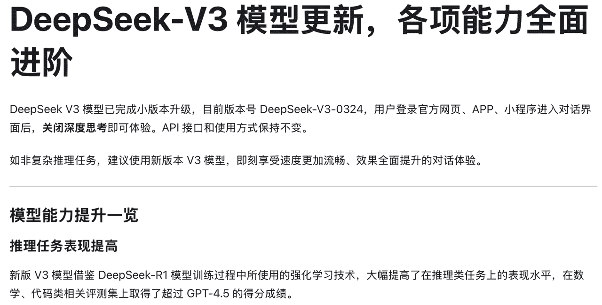

> DeepSeek-V3-0324模型发布公告地址：https://api-docs.deepseek.com/zh-cn/news/news250325

在DeepSeek-R1模型已经一统天下的今天，其实很多人会非常好奇，为什么迭代这款感觉没太大存在感的DeepSeek-V3模型呢？

看本次更新公告，感觉这次升级幅度也不大，哪怕是新模型重点提升了编程和推理性能，比起DeepSeek-R1模型来说还是差着一点，那这次更新模型的意义是什么呢？等着直接发DeepSeek-R2模型不好么？

**DeepSeek-R1模型评分**

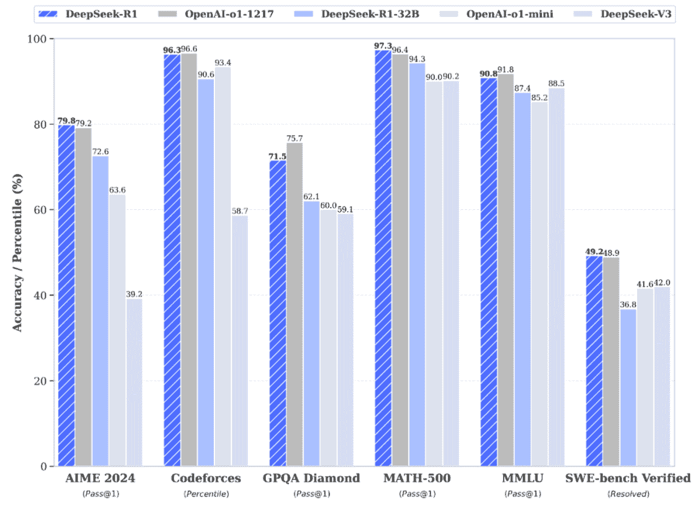

DeepSeek-V3-0324模型评分

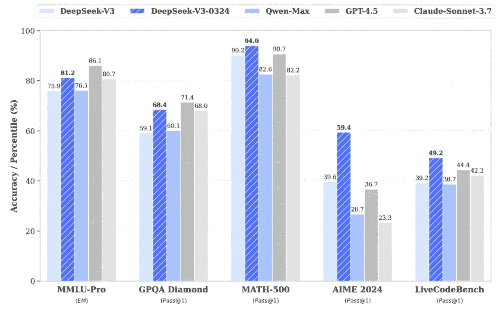

如果你也有同感，那么你可能低估了DeepSeek-V3-0324模型的真实价值。

实际上，新款**V**3模型是国内首款、也是全球最强的具备强推理性能的对话模型，而在Agent技术大爆发的今天，这款模型才是DeepSeek盛名之下第一款具备工业级Agent开发能力的基础模型，甚至我相信未来，这款模型的影响力将不输于DeepSeek-R1模型。

那么接下来，我就从技术人角度，为大家详细介绍下DeepSeek-V3-0324的模型功能特性，以及为什么说这款模型是Agent开发最佳模型。

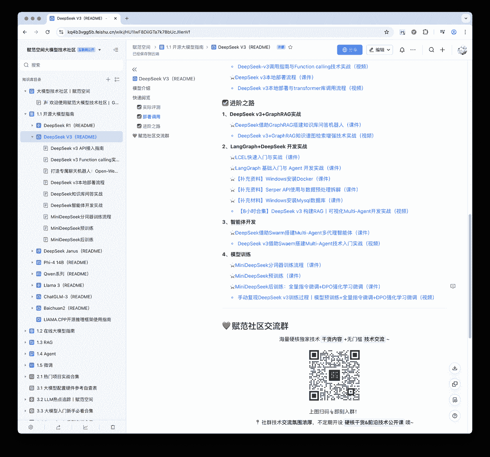

注：社区学习课件快速链接[DeepSeek V3（README）](https://kq4b3vgg5b.feishu.cn/wiki/HU1lwF8DiiGTa7k7BbUcJIIenVf?from=from_copylink)

首先我们先来看一波“热闹”，看下表面上，新模型都有哪些特性。

根据深度求索官方发布的公告，本次DeepSeek-V3-0324模型，主要在推理能力、代码能力和长文本能力三个方面有较大提升，

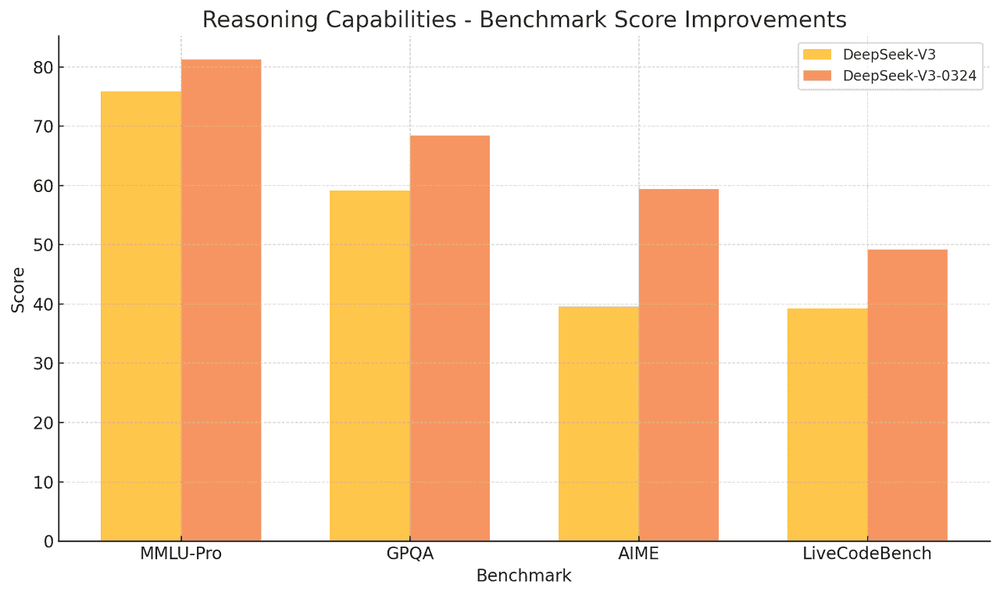

而相对比全球顶尖的对话模型、如Qwen-Max、GPT-4.5、Claude-3.7等，DeepSeek-V3-0324模型的综合性能优势也非常明显。

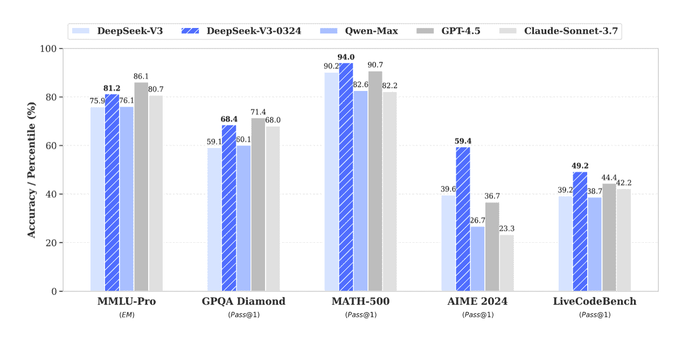

也就是说，DeepSeek仅仅一个小版本更新，就让V3模型再次问鼎全球对话模型性能排行榜。

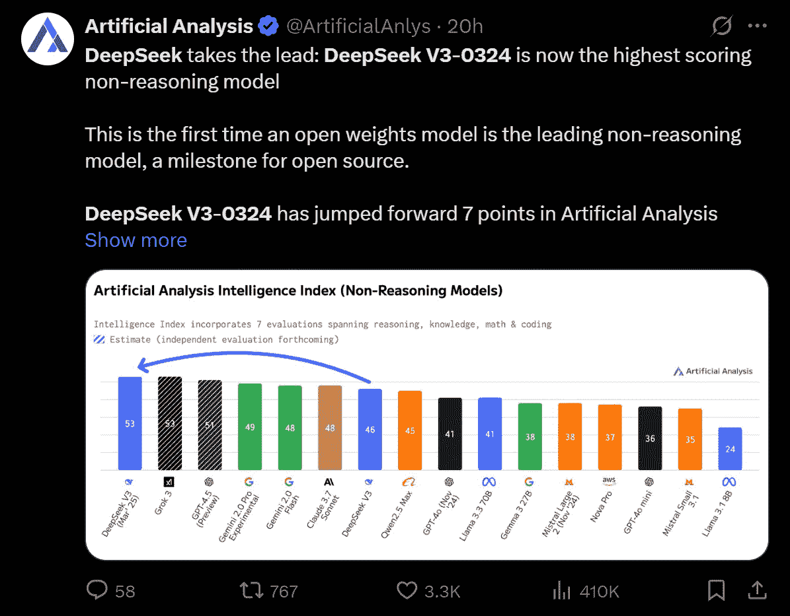

而根据官方发布的示例、以及全球开发者的测试结果来看，新模型的性能确实非常强劲。编程能力方面，新模型“玩球”的能力炉火纯青，已经能顺利模拟多个小球在一个变换的空间内来回翻滚的真实物理状态，

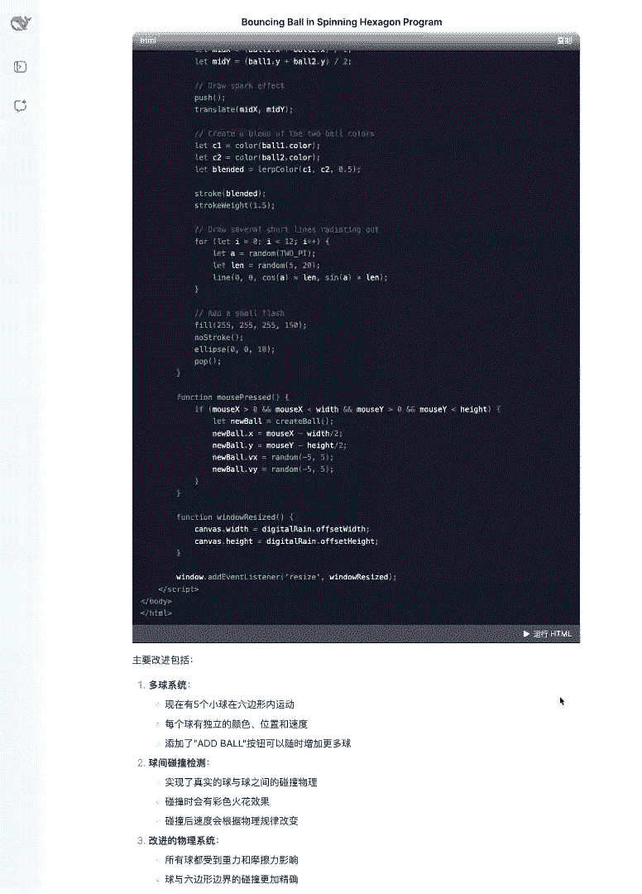

甚至仅需一句提示词，就能让模型创建数千行代码，例如创建一个布局美观并且可以流畅运行的国际象棋小游戏，要知道哪怕是Claude 3.7或者是刚刚发布的Gemini 2.5 pro，也无法达到如此程度。

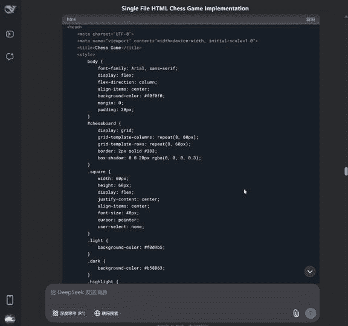

[20250326142118_rec_.mp4](https://internal-api-drive-stream.feishu.cn/space/api/box/stream/download/all/Rzr3bLvEoobN5vxThogc5mhEnDf)

此外，DeepSeek-V3-0324模型的长文本编写能力也得到大幅提高，现在无论是编写指定格式和主题的文本，

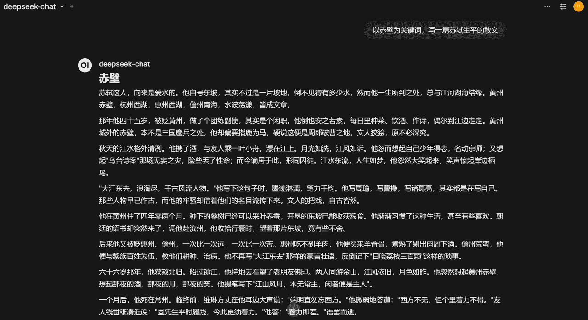

还是创建一篇爱情小说，

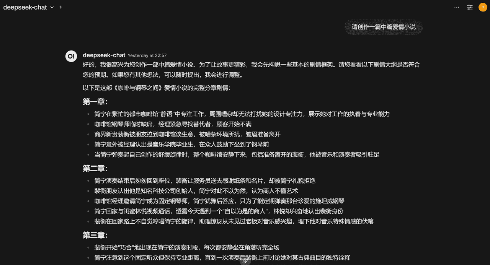

还是进行网页搜索然后创建一份市场分析报告，

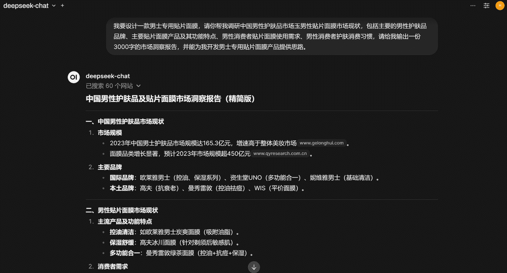

仅需一句话，模型就能帮你顺利完成。

此外，新模型的开源协议更新为MIT协议，这是一种非常宽松的协议，模型可免费部署、商用、以及进行模型蒸馏。不得不说，新版模型的实用性大幅提升。

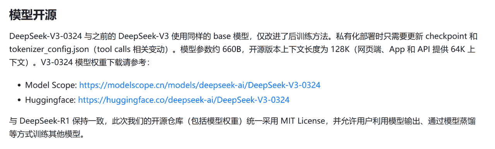

不过，这难道就是新模型的全部么？nonono，远远不止！俗话说，外行看热闹，内行看门道，接下来就让我们一起来看新模型背后的“门道”。

经过了几天的测试，我们发现，DeepSeek-V3-0324模型的最大提升，其实是Function calling能力的巨大进步！尽管这在更新公告上只有一句话，但却足以改写目前国内Agent开发的技术规范。

要知道，上一代V3模型还傻傻的连外部工具都识别不清楚，而新版V3模型，不仅调用外部工具准确率大幅提升，而且居然支持了多工具并联（parallel function calling）和串联（multi function calling）使用。

parallel function calling

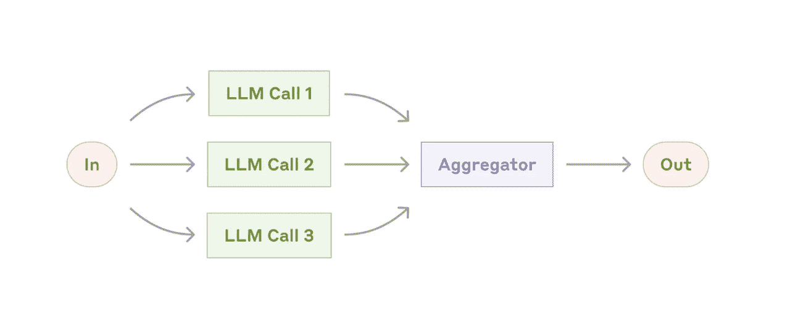

multi function calling

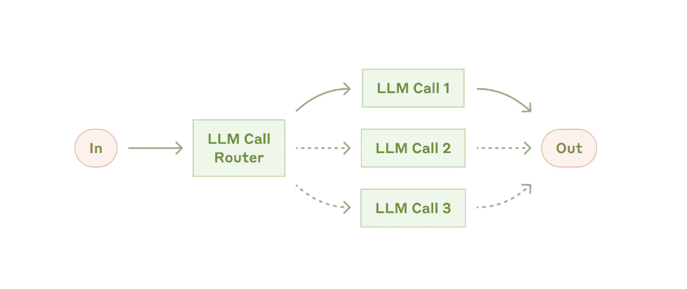

甚至还具备了外部工具调用失败后自动纠错功能。

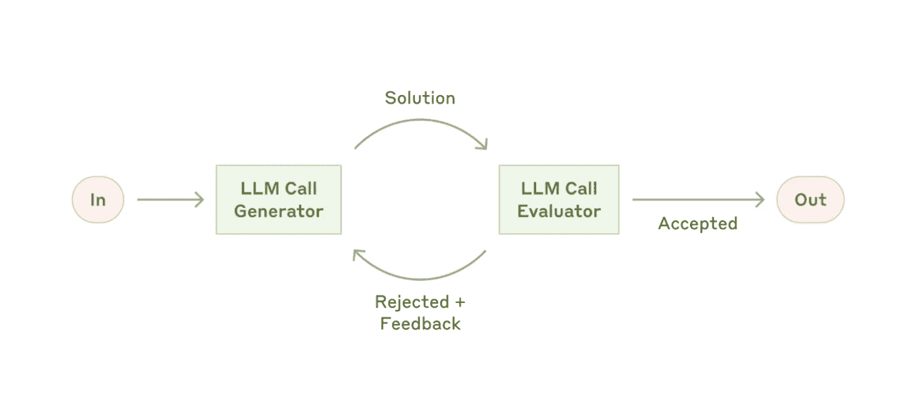

可以说，现在哪怕不依靠复杂的Agent开发工具，DeepSeek-V3-0324凭借其强大的function calling能力，就能够快速搭建智能体了。

这里我们通过一个**具体的示例来进行说明**

我们在本地环境中，给新版V3模型配置了网络搜索和编程两个外部工具，并让模型搜索北京近7天的气温，然后用Python绘制一个折线图进行展示，同时注意合理设置代码参数，以免图片展示有乱码。

接下来，请看新版V3模型的表演！

首先，V3模型判断当前任务可以并行调用两次搜索工具，分别搜索北京天气和一些绘图代码的参数设置方法，于是开启了一次工具并联，同时搜索多个问题并获得答案；

然后，根据搜索得到的结果，V3模型直接开启第二轮工具调用，借助编程工具（代码解释器）来绘制北京7天气温折线图，并试图通过设置黑体字体来避免乱码；

而当绘图结束后，V3发现还是存在字体乱码的情况，于是开始自动debug，发现是本地环境缺少了目标字体，于是考虑换个字体再次绘图；

而当第二次绘图结束后，V3发现新的字体也没安装，而自己并没有权限安装字体，于是模型输出了内容正确但标题存在乱码的图片，同时建议手动下载字体，然后重新绘图。

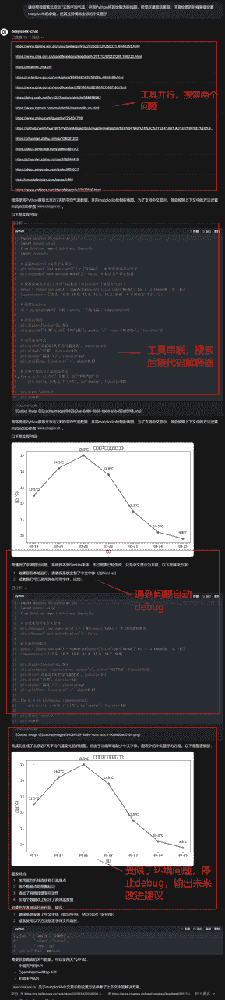

> 本部分展示形式，建议一边滚动图片，一边配合讲解，讲到哪图片就滚动到哪。

整个过程一气呵成非常流畅，完全不需要人工干预，而且速度很快。并且，最关键的是，整个过程只通过DeepSeek-V3-0324模型原生Function calling功能即可完成，无需借助其他任何Agent开发工具或者MCP协议，可以说这个效果是非常惊人的。

而通过这个示例能够看出，DeepSeek-V3-0324模型，就是国产模型中Agent能力最强的大模型没有之一，其Agent能力甚至不输GPT-4o或Claude-3.5等老牌Agent模型，并且这还是全球唯一一款顶尖Agent能力的开源大模型。不得不说，DeepSeek-V3-0324模型的发布，将从底层模型的角度，大幅加快Agent技术落地。

看**到这里，可能有小伙伴会有疑问，为什么要用V3模型进行**Agent开发，DeepSeek-R1模型不行么？很遗憾，尽管DeepSeek-R1推理和对话能力都不错，但其本身并不适合或者说根本无法进行Agent开发。原因有三：

其一：DeepSeek-R1模型就没有Function calling功能，无法调用外部工具，哪怕是通过嫁接的方法让R1模型能够间接调用外部工具，实现效果也非常不稳定，达不到工业级应用水准；

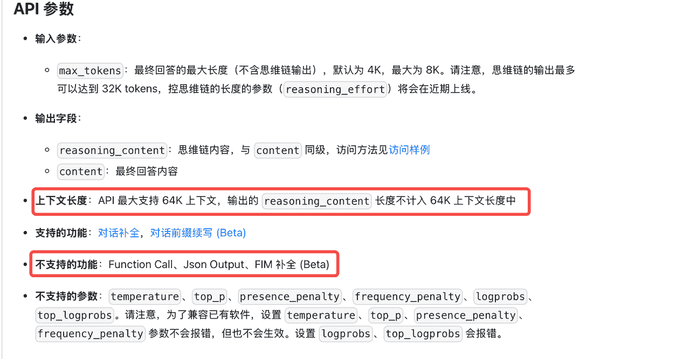

例如，刚才那个示例，用换成R1模型是无法运行的。

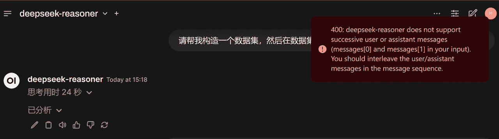

其二：DeepSeek-R1每次对话时都需要先进行复杂的思考，而Agent往往要求模型短频快的进行多次响应，这就导致借助R1构建的智能体运行效率非常低；

其三：DeepSeek-R1模型还存在一定的幻觉，会无中生有的创造一些“事实”，这对于一个需要精密复杂协作的Agent来说，会严重影响准确率。

而这也是为什么，前段时间大火的Manus，放着DeepSeek不用，偏要用Claude 3.5作为基础模型的核心原因。

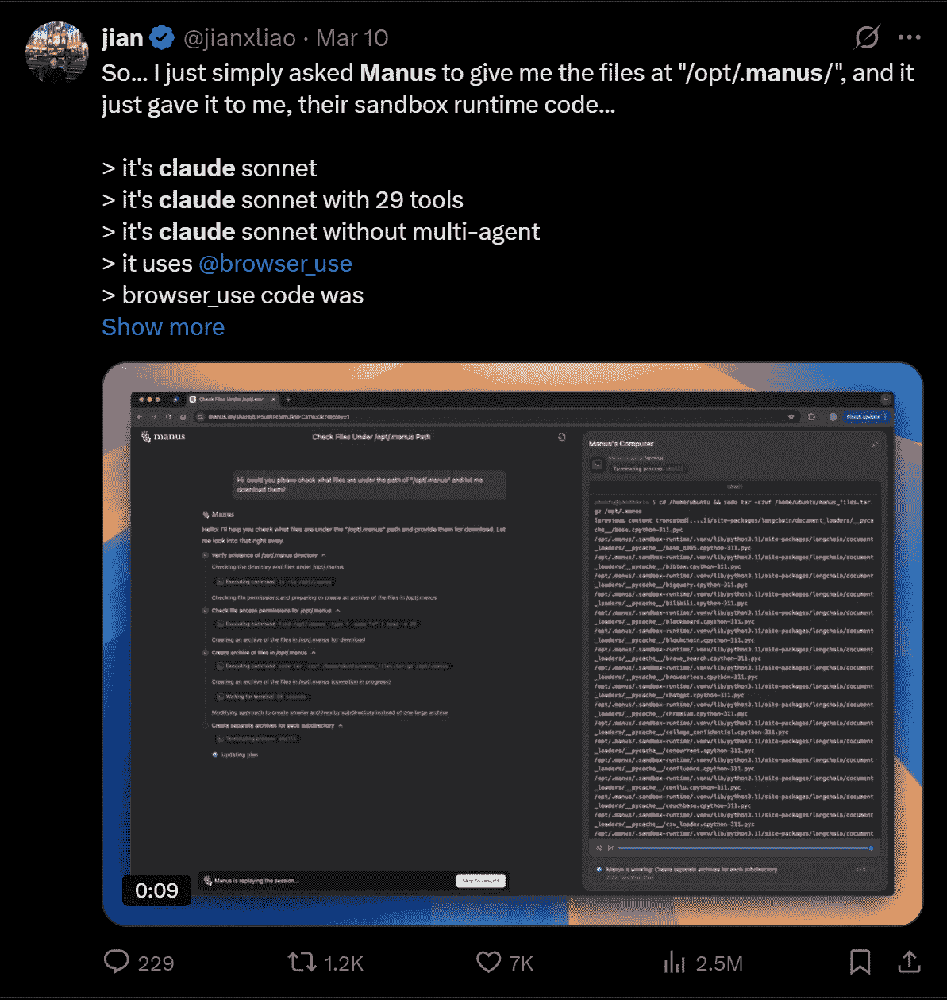

其实作为技术人，我们也深有同感，在Agent开发过程中，如果底层模型Agent性能不够，开发人员需要多写5倍甚至10倍的代码，通过大量的工程化的方法来弥补底层模型性能不足的问题。这就会导致开发者天然会更加喜欢Claude或者GPT模型这种强Agent性能的模型。

而现在，天亮了，我们终于有属于自己的强Agent性能的大模型了。看到这里，大家是不是能够更加深度的理解DeepSeek-V3-0324模型真正的技术价值了呢。

并且，得益于DeepSeek V3模型架构和R1模型架构完全一致，本地部署的R1模型可以无缝切换到V3模型，而若想进一步深入学习V3模型的Agent开发技术，也欢迎大家扫码加入大模型技术社区，我将持续为大家提供前沿技术视野和技术干货教学。

最后拓展一点，其实我们也可以从DeepSeek-V3-0324模型的更新，看到未来底层大模型技术发展方向。

其实推理模型不适合进行Agent开发，这并不是R1模型的问题，而是全部推理大模型的通病。那如何解决这个问题呢，业内一致判断的最佳方案，就是希望将两种模型的能力合并，打造兼具推理性能和Agent开发性能的全新形态大模型。

其中，Anthropic动作最快，在2月底重磅发布了Claude-3.7，这是全球首款混合推理大模型，可以通过参数设置在推理形态和对话形态中来回切换，一个模型、两种用法，从而更加灵活的满足用户的各类需求。

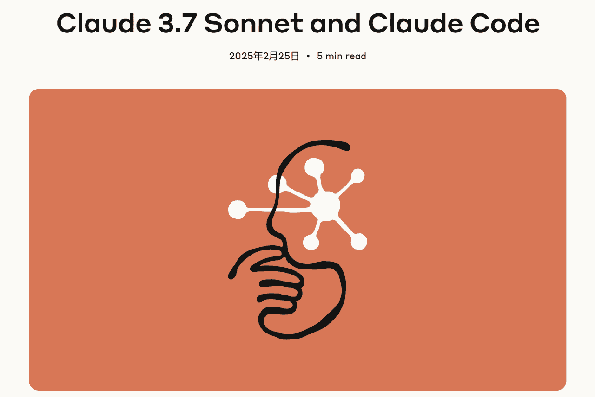

> Claude 3.7发布公告：https://www.anthropic.com/news/claude-3-7-sonnet

而OpenAI则是计划在GPT-5中实现两类模型功能的合并，尽管不确定是否会采用类似Claude 3.7这种混合推理模式，但根据官方公告，GPT4.5将会是最后一代对话模型，而o3也将是最后一代推理模型，新形态模型呼之欲出。

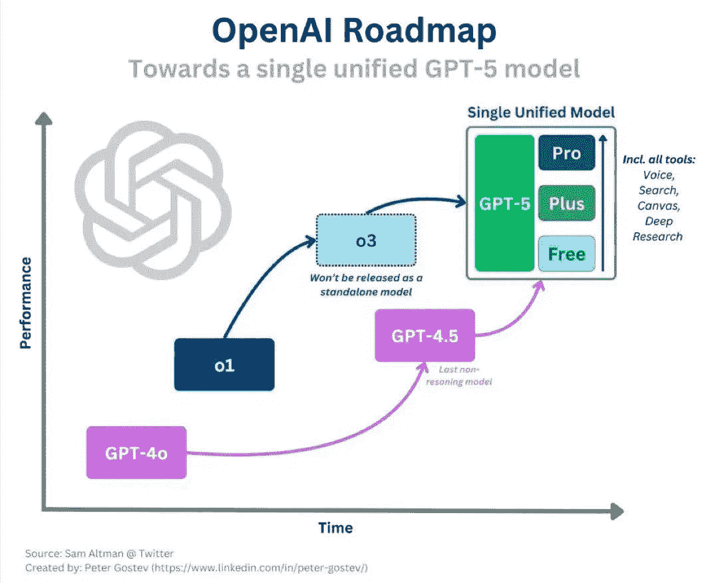

而现在DeepSeek，则给出了一条新的技术路径，那就是借助推理模型创造大量的高质量合成推理数据，然后对对话模型进行后训练，从而大幅提高对话模型推理能力和Agent能力，最终完成两类模型的合并。而现在V3-0324就是一次非常重要的尝试。

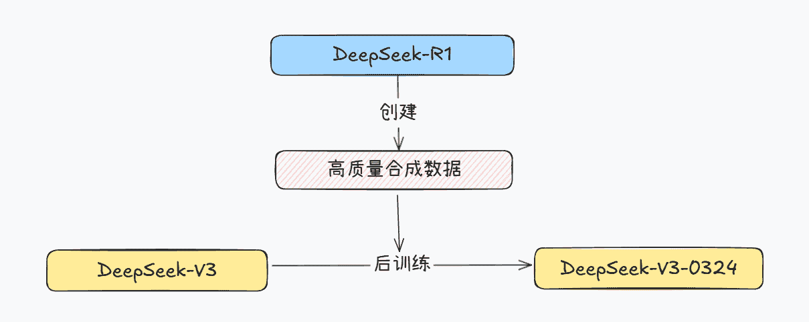

好了，以上就是本期全部内容。我是九天，如果觉得有用，记得点赞支持哦！此外，也欢迎大家扫码加入赋范大模型技术社区参与学习，大模型技术爆发式增长，我将持续为大家提供前沿技术视野和技术干货教学，我们下期内容，再见！

