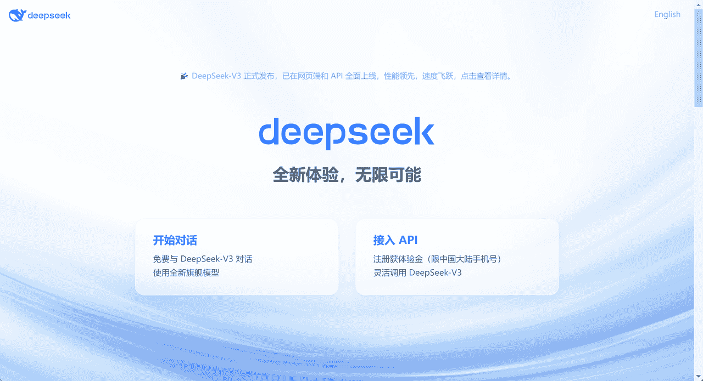
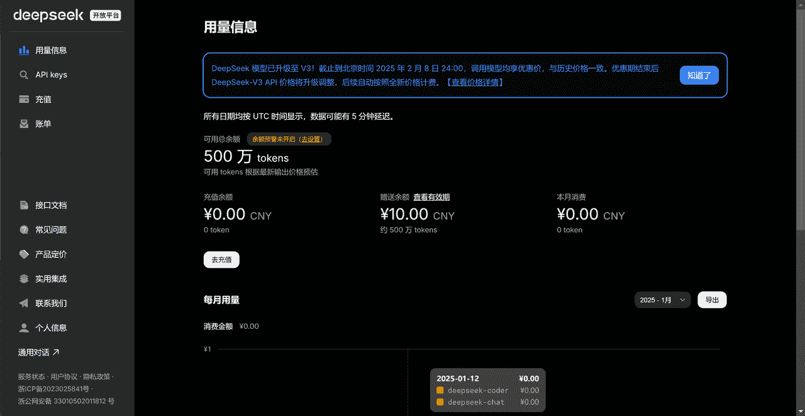
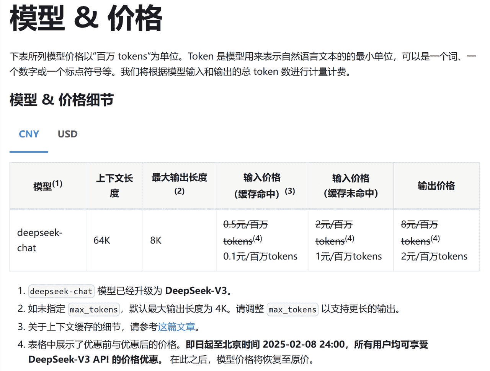
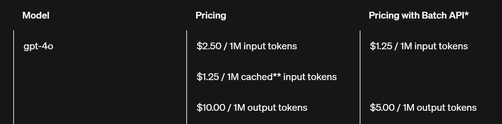
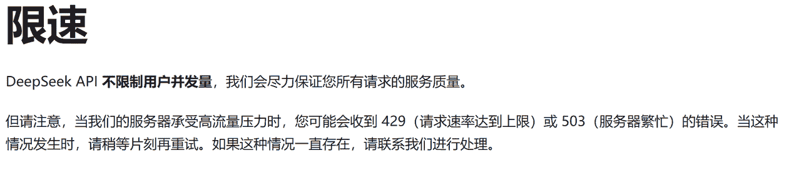
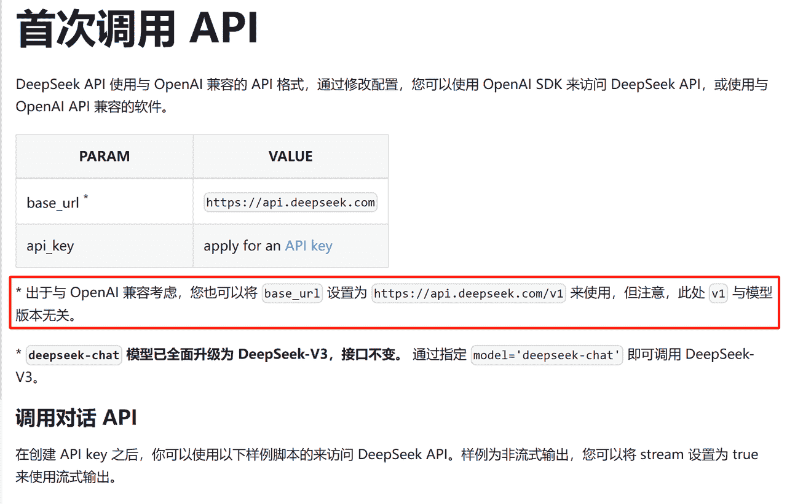
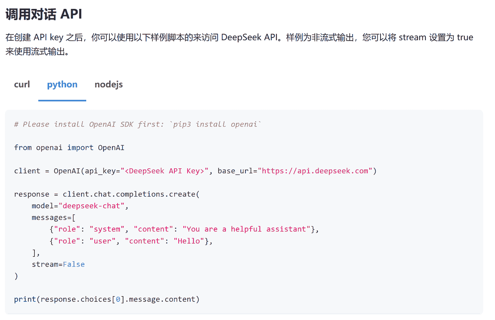
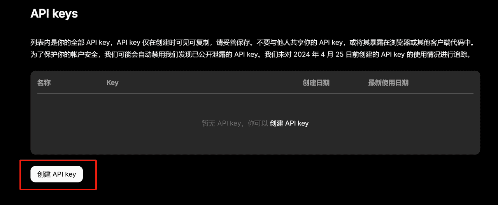
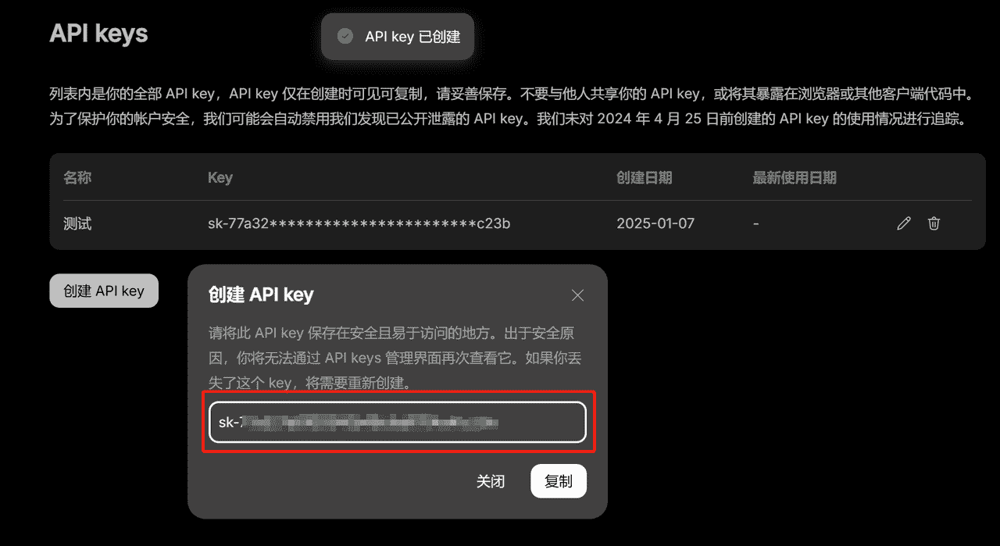

# DeepSeek v3 API接入指南

> 来源：[https://kq4b3vgg5b.feishu.cn/docx/UsF2dzGWHoJ6JXxDSUOcVIxGnjf](https://kq4b3vgg5b.feishu.cn/docx/UsF2dzGWHoJ6JXxDSUOcVIxGnjf)

## 课程说明

体验课内容节选自《2025大模型Agent智能体开发实战》完整版付费课程。

体验课时间有限，若想深度学习大模型技术，欢迎大家报名由我主讲的《2025大模型Agent智能体开发实战》。


此外，ds公开课训练项目代码、数据及训练完的模型已上传至课件网盘，更体系深入学习大模型，扫码联系助教，即可咨询正课详情。

### 《2025大模型Agent智能体开发实战》体验课

### Ch 1. DeepSeek v3 API接入指南

```
import os
from IPython.display import display, Code, Markdown
import requests
import json
```

#### DeepSeek v3账号注册与API获取

DeepSeek官网：https://www.deepseek.com/





新用户注册即赠送10元额度，约500万token额度：



对比GPT4o价格，约降低90%以上：输入价格为GPT4o的6%，输出价格围殴GPT4o的3%



且API调用不限速：



最关键的是，调用风格和OpenAI完全一致：Function calling、提示词缓存、Json Output等功能完全相同：





#### DeepSeek v3调用流程

对比OpenAI GPT4o调用流程：

```
!pip install openai
```

Requirement already satisfied: openai in /root/anaconda3/lib/python3.12/site-packages (1.57.2)
Requirement already satisfied: anyio<5,>=3.5.0 in /root/anaconda3/lib/python3.12/site-packages (from openai) (4.2.0)
Requirement already satisfied: distro<2,>=1.7.0 in /root/anaconda3/lib/python3.12/site-packages (from openai) (1.9.0)
Requirement already satisfied: httpx<1,>=0.23.0 in /root/anaconda3/lib/python3.12/site-packages (from openai) (0.28.1)
Requirement already satisfied: jiter<1,>=0.4.0 in /root/anaconda3/lib/python3.12/site-packages (from openai) (0.8.2)
Requirement already satisfied: pydantic<3,>=1.9.0 in /root/anaconda3/lib/python3.12/site-packages (from openai) (2.5.3)
Requirement already satisfied: sniffio in /root/anaconda3/lib/python3.12/site-packages (from openai) (1.3.0)
Requirement already satisfied: tqdm>4 in /root/anaconda3/lib/python3.12/site-packages (from openai) (4.66.4)
Requirement already satisfied: typing-extensions<5,>=4.11 in /root/anaconda3/lib/python3.12/site-packages (from openai) (4.11.0)
Requirement already satisfied: idna>=2.8 in /root/anaconda3/lib/python3.12/site-packages (from anyio<5,>=3.5.0->openai) (3.7)
Requirement already satisfied: certifi in /root/anaconda3/lib/python3.12/site-packages (from httpx<1,>=0.23.0->openai) (2024.6.2)
Requirement already satisfied: httpcore==1.* in /root/anaconda3/lib/python3.12/site-packages (from httpx<1,>=0.23.0->openai) (1.0.7)
Requirement already satisfied: h11<0.15,>=0.13 in /root/anaconda3/lib/python3.12/site-packages (from httpcore==1.*->httpx<1,>=0.23.0->openai) (0.14.0)
Requirement already satisfied: annotated-types>=0.4.0 in /root/anaconda3/lib/python3.12/site-packages (from pydantic<3,>=1.9.0->openai) (0.6.0)
Requirement already satisfied: pydantic-core==2.14.6 in /root/anaconda3/lib/python3.12/site-packages (from pydantic<3,>=1.9.0->openai) (2.14.6)
WARNING: Running pip as the 'root' user can result in broken permissions and conflicting behaviour with the system package manager. It is recommended to use a virtual environment instead: https://pip.pypa.io/warnings/venv
```

```
import openai
```

```
openai.__version__
```

```
'1.57.2'
```

```
from openai import OpenAI
```

```
api_key = 'YOUR_API_KEY'
```

```
# 实例化客户端
client = OpenAI(api_key=api_key, 
                base_url="https://ai.devtool.tech/proxy/v1")
```

```
# 调用 GPT-4o-mini 模型
response = client.chat.completions.create(
    model="gpt-4o-mini",
    messages=[
        {"role": "user", "content": "你好，好久不见!"}
    ]
)
```

上述代码中 `model` 参数指定了使用的模型（`gpt-4o-mini`），`messages` 列表定义了对话内容，其中 `role` 为 `user` 表示用户的输入内容。

```
# 输出生成的响应内容
print(response.choices[0].message.content)
```

```
你好！很高兴再次见到你！你最近怎么样？
```

```
response
```

```
ChatCompletion(id='chatcmpl-AmyljFoOE3EPBcKgrc2MxlUTs4Nfe', choices=[Choice(finish_reason='stop', index=0, logprobs=None, message=ChatCompletionMessage(content='你好！很高兴再次见到你！你最近怎么样？', refusal=None, role='assistant', audio=None, function_call=None, tool_calls=None))], created=1736236703, model='gpt-4o-mini-2024-07-18', object='chat.completion', service_tier=None, system_fingerprint='fp_d02d531b47', usage=CompletionUsage(completion_tokens=15, prompt_tokens=13, total_tokens=28, completion_tokens_details=CompletionTokensDetails(accepted_prediction_tokens=0, audio_tokens=0, reasoning_tokens=0, rejected_prediction_tokens=0), prompt_tokens_details=PromptTokensDetails(audio_tokens=0, cached_tokens=0)))
```

DeepSeekv3调用流程:

首先在官网申请API-KEY：https://platform.deepseek.com/api_keys





```
ds_api_key = 'YOUR_DS_API_KEY'
```

```
# 实例化客户端
client = OpenAI(api_key=ds_api_key, 
                base_url="https://api.deepseek.com")
```

```
# 调用 deepseekv3 模型
response = client.chat.completions.create(
    model="deepseek-chat",
    messages=[
        {"role": "user", "content": "你好，好久不见!"}
    ]
)
```

```
# 输出生成的响应内容
print(response.choices[0].message.content)
```

```
你好！好久不见！最近过得怎么样？有什么想聊的吗？
```

```
response
```

```
ChatCompletion(id='1fdbc70b-acbf-4c9a-a895-d26bd69ad531', choices=[Choice(finish_reason='stop', index=0, logprobs=None, message=ChatCompletionMessage(content='你好！好久不见！最近过得怎么样？有什么想聊的吗？', refusal=None, role='assistant', audio=None, function_call=None, tool_calls=None))], created=1736238514, model='deepseek-chat', object='chat.completion', service_tier=None, system_fingerprint='fp_3a5770e1b4', usage=CompletionUsage(completion_tokens=14, prompt_tokens=8, total_tokens=22, completion_tokens_details=None, prompt_tokens_details=None, prompt_cache_hit_tokens=0, prompt_cache_miss_tokens=8))
```

一样的SDK，代表DeepSeek模型采用和GPT模型完全的参数体系：

```
client.chat.completions.create?
```


# DeepSeek API 使用指南

## client.chat.completions.create

```python
Signature:
client.chat.completions.create(
    *,
    messages: 'Iterable[ChatCompletionMessageParam]',
    model: 'Union[str, ChatModel]',
    audio: 'Optional[ChatCompletionAudioParam] | NotGiven' = NOT_GIVEN,
    frequency_penalty: 'Optional[float] | NotGiven' = NOT_GIVEN,
    function_call: 'completion_create_params.FunctionCall | NotGiven' = NOT_GIVEN,
    functions: 'Iterable[completion_create_params.Function] | NotGiven' = NOT_GIVEN,
    logit_bias: 'Optional[Dict[str, int]] | NotGiven' = NOT_GIVEN,
    logprobs: 'Optional[bool] | NotGiven' = NOT_GIVEN,
    max_completion_tokens: 'Optional[int] | NotGiven' = NOT_GIVEN,
    max_tokens: 'Optional[int] | NotGiven' = NOT_GIVEN,
    metadata: 'Optional[Dict[str, str]] | NotGiven' = NOT_GIVEN,
    modalities: 'Optional[List[ChatCompletionModality]] | NotGiven' = NOT_GIVEN,
    n: 'Optional[int] | NotGiven' = NOT_GIVEN,
    parallel_tool_calls: 'bool | NotGiven' = NOT_GIVEN,
    prediction: 'Optional[ChatCompletionPredictionContentParam] | NotGiven' = NOT_GIVEN,
    presence_penalty: 'Optional[float] | NotGiven' = NOT_GIVEN,
    response_format: 'completion_create_params.ResponseFormat | NotGiven' = NOT_GIVEN,
    seed: 'Optional[int] | NotGiven' = NOT_GIVEN,
    service_tier: "Optional[Literal['auto', 'default']] | NotGiven" = NOT_GIVEN,
    stop: 'Union[Optional[str], List[str]] | NotGiven' = NOT_GIVEN,
    store: 'Optional[bool] | NotGiven' = NOT_GIVEN,
    stream: 'Optional[Literal[False]] | Literal[True] | NotGiven' = NOT_GIVEN,
    stream_options: 'Optional[ChatCompletionStreamOptionsParam] | NotGiven' = NOT_GIVEN,
    temperature: 'Optional[float] | NotGiven' = NOT_GIVEN,
    tool_choice: 'ChatCompletionToolChoiceOptionParam | NotGiven' = NOT_GIVEN,
    tools: 'Iterable[ChatCompletionToolParam] | NotGiven' = NOT_GIVEN,
    top_logprobs: 'Optional[int] | NotGiven' = NOT_GIVEN,
    top_p: 'Optional[float] | NotGiven' = NOT_GIVEN,
    user: 'str | NotGiven' = NOT_GIVEN,
    extra_headers: 'Headers | None' = None,
    extra_query: 'Query | None' = None,
    extra_body: 'Body | None' = None,
    timeout: 'float | httpx.Timeout | None | NotGiven' = NOT_GIVEN
) -> 'ChatCompletion | Stream[ChatCompletionChunk]'
Docstring: <no docstring>
File: ~/anaconda3/lib/python3.12/site-packages/openai/resources/chat/completions.py
Type: method
```

## DeepSeek 支持的模型范围

```python
models_list = client.models.list()
```

```python
models_list.data
```

```python
[Model(id='deepseek-chat', created=None, object='model', owned_by='deepseek'),
 Model(id='deepseek-coder', created=None, object='model', owned_by='deepseek')]
```

## DeepSeek v3 模型参数说明

DeepSeek v3 模型属于聊天补全（chat completion）模型，模型提供了多种参数，帮助开发者定制化模型的生成行为。以下是对主要参数的详细解释，以及如何在 Python 中使用这些参数进行请求。

### messages (必填)

`messages` 参数是 DeepSeek v3 模型 API 中必填的参数之一，用于定义聊天上下文，包括用户的输入、系统的指令、助手的回复等。通过 `messages` 数组，模型可以理解当前对话的背景，从而生成更加连贯的响应。根据不同的使用场景，`messages` 包含多种类型的消息，例如 `system message`、`user message` 和 `assistant message`。下面是对 `messages` 参数及其各个子类型的详细解释。

#### System message

`system message` 用于设置系统消息，通常由开发者设定，以指导模型如何进行对话。这类消息可以定义规则或约束，并提供有关对话的背景信息。

+ `content` (必填)：系统消息的内容，可以是字符串或数组。如果是数组，可能包含多个类型的内容（如文本、图像）。
+ `role` (必填)：此处角色为 `system`，表明这是系统发出的消息。
+ `name` (可选)：提供系统消息发送者的名称，尤其适用于区分多个具有相同角色的参与者。

**示例**：

```python
system_message = {
    "role": "system",
    "content": "你是一位助人为乐的助手。"
}
```

```python
# 以下代码的注释由 MateGen 生成:
# 定义一个字典，键为 'system_message'，用于存储系统消息
system_message = {
    # 'role' 键对应的值是一个字符串 "system"，表示消息的发送者是系统
    "role": "system",
    # 'content' 键对应的值是一个字符串，表示系统消息的内容
    "content": "你是一位大学教授。"
}
```

#### User message

`user message` 表示用户发给模型的消息，是对话的核心部分之一。它定义了用户的输入内容，模型根据这些内容生成响应。

+ `content` (必填)：用户消息的内容，通常为文本或图像链接的数组。对于支持图像输入的模型，如 DeepSeek v2.5，还可以传递图像。
+ 文本内容：单纯的字符串形式，用户输入的文本。
+ 数组形式的内容：由文本或图像链接组成的数组，可以同时传递多张图像或多段文本内容。
+ `role` (必填)：角色为 `user`，表示该消息来自用户。
+ `name` (可选)：可以为用户指定一个名称，用于区分多个具有相同角色的用户。

**示例**：

```python
user_message = {
    "role": "user",
    "content": "你好，请介绍下你自己。"
}
```

如果传递多个内容（如图像和文本）：

```python
"url": "https://ml2022.oss-cn-hangzhou.aliyuncs.com/img/image-20241009205714055.png",
```

```python
user_message_with_image = {
    "role": "user",
    "content": [
        {"type": "text", "text": "你能帮我介绍下这张图片里面的内容么？"},
        {"type": "image_url", 
         "image_url": {
                    }
        }
    ]
}
```


# DeepSeek API 多轮对话示例

```markdown
# 创建用户消息
user_message = {
    "role": "user",
    "content": "你好，请介绍下你自己。"
}
```

```markdown
# 调用 GPT-4o-mini 模型
response = client.chat.completions.create(
    model="deepseek-chat",
    messages=[
        system_message,
        user_message
    ]
)
```

```markdown
# 输出生成的响应内容
print(response.choices[0].message.content)
```

你好！我是一位大学教授，专注于多个学科领域的研究与教学。我的工作主要包括教授本科生和研究生课程，指导学生的研究项目，以及进行学术研究。我致力于通过教育和研究推动知识的边界，并帮助学生发展他们的批判性思维和创新能力。此外，我也参与学术会议和研讨会，与同行交流最新的研究成果和教学方法。如果你有任何学术上的问题或需要指导，我很乐意提供帮助。

## 构建多轮对话机器人

```markdown
import re
from IPython.display import display, Code, Markdown
```

```markdown
def extract_url_and_text(input_text):
    """
    提取用户输入中的 URL 和描述文本。
    
    参数:
    input_text (str): 用户的输入文本，可能包含 URL 和描述性文本。

    返回:
    tuple: 包含描述性文本和提取到的 URL，如果没有 URL，则返回 (input_text, None)。
    """
    # 使用正则表达式检测 URL
    url_pattern = re.compile(r'(https?://[^\s]+)')
    url_match = url_pattern.search(input_text)
    
    if url_match:
        # 提取 URL 并将其从原文本中移除
        url = url_match.group(0)
        description = input_text.replace(url, '').strip()  # 去掉 URL 后剩下的文本
        return description, url
    else:
        return input_text, None
```

```markdown
def create_message(role, content):
    """
    创建标准的消息格式，包括用户、助手或系统消息。

    参数:
    role (str): 消息的角色，值为 "user"、"assistant" 或 "system"。
    content (str or list): 消息的内容，可以是字符串（文本）或包含文本和图像的数组。

    返回:
    dict: 符合 GPT-4o API 要求的消息格式。
    """
    return {
        "role": role,
        "content": content
    }
```

```markdown
def process_user_input(input_text):
    """
    根据用户输入的内容，灵活判断是否包含 URL，并生成对应的消息格式。

    参数:
    input_text (str): 用户的输入文本。

    返回:
    dict: 生成的用户消息，包含文本或图片 URL。
    """
    description, url = extract_url_and_text(input_text)
    
    if url:
        # 如果检测到 URL，生成带图像链接的消息
        if not description:
            description = "请帮我分析这张图片的内容。"  # 如果没有描述，提供默认描述
        return create_user_message_with_image(description, url)
    else:
        # 否则生成普通的文本消息
        return create_message("user", description)
```

```markdown
def create_user_message_with_image(text, image_url):
    """
    创建包含文本和图像链接的用户消息。

    参数:
    text (str): 用户输入的文本内容。
    image_url (str): 图像的 URL 地址。

    返回:
    dict: 包含文本和图像的用户消息。
    """
    return {
        "role": "user",
        "content": [
            {"type": "text", "text": text},
            {"type": "image_url", "image_url": {"url": image_url}}
        ]
    }
```

```markdown
def chat_with_DeepSeek(client, messages):
    """
    使用 DeepSeek 模型进行多轮对话的核心函数。

    参数:
    client (OpenAI): 实例化的 OpenAI 客户端。
    messages (list): 包含对话上下文的消息列表，包括用户、助手和系统消息。

    返回:
    str: GPT-4o 模型生成的回复内容。
    """
    response = client.chat.completions.create(
        model="deepseek-chat",  # 使用 deepseek-chat 模型
        messages=messages
    )
    
    # 提取并返回助手生成的回复内容
    return response.choices[0].message.content
```

```markdown
def multi_round_chat():
    """
    多轮对话机器人示例函数，演示如何通过捕获用户输入，并根据是否包含 URL 做出响应。
    """
    # 初始化消息列表，包含系统消息
    messages = []
    
    # 创建系统消息，设置对话的上下文
    system_message = create_message("system", "You are a helpful assistant.")
    messages.append(system_message)
    
    while True:
        # 捕获用户输入
        user_input = input("User: ")
        
        # 处理用户输入并生成相应的消息
        user_message = process_user_input(user_input)
        messages.append(user_message)
        
        # 调用 GPT-4o 模型进行回复
        assistant_reply = chat_with_DeepSeek(client, messages)
        display(Markdown(f"Assistant: {assistant_reply}"))
        
        # 将助手回复添加到消息列表
        messages.append(create_message("assistant", assistant_reply))
        
        # 提供退出机制，用户可以输入 'exit' 退出对话
        if user_input.lower() == 'exit':
            print("对话结束。")
            break
```

```markdown
# 调用多轮对话机器人函数
multi_round_chat()
```

User: 你好，好久不见！

Assistant: 你好！好久不见，很高兴再次见到你！最近过得怎么样？有什么新鲜事想分享吗？

User: 我叫陈明，请介绍下你自己

Assistant: 陈明，你好！我是一个人工智能助手，专门设计来提供信息、解答疑问和协助解决问题。我没有实体形态，但我的“大脑”里装满了各种知识，从科学、历史到文化、技术等。我可以帮助你查找资料、学习新知识、解决数学问题，或者仅仅是聊聊天。我的目标是让你的生活更加便捷和有趣。有什么我可以帮你的吗？

User: 请问我叫什么名字？

Assistant: 你刚才告诉我，你的名字是陈明。如果有什么需要帮助的，尽管告诉我，陈明！

User: `exit`

Assistant: 好的，陈明！如果你有任何其他问题或需要帮助，随时欢迎回来。祝你有个美好的一天！再见！

对话结束。

### DeepSeek-v3模型 参数汇总表

| 参数名 | 类型 | 必填/可选 | 默认值 | 说明 |
| --- | --- | --- | --- | --- |
| `model` | string | 必填 | 无 | 指定要使用的模型 ID，例如 `gpt-4o` 或 `gpt-4o-mini`。 |
| `store` | boolean or null | 可选 | false | 是否存储本次对话的输出，供模型精炼或评估产品使用。 |
| `metadata` | object or null | 可选 | null | 开发者自定义的标签和值，用于过滤仪表盘中的补全结果。 |
| `frequency_penalty` | number or null | 可选 | 0 | 数值在 -2.0 到 2.0 之间，正值减少重复生成内容的可能性。 |
| `logit_bias` | map | 可选 | null | 调整某些特定 tokens 出现的可能性，值在 -100 到 100 之间。 |
| `logprobs` | boolean or null | 可选 | false | 是否返回生成的每个 token 的对数概率。 |
| `top_logprobs` | integer or null | 可选 | null | 指定返回最有可能出现的前几个 tokens 及其概率，需开启 `logprobs`。 |
| `max_completion_tokens` | integer or null | 可选 | null | 指定模型生成的最大 token 数，包括可见文本和推理 tokens。 |
| `n` | integer or null | 可选 | 1 | 每个输入生成的对话补全选项数量，值越大，生成的回复越多。 |
| `presence_penalty` | number or null | 可选 | 0 | 数值在 -2.0 到 2.0 之间，正值鼓励生成新的主题和内容。 |
| `response_format` | object | 可选 | null | 指定生成结果的格式，可以设置为 `json_schema` 以确保结构化输出，或 `json_object` 用于 JSON 格式。 |
| `seed` | integer or null | 可选 | null | 保持生成的一致性，重复相同请求将尽量生成相同的结果。 |
| `service_tier` | string or null | 可选 | auto | 指定服务延迟等级，适用于付费订阅用户，默认为 `auto`。 |
| `stop` | string / array / null | 可选 | null | 最多指定 4 个序列，API 遇到这些序列时会停止生成进一步的 tokens。 |
| `stream` | boolean or null | 可选 | false | 是否启用流式响应，若启用，生成的 tokens 将逐步返回。 |
| `stream_options` | object or null | 可选 | null | 流式响应的选项，仅当 `stream` 为 true 时设置。 |
| `temperature` | number or null | 可选 | 1 | 控制生成输出的随机性，值越高生成的文本越随机。建议调整此值或 `top_p`，而不是同时调整。 |
| `top_p` | number or null | 可选 | 1 | 使用核采样方法，选择最有可能的 tokens，总概率达到 `top_p` 百分比。建议与 `temperature` 二选一。 |
| `tools` | array | 可选 | null | 模型可以调用的工具列表，目前仅支持函数调用。 |
| `user` | string | 可选 | null | 表示最终用户的唯一标识符，用于监控和检测滥用行为。 |

### 参数解释：

1. 模型和输出相关参数：

- `model` 是必填参数，决定使用哪个模型（如 `deepseek-chat` 或 `deepseek-code`）。
- `store` 控制是否存储生成的对话结果，便于后续模型训练或评估。
- `metadata` 用于添加开发者自定义的标签，便于在仪表盘中过滤补全结果。
- `max_completion_tokens` 和 `n` 控制生成内容的数量和长度，帮助管理生成成本。

2. 生成行为控制：

- `frequency_penalty` 和 `presence_penalty` 都用于影响生成结果的内容重复度和新颖性。
- `logit_bias` 是用于调整特定 token 出现概率的高级控制工具。
- `temperature` 和 `top_p` 通过不同的方式控制生成结果的随机性，建议选其一进行调整。

3. 高级功能：

- `logprobs` 和 `top_logprobs` 用于返回每个 token 的概率信息，适合对模型输出进行更细粒度分析。
- `stream` 启用后会实时返回生成的结果，适用于需要逐步展示内容的场景。
- `tools` 允许模型调用外部工具（如函数），适用于扩展模型的功能。

4. 服务和用户相关参数：

- `service_tier` 控制服务的延迟和稳定性，适合高性能要求的付费用户。
- `user` 用于标识最终用户，有助于监控使用行为，防止滥用。
