# 打造专属聊天机器人：Open-WebUI接入DeepSeek v3流程详解

> 来源：[https://kq4b3vgg5b.feishu.cn/docx/JotYdXKssojqyAxcx2gczyuFndg](https://kq4b3vgg5b.feishu.cn/docx/JotYdXKssojqyAxcx2gczyuFndg)

# 课程说明：

+   体验课内容节选自《2025大模型Agent智能体开发实战》完整版付费课程

体验课时间有限，若想深度学习大模型技术，欢迎大家报名由我主讲的《2025大模型Agent智能体开发实战》：

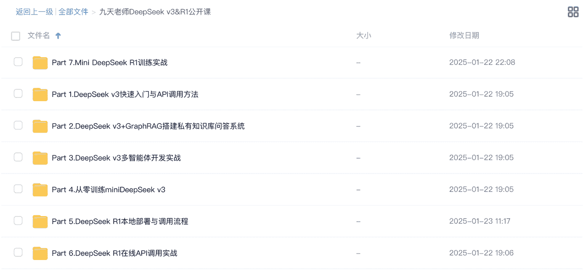


此外，公开课训练项目代码、数据、**及训练完的模型，已上传至课件****网盘，联系****⬆**️助教回复“DS网盘”，即可领取（目前**咨**询人数较多，助教老师在加急一一回复啦，小伙伴们发送后耐心等待一下哦🌹～）。

---

## 《2025大模型Agent智能体开发实战》体验课

## Ch 3.打造专属聊天机器人：Open-WebUI接入DeepSeek v3流程详解

#### Open WebUI项目介绍

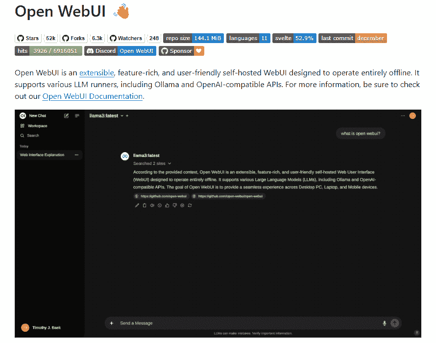

> Open-webui Github : https://github.com/open-webui/open-webui

🚀 轻**松安装：**通过 Docker 或 Kubernetes（kubectl、kustomize 或 helm）实现无缝安装，支持 :ollama 和 :cuda 标签镜像，带来无忧体验。

🤝 Ollama/OpenAI API 集成：轻松集成与 OpenAI 兼容的 API，支持与 Ollama 模型的多样化对话。自定义 OpenAI API URL，可与 LMStudio、GroqCloud、Mistral、OpenRouter 等平台对接。

🛡️ 细**粒度权限和用户组：**管理员可以创建详细的用户角色和权限，确保用户环境的安全性。这种细粒度管理不仅增强了安全性，还允许定制化的用户体验，培养用户的责任感与归属感。

📱 响**应式设计：**在桌面PC、笔记本和移动设备上都能享受无缝的使用体验。

✒️🔢 完整的 Markdown 和 LaTeX 支持：通过全面的 Markdown 和 LaTeX 支持，提升 LLM（大语言模型）体验，让交互更为丰富。

🎤📹 免提**语音/视频通话：享**受无缝的语音和视频通话功能，提供更为动态和互动的聊天环境。

🛠️ 模**型构建器：**通过 Web UI 轻松创建 Ollama 模型。创建并添加自定义角色/代理，定制聊天元素，并通过 Open WebUI 社区集成轻松导入模型。

🐍 原生 Python 函数调用工具：通过内置代码编辑器支持，增强 LLM 功能。通过“Bring Your Own Function” (BYOF) 轻松集成自己的 Python 函数，与 LLM 无缝对接。

📚 本**地 RAG 集成：**体验未来的聊天互动，开创性的检索增强生成（RAG）支持，让文档互动无缝融入聊天体验。您可以直接将文档加载到聊天中，或通过 # 命令将文件添加到文档库，方便在查询时访问。

🔍 W**eb 搜索集成 RAG：**通过 SearXNG、Google PSE、Brave Search、serpstack、serper、Serply、DuckDuckGo、TavilySearch、SearchApi 和 Bing 等搜索引擎提供商执行 Web 搜索，并将结果直接注入到您的聊天体验中。

🌐 W**eb 浏览功能：**通过 # 命令加 URL，无缝集成网站内容到聊天体验中，增强互动的丰富性和深度。

🎨 图**像生成集成：**通过 AUTOMATIC1111 API 或 ComfyUI（本地）以及 OpenAI 的 DALL-E（外部）等选项，轻松集成图像生成功能，为聊天体验增添动态视觉内容。

⚙️ **多模型对话**：轻松与多种模型同时互动，利用各自的优势提供最优回应。通过并行利用多种模型，提升聊天效果。

🔐 基**于角色的访问控制（RBAC）：**确保安全的访问控制，只有授权用户才能访问 Ollama，模型创建/拉取权限仅限管理员。

🌐🌍 多语**言支持：体**验您喜欢的语言版本的 Open WebUI，我们提供国际化（i18n）支持，积极拓展更多语言！欢迎加入我们成为贡献者！

🧩 管道与 Open WebUI 插件支持：通过管道插件框架，无缝集成自定义逻辑和 Python 库到 Open WebUI。启动您的管道实例，设置 OpenAI URL 为管道 URL，探索无限可能性。功能示例包括函数调用、用户速率限制、使用监控（如 Langfuse）、实时翻译（如 LibreTranslate 多语言支持）、有害信息过滤等。

🌟 持**续更新：**我们承诺定期更新 Open WebUI，提供修复和新增功能，不断优化用户体验。

这里我们是可以关注到，**Open WebUI****项目支持接入在线大模型和开源大模型，比如 OpenAI、****GLM4、Qwen2****.5****等等，均可以通过O**pen WebUI的 Functions 功能来灵活的接入，支持一键导入配置，比如：

> Open WebUI Functions：https://openwebui.com/functions

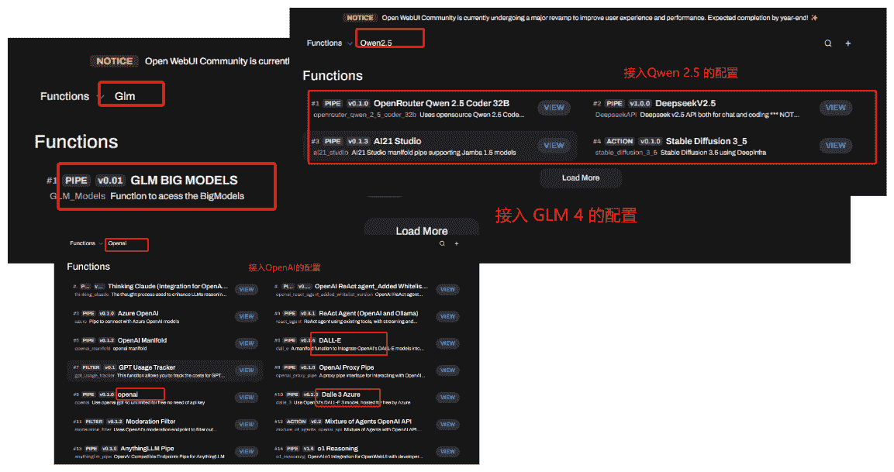

在 Open WebUI 项目中，Functions（功能）通常是指该项目提供的可以执行特定任务或操作的模块或方法。这些功能可以帮助用户与大模型进行交互、配置模型参数、获取输出结果等。具体来说，这些 Functions 包括文本生成、模型参数调节、会话管理功能、API 接口、模型选择和管理等实现细节。

+   DeepSeek v3接入Open-WebUI流程

首先需要创建虚拟环境：

```
conda create -n open-webui python=3.11
conda init
source ~/.bashrc
conda activatopen-webui
```

然后安装Open-WebUI项目：

```
pip install open-webui -i https://pypi.tuna.tsinghua.edu.cn/simple
```

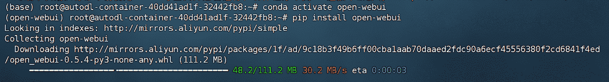

然后开启服务：

```
open-webui serve
```


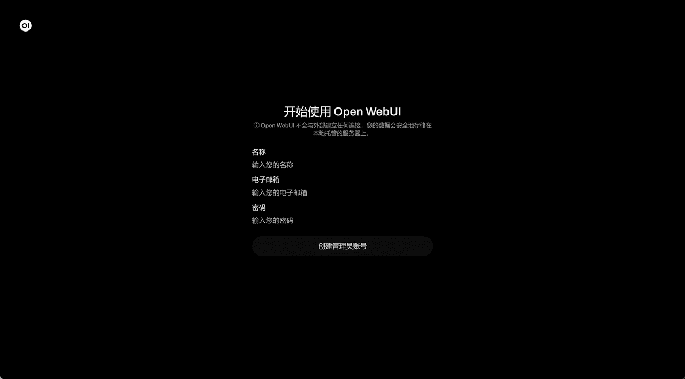

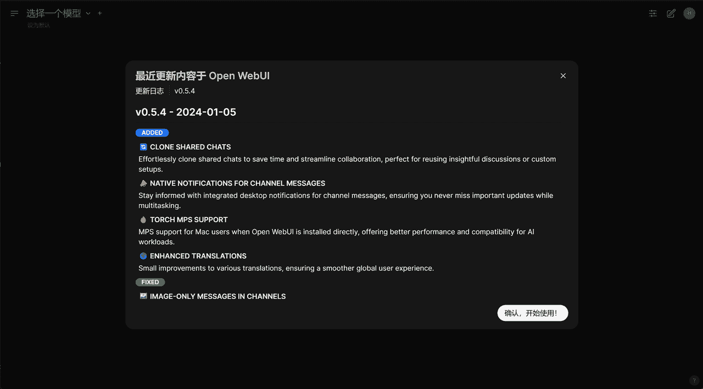

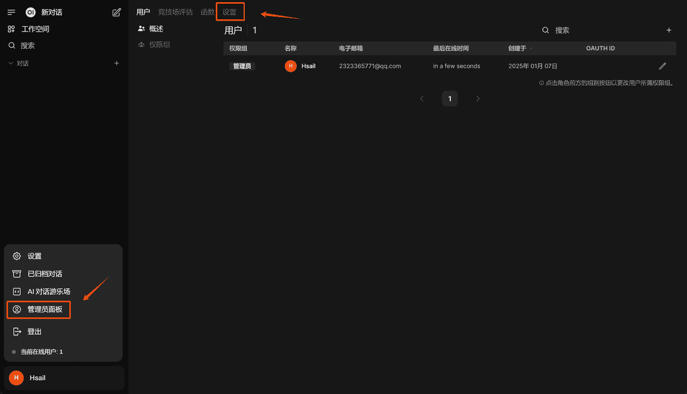

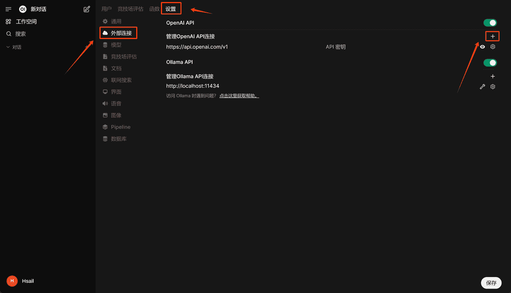

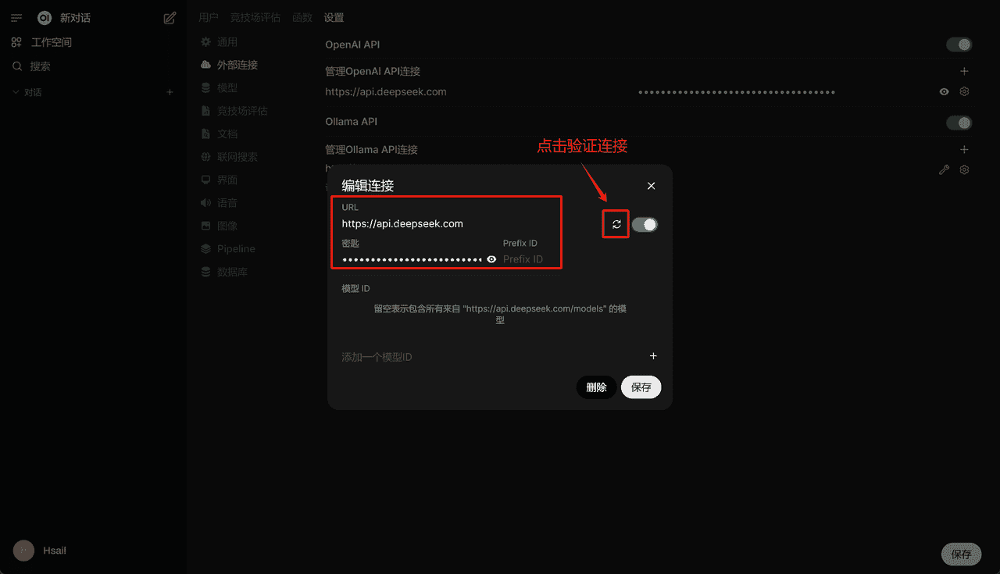

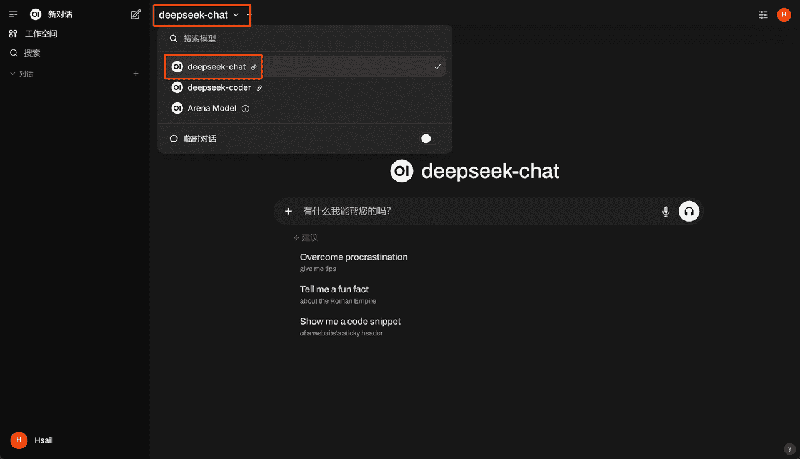

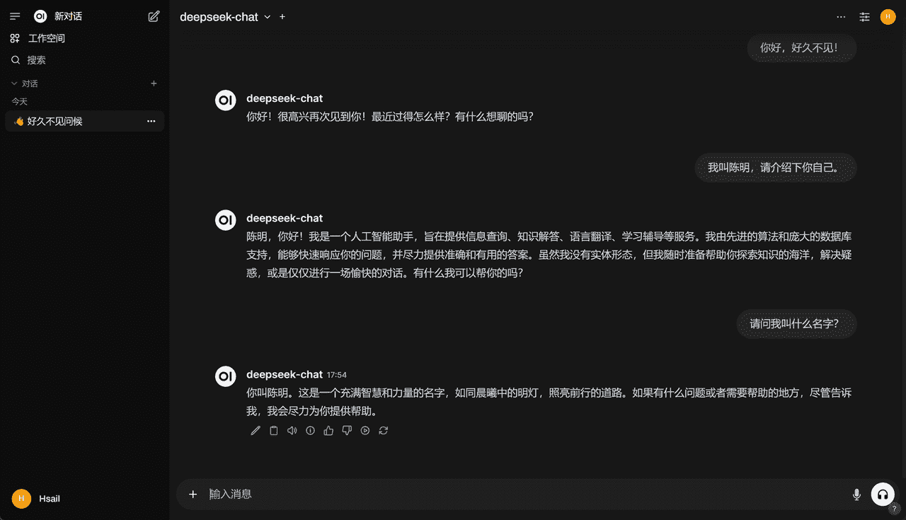

后续我们将直接使用Open-WebUI作为前端工具，调用DeepSeek v3模型。