# DeepSeek v3本地部署流程

> 来源：[https://kq4b3vgg5b.feishu.cn/docx/CFZOdexbxo2AOTxjrxXclVe3nsg](https://kq4b3vgg5b.feishu.cn/docx/CFZOdexbxo2AOTxjrxXclVe3nsg)

# 课程说明：

+   体验课内容节选自《2025大模型Agent智能体开发实战》完整版付费课程

体验课时间有限，若想深度学习大模型技术，欢迎大家报名由我主讲的《2025大模型Agent智能体开发实战》：


此外，公开课训练项目代码、数据、**及训练完的模型，已上传至课件****网盘，联系****⬆**️助教回复“DS网盘”，即可领取（目前**咨**询人数较多，助教老师在加急一一回复啦，小伙伴们发送后耐心等待一下哦🌹～）。

---

# DeepSeek v3本地部署流程

## DeepSeek发布公告

DeepSeek v3发布公告：https://api-docs.deepseek.com/zh-cn/news/news1226

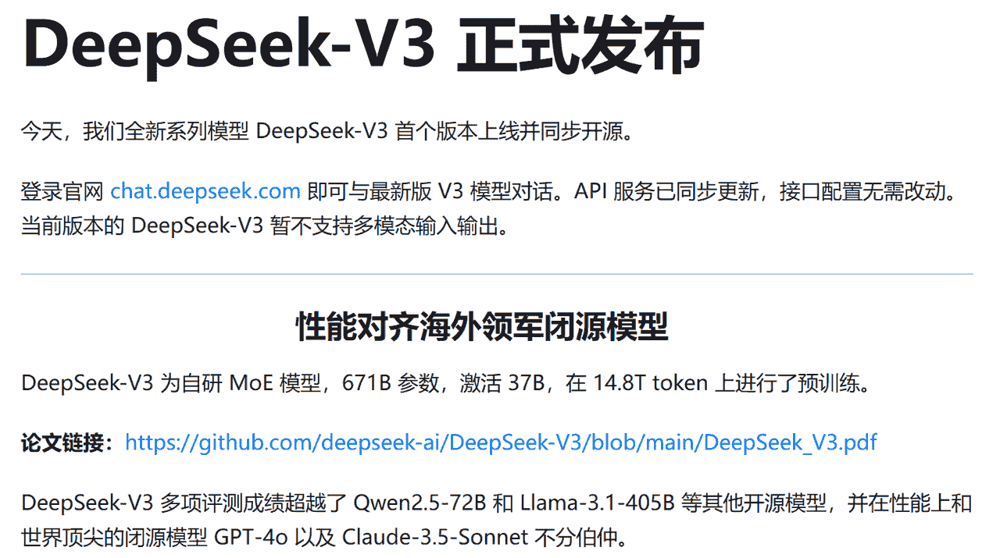

DeepSeek-V3 多项评测成绩超越了 Qwen2.5-72B 和 Llama-3.1-405B 等其他开源模型，并在性能上和世界顶尖的闭源模型 GPT-4o 以及 Claude-3.5-Sonnet 不分伯仲。

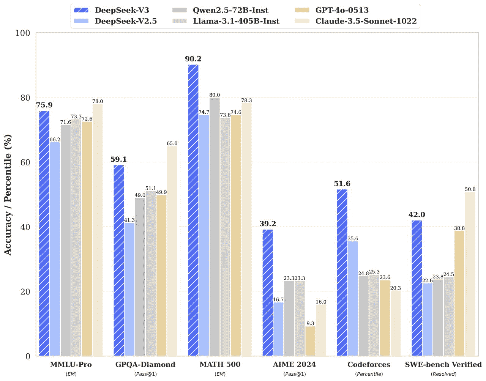

+   **百科知识：** DeepSeek-V3 在知识类任务（MMLU, MMLU-Pro, GPQA, SimpleQA）上的水平相比前代 DeepSeek-V2.5 显著提升，接近当前表现最好的模型 Claude-3.5-Sonnet-1022。

+   **长文本：** 在长文本测评中，DROP、FRAMES 和 LongBench v2 上，DeepSeek-V3 平均表现超越其他模型。

+   **代码：** DeepSeek-V3 在算法类代码场景（Codeforces），远远领先于市面上已有的全部非 o1 类模型；并在工程类代码场景（SWE-Bench Verified）逼近 Claude-3.5-Sonnet-1022。

+   **数学：** 在美国数学竞赛（AIME 2024, MATH）和全国高中数学联赛（CNMO 2024）上，DeepSeek-V3 大幅超过了所有开源闭源模型。

+   **中文能力：** DeepSeek-V3 与 Qwen2.5-72B 在教育类测评 C-Eval 和代词消歧等评测集上表现相近，但在事实知识 C-SimpleQA 上更为领先。

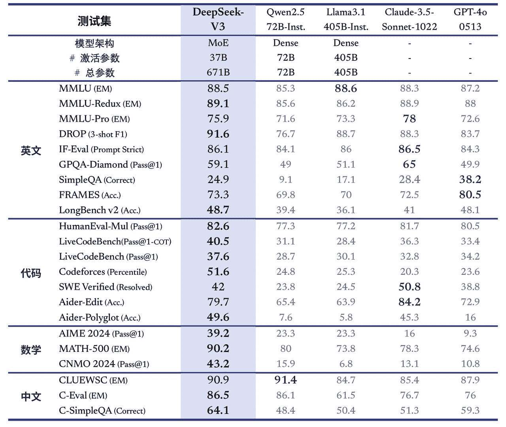

## DeepSeek开源情况介绍

GitHub项目地址：https://github.com/deepseek-ai/DeepSeek-V3

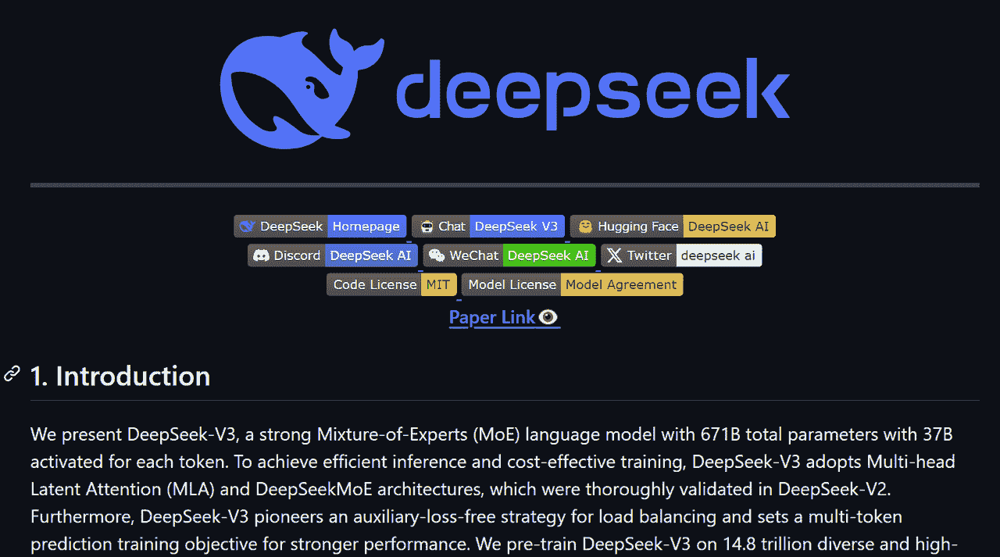

其中技术报告和模型代码部分值得关注：

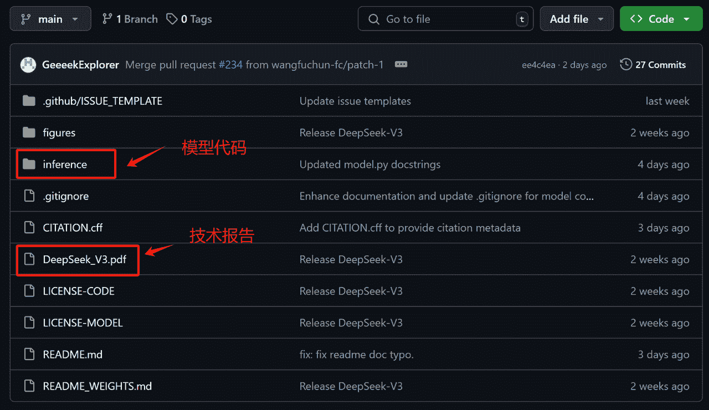

其中开源的代码部分内容如下：

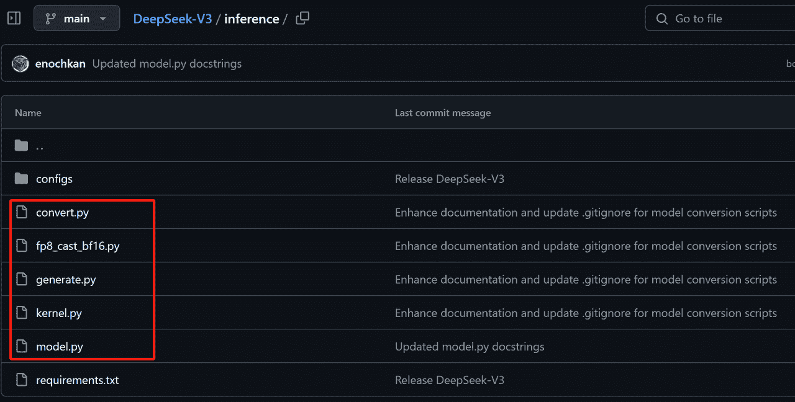

+   convert.py：用于进行格式转化，将一个已经训练好的模型检查点（checkpoint）文件从一个格式（比如 safetensors）转换并保存成一个适合特定模型并行度（model parallelism）和专家数（n_experts）的格式。

+   fp8_cast_bf16.py：代码的功能是将存储在 FP8 格式中的模型权重转换为 BF16 格式，并保存转换后的权重。它还更新了模型的索引文件，去除了 scale_inv 的引用。

+   generate.py：代码是一个用于生成文本的示例程序，支持交互式和批量文本生成。它使用一个 Transformer 模型并进行分布式训练。

+   **kernel**.py：代码主要涉及量化和**矩阵乘**法操作，使用了 Triton 库进行加速，特别是针对 FP8 精度（浮点8位）进行了优化。Triton 是一个专为 GPU 上的高效自定义操作而设计的编程框架，支持 Python 和 PyTorch，可以通过简洁的代码来实现高效的 GPU 核心。

+   model.py： 定义了DeekSeek v3模型架构。

目前模型权重已经在hugging face上开源了，具体情况如下：

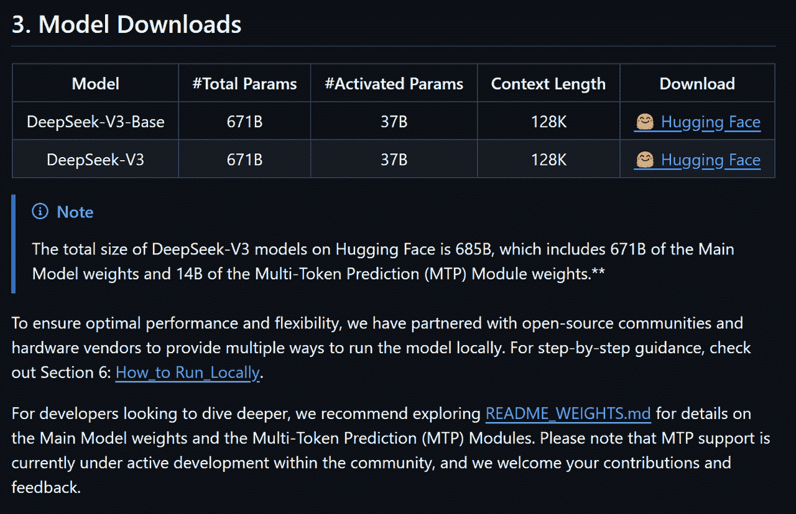

> DeepSeek-V3模型在Hugging Face上的总大小为685B，其中包括671B的主模型权重和14B的多标记预测（MTP）模块权重。

> 为了确保最佳性能和灵活性，我们与开源社区和硬件供应商合作，提供多种在本地运行模型的方式。有关逐步指导，请参阅第6节：如何在本地运行（How_to_Run_Locally）。

> 对于希望深入了解的开发者，我们建议查阅README_WEIGHTS.md文件，了解主模型权重和多标记预测（MTP）模块的详细信息。请注意，MTP支持目前仍在社区内积极开发中，我们欢迎您的贡献和反馈。

并且还非常贴心的介绍了权重情况：https://github.com/deepseek-ai/DeepSeek-V3/blob/main/README_WEIGHTS.md

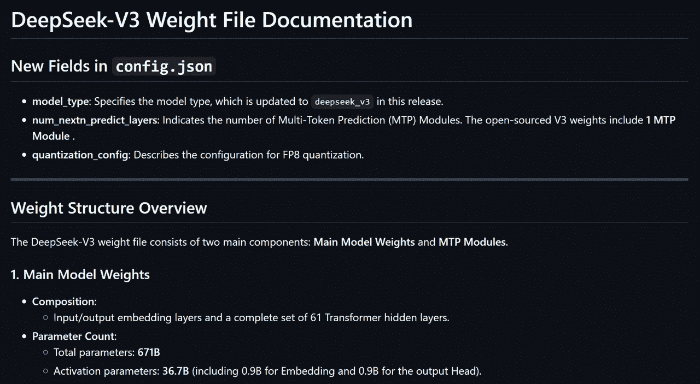

DeepSeek v3模型权重可在hugging face上主页上下载：https://huggingface.co/deepseek-ai/DeepSeek-V3，权重总共约650G大小。

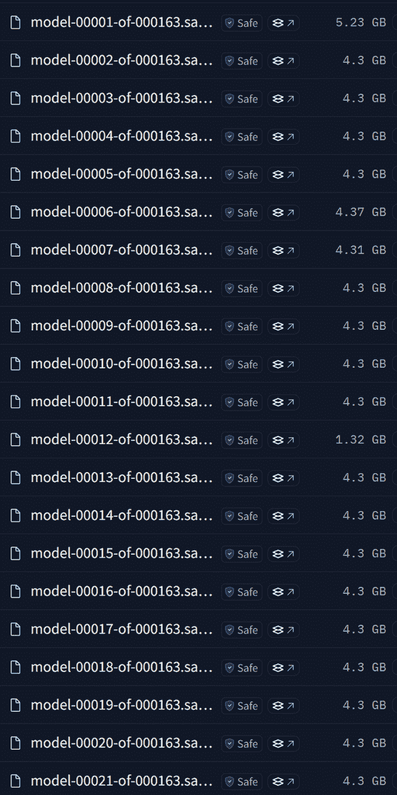

此外，也可在魔搭社区上下载：https://www.modelscope.cn/models/deepseek-ai/DeepSeek-V3

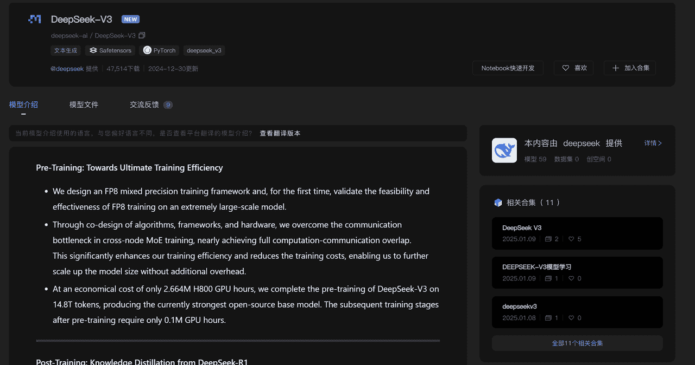

既然是权重全开源，那肯定是可以在本地运行的，以下官方介绍的本地运行方法：

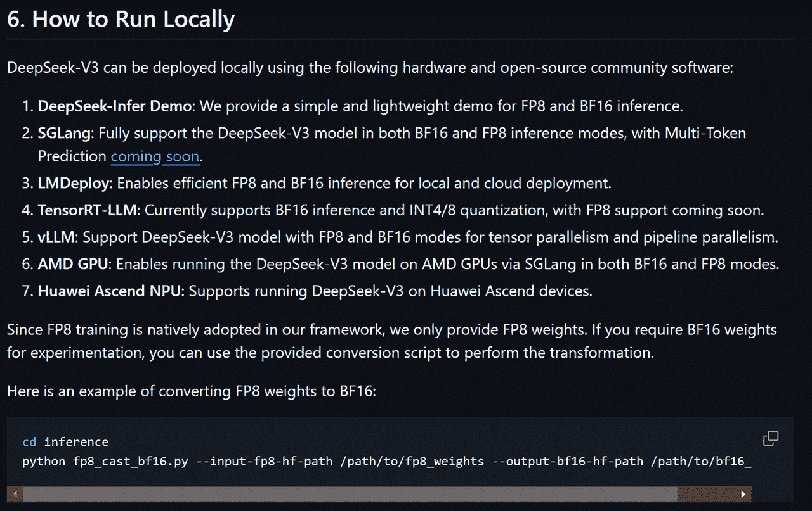

> **6. 如何在本地运行**

> DeepSeek-V3可以使用以下硬件和开源社区软件在本地部署：

+   DeepSeek-Infer Demo：我们提供了一个简单且轻量的演示，支持FP8和BF16推理。

+   **SGLang**：完全支持DeepSeek-V3模型在BF16和FP8推理模式下运行，且即将支持多标记预测（MTP）。

+   **LMDeploy**：支持高效的FP8和BF16推理，适用于本地和云端部署。

+   **TensorRT-LLM**：目前支持BF16推理和INT4/8量化，FP8支持即将推出。

+   **vLLM**：支持DeepSeek-V3模型在FP8和BF16模式下进行张量并行和流水线并行。

+   **AMD GPU**：通过SGLang，在BF16和FP8模式下支持在AMD GPU上运行DeepSeek-V3模型。

+   **华为Ascend NPU**：支持在华为Ascend设备上运行DeepSeek-V3模型。

> 由于我们的框架原生采用FP8训练，因此只提供FP8权重。如果您需要BF16权重进行实验，您可以使用提供的转换脚本进行转换。

由于DeepSeek的框架原生采用 FP8 训练，因此仅提供 FP8 权重，预估仅700GB+显存便可轻松运行。当然也可以转换到BF16，在半精度下，需1400GB+，而量化到int4时需要450GB+。以下是半精度下显存占用情况：（占用 490G 显存，需要 7张 80G A100，租赁成本约1000元1天）

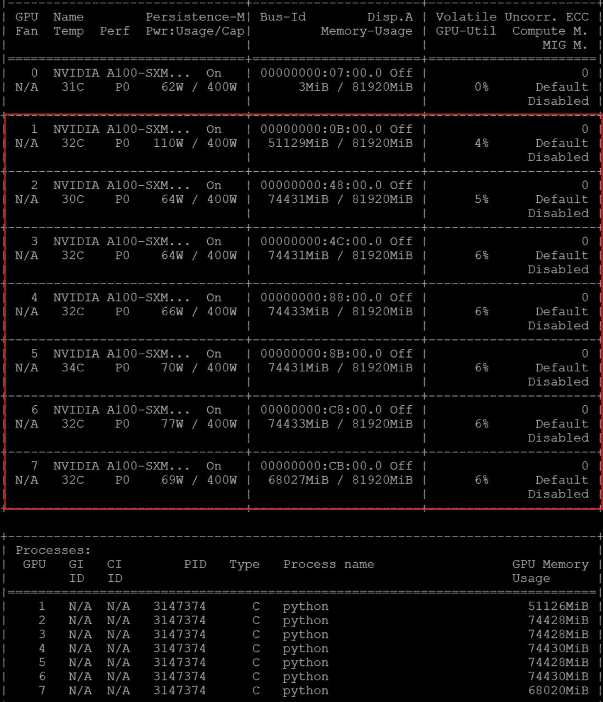

## DeepSeek v3本地部署与调用流程

本次DeepSeek v3的本地部署将使用模型的Int4量化版进行运行，基本配置如下：

+   服务器硬件配置如下：

+   GPU：Nvidia H20（98G） GPU * 8

+   CPU：AMD EPYC 9K84 96-Core

+   桥接方式：NVLink

+   内存：150G

+   存储：2T

+   深度学习环境配置如下：

+   操作系统：Ubuntu22.04

+   PyTorch版本：2.5.1

+   Python版本：3.12

+   CUDA版本：12.4

+   其他软件包版本根据DeepSeek v3项目requirement决定。

> 硬件环境也可考虑在AutoDL上进行租赁，具体租赁方法可参考我的教程：《AutoDL快速入门与GPU租赁使用指南》https://www.bilibili.com/video/BV1bxB7YYEST/

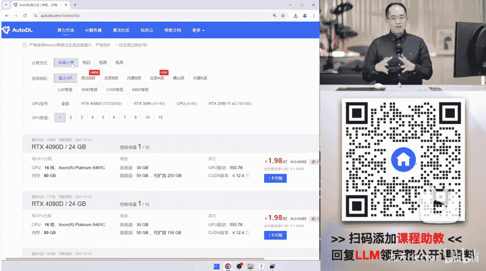

+   创建虚拟环境

```
conda create --name dv3 python=3.11
conda init
source ~/.bashrc
conda activate dv3
```

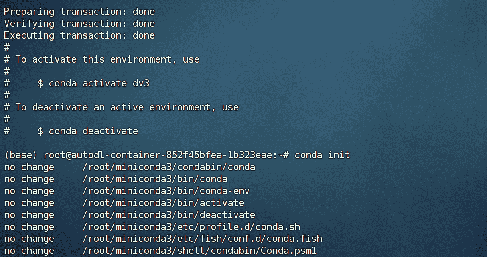

```
conda install jupyterlab
conda install ipykernel
python -m ipykernel install --user --name dv3 --display-name &quot;Python (dv3)&quot;
```

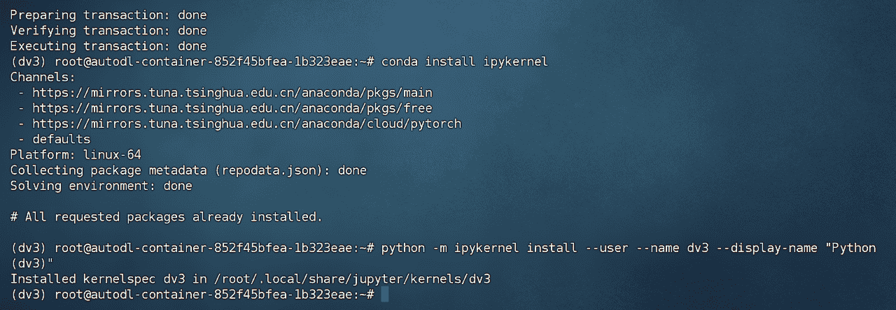

+   登录Github主页拉取项目

+   访问DeepSeek v3主页：https://github.com/deepseek-ai/DeepSeek-V3

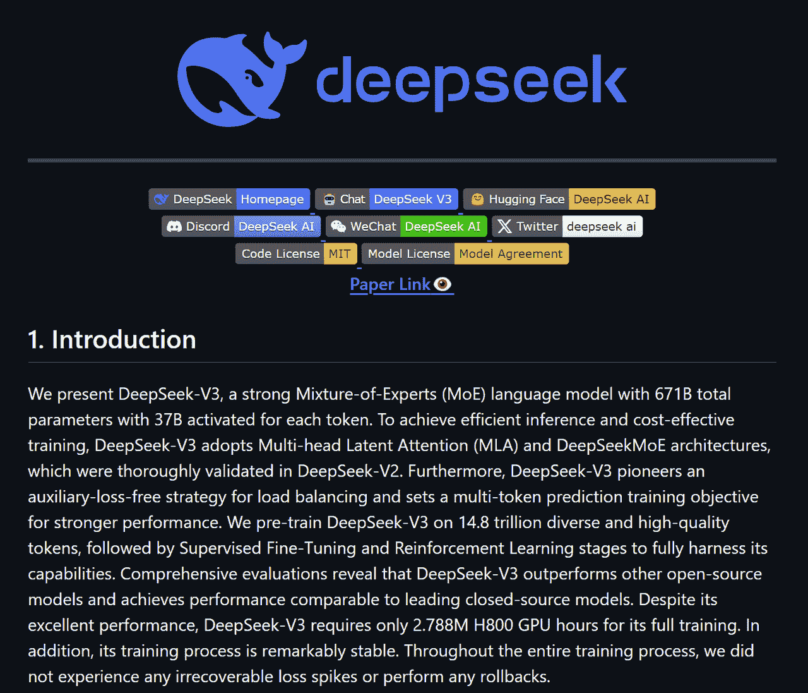

```
git clone https://github.com/deepseek-ai/DeepSeek-V3.git
```

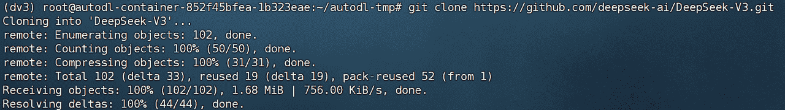

+   下载模型权重

可以在HuggingFace或者魔搭社区上下载模型权重，考虑到国内网络情况，推荐使用魔搭社区进行下载。DeepSeek v3魔搭社区官网地址：https://www.modelscope.cn/models/deepseek-ai/DeepSeek-V3

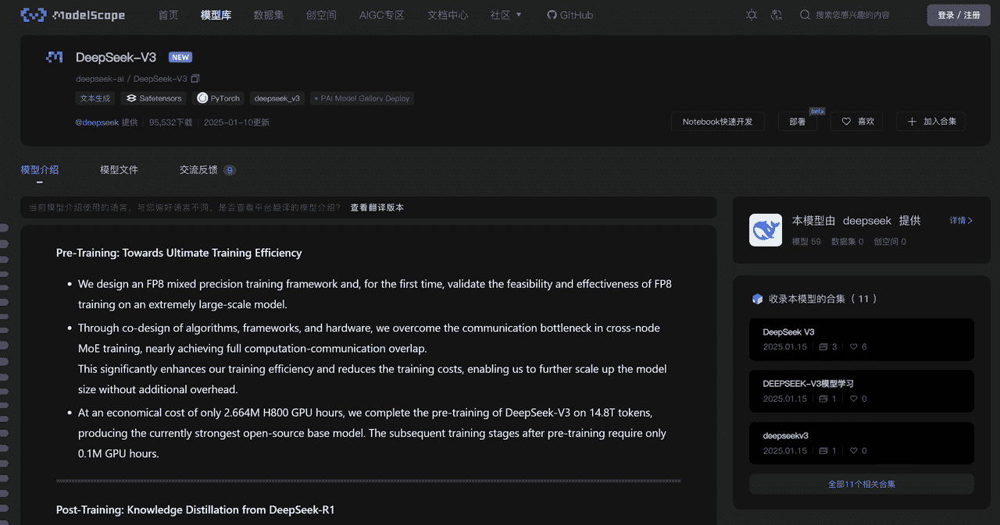

> 注，下载前需提前留出600G左右存储空间，用于保存模型权重

具体下载流程如下：

```
pip install modelscope
```

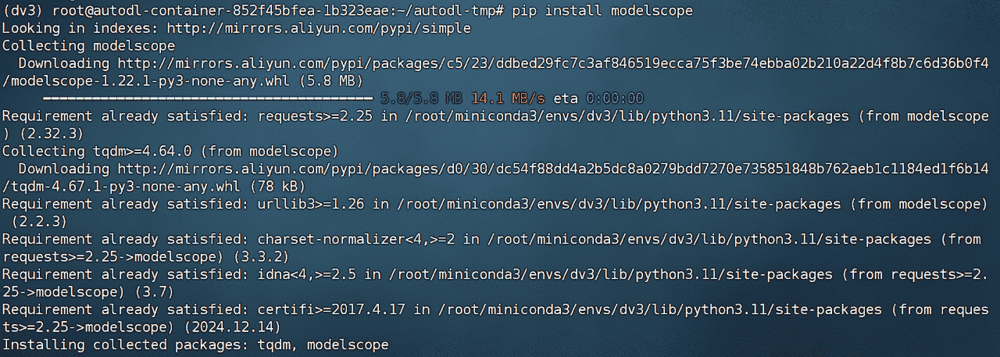

```
mkdir ./deepseek
modelscope download --model OPEA/DeepSeek-V3-int4-sym-gptq-inc --local_dir ./deepseek
```

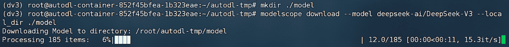

> 这里在下载的时候就是下载Int4类型的权重

+   在Jupyter中进行推理

```
import torch
from modelscope import AutoTokenizer, AutoModelForCausalLM, GenerationConfig
model_name = &quot;./deepseek&quot;
tokenizer = AutoTokenizer.from_pretrained(model_name)
model = AutoModelForCausalLM.from_pretrained(model_name, torch_dtype=torch.bfloat16, device_map=&quot;auto&quot;)
model.generation_config = GenerationConfig.from_pretrained(model_name)
model.generation_config.pad_token_id = model.generation_config.eos_token_id
```

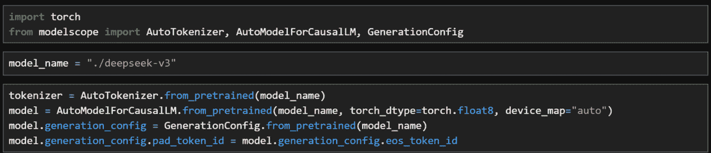

```
messages = [
    {&quot;role&quot;: &quot;user&quot;, &quot;content&quot;: &quot;你好，好久不见，请介绍下你自己！&quot;}
]
input_tensor = tokenizer.apply_chat_template(messages, add_generation_prompt=True, return_tensors=&quot;pt&quot;)
outputs = model.generate(input_tensor.to(model.device), max_new_tokens=100)
result = tokenizer.decode(outputs[0][input_tensor.shape[1]:], skip_special_tokens=True)
print(result)
```

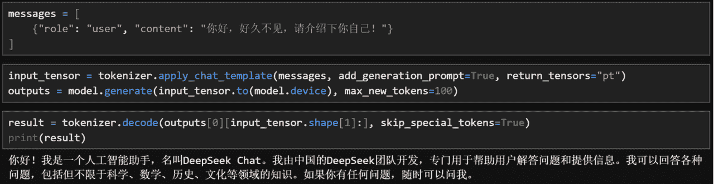

## DeepSeek v3+SGLang部署方案

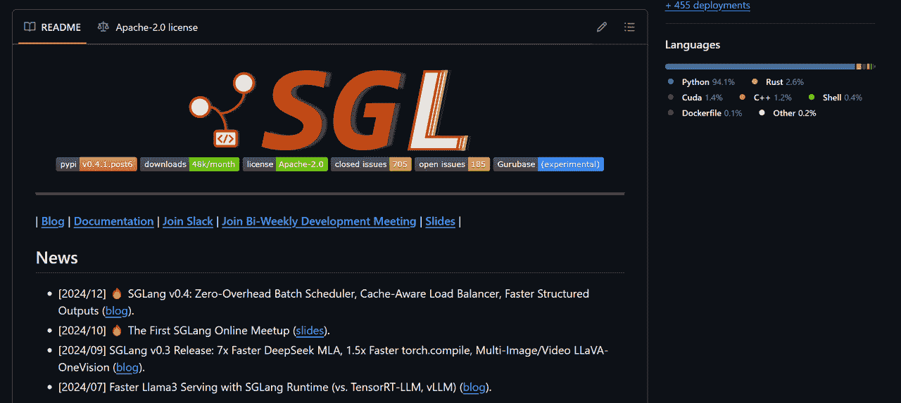

SGLang项目主页：https://github.com/sgl-project/sglang

SGLang 目前支持 MLA 优化、DP Attention、FP8 (W8A8)、FP8 KV 缓存和 Torch Compile，在开源框架中提供了领先的延迟和吞吐量性能。

需要注意的是，SGLang v0.4.1 完全支持在 NVIDIA 和 AMD GPU 上运行 DeepSeek-V3，使其成为一个高度通用且稳健的解决方案。SGLang 还支持多节点张量并行，允许你在多个网络连接的机器上运行该模型。目前多标记预测（MTP）正在开发中，进展可以在优化计划中追踪。

+   安装SGLang

```
pip install &quot;sglang[all]&gt;=0.4.1.post5&quot; --find-links https://flashinfer.ai/whl/cu124/torch2.4/flashinfer
```

+   调用DeepSeek v3

```
python3 -m sglang.launch_server --model deepseek-ai/DeepSeek-V3 --tp 8 --trust-remote-code
```

此时服务将在30000端口启动。接下来即可使用OpenAI风格API来调用DeepSeek v3模型了：

```
import openai
client = openai.Client(
    base_url=&quot;http://127.0.0.1:30000/v1&quot;, api_key=&quot;EMPTY&quot;)

# Chat completion
response = client.chat.completions.create(
    model=&quot;default&quot;,
    messages=[
        {&quot;role&quot;: &quot;system&quot;, &quot;content&quot;: &quot;You are a helpful AI assistant&quot;},
        {&quot;role&quot;: &quot;user&quot;, &quot;content&quot;: &quot;List 3 countries and their capitals.&quot;},
    ],
    temperature=0,
    max_tokens=64,
)
print(response)
```

## DeepSeek v3+LMDeploy部署方案

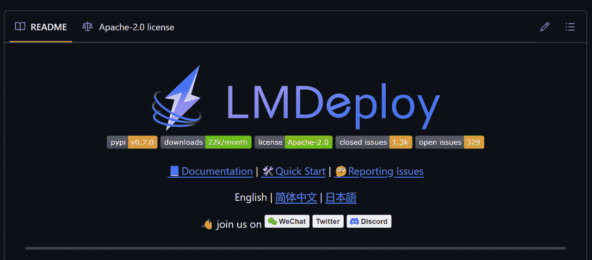

LMDeploy项目主页：https://github.com/InternLM/lmdeploy

LMDeploy 是一个灵活且高性能的推理与服务框架，专为大语言模型量身定制，现在支持 DeepSeek-V3。它提供了离线管道处理和在线部署能力，能够与基于 PyTorch 的工作流无缝集成。具体使用LMDeploy调用DeepSeek v3流程如下：

+   安装LMDeploy

```
git clone -b support-dsv3 https://github.com/InternLM/lmdeploy.git
cd lmdeploy
pip install -e .
```

+   单任务推理，编写Python脚本执行

```
from lmdeploy import pipeline, PytorchEngineConfig

if __name__ == &quot;__main__&quot;:
    pipe = pipeline(&quot;deepseek-ai/DeepSeek-V3-FP8&quot;, backend_config=PytorchEngineConfig(tp=8))
    messages_list = [
        [{&quot;role&quot;: &quot;user&quot;, &quot;content&quot;: &quot;Who are you?&quot;}],
        [{&quot;role&quot;: &quot;user&quot;, &quot;content&quot;: &quot;Translate the following content into Chinese directly: DeepSeek-V3 adopts innovative architectures to guarantee economical training and efficient inference.&quot;}],
        [{&quot;role&quot;: &quot;user&quot;, &quot;content&quot;: &quot;Write a piece of quicksort code in C++.&quot;}],
    ]
    output = pipe(messages_list)
    print(output)
```

+   在线服务调用

先运行如下命令

```
# run
lmdeploy serve api_server deepseek-ai/DeepSeek-V3-FP8 --tp 8 --backend pytorch
```

接下来即可在23333端口调用DeepSeek v3模型：

```
from openai import OpenAI
client = OpenAI(
    api_key=&#x27;YOUR_API_KEY&#x27;,
    base_url=&quot;http://0.0.0.0:23333/v1&quot;
)
model_name = client.models.list().data[0].id
response = client.chat.completions.create(
  model=model_name,
  messages=[
    {&quot;role&quot;: &quot;user&quot;, &quot;content&quot;: &quot;Write a piece of quicksort code in C++.&quot;}
  ],
    temperature=0.8,
    top_p=0.8
)
print(response)
```

## DeepSeek v3+vLLM部署方案

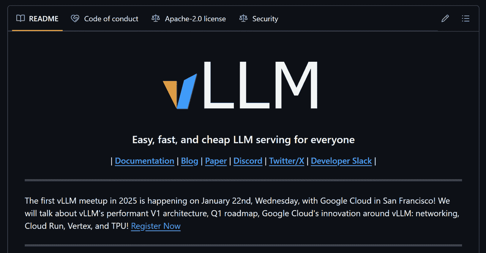

vLLM项目主页：https://github.com/vllm-project/vllm

vLLM v0.6.6 支持在 NVIDIA 和 AMD GPU 上以 FP8 和 BF16 模式进行 DeepSeek-V3 推理。除了标准技术外，vLLM 还提供了管道并行性，允许你在多个网络连接的机器上运行该模型。

+   vLLM安装

```
pip install vllm
```

+   DeepSeek v3调用

目前vLLM已支持DeepSeek v3模型调用，可以在模型支持列表中查看模型关键字：https://docs.vllm.ai/en/latest/models/supported_models.html

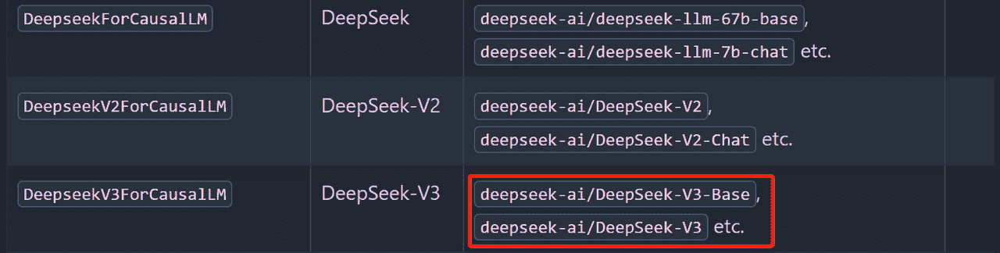

接下来即可使用如下代码进行调用：

```
from vllm import LLM

# For generative models (task=generate) only
llm = LLM(model=deepseek-ai/DeepSeek-V3, task=&quot;generate&quot;)  # Name or path of your model
output = llm.generate(&quot;Hello, my name is&quot;)
print(output)
```