# GPT-OSS高效微调实战（上）

> 来源：[https://kq4b3vgg5b.feishu.cn/docx/F1Mtdi4qtoM5AIxVdROc9Ai4noh](https://kq4b3vgg5b.feishu.cn/docx/F1Mtdi4qtoM5AIxVdROc9Ai4noh)

## 一、OpenAI最新开源GPT-OSS模型介绍

### 1. GPT-OSS模型简介

仅需16G显存，即可本地部署`o3-mini`级别推理模型，仅需60G显存，即可本地部署`o4-mini`级别推理模型，这就是OpenAI最新开源的`gpt-oss`系列模型。这是OpenAI 6年来首次重大开源，同时也是最有诚意的一次开源。根据官方评测结果，本次开源的`gpt-oss`两个尺寸的模型，小尺寸的`gpt-oss-20b`模型，性能介于`o3-mini`与`o4-mini`之间，而大尺寸的`gpt-oss-120b`模型，性能则已经赶上了`o4-mini`模型。

当地时间8月5号上午，OpenAI正式宣布开源全新一代的对话模型`gpt-oss`，本次总共发布`gpt-oss-20b`和`gpt-oss-120b`两款模型，这是OpenAI自2019年开源`GPT-2`模型以来首个开源的对话模型，各项性能指标上追平了自家目前性能最强的`o4`模型。

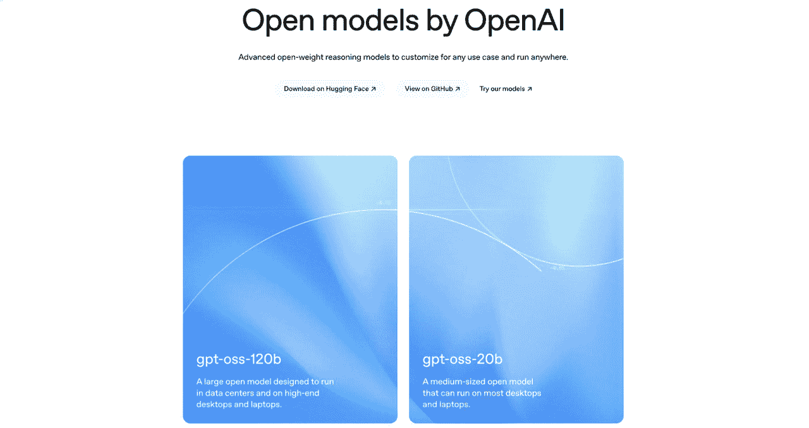

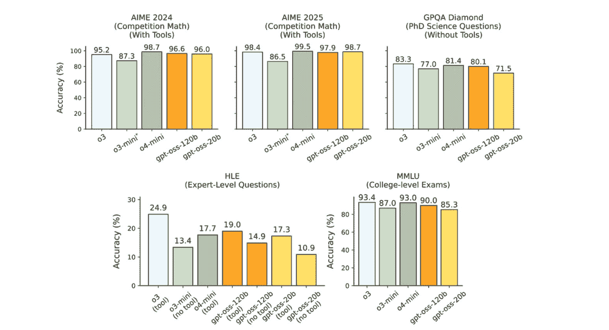

#### 模型参数

本次开源的`gpt-oss`两个尺寸的模型，模型基本参数如下：

| 模型 | 激活专家数量（Top-k） | 激活专家总参数量 | 共享参数量（Attention + Embedding） | 推理所需显存（MXFP4） | 全量训练推荐显存 | 高效微调所需显存（QLoRA） |
| --- | --- | --- | --- | --- | --- | --- |
| `gpt-oss-20b` | `4`（每层 32 专家里选 Top-4） | `3.61B` | `≈1.80B` | `≈16 GB` | `≈234–312 GB` | `≈14 GB` |
| `gpt-oss-120b` | `4`（每层 128 专家里选 Top-4） | `5.13B` | `≈2.12B` | `≈80 GB` | `≈1.31–1.74 TB` | `≈65 GB` |

能够看出，尽管`GPT-OSS`模型写着`20B`、`120B`参数，但实际上模型是混合专家模型，`20b`模型每次推理激活专家参数量为`3.6B`、`120b`模型每次推理激活专家参数量为`5.13B`，并不算特别尺寸的模型。

相比`Qwen3-235B-A22B`的旗舰模型，`GPT-OSS`系列模型其实算是小中号模型，但这并不意味着`GPT-OSS`模型性能不足。

#### 模型性能

`gpt-oss-20b`模型拥有堪比`o3-mini`级别模型的性能，而`gpt-oss-120b`模型能力则更是达到了`o4-mini`模型级别。根据官方给出的评分结果，无论是在数学、推理、编程，还是在前段时间大放异彩的人类终极测试（`HLE`）等评估指标上，`gpt-oss-20b`的能力都介于`o3-mini`和`o4-mini`之间，而`gpt-oss-120b`模型则是和`o4-mini`模型不相上下。

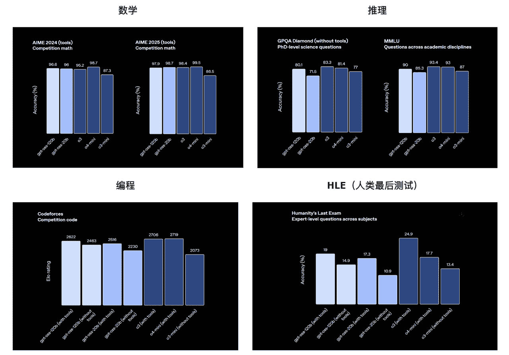

也就是说，OpenAI开源的`gpt-oss`系列模型，是仅次于OpenAI `o3`模型、`GPT-5`模型的第二梯队模型。而如果和前段时间刚开源的`Qwen3-235B-A22B`推理模型相比，`gpt-oss-120b`模型则是以不到一半的参数量和硬件成本，就超越了`Qwen3-235B`的模型性能。

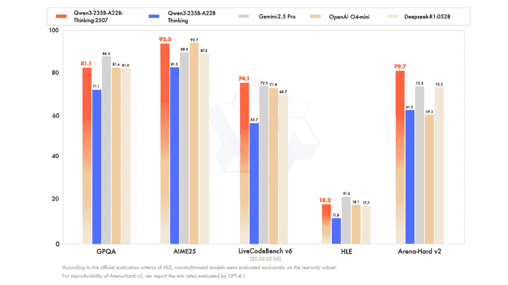

### 2. GPT-OSS模型核心特性

#### MXFP-4精度

在 `GPT-OSS` 模型中，核心参数采用了一种名为 `MXFP4`（Mixed Floating Point 4） 的精度格式。`MXFP4` 是一种面向大规模混合专家（`MoE`）架构而设计的混合低比特浮点表示方式，它在权重量化中使用 4 比特存储，同时结合比例缩放与分组归一化等机制，以在保持模型推理稳定性的前提下，大幅降低显存占用与内存带宽压力。与常见的 `INT4` 或 `FP8` 方案相比，`MXFP4` 并非单纯追求极限压缩，而是在推理精度、数值动态范围和硬件友好性之间取得平衡。借助这种精度格式，`GPT-OSS` 系列模型能够在更低的硬件门槛下运行，例如 `gpt-oss-20b` 在 `MXFP4` 下仅需约 16GB 显存即可完成推理，这也是其“开放权重 + 高可部署性”设计的重要支撑点之一。

`MXFP4`（Mixed Floating Point 4）是 `GPT-OSS` 模型采用的一种高效推理精度格式，其核心价值在于大幅压缩权重存储与显存占用，使得数百亿参数量级的模型可以在较低硬件门槛下运行。然而，这种精度格式的设计初衷主要面向推理阶段，而非训练环节。具体而言，`MXFP4` 内核当前仅实现了前向传播，对反向传播尚未提供完整支持。这意味着在常规模型开发框架中，`MXFP4` 权重无法直接参与全量训练或标准微调流程。为了在工程上维持可操作性，通常的做法是将 `MXFP4` 权重先上采样（`upcast`）回 `BF16`，再执行训练或微调操作。但这种处理方式会显著增加内存与显存需求，往往需要数倍于推理阶段的硬件资源，限制了其在实际工程落地中的普适性。因此，在现阶段，`MXFP4` 更适合作为高效推理与部署的权重格式，而在训练与微调环节则存在天然的局限。

> 需要注意，目前主流的深度学习框架（如 `Hugging Face Transformers`、`TRL` 等）并未原生支持 `MXFP4` 权重的反向传播，开发者不得不通过 `upcast` 至 `BF16` 的方式来完成训练，这直接导致显存占用与训练时间的大幅增加。`Unsloth` 则采取了不同的工程路径：其团队基于 `OpenAI Triton` 内核为 `MXFP4` 专门实现了定制的训练算子与反向传播支持，从而绕过了 `MXFP4` 不支持 `backward` 的核心瓶颈。借助这些定制内核，`Unsloth` 能够直接在 `MXFP4` 权重上插入和更新适配器参数，避免了全模型上采样带来的额外资源消耗。实践效果表明，使用 `Unsloth` 微调 `GPT-OSS-20B` 模型时，仅需约 14GB 显存即可运行，而如果依赖传统框架，则至少需要 65GB 显存才能完成相同任务。这种巨大差异正是源于 `Unsloth` 对 `MXFP4` 底层训练支持的定制化实现，也是其在该领域具备独特优势的根本原因。

#### gpt-oss模型响应速度

得益于`MoE`架构以及原生混合`FP4`（`MXFP4`）权重精度，`gpt-oss-20b`模型最低16G显存即可运行，并且响应速度极快，`3090`上就能达到`80+tokens/s`，`5090`上更是能达到恐怖的`200+tokens/s`。根据我们的压力测试，单卡`H800` GPU运行情况下，`gpt-oss-20b`模型能够保持在`550 tokens/s`的吞吐量，也就是20个并发的时候能够至少保持`25 tokens/s`。整体来看响应速度非常快，这也印证了此前所说的`gpt-oss`模型架构方面的效率优势。

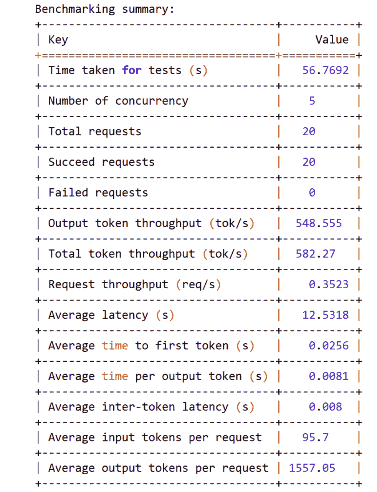

#### gpt-oss可控混合推理特性

`GPT-OSS` 模型的一大特色在于引入了 可控推理程度（`Configurable Reasoning Effort`） 的机制。通过在推理调用中设置 `reasoning_effort` 参数，用户能够在不同的推理深度之间进行切换，例如选择 `low`、`medium` 或 `high` 等档位。该机制的设计初衷在于赋予模型在性能与延迟之间的灵活平衡：当任务场景强调响应速度时，可以使用较低的推理程度以获得简洁直接的答案；而在复杂问题求解或多步逻辑推演场景中，则可以启用较高的推理程度，让模型生成更长、更细致的推理链条。需要强调的是，这一能力并非简单地调节输出字数，而是源自 `GPT-OSS` 在训练过程中针对推理链（`Chain-of-Thought`）的特殊优化，使其能够根据需求自适应地在“快速决策”与“深度推理”之间切换，从而满足不同应用场景对模型思考过程的差异化要求。

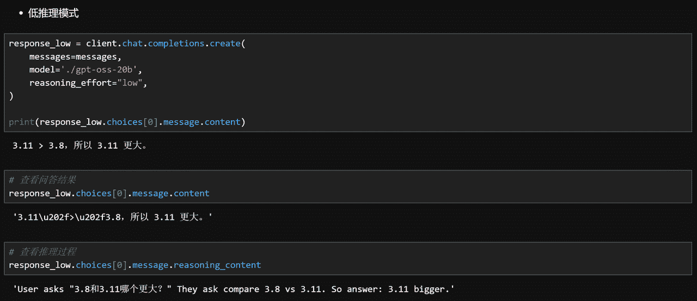

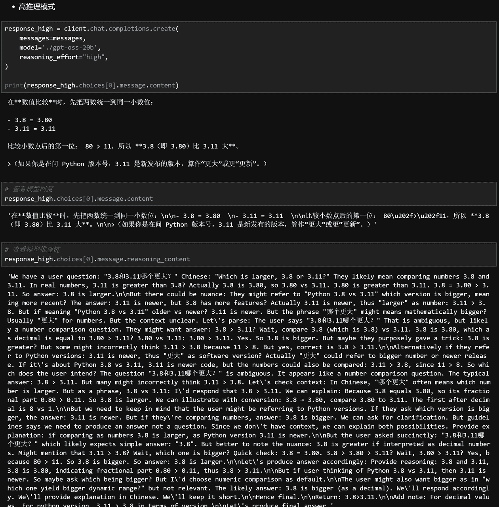

#### GPT-OSS模型在线体验地址

https://gpt-oss.com/

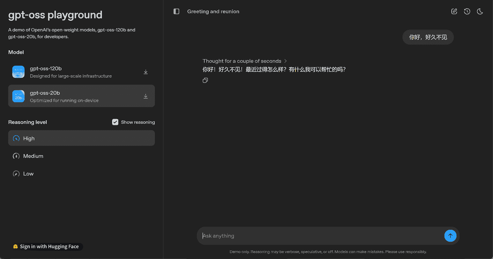

#### GPT-OSS官方提示词模板

OpenAI 开源的 `Harmony` 库，本质上是一个用于对话解析与分词的标准化工具。它的核心用途在于将多轮对话、系统提示、工具调用等信息，严格转换为 `GPT-OSS` 模型所需的标准输入格式。这一模板不仅规范了消息角色（`system`、`user`、`assistant`、`tool`）的表达方式，还支持诸如 `reasoning_effort`、`developer_instructions`、`model_identity` 等扩展参数，使开发者能够更精细地控制推理深度与上下文指令。借助 `Harmony`，训练和推理环节能够共享统一的提示词拼接规则，从而避免由于格式不一致导致的行为偏差，是确保 `GPT-OSS` 模型稳定发挥性能的关键组件。

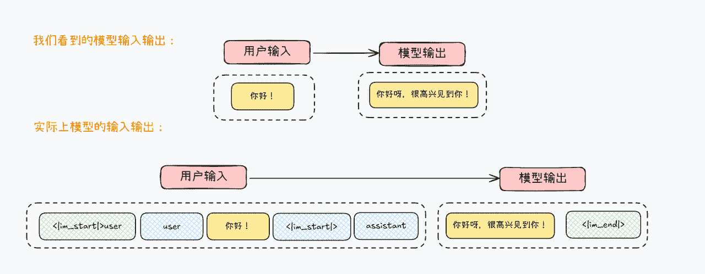

#### Harmony模板官方说明

https://cookbook.openai.com/articles/openai-harmony

#### 需要注意的是

与 `Harmony` 相比，社区常用的 `jinja` `chat_template` 在格式细节上存在一定差异，例如工具调用参数在序列化时会引入多余的转义符，部分边界位置插入额外换行，以及推理链标签（`analysis`/`final`）的渲染不符。这些看似微小的差异会在微调和推理时引入分布偏移，使得模型在真实使用场景下表现不稳定。`Unsloth` 针对这一问题，直接集成了对 `Harmony` 的调用，并提供了 `encode_conversations_with_harmony` 函数，使开发者能够绕过 `jinja` 模板，直接将 Python 格式的对话转化为符合 OpenAI 标准的输入。这一改进确保了数据预处理、微调和推理的严格一致性，也为 `GPT-OSS` 在工具调用和可控推理等高级特性上提供了更可靠的支撑。

#### GPT-OSS模型通用适配性

`GPT-OSS` 系列模型天生具备极强的适配性，使其能无缝对接多种推理引擎与 `Agent` 开发框架，实现灵活部署与 `Agent` 构建。根据 OpenAI 官方发布信息和相关集成指南，`GPT-OSS` 可与以下平台和框架兼容：

##### 部署与推理引擎

- `vLLM`：可高效运行 `gpt-oss-20b` 和 `gpt-oss-120b`，支持 API 服务化与 `Agent SDK` 集成 (OpenAI Cookbook)。
- `Ollama` 与 `LM Studio`：适配本地或边缘推理环境，便于快速调用和原型测试 (Data Science Dojo)。
- `Azure`、`Hugging Face`、`AWS`、`Fireworks`、`Together AI`、`Baseten`、`Vercel`、`Cloudflare`、`OpenRouter` 等：`GPT-OSS` 提供广泛云端推理支持，使模型在各种云平台上均可部署 (OpenAI)。

##### Agent 开发与生态集成

- `LangChain` / `Autogen` / `LangGraph` 等 `Agent` 构建库，可轻松调用 `GPT-OSS` 构建复杂链式任务或工具调用流程 (Medium)。
- 支持 `OpenAI SDK` 与 `Agent SDK` 集成，可与现有工具体系（如工具调用、`function calling`、结构化输出、`Chain-of-Thought` 推理）无缝对接 (Medium)。

##### 使用 GPT-OSS 构建 Agent 的技术优势

- **高度可组合与开放**：`GPT-OSS` 在设计之初便强调“`Composable & Open`”，可与 `LangGraph`、`Autogen`、`LangChain` 等框架配合构建定制化 `Agent`，也支持开发者完全定制底层逻辑或提示模板。
- `OpenAI SDK` / `Agent SDK` 兼容性：只要保持模型部署为标准 `OpenAI` 响应接口，就能直接复用原有的工具调用、`function calling`、结构化输出与 `CoT` 推理机制，实现迁移无缝。
- **多平台部署通道齐全**：从本地 consumer GPU（如 `20B` 可用 `16 GB` 显存）到高性能云基础设施（如使用 `≥ 80 GB` GPU 部署 `120B`），以及各大云平台支持，让 `GPT-OSS` 可在广泛设备和云环境中运行。
- **强力 `Agent` 能力支持**：`GPT-OSS` 模型本身具备工具使用能力、结构化输出能力与 `CoT` 推理能力，无需额外技术封装即可构建功能强大的 `Agent` 系统。

综合来看，`GPT-OSS` 作为 OpenAI 最新发布的开放权重大模型，在设计上兼顾了性能与工程可用性，其特性极具代表性。一方面，模型基于混合专家架构与 `MXFP4` 精度优化，实现了在保持高水平推理与理解能力的同时，大幅降低显存占用和推理延迟，使得二十亿级参数版本在消费级硬件上亦可运行。另一方面，`GPT-OSS` 在系统层面引入了可控推理程度、原生工具调用与结构化输出等功能，使其不仅能够应对快速响应的场景，也能在复杂任务中展现出更强的逻辑推理与多步骤问题解决能力。此外，模型适配性突出，能够无缝对接 `vLLM`、`Ollama` 等推理框架，并与 `LangChain`、`LangGraph`、`Autogen` 等 `Agent` 开发生态高度兼容，支持从本地部署到多云平台的广泛应用。综合来看，`GPT-OSS` 在性能、效率、资源需求与生态适配之间实现了较为理想的平衡，是当前开源大模型体系中兼具实用性与前瞻性的代表。

## 二、大模型微调技术快速入门

### 1. 微调基础概念介绍

#### 1.1 微调基本概念

所谓大模型微调，指的在已有的大规模预训练模型基础上，通过对标注数据进行训练，进一步优化模型的表现，以适应特定任务或场景的需求。不同于`RAG`或者`Agent`技术，通过搭建工作流来优化模型表现，微调是通过修改模型参数来优化模型能力，是一种能够让模型“永久”掌握某种能力的方法。

#### 1.2 全量微调与高效微调

而从方法的大类上来划分，微调又可以划分为全量微调：带入全部数据进行微调，和高效微调：只带入部分数据进行微调。毫无疑问，全量微调是一种算力消耗更大、但对模型的能力改造更为彻底的方法，而高效微调则更类似一种“四两拨千斤”的方法，通过修改模型部分参数，来调整模型整体能力。

#### 1.3 模型微调的优劣势分析

尽管模型微调能够通过修改模型参数的方式，永久的修改模型的能力，但这其实是一把双刃剑，如果处理不当，很可能造成模型原始能力的灾难性遗忘，即会导致模型原始能力丢失，对于复杂模型尤其如此。而为了能够满足微调最初目标，我们必须小心谨慎的设计模型微调数据集和微调训练流程，并经过反复多次训练验证，得到一个最佳模型。

#### 1.4 高效微调与`LoRA`、`QLoRA`

尽管全量微调可以对模型的能力进行深度改造，但要带入模型全部参数进行训练，需要消耗大量的算力，且有一定的技术门槛。相比之下，在绝大多数场景中，如果我们只想提升模型某个具体领域的能力，那高效微调会更加合适。尽管在2020年前后，深度学习领域诞生了很多高效微调的方法，但现在适用于大模型的最主流的高效微调方法只有一种——`LoRA`。

`LoRA`（`Low-Rank Adaptation`）微调是一种参数高效的微调方法，旨在通过引入低秩矩阵来减少微调时需要调整的参数数量，从而显著降低显存和计算资源的消耗。具体来说，`LoRA` 微调并不直接调整原始模型的所有参数，而是通过在某些层中插入低秩的适配器（`Adapter`）层来进行训练。

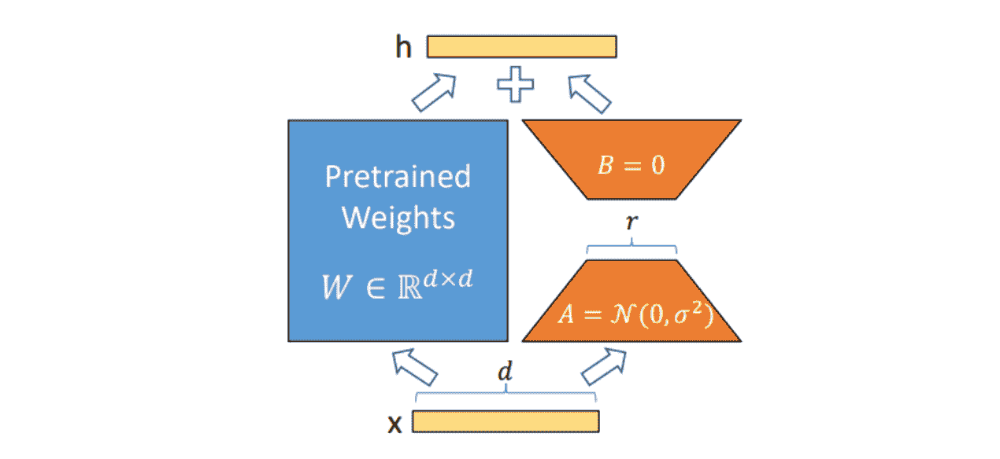

**`LoRA`的原理：**

+ 在标准微调中，我们会修改模型的所有权重，而在 `LoRA` 中，只有某些低秩矩阵（适配器）被训练和调整。这意味着原始模型的参数保持不变，只是通过少量的新参数来调整模型的输出。

+ 低秩矩阵的引入可以在显存和计算能力有限的情况下，依然有效地对大型预训练模型进行微调，从而让 `LoRA` 成为显存较小的设备上的理想选择。

**`LoRA`的优势：**

1. **显存优化：** 只需要调整少量的参数（适配器），显著减少了显存需求，适合显存有限的`GPU`。

2. **计算效率：** 微调过程中的计算负担也更轻，因为减少了需要调整的参数量。

3. **灵活性：** 可以与现有的预训练模型轻松结合使用，适用于多种任务，如文本生成、分类、问答等。


## 1. QLoRA 技术介绍

而`QLoRA`（Quantized Low-Rank Adaptation）是`LoRA`的一个扩展版本，它结合了`LoRA`的低秩适配器和量化技术。`QLoRA`进一步优化了计算效率和存储需求，特别是在极端显存受限的环境下。与`LoRA`不同的是，`QLoRA`会将插入的低秩适配器层的部分权重进行量化（通常是量化为`INT4`或`INT8`），在保持性能的同时显著降低模型的存储和计算需求。

+   **核心思想：** 在`LoRA`的基础上加入量化技术，减少权重表示的位数，从而降低显存和计算需求。`QLoRA`结合了低秩适配器和量化的优点，能够在显存有限的设备上进行更高效的微调。

+   **量化：** 通过将模型权重量化为低精度（如`INT4`），减少内存占用，并提高推理和训练速度。

+   优势：

+   在显存非常有限的情况下仍能进行微调。

+   可以处理更大规模的模型。

+   适合用于边缘设备和需要低延迟推理的场景。

`LoRA`与`QLoRA`二者对比如下

| 特性 | `LoRA` | `QLoRA` |

| --- | --- | --- |

| **核心技术** | 低秩适配器（Low-Rank Adapters） | 低秩适配器 + 量化技术（Low-Rank Adapters + Quantization） |

| **适用场景** | 显存受限，但设备性能较好 | 极限显存受限或需要快速推理的设备 |

| **计算效率** | 提高计算效率，减少调整的参数数量 | 进一步提升效率，减少内存使用并加快推理速度 |

| **量化技术** | 无量化 | 将权重量化为低精度（如`INT4`或`INT8`） |

| **内存消耗** | 较低，但不如`QLoRA`低 | 显著降低内存消耗，适合更小的设备 |

| **训练复杂度** | 较简单，适用于大多数微调场景 | 需要更多的量化和适配工作，但适合超大模型和设备受限场景 |

> 微调原理参考：【入门】大语言模型常用微调框架介绍|`https://www.bilibili.com/video/BV1Yc411g78a/`

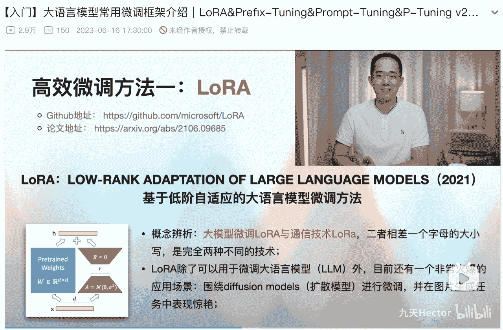

### 2. 高效微调的应用场景

在实际大模型应用场景中，高效微调主要用于以下四个方面：

+   **对话风格微调**：高效微调可以用于根据特定需求调整模型的对话风格。例如，针对客服系统、虚拟助理等场景，模型可以通过微调来适应不同的 语气、礼貌程度 或 回答方式，从而在与用户互动时提供更符合要求的对话体验。通过微调少量的参数（例如对话生成的策略、情感表达等），可以使模型表现出更具针对性和个性化的风格。

+   **知识灌注**：知识灌注是指将外部知识或领域特定的信息快速集成到已有的预训练模型中。通过高效微调，模型可以更好地学习新领域的专有知识，而无需重新从头开始训练。例如，对于法律、医疗等专业领域，可以使用少量的标注数据对预训练模型进行微调，帮助模型理解特定行业的术语、规则和知识，进而提升专业领域的问答能力。

+   **推理能力提升**：高效微调还可以用于提升大模型的推理能力，尤其是在处理更复杂推理任务时。通过微调，模型能够更加高效地理解长文本、推理隐含信息，或者从数据中提取逻辑关系，进而在多轮推理任务中提供更准确的答案。这种微调方式可以帮助模型在解答复杂问题时，提高推理准确性并减少错误。

+   **Agent能力（`Function calling`能力、或者`MCP`能力）提升**：在多任务协作或功能调用场景中，高效微调能够显著提升模型的Agent能力，使得模型能够有效地与其他系统进行交互、调用外部API或执行特定任务。通过针对性微调，模型可以学会更精准的功能调用策略、参数解析和操作指令，从而在自动化服务、智能助手或机器人控制等领域表现得更加高效和智能。

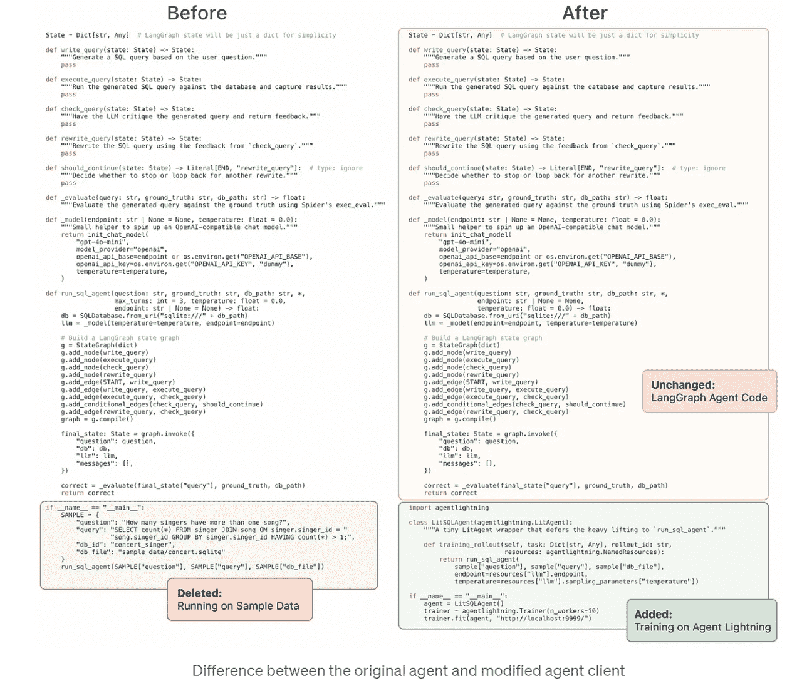

### 3. 主流微调工具介绍

在入手学习大模型微调时，首先推荐功能层次封装层次较高的微调四套工具：`unsloth`、`LLaMA-Factory`、`ms-SWIFT`和`ColossalAI`。除此之外，也可以借助更加底层的库，如`peft`、`LoRA`、`transformers`等实现高效微调。对于初学者来说，首先使用现成工具来进行微调，四种工具基本说明如下。

#### 3.1 unsloth

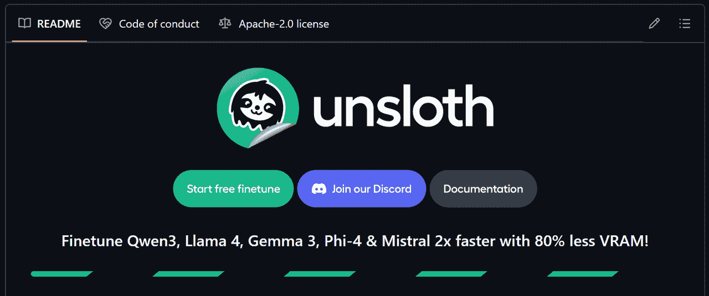

+   `unsloth` GitHub主页：`https://github.com/unslothai/unsloth`

`unsloth` 是一个专为大型语言模型（LLM）设计的动态量化与微调框架，旨在提高微调效率并减少显存占用。 它通过手动推导计算密集型数学步骤并手写 GPU 内核，实现了无需硬件更改即可显著加快训练速度。

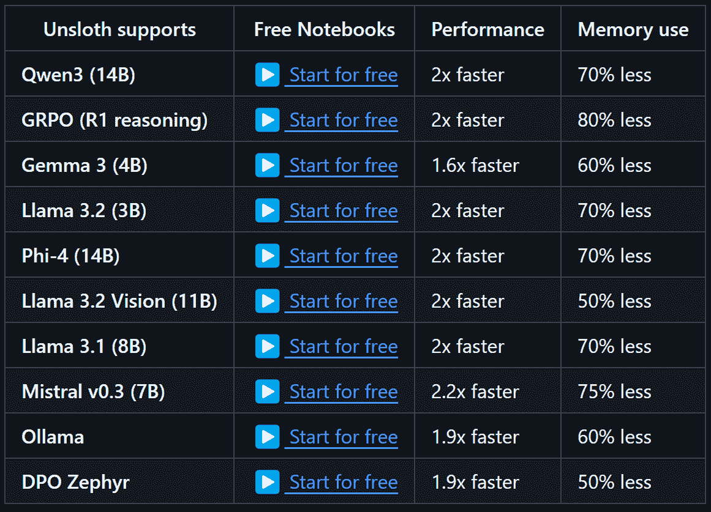

`unsloth` 与 `HuggingFace` 生态兼容，可以很容易地`transformers`、`peft`、`trl` 等库结合，以实现模型的监督微调（`SFT`）和直接偏好优化（`DPO`），仅需模型的加载方式，无需对现有训练代码进行修改。

+   Unsloth动态量化模型：`https://unsloth.ai/blog/dynamic-v2`

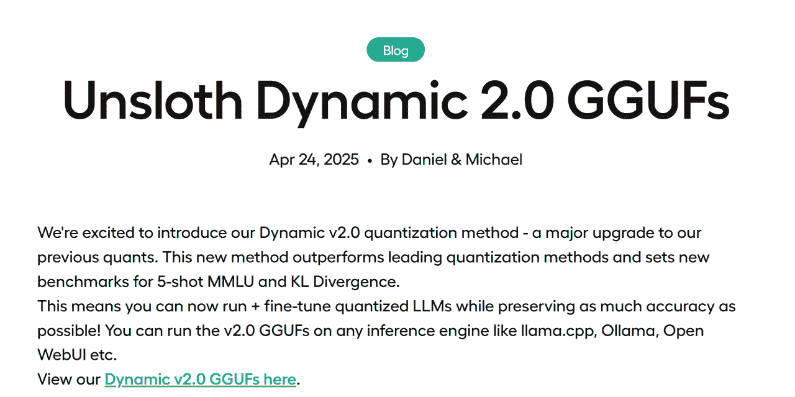

Unsloth 的动态量化方法，特别是其最新的 Dynamic 2.0 版本，旨在在尽量减少性能损失的同时显著压缩大型语言模型（LLMs）的体积。尤其是 4-bit 动态量化版本，现有的评测显示其性能下降非常有限，甚至在某些任务上与原始模型相当。具体评测结果如图所示：

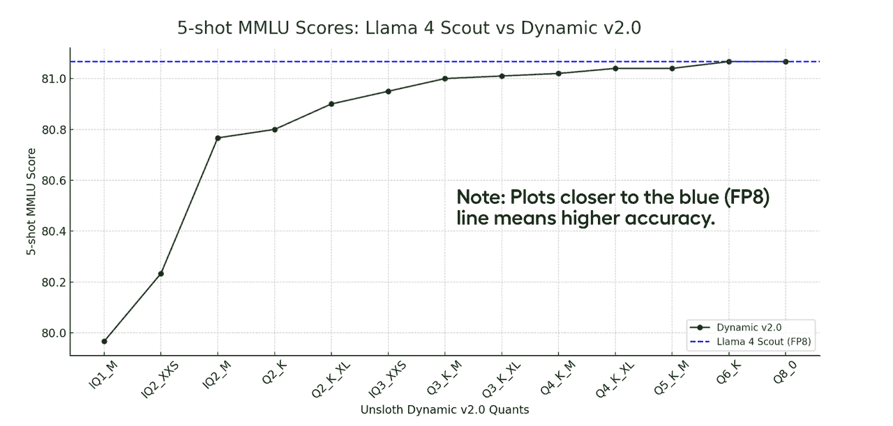

另外，曾经有一篇关于 Qwen3 模型在 4-bit 动态量化下的具体性能下降数据尚不全面。然而，根据最近的一项研究，Qwen3 模型在4bit动态量化时，仅损失不到1%的性能。

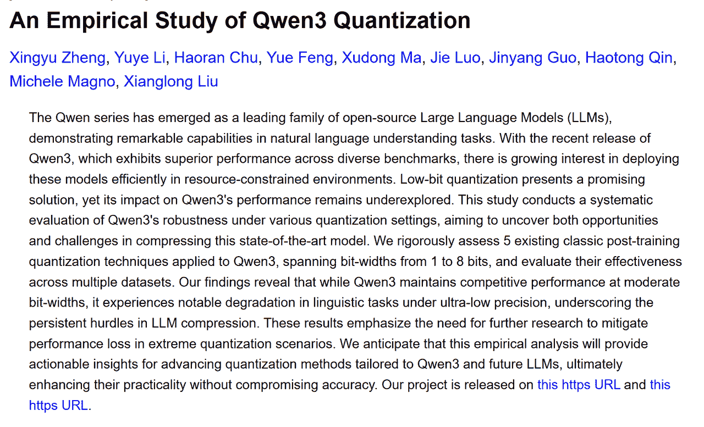

> 论文地址：`https://arxiv.org/abs/2505.02214`

这也使得`Unsloth`的动态量化模型成为个人配置下的最佳微调工具。

不过需要注意的是，动态量化由利也有弊，其好处在于可以极大程度压缩模型运行所需占用的显存大小，同时几乎不损失性能，但问题在于动态量化的模型，无论是推理还是微调，只能单卡运行，这就使得其吞吐量有限，无法在一台物理机上实现多GPU并行从而扩大吞吐量。

**主要功能点：**

+   **高效微调：** `unsloth` 通过深度优化，使 LLM 的微调速度提高 2-5 倍，显存使用量减少约 80%，且准确度无明显下降。

+   **广泛的模型支持：** 目前支持的模型包括目前各类主流模型，用户可以根据需求适合的模型进行微调。

+   **兼容性：** `unsloth` 与 `HuggingFace`生态系统兼容，用户可以轻松将其与 `transformers`、`peft`、`trl` 等库结合，实现模型的监督微调（`SFT`）和直接偏好优化（`DPO`），仅需修改模型的加载方式，无需对现有训练代码进行过多修改。

+   **内存优化：** 通过 4 位和 16 位的 `QLoRA`/`LoRA` 微调，`unsloth` 显著了显存占用，使得在资源受限的环境中也能大的微调。

**unsloth核心优势：**

+   **显著提升微调效率：** 相比传统方法，`Unsloth`采用独家4bit动态量化技术，能够在更短的时间内完成微调任务，节省时间成本。

+   **降低硬件要求：** 通过优化显存使用，用户可以在显存较小的 GPU 上进行大模型的微调，降低了硬件门槛。

+   **开源免费：** `Unsloth` 提供开源版本，用户可以在 Google Colab 或 Kaggle Notebooks 上免费试用，方便上手体验。

总的来说，`unsloth` 为大型语言模型的微调提供了高效、低成本的解决方案，适合希望在有限资源下进行模型微调的开发者和研究人员。

+   `Unsloth`与`GPT-OSS`模型搭配特性

`Unsloth` 在 `GPT-OSS` 模型的适配上展现出独特优势。它不仅解决了 `MXFP4` 权重在常规模型框架中无法直接训练的局限，还为这一精度格式编写了专门的反向传播与训练算子，使开发者能够在无需上采样的前提下直接对 `MXFP4` 权重进行高效微调，从而显著降低显存开销与硬件门槛。在推理环节，`Unsloth` 同样全面支持 `GPT-OSS` 的 `Harmony` 提示词模板、可控推理参数以及工具调用机制，保证了从数据预处理到训练与推理的流程一致性与稳定性。凭借这些特性，`Unsloth` 已成为当前最契合 `GPT-OSS` 的工具链，无论是大规模推理部署还是资源受限环境下的高效微调，都能够提供兼具实用性与灵活性的解决方案。

#### 3.2 LLaMA-Factory

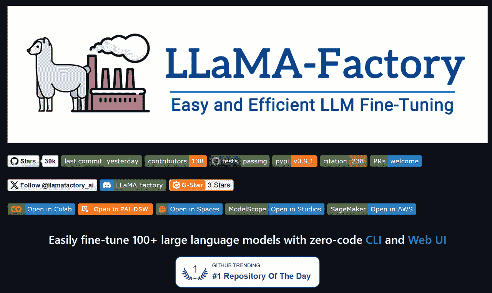

+   `LLaMA-Factory` GitHub主页：`https://github.com/hiyouga/LLaMA-Factory`

`LLaMA-Factory` 是一个统一且高效的微调框架，旨在为超过 100 种大型语言模型（LLMs）和视觉语言模型（VLMs）提供便捷的微调支持。 用户能够灵活地定制模型以适应各种下游任务。

**主要功能和特点：**

+   **广型支持：** `LLaMA-Factory` 支持对 100 多LLMs 和 VLMs 进行微调，包括最新的模型版本，如 `Llama 3`、`GLM-4`、`Mistral Small`、`PaliGemma2` 等。

+   **高效的微调方法：** 框架集成了多nk Adaptation）、`QRA`（Quantized LoRA）等，以提高训练速度并减少显存占用。

+   **多模态任务支持：** 除了传统的文本任务外，`LLaMA-Factory` 还支频识别、音频理解等多种任务类型。

+   **实验监控：** 提供了丰富的实验监控工具，如 `LlamaBoard`、`TensorBoard`、`Wandb`、`MLflow`、练过程。

+   **快速：** 框架提供了类似 OpenAI 风格的 API、`Gradio` UI 和命令行界面，并结合 `vLLM` worker，实现了高效的推理能力。

#### 3.3 ms-SWIFT

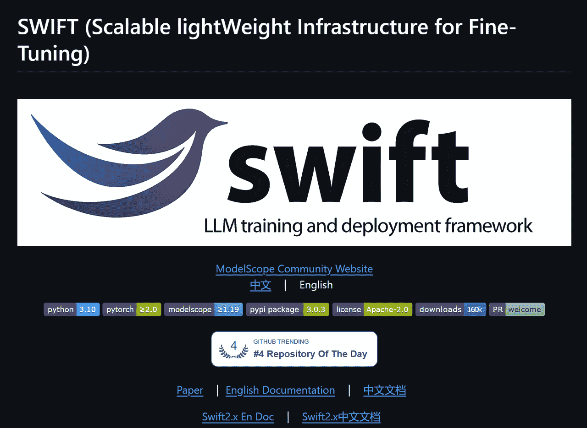

+   `ms-SWIFT` GitHub项目主页：`https://github.com/modelscope/swift`

`ms-swift`（Scalable lightWeight Infrastructure for Fine-Tuning）是由魔搭社区（ModelScope）开发的高效微调和部署框架，旨在为研究人员和开发者提供一站式的大模型与多模态大模型的训练、推理、评测、量化和部署解决方案。 的模型支持：** `ms-swift` 支持超过 450 种大型模型（LLMs）和 150 多种多模态大模型（MLLMs）的训练和部署**，包括最新的模型版本，如 `Qwen2.5`、`InternLM3`、`GLM4`、`Llama3.3`、`Mistral`、`DeepSeek-R1`、`Yi1.5`、`Baichuan2`、`Gemma2` 等，以及多模态模型如 `Qwen2.5-VL`、`Qwen2-Audio`、`Llama3.2-Vision`、`Llava`、`InternVL2.5` 等。

+   **多样化的训练技术：** 框架集`oRA`、`Llama-Pro`、`LonoRA`、`GaLore`、`Q-GaLore`、`LoRA+`、`LISA`、`DoRA`、`FourierFt`、`ReFT`、`UnSloth` 和 `Liger` 等，满足不同的微调需求。

+   **轻量级微调：** 支持多种轻量级微调方法，如 `LoRA`、`QLoRA`、`DoLLaMAPro`、`Adapt`、`GaLore`、`Q-Galore`、`LISA`、`UnSloth`、`Liger-Kernel` 等，降低显存和计算资源的消耗。

+   **分布式训练：** 支持分布式数据并行（`DDP`）、`DeepSpeed ZeRO2`/`ZeRO3`、`FSDP` 等技术，提升推理加速：** 提供 `BNBWQ`、`GPTQ`、`AQLM`、`H🐧`、`EETQ` 等量化方法，并支持使用 `vLLM` 和 `LMDeploy` 对推理、评测和部署 支持图像、视频和语音等多种模态型训练，涵盖 `VQA`、`Caption`、`OCR`、`Grounding` 等任务。

+   **用户友好的界面：** 提供基于 `Gradio` 的 `We`和量化操作，简化了大模型的全链路流程。

#### 3.4 ColossalAI

+   `ColossalAI` GitHub项目主页：`https://github.com/hpcaitech/ColossalAI`

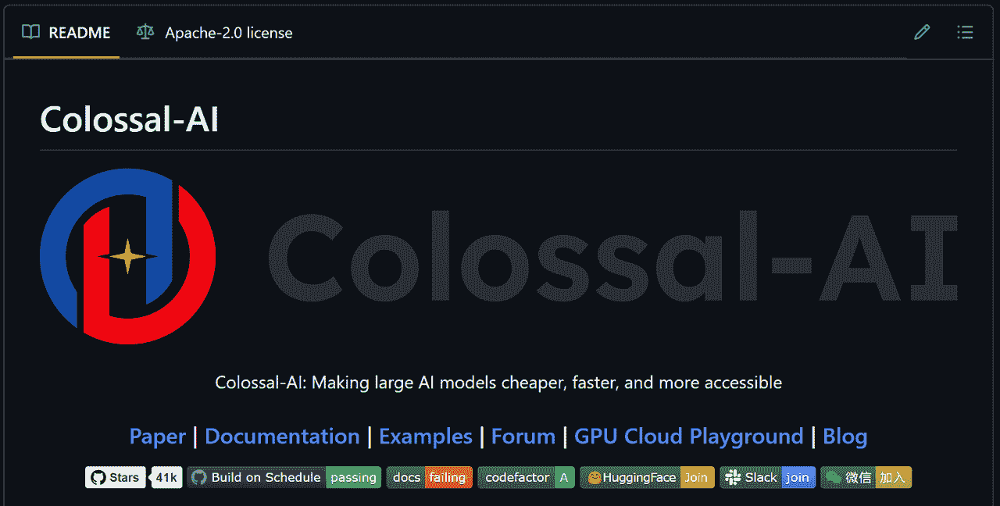

`Colossal-AI` 是一个高效的分布式人工智能训练系统，旨在最大化提升人工智能训练效率，同时最小化训练成本。作为深度学习框架的内核，`Colossal-AI` 提供了自动超高维并行、大规模优化库、自适应任务调度、内存优化以及最新模型复现等前沿技术。与英伟达的 `Megatron-LM` 相比，`Colossal-AI` 仅需一半数量的 GPU 即可完成 `GPT-3` 训练，半小时内预训练 `ViT-Base/32`，并在两天内训练完 15 亿参数的 `GPT` 模型。此外，`Colossal-AI` 提供了多种并行技术，如数据并行、流水线并行和张量并行，以加速模型训练。 citeturn0search1该项目自开源以来，迅速登上 `GitHub` 热榜，成为解放 AI 生产力的最佳选择。

并且，`ColossalAI`也是目前唯一支持`DeepSeek R1`非量化模型高效微调的框架，仅需4个节点、8卡`A100`服务器即可完成`DeepSeek R1`高效微调。


> 注一：若是强化学习训练，则推荐`veRL`和`OpenRLHF`等框架。

> 注二：其他更底层微调框架推荐

| 框架 | 优势 | 适用场景 |

| --- | --- | --- |

| `Hugging Face` | 高度兼容，易用，文档丰富 | 一般 NLP 任务，模型选择丰富 |

| `LoRA` | 显存节省，减少微调计算量 | 显存有限的设备，微调大规模模型 |

| `PEFT` | 高效微调，低计算开销 | 资源有限的环境，适合大规模预训练模型的微调 |

| `DeepSpeed` | 大规模分布式训练，显存优化 | 超大规模训练，多卡分布式训练 |

| `AdapterHub` | 低资源消耗，快速微调 | 多任务微调，资源有限的环境 |

| `Alpaca-LoRA` | 生成任务优化，`LoRA` 技术结合 | 对话生成、文本生成 |

| `FastChat` | 对话系统微调，快速集成 | 对话生成任务，尤其是对 `ChatGPT` 等模型微调 |

| `FairScale` | 大规模分布式训练优化，自动化优化 | 多卡分布式训练，大规模微调 |

### 4. 模型性能评估框架`EvalScope`

+   项目地址：`https://github.com/modelscope/evalscope`

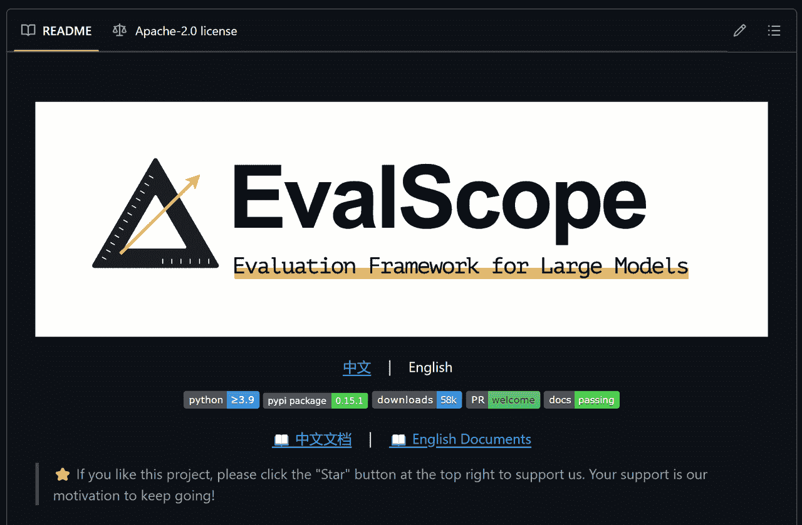

**`EvalScope`** 是由阿里巴巴魔搭社区（ModelScope）推出的一款开源模型评估框架，旨在为大语言模型（LLM）和多模态模型提供统一、系统化的性能评估方案。该框架具备高度的自动化和可扩展性，适用于研究机构、工业界以及模型开发者在模型验证与性能对比场景中的广泛需求。

`EvalScope` 的核心功能和特点包括：

1.  **丰富的评测基准覆盖**：框架内置多种权威评测数据集，涵盖中英文通用知识问答（如 `MMLU`、`CMMLU`、`C-Eval`）、数学推理（如 `GSM8K`、`MATH`）、常识判断（如 `HellaSwag`、`ARC`）、代码生成（如 `HumanEval`）等多个方向，支持对模型能力进行多维度评估。

1.  **多样的评估模式支持**：`EvalScope` 提供三种灵活的评估模式，包括单模型评估模式（`Single`）、基于基线的两两对比模式（`Pairwise-Baseline`）、以及全模型两两对比模式（`Pairwise-All`），可满足从快速诊断到全面对比的不同使用场景。

1.  **统一的模型接入接口**：框架对不同类型的模型提供统一的调用方式，兼容 `HuggingFace`、本地部署模型及 `API` 远程调用，支持标准的 `generate` 与 `chat` 接口，大大降低了模型集成的复杂度。

1.  **评估流程高度自动化**：`EvalScope` 实现了评测任务的全自动执行，包括客观题自动打分、复杂问题使用评审模型辅助判定结果等，支持批量评估与日志记录，极大提升了评估效率与结果一致性。

1.  **完善的性能与能力可视化工具**：框架支持生成详细的评估报告和图表，展示模型在不同任务维度下的表现，便于开发者进行横向对比和性能分析。

1.  **多后端与评测能力扩展**：`EvalScope` 可集成多个评测后端，如 `OpenCompass`、`VLMEvalKit`、`RAGEval` 等，支持从单模态到多模态、从语言建模到 `RAG` 端到端评测的全链路能力。

1.  **支持部署性能测试**：除评估模型能力外，`EvalScope` 还提供服务端推理性能测试工具，涵盖吞吐量、响应时延等关键指标，帮助开发者评估模型的部署实用性。

公开课中我们将借助`EvalScope`进行模型微调前后的性能对比测试。

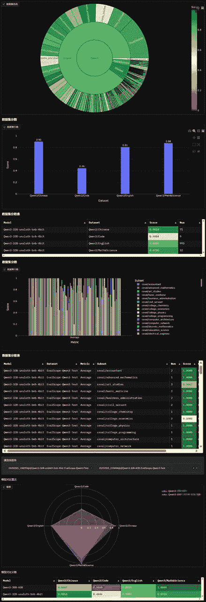

### 5. 微调所需软硬件环境说明

大模型微调属于大模型进阶类技术，不同于普通的模型对话或搭建基础应用，微调往往需要一定的软硬件条件支持。

+   大模型微调所需硬件一览

硬件方面，不同尺寸模型、不同精度微调时所需显存如下：

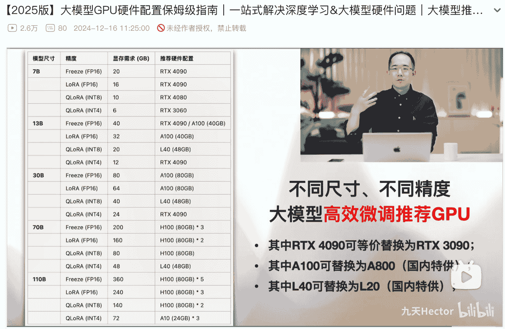

> 更多大模型基础硬件配置要求，详见公开课《【2025版】大模型GPU硬件配置保姆级指南》|`https://www.bilibili.com/video/BV1VFqZYSEoj`


## `gpt-oss`系列模型微调所需显存一览

以下是`gpt-oss`系列模型高效微调显存占用预估表：

| 模型 | 激活专家数量（Top-k） | 激活专家总参数量 | 共享参数量（Attention + Embedding） | 推理所需显存（MXFP4） | 全量训练推荐显存 | 高效微调所需显存（QLoRA） |

| --- | --- | --- | --- | --- | --- | --- |

| `gpt-oss-20b` | **4**（每层 32 专家里选 Top-4） | **3.61B** | **≈1.80B** | **≈16 GB** | **≈234–312 GB** | **≈14 GB** |

| `gpt-oss-120b` | **4**（每层 128 专家里选 Top-4） | **5.13B** | **≈2.12B** | **≈80 GB** | **≈1.31–1.74 TB** | **≈65 GB** |

公开课中将采用 H800 单卡 GPU 服务器（80G）为大家展示`gpt-oss-20b`动态量化模型的高效微调流程，同学们可以根据自己实际硬件条件，选取不同模型进行微调，更换不同模型仅需要下载不同模型权重即可，其他流程完全一致。

> 注1：CPU 及 Mac M 系列芯片不能进行微调；

> 注2：目前 MoE 模型只支持 4bit 普通量化微调，暂不支持动态量化微调。

## 操作系统选择

而操作系统方面，由于绝大多数工业场景下微调会涉及多卡微调，目前只有 `Linux` 系统对 `DeepSpeed` 和其他多卡并行加速库支持较好，因此绝大多数工业场景下都会使用 `Ubuntu` 操作系统或 `CentOS` 操作系统。本节公开课我们以 `Ubuntu` 系统为例来进行高效微调。

若无相关软件环境，本节公开课的相关代码也可以在 `Windows` 下运行（本节微调示例不涉及多卡并行）。但若想体验更加真实的工业场景下的微调流程，也可以考虑在 `AutoDL` 上租赁显卡并配置 `Ubuntu` 服务器来完成操作，例如租赁 `3090` 显卡，每小时仅需 1.5 元，可以微调 `gpt-oss-20b` 动态量化模型，运行两小时即可得到结果，仅需不到 5 元即可完成训练：

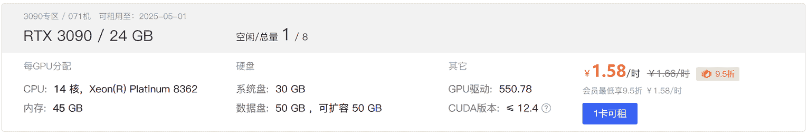

> `AutoDL` 相关操作详见公开课：《`AutoDL` 快速入门与 GPU 租赁使用指南》| https://www.bilibili.com/video/BV1bxB7YYEST/


## 6. 公开课课件领取

👇扫码即可领取全部课程资料👇


## 三、`gpt-oss`模型高效微调环境准备

接下来开始进行模型高效微调前的环境准备工作。需要注意的是，为了更好的复现企业级模型微调全流程，本次公开课将需要使用如下四项工具：

+ 【必须】`Unsloth`：高效微调框架，必须安装使用；

+ 【可选】`vLLM`：模型调度框架，用于验证微调后模型效果，也可以使用 `ollama` 或者其他调度框架进行模型微调后效果验证；

+ 【可选】`EvalScope`：模型评测框架，用于对比微调前后模型性能，也可以通过人工观察进行评估；

+ 【可选】`wandb`：模型训练数据在线记录工具，用于保存模型训练过程中损失之的变化情况，并监控服务器硬件数据；

若想尽快完成微调，可以只安装 `Unsloth` 即可，若希望完整执行完微调、过程监督和效果测试各环节，则需要完整安装完各框架工具。

### 1. `Unsloth` 安装部署

由于要安装多个项目，因此建议创建虚拟环境以避免依赖冲突。这里首先为 `Unsloth` 创建虚拟环境：

```
conda create --name unsloth python=3.12
conda init
source ~/.bashrc
conda activate unsloth
```

然后在虚拟环境中安装 `Jupyter` 及 `Jupyter Kernel`：

```
conda install jupyterlab
conda install ipykernel
python -m ipykernel install --user --name unsloth --display-name "Python unsloth"
```

然后使用如下命令安装 `Unsloth`：

```
pip install numpy
pip install -i https://repo.huaweicloud.com/repository/pypi/simple \
    "torch>=2.8.0" "triton>=3.4.0" \
    "unsloth_zoo[base] @ git+https://github.com/unslothai/unsloth-zoo" \
    "unsloth[base] @ git+https://github.com/unslothai/unsloth" \
    torchvision bitsandbytes \
    git+https://github.com/huggingface/transformers \
    git+https://github.com/triton-lang/triton.git@05b2c186c1b6c9a08375389d5efe9cb4c401c075#subdirectory=python/triton_kernels
```

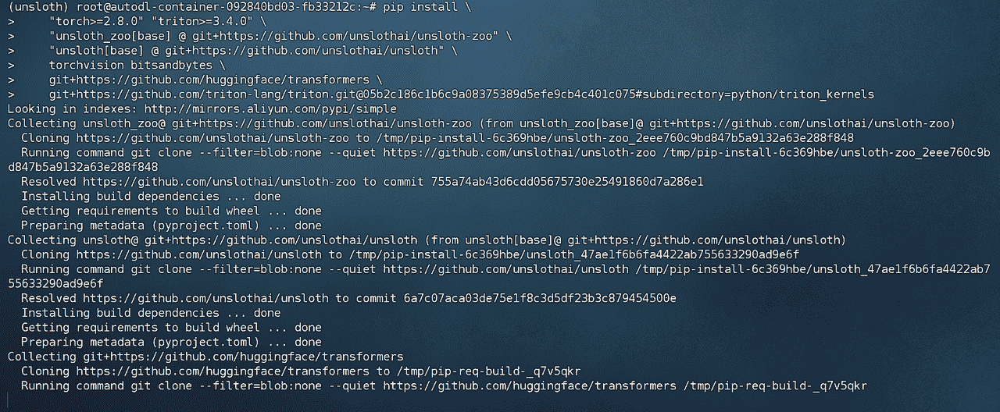

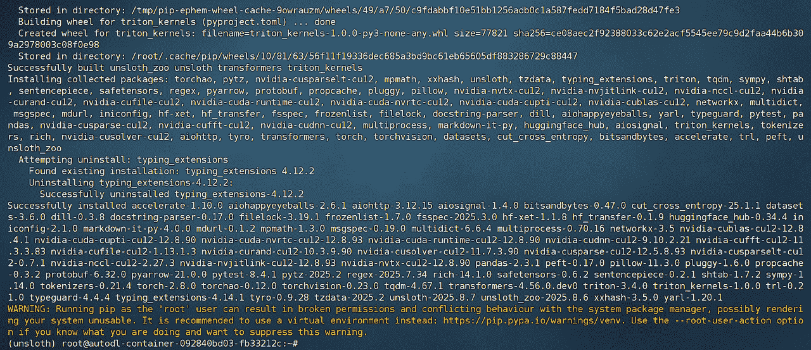

安装完成后在任意 `Jupyter` 中选择 `unsloth` kernel，即可进入对应的虚拟环境进行代码编写：

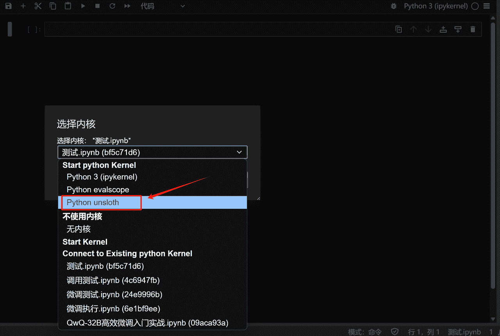

可以输入如下代码进行测试

```
from unsloth import FastLanguageModel
import torch
```

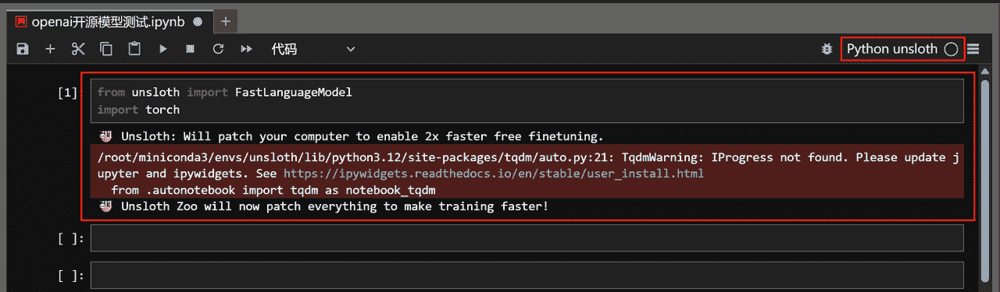

### 2. `vLLM` 安装部署与 `gpt-oss` 模型权重下载

#### 2.1 `vLLM` 安装部署

接下来继续安装 `vLLM`，若是在 `AutoDL` 上租赁的服务器，则可以在默认环境中进行安装，其他服务器上建议创建虚拟环境进行安装。虚拟环境创建流程如下（`AutoDL` 不用）：

```
conda create --name vllm python=3.12
conda init
source ~/.bashrc
conda activate vllm
```

`vllm` 主要提供后台的模型调用服务，因此不用安装 `Jupyter Kernel`。

接下来继续进行 `vllm` 安装：

```
pip install --pre vllm==0.10.1+gptoss \
  --extra-index-url https://wheels.vllm.ai/gpt-oss/ \
  --extra-index-url https://download.pytorch.org/whl/nightly/cu128
```

等待下载完成后，我们即可以使用 `pip show vllm` 命令查看 `vllm` 框架的安装信息，可以明确看到当前安装的 `vllm` 版本号，也就是 0.10.1 版

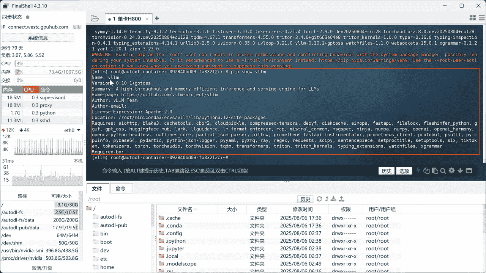

#### 2.2 `gpt-oss` 模型权重下载

接下来进行 `gpt-oss` 模型权重下载，国内网络环境下可以在魔搭社区上进行下载：https://www.modelscope.cn/search?search=gpt-oss ，`gpt-oss` 模型没有更多的量化版本模型，只需要区分普通权重和 `GGUF` 权重即可。

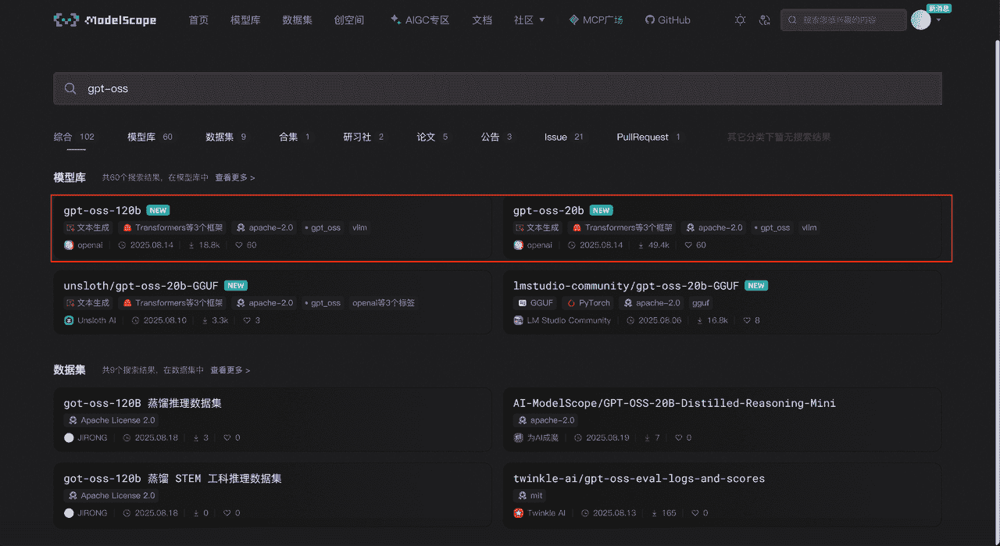

在当前开源大模型的生态中，常见的权重文件主要有两种格式，其一是 `safetensors`，其二是 `GGUF`。二者在用途与设计理念上有所差异。`safetensors` 格式是 `Hugging Face` 主推的一种安全高效的权重存储格式，相较于传统的 `PyTorch` checkpoint（`.bin`）文件，它避免了 `pickle` 带来的潜在安全风险，并且具备更快的加载速度与内存映射能力，广泛用于模型的训练、微调与研究工作场景。由于 `safetensors` 文件结构保持了与 `Hugging Face Transformers` 等框架的高度兼容性，因此在科研和工程实践中已经成为主流的权重格式。而 `GGUF` 则是 `llama.cpp` 社区发展起来的一种专用格式，它的目标是最大化模型在本地设备、尤其是 `CPU` 与消费级 `GPU` 上的推理效率。`GGUF` 在设计上进行了量化与存储优化，支持 `INT8`、`INT4` 等多种低比特精度，能够显著降低显存占用并加快加载速度，非常适合移动端、边缘设备以及需要轻量化推理的场景。简而言之，`safetensors` 更侧重于在训练与研究流程中的安全与兼容性，而 `GGUF` 更偏向于推理部署与资源受限环境下的高效执行。

而 `vLLM` 及 `Unsloth` 默认使用 `satetensor` 权重格式进行调用和微调，因此这里我们可以选择 `OpenAI` 官方的 `20b` 或者 `120b` 模型参数进行下载。在命令行中首先需要安装 `modelscope`：

```
pip install modelscope
```

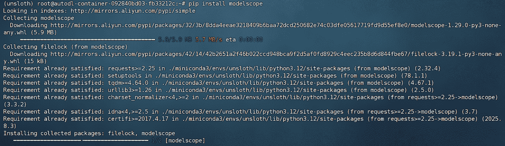

然后创建两个项目目录：

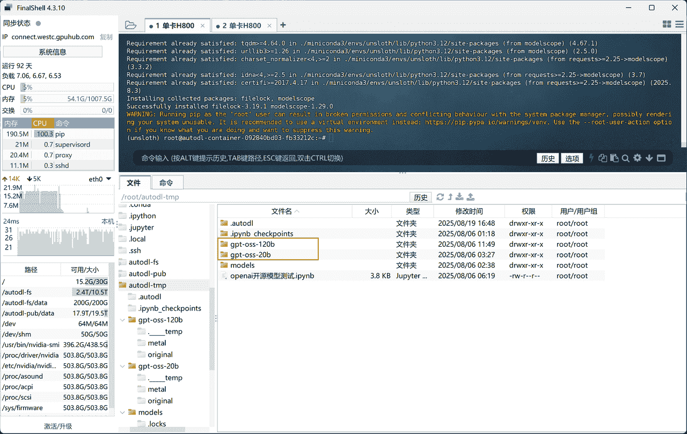

然后选择 `20b` 或者 `120b` 模型进行下载：

```
# 下载 20b 模型
modelscope download --model openai-mirror/gpt-oss-20b --local_dir ./gpt-oss-20b

# 下载 120b 模型
modelscope download --model openai-mirror/gpt-oss-120b --local_dir ./gpt-oss-120b
```

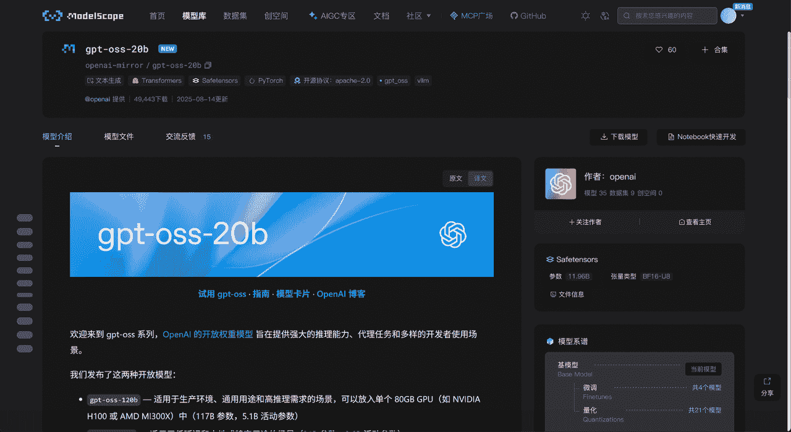

下载完模型权重后即可查看：

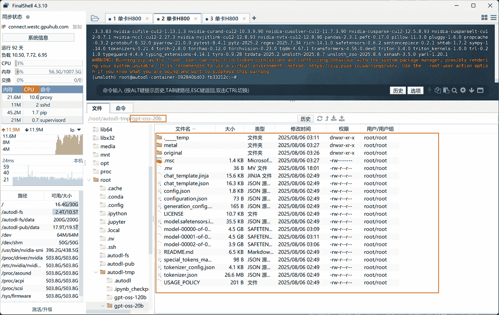

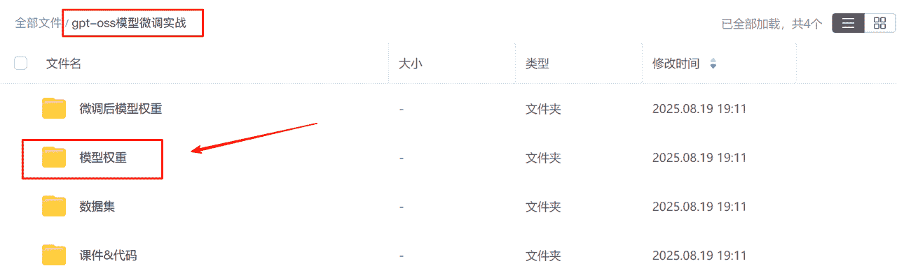


#### 2.3 借助 `vllm` 进行模型调用

下载完模型权重后，接下来即可测试模型调用流程了，首先开启 `vllm` 服务，`GPT-OSS-20B` 模型最低 16G 显存即可运行。因此这里是设置的单卡运行 `vLLM`：

```
# conda activate vllm
# cd ./autodl-tmp
vllm serve ./gpt-oss-20b
```

开启后执行效果如下：

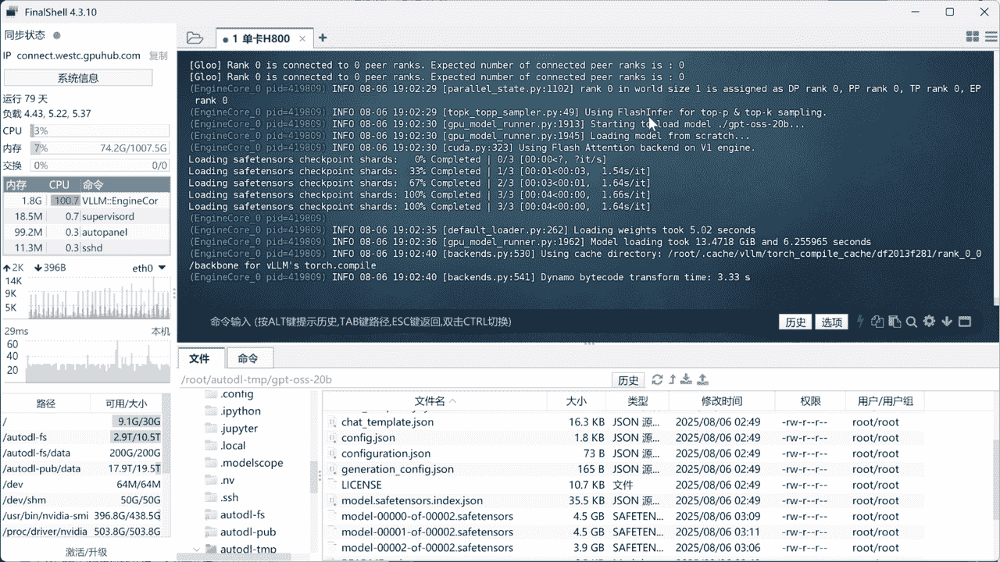

实际显存占用如下：

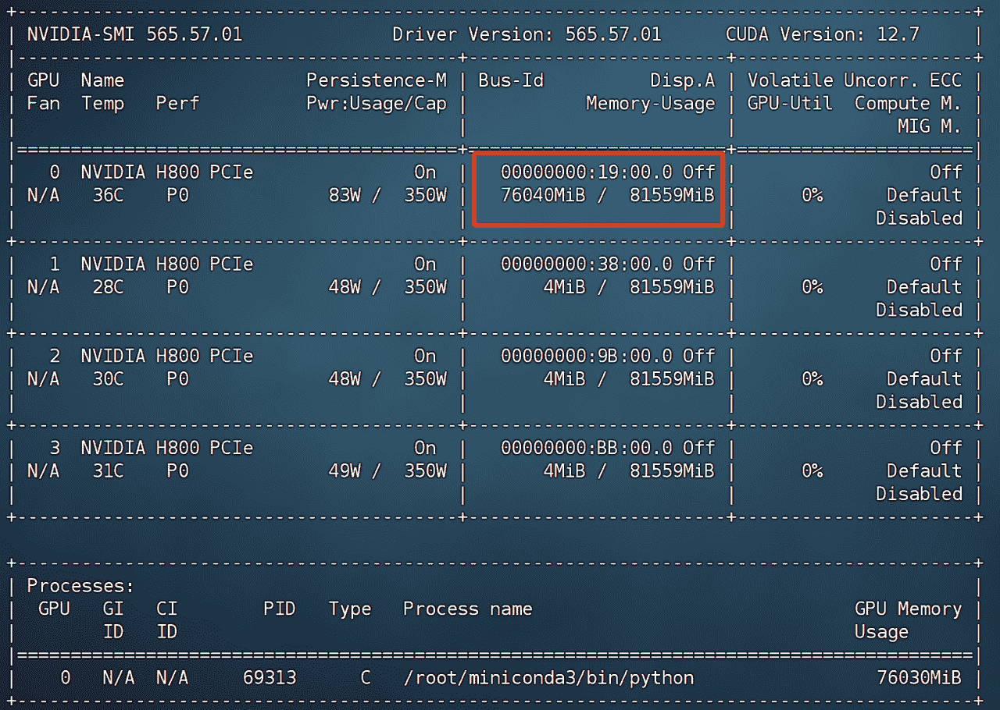

> 注，`vllm` 会占用显卡的 80% 以上显存。实际调用时最低 16G 显存即可调用，最低 22G 显存即可微调。

接下来则可在代码环境中进行调用测试：

```
from openai import OpenAI

client = OpenAI(
    base_url='http://127.0.0.1:8000/v1/',
    api_key='vllm',  # 必须传递该参数
)

prompt = "3.8 和 3.11 哪个更大？"
messages = [
    {"role": "user", "content": prompt}
]

response_low = client.chat.completions.create(
    messages=messages,
    model='./gpt-oss-20b',
    reasoning_effort="low",
)

print(response_low.choices[0].message.content)

# 查看问答结果
response_low.choices[0].message.content

# 查看推理过程
response_low.choices[0].message.reasoning_content
```


然后仅需进行高推理模式测试：

```
response_high = client.chat.completions.create(
    messages=messages,
    model='./gpt-oss-20b',
    reasoning_effort="high",
)

print(response_high.choices[0].message.content)
# 查看模型回复
response_high.choices[0].message.content

# 查看模型推理链
response_high.choices[0].message.reasoning_content
```

结果如下：


### 3. `EvalScope` 安装部署流程

#### 3.1 `EvalScope` 安装流程

接下来进行 `EvalScope` 安装部署，项目官网：https://github.com/modelscope/evalscope

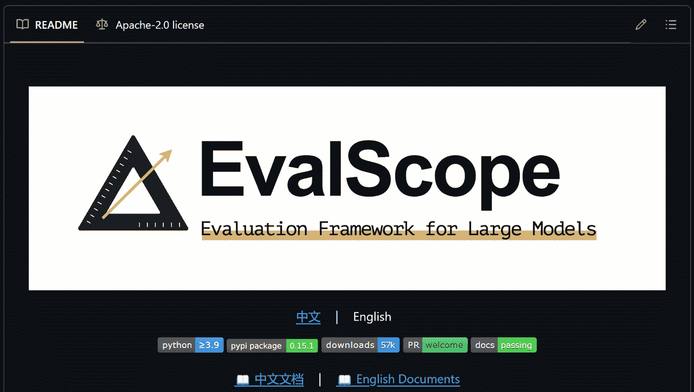

为了避免和 `Unsloth` 的依赖产生冲突，`EvalScope` 需要再单独创建虚拟环境：

```
conda create --name evalscope python=3.12
conda init
source ~/.bashrc
conda activate evalscope

conda install jupyterlab
conda install ipykernel
python -m ipykernel install --user --name evalscope --display-name "Python evalscope"
```

然后安装对应的库

```
pip install evalscope                # 安装 Native backend (默认)
# 额外选项
pip install 'evalscope[opencompass]'   # 安装 OpenCompass backend
pip install 'evalscope[vlmeval]'       # 安装 VLMEvalKit backend
pip install 'evalscope[rag]'           # 安装 RAGEval backend
pip install 'evalscope[perf]'          # 安装 模型压测模块 依赖
pip install 'evalscope[app]'           # 安装 可视化 相关依赖

# 或可以直接输入 all，安装全部模块
# pip install 'evalscope[all]'           # 安装所有 backends (Native, OpenCompass, VLMEvalKit, RAGEval)
```

> 源码安装：

```
git clone https://github.com/modelscope/evalscope.git
cd evalscope/

pip install omegaconf

pip install -e .                  # 安装 Native backend
# 额外选项
pip install -e '.[opencompass]'   # 安装 OpenCompass backend
pip install -e '.[vlmeval]'       # 安装 VLMEvalKit backend
pip install -e '.[rag]'           # 安装 RAGEval backend
pip install -e '.[perf]'          # 安装 模型压测模块 依赖
pip install -e '.[app]'           # 安装 可视化 相关依赖
pip install -e '.[all]'           # 安装所有 backends (Native, OpenCompass, VLMEvalKit, RAGEval)
```

#### 3.2 借助 `EvalScope` 进行压力测试

紧接着，我们就可以尝试进行模型的压力测试，可以测试当前 `gpt-oss` 模型在单卡 H800 上，由 `vllm` 调度框架驱动时的实际性能表现：


```
evalscope perf \
    --url &quot;http://127.0.0.1:8000/v1/chat/completions&quot; \
    --parallel 5 \
    --model ./gpt-oss-20b \
    --number 20 \
    --api openai \
    --dataset openqa \
    --stream
```

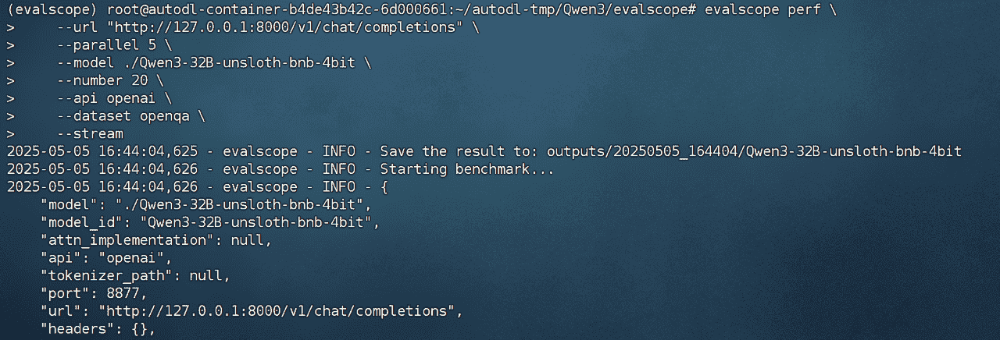

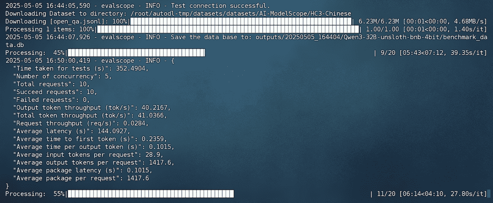

输出结果保存在：`outputs/20250505_164404/gpt-oss`中：

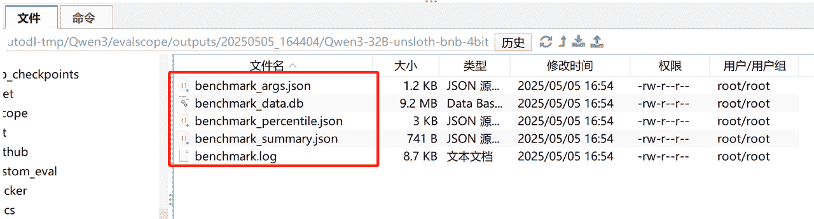

然后即可在`summary.json`中查看压测的benchmark


# 3.3 进行模型性能评估

接下来即可进一步进行模型性能评估。这里我们先尝试对其进行初始状态下的性能评估，然后等微调结束后，再进行新一轮的评估，进而对比微调前后模型性能变化情况。这里需要在Jupyter中选择`evalscope` kernel：

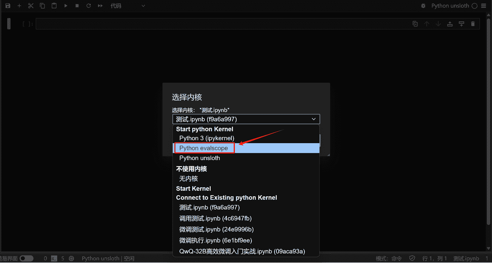

然后运行如下代码：

【可选】数据集构造代码：

```
from evalscope.collections import CollectionSchema, DatasetInfo, WeightedSampler
from evalscope.utils.io_utils import dump_jsonl_data

schema = CollectionSchema(name=&#x27;Qwen3&#x27;, datasets=[
    CollectionSchema(name=&#x27;English&#x27;, datasets=[
        DatasetInfo(name=&#x27;mmlu_pro&#x27;, weight=1, task_type=&#x27;exam&#x27;, tags=[&#x27;en&#x27;], args={&#x27;few_shot_num&#x27;: 0}),
        DatasetInfo(name=&#x27;mmlu_redux&#x27;, weight=1, task_type=&#x27;exam&#x27;, tags=[&#x27;en&#x27;], args={&#x27;few_shot_num&#x27;: 0}),
        DatasetInfo(name=&#x27;ifeval&#x27;, weight=1, task_type=&#x27;instruction&#x27;, tags=[&#x27;en&#x27;], args={&#x27;few_shot_num&#x27;: 0}),
    ]),
    CollectionSchema(name=&#x27;Chinese&#x27;, datasets=[
        DatasetInfo(name=&#x27;ceval&#x27;, weight=1, task_type=&#x27;exam&#x27;, tags=[&#x27;zh&#x27;], args={&#x27;few_shot_num&#x27;: 0}),
        DatasetInfo(name=&#x27;iquiz&#x27;, weight=1, task_type=&#x27;exam&#x27;, tags=[&#x27;zh&#x27;], args={&#x27;few_shot_num&#x27;: 0}),
    ]),
    CollectionSchema(name=&#x27;Code&#x27;, datasets=[
        DatasetInfo(name=&#x27;live_code_bench&#x27;, weight=1, task_type=&#x27;code&#x27;, tags=[&#x27;en&#x27;], args={&#x27;few_shot_num&#x27;: 0, &#x27;subset_list&#x27;: [&#x27;v5_v6&#x27;], &#x27;extra_params&#x27;: {&#x27;start_date&#x27;: &#x27;2025-01-01&#x27;, &#x27;end_date&#x27;: &#x27;2025-04-30&#x27;}}),
    ]),
    CollectionSchema(name=&#x27;Math&amp;Science&#x27;, datasets=[
        DatasetInfo(name=&#x27;math_500&#x27;, weight=1, task_type=&#x27;math&#x27;, tags=[&#x27;en&#x27;], args={&#x27;few_shot_num&#x27;: 0}),
        DatasetInfo(name=&#x27;aime24&#x27;, weight=1, task_type=&#x27;math&#x27;, tags=[&#x27;en&#x27;], args={&#x27;few_shot_num&#x27;: 0}),
        DatasetInfo(name=&#x27;aime25&#x27;, weight=1, task_type=&#x27;math&#x27;, tags=[&#x27;en&#x27;], args={&#x27;few_shot_num&#x27;: 0}),
        DatasetInfo(name=&#x27;gpqa&#x27;, weight=1, task_type=&#x27;knowledge&#x27;, tags=[&#x27;en&#x27;], args={&#x27;subset_list&#x27;: [&#x27;gpqa_diamond&#x27;], &#x27;few_shot_num&#x27;: 0})
    ])
])

# get the mixed data
mixed_data = WeightedSampler(schema).sample(100000000)  # set a large number to ensure all datasets are sampled
# dump the mixed data to a jsonl file
dump_jsonl_data(mixed_data, &#x27;outputs/gpt-oss_test.jsonl&#x27;)
```

创建好的完整数据集已上传至课件网盘：

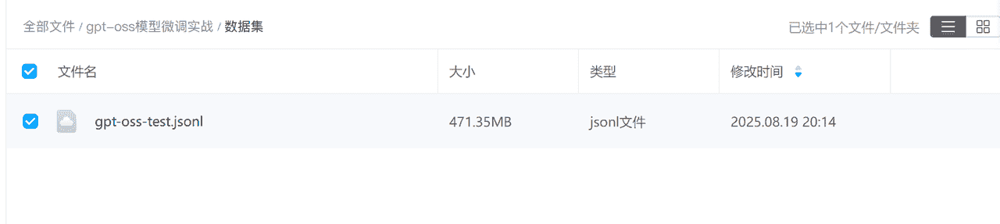


评测代码：

```
from evalscope import TaskConfig, run_task
task_cfg = TaskConfig(
    model=&#x27;./gpt-oss-20b&#x27;,
    api_url=&#x27;http://127.0.0.1:8000/v1/chat/completions&#x27;,
    eval_type=&#x27;service&#x27;,
    datasets=[
        &#x27;data_collection&#x27;,
    ],
    dataset_args={
        &#x27;data_collection&#x27;: {
            &#x27;dataset_id&#x27;: &#x27;modelscope/EvalScope-Qwen3-Test&#x27;,
            &#x27;filters&#x27;: {&#x27;remove_until&#x27;: &#x27;&lt;/think&gt;&#x27;}  # 过滤掉思考的内容
        }
    },
    eval_batch_size=128,
    generation_config={
        &#x27;max_tokens&#x27;: 30000,  # 最大生成token数，建议设置为较大值避免输出截断
        &#x27;temperature&#x27;: 0.6,  # 采样温度 (qwen 报告推荐值)
        &#x27;top_p&#x27;: 0.95,  # top-p采样 (qwen 报告推荐值)
        &#x27;top_k&#x27;: 20,  # top-k采样 (qwen 报告推荐值)
        &#x27;n&#x27;: 1,  # 每个请求产生的回复数量
    },
    timeout=60000,  # 超时时间
    stream=True,  # 是否使用流式输出
    limit=2000,  # 设置为2000条数据进行测试
)

run_task(task_cfg=task_cfg)
```

这里采用了EvalScope专门为Qwen3准备的`modelscope/EvalScope-Qwen3-Test`数据集进行评测，会围绕模型的推理、指令跟随、代理能力和多语言支持方面能力进行测试，该数据包含`mmlu_pro`、`ifeval`、`live_code_bench`、`math_500`、`aime24`等各著名评估数据集。

数据集地址：https://modelscope.cn/datasets/modelscope/EvalScope-Qwen3-Test/summary

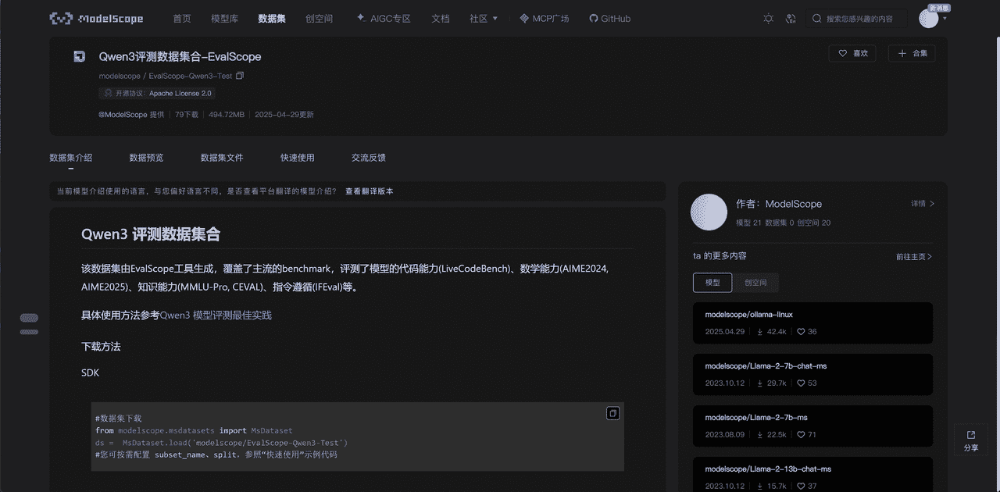

评测运行结果如下：

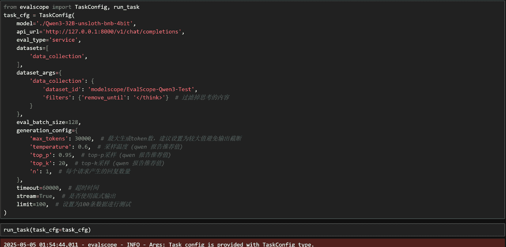


此时后台显示如下：

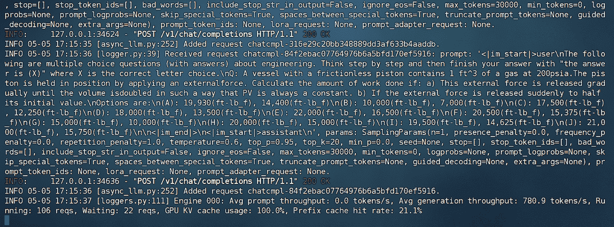

查看模型能力评测结果

```
evalscope app
```

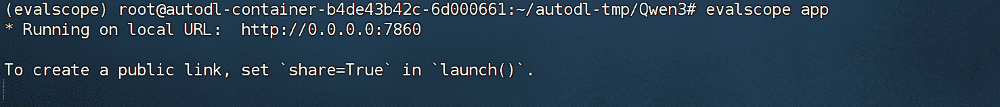

对评测结果进行可视化：

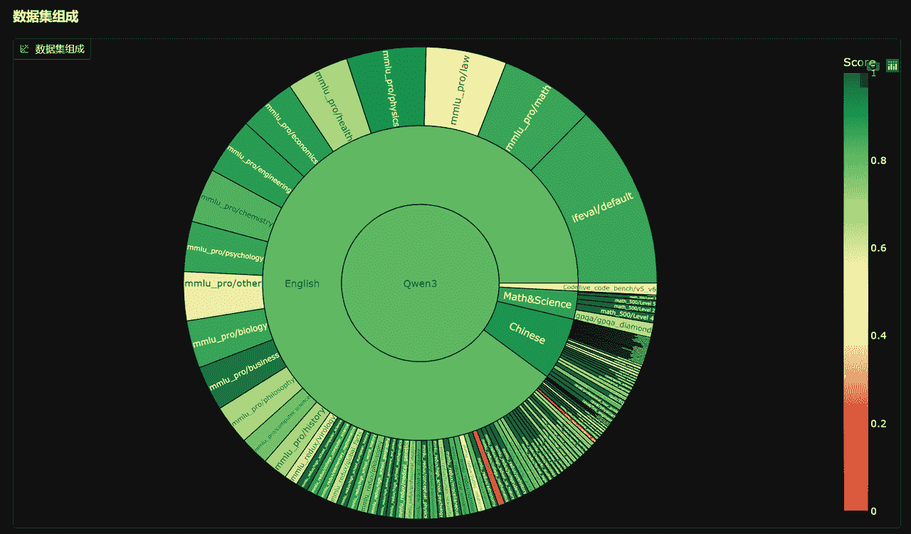

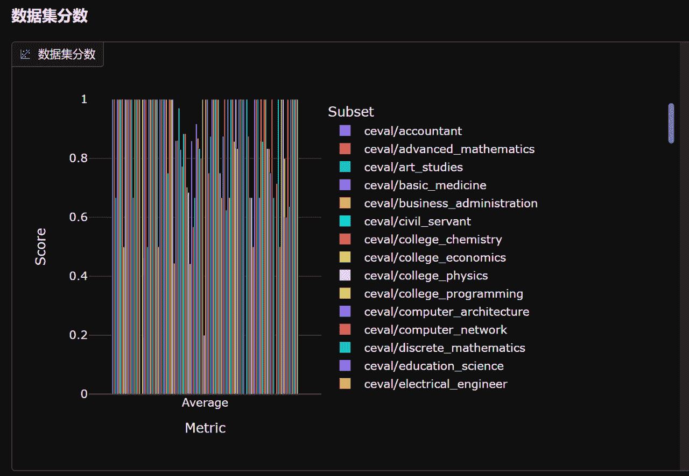

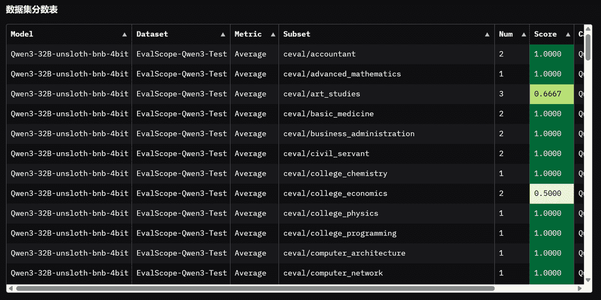

# 4. wandb安装与注册

## 4.1 wandb基本说明

在大规模模型训练中，我们往往需要监控和分析大量的训练数据，而`WandB`可以帮助我们实现这一目标。它提供了以下几个重要的功能：

**实时可视化**：`WandB`可以实时展示训练过程中关键指标的变化，如损失函数、学习率、训练时间等。通过这些可视化数据，我们能够直观地了解模型的训练进展，快速发现训练中的异常或瓶颈。

**自动记录与日志管理**：`WandB`会自动记录每次实验的参数、代码、输出结果，确保实验结果的可追溯性。无论是超参数的设置，还是模型的架构调整，`WandB`都能够帮助我们完整保留实验记录，方便后期对比与调优。

**支持中断与恢复训练**：在长时间的预训练任务中，系统中断或需要暂停是常见的情况。通过`WandB`的`checkpoint`功能，我们可以随时恢复训练，从上次中断的地方继续进行，避免数据和时间的浪费。

**多实验对比**：当我们尝试不同的模型配置或超参数时，`WandB`允许我们在多个实验之间轻松进行对比分析，帮助我们选择最优的模型配置。

**团队协作**：`WandB`还支持团队协作，多个成员可以共同查看实验结果，协同调试模型。这对研究和项目开发中团队的合作非常有帮助。

## 4.2 wandb注册与使用

wandb官网：https://wandb.ai/site


然后即可在令行中输入如下代码安装`wandb`：

```
pip install wandb
```


接下来在`unsloth`微调前，我们即可设置`wandb`进行微调记录，并可在对应网站上观察到训练过程如下：


---

# 【专题讲解】微调数据集及其特殊字符含义解释

如何创建和选取模型微调数据集，是决定模型微调效果成败的最关键因素，截止目前，已经诞生了各类不同的微调框架和海量的微调数据集，在绝大多数情况下，我们只需要选择不同的微调框架并搭配不同的数据集即可。但伴随着模型能力越来越复杂，包括现阶段很多模型具备了Function calling功能，甚至是具备了推理或者混合推理能力，此时如果希望进行一些复杂功能模型的微调，例如围绕Qwen3模型进行Function calling能力微调、同时还需保留其混合推理能力，此时很多公开数据集或许就无法满足要求了。此外，如果我们希望给模型进行特定领域的知识关注，或者提升模型对于特殊工具组的工具调用准确率，此时就需要手动创建微调数据集了。

而要手动合并或者创建微调数据集，就必须深入了解微调数据集构造背后的原理。本小节内容，就为大家详细介绍创建微调数据集背后的底层原理。

## 1. 模型内置特殊字符及提示词模板

其实最快速了解构造数据集的方法，是从模型底层原理入手。对于当代大模型来说，普遍需要通过一些特殊字符来标记用户的不同类型输入、系统提示词、以及工具调用或者多模态输入等。而在实际对话过程中，模型对于用户的输入输出是这么进行识别的（以Qwen3为例），一次简答的问答，模型的真实输入和输出如下所示：


其中`<|im_start|>`代表文本开始，而`user`则代表消息身份，用于构建多轮对话，而`<|im_end|>`则代表文本结束，即用户输入结束，而`<|im_start|>`代表新一段文本开始，`assistant`代表接下来由模型创建消息，而`<|im_end|>`同样代表模型创建消息的结束。

而模型其实是通过这样一组特殊字符标记来规范自己的行为，判断当前消息类型，以及通过输出特殊标记来确定停止时间。对于绝大多数模型，我们可以在模型的`tokenizer_config.json`中看到完整的特殊标记符（以及系统提示词模板）：


而在实际微调过程中，我们都知道需要有监督的数据集、也就是需要输入QA对来进行微调。以著名的`alpaca_zh`中文微调数据集来说，其基本格式如下：


其中的`input`和`output`就是输入和输出。例如如下对话：


就可以表示为下列json格式数据集：

```
  {
    &quot;instruction&quot;: &quot;&quot;,
    &quot;input&quot;: &quot;输入：你好。&quot;,
    &quot;output&quot;: &quot;输出：你好，有什么可以帮到你的？&quot;
  },
```

而在真实的微调过程中，如果是针对Qwen3进行微调，微调脚本会将这条数据集（无论什么格式）转化为如下格式：

```
&lt;|im_start|&gt;user\n你好&lt;|im_end|&gt;\n&lt;|im_start|&gt;assistant\n你好，有什么可以帮到你的？&lt;|im_end|&gt;
```

而在实际训练过程中，模型就会根据`assistant`前的内容，学习`assistant`后面的输出内容。

## 2. 带有系统提示和Function calling微调数据集格式

在很多场景下，我们还会发现一些带有`instruction`字段的微调数据集，那`instruction`字段是如何带入到微调过程中的呢？


答案非常简单，还是依靠特殊字符。例如有一个对话内容如下：

+   系统提示词（`instruction`）：你是一名助人为乐的助手。

+   用户输入（`input`）：你好，好久不见。

+   助手回复（`output`）：是的呀，好久不见，最近有什么有趣的事情要和我分享么？

此时模型的输入和输出如下：

```
&lt;|im_start|&gt;system
你是一名助人为乐的助手。&lt;|im_end|&gt;
&lt;|im_start|&gt;user
你好，好久不见。&lt;|im_end|&gt;
&lt;|im_start|&gt;assistant
是的呀，好久不见，最近有什么有趣的事情要和我分享么？&lt;|im_end|&gt;
```

即会通过`<|im_start|>`system`<|im_end|>`来标记系统提示词。实际进行微调时，模型会根据`assistant`为界，学习`assistant`之前的文本输入情况下应该如何输出。


# 微调数据集结构与 Function calling

## 基础 Function calling 流程

更进一步的，如果对话过程中带入了Function calling，此时首先模型会读取提前准备好的tool schema（也可能是自动生成的，例如MCP即可自动创建tool schema）：

```
tool_schema = [{
    &quot;name&quot;: &quot;get_weather&quot;,
    &quot;description&quot;: &quot;查询指定城市的天气信息&quot;,
    &quot;parameters&quot;: {
        &quot;type&quot;: &quot;object&quot;,
        &quot;properties&quot;: {
            &quot;location&quot;: {
                &quot;type&quot;: &quot;string&quot;,
                &quot;description&quot;: &quot;要查询天气的城市名称&quot;
            }
        },
        &quot;required&quot;: [&quot;location&quot;]
    }
}]
```

而假设我们的对话内容如下：

+ 系统提示词（`instruction`）：你是一名助人为乐的助手。当用户查询天气的时候，请调用`get_weather`函数进行天气信息查询。

+ 用户输入（`input`）：你好，请帮我查询下北京天气。

+ 助手回复（`output`）：`{"name": "get_weather", "arguments": {"location": "北京"}}`

> 此时回复内容就是一条Function call message

而此时模型真实的输入和输出内容如下：

```
&lt;|im_start|&gt;system
你是一名助人为乐的助手。当用户查询天气的时候，请调用get_weather函数进行天气信息查询。

# Tools

You may call one or more functions to assist with the user query.

You are provided with function signatures within &lt;tools&gt;&lt;/tools&gt; XML tags:
&lt;tools&gt;
{&quot;name&quot;: &quot;get_weather&quot;, &quot;description&quot;: &quot;查询指定城市的天气信息&quot;, &quot;parameters&quot;: {&quot;type&quot;: &quot;object&quot;, &quot;properties&quot;: {&quot;location&quot;: {&quot;type&quot;: &quot;string&quot;, &quot;description&quot;: &quot;要查询天气的城市名称&quot;}}, &quot;required&quot;: [&quot;location&quot;]}}
&lt;/tools&gt;

For each function call, return a json object with function name and arguments within &lt;tool_call&gt;&lt;/tool_call&gt; XML tags:
&lt;tool_call&gt;
{&quot;name&quot;: &lt;function-name&gt;, &quot;arguments&quot;: &lt;args-json-object&gt;}
&lt;/tool_call&gt;
&lt;|im_end|&gt;
&lt;|im_start|&gt;user
你好，请帮我查询下北京天气。&lt;|im_end|&gt;
&lt;|im_start|&gt;assistant
&lt;tool_call&gt;
{&quot;name&quot;: &quot;get_weather&quot;, &quot;arguments&quot;: {&quot;location&quot;: &quot;北京&quot;}}
&lt;/tool_call&gt;&lt;|im_end|&gt;
```

接下来在进行训练时，模型同样根据`assistant`前的内容，学习`assistant`后面的输出内容。不过需要注意的是，由于高效微调调整的参数量较少，因此只能优化模型的Function calling能力，并不能从无到有让模型学会Function calling。

## 带有思考过程的微调数据集结构

而如果是带有思考链，则一个简单的问答数据如下：


+ 系统提示词（`instruction`）：你是一名助人为乐的助手。

+ 用户输入（`input`）：你好，好久不见。

+ 助手回复（`output`）：好的，用户发来“你好，好久不见！”，我需要回应。首先，用户可能希望得到亲切的回应，所以应该用友好的语气。/n是的呀，好久不见，最近有什么有趣的事情要和我分享么？

此时模型真实的内部输入和输出结果如下：

```
&lt;|im_start|&gt;system
你是一名助人为乐的助手。&lt;|im_end|&gt;
&lt;|im_start|&gt;user
你好，好久不见。&lt;|im_end|&gt;
&lt;|im_start|&gt;assistant
&lt;think&gt;
好的，用户发来“你好，好久不见！”，我需要回应。首先，用户可能希望得到亲切的回应，所以应该用友好的语气。
&lt;/think&gt;

是的呀，好久不见，最近有什么有趣的事情要和我分享么？&lt;|im_end|&gt;
```

模型同样根据`assistant`前的内容，学习`assistant`后面的输出内容。也就是说，所谓的思考过程，本质上其实是一种文本响应格式，通过模型训练而来。

## 带有思考过程的 Function calling 流程

最后难度升级，假设是带有思考过程、系统提示词的Function calling流程呢？此时一次对话的基本数据结构如下：


内容如下：

+ 系统提示词（`instruction`）：你是一名助人为乐的助手。当用户查询天气的时候，请调用`get_weather`函数进行天气信息查询。

+ 用户输入（`input`）：你好，请帮我查询下北京天气。

+ 助手回复（`output`）：好的，用户问北京今天的天气，我应该尝试调用工具`get_weather`，并将参数设置为北京。/n`{"name": "get_weather", "arguments": {"location": "北京"}}`

而此时模型的真实输入和输出如下：

```
&lt;|im_start|&gt;system
你是一名助人为乐的助手。当用户查询天气的时候，请调用get_weather函数进行天气信息查询。

# Tools

You may call one or more functions to assist with the user query.

You are provided with function signatures within &lt;tools&gt;&lt;/tools&gt; XML tags:
&lt;tools&gt;
{&quot;name&quot;: &quot;get_weather&quot;, &quot;description&quot;: &quot;查询指定城市的天气信息&quot;, &quot;parameters&quot;: {&quot;type&quot;: &quot;object&quot;, &quot;properties&quot;: {&quot;location&quot;: {&quot;type&quot;: &quot;string&quot;, &quot;description&quot;: &quot;要查询天气的城市名称&quot;}}, &quot;required&quot;: [&quot;location&quot;]}}
&lt;/tools&gt;

For each function call, return a json object with function name and arguments within &lt;tool_call&gt;&lt;/tool_call&gt; XML tags:
&lt;tool_call&gt;
{&quot;name&quot;: &lt;function-name&gt;, &quot;arguments&quot;: &lt;args-json-object&gt;}
&lt;/tool_call&gt;
&lt;|im_end|&gt;
&lt;|im_start|&gt;user
你好，请帮我查询下北京天气。&lt;|im_end|&gt;
&lt;|im_start|&gt;assistant
&lt;think&gt;
好的，用户问北京今天的天气，我应该尝试调用工具 get_weather，并将参数设置为北京。
&lt;/think&gt;

&lt;tool_call&gt;
{&quot;name&quot;: &quot;get_weather&quot;, &quot;arguments&quot;: {&quot;location&quot;: &quot;北京&quot;}}
&lt;/tool_call&gt;&lt;|im_end|&gt;
```

模型同样根据`assistant`前的内容，学习`assistant`后面的输出内容。由此可见，模型拥有不同功能的背后，其实源于不同格式的训练数据集的训练。而对于gpt-oss这种模型来说，同时拥有Function calling、混合推理等功能，属于功能非常复杂的模型了。在实际微调过程中，稍有不慎就会令其丧失原有能力。

---
