# Part 2. 高效微调提升模型 Agent 性能基本原理

> 来源：[https://kq4b3vgg5b.feishu.cn/docx/DYH5d4G1HoLnCKxhveBcu🐧wnNd](https://kq4b3vgg5b.feishu.cn/docx/DYH5d4G1HoLnCKxhveBcu🐧wnNd)

## GPT-OSS 高效微调实战

### 四、大模型 Function calling（Tool Call）功能回顾

#### 1. 为什么提升 Agent 性能至关重要

在当前的应用版图里，“大模型 × 工具”的 Agent 形态已经成为主流：搜索、数据库/知识库检索、工作流编排、第三方 API（支付、CRM、运维、IoT）、本地 Python/SQL 执行器、浏览器自动化、企业内系统……不同业务域使用的工具族差异巨大。仅靠提示词（`prompt`）让模型临时学会工具调用，往往会出现函数选择错误、参数缺失或单位/类型不匹配、调用时机不当、无法多步协同等问题，直接拉低转化率与任务成功率。

通过高效微调（LoRA/QLoRA、Adapter、多任务 SFT + 轻量 RL/DPO 等）让底层模型“原生熟悉你的工具”，可以显著提升：

+   **正确性与稳健性**：更准地选择函数、填参与容错处理（重试、降级、回滚）；明显降低“能说不会做”的幻觉。

+   **效率与成本**：更少轮次内完成任务、减少无效调用；小型模型经针对性微调后可替代更大通用模型落地。

+   **可控性与合规**：对 JSON/Schema 严格遵循、对敏感操作引入显式确认与策略约束（`allowlist`/`denylist`/权限域）。

+   **可维护性**：当你的工具/API 版本升级时，只需增量扩充工具示例数据，小幅再训练即可“热更新”模型的工具心智。

+   衡量 Agent 性能的关键指标建议覆盖：函数选择准确率（Top-1/严格匹配）、参数精确匹配率（Exact Match/Schema 通过率）、多步任务成功率（E2E Task Success）、调用轮次/时延/成本、鲁棒性（异常→自我纠错）与安全合规率。这些指标与数据闭环直接反馈到你后续的高效微调与评测基线，形成持续进化。

#### 2. 大模型调用工具关键技术：Function calling 实现流程


##### Step 1. 准备阶段：定义工具 & 绑定 JSON Schema & 生成 tools 列表

1.  **实现业务函数**（例如 Python/Node 函数）。

```
def get_weather(loc):
    """
    查询即时天气函数
    :param loc: 必要参数，字符串类型，用于表示查询天气的具体城市名称，\
    注意，中国的城市需要用对应城市的英文名称代替，例如如果需要查询北京市天气，则loc参数需要输入'Beijing'；
    :return：OpenWeather API查询即时天气的结果，具体URL请求地址为：https://api.openweathermap.org/data/2.5/weather\
    返回结果对象类型为解析之后的JSON格式对象，并用字符串形式进行表示，其中包含了全部重要的天气信息
    """
    # Step 1.构建请求
    url = "https://api.openweathermap.org/data/2.5/weather"

    # Step 2.设置查询参数
    params = {
        "q": loc,               
        "appid": open_weather_key,    # 输入API key
        "units": "metric",            # 使用摄氏度而不是华氏度
        "lang":"zh_cn"                # 输出语言为简体中文
    }

    # Step 3.发送GET请求
    response = requests.get(url, params=params)
    
    # Step 4.解析响应
    data = response.json()
    return json.dumps(data)
```

1.  为每个函数写 JSON Schema（严格声明参数名、类型与必填项）。

1.  **汇总为 `tools`**：形如

```
[
  {
    "type": "function",
    "function": {
      "name": "get_weather",
      "description": "查询某城市指定日期的天气。",
      "parameters": {
        "type": "object",
        "properties": {
          "city": {"type": "string"},
          "date": {"type": "string", "format": "date"}
        },
        "required": ["city", "date"],
        "additionalProperties": false
      }
    }
  }
]
```

> 这一阶段对应流程图左侧绿框的 Step 1–3：自定义函数 → 为函数添加 Schema → 汇总为 `Tool_List`。

##### Step 2. 第一次对话：把 `tools` 提供给模型，等待模型判断“要不要用工具”

调用聊天接口（示例 API 形态）：

```
client.chat.completions.create(
  model=MODEL,
  messages=message_history,   # user 问题在这里
  tools=tools,                # 把上一步的列表传给模型
  # 可选：tool_choice="auto" | {"type":"function","function":{"name":"..."}}
)
```

模型会先阅读上下文与 `tools` 列表，然后做出决策：

+   **不需要调用工具**：直接返回普通 assistant 文本（`tool_calls` = null），流程到此结束，返回用户。

+   **需要调用工具**：返回一个“空内容 + `tool_calls`”的 assistant 消息，例如：

```
{
  "role": "assistant",
  "content": null,
  "tool_calls": [
    {
      "id": "call_abc123",            // 本次调用的唯一ID（很重要）
      "type": "function",
      "function": {
        "name": "get_weather",
        "arguments": "{\"city\":\"北京\",\"date\":\"2025-08-22\"}"
      }
    }
  ]
}
```

> 这一步对应流程图右侧粉色框的第一次 `client.chat.completions.create(...)` 以及菱形判断“是否需要调用外部函数”。

##### Step 3. 执行阶段：解析 `tool_calls` 并真正运行外部函数

拿到 `assistant.tool_calls` 后，在你的后端按如下步骤执行（对应左下角黄/蓝步骤）：

1.  **函数选择与参数解析**：根据 `tool_calls[*].function.name` 定位到本地函数，并解析 `arguments` JSON。

1.  **执行函数**：调用实际业务逻辑，拿到返回结果（成功或错误）。

1.  **封装为 `tool` 消息**：把执行结果写成一条结构化消息加入对话历史，形如：

```
{
  "role": "tool",
  "tool_call_id": "call_abc123",  // 必须与上一步的 id 对应
  "name": "get_weather",
  "content": "{\"temp\": 30, \"desc\": \"晴\"}"
}
```

> 注意：`tool_call_id` 是粘合剂，模型靠它把你的结果与自己的那次调用对应起来。

> 流程图左侧蓝色 Step 4 就是在构造这条 `ToolMessage`。

##### Step 4. 第二次对话：把 `tool` 结果回灌给模型，生成最终回答

把对话历史扩展为：

```
user message
assistant (含 tool_calls)
tool message（你的执行结果）
```

再次调用接口（仍可携带 `tools`，以便需要继续调用其他函数）：

```
client.chat.completions.create(
  model=MODEL,
  messages=updated_messages,
  tools=tools
)
```

此时模型会阅读 `tool` 结果，再产出面向用户的最终自然语言答案（或继续产生新的 `tool_calls` 进入下一轮）。

+   若已拿到充分信息，assistant 将输出 Final Answer；

+   若仍需更多数据，assistant 可能再次产出 `tool_calls`，流程回到第 3 步，直至完成。

> 这一步对应流程图中部第二个粉色框与底部“输出 Final Answer”。

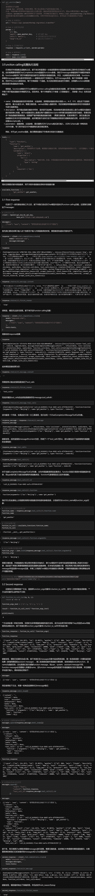

### 3. 当代大模型 Function calling 响应模式介绍

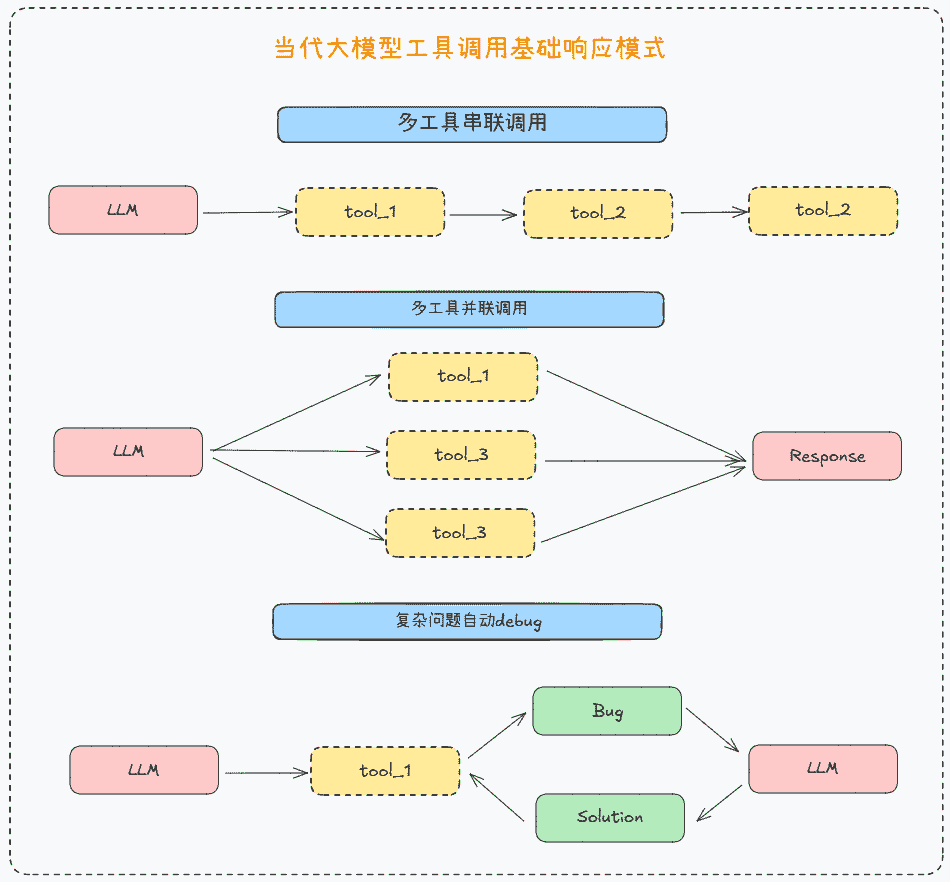

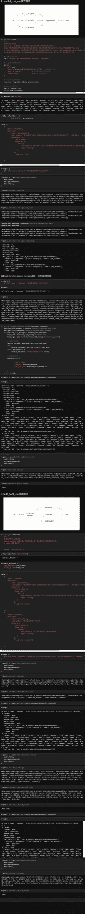

## 五、微调数据集及其特殊字符含义解释

如何创建和选取模型微调数据集，是决定模型微调效果成败的最关键因素，截止目前，已经诞生了各类不同的微调框架和海量的微调数据集，在绝大多数情况下，我们只需要选择不同的微调框架并搭配不同的数据集即可。但伴随着模型能力越来越复杂，包括现阶段很多模型具备了 Function calling 功能，甚至是具备了推理或者混合推理能力，此时如果希望进行一些复杂功能模型的微调，例如围绕 Qwen3 模型进行 Function calling 能力微调、同时还需保留其混合推理能力，此时很多公开数据集或许就无法满足要求了。此外，如果我们希望给模型进行特定领域的知识关注，或者提升模型对于特殊工具组的工具调用准确率，此时就需要手动创建微调数据集了。

而要手动合并或者创建微调数据集，就必须深入了解微调数据集构造背后的原理。本小节内容，就为大家详细介绍创建微调数据集背后的底层原理。

### 1. 模型内置特殊字符及提示词模板

其实最快速了解构造数据集的方法，是从模型底层原理入手。对于当代大模型来说，普遍需要通过一些特殊字符来标记用户的不同类型输入、系统提示词、以及工具调用或者多模态输入等。而在实际对话过程中，模型对于用户的输入输出是这么进行识别的，一次简答的问答，模型的真实输入和输出如下所示：

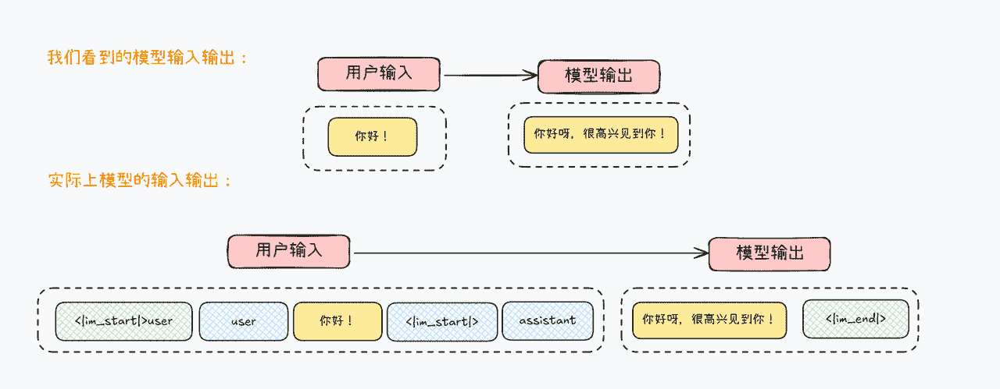

其中 `<|im_start|>` 代表文本开始，而 `user` 则代表消息身份，用于构建多轮对话，而 `<|im_end|>` 则代表文本结束，即用户输入结束，而 `<|im_start|>` 代表新一段文本开始，`assistant` 代表接下来由模型创建消息，而 `<|im_end|>` 同样代表模型创建消息的结束。

而模型其实是通过这样一组特殊字符标记来规范自己的行为，判断当前消息类型，以及通过输出特殊标记来确定停止时间。对于绝大多数模型，我们可以在模型的 `tokenizer_config.json` 中看到完整的特殊标记符（以及系统提示词模板）：

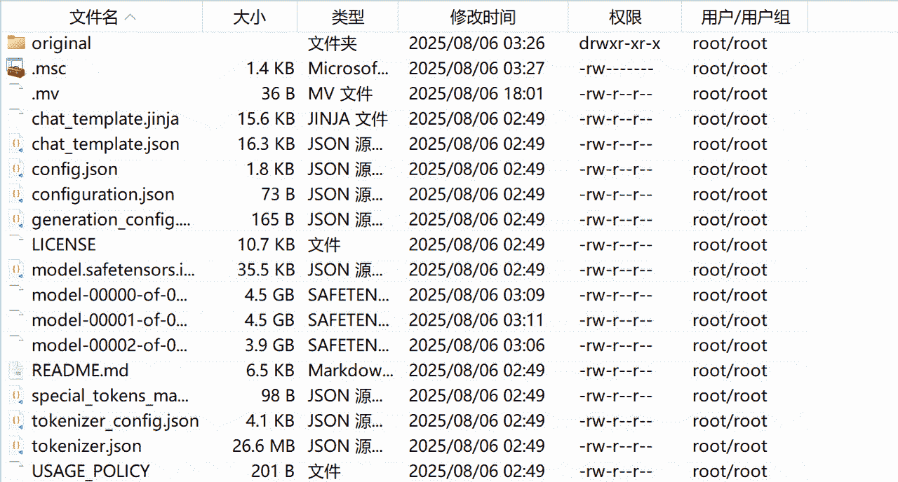


而在实际微调过程中，我们都知道需要有监督的数据集、也就是需要输入 QA 对来进行微调。以著名的 `alpaca_zh` 中文微调数据集来说，其基本格式如下：

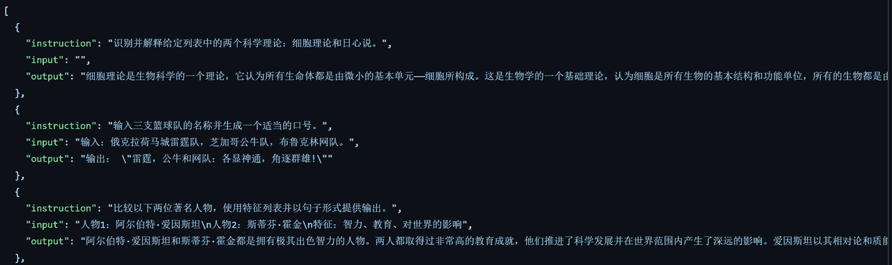

其中的 `input` 和 `output` 就是输入和输出。例如如下对话：


就可以表示为下列 json 格式数据集：

```
  {
    "instruction": "",
    "input": "输入：你好。",
    "output": "输出：你好，有什么可以帮到你的？"
  },
```

而在真实的微调过程中，如果是针对 Qwen3 进行微调，微调脚本会将这条数据集（无论什么格式）转化为如下格式：

```
<|im_start|>user\n你好<|im_end|>\n<|im_start|>assistant\n你好，有什么可以帮到你的？<|im_end|>
```

而在实际训练过程中，模型就会根据 `assistant` 前的内容，学习 `assistant` 后面的输出内容。

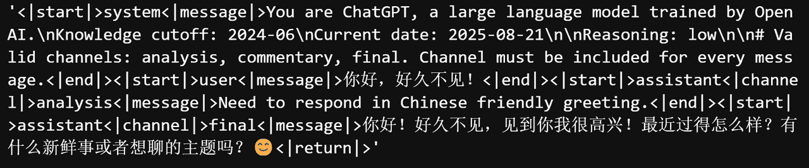

### 2. 带有系统提示和 Function calling 微调数据集格式

在很多场景下，我们还会发现一些带有 `instruction` 字段的微调数据集，那 `instruction` 字段是如何带入到微调过程中的呢？


答案非常简单，还是依靠特殊字符。例如有一个对话内容如下：

+   系统提示词（`instruction`）：你是一名助人为乐的助手。

+   用户输入（`input`）：你好，好久不见。

+   助手回复（`output`）：是的呀，好久不见，最近有什么有趣的事情要和我分享么？

此时模型的输入和输出如下：

```
<|im_start|>system
你是一名助人为乐的助手。<|im_end|>
<|im_start|>user
你好，好久不见。<|im_end|>
<|im_start|>assistant
是的呀，好久不见，最近有什么有趣的事情要和我分享么？<|im_end|>
```

即会通过 `<|im_start|>system...</|im_end|>` 来标记系统提示词。实际进行微调时，模型会根据 `assistant` 为界，学习 `assistant` 之前的文本输入情况下应该如何输出。

更进一步的，如果对话过程中带入了 Function calling，此时首先模型会读取提前准备好的 tool schema（也可能是自动生成的，例如 MCP 即可自动创建 tool schema）：

```
tool_schema = [{
    "name": "get_weather",
    "description": "查询指定城市的天气信息",
    "parameters": {
        "type": "object",
        "properties": {
            "location": {
                "type": "string",
                "description": "要查询天气的城市名称"
            }
        },
        "required": ["location"]
    }
}]
```

而假设我们的对话内容如下：


## Function calling 微调数据结构

### 2. 基础数据结构

系统提示词（instruction）：你是一名助人为乐的助手。当用户查询天气的时候，请调用`get_weather`函数进行天气信息查询。

用户输入（input）：你好，请帮我查询下北京天气。

助手回复（output）：`{"name": "get_weather", "arguments": {"location": "北京"}}`

> 此时回复内容就是一条`Function call message`

而此时模型真实的输入和输出内容如下：

```
&lt;|im_start|&gt;system
你是一名助人为乐的助手。当用户查询天气的时候，请调用get_weather函数进行天气信息查询。

# Tools

You may call one or more functions to assist with the user query.

You are provided with function signatures within &lt;tools&gt;&lt;/tools&gt; XML tags:
&lt;tools&gt;
{&quot;name&quot;: &quot;get_weather&quot;, &quot;description&quot;: &quot;查询指定城市的天气信息&quot;, &quot;parameters&quot;: {&quot;type&quot;: &quot;object&quot;, &quot;properties&quot;: {&quot;location&quot;: {&quot;type&quot;: &quot;string&quot;, &quot;description&quot;: &quot;要查询天气的城市名称&quot;}}, &quot;required&quot;: [&quot;location&quot;]}}
&lt;/tools&gt;

For each function call, return a json object with function name and arguments within &lt;tool_call&gt;&lt;/tool_call&gt; XML tags:
&lt;tool_call&gt;
{&quot;name&quot;: &lt;function-name&gt;, &quot;arguments&quot;: &lt;args-json-object&gt;}
&lt;/tool_call&gt;
&lt;|im_end|&gt;
&lt;|im_start|&gt;user
你好，请帮我查询下北京天气。&lt;|im_end|&gt;
&lt;|im_start|&gt;assistant
&lt;tool_call&gt;
{&quot;name&quot;: &quot;get_weather&quot;, &quot;arguments&quot;: {&quot;location&quot;: &quot;北京&quot;}}
&lt;/tool_call&gt;&lt;|im_end|&gt;
```

接下来在进行训练时，模型根据`assistant`前的内容，学习`assistant`后面的输出内容。不过需要注意的是，由于高效微调调整的参数量较少，因此只能优化模型的`Function calling`能力，并不能从无到有让模型学会`Function calling`。

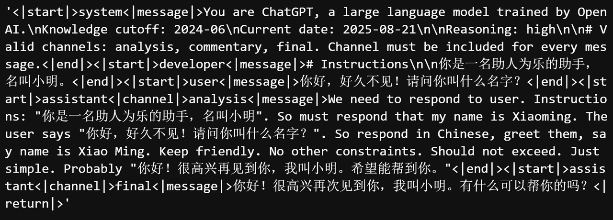

### 3. 带有思考过程的微调数据集结构

而如果是带有思考链，则一个简单的问答数据如下：

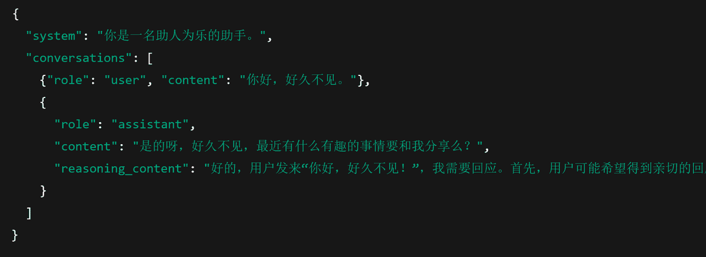

系统提示词（instruction）：你是一名助人为乐的助手。

用户输入（input）：你好，好久不见。

助手回复（output）：好的，用户发来“你好，好久不见！”，我需要回应。首先，用户可能希望得到亲切的回应，所以应该用友好的语气。/n是的呀，好久不见，最近有什么有趣的事情要和我分享么？

此时模型真实的内部输入和输出结果如下：

```
&lt;|im_start|&gt;system
你是一名助人为乐的助手。&lt;|im_end|&gt;
&lt;|im_start|&gt;user
你好，好久不见。&lt;|im_end|&gt;
&lt;|im_start|&gt;assistant
&lt;think&gt;
好的，用户发来“你好，好久不见！”，我需要回应。首先，用户可能希望得到亲切的回应，所以应该用友好的语气。
&lt;/think&gt;

是的呀，好久不见，最近有什么有趣的事情要和我分享么？&lt;|im_end|&gt;
```

模型根据`assistant`前的内容，学习`assistant`后面的输出内容。也就是说，所谓的思考过程，本质上其实是一种文本响应格式，通过模型训练而来。

最后难度升级，假设是带有思考过程、系统提示词的`Function calling`流程呢？此时一次对话的基本数据结构如下：

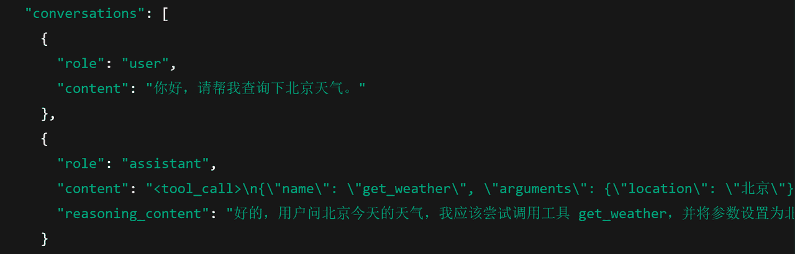

内容如下：

系统提示词（instruction）：你是一名助人为乐的助手。当用户查询天气的时候，请调用`get_weather`函数进行天气信息查询。

用户输入（input）：你好，请帮我查询下北京天气。

助手回复（output）：好的，用户问北京今天的天气，我应该尝试调用工具`get_weather`，并将参数设置为北京。/n`{"name": "get_weather", "arguments": {"location": "北京"}}`

而此时模型的真实输入和输出如下：

```
&lt;|im_start|&gt;system
你是一名助人为乐的助手。当用户查询天气的时候，请调用get_weather函数进行天气信息查询。

# Tools

You may call one or more functions to assist with the user query.

You are provided with function signatures within &lt;tools&gt;&lt;/tools&gt; XML tags:
&lt;tools&gt;
{&quot;name&quot;: &quot;get_weather&quot;, &quot;description&quot;: &quot;查询指定城市的天气信息&quot;, &quot;parameters&quot;: {&quot;type&quot;: &quot;object&quot;, &quot;properties&quot;: {&quot;location&quot;: {&quot;type&quot;: &quot;string&quot;, &quot;description&quot;: &quot;要查询天气的城市名称&quot;}}, &quot;required&quot;: [&quot;location&quot;]}}
&lt;/tools&gt;

For each function call, return a json object with function name and arguments within &lt;tool_call&gt;&lt;/tool_call&gt; XML tags:
&lt;tool_call&gt;
{&quot;name&quot;: &quot;get_weather&quot;, &quot;arguments&quot;: &lt;args-json-object&gt;}
&lt;/tool_call&gt;
&lt;|im_end|&gt;
&lt;|im_start|&gt;user
你好，请帮我查询下北京天气。&lt;|im_end|&gt;
&lt;|im_start|&gt;assistant
&lt;think&gt;
好的，用户问北京今天的天气，我应该尝试调用工具 get_weather，并将参数设置为北京。
&lt;/think&gt;

&lt;tool_call&gt;
{&quot;name&quot;: &quot;get_weather&quot;, &quot;arguments&quot;: {&quot;location&quot;: &quot;北京&quot;}}
&lt;/tool_call&gt;&lt;|im_end|&gt;
```

模型根据`assistant`前的内容，学习`assistant`后面的输出内容。由此可见，模型拥有不同功能的背后，其实源于不同格式的训练数据集的训练。而对于gpt-oss这种模型来说，同时拥有`Function calling`、混合推理等功能，属于功能非常复杂的模型了。在实际微调过程中，稍有不慎就会令其丧失原有能力。

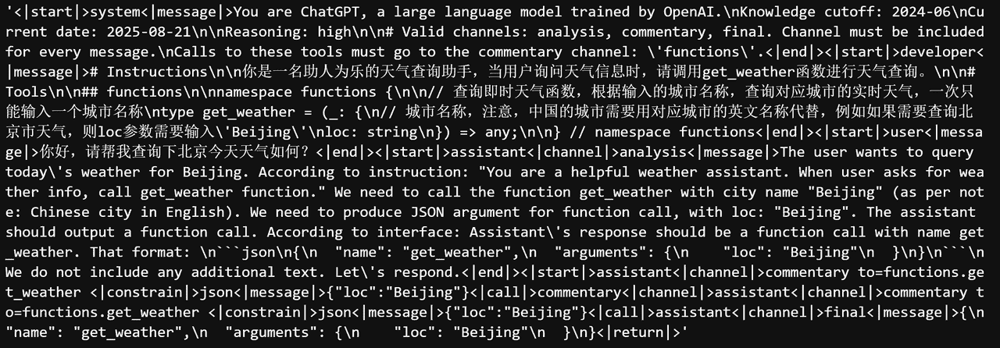

而除此之外，还有更加复杂的情况，如一次性创建多条`function call message`的回复格式：

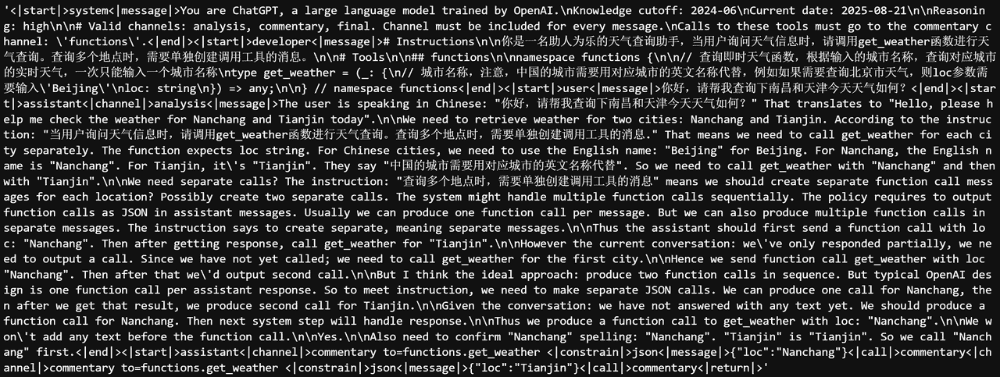

以及多个工具串联调用的形式，即一个`Function response message`后接一个`function call message`的响应形式：

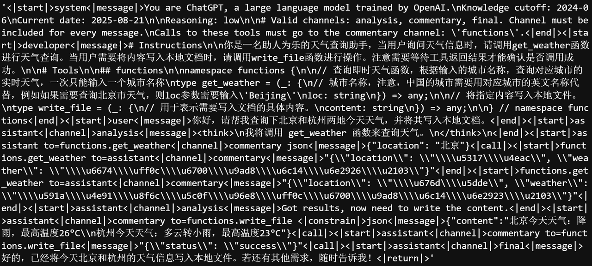

> 更多代码实现，详见下一小节内容

### 4. gpt-oss模型提示词模板基本结构

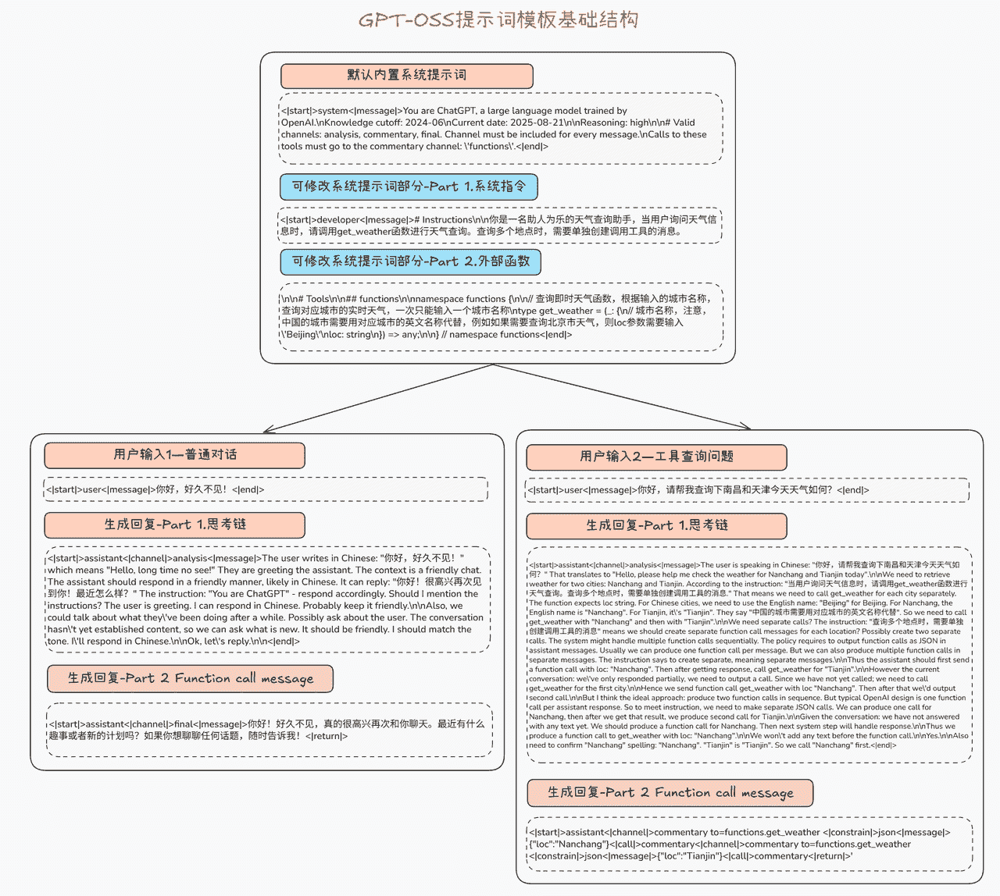

基于此，对于GPT-OSS模型来说（同时也是当代最复杂的基座模型都是如此），工具调用方面的响应模式至少有以下两种特殊形式：

+ （Multi）`function calling message`—（Multi）`function responses message`—second response message...

+ （Multi）`function calling message`—（Multi）`function responses message`—（Multi）`function calling message`...

这也使得我们在构建微调数据集时需要参考的地方。

## 六、Agent性能微调数据集介绍

根据我们期望的微调后模型特性，我们可以借助如下数据集进行微调。

### 1. AymanTarig / `function-calling-v0.2-with-r1-cot`（2025）

+ 数据集地址：

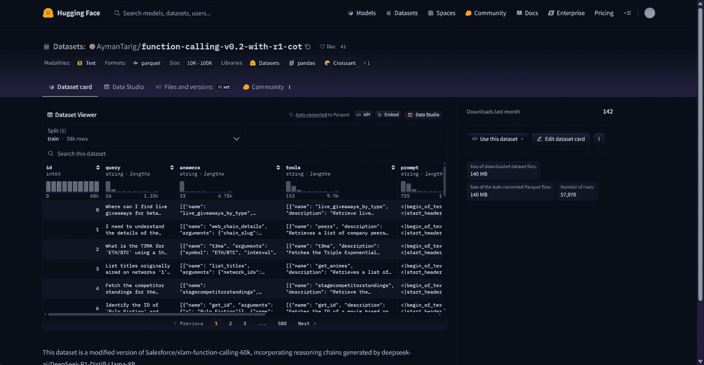

+ 数据集解释：

`AymanTarig / function-calling-v0.2-with-r1-cot`（2025）是一个专为“函数调用 + 推理”训练而整理的开源数据集，采用 Parquet 存储、文本模态，当前公开的默认切分约 58k 条样本（train），便于直接接入常见的 SFT 管线。每条样本同时给出 query、tools（函数签名与参数模式）、answers（目标 JSON 函数调用，可包含多次调用）、prompt（带 ChatML 结构的提示）以及两列显式推理信号 `think` 与 `r1-gen`，适合教会模型“先思考、再稳健地产生结构化调用”。页面示例显示 answers 支持数组形式的多函数调用输出，而 tools 中包含可执行意图的参数约束，对齐下游函数路由/工具编排的需求。数据近维护活跃；作者还同步提供了 ChatML 格式 的姊妹版本 `function-calling-v0.2-with-r1-cot-chat-ml-format`（2025-06），方便直接对接常见模板与训练脚本。总体而言，该数据集兼具函数 schema、目标调用与显式思考链三位一体的监督信号，非常适合用于“带思考链的函数调用”能力微调与评测基座。数据集包含21大类3673个可执行的API，覆盖面非常广。

+ 数据样例：

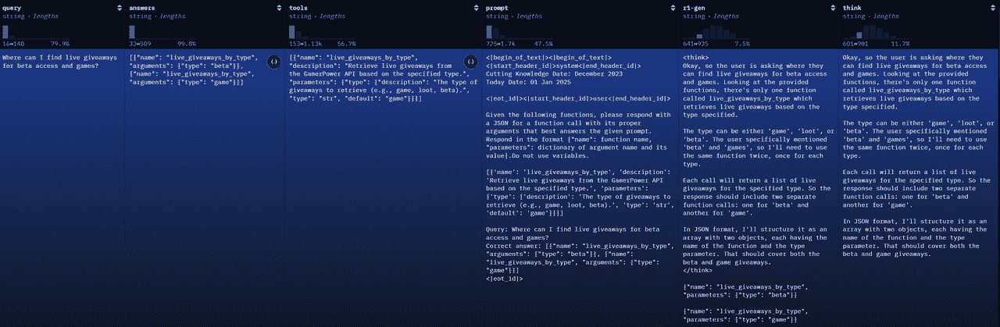

### 2. interstellarninja / `hermes_reasoning_tool_use`数据集

+ 数据集地址：https://huggingface.co/datasets/interstellarninja/hermes_reasoning_tool_use

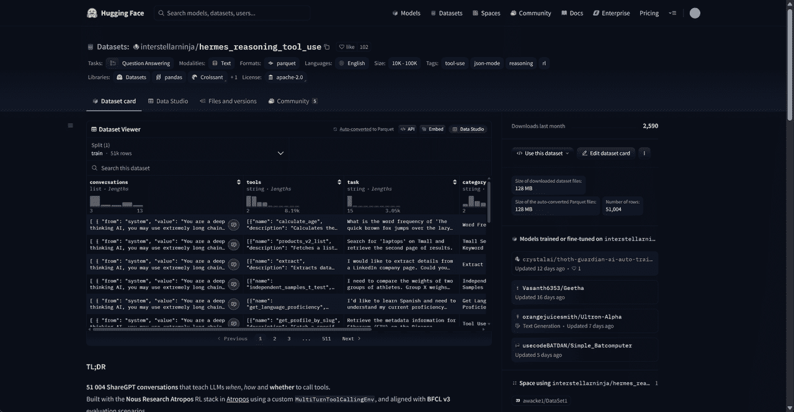

+ 数据集介绍

`interstellarninja / hermes_reasoning_tool_use` 是一个围绕“会思考、会用工具”的开源数据集：采用 Apache-2.0 许可、单一 train 切分约 51,004 条样本（约 392 MB），以 ShareGPT 会话格式存储（Parquet），字段含 `conversations` / `tools` / `task` / `category` / `source` / `scenario_category`，便于直接用 `Datasets/axolotl` 加载微调。其对话模板在 `system` 中明确要求将内在推理写入 `<think>…</think>`，并以 `<tool_call>…</tool_call>` 输出 OpenAI 风格的函数调用 JSON（含 pydantic schema），非常契合“思考链 + 函数调用”的监督信号。

样本覆盖 BFCL v3 的四类场景：`single_turn`、`multi_turn`、`multi_step` 与 `relevance`（无合适工具时应拒绝），有助于训练模型“何时/如何/是否”调用工具。构建流程基于 Nous Research 的 Atropos RL 栈，在自定义 `MultiTurnToolCallingEnv` 中进行 GRPO roll-outs，并通过奖励塑形与严格校验（如 `_validate_think_plus_calls`、`_check_sequential_tools`）仅保留结构与语义均合格的轨迹。

并且，数据集包含四种调用格式，`single_turn`（单轮单调用）、`multi_turn`（多轮多调用）、`multi_step`（单轮内≥2 顺序调用）、`relevance`（无合适工具应拒绝）。这天然覆盖了“何时/如何/是否”调用工具的决策学习。

总体而言，这是一个兼具长链推理标注与工具调用轨迹的实用数据集，既可用于 SFT，也可作为 GRPO 预热或评测基座，快速提升模型在真实代理场景下的工具使用稳健性。

+ 数据集样例

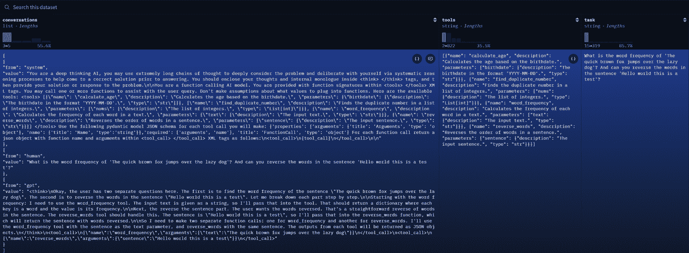

---

+ 体验课内容节选自《2025大模型Agent智能体开发实战》(秋招冲刺班)完整版付费课程

体验课时间有限，若想深度学习大模型技术，欢迎大家报名由我主讲的《2025大模型Agent智能体开发实战》(秋招冲刺班)


《2025大模型Agent智能体开发实战》(秋招冲刺班)为【100+小时】体系大课，总共20大模块精讲精析，零基础直达大模型企业级应用！

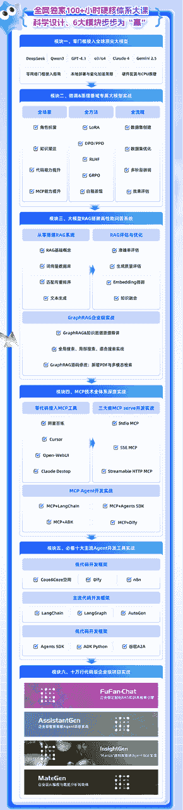

### 部分课程成果演示

+ Dify+DeepSeek搭建智能客服

+ 可视化数据分析Multi-Agent

+ Ollama 自动化并发请求测试与动态资源监控

+ Neo4j 并行多线程导入百万级文本方法与实践

+ MateGen Pro 项目功能演示

+ 智能客服项目展示

+ GraphRAG+多模态文档检索

此外，若是对大模型底层原理感兴趣，也欢迎报名由我和菜菜老师共同主讲的《2025大模型原理与实战课程》(秋招冲刺班)


两门大模型课程秋招冲刺班预售进行中，直播间可享超值特价+全套学习福利，合购还有更多优惠哦~详细信息扫码添加助教，回复“大模型”，即可领取课程大纲&查看课程详情👇


