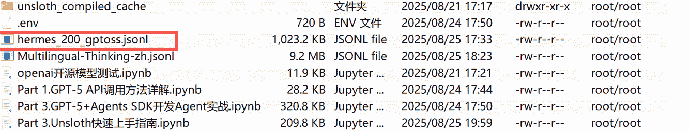
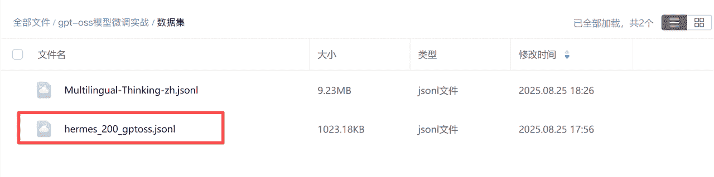
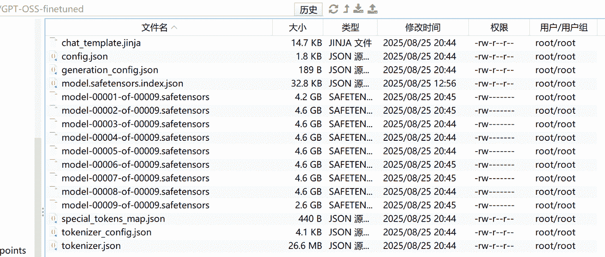
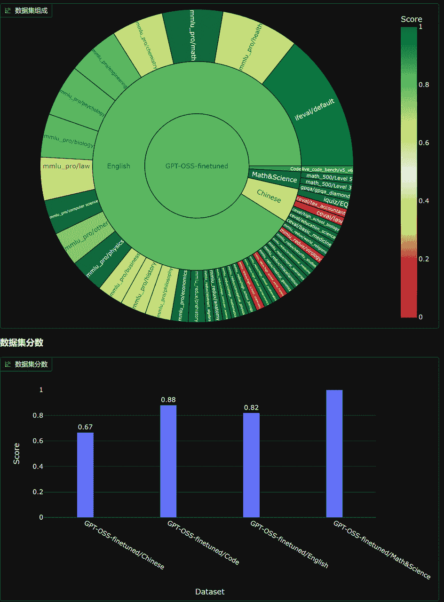

# Part 4.GPT-OSS Agent性能微调

> 来源：[https://kq4b3vgg5b.feishu.cn/docx/Yaejd8P1XojwSyxJMjVcqYHFn9d](https://kq4b3vgg5b.feishu.cn/docx/Yaejd8P1XojwSyxJMjVcqYHFn9d)

## 课程说明

体验课内容节选自《2025大模型Agent智能体开发实战》(秋招冲刺班)完整版付费课程

体验课时间有限，若想深度学习大模型技术，欢迎大家报名由我主讲的《2025大模型Agent智能体开发实战》(秋招冲刺班)

在熟悉了Unsloth核心功能以及基础的微调数据集准备方法之后，接下来我们尝试进行一项更加复杂的微调工作——围绕GPT-OSS模型进行Agent性能微调。

## 九、Agent性能微调数据集准备

### 1. Hermes tool use数据集介绍

- 数据集地址：`https://huggingface.co/datasets/interstellarninja/hermes_reasoning_tool_use`


`interstellarninja/hermes_reasoning_tool_use` 是一个围绕“会思考、会用工具”的开源数据集：采用 Apache-2.0 许可、单一 `train` 切分约 51,004 条样本（约 392 MB），以 ShareGPT 会话格式存储（Parquet），字段含 `conversations` / `tools` / `task` / `category` / `source` / `scenario_category`，便于直接用 `datasets` / `axolotl` 加载微调。其对话模板在 `system` 中明确要求将内在推理写入 `<think>…</think>`，并以 `<tool_call>…</tool_call>` 输出 OpenAI 风格的函数调用 JSON（含 `pydantic` schema），非常契合“思考链 + 函数调用”的监督信号。

样本覆盖 BFCL v3 的四类场景：`single_turn`、`multi_turn`、`multi_step` 与 `relevance`（无合适工具时应拒绝），有助于训练模型“何时/如何/是否”调用工具。构建流程基于 Nous Research 的 Atropos RL 栈，在自定义 `MultiTurnToolCallingEnv` 中进行 GRPO roll-outs，并通过奖励塑形与严格校验（如 `_validate_think_plus_calls`、`_check_sequential_tools`）仅保留结构与语义均合格的轨迹。

并且，数据集包含四种调用格式，`single_turn`（单轮单调用）、`multi_turn`（多轮多调用）、`multi_step`（单轮内≥2 顺序调用）、`relevance`（无合适工具应拒绝）。这天然覆盖了“何时/如何/是否”调用工具的决策学习。

总体而言，这是一个兼具长链推理标注与工具调用轨迹的实用数据集，既可用于 SFT，也可作为 GRPO 预热或评测基座，快速提升模型在真实代理场景下的工具使用稳健性。

- 数据集读取

```
from datasets import load_dataset, Dataset, Features, Value
import random, json, os
```

```
# 原始数据
ds_full = load_dataset("interstellarninja/hermes_reasoning_tool_use", split="train")
```

```
Using the latest cached version of the dataset since interstellarninja/hermes_reasoning_tool_use couldn't be found on the Hugging Face Hub
WARNING:datasets.load:Using the latest cached version of the dataset since interstellarninja/hermes_reasoning_tool_use couldn't be found on the Hugging Face Hub
Found the latest cached dataset configuration 'default' at /root/.cache/huggingface/datasets/interstellarninja___hermes_reasoning_tool_use/default/0.0.0/55d824b623303055d5a76eb6ab12861b80a4ee20 (last modified on Mon Aug 25 20:12:37 2025).
WARNING:datasets.packaged_modules.cache.cache:Found the latest cached dataset configuration 'default' at /root/.cache/huggingface/datasets/interstellarninja___hermes_reasoning_tool_use/default/0.0.0/55d824b623303055d5a76eb6ab12861b80a4ee20 (last modified on Mon Aug 25 20:12:37 2025).
```

```
ds_full[0]
```


# Hermes Reasoning Tool Use 数据集介绍

## 数据集示例

```
{&#x27;conversations&#x27;: [{&#x27;from&#x27;: &#x27;system&#x27;,
   &#x27;value&#x27;: &#x27;You are a deep to the problem.\n\nYou are a function calling AI model. You are provided with function signatures within &lt;tools&gt; &lt;/tools&gt; XML tags. You may call one or more functions to assist with the user query. Don\&#x27;t make assumptions about what values to plug into functions. Here are the available tools: &lt;tools&gt; [{&quot;name&quot;: &quot;calculate_age&quot;, &quot;description&quot;: &quot;Calculates the age based on the birthdate.&quot;, &quot;parameters&quot;: {&quot;birthdate&quot;: {&quot;description&quot;: &quot;The birthdate in the format \&#x27;YYYY-MM-DD\&#x27;.&quot;, &quot;type&quot;: &quot;str&quot;}}}, {&quot;name&quot;: &quot;find_duplicate_number&quot;, &quot;description&quot;: &quot;Finds the duplicate number in a list of integers.&quot;, &quot;parameters&quot;: {&quot;nums&quot;: {&quot;description&quot;: &quot;The list of integers.&quot;, &quot;type&quot;: &quot;List[int]&quot;}}}, {&quot;name&quot;: &quot;word_frequency&quot;, &quot;description&quot;: &quot;Calculates the frequency of each word in a text.&quot;, &quot;parameters&quot;: {&quot;text&quot;: {&quot;description&quot;: &quot;The input text.&quot;, &quot;type&quot;: &quot;str&quot;}}}, {&quot;name&quot;: &quot;reverse_words&quot;, &quot;description&quot;: &quot;Reverses the order of words in a sentence.&quot;, &quot;parameters&quot;: {&quot;sentence&quot;: {&quot;description&quot;: &quot;The input sentence.&quot;, &quot;type&quot;: &quot;str&quot;}}}] &lt;/tools&gt; Use the following pydantic model JSON schema for each tool call you will make: {\&#x27;properties\&#x27;: {\&#x27;arguments\&#x27;: {\&#x27;title\&#x27;: \&#x27;Arguments\&#x27;, \&#x27;type\&#x27;: \&#x27;object\&#x27;}, \&#x27;name\&#x27;: {\&#x27;title\&#x27;: \&#x27;Name\&#x27;, \&#x27;type\&#x27;:\&#x27;string\&#x27;}},\&#x27;required\&#x27;: [\&#x27;arguments\&#x27;, \&#x27;name\&#x27;], \&#x27;title\&#x27;: \&#x27;FunctionCall\&#x27;, \&#x27;type\&#x27;: \&#x27;object\&#x27;} For each function call return a json object with function name and arguments within &lt;tool_call&gt; &lt;/tool_call&gt; XML tags as follows:\n&lt;tool_call&gt;\n{tool_call}\n&lt;/tool_call&gt;\n\n&#x27;},
  {&#x27;from&#x27;: &#x27;human&#x27;,
   &#x27;value&#x27;: &quot;What is the word frequency of &#x27;The quick brown fox jumps over the lazy dog&#x27;? And can you reverse the words in the sentence &#x27;Hello world this is a test&#x27;?&quot;},
  {&#x27;from&#x27;: &#x27;gpt&#x27;,
   &#x27;value&#x27;: &#x27;&lt;think&gt;\nOkay, the user has two separate questions here. The first is to find the word frequency of the sentence &quot;The quick brown fox jumps over the lazy dog&quot;. The second is to reverse the words in the sentence &quot;Hello world this is a test&quot;. Let me break down each part step by step.\n\nStarting with the word frequency: I need to use the word_frequency tool. The input text is given as a string, so I\&#x27;ll pass that into the tool. That should return a dictionary where each key is a word and the value is its frequency.\n\nNext, the reverse the sentence part. The user wants the words reversed. That\&#x27;s a straightforward reverse of words in the sentence. The reverse_words tool should handle this. The sentence is &quot;Hello world this is a test&quot;, so I\&#x27;ll pass that into the reverse_words function, which will return the sentence with words reversed.\n\nSo I need to make two separate function calls: one for word_frequency and another for reverse_words. I\&#x27;ll use the word_frequency tool with the sentence as the text parameter, and reverse_words with the same sentence. The outputs from each tool will be returned as JSON objects.\n&lt;/think&gt;\n&lt;tool_call&gt;\n{&quot;name&quot;:&quot;word_frequency&quot;,&quot;arguments&quot;:{&quot;text&quot;:&quot;The quick brown fox jumps over the lazy dog&quot;}}\n&lt;/tool_call&gt;\n&lt;tool_call&gt;\n{&quot;name&quot;:&quot;reverse_words&quot;,&quot;arguments&quot;:{&quot;sentence&quot;:&quot;Hello world this is a test&quot;}}\n&lt;/tool_call&gt;&#x27;}],
  &#x27;tools&#x27;: &#x27;[{&quot;name&quot;: &quot;calculate_age&quot;, &quot;description&quot;: &quot;Calculates the age based on the birthdate.&quot;, &quot;parameters&quot;: {&quot;birthdate&quot;: {&quot;description&quot;: &quot;The birthdate in the format \&#x27;YYYY-MM-DD\&#x27;.&quot;, &quot;type&quot;: &quot;str&quot;}}}, {&quot;name&quot;: &quot;find_duplicate_number&quot;, &quot;description&quot;: &quot;Finds the duplicate number in a list of integers.&quot;, &quot;parameters&quot;: {&quot;nums&quot;: {&quot;description&quot;: &quot;The list of integers.&quot;, &quot;type&quot;: &quot;List[int]&quot;}}}, {&quot;name&quot;: &quot;word_frequency&quot;, &quot;description&quot;: &quot;Calculates the frequency of each word in a text.&quot;, &quot;parameters&quot;: {&quot;text&quot;: {&quot;description&quot;: &quot;The input text.&quot;, &quot;type&quot;: &quot;str&quot;}}}, {&quot;name&quot;: &quot;reverse_words&quot;, &quot;description&quot;: &quot;Reverses the order of words in a sentence.&quot;, &quot;parameters&quot;: {&quot;sentence&quot;: {&quot;description&quot;: &quot;The input sentence.&quot;, &quot;type&quot;: &quot;str&quot;}}}]&#x27;,
  &#x27;task&#x27;: &quot;What is the word frequency of &#x27;The quick brown fox jumps over the lazy dog&#x27;? And can you reverse the words in the sentence &#x27;Hello world this is a test&#x27;?&quot;,
  &#x27;category&#x27;: &#x27;Word Frequency&#x27;,
  &#x27;source&#x27;: &#x27;Salesforce-Xlam&#x27;,
  &#x27;scenario_category&#x27;: &#x27;single&#x27;}
```

## 数据集概述

Hermes Reasoning Tool Use 是一个 “推理 + 工具调用（function calling）” 的教学/微调数据集。它不仅包含自然语言对话，还显式标注了：

- 系统提示（`system`）里提供的工具签名（函数名、参数等）；
- 模型在对话中调用工具的动作（函数名 + 参数）；
- 工具的返回结果（带 `Rende`）；
- 模型的思维过程（使用 `<think>…</think>` 包裹的内在推理）。

因此它特别适合训练/评估：

何时调用哪个工具、如何构造参数、如何把工具结果融入最终答复、以及多步工具调用的策划与执行。

## 数据集加载与查看

### 数据集对象

`ds_full`

### 数据集信息

```
Dataset({
    features: [&#x27;conversations&#x27;, &#x27;tools&#x27;, &#x27;task&#x27;, &#x27;category&#x27;, &#x27;source&#x27;, &#x27;scenario_category&#x27;],
    num_rows: 51004
})
```

### 查看任务字段示例

```
ds_full[&#x27;task&#x27;][:10]
```


# 数据集字段与调用示例

## 数据样本示例

### 示例 1：对话请求数组

```
[
  "What is the word frequency of 'The quick brown fox jumps over the lazy dog'? And can you reverse the words in the sentence 'Hello world this is a test'?",
  "Search for 'laptops' on Tmall and retrieve the second page of results.",
  'I would like to extract details from a LinkedIn company page. Could you assist me in fetching the information from this URL: https://www.linkedin.com/company/abc-corporation?',
  'I need to compare the weights of two groups of athletes. Group X weighs [70, 72, 74, 76, 78] kg and Group Y weighs [71, 73, 75, 77, 79] kg. Perform the t-test with a significance level of 0.10.',
  'I\'d like to learn Spanish and need to understand my current proficiency level. Also, once I know my level, I need a translation of the following text: "I want to learn Spanish quickly" into Spanish.',
  'Retrieve the metadata information for Ethereum (ETH) on the Binance exchange, including metrics related to the asset.',
  'Can you perform a static analysis on floors 3, 7, and 11?',
  'How can I view the analysis for Tesla, Inc. from a week ago?',
  'I need to find out about battles between June 12th and July 15th involving Germany and France. What types of military events took place?',
  "Generate a static map image of size 1600x1600 centered at the coordinates (55.7558, 37.6176) with a zoom level of 11, using the 'toursprung-terrain' maptype, and include a delta_zoom of 2. Output the URL."
]
```

### 示例 2：`ds_full['source'][:10]`

```
ds_full['source'][:10]
```

### 示例 3：来源列表前 10 条

```
['Salesforce-Xlam',
 'Nvidia-When2Call',
 'ToolAce',
 'Nvidia-When2Call',
 'ToolAce',
 'Nvidia-When2Call',
 'Nvidia-When2Call',
 'Nvidia-When2Call',
 'ToolAce',
 'Nvidia-When2Call']
```

### 示例 4：`ds_full['scenario_category'][:10]`

```
ds_full['scenario_category'][:10]
```

### 示例 5：场景类型列表前 10 条

```
['single',
 'single',
 'multiturn',
 'single',
 'multistep',
 'relevance',
 'relevance',
 'relevance',
 'relevance',
 'single']
```

## 顶层字段说明

数据集每条样本通常包含以下顶层字段：

- `conversations`：**对话轮次**（list）。每轮有：
  - `from`：`system` / `human` / `gpt` / `tool`
  - `value`：该轮文本。
  - `system` 轮里常见 `` `<tools>` `` … `` `</tools>` ``（提供函数签名）
  - `gpt` 轮里可能含 `` `<think>`…`</think>` `` 与一个或多个 `` `<tool_call>` … `</tool_call>` ``
  - `tool` 轮里含 Rende … Laval

- `tools`：工具清单（有时是 **字符串化 JSON**，有时是 `list[dict]`）。与 `system` 里的 `` `<tools>` `` 一致或互补。

- `task`：该样本的人类任务简述。

- `category`：任务类别（如 `Is Hotel Available`、`Tool Use`、`Get Stock Price` 等）。

- `source`：来源（如 `Nvidia-When2Call`、`ToolAce`、`Glaive`、`Nous-Hermes`、`Salesforce-Xlam`）。

- `scenario_category`：场景类型：
  - `single`：单轮对话 + 单次或多次调用（在一轮内发起多个工具调用）
  - `multiturn`：多轮往返
  - `multistep`：需要按顺序完成多个工具步骤
  - `relevance`：强调选择 **相关** 工具（干扰项较多）

## 数据类型不一致

> ⚠️ 真实数据里 **类型并不总统一**：
>
> - `tools` 可能是字符串，也可能是对象数组；
> - `parameters.type` 可能写成 `"dict"`（理想应为 `"object"`）；
> - `required` 可能放在工具**外层**而不是 `parameters.required`；
> - 有的属性缺失 `description`。

这就是我们清洗规范化要解决的。

## 调用示例

### 单工具调用示例

```
ds_full[0]['conversations']
```

```
[{'from': 'system',
  'value': 'You are a deep to the problem.\n\nYou are a function calling AI model. You are provided with function signatures within <tools> </tools> XML tags. You may call one or more functions to assist with the user query. Don\'t make assumptions about what values to plug into functions. Here are the available tools: <tools> [{"name": "calculate_age", "description": "Calculates the age based on the birthdate.", "parameters": {"birthdate": {"description": "The birthdate in the format \'YYYY-MM-DD\'.", "type": "str"}}}, {"name": "find_duplicate_number", "description": "Finds the duplicate number in a list of integers.", "parameters": {"nums": {"description": "The list of integers.", "type": "List[int]"}}}, {"name": "word_frequency", "description": "Calculates the frequency of each word in a text.", "parameters": {"text": {"description": "The input text.", "type": "str"}}}, {"name": "reverse_words", "description": "Reverses the order of words in a sentence.", "parameters": {"sentence": {"description": "The input sentence.", "type": "str"}}}] </tools> Use the following pydantic model JSON schema for each tool call you will make: {\'properties\': {\'arguments\': {\'title\': \'Arguments\', \'type\': \'object\'}, \'name\': {\'title\': \'Name\', \'type\':\'string\'}},\'required\': [\'arguments\', \'name\'],\'title\': \'FunctionCall\', \'type\': \'object\'} For each function call return a json object with function name and arguments within <tool_call> </tool_call> XML tags as follows:\n<tool_call>\n{tool_call}\n</tool_call>\n\n'},
 {'from': 'human',
  'value': "What is the word frequency of 'The quick brown fox jumps over the lazy dog'? And can you reverse the words in the sentence 'Hello world this is a test'?"},
 {'from': 'gpt',
  'value': '<think>\nOkay, the user has two separate questions here. The first is to find the word frequency of the sentence "The quick brown fox jumps over the lazy dog". The second is to reverse the words in the sentence "Hello world this is a test". Let me break down each part step by step.\n\nStarting with the word frequency: I need to use the word_frequency tool. The input text is given as a string, so I\'ll pass that into the tool. That should return a dictionary where each key is a word and the value is its frequency.\n\nNext, the reverse the sentence part. The user wants the words reversed. That\'s a straightforward reverse of words in the sentence. The reverse_words tool should handle this. The sentence is "Hello world this is a test", so I\'ll pass that into the reverse_words function, which will return the sentence with words reversed.\n\nSo I need to make two separate function calls: one for word_frequency and another for reverse_words. I\'ll use the word_frequency tool with the sentence as the text parameter, and reverse_words with the same sentence. The outputs from each tool will be returned as JSON objects.\n</think>\n<tool_call>\n{"name":"word_frequency","arguments":{"text":"The quick brown fox jumps over the lazy dog"}}\n</tool_call>\n<tool_call>\n{"name":"reverse_words","arguments":{"sentence":"Hello world this is a test"}}\n</tool_call>'}]
```

### 多工具并行调用示例

```
ds_full[1]['conversations']
```


```
'value': '<tool_response>\n{"name":"tmall_search_by_keyword","content":{"data":[{"id":"10000000","title":"Acer Aspire 5 Slim Laptop","price":"699.99","picture":"https://example.com/acer-aspire-5.jpg","description":"15.6 inches FHD IPS Display, 8GB RAM, 256GB SSD","brand":"Acer","category":"Laptops","rating":4.5},{"id":"10000001","title":"HP Pavilion x360 14","price":"599.99","picture":"https://example.com/hp-pavilion-x360.jpg","description":"14 inches Touchscreen Convertible, 8GB RAM, 256GB SSD","brand":"HP","category":"Laptops","rating":4.3},{"id":"10000002","title":"Dell Inspiron 15 3501 Laptop","price":"549.99","picture":"https://example.com/dell-inspiron.jpg","description":"15.6 inches HD Display, 8GB RAM, 256GB SSD","brand":"Dell","category":"Laptops","rating":4.1},{"id":"10000003","title":"Lenovo IdeaPad 3 Laptop","price":"529.99","picture":"https://example.com/lenovo-ideapad.jpg","description":"15.6 inches HD Display, 8GB RAM, 256GB SSD","brand":"Lenovo","category":"Laptops","rating":4.2},{"id":"10000004","title":"ASUS VivoBook 15 Laptop","price":"649.99","picture":"https://example.com/asus-vivobook.jpg","description":"15.6 inches FHD Display, 8GB RAM, 256GB SSD","brand":"ASUS","category":"Laptops","rating":4.4},{"id":"10000005","title":"Samsung Galaxy Book Pro Laptop","price":"849.99","picture":"https://example.com/samsung-galaxy-book.jpg","description":"13.3 inches FHD OLED Display, 8GB RAM, 256GB SSD","brand":"Samsung","category":"Laptops","rating":4.6}],"page":2,"total_results":50,"total_pages":25}}\n</tool_response>'}]
```


```
[{&#x27;from&#x27;: &#x27;system&#x27;,
  &#x27;value&#x27;: &#x27;You are a deep to the problem.\n\nYou are a function calling AI model. You are provided with function signatures within &lt;tools&gt; &lt;/tools&gt; XML tags. You may call one or more functions to assist with the user query. If available tools are not relevant in assisting with user query, just respond in natural conversational language. Don\&#x27;t make assumptions about what values to plug into functions. After calling &amp; executing the functions, you will be provided with function results within &lt;tool_response&gt; &lt;/tool_response&gt; XML tags. Here are the available tools:\n&lt;tools&gt;\n[\n{&quot;name&quot;: &quot;products_v2_list&quot;, &quot;description&quot;: &quot;Fetches a list of products from the ASOS store with various filtering and sorting options.&quot;, &quot;parameters&quot;: {&quot;type&quot;: &quot;dict&quot;, &quot;properties&quot;: {&quot;store&quot;: {&quot;description&quot;: &quot;The store identifier obtained from the countries/list API.&quot;, &quot;type&quot;: &quot;str&quot;, &quot;default&quot;: &quot;US&quot;}, &quot;offset&quot;: {&quot;description&quot;: &quot;The offset to skip already viewed products.&quot;, &quot;type&quot;: &quot;int&quot;, &quot;default&quot;: &quot;0&quot;}, &quot;categoryid&quot;: {&quot;description&quot;: &quot;The category identifier from the categories/list API.&quot;, &quot;type&quot;: &quot;int&quot;, &quot;default&quot;: &quot;4209&quot;}, &quot;limit&quot;: {&quot;description&quot;: &quot;The number of items per page.&quot;, &quot;type&quot;: &quot;int&quot;, &quot;default&quot;: &quot;48&quot;}, &quot;attribute_1046&quot;: {&quot;description&quot;: &quot;Filter by style, multiple values separated by comma.&quot;, &quot;type&quot;: &quot;str, optional&quot;, &quot;default&quot;: &quot;&quot;}, &quot;pricemin&quot;: {&quot;description&quot;: &quot;Minimum price filter.&quot;, &quot;type&quot;: &quot;int, optional&quot;, &quot;default&quot;: &quot;&quot;}, &quot;country&quot;: {&quot;description&quot;: &quot;Country code; default is \&#x27;US\&#x27;.&quot;, &quot;type&quot;: &quot;str, optional&quot;, &quot;default&quot;: &quot;US&quot;}, &quot;attribute_10147&quot;: {&quot;description&quot;: &quot;Filter by leather/non-leather, multiple values separated by comma.&quot;, &quot;type&quot;: &quot;str, optional&quot;, &quot;default&quot;: &quot;&quot;}, &quot;sort&quot;: {&quot;description&quot;: &quot;Sorting option, one of \&#x27;pricedesc\&#x27;, \&#x27;priceasc\&#x27;, or \&#x27;freshness\&#x27;; default is \&#x27;freshness\&#x27;.&quot;, &quot;type&quot;: &quot;str, optional&quot;, &quot;default&quot;: &quot;freshness&quot;}, &quot;q&quot;: {&quot;description&quot;: &quot;Search query for products by name (do not use with categoryId).&quot;, &quot;type&quot;: &quot;str, optional&quot;, &quot;default&quot;: &quot;&quot;}, &quot;base_colour&quot;: {&quot;description&quot;: &quot;Filter by color, multiple values separated by comma.&quot;, &quot;type&quot;: &quot;str, optional&quot;, &quot;default&quot;: &quot;&quot;}, &quot;range&quot;: {&quot;description&quot;: &quot;Filter by sale/new season, multiple values separated by comma.&quot;, &quot;type&quot;: &quot;str, optional&quot;, &quot;default&quot;: &quot;&quot;}, &quot;attribute_1047&quot;: {&quot;description&quot;: &quot;Filter by product type, multiple values separated by comma.&quot;, &quot;type&quot;: &quot;str, optional&quot;, &quot;default&quot;: &quot;&quot;}, &quot;currency&quot;: {&quot;description&quot;: &quot;Currency code obtained from countries/list API; default is \&#x27;USD\&#x27;.&quot;, &quot;type&quot;: &quot;str, optional&quot;, &quot;default&quot;: &quot;USD&quot;}, &quot;attribute_10155&quot;: {&quot;description&quot;: &quot;Filter by range, multiple values separated by comma.&quot;, &quot;type&quot;: &quot;str, optional&quot;, &quot;default&quot;: &quot;&quot;}, &quot;pricemax&quot;: {&quot;description&quot;: &quot;Maximum price filter.&quot;, &quot;type&quot;: &quot;int, optional&quot;, &quot;default&quot;: &quot;&quot;}, &quot;sizeschema&quot;: {&quot;description&quot;: &quot;Size schema identifier obtained from countries/list API; default is \&#x27;US\&#x27;.&quot;, &quot;type&quot;: &quot;str, optional&quot;, &quot;default&quot;: &quot;US&quot;}, &quot;brand&quot;: {&quot;description&quot;: &quot;Filter by brand, multiple values separated by comma.&quot;, &quot;type&quot;: &quot;str, optional&quot;, &quot;default&quot;: &quot;&quot;}, &quot;size&quot;: {&quot;description&quot;: &quot;Filter by size, multiple values separated by comma.&quot;, &quot;type&quot;: &quot;str, optional&quot;, &quot;default&quot;: &quot;&quot;}, &quot;lang&quot;: {&quot;description&quot;: &quot;Language code; default is \&#x27;en-US\&#x27;.&quot;, &quot;type&quot;: &quot;str, optional&quot;, &quot;default&quot;: &quot;en-US&quot;}}}, &quot;required&quot;: [&quot;store&quot;, &quot;offset&quot;, &quot;categoryid&quot;, &quot;limit&quot;]},\n{&quot;name&quot;: &quot;tmall_search_by_keyword&quot;, &quot;description&quot;: &quot;Searches for products on Tmall by keyword.&quot;, &quot;parameters&quot;: {&quot;type&quot;: &quot;dict&quot;, &quot;properties&quot;: {&quot;page&quot;: {&quot;description&quot;: &quot;The page number of the search results to retrieve.&quot;, &quot;type&quot;: &quot;int&quot;, &quot;default&quot;: &quot;1&quot;}, &quot;keyword&quot;: {&quot;description&quot;: &quot;The keyword to search for products.&quot;, &quot;type&quot;: &quot;str&quot;, &quot;default&quot;: &quot;\\u6d77\\u4e45\\u6c34\\u74f6&quot;}}}, &quot;required&quot;: [&quot;page&quot;, &quot;keyword&quot;]},\n{&quot;name&quot;: &quot;navigations_get_node_content&quot;, &quot;description&quot;: &quot;Fetches the content of a node in a navigation hierarchy.&quot;, &quot;parameters&quot;: {&quot;type&quot;: &quot;dict&quot;, &quot;properties&quot;: {&quot;is_id&quot;: {&quot;description&quot;: &quot;The \&#x27;id\&#x27; field value returned from the /navigations/get-root endpoint.&quot;, &quot;type&quot;: &quot;int&quot;, &quot;default&quot;: &quot;26066300130&quot;}, &quot;cat_id&quot;: {&quot;description&quot;: &quot;The \&#x27;cat_id\&#x27; field value returned from the /navigations/get-tabs endpoint.&quot;, &quot;type&quot;: &quot;int&quot;, &quot;default&quot;: &quot;2026&quot;}, &quot;language&quot;: {&quot;description&quot;: &quot;The 2-letter language code (default is \&#x27;en\&#x27;).&quot;, &quot;type&quot;: &quot;str, optional&quot;, &quot;default&quot;: &quot;en&quot;}, &quot;currency&quot;: {&quot;description&quot;: &quot;The 3-letter currency code (default is \&#x27;USD\&#x27;).&quot;, &quot;type&quot;: &quot;str, optional&quot;, &quot;default&quot;: &quot;USD&quot;}, &quot;country&quot;: {&quot;description&quot;: &quot;The 2-letter country code (default is \&#x27;US\&#x27;).&quot;, &quot;type&quot;: &quot;str, optional&quot;, &quot;default&quot;: &quot;US&quot;}}}, &quot;required&quot;: [&quot;is_id&quot;, &quot;cat_id&quot;]}\n]\n&lt;/tools&gt;\nFor each function call return a JSON object, with the following pydantic model json schema for each:\n{\&#x27;title\&#x27;: \&#x27;FunctionCall\&#x27;, \&#x27;type\&#x27;: \&#x27;object\&#x27;, \&#x27;properties\&#x27;: {\&#x27;name\&#x27;: {\&#x27;title\&#x27;: \&#x27;Name\&#x27;, \&#x27;type\&#x27;:\&#x27;string\&#x27;}, \&#x27;arguments\&#x27;: {\&#x27;title\&#x27;: \&#x27;Arguments\&#x27;, \&#x27;type\&#x27;: \&#x27;object\&#x27;}},\&#x27;required\&#x27;: [\&#x27;name\&#x27;, \&#x27;arguments\&#x27;]}\nEach function call should be enclosed within &lt;tool_call&gt; &lt;/tool_call&gt; XML tags.\nExample:\n&lt;tool_call&gt;\n{\&#x27;name\&#x27;: &lt;function-name&gt;,\&#x27;arguments\&#x27;: &lt;args-dict&gt;}\n&lt;/tool_call&gt;\n\n&#x27;},
 {&#x27;from&#x27;: &#x27;human&#x27;,
  &#x27;value&#x27;: &quot;Search for &#x27;laptops&#x27; on Tmall and retrieve the second page of results.&quot;},
 {&#x27;from&#x27;: &#x27;gpt&#x27;,
  &#x27;value&#x27;: &#x27;&lt;think&gt;\nOkay, the user wants to search for \&#x27;laptops&#x27; on Tmall and retrieve the second page of results. Let\&#x27;s think about how to do this.\n\nFirst, the available functions are listed. The tmall_search_by_keyword function seems suitable here. Looking at its parameters, I need to provide the page number and the keyword. The keyword here is \&#x27;laptops&#x27;, and the page is the second one, so page=2.\n\nSo the function call should use tmall_search_by_keyword with page=2 and keyword=\&#x27;laptops&#x27;. That should give the results for the second page.\n\nWait, does the function return the correct data structure? The user might want the product details, like names, prices, maybe images. The documentation says tmall_search_by_keyword returns a list of products, each with title, price, picture, and other details. So yes, this should work.\n&lt;/think&gt;\n&lt;tool_call&gt;\n{&quot;name&quot;:&quot;tmall_search_by_keyword&quot;,&quot;arguments&quot;:{&quot;page&quot;:2,&quot;keyword&quot;:&quot;laptops&quot;}}\n&lt;/tool_call&gt;&#x27;},
 {&#x27;from&#x27;: &#x27;tool&#x27;,
```


# 多轮对话+工具调用示例

```
ds_full[2][&#x27;conversations&#x27;]
```


# 函数调用对话示例

## 系统提示词

系统角色设定与可用工具定义如下：

```text
[{'from': 'system',
  'value': 'You are a deep to the problem.

You are a function calling AI model. You are provided with function signatures within <tools> </tools> XML tags. You may call one or more functions to assist with the user query. If available tools are not relevant in assisting with user query, just respond in natural conversational language. Don\'t make assumptions about what values to plug into functions. After calling & executing the functions, you will be provided with function results within <tool_response> </tool_response> XML tags. Here are the available tools:
<tools>
[{'name':'extract','description':'Extracts data from a LinkedIn URL (prostring or company page).','parameters':{'type':'dict','properties':{'url':{'description':'The LinkedIn URL to extract data from','type':'string'},'html':{'description':'Whether to output raw HTML in.raw property. Disabled by default.','type':'boolean','default':true}},'required':['url']},'required':null},{'name':'get_all_motivational_quotes','description':'This endpoint fetches all motivational quotes. You can do pagination as well using the \'skip\' and \'limit\' parameters.','parameters':{'type':'dict','properties':{'skip':{'description':'The number of quotes to skip from the beginning of the result set.','type':'float'},'limit':{'description':'The maximum number of quotes to return.','type':'float'}},'required':[]},'required':null},{'name':'get_sub_regions','description':'Get a list of sub-regions in the world, filtered by the specified region.','parameters':{'type':'dict','properties':{'region':{'description':'The name of the region to get sub-regions for.','type':'string'},'language':{'description':'The language to use for the response.','type':'string"}},'required':['region']},'required':null},{'name':'consulta_estabelecimento','description':'Retrieve information about a company (estabelecimento) based on its CNPJ (Corporate Number) from various sources such as Receita Federal, Simples Nacional, and Cadastro de Contribuintes.','parameters':{'type':'dict','properties':{'CNPJ':{'description':'The CNPJ of the company to retrieve information about','type':'string'},'maxAge':{'description':'The maximum age of the data in days','type':'float','default':30},'simplesHistory':{'description':'Whether to include Simples Nacional history','type':'boolean','default':false},'registrations':{'description':"UFs (states) to include in the Cadastro de Contribuintes information, separated by commas. Use \'BR\' to include all states.",'type':'string','default':'BR'},'simples':{'description':'Whether to include Simples Nacional information','type':'boolean','default':true}},'required':['CNPJ']},'required':null},{'name':'realtor_school_list','description':'This API returns a list of Realtor schools in a given city, state, and school level. The response includes school details such as name, rating, and reviews.','parameters':{'type':'dict','properties':{'city':{'description':'The city to filter schools by','type':'string'},'state_code':{'description':'The state code to filter schools by','type':'string'},'school_level':{'description':'The school level to filter schools by (elementary, middle, high, private, charter)','type':'string'},'page':{'description':'The page number to retrieve (default: 1)','type':'int"}},'required':['city','state_code','school_level','page']},'required':null}]
</tools>
For each function call return a JSON object, with the following pydantic model json schema for each:
{'title': 'FunctionCall', 'type': 'object', 'properties': {'name': {'title': 'Name', 'type': 'string'}, 'arguments': {'title': 'Arguments', 'type': 'object"}},'required': ['name', 'arguments']}
Each function call should be enclosed within <tool_call> </tool_call> XML tags.
Example:
<tool_call>
{'name': <function-name>, 'arguments': <args-dict>}
</tool_call>

'}
]
```

## 对话记录

### 第一轮：提取 LinkedIn 公司页面信息

#### 用户请求

I would like to extract details from a LinkedIn company page. Could you assist me in fetching the information from this URL: `https://www.linkedin.com/company/abc-corporation`?

#### 助手思考过程

```
<think>
Okay, the user wants to extract details from a LinkedIn company page. The URL provided is https://www.linkedin.com/company/company-name. I need to use the extract tool to get this done. The extract tool has a parameter for the URL and an optional HTML flag. Since the user didn't specify any other parameters, I'll just provide the URL.

Wait, the URL passed is a company page, so the extract function should handle that. The result will include things like the company's name, industry, employees, headquarters, etc. The user didn't mention any specific details to extract, so I should just go with the default extraction. The HTML flag is set to true by default, but since they might want the raw data, I should include it in the parameters. But the documentation says it's optional. The extract tool should handle the data extraction from the company page.
</think>
```

#### 工具调用

```json
<tool_call>
{
  "name": "extract",
  "arguments": {
    "url": "https://www.linkedin.com/company/abc-corporation"
  }
}
</tool_call>
```

#### 工具返回

```json
<tool_response>
{
  "tool_call_id": "call_45cde0fe39464c18b23c900c4a2375be",
  "name": "extract",
  "content": {
    "data": {
      "name": "ABC Corporation",
      "industry": "Information Technology and Services",
      "website": "http://www.abccorporation.com",
      "headquarters": "San Francisco, CA",
      "yearFounded": 1998,
      "companySize": "11-50 employees",
      "specialties": [
        "Cloud computing",
        "Software as a Service (SaaS)",
        "IT consulting"
      ]
    },
    "raw": "<!DOCTYPE html><html><head><title>ABC Corporation</title></head><body><h1>ABC Corporation</h1><p>Industry: Information Technology and Services</p><p>Website: http://www.abccorporation.com</p><p>Headquarters: San Francisco, CA</p><p>Year Founded: 1998</p><p>Company Size: 11-50 employees</p><p>Specialties: Cloud computing, Software as a Service (SaaS), IT consulting</p></body></html>"
  }
}
</tool_response>
```

#### 助手回复

The LinkedIn page for ABC Corporation shows they are an IT services company operating in San Francisco, CA, founded in 1998 with 11-50 employees. Their specialties include cloud computing, Software as a Service (SaaS), and IT consulting. You can find more details on their website at `http://www.abccorporation.com`.

### 第二轮：获取励志名言

#### 用户请求

Could you share some motivational quotes that might inspire my team during this business project?

#### 助手思考过程

```
<think>
The user wants motivational quotes to inspire their team during a business project. I should use the get_all_motivational_quotes tool to fetch some. Since they didn't specify a language, I'll use the default, maybe English. Also, no parameters for skip or limit were given, so using the default pagination. The quotes might be from famous people or general motivational messages that are suitable for a business context. The tool might return a list, so need to select the top few that are inspiring and relevant.
</think>
```

#### 工具调用

```json
<tool_call>
{
  "name": "get_all_motivational_quotes",
  "arguments": {}
}
</tool_call>
```

#### 工具返回

```json
<tool_response>
{
  "tool_call_id": "call_85d0d52000614fb0aa94a4557275c8e8",
  "name": "get_all_motivational_quotes",
  "content": {
    "quotes": [
      {
        "text": "The only way to do great work is to love what you do.",
        "author": "Steve Jobs",
        "id": 1
      },
      {
        "text": "Believe you can and you're halfway there.",
        "author": "Theodore Roosevelt",
        "id": 2
      },
      {
        "text": "It always seems impossible until it's done.",
        "author": "Nelson Mandela",
        "id": 3
      },
      {
        "text": "You are never too old to set another goal or to dream a new dream.",
        "author": "C.S. Lewis",
        "id": 4
      }
    ]
  }
}
</tool_response>
```

#### 助手回复

Here are some motivational quotes to inspire your team:

1. **Steve Jobs:** "The only way to do great work is to love what you do."
2. **Theodore Roosevelt:** "Believe you can and you're halfway there."
3. **Nelson Mandela:** "It always seems impossible until it's done."
4. **C.S. Lewis:** "You are never too old to set another goal or to dream a new dream."


## 无干预下多轮工具调用示例

```
ds_full[4][&#x27;conversations&#x27;]
```

```
[{&#x27;from&#x27;: &#x27;system&#x27;,
  &#x27;value&#x27;: &#x27;You are a deep to the problem.\n\nYou are a function calling AI model. You are provided with function signatures within &lt;tools&gt; &lt;/tools&gt; XML tags. You may call one or more functions to assist with the user query. If available tools are not relevant in assisting with user query, just respond in natural conversational language. Don\&#x27;t make assumptions about what values to plug into functions. After calling &amp; executing the functions, you will be provided with function results within &lt;tool_response&gt; &lt;/tool_response&gt; XML tags. Here are the available tools:\n&lt;tools&gt;\n[{&quot;name&quot;:&quot;get_language_proficiency&quot;,&quot;description&quot;:&quot;Retrieve language proficiency information&quot;,&quot;parameters&quot;:{&quot;type&quot;:&quot;dict&quot;,&quot;properties&quot;:{&quot;language&quot;:{&quot;type&quot;:&quot;string&quot;,&quot;description&quot;:&quot;The language for which you want to get the proficiency (e.g., English, Spanish, French)&quot;},&quot;level&quot;:{&quot;type&quot;:&quot;string&quot;,&quot;description&quot;:&quot;The desired level of proficiency (e.g., Beginner, Intermediate, Advanced)&quot;}},&quot;required&quot;:[&quot;language&quot;]},&quot;required&quot;:null},{&quot;name&quot;:&quot;get_language_translation&quot;,&quot;description&quot;:&quot;Translate a given text to another language&quot;,&quot;parameters&quot;:{&quot;type&quot;:&quot;dict&quot;,&quot;properties&quot;:{&quot;text&quot;:{&quot;type&quot;:&quot;string&quot;,&quot;description&quot;:&quot;The text to be translated&quot;},&quot;source_language&quot;:{&quot;type&quot;:&quot;string&quot;,&quot;description&quot;:&quot;The source language of the text (e.g., English, Spanish, French)&quot;},&quot;target_language&quot;:{&quot;type&quot;:&quot;string&quot;,&quot;description&quot;:&quot;The target language for translation (e.g., English, Spanish, French)&quot;}},&quot;required&quot;:[&quot;text&quot;,&quot;source_language&quot;,&quot;target_language&quot;]},&quot;required&quot;:null}]\n&lt;/tools&gt;\nFor each function call return a JSON object, with the following pydantic model json schema for each:\n{\&#x27;title\&#x27;: \&#x27;FunctionCall\&#x27;, \&#x27;type\&#x27;: \&#x27;object\&#x27;, \&#x27;properties\&#x27;: {\&#x27;name\&#x27;: {\&#x27;title\&#x27;: \&#x27;Name\&#x27;, \&#x27;type\&#x27;:\&#x27;string\&#x27;}, \&#x27;arguments\&#x27;: {\&#x27;title\&#x27;: \&#x27;Arguments\&#x27;, \&#x27;type\&#x27;: \&#x27;object\&#x27;}},\&#x27;required\&#x27;: [\&#x27;name\&#x27;, \&#x27;arguments\&#x27;]}\nEach function call should be enclosed within &lt;tool_call&gt; &lt;/tool_call&gt; XML tags.\nExample:\n&lt;tool_call&gt;\n{\&#x27;name\&#x27;: &lt;function-name&gt;,\&#x27;arguments\&#x27;: &lt;args-dict&gt;}\n&lt;/tool_call&gt;\n\n&#x27;},
 {&#x27;from&#x27;: &#x27;human&#x27;,
  &#x27;value&#x27;: &#x27;I\&#x27;d like to learn Spanish and need to understand my current proficiency level. Also, once I know my level, I need a translation of the following text: &quot;I want to learn Spanish quickly&quot; into Spanish.\n\n&#x27;},
 {&#x27;from&#x27;: &#x27;gpt&#x27;,
  &#x27;value&#x27;: &#x27;&lt;think&gt;\nOkay, the user wants to know their Spanish language proficiency and also needs a translation of a text into Spanish. Let\&#x27;s start with the first part: getting their proficiency level. The get_language_proficiency tool requires specifying the language and level. The user specified Spanish, but they didn\&#x27;t mention their current level. Hmm, maybe I should assume the default for unknown users which is &quot;Beginner&quot;. But wait, the user said they want to learn Spanish, so maybe they are a beginner. Alternatively, maybe the tool allows for the user to input their current level. Let me check the tool parameters. The function requires both &quot;language&quot; and &quot;level&quot; as required parameters. Since the user hasn\&#x27;t specified a level, perhaps I should default it to &quot;Beginner&quot; as a safe assumption.\n\nOnce we have the proficiency level, the user wants the translation of &quot;I want to learn Spanish quickly&quot; into Spanish. The translation tool requires source and target languages. The source is English, target is Spanish. So I\&#x27;ll call get_language_translation with those parameters.\n\nSo first step: get_language_proficiency with language=&quot;Spanish&quot; and level=&quot;Beginner&quot;. Then, get_language_translation with text=&quot;I want to learn Spanish quickly&quot;, source_language=&quot;English&quot;, target_language=&quot;Spanish&quot;.\n\nAfter getting the responses, I\&#x27;ll output the proficiency level and the translated text.\n&lt;/think&gt;\n&lt;tool_call&gt;\n{&quot;name&quot;:&quot;get_language_proficiency&quot;,&quot;arguments&quot;:{&quot;language&quot;:&quot;Spanish&quot;,&quot;level&quot;:&quot;Beginner&quot;}}\n&lt;/tool_call&gt;&#x27;},
 {&#x27;from&#x27;: &#x27;tool&#x27;,
  &#x27;value&#x27;: &#x27;&lt;tool_response&gt;\n{&quot;tool_call_id&quot;: &quot;call_27ce8bdc10d34f5cbcdda87903bed07a&quot;, &quot;name&quot;: &quot;get_language_proficiency&quot;, &quot;content&quot;: {&quot;proficiency&quot;: &quot;Beginner&quot;}}\n&lt;/tool_response&gt;&#x27;},
 {&#x27;from&#x27;: &#x27;gpt&#x27;,
  &#x27;value&#x27;: &#x27;&lt;think&gt;\nOkay, the first tool response gave the Spanish proficiency level as Beginner. Now, the user wants the text &quot;I want to learn Spanish quickly&quot; translated into Spanish. Using the get_language_translation tool, the source language is English and target is Spanish. The text will be translated accordingly.\n\nI\&#x27;ll call the translation tool with the given parameters.\n&lt;/think&gt;\n&lt;tool_call&gt;\n{&quot;name&quot;:&quot;get_language_translation&quot;,&quot;arguments&quot;:{&quot;text&quot;:&quot;I want to learn Spanish quickly&quot;,&quot;source_language&quot;:&quot;English&quot;,&quot;target_language&quot;:&quot;Spanish&quot;}}\n&lt;/tool_call&gt;&#x27;},
 {&#x27;from&#x27;: &#x27;tool&#x27;,
  &#x27;value&#x27;: &#x27;&lt;tool_response&gt;\n{&quot;tool_call_id&quot;: &quot;call_fb5f7d2466414a0184b5207edfb63e2c&quot;, &quot;name&quot;: &quot;get_language_translation&quot;, &quot;content&quot;: {&quot;translation&quot;: &quot;Quiero aprender espa\\u00f1ol r\\u00e1pidamente&quot;}}\n&lt;/tool_response&gt;&#x27;},
 {&#x27;from&#x27;: &#x27;gpt&#x27;,
  &#x27;value&#x27;: &#x27;&lt;think&gt;\nOkay, the user wants their Spanish proficiency and the translation of &quot;I want to learn Spanish quickly&quot; into Spanish. The first tool response gave their proficiency as Beginner, and the second tool translated the text to &quot;Quiero aprender español rápidamente&quot;. That should cover both parts of their request.\n&lt;/think&gt;Your current Spanish proficiency level is **Beginner**. The translated text is: **&quot;Quiero aprender español rápidamente&quot;** (I want to learn Spanish quickly).&#x27;},
 {&#x27;from&#x27;: &#x27;gpt&#x27;,
  &#x27;value&#x27;: &#x27;&lt;think&gt;\nThe user has received the answers to their two questions: their Spanish proficiency level (Beginner) and the translation of their text. The task is complete.\n&lt;/think&gt;Your Spanish proficiency level is assessed as Beginner, and the translated text is &quot;Quiero aprender español rápidamente&quot;. If you have any further questions or need additional assistance, please let me know!&#x27;}]
```

### 2. Hermes tool use数据集清洗


# 工具函数定义与解析

## 导入依赖

```python
import re, json, ast
from copy import deepcopy
from datasets import load_dataset
```

## 1) 类型映射：把简写类型转为 JSON Schema

```python
def _map_type(t: str):
    t = (t or "").strip()
    if t.lower() in ("str", "string"):
        return {"type": "string"}
    if t.lower() in ("int", "integer"):
        return {"type": "integer"}
    if t.lower() in ("float", "number"):
        return {"type": "number"}
    if t.lower() in ("bool", "boolean"):
        return {"type": "boolean"}
    if t.startswith("List[") and t.endswith("]"):
        inner = t[5:-1].strip()
        inner_schema = _map_type(inner)
        return {"type": "array", "items": {"type": inner_schema.get("type", "string")}}
    # 兜底
    return {"type": "string"}
```

## 2) 参数归一化与 Hermes 工具转换

```python
import json, ast, re

# 1) 兜底的类型映射
def _map_base_type(t: str) -> str:
    t = (t or "string")
    if isinstance(t, str):
        t = t.strip().lower()
    else:
        t = str(t).strip().lower()
    # 去掉 like "bool, optional"
    t = t.split(",")[0].strip()
    MAP = {
        "str": "string", "string": "string",
        "int": "integer", "integer": "integer",
        "float": "number", "number": "number",
        "bool": "boolean", "boolean": "boolean",
        "dict": "object", "object": "object",
        "array": "array", "list": "array",
    }
    return MAP.get(t, "string")

# 2) 将各种 parameters 归一化为 JSON Schema
def _normalize_parameters_to_jsonschema(params) -> dict:
    if not isinstance(params, dict):
        return {"type": "object", "properties": {}}

    if params.get("type") in ("object", "dict") and "properties" in params:
        schema = dict(params)
        if schema["type"] == "dict":
            schema["type"] = "object"
        props = {}
        for p, spec in (schema.get("properties") or {}).items():
            if not isinstance(spec, dict):
                spec = {}
            base = _map_base_type(spec.get("type", "string"))
            props[p] = {
                "type": base,
                "description": spec.get("description", ""),  # ← 必有描述
            }
        req = schema.get("required")
        if not isinstance(req, list):
            req = list(props.keys())
        return {"type": "object", "properties": props, "required": req}

    # 简写 -> 正规化
    props, required = {}, []
    for p, spec in (params.items() if isinstance(params, dict) else []):
        if not isinstance(spec, dict):
            spec = {}
        base = _map_base_type(spec.get("type", "string"))
        props[p] = {
            "type": base,
            "description": spec.get("description", ""),  # ← 必有描述
        }
        required.append(p)
    return {"type": "object", "properties": props, "required": required}

# 3) Hermes tools → gpt-oss tools（超稳健版）
def hermes_tools_to_gptoss_tools(hermes_tools):
    out = []
    if not hermes_tools:
        return out

    for t in hermes_tools:
        if isinstance(t, str):
            try:
                t = json.loads(t)
            except Exception:
                try:
                    import ast
                    t = ast.literal_eval(t)
                except Exception:
                    continue
        if not isinstance(t, dict):
            continue

        fn = t["function"] if (t.get("type") == "function" and isinstance(t.get("function"), dict)) else t
        name = (fn.get("name") or "").strip()
        if not name:
            continue

        desc = fn.get("description") or ""  # ← 必有 description
        params = fn.get("parameters") or {}
        schema = _normalize_parameters_to_jsonschema(params)

        # ---- 补齐 properties 里的 type/description ----
        if schema.get("type") == "object" and isinstance(schema.get("properties"), dict):
            for p, spec in list(schema["properties"].items()):
                if not isinstance(spec, dict):
                    spec = {}
                spec.setdefault("type", "string")
                spec.setdefault("description", "")
                schema["properties"][p] = spec
        # ---------------------------------------------

        out.append({
            "type": "function",
            "function": {
                "name": name,
                "description": desc,
                "parameters": schema,
            },
        })
    return out
```

## 3) 从 system 文本里提取/去掉 `<tools>...</tools>` 块

```python
_TOOLS_BLOCK_RE = re.compile(r"<tools>(.*?)</tools>", re.DOTALL)

def strip_tools_block(text: str) -> str:
    if not text:
        return text
    return _TOOLS_BLOCK_RE.sub("", text).strip()

def extract_tools_from_system(text: str):
    """尽力从 <tools>...</tools> 中解析出 Python 列表或 JSON 列表；失败则返回 []."""
    if not text:
        return []
    m = _TOOLS_BLOCK_RE.search(text)
    if not m:
        return []
    raw = m.group(1).strip()
    # 尝试 JSON
    try:
        return json.loads(raw)
    except Exception:
        pass
    # 尝试 Python 字面量（Hermes 常用单引号）
    try:
        val = ast.literal_eval(raw)
        return val if isinstance(val, list) else []
    except Exception:
        return []
```

## 4) 解析 assistant 的 `<think>` 与 `<tool_call>`

```python
_THINK_RE = re.compile(r"<think>(.*?)</think>", re.DOTALL)
_TOOLCALL_RE = re.compile(r"<tool_call>\s*(\{.*?\})\s*</tool_call>", re.DOTALL)

def parse_assistant_content(value: str):
    """返回 (thinking:str|None, tool_calls:list[{'function':{'name', 'arguments'}}])"""
    if not value:
        return None, []
    thinking = None
    m = _THINK_RE.search(value)
    if m:
        thinking = m.group(1).strip()

    calls = []
    for m in _TOOLCALL_RE.finditer(value):
        blob = m.group(1)
        try:
            obj = json.loads(blob)
        except Exception:
            # 单引号风格
            try:
                obj = ast.literal_eval(blob)
            except Exception:
                continue
        name = obj.get("name")
        args = obj.get("arguments", {})
        if not isinstance(args, dict):
            # 再试一次解析
            try:
                args = json.loads(args) if isinstance(args, str) else {}
            except Exception:
                args = {}
        if name:
            calls.append({"function": {"name": name, "arguments": args}})
    return thinking, calls
```


# 5) 解析 tool 的 <tool_response> JSON 内容为字符串

```python
_TOOLRESP_RE = re.compile(r"<tool_response>\s*(\{.*?\})\s*</tool_response>", re.DOTALL)

def parse_tool_response_value(value: str) -> str:
    """
    输入 Hermes 的 tool.value，输出一个 JSON 字符串（尽量规范化）。
    """
    if not value:
        return ""
    m = _TOOLRESP_RE.search(value)
    raw = (m.group(1).strip() if m else value.strip())
    # 尝试 JSON
    try:
        obj = json.loads(raw)
        return json.dumps(obj, ensure_ascii=False)
    except Exception:
        pass
    # 尝试 Python 字面量
    try:
        obj = ast.literal_eval(raw)
        return json.dumps(obj, ensure_ascii=False)
    except Exception:
        # 留原文（让模板做 tojson），至少是字符串
        return raw
```

## 5.1 开发者文本噪音清洗

```python
DEV_NOISE_PATTERNS = [
    r"Here are the available tools:.*",
    r"Use the following pydantic model.*",
    r"Each function call should be enclosed.*",
    r"You are a function calling AI model\..*",
    r"within\s*<tools>\s*</tools>\s*XML tags.*",
]
DEV_NOISE_RE = re.compile("|".join(DEV_NOISE_PATTERNS), re.DOTALL)

def clean_developer_text(s: str) -> str:
    s = _TOOLS_BLOCK_RE.sub("", s or "")  # 先去掉 <tools>…</tools>
    s = DEV_NOISE_RE.sub("", s).strip()
    s = re.sub(r"\n{3,}", "\n\n", s)
    return s
```

## 5.2 开发者文本最终清洗

```python
import re

# 原有噪音模式
DEV_NOISE_PATTERNS = [
    r"Here are the available tools:.*",
    r"Use the following pydantic model.*",
    r"Each function call should be enclosed.*",
    r"You are a function calling AI model\..*",
    r"within\s*<tools>\s*</tools>\s*XML tags.*",
    # 新增：清理 <think> 相关说明
    r"You should enclose.*?<think>.*?</think>.*?(solution|response).*",
    r"enclose your thoughts.*?<think>.*?</think>.*",
    r"internal monologue.*?<think>.*?</think>.*",
]
DEV_NOISE_RE = re.compile("|".join(DEV_NOISE_PATTERNS), re.DOTALL | re.IGNORECASE)

def final_clean_developer_text(s: str) -> str:
    """
    清理 Hermes system 提示，去掉工具声明、pydantic schema、<think> 标签说明，
    只保留干净的通用 developer 提示。
    """
    if not s:
        return ""
    # 先去掉 <tools>...</tools> 块
    s = _TOOLS_BLOCK_RE.sub("", s)
    # 去掉定义的噪音段落
    s = DEV_NOISE_RE.sub("", s).strip()
    # 压缩多余空行
    s = re.sub(r"\n{3,}", "\n\n", s)
    return s
```

## 5.3 消息清洗与 think 标签处理

```python
import re, json

_UNPAIRED_THINK_OPEN  = re.compile(r"<think>\s*", re.IGNORECASE)
_UNPAIRED_THINK_CLOSE = re.compile(r"\s*</think>", re.IGNORECASE)

def _strip_unpaired_think_tags(text: str) -> str:
    if not isinstance(text, str):
        return "" if text is None else str(text)
    # 去掉单独出现（或未配对）的 <think> / </think> 标签
    text = _UNPAIRED_THINK_OPEN.sub("", text)
    text = _UNPAIRED_THINK_CLOSE.sub("", text)
    return text

def _drop_none_fields(msg: dict) -> dict:
    # 删掉值为 None 的键
    return {k: v for k, v in msg.items() if v is not None}

def sanitize_messages_for_gptoss(messages: list) -> list:
    cleaned = []
    for m in messages:
        m = dict(m)  # 复制一份
        role = m.get("role")

        # 1) 去掉 thinking=None
        if "thinking" in m and (m["thinking"] is None or m["thinking"] == ""):
            m.pop("thinking", None)

        # 2) 对 content 做兜底清洗（移除残留 think 标签）
        if "content" in m:
            m["content"] = _strip_unpaired_think_tags(m["content"])

        # 3) tool 消息的 content 必须是字符串
        if role == "tool":
            c = m.get("content", "")
            if not isinstance(c, str):
                try:
                    m["content"] = json.dumps(c, ensure_ascii=False)
                except Exception:
                    m["content"] = str(c)

        # 4) assistant+tool_calls 情况：不能带 content
        if role == "assistant" and "tool_calls" in m and m.get("tool_calls"):
            m.pop("content", None)  # 保守起见清掉

        # 5) 删除 None 字段
        m = _drop_none_fields(m)

        # 6) 丢弃完全空的消息（极少数脏数据）
        if role and (m.get("content") or m.get("tool_calls") or m.get("thinking") or role == "tool"):
            cleaned.append(m)

    return cleaned
```

# 6) 单条样本转换：Hermes → gpt-oss (messages + tools)

```python
def hermes_to_gptoss_example(ex: dict):
    conv = ex.get("conversations") or []
    top_tools_raw = ex.get("tools")  # 可能是 str / list[str] / list[dict] / dict / None

    messages = []
    idx = 0
    sys_text = ""

    if len(conv) and conv[0].get("from") == "system":
        sys_text = conv[0].get("value", "") or ""
        # 若顶层无 tools，从 system 的 <tools>... 抽
        if not top_tools_raw:
            extracted = extract_tools_from_system(sys_text)
            if extracted:
                top_tools_raw = extracted

        dev_text = final_clean_developer_text(sys_text)
        if dev_text.strip():
            messages.append({"role": "developer", "content": dev_text.strip()})
        idx = 1

    # 1) 工具归一化（你已有）
    top_tools_norm = parse_tools_any(top_tools_raw)
    gptoss_tools = hermes_tools_to_gptoss_tools(top_tools_norm or [])

    # 2) 主循环（加一点点健壮性）
    for turn in conv[idx:]:
        who = (turn.get("from") or "").lower()
        val = turn.get("value", "")
        if not isinstance(val, str):  # 防御：确保是字符串
            val = str(val)

        if who in ("human", "user"):
            if val.strip():
                messages.append({"role": "user", "content": val})

        elif who in ("gpt", "assistant"):
            thinking, calls = parse_assistant_content(val)
            if calls:
                for j, call in enumerate(calls):
                    msg = {"role": "assistant", "tool_calls": [call]}
                    if j == 0 and thinking:   # 只有第一条带 thinking
                        msg["thinking"] = thinking
                    messages.append(msg)
            else:
                # 非工具调用回合
                content = val
                if thinking is not None:
                    content = _THINK_RE.sub("", val).strip()
                messages.append(
                    {"role": "assistant", **({"thinking": thinking} if thinking else {}), "content": content}
                )

        elif who == "tool":
            tool_payload = parse_tool_response_value(val)  # -> JSON 字符串
            messages.append({"role": "tool", "content": tool_payload})

    # 3) 收尾清理（你已有）
    messages = sanitize_messages_for_gptoss(messages)
    return {"messages": messages, "tools": gptoss_tools}
```


# 7) 批量映射 + 渲染成 text（用于 SFT）

```python
def convert_hermes_dataset_to_gptoss_text(ds, tokenizer, reasoning_effort="low"):
    """
    输入：datasets.Dataset（Hermes），以及已加载好的 gpt-oss tokenizer
    输出：新的 Dataset，包含：
      - messages（供调试）
      - tools_obj（供调试）
      - text（喂给 SFTTrainer 的列）
    """
    def map_one(ex):
        r = hermes_to_gptoss_example(ex)
        return {"messages": r["messages"], "tools_obj": r["tools"]}

    ds2 = ds.map(map_one)

    def render_batch(batch):
        out = []
        for msgs, tools in zip(batch["messages"], batch["tools_obj"]):
            txt = tokenizer.apply_chat_template(
                msgs,
                tools=tools,                   # ← 关键：工具通过参数传入
                add_generation_prompt=False,   # 训练集通常 False
                reasoning_effort=reasoning_effort,  # "low"/"medium"/"high"
                tokenize=False,
            )
            out.append(txt)
        return {"text": out}

    ds3 = ds2.map(render_batch, batched=True)
    return ds3
```

```python
import json, ast

def parse_tools_any(obj):
    """
    把 Hermes 的 tools 字段归一化为 [dict, ...]：
    - 支持 str（JSON 或 Python 字面量，含单引号）
    - 支持 dict（单个工具，转成 [dict]）
    - 支持 list（其中元素可为 str 或 dict）
    - 其他类型返回 []
    """
    if obj is None:
        return []

    # 纯字符串：尝试 json -> ast
    if isinstance(obj, str):
        s = obj.strip()
        if not s:
            return []
        for loader in (json.loads, ast.literal_eval):
            try:
                val = loader(s)
                return parse_tools_any(val)  # 递归归一化
            except Exception:
                pass
        return []  # 实在解析不了就空

    # 字典：包成单元素列表
    if isinstance(obj, dict):
        return [obj]

    # 列表：逐个元素解析
    if isinstance(obj, list):
        out = []
        for it in obj:
            if isinstance(it, dict):
                out.append(it)
            elif isinstance(it, str):
                it_s = it.strip()
                ok = None
                for loader in (json.loads, ast.literal_eval):
                    try:
                        val = loader(it_s)
                        ok = val
                        break
                    except Exception:
                        pass
                if isinstance(ok, dict):
                    out.append(ok)
                elif isinstance(ok, list):
                    out.extend(parse_tools_any(ok))
                # 其他情况丢弃这个元素
        return out

    # 其他类型丢弃
    return []
```

定义好了数据清洗函数之后，接下来测试能否将原始数据转化为`gpt-oss`模型能够用于训练的文本格式：

```python
ds_full
```

```python
Dataset({
    features: ['conversations', 'tools', 'task', 'category', 'source', 'scenario_category'],
    num_rows: 51004
})
```

## 2) 随便取一条（比如第 0 条）

```python
sample = ds_full[0]
print("原始 Hermes 数据：")
print(sample)
```


# Hermes 数据格式与单条转换示例

## 原始 Hermes 数据

```
{&#x27;conversations&#x27;: [{&#x27;from&#x27;: &#x27;system&#x27;, &#x27;value&#x27;: &#x27;You are a deep to the problem.\n\nYou are a function calling AI model. You are provided with function signatures within &lt;tools&gt; &lt;/tools&gt; XML tags. You may call one or more functions to assist with the user query. Don\&#x27;t make assumptions about what values to plug into functions. Here are the available tools: &lt;tools&gt; [{&quot;name&quot;: &quot;calculate_age&quot;, &quot;description&quot;: &quot;Calculates the age based on the birthdate.&quot;, &quot;parameters&quot;: {&quot;birthdate&quot;: {&quot;description&quot;: &quot;The birthdate in the format \&#x27;YYYY-MM-DD\&#x27;.&quot;, &quot;type&quot;: &quot;str&quot;}}}, {&quot;name&quot;: &quot;find_duplicate_number&quot;, &quot;description&quot;: &quot;Finds the duplicate number in a list of integers.&quot;, &quot;parameters&quot;: {&quot;nums&quot;: {&quot;description&quot;: &quot;The list of integers.&quot;, &quot;type&quot;: &quot;List[int]&quot;}}}, {&quot;name&quot;: &quot;word_frequency&quot;, &quot;description&quot;: &quot;Calculates the frequency of each word in a text.&quot;, &quot;parameters&quot;: {&quot;text&quot;: {&quot;description&quot;: &quot;The input text.&quot;, &quot;type&quot;: &quot;str&quot;}}}, {&quot;name&quot;: &quot;reverse_words&quot;, &quot;description&quot;: &quot;Reverses the order of words in a sentence.&quot;, &quot;parameters&quot;: {&quot;sentence&quot;: {&quot;description&quot;: &quot;The input sentence.&quot;, &quot;type&quot;: &quot;str&quot;}}}] &lt;/tools&gt; Use the following pydantic model JSON schema for each tool call you will make: {\&#x27;properties\&#x27;: {\&#x27;arguments\&#x27;: {\&#x27;title\&#x27;: \&#x27;Arguments\&#x27;, \&#x27;type\&#x27;: \&#x27;object\&#x27;}, \&#x27;name\&#x27;: {\&#x27;title\&#x27;: \&#x27;Name\&#x27;, \&#x27;type\&#x27;:\&#x27;string\&#x27;}},\&#x27;required\&#x27;: [\&#x27;arguments\&#x27;, \&#x27;name\&#x27;], \&#x27;title\&#x27;: \&#x27;FunctionCall\&#x27;, \&#x27;type\&#x27;: \&#x27;object\&#x27;} For each function call return a json object with function name and arguments within &lt;tool_call&gt; &lt;/tool_call&gt; XML tags as follows:\n&lt;tool_call&gt;\n{tool_call}\n&lt;/tool_call&gt;\n\n&#x27;}, {&#x27;from&#x27;: &#x27;human&#x27;, &#x27;value&#x27;: &quot;What is the word frequency of &#x27;The quick brown fox jumps over the lazy dog&#x27;? And can you reverse the words in the sentence &#x27;Hello world this is a test&#x27;?&quot;}, {&#x27;from&#x27;: &#x27;gpt&#x27;, &#x27;value&#x27;: &#x27;&lt;think&gt;\nOkay, the user has two separate questions here. The first is to find the word frequency of the sentence &quot;The quick brown fox jumps over the lazy dog&quot;. The second is to reverse the words in the sentence &quot;Hello world this is a test&quot;. Let me break down each part step by step.\n\nStarting with the word frequency: I need to use the word_frequency tool. The input text is given as a string, so I\&#x27;ll pass that into the tool. That should return a dictionary where each key is a word and the value is its frequency.\n\nNext, the reverse the sentence part. The user wants the words reversed. That\&#x27;s a straightforward reverse of words in the sentence. The reverse_words tool should handle this. The sentence is &quot;Hello world this is a test&quot;, so I\&#x27;ll pass that into the reverse_words function, which will return the sentence with words reversed.\n\nSo I need to make two separate function calls: one for word_frequency and another for reverse_words. I\&#x27;ll use the word_frequency tool with the sentence as the text parameter, and reverse_words with the same sentence. The outputs from each tool will be returned as JSON objects.\n&lt;/think&gt;\n&lt;tool_call&gt;\n{&quot;name&quot;:&quot;word_frequency&quot;,&quot;arguments&quot;:{&quot;text&quot;:&quot;The quick brown fox jumps over the lazy dog&quot;}}\n&lt;/tool_call&gt;\n&lt;tool_call&gt;\n{&quot;name&quot;:&quot;reverse_words&quot;,&quot;arguments&quot;:{&quot;sentence&quot;:&quot;Hello world this is a test&quot;}}\n&lt;/tool_call&gt;&#x27;}], &#x27;tools&#x27;: &#x27;[{&quot;name&quot;: &quot;calculate_age&quot;, &quot;description&quot;: &quot;Calculates the age based on the birthdate.&quot;, &quot;parameters&quot;: {&quot;birthdate&quot;: {&quot;description&quot;: &quot;The birthdate in the format \&#x27;YYYY-MM-DD\&#x27;.&quot;, &quot;type&quot;: &quot;str&quot;}}}, {&quot;name&quot;: &quot;find_duplicate_number&quot;, &quot;description&quot;: &quot;Finds the duplicate number in a list of integers.&quot;, &quot;parameters&quot;: {&quot;nums&quot;: {&quot;description&quot;: &quot;The list of integers.&quot;, &quot;type&quot;: &quot;List[int]&quot;}}}, {&quot;name&quot;: &quot;word_frequency&quot;, &quot;description&quot;: &quot;Calculates the frequency of each word in a text.&quot;, &quot;parameters&quot;: {&quot;text&quot;: {&quot;description&quot;: &quot;The input text.&quot;, &quot;type&quot;: &quot;str&quot;}}}, {&quot;name&quot;: &quot;reverse_words&quot;, &quot;description&quot;: &quot;Reverses the order of words in a sentence.&quot;, &quot;parameters&quot;: {&quot;sentence&quot;: {&quot;description&quot;: &quot;The input sentence.&quot;, &quot;type&quot;: &quot;str&quot;}}}]&#x27;, &#x27;task&#x27;: &quot;What is the word frequency of &#x27;The quick brown fox jumps over the lazy dog&#x27;? And can you reverse the words in the sentence &#x27;Hello world this is a test&#x27;?&quot;, &#x27;category&#x27;: &#x27;Word Frequency&#x27;, &#x27;source&#x27;: &#x27;Salesforce-Xlam&#x27;, &#x27;scenario_category&#x27;: &#x27;single&#x27;}
```

## 单条转换（不用整个 `map`）

```
converted = hermes_to_gptoss_example(sample)
print(&quot;\n转换后的 gpt-oss messages：&quot;)
for m in converted[&quot;messages&quot;]:
    print(m)
```


```
转换后的 gpt-oss messages：
{&#x27;role&#x27;: &#x27;developer&#x27;, &#x27;content&#x27;: &#x27;You are a deep thinking AI, you may use extremely long chains of thought to deeply consider the problem and deliberate with yourself via systematic reasoning processes to help come to a correct solution prior to answering.&#x27;}
{&#x27;role&#x27;: &#x27;user&#x27;, &#x27;content&#x27;: &quot;What is the word frequency of &#x27;The quick brown fox jumps over the lazy dog&#x27;? And can you reverse the words in the sentence &#x27;Hello world this is a test&#x27;?&quot;}
{&#x27;role&#x27;: &#x27;assistant&#x27;, &#x27;tool_calls&#x27;: [{&#x27;function&#x27;: {&#x27;name&#x27;: &#x27;word_frequency&#x27;, &#x27;arguments&#x27;: {&#x27;text&#x27;: &#x27;The quick brown fox jumps over the lazy dog&#x27;}}}], &#x27;thinking&#x27;: &#x27;Okay, the user has two separate questions here. The first is to find the word frequency of the sentence &quot;The quick brown fox jumps over the lazy dog&quot;. The second is to reverse the words in the sentence &quot;Hello world this is a test&quot;. Let me break down each part step by step.\n\nStarting with the word frequency: I need to use the word_frequency tool. The input text is given as a string, so I\&#x27;ll pass that into the tool. That should return a dictionary where each key is a word and the value is its frequency.\n\nNext, the reverse the sentence part. The user wants the words reversed. That\&#x27;s a straightforward reverse of words in the sentence. The reverse_words tool should handle this. The sentence is &quot;Hello world this is a test&quot;, so I\&#x27;ll pass that into the reverse_words function, which will return the sentence with words reversed.\n\nSo I need to make two separate function calls: one for word_frequency and another for reverse_words. I\&#x27;ll use the word_frequency tool with the sentence as the text parameter, and reverse_words with the same sentence. The outputs from each tool will be returned as JSON objects.&#x27;}
{&#x27;role&#x27;: &#x27;assistant&#x27;, &#x27;tool_calls&#x27;: [{&#x27;function&#x27;: {&#x27;name&#x27;: &#x27;reverse_words&#x27;, &#x27;arguments&#x27;: {&#x27;sentence&#x27;: &#x27;Hello world this is a test&#x27;}}}]}
```

```
from unsloth import FastLanguageModel
import torch
```

```
🦥 Unsloth: Will patch your computer to enable 2x faster free finetuning.


/root/miniconda3/envs/unsloth/lib/python3.12/site-packages/tqdm/auto.py:21: TqdmWarning: IProgress not found. Please update jupyter and ipywidgets. See https://ipywidgets.readthedocs.io/en/stable/user_install.html
  from .autonotebook import tqdm as notebook_tqdm


🦥 Unsloth Zoo will now patch everything to make training faster!
```

```
max_seq_length = 8192
dtype = None
```

```
model, tokenizer = FastLanguageModel.from_pretrained(
    model_name = &quot;./gpt-oss-20b-bf16&quot;,
    dtype = dtype, 
    max_seq_length = max_seq_length, 
    load_in_4bit = True,  
    full_finetuning = False,
)
```

```
==((====))==  Unsloth 2025.8.7: Fast Gpt_Oss patching. Transformers: 4.56.0.dev0.
   \\   /|    NVIDIA H800 PCIe. Num GPUs = 1. Max memory: 79.19 GB. Platform: Linux.
O^O/ \_/ \    Torch: 2.8.0+cu128. CUDA: 9.0. CUDA Toolkit: 12.8. Triton: 3.4.0
\        /    Bfloat16 = TRUE. FA [Xformers = None. FA2 = False]
 &quot;-____-&quot;     Free license: http://github.com/unslothai/unsloth
Unsloth: Fast downloading is enabled - ignore downloading bars which are red colored!
Unsloth: Gpt_Oss does not support SDPA - switching to eager!


Loading checkpoint shards: 100%|██████████| 9/9 [00:06&lt;00:00,  1.30it/s]
```

```
# 4) 渲染成 gpt-oss 文本
text = tokenizer.apply_chat_template(
    converted[&quot;messages&quot;],
    tools=converted[&quot;tools&quot;],
    add_generation_prompt=False,
    reasoning_effort=&quot;low&quot;,
    tokenize=False,
)
print(&quot;\n渲染后的训练文本：&quot;)
```

```
渲染后的训练文本：
```

```
text
```

```
&#x27;&lt;|start|&gt;system&lt;|message|&gt;You are ChatGPT, a large language model trained by OpenAI.\nKnowledge cutoff: 2024-06\nCurrent date: 2025-08-25\n\nReasoning: low\n\n# Valid channels: analysis, commentary, final. Channel must be included for every message.\nCalls to these tools must go to the commentary channel: \&#x27;functions\&#x27;.&lt;|end|&gt;&lt;|start|&gt;developer&lt;|message|&gt;# Instructions\n\nYou are a deep thinking AI, you may use extremely long chains of thought to deeply consider the problem and deliberate with yourself via systematic reasoning processes to help come to a correct solution prior to answering.\n\n# Tools\n\n## functions\n\nnamespace functions {\n\n// Calculates the age based on the birthdate.\ntype calculate_age = (_: {\n// The birthdate in the format \&#x27;YYYY-MM-DD\&#x27;.\nbirthdate: string\n}) =&gt; any;\n\n// Finds the duplicate number in a list of integers.\ntype find_duplicate_number = (_: {\n// The list of integers.\nnums: number[]\n}) =&gt; any;\n\n// Calculates the frequency of each word in a text.\ntype word_frequency = (_: {\n// The input text.\ntext: string\n}) =&gt; any;\n\n// Reverses the order of words in a sentence.\ntype reverse_words = (_: {\n// The input sentence.\nsentence: string\n}) =&gt; any;\n\n} // namespace functions&lt;|end|&gt;&lt;|start|&gt;user&lt;|message|&gt;What is the word frequency of \&#x27;The quick brown fox jumps over the lazy dog\&#x27;? And can you reverse the words in the sentence \&#x27;Hello world this is a test\&#x27;?&lt;|end|&gt;&lt;|start|&gt;assistant to=functions.word_frequency&lt;|channel|&gt;commentary json&lt;|message|&gt;{&quot;text&quot;: &quot;The quick brown fox jumps over the lazy dog&quot;}&lt;|call|&gt;&lt;|start|&gt;assistant to=functions.reverse_words&lt;|channel|&gt;commentary json&lt;|message|&gt;{&quot;sentence&quot;: &quot;Hello world this is a test&quot;}&lt;|call|&gt;&#x27;
```

```
sample = ds[15]
print(&quot;原始 Hermes 数据：&quot;)
print(sample)
```


# 原始 Hermes 数据

下面给出完整的原始 Hermes 数据，包含对话历史、可用工具定义、任务描述及元数据信息。

```
原始 Hermes 数据：
{&#x27;conversations&#x27;: [{&#x27;from&#x27;: &#x27;system&#x27;, &#x27;value&#x27;: &#x27;You are a deep to the problem.\n\nYou are a function calling AI model. You are provided with function signatures within &lt;tools&gt; &lt;/tools&gt; XML tags. You may call one or more functions to assist with the user query. If available tools are not relevant in assisting with user query, just respond in natural conversational language. Don\&#x27;t make assumptions about what values to plug into functions. After calling &amp; executing the functions, you will be provided with function results within &lt;tool_response&gt; &lt;/tool_response&gt; XML tags. Here are the available tools:\n&lt;tools&gt;\n[{&quot;name&quot;:&quot;get_biodegradation_rate&quot;,&quot;description&quot;:&quot;Retrieve the rate of biodegradation for a specific substance&quot;,&quot;parameters&quot;:{&quot;type&quot;:&quot;dict&quot;,&quot;properties&quot;:{&quot;substance&quot;:{&quot;type&quot;:&quot;string&quot;,&quot;description&quot;:&quot;The substance for which you want to retrieve the biodegradation rate (e.g., plastic, oil, pesticide)&quot;}},&quot;required&quot;:[&quot;substance&quot;]},&quot;required&quot;:null},{&quot;name&quot;:&quot;calculate_co2_emissions&quot;,&quot;description&quot;:&quot;Calculate the CO2 emissions produced by a specific process&quot;,&quot;parameters&quot;:{&quot;type&quot;:&quot;dict&quot;,&quot;properties&quot;:{&quot;process&quot;:{&quot;type&quot;:&quot;string&quot;,&quot;description&quot;:&quot;The specific process for which you want to calculate CO2 emissions (e.g., manufacturing, transportation)&quot;},&quot;amount&quot;:{&quot;type&quot;:&quot;float&quot;,&quot;description&quot;:&quot;The amount of the process (e.g., number of units, distance traveled)&quot;}},&quot;required&quot;:[&quot;process&quot;,&quot;amount&quot;]},&quot;required&quot;:null},{&quot;name&quot;:&quot;get_microbial_diversity&quot;,&quot;description&quot;:&quot;Retrieve the microbial diversity in a specific environment&quot;,&quot;parameters&quot;:{&quot;type&quot;:&quot;dict&quot;,&quot;properties&quot;:{&quot;environment&quot;:{&quot;type&quot;:&quot;string&quot;,&quot;description&quot;:&quot;The environment for which you want to retrieve the microbial diversity (e.g., soil, water, air)&quot;}},&quot;required&quot;:[&quot;environment&quot;]},&quot;required&quot;:null},{&quot;name&quot;:&quot;get_toxicity_level&quot;,&quot;description&quot;:&quot;Retrieve the toxicity level of a specific substance&quot;,&quot;parameters&quot;:{&quot;type&quot;:&quot;dict&quot;,&quot;properties&quot;:{&quot;substance&quot;:{&quot;type&quot;:&quot;string&quot;,&quot;description&quot;:&quot;The substance for which you want to retrieve the toxicity level (e.g., heavy metals, pollutants, chemicals)&quot;}},&quot;required&quot;:[&quot;substance&quot;]},&quot;required&quot;:null},{&quot;name&quot;:&quot;measure_air_quality&quot;,&quot;description&quot;:&quot;Measure the air quality at a specific location&quot;,&quot;parameters&quot;:{&quot;type&quot;:&quot;dict&quot;,&quot;properties&quot;:{&quot;location&quot;:{&quot;type&quot;:&quot;string&quot;,&quot;description&quot;:&quot;The location for which you want to measure the air quality (e.g., city, address)&quot;},&quot;duration&quot;:{&quot;type&quot;:&quot;int&quot;,&quot;description&quot;:&quot;The duration of the air quality measurement in minutes&quot;}},&quot;required&quot;:[&quot;location&quot;,&quot;duration&quot;]},&quot;required&quot;:null}]\n&lt;/tools&gt;\nFor each function call return a JSON object, with the following pydantic model json schema for each:\n{\&#x27;title\&#x27;: \&#x27;FunctionCall\&#x27;, \&#x27;type\&#x27;: \&#x27;object\&#x27;, \&#x27;properties\&#x27;: {\&#x27;name\&#x27;: {\&#x27;title\&#x27;: \&#x27;Name\&#x27;, \&#x27;type\&#x27;:\&#x27;string\&#x27;}, \&#x27;arguments\&#x27;: {\&#x27;title\&#x27;: \&#x27;Arguments\&#x27;, \&#x27;type\&#x27;: \&#x27;object\&#x27;}},\&#x27;required\&#x27;: [\&#x27;name\&#x27;, \&#x27;arguments\&#x27;]}\nEach function call should be enclosed within &lt;tool_call&gt; &lt;/tool_call&gt; XML tags.\nExample:\n&lt;tool_call&gt;\n{\&#x27;name\&#x27;: &lt;function-name&gt;,\&#x27;arguments\&#x27;: &lt;args-dict&gt;}\n&lt;/tool_call&gt;\n\n&#x27;}, {&#x27;from&#x27;: &#x27;human&#x27;, &#x27;value&#x27;: &#x27;I am conducting an environmental impact study involving several substances. Could you help me find out the toxicity level of lead and then measure the air quality in New York City for the next 60 minutes based on the presence of lead?\n\n&#x27;}, {&#x27;from&#x27;: &#x27;gpt&#x27;, &#x27;value&#x27;: &#x27;&lt;think&gt;\nOkay, the user wants to find the toxicity level of lead and measure air quality in NYC for 60 minutes. Let me start with the first task: getting the toxicity level of lead. I\&#x27;ll use the \&#x27;get_toxicity_level\&#x27; tool with the substance \&#x27;lead\&#x27;.\n\nOnce I get that result, they also want air quality measurements in NYC for 60 minutes. So after the first response, I should call the\&#x27;measure_air_quality\&#x27; tool with the location set to NYC and duration 60.\n&lt;/think&gt;\n&lt;tool_call&gt;\n{&quot;name&quot;:&quot;get_toxicity_level&quot;,&quot;arguments&quot;:{&quot;substance&quot;:&quot;lead&quot;}}\n&lt;/tool_call&gt;&#x27;}, {&#x27;from&#x27;: &#x27;tool&#x27;, &#x27;value&#x27;: &#x27;&lt;tool_response&gt;\n{&quot;tool_call_id&quot;: &quot;call_1142e3bd37684f34a097b1722b664989&quot;, &quot;name&quot;: &quot;get_toxicity_level&quot;, &quot;content&quot;: {&quot;level&quot;: &quot;high&quot;}}\n&lt;/tool_response&gt;&#x27;}, {&#x27;from&#x27;: &#x27;gpt&#x27;, &#x27;value&#x27;: &#x27;&lt;think&gt;\nAlright, the toxicity level of lead is high. Now the next step is to measure the air quality in NYC for 60 minutes. I\&#x27;ll use the\&#x27;measure_air_quality\&#x27; tool with location as \&#x27;New York City\&#x27; and duration 60.\n\nWait, the user didn\&#x27;t specify any particular location within NYC, so I\&#x27;ll assume they mean the city as a whole. Let me make sure I input that correctly.\n&lt;/think&gt;\n&lt;tool_call&gt;\n{&quot;name&quot;:&quot;measure_air_quality&quot;,&quot;arguments&quot;:{&quot;location&quot;:&quot;New York City&quot;,&quot;duration&quot;:60}}\n&lt;/tool_call&gt;&#x27;}, {&#x27;from&#x27;: &#x27;tool&#x27;, &#x27;value&#x27;: &#x27;&lt;tool_response&gt;\n{&quot;tool_call_id&quot;: &quot;call_007f402863ee4a6da707337447343a52&quot;, &quot;name&quot;: &quot;measure_air_quality&quot;, &quot;content&quot;: {&quot;air_quality_index&quot;: 50}}\n&lt;/tool_response&gt;&#x27;}, {&#x27;from&#x27;: &#x27;gpt&#x27;, &#x27;value&#x27;: &quot;&lt;think&gt;\nOkay, the user asked for the toxicity level of lead and the air quality in NYC. The first tool provided a high toxicity level for lead, which is important to note in environmental impact studies. For the air quality measurement, it came back as 50, which is moderate. The air quality index (AQI) of 50 falls under the &#x27;Good&#x27; category, so the air quality in NYC is good. Since the user didn&#x27;t specify any other parameters, these two results should cover their request. I&#x27;ll summarize the findings to them.\n&lt;/think&gt;The toxicity level of lead is **high**, and the air quality in New York City for the next 60 minutes is **good** (AQI of 50). This indicates a moderate level of air quality, suggesting that there are no immediate health concerns related to air pollution.&quot;}, {&#x27;from&#x27;: &#x27;gpt&#x27;, &#x27;value&#x27;: &#x27;&lt;think&gt;\nOkay, the user wants to know the biodegradation rate of plastic and the CO2 emissions from burning oil. Let me start by calling the biodegradation tool for plastic. After that, for CO2 emissions, I need to specify the process as \&#x27;burning\&#x27; and the amount, but the user didn\&#x27;t mention the amount. Hmm, maybe they mean burning a certain amount, but it\&#x27;s not specified. Maybe I should ask for the amount as part of the process. Wait, the user might have missed providing that. Let me check the original query again. Oh, the user just says &quot;calculate CO2 emissions produced by burning oil&quot;, so perhaps they expect a general estimate. Maybe I should clarify with a friendly prompt, but the instructions say to proceed as given. Alternatively, maybe use a default amount or ask if they can specify, but perhaps the tools require a numeric value. Wait, looking at the calculate_co2_emissions tool parameters, it requires an amount. So without that, I might need to prompt the user, but according to the instructions, I should call the tool even if the parameters aren\&#x27;t fully specified. Wait, but the user might have meant that the amount is variable. Hmm, perhaps the tool expects a specific value. Maybe I should proceed by asking the user for the amount, but the original query doesn\&#x27;t specify. Since it\&#x27;s part of the available tools, perhaps I should call it with a placeholder, but that might be an issue. Alternatively, maybe the user expects a general estimate without a specific amount. Maybe I should proceed with a general calculation, but the tool requires an amount. This is a problem. Wait, the user\&#x27;s query says &quot;calculate CO2 emissions produced by burning oil&quot;. So they might want a general calculation, but the tool needs a numerical amount. I need to figure out if there\&#x27;s a standard amount to use or if I should prompt the user. However, the instructions say to use the given parameters as is. Therefore, perhaps I should proceed by indicating that the CO2 calculation requires an amount, which was missing. Let me proceed with the first tool call for biodegradation rate of plastic, then proceed to the CO2 emissions tool with a placeholder or error message. Wait, perhaps the user intended to provide the amount but missed it. Since I can\&#x27;t assume, maybe I should inform them that I need the amount for the CO2 calculation. But according to the initial instructions, should I proceed or wait? The instructions say to call exactly one tool at a time and wait for its response. Since the CO2 tool requires an amount and it\&#x27;s missing, perhaps I should inform the user to provide that before proceeding. But the system might expect me to proceed as per the query. Hmm, this is a challenge. Let me think again.\n\nThe user\&#x27;s exact query is: &quot;Calculate the CO2 emissions produced by burning oil.&quot; Without specifying the amount, like how much oil is being burned. So the calculate_co2_emissions tool requires both process (which is \&#x27;burning\&#x27;) and amount (the quantity, like litres, tonnes, etc.). Since that\&#x27;s missing, I should inform the user that the amount is missing. But the problem is that the user might not realize that. Given that the instructions say to proceed sequentially, perhaps I should call the first tool, then for the second, indicate that the amount is required. But the initial instructions say to decide whether to call another tool based on the response. So, for the CO2 call, I should call it with a placeholder amount, like 1000 units, but that\&#x27;s assuming. Alternatively, maybe the user expects using a common scenario. Alternatively, perhaps the user wants a general estimate without specific numbers, but the tool requires a number. Since I can\&#x27;t proceed without that, perhaps I should inform the user to provide the amount. But according to the initial problem statement, the user is supposed to be in a scenario where they are asking via the AI, and the assistant should handle it. Maybe I\&#x27;ll proceed by calling the CO2 tool with a placeholder amount and explain that. But I\&#x27;m not sure. Alternatively, maybe the user expects the tool to handle it. But in the absence of specific data, I can\&#x27;t proceed, so I should request the user to provide the amount. However, given the instructions, perhaps I should proceed to call the tools as per the initial query and note the missing data. Hmm, this is a bit of a problem. Let\&#x27;s proceed step by step.\n\nFirst, biodegradation rate of plastic:\n\nCall: get_biodegradation_rate with substance=\&#x27;plastic\&#x27;\n\nThen, calculate_co2_emissions with process=\&#x27;burning oil\&#x27; and amount=... (but amount is missing). Therefore, first, I\&#x27;ll call the biodegradation tool, then the CO2 tool with a placeholder amount, but that might not be accurate. Alternatively, maybe the user intended to provide an example, but didn\&#x27;t. Since I can\&#x27;t assume, I\&#x27;ll inform the user that the&#x27;}], &#x27;tools&#x27;: &#x27;[{&quot;name&quot;: &quot;get_biodegradation_rate&quot;, &quot;description&quot;: &quot;Retrieve the rate of biodegradation for a specific substance&quot;, &quot;parameters&quot;: {&quot;type&quot;: &quot;dict&quot;, &quot;properties&quot;: {&quot;substance&quot;: {&quot;type&quot;: &quot;string&quot;, &quot;description&quot;: &quot;The substance for which you want to retrieve the biodegradation rate (e.g., plastic, oil, pesticide)&quot;}}, &quot;required&quot;: [&quot;substance&quot;]}, &quot;required&quot;: null}, {&quot;name&quot;: &quot;calculate_co2_emissions&quot;, &quot;description&quot;: &quot;Calculate the CO2 emissions produced by a specific process&quot;, &quot;parameters&quot;: {&quot;type&quot;: &quot;dict&quot;, &quot;properties&quot;: {&quot;process&quot;: {&quot;type&quot;: &quot;string&quot;, &quot;description&quot;: &quot;The specific process for which you want to calculate CO2 emissions (e.g., manufacturing, transportation)&quot;}, &quot;amount&quot;: {&quot;type&quot;: &quot;float&quot;, &quot;description&quot;: &quot;The amount of the process (e.g., number of units, distance traveled)&quot;}}, &quot;required&quot;: [&quot;process&quot;, &quot;amount&quot;]}, &quot;required&quot;: null}, {&quot;name&quot;: &quot;get_microbial_diversity&quot;, &quot;description&quot;: &quot;Retrieve the microbial diversity in a specific environment&quot;, &quot;parameters&quot;: {&quot;type&quot;: &quot;dict&quot;, &quot;properties&quot;: {&quot;environment&quot;: {&quot;type&quot;: &quot;string&quot;, &quot;description&quot;: &quot;The environment for which you want to retrieve the microbial diversity (e.g., soil, water, air)&quot;}}, &quot;required&quot;: [&quot;environment&quot;]}, &quot;required&quot;: null}, {&quot;name&quot;: &quot;get_toxicity_level&quot;, &quot;description&quot;: &quot;Retrieve the toxicity level of a specific substance&quot;, &quot;parameters&quot;: {&quot;type&quot;: &quot;dict&quot;, &quot;properties&quot;: {&quot;substance&quot;: {&quot;type&quot;: &quot;string&quot;, &quot;description&quot;: &quot;The substance for which you want to retrieve the toxicity level (e.g., heavy metals, pollutants, chemicals)&quot;}}, &quot;required&quot;: [&quot;substance&quot;]}, &quot;required&quot;: null}, {&quot;name&quot;: &quot;measure_air_quality&quot;, &quot;description&quot;: &quot;Measure the air quality at a specific location&quot;, &quot;parameters&quot;: {&quot;type&quot;: &quot;dict&quot;, &quot;properties&quot;: {&quot;location&quot;: {&quot;type&quot;: &quot;string&quot;, &quot;description&quot;: &quot;The location for which you want to measure the air quality (e.g., city, address)&quot;}, &quot;duration&quot;: {&quot;type&quot;: &quot;int&quot;, &quot;description&quot;: &quot;The duration of the air quality measurement in minutes&quot;}}, &quot;required&quot;: [&quot;location&quot;, &quot;duration&quot;]}, &quot;required&quot;: null}]&#x27;, &#x27;task&#x27;: &#x27;I am conducting an environmental impact study involving several substances. Could you help me find out the toxicity level of lead and then measure the air quality in New York City for the next 60 minutes based on the presence of lead?&#x27;, &#x27;category&#x27;: &#x27;Get Toxicity Level&#x27;, &#x27;source&#x27;: &#x27;ToolAce&#x27;, &#x27;scenario_category&#x27;: &#x27;multistep&#x27;}
```


```
converted = hermes_to_gptoss_example(sample)
print(&quot;\n转换后的 gpt-oss messages：&quot;)
for m in converted[&quot;messages&quot;]:
    print(m)
```


# 转换后的 `gpt-oss` messages

```
{&#x27;role&#x27;: &#x27;developer&#x27;, &#x27;content&#x27;: &#x27;You are a deep, I should call the&#x27;measure_air_quality&#x27; tool with the location set to NYC and duration 60.&quot;}
{&#x27;role&#x27;: &#x27;tool&#x27;, &#x27;content&#x27;: &#x27;{&quot;tool_call_id&quot;: &quot;call_1142e3bd37684f34a097b1722b664989&quot;, &quot;name&quot;: &quot;get_toxicity_level&quot;, &quot;content&quot;: {&quot;level&quot;: &quot;high&quot;}}&#x27;}
{&#x27;role&#x27;: &#x27;assistant&#x27;, &#x27;tool_calls&#x27;: [{&#x27;function&#x27;: {&#x27;name&#x27;: &#x27;measure_air_quality&#x27;, &#x27;arguments&#x27;: {&#x27;location&#x27;: &#x27;New York City&#x27;, &#x27;duration&#x27;: 60}}}], &#x27;thinking&#x27;: &quot;Alright, the toxicity level of lead is high. Now the next step is to measure the air quality in NYC for 60 minutes. I&#x27;ll use the&#x27;measure_air_quality&#x27; tool with location as &#x27;New York City&#x27; and duration 60.\n\nWait, the user didn&#x27;t specify any particular location within NYC, so I&#x27;ll assume they mean the city as a whole. Let me make sure I input that correctly.&quot;}
{&#x27;role&#x27;: &#x27;tool&#x27;, &#x27;content&#x27;: &#x27;{&quot;tool_call_id&quot;: &quot;call_007f402863ee4a6da707337447343a52&quot;, &quot;name&quot;: &quot;measure_air_quality&quot;, &quot;content&quot;: {&quot;air_quality_index&quot;: 50}}&#x27;}
{&#x27;role&#x27;: &#x27;assistant&#x27;, &#x27;thinking&#x27;: &quot;Okay, the user asked for the toxicity level of lead and the air quality in NYC. The first tool provided a high toxicity level for lead, which is important to note in environmental impact studies. For the air quality measurement, it came back as 50, which is moderate. The air quality index (AQI) of 50 falls under the &#x27;Good&#x27; category, so the air quality in NYC is good. Since the user didn&#x27;t specify any other parameters, these two results should cover their request. I&#x27;ll summarize the findings to them.&quot;, &#x27;content&#x27;: &#x27;The toxicity level of lead is **high**, and the air quality in New York City for the next 60 minutes is **good** (AQI of 50). This indicates a moderate level of air quality, suggesting that there are no immediate health concerns related to air pollution.&#x27;}
{&#x27;role&#x27;: &#x27;assistant&#x27;, &#x27;content&#x27;: &#x27;Okay, the user wants to know the biodegradation rate of plastic and the CO2 emissions from burning oil. Let me start by calling the biodegradation tool for plastic. After that, for CO2 emissions, I need to specify the process as \&#x27;burning\&#x27; and the amount, but the user didn\&#x27;t mention the amount. Hmm, maybe they mean burning a certain amount, but it\&#x27;s not specified. Maybe I should ask for the amount as part of the process. Wait, the user might have missed providing that. Let me check the original query again. Oh, the user just says &quot;calculate CO2 emissions produced by burning oil&quot;, so perhaps they expect a general estimate. Maybe I should clarify with a friendly prompt, but the instructions say to proceed as given. Alternatively, maybe use a default amount or ask if they can specify, but perhaps the tools require a numeric value. Wait, looking at the calculate_co2_emissions tool parameters, it requires an amount. So without that, I might need to prompt the user, but according to the instructions, I should call the tool even if the parameters aren\&#x27;t fully specified. Wait, but the user might have meant that the amount is variable. Hmm, perhaps the tool expects a specific value. Maybe I should proceed by asking the user for the amount, but the original query doesn\&#x27;t specify. Since it\&#x27;s part of the available tools, perhaps I should call it with a placeholder, but that might be an issue. Alternatively, maybe the user expects a general estimate without a specific amount. Maybe I should proceed with a general calculation, but the tool requires an amount. This is a problem. Wait, the user\&#x27;s query says &quot;calculate CO2 emissions produced by burning oil&quot;. So they might want a general calculation, but the tool needs a numerical amount. I need to figure out if there\&#x27;s a standard amount to use or if I should prompt the user. However, the instructions say to use the given parameters as is. Therefore, perhaps I should proceed by indicating that the CO2 calculation requires an amount, which was missing. Let me proceed with the first tool call for biodegradation rate of plastic, then proceed to the CO2 emissions tool with a placeholder or error message. Wait, perhaps the user intended to provide the amount but missed it. Since I can\&#x27;t assume, maybe I should inform them that I need the amount for the CO2 calculation. But according to the initial instructions, should I proceed or wait? The instructions say to call exactly one tool at a time and wait for its response. Since the CO2 tool requires an amount and it\&#x27;s missing, perhaps I should inform the user to provide that before proceeding. But the system might expect me to proceed as per the query. Hmm, this is a challenge. Let me think again.\n\nThe user\&#x27;s exact query is: &quot;Calculate the CO2 emissions produced by burning oil.&quot; Without specifying the amount, like how much oil is being burned. So the calculate_co2_emissions tool requires both process (which is \&#x27;burning\&#x27;) and amount (the quantity, like litres, tonnes, etc.). Since that\&#x27;s missing, I should inform the user that the amount is missing. But the problem is that the user might not realize that. Given that the instructions say to proceed sequentially, perhaps I should call the first tool, then for the second, indicate that the amount is required. But the initial instructions say to decide whether to call another tool based on the response. So, for the CO2 call, I should call it with a placeholder amount, like 1000 units, but that\&#x27;s assuming. Alternatively, maybe the user expects using a common scenario. Alternatively, perhaps the user wants a general estimate without specific numbers, but the tool requires a number. Since I can\&#x27;t proceed without that, perhaps I should inform the user to provide the amount. But according to the initial problem statement, the user is supposed to be in a scenario where they are asking via the AI, and the assistant should handle it. Maybe I\&#x27;ll proceed by calling the CO2 tool with a placeholder amount and explain that. But I\&#x27;m not sure. Alternatively, maybe the user expects the tool to handle it. But in the absence of specific data, I can\&#x27;t proceed, so I should request the user to provide the amount. However, given the instructions, perhaps I should proceed to call the tools as per the initial query and note the missing data. Hmm, this is a bit of a problem. Let\&#x27;s proceed step by step.\n\nFirst, biodegradation rate of plastic:\n\nCall: get_biodegradation_rate with substance=\&#x27;plastic\&#x27;\n\nThen, calculate_co2_emissions with process=\&#x27;burning oil\&#x27; and amount=... (but amount is missing). Therefore, first, I&#x27;ll call the biodegradation tool, then the CO2 tool with a placeholder amount, but that might not be accurate. Alternatively, maybe the user intended to provide an example, but didn&#x27;t. Since I can&#x27;t assume, I&#x27;ll inform the user that the&#x27;}
```


```
text = tokenizer.apply_chat_template(
    converted["messages"],
    tools=converted["tools"],
    add_generation_prompt=False,
    reasoning_effort="low",
    tokenize=False,
)
print("\n渲染后的训练文本：")
```

```
渲染后的训练文本：
```

```
text
```


# System Message

You are ChatGPT, a large language model trained by OpenAI.

Knowledge cutoff: 2024-06

Current date: 2025-08-25

Reasoning: low

# Valid channels: `analysis`, `commentary`, `final`. Channel must be included for every message.

Calls to these tools must go to the commentary channel: `functions`.

# Developer Message

## Instructions

You are a deep. Since the CO2 tool requires an amount and it's missing, perhaps I should inform the user to provide that before proceeding. But the system might expect me to proceed as per the query. Hmm, this is a challenge. Let me think again.

The user's exact query is: "Calculate the CO2 emissions produced by burning oil." Without specifying the amount, like how much oil is being burned. So the `calculate_co2_emissions` tool requires both process (which is `burning`) and amount (the quantity, like litres, tonnes, etc.). Since that's missing, I should inform the user that the amount is missing. But the problem is that the user might not realize that. Given that the instructions say to proceed sequentially, perhaps I should call the first tool, then for the second, indicate that the amount is required. But the initial instructions say to decide whether to call another tool based on the response. So, for the CO2 call, I should call it with a placeholder amount, like 1000 units, but that's assuming. Alternatively, maybe the user expects using a common scenario. Alternatively, perhaps the user wants a general estimate without specific numbers, but the tool requires a number. Since I can't proceed without that, perhaps I should inform the user to provide the amount. But according to the initial problem statement, the user is supposed to be in a scenario where they are asking via the AI, and the assistant should handle it. Maybe I'll proceed by calling the CO2 tool with a placeholder amount and explain that. But I'm not sure. Alternatively, maybe the user expects the tool to handle it. But in the absence of specific data, I can't proceed, so I should request the user to provide the amount. However, given the instructions, perhaps I should proceed to call the tools as per the initial query and note the missing data. Hmm, this is a bit of a problem. Let's proceed step by step.

First, biodegradation rate of `plastic`:

`get_biodegradation_rate with substance='plastic'`

Then, `calculate_co2_emissions with process='burning oil' and amount=...` (but amount is missing). Therefore, first, I'll call the biodegradation tool, then the CO2 tool with a placeholder amount, but that might not be accurate. Alternatively, maybe the user intended to provide an example, but didn't. Since I can't assume, I'll inform the user that the<|return|>


接下来，我们抽取200条数据进行批量转化与快速微调效果验证：

```
from datasets import load_dataset, Dataset, Features, Value
import random, json, os
```

```
# 随机采样 200 条（可换成你想要的索引集合）
seed = 42
random.seed(seed)
idxs = random.sample(range(len(ds_full)), 200)
ds_sample = ds_full.select(idxs)
```

```
print(ds_sample)  # sanity check
```

```
Dataset({
    features: [&#x27;conversations&#x27;, &#x27;tools&#x27;, &#x27;task&#x27;, &#x27;category&#x27;, &#x27;source&#x27;, &#x27;scenario_category&#x27;],
    num_rows: 200
})
```

```
ds_sample[0]
```

```
{&#x27;conversations&#x27;: [{&#x27;from&#x27;: &#x27;system&#x27;,
   &#x27;value&#x27;: &#x27;You are a deep to the problem.\n\nYou are a function calling AI model. You are provided with function signatures within &lt;tools&gt; &lt;/tools&gt; XML tags. You may call one or more functions to assist with the user query. If available tools are not relevant in assisting with user query, just respond in natural conversational language. Don\&#x27;t make assumptions about what values to plug into functions. After calling &amp; executing the functions, you will be provided with function results within &lt;tool_response&gt; &lt;/tool_response&gt; XML tags. Here are the available tools:\n&lt;tools&gt;\n[\n{&quot;name&quot;: &quot;is_hotel_available&quot;, &quot;description&quot;: &quot;Checks the availability of a hotel for a given date range.&quot;, &quot;parameters&quot;: {&quot;type&quot;: &quot;dict&quot;, &quot;properties&quot;: {&quot;hotel&quot;: {&quot;description&quot;: &quot;The name of the hotel.&quot;, &quot;type&quot;: &quot;str&quot;}, &quot;city&quot;: {&quot;description&quot;: &quot;The city where the hotel is located.&quot;, &quot;type&quot;: &quot;str&quot;}, &quot;checkin&quot;: {&quot;description&quot;: &quot;The check-in date in the format \\&quot;YYYY-MM-DD\\&quot;.&quot;, &quot;type&quot;: &quot;str&quot;}, &quot;checkout&quot;: {&quot;description&quot;: &quot;The check-out date in the format \\&quot;YYYY-MM-DD\\&quot;.&quot;, &quot;type&quot;: &quot;str&quot;}}}, &quot;required&quot;: [&quot;hotel&quot;, &quot;city&quot;, &quot;checkin&quot;, &quot;checkout&quot;]}\n]\n&lt;/tools&gt;\nFor each function call return a JSON object, with the following pydantic model json schema for each:\n{\&#x27;title\&#x27;: \&#x27;FunctionCall\&#x27;, \&#x27;type\&#x27;: \&#x27;object\&#x27;, \&#x27;properties\&#x27;: {\&#x27;name\&#x27;: {\&#x27;title\&#x27;: \&#x27;Name\&#x27;, \&#x27;type\&#x27;:\&#x27;string\&#x27;}, \&#x27;arguments\&#x27;: {\&#x27;title\&#x27;: \&#x27;Arguments\&#x27;, \&#x27;type\&#x27;: \&#x27;object\&#x27;}},\&#x27;required\&#x27;: [\&#x27;name\&#x27;, \&#x27;arguments\&#x27;]}\nEach function call should be enclosed within &lt;tool_call&gt; &lt;/tool_call&gt; XML tags.\nExample:\n&lt;tool_call&gt;\n{\&#x27;name\&#x27;: &lt;function-name&gt;,\&#x27;arguments\&#x27;: &lt;args-dict&gt;}\n&lt;/tool_call&gt;\n\n&#x27;},
  {&#x27;from&#x27;: &#x27;human&#x27;,
   &#x27;value&#x27;: &#x27;I want to book a hotel in Berlin from 3/15/2022 to 3/20/2022. Is the Queens Hotel available?&#x27;},
  {&#x27;from&#x27;: &#x27;gpt&#x27;,
   &#x27;value&#x27;: &#x27;&lt;think&gt;\nOkay, the user wants to check the availability of the Queens Hotel in Berlin from March 15th to March 20th, 2022. Let me start by recalling the available tools. The only tool provided here is the hotel availability checker, which is called &quot;is_hotel_available&quot;. \n\nSo, I need to construct the proper function call for that tool. The parameters required are hotel, city, checkin, and checkout. The user mentioned the hotel is Queens Hotel, city is Berlin, check-in is March 15, 2022 (which should be formatted as YYYY-MM-DD, so 2022-03-15), and check-out is March 20, 2022 (2022-03-20). \n\nI\&#x27;ll call the is_hotel_available function with these parameters and then present the response. The Python code will need to use the function name and pass the dictionary with the required details. Once the function is called, the result will be in JSON format, which I should parse to show the availability information.\n&lt;/think&gt;\n&lt;tool_call&gt;\n{&quot;name&quot;:&quot;is_hotel_available&quot;,&quot;arguments&quot;:{&quot;hotel&quot;:&quot;Queens Hotel&quot;,&quot;city&quot;:&quot;Berlin, Germany&quot;,&quot;checkin&quot;:&quot;2022-03-15&quot;,&quot;checkout&quot;:&quot;2022-03-20&quot;}}\n&lt;/tool_call&gt;&#x27;},
  {&#x27;from&#x27;: &#x27;tool&#x27;,
   &#x27;value&#x27;: &#x27;&lt;tool_response&gt;\n{&quot;name&quot;: &quot;is_hotel_available&quot;, &quot;content&quot;: {&quot;hotel&quot;: &quot;Queens Hotel&quot;, &quot;city&quot;: &quot;Berlin, Germany&quot;, &quot;checkin&quot;: &quot;2022-03-15&quot;, &quot;checkout&quot;: &quot;2022-03-20&quot;, &quot;availability&quot;: &quot;Available&quot;, &quot;rooms_left&quot;: 5, &quot;price_per_night&quot;: 189, &quot;total_price&quot;: 945, &quot;cancellation_policy&quot;: &quot;Flexible until 5 days before arrival&quot;, &quot;special_offers&quot;: []}}\n&lt;/tool_response&gt;&#x27;}],
 &#x27;tools&#x27;: &#x27;[{&quot;name&quot;: &quot;is_hotel_available&quot;, &quot;description&quot;: &quot;Checks the availability of a hotel for a given date range.&quot;, &quot;parameters&quot;: {&quot;type&quot;: &quot;dict&quot;, &quot;properties&quot;: {&quot;hotel&quot;: {&quot;description&quot;: &quot;The name of the hotel.&quot;, &quot;type&quot;: &quot;str&quot;}, &quot;city&quot;: {&quot;description&quot;: &quot;The city where the hotel is located.&quot;, &quot;type&quot;: &quot;str&quot;}, &quot;checkin&quot;: {&quot;description&quot;: &quot;The check-in date in the format \\&quot;YYYY-MM-DD\\&quot;.&quot;, &quot;type&quot;: &quot;str&quot;}, &quot;checkout&quot;: {&quot;description&quot;: &quot;The check-out date in the format \\&quot;YYYY-MM-DD\\&quot;.&quot;, &quot;type&quot;: &quot;str&quot;}}}, &quot;required&quot;: [&quot;hotel&quot;, &quot;city&quot;, &quot;checkin&quot;, &quot;checkout&quot;]}]&#x27;,
 &#x27;task&#x27;: &#x27;I want to book a hotel in Berlin from 3/15/2022 to 3/20/2022. Is the Queens Hotel available?&#x27;,
 &#x27;category&#x27;: &#x27;Is Hotel Available&#x27;,
 &#x27;source&#x27;: &#x27;Nvidia-When2Call&#x27;,
 &#x27;scenario_category&#x27;: &#x27;single&#x27;}
```

```
# 注意：不要返回列名 &#x27;tools&#x27;，用新名字避免与原始列冲突
def map_convert_to_strings(ex):
    out = hermes_to_gptoss_example(ex)  # -&gt; {&quot;messages&quot;: [...], &quot;tools&quot;: [...]}
    return {
        &quot;messages_json&quot;: json.dumps(out[&quot;messages&quot;], ensure_ascii=False),
        &quot;tools_json&quot;: json.dumps(out[&quot;tools&quot;], ensure_ascii=False),
    }

# 显式声明 features 为 string，杜绝 Arrow 猜类型
features = Features({
    &quot;messages_json&quot;: Value(&quot;string&quot;),
    &quot;tools_json&quot;: Value(&quot;string&quot;),
})

# 移除原始所有列，只保留我们需要的两列，避免同名冲突
ds_conv = ds_sample.map(
    map_convert_to_strings,
    remove_columns=ds_sample.column_names,
    features=features,
)
print(ds_conv[0])
```


```
Map: 100%|██████████| 200/200 [00:00<00:00, 2510.78 examples/s]

{'messages_json': '[{"role": "developer", "content": "You are a deep. The Python code will need to use the function name and pass the dictionary with the required details. Once the function is called, the result will be in JSON format, which I should parse to show the availability information."}, {"role": "tool", "content": "{\"name\": \"is_hotel_available\", \"content\": {\"hotel\": \"Queens Hotel\", \"city\": \"Berlin, Germany\", \"checkin\": \"2022-03-15\", \"checkout\": \"2022-03-20\", \"availability\": \"Available\", \"rooms_left\": 5, \"price_per_night\": 189, \"total_price\": 945, \"cancellation_policy\": \"Flexible until 5 days before arrival\", \"special_offers\": []}}"}]}', 'tools_json': '[{"type": "function", "function": {"name": "is_hotel_available", "description": "Checks the availability of a hotel for a given date range.", "parameters": {"type": "object", "properties": {"hotel": {"type": "string", "description": "The name of the hotel."}, "city": {"type": "string", "description": "The city where the hotel is located."}, "checkin": {"type": "string", "description": "The check-in date in the format \"YYYY-MM-DD\"."}, "checkout": {"type": "string", "description": "The check-out date in the format \"YYYY-MM-DD\"."}}, "required": ["hotel", "city", "checkin", "checkout"]}}}]'}
```

```
ds_conv[1]
```

```
{'messages_json': '[{"role": "developer", "content": "You are a deep provided the nearby restaurants in NYC with their distances. The result shows three restaurants: The Modern (300m), Le Bernardin (450m), and Eleven Madison Park (500m). The user might want more details, so perhaps they could ask for more info like reviews or cuisine types. But since it\'s just a simple request, the answer is sufficient. No further action is needed.", "content": "The system found these restaurants within 500 meters of your location in New York City:\n1. **The Modern** - 300 meters away\n2. **Le Bernardin** - 450 meters away\n3. **Eleven Madison Park** - 500 meters away\n\nWould you like additional details about any of these restaurants?"}]}', 'tools_json': '[{"type": "function", "function": {"name": "find_nearby_restaurants", "description": "Find nearby restaurants based on location", "parameters": {"type": "object", "properties": {"location": {"type": "string", "description": "The location to search for restaurants"}, "distance": {"type": "integer", "description": "The maximum distance in meters"}}, "required": ["location", "distance"]}}}, {"type": "function", "function": {"name": "calculate_tip", "description": "Calculate the tip amount for a bill", "parameters": {"type": "object", "properties": {"bill_amount": {"type": "number", "description": "The amount of the bill"}, "tip_percentage": {"type": "number", "description": "The percentage of tip to give"}}, "required": ["bill_amount", "tip_percentage"]}}}]'}
```

```
save_path = "hermes_200_gptoss.jsonl"
with open(save_path, "w", encoding="utf-8") as f:
    for ex in ds_conv:
        f.write(json.dumps({
            "messages_json": ex["messages_json"],
            "tools_json": ex["tools_json"],
        }, ensure_ascii=False) + "\n")
print("Saved to:", os.path.abspath(save_path))
```

```
Saved to: /root/autodl-tmp/hermes_200_gptoss.jsonl
```

```
tokenizer
```


```
PreTrainedTokenizerFast(name_or_path='./gpt-oss-20b-bf16', vocab_size=199998, model_max_length=1000000000000000019884624838656, is_fast=True, padding_side='left', truncation_side='right', special_tokens={'bos_token': '<|startoftext|>', 'eos_token': '<|return|>', 'pad_token': '<|endoftext|>'}, clean_up_tokenization_spaces=False, added_tokens_decoder={
        199998: AddedToken('<|startoftext|>', rstrip=False, lstrip=False, single_word=False, normalized=False, special=True),
        199999: AddedToken('<|endoftext|>', rstrip=False, lstrip=False, single_word=False, normalized=False, special=True),
        200000: AddedToken('<|reserved_200000|>', rstrip=False, lstrip=False, single_word=False, normalized=False, special=True),
        200001: AddedToken('<|reserved_200001|>', rstrip=False, lstrip=False, single_word=False, normalized=False, special=True),
        200002: AddedToken('<|return|>', rstrip=False, lstrip=False, single_word=False, normalized=False, special=True),
        200003: AddedToken('<|constrain|>', rstrip=False, lstrip=False, single_word=False, normalized=False, special=True),
        200004: AddedToken('<|reserved_200004|>', rstrip=False, lstrip=False, single_word=False, normalized=False, special=True),
        200005: AddedToken('<|channel|>', rstrip=False, lstrip=False, single_word=False, normalized=False, special=True),
        200006: AddedToken('<|start|>', rstrip=False, lstrip=False, single_word=False, normalized=False, special=True),
        200007: AddedToken('<|end|>', rstrip=False, lstrip=False, single_word=False, normalized=False, special=True),
        200008: AddedToken('<|message|>', rstrip=False, lstrip=False, single_word=False, normalized=False, special=True),
        200009: AddedToken('<|reserved_200009|>', rstrip=False, lstrip=False, single_word=False, normalized=False, special=True),
        200010: AddedToken('<|reserved_200010|>', rstrip=False, lstrip=False, single_word=False, normalized=False, special=True),
        200011: AddedToken('<|reserved_200011|>', rstrip=False, lstrip=False, single_word=False, normalized=False, special=True),
        200012: AddedToken('<|call|>', rstrip=False, lstrip=False, single_word=False, normalized=False, special=True),
        200013: AddedToken('<|reserved_200013|>', rstrip=False, lstrip=False, single_word=False, normalized=False, special=True),
        200014: AddedToken('<|reserved_200014|>', rstrip=False, lstrip=False, single_word=False, normalized=False, special=True),
        200015: AddedToken('<|reserved_200015|>', rstrip=False, lstrip=False, single_word=False, normalized=False, special=True),
        200016: AddedToken('<|reserved_200016|>', rstrip=False, lstrip=False, single_word=False, normalized=False, special=True),
        200017: AddedToken('<|reserved_200017|>', rstrip=False, lstrip=False, single_word=False, normalized=False, special=True),
        200018: AddedToken('<|endofprompt|>', rstrip=False, lstrip=False, single_word=False, normalized=False, special=True),
}
)
```

```
def _fix_tools_for_template(tools):
    out = []
    for t in tools or []:
        if not isinstance(t, dict): 
            continue
        fn = t.get("function") if (t.get("type") == "function" and isinstance(t.get("function"), dict)) else t
        fn.setdefault("description", "")
        params = fn.get("parameters") or {}
        if isinstance(params, dict):
            if params.get("type") == "dict":
                params["type"] = "object"                     # ① dict -> object
            if params.get("type") == "object":
                props = params.setdefault("properties", {})
                if not isinstance(props, dict): 
                    params["properties"] = {}
                # 把外层 required 并进去
                if "required" not in params and isinstance(fn.get("required"), list):
                    params["required"] = fn["required"]       # ② 合并 required
                # 保证每个属性有 type/description
                for k, spec in list(props.items()):
                    if not isinstance(spec, dict): 
                        spec = {}
                    spec.setdefault("type", "string")
                    spec.setdefault("description", "")
                    props[k] = spec
        out.append({"type": "function", "function": fn})
    return out

def _fix_tool_messages(messages):
    for m in messages:
        if m.get("role") == "tool" and isinstance(m.get("content"), str):
            s = m["content"]
            try:
                m["content"] = json.loads(s)                  # ③ 字符串 -> 对象
            except Exception:
                try:
                    import ast
                    m["content"] = ast.literal_eval(s)
                except Exception:
                    pass
    return messages

def render_batch(batch):
    texts = []
    for m_str, t_str in zip(batch["messages_json"], batch["tools_json"]):
        messages = json.loads(m_str)
        tools = json.loads(t_str)

        messages = _fix_tool_messages(messages)
        tools = _fix_tools_for_template(tools)

        txt = tokenizer.apply_chat_template(
            messages,
            tools=tools,
            add_generation_prompt=False,
            reasoning_effort="low",
            tokenize=False,
        )
        texts.append(txt)
    return {"text": texts}
```

```
ds_text = ds_conv.map(render_batch, batched=True)
```

```
Map: 100%|██████████| 200/200 [00:00<00:00, 1927.02 examples/s]
```

```
ds_text
```

```
Dataset({
    features: ['messages_json', 'tools_json', 'text'],
    num_rows: 200
})
```

完整数据集地址：






我们抽取其中几条数据进行查看：

```
ds_text[0]['text']
```


# 酒店预订工具示例

```
&#x27;&lt;|start|&gt;system&lt;|message|&gt;You are ChatGPT, a large language model trained by OpenAI.\nKnowledge cutoff: 2024-06\nCurrent date: 2025-08-25\n\nReasoning: low\n\n# Valid channels: analysis, commentary, final. Channel must be included for every message.\nCalls to these tools must go to the commentary channel: \&#x27;functions\&#x27;.&lt;|end|&gt;&lt;|start|&gt;developer&lt;|message|&gt;# Instructions\n\nYou are a deep provided the nearby restaurants in NYC with their distances. The result shows three restaurants: The Modern (300m), Le Bernardin (450m), and Eleven Madison Park (500m). The user might want more details, so perhaps they could ask for more info like reviews or cuisine types. But since it\&#x27;s just a simple request, the answer is sufficient. No further action is needed.&lt;|end|&gt;&lt;|start|&gt;assistant&lt;|channel|&gt;final&lt;|message|&gt;The system found these restaurants within 500 meters of your location in New York City:\n1. **The Modern** - 300 meters away\n2. **Le Bernardin** - 450 meters away\n3. **Eleven Madison Park** - 500 meters away\n\nWould you like additional details about any of these restaurants?&lt;|return|&gt;&#x27;
```

## 数据字段访问

```
ds_text[2][&#x27;text&#x27;]
```

# Quran 搜索与树木等价计算示例

```
&#x27;&lt;|start|&gt;system&lt;|message|&gt;You are ChatGPT, a large language model trained by OpenAI.\nKnowledge cutoff: 2024-06\nCurrent date: 2025-08-25\n\nReasoning: low\n\n# Valid channels: analysis, commentary, final. Channel must be included for every message.\nCalls to these tools must go to the commentary channel: \&#x27;functions\&#x27;.&lt;|end|&gt;&lt;|start|&gt;developer&lt;|message|&gt;# Instructions\n\nYou are a deep thinking AI, you may use extremely long chains of thought to deeply consider the problem and deliberate with yourself via systematic reasoning processes to help come to a correct solution prior to answering.\n\n# Tools\n\n## functions\n\nnamespace functions {\n\n// Search for a given keyword in the English translation of the Quran and return the verses containing the keyword and total matches in JSON format.\ntype search_for_a_word_in_quran = (_: {\n// The keyword or phrase to search for in the Quran.\nsearchterm: string\n}) =&gt; any;\n\n// Calculates the CO2 emissions in kilograms from the use of public transportation based on the distance traveled and type of transit.\ntype carbonfootprintfrompublictransit = (_: {\n// The distance traveled in kilometers.\ndistance: string,\n// The type of transportation, one of: \&#x27;Taxi\&#x27;, \&#x27;ClassicBus\&#x27;, \&#x27;EcoBus\&#x27;, \&#x27;Coach\&#x27;, \&#x27;NationalTrain\&#x27;, \&#x27;LightRail\&#x27;, \&#x27;Subway\&#x27;, \&#x27;FerryOnFoot\&#x27;, \&#x27;FerryInCar\&#x27;.\ntype: string\n}) =&gt; any;\n\n// Calculate the number of trees required to create a given weight of paper.\ntype treeequivalent = (_: {\n// The weight of the paper.\nweight: string,\n// The unit of measurement for the weight (e.g., \&#x27;kg\&#x27; or \&#x27;lb\&#x27;).\nunit: string\n}) =&gt; any;\n\n// Fetches the entire Surah (chapter) of the Koran, including all verses and some additional information, based on the provided chapter ID.\ntype get_entire_surah_chapter = (_: {\n// The unique identifier for a Surah (chapter) in the Koran. Must be between 1 and 114, inclusive.\nchapterid: number\n}) =&gt; any;\n\n} // namespace functions&lt;|end|&gt;&lt;|start|&gt;user&lt;|message|&gt;Could you help me with two things? First, search the Quran for the term \&#x27;kindness\&#x27; and second, find out how many trees are needed to produce 600 lb of paper?&lt;|end|&gt;&lt;|start|&gt;assistant to=functions.search_for_a_word_in_quran&lt;|channel|&gt;commentary json&lt;|message|&gt;{&quot;searchterm&quot;: &quot;kindness&quot;}&lt;|call|&gt;&lt;|start|&gt;assistant to=functions.treeequivalent&lt;|channel|&gt;commentary json&lt;|message|&gt;{&quot;weight&quot;: &quot;600&quot;, &quot;unit&quot;: &quot;lb&quot;}&lt;|call|&gt;&#x27;
```

## 数据字段访问

```
ds_text[3][&#x27;text&#x27;]
```


```
&#x27;&lt;|start|&gt;system&lt;|message|&gt;You are ChatGPT, a large language model trained by OpenAI.\nKnowledge cutoff: 2024-06\nCurrent date: 2025-08-25\n\nReasoning: low\n\n# Valid channels: analysis, commentary, final. Channel must be included for every message.\nCalls to these tools must go to the commentary channel: \&#x27;functions\&#x27;.&lt;|end|&gt;&lt;|start|&gt;developer&lt;|message|&gt;# Instructions\n\nYou are a deep thinking AI, you may use extremely long chains of thought to deeply consider the problem and deliberate with yourself via systematic reasoning processes to help come to a correct solution prior to answering.\n\n# Tools\n\n## functions\n\nnamespace functions {\n\n// Fetches and returns a list of all available stock symbols from the real-time-quotes API.\ntype stock_symbols = (_: {\n// If True, includes stock names in the returned data. Defaults to None.\nincludenames?: any, // default: &quot;false&quot;\n}) =&gt; any;\n\n// Fetch the Total Value Locked (TVL) for a specified DeFi protocol from the RapidAPI Toolbench.\ntype tvl_protocol = (_: {\n// The slug identifier for the DeFi protocol.\nprotocol?: any, // default: &quot;&quot;\n}) =&gt; any;\n\n} // namespace functions&lt;|end|&gt;&lt;|start|&gt;user&lt;|message|&gt;I need the total value locked for MakerDAO.&lt;|end|&gt;&lt;|start|&gt;assistant&lt;|channel|&gt;analysis&lt;|message|&gt;Okay, let me think about this. The user wants the total value locked (TVL) for MakerDAO. The tvl_protocol tool seems relevant here. The parameters for tvl_protocol require a specific protocol slug. I need to figure out the correct slug for MakerDAO. I remember that slugs are usually derived from the protocol\&#x27;s name or a shortened version. MakerDAO is a well-known DeFi protocol, so maybe the slug is maker or makerdao. Let me check... Hmm, sometimes they might use the full name as the slug. Let me see if I can recall or infer the exact slug. Wait, I think the correct slug for MakerDAO is &quot;maker&quot; or maybe &quot;makerdao&quot;. Let me check the available tools again. Since the parameters require the protocol as a string, I should use the most accurate value. I think the slug is &quot;maker&quot;. So the function call would be tvl_protocol with protocol set to &quot;maker&quot;.&lt;|end|&gt;&lt;|start|&gt;assistant&lt;|channel|&gt;final&lt;|message|&gt;Apologies, but I\&#x27;m unable to provide the Total Value Locked (TVL) for MakerDAO at this time. The `tvl_protocol` tool requires a specific protocol slug as input, which I don\&#x27;t have. Without the correct slug identifier, I can\&#x27;t fetch the requested data. Could you please provide the exact name or identifier for the MakerDAO protocol? Knowing the precise name or any other identifying details would help me retrieve the accurate TVL.&lt;|return|&gt;&#x27;
```

```
ds_text[5][&#x27;text&#x27;]
```


# System 消息

<|start|>system<|message|>You are ChatGPT, a large language model trained by OpenAI.

Knowledge cutoff: 2024-06
Current date: 2025-08-25

Reasoning: low

\# Valid channels: analysis, commentary, final. Channel must be included for every message.
Calls to these tools must go to the commentary channel: `functions`.<|end|>

# Developer 消息

<|start|>developer<|message|>\# Instructions

You are a deep, use IDs with values <= 5 or > 10. Other values may generate exceptions.
orderid: number
}) => any;

// Fetch a list of quotes for a given genre.

    Args:
        name (str): The name of the genre to fetch quotes for.

    Returns:
        List of quotes for the specified genre.
    \
type get_quotes_by_genre = (_: {
// The name of the genre to fetch quotes for.
name: string
}) => any;

// Fetch the list of recitations for a specific Ayah.

    Args:
        recitation_id (int): The ID of the recitation.
        ayah_key (str): The key of the Ayah (e.g., '1:1' for first Ayah of first Surah).

    Returns:
        List of recitations for the specified Ayah.
    \
type ayah_recitations = (_: {
// The ID of the recitation.
recitation_id: number,
// The key of the Ayah, which is a combination of the Surah number and Ayah number (e.g., '1:1' for the first Ayah of the first Surah).
ayah_key: string
}) => any;

} // namespace functions
```<|end|>

# 对话记录

## 用户：查询今日处女座运势

<|start|>user<|message|>What are today's horoscope predictions for a person born under the sign of Virgo?<|end|>

## 助手：调用 `functions.sign`

<|start|>assistant to=functions.sign<|channel|>commentary json<|message|>

```json
{
  "s": "virgo"
}
```<|call|>

## 工具返回：`functions.sign`

<|start|>functions.sign to=assistant<|channel|>commentary<|message|>

```json
{
  "tool_call_id": "call_X2BFdg8e0abUqscZyrg1VM1z",
  "name": "sign",
  "content": "{'sign': 'Virgo', 'date': '2024-06-28', 'prediction': \"Today is a day of heightened intuition and analytical prowess for Virgo. Your ability to notice details others miss will be particularly strong, allowing you to solve complex problems with ease. In your professional life, your meticulous nature will be greatly appreciated - you may find yourself taking on a leadership role in an important project. Financially, it's a good time to review your budget and make adjustments where necessary. In relationships, open and honest communication will strengthen your bonds. Take some time for self-care, perhaps through organizing your living space or indulging in a healthy, home-cooked meal.\", 'lucky_number': 6, 'mood': 'Analytical', 'compatibility': 'Capricorn'}"
}
```<|end|>

## 助手：今日处女座运势最终回答

<|start|>assistant<|channel|>final<|message|>Today's Virgo horoscope (June 28, 2024):

**Key Themes:**
- Heightened intuition and attention to detail.
- Leadership opportunities in projects requiring precision.
- Financial review and budget adjustments.
- Strengthened relationships through honest communication.

Lucky number: 6
Mood: Analytical
Best compatibility: Capricorn.

Take time today to appreciate your ability to solve complex problems and nurture connections. 🌟<|end|>

## 用户：查询明日处女座运势

<|start|>user<|message|>Can you provide the horoscope predictions for tomorrow for a person born under the sign of Virgo?

Please retrieve tomorrow's prediction for Virgo using their zodiac sign name.<|end|>

## 助手：调用 `functions.sign`

<|start|>assistant to=functions.sign<|channel|>commentary json<|message|>

```json
{
  "s": "virgo",
  "date": "2024-06-29"
}
```<|call|>

## 工具返回：`functions.sign`

<|start|>functions.sign to=assistant<|channel|>commentary<|message|>

```json
{
  "tool_call_id": "call_9dMxtk9NPuAXXi7zS2v4ismo",
  "name": "sign",
  "content": "{'sign': 'Virgo', 'date': '2024-06-29', 'prediction': \"Tomorrow brings a day of heightened intuition and analytical prowess for Virgo. Your ability to notice subtle details will be particularly strong, allowing you to make significant progress on complex projects. In your professional life, your meticulous nature will be greatly appreciated - you may find yourself taking on a mentoring role or leading an important initiative. Financially, it's an excellent time to review your long-term goals and make adjustments to your savings strategy. In relationships, clear and honest communication will be key to strengthening your bonds. Take some time for self-care, perhaps through organizing your living space or indulging in a healthy, home-cooked meal. Your practical approach combined with a touch of creativity will lead to innovative solutions.\", 'lucky_number': 7, 'mood': 'Insightful', 'compatibility': 'Capricorn'}"
}
```<|end|>

## 助手：分析（analysis 频道）

<|start|>assistant<|channel|>analysis<|message|>The user wants tomorrow's horoscope for Virgo. The tool returned a detailed prediction that includes the sign, date, prediction, lucky number, mood, and compatibility. The prediction talks about heightened intuition, leading projects requiring precision, mentoring roles, financial goals review, communication in relationships, self-care through organization or cooking, and a blend of analytical and creative approaches. I'll summarize this in a concise, friendly manner to provide the user with the essential information they requested.<|end|>

## 助手：明日处女座运势最终回答

<|start|>assistant<|channel|>final<|message|>Tomorrow's Virgo horoscope (June 29, 2024):

**Key Themes:**
- Enhanced intuitive insight and attention to detail.
- Leadership in mentoring or leading initiatives.
- Review of long-term financial goals.
- Strengthened relationships through clear communication.

Lucky number: 7
Mood: Insightful
Best compatibility: Capricorn.

Take time today to leverage your analytical skills while allowing creativity to inform your decisions. 🧩🔮<|return|>


# 【微调实战二】微调GPT-OSS模型Agent性能微调

`ds_text[6]['text']`

```
' <|start|>system<|message|>You are ChatGPT, a large language model trained by OpenAI.
Knowledge cutoff: 2024-06
Current date: 2025-08-25

Reasoning: low

# Valid channels: analysis, commentary, final. Channel must be included for every message.
Calls to these tools must go to the commentary channel: 'functions'.<|end|><|start|>developer<|message|># Instructions

You are a deep. The Python code will need to use the function name and pass the dictionary with the required details. Once the function is called, the result will be in JSON format, which I should parse to show the availability information."}, {"role": "tool", "content": "{\"name\": \"is_hotel_available\", \"content\": {\"hotel\": \"Queens Hotel\", \"city\": \"Berlin, Germany\", \"checkin\": \"2022-03-15\", \"checkout\": \"2022-03-20\", \"availability\": \"Available\", \"rooms_left\": 5, \"price_per_night\": 189, \"total_price\": 945, \"cancellation_policy\": \"Flexible until 5 days before arrival\", \"special_offers\": []}}]"}]', 'tools_json': '[{"type": "function", "function": {"name": "is_hotel_available", "description": "Checks the availability of a hotel for a given date range.", "parameters": {"type": "object", "properties": {"hotel": {"type": "string", "description": "The name of the hotel."}, "city": {"type": "string", "description": "The city where the hotel is located."}, "checkin": {"type": "string", "description": "The check-in date in the format \"YYYY-MM-DD\"."}, "checkout": {"type": "string", "description": "The check-out date in the format \"YYYY-MM-DD\"."}}, "required": ["hotel", "city", "checkin", "checkout"]}}]'}
```

## Step 2.数据格式转化

有了数据集之后，我们还需要将数据集转化为gpt-oss能够识别的数据格式，首先第一步是需要将其转化为gpt-oss的基本消息格式：

```
ds_text = dataset.map(render_batch, batched=True)
```

`ds_text`

```
Dataset({
    features: ['messages_json', 'tools_json', 'text'],
    num_rows: 200
})
```

其中 `text` 字段中就保存着可以用于微调的完整文本结构，其中 `assistant` 之前是输入，之后是输出：

```
print(ds_text[0]['text'])
```


```
<|start|>system<|message|>You are ChatGPT, a large language model trained by OpenAI.
Knowledge cutoff: 2024-06
Current date: 2025-08-25

Reasoning: low

# Valid channels: analysis, commentary, final. Channel must be included for every message.
Calls to these tools must go to the commentary channel: 'functions'.<|end|><|start|>developer<|message|># Instructions

You are a deep thinking AI, you may use extremely long chains of thought to deeply consider the problem and deliberate with yourself via systematic reasoning processes to help come to a correct solution prior to answering.

# Tools

## functions

namespace functions {

// Checks the availability of a hotel for a given date range.
type is_hotel_available = (_: {
// The name of the hotel.
hotel: string,
// The city where the hotel is located.
city: string,
// The check-in date in the format "YYYY-MM-DD".
checkin: string,
// The check-out date in the format "YYYY-MM-DD".
checkout: string
}) => any;

} // namespace functions<|end|><|start|>user<|message|>I want to book a hotel in Berlin from 3/15/2022 to 3/20/2022. Is the Queens Hotel available?<|end|><|start|>assistant to=functions.is_hotel_available<|channel|>commentary json<|message|>{"hotel": "Queens Hotel", "city": "Berlin, Germany", "checkin": "2022-03-15", "checkout": "2022-03-20"}<|call|><|start|>functions.is_hotel_available to=assistant<|channel|>commentary<|message|>{"name": "is_hotel_available", "content": {"hotel": "Queens Hotel", "city": "Berlin, Germany", "checkin": "2022-03-15", "checkout": "2022-03-20", "availability": "Available", "rooms_left": 5, "price_per_night": 189, "total_price": 945, "cancellation_policy": "Flexible until 5 days before arrival", "special_offers": []}}<|end|>
```

## Step 3. LoRA 参数灌注

```
model = FastLanguageModel.get_peft_model(
    model,
    r = 8, # Choose any number > 0 ! Suggested 8, 16, 32, 64, 128
    target_modules = ["q_proj", "k_proj", "v_proj", "o_proj",
                      "gate_proj", "up_proj", "down_proj",],
    lora_alpha = 16,
    lora_dropout = 0, # Supports any, but = 0 is optimized
    bias = "none",    # Supports any, but = "none" is optimized
    # [NEW] "unsloth" uses 30% less VRAM, fits 2x larger batch sizes!
    use_gradient_checkpointing = "unsloth", # True or "unsloth" for very long context
    random_state = 3407,
    use_rslora = False,  # We support rank stabilized LoRA
    loftq_config = None, # And LoftQ
)
```

```
Unsloth: Making `model.base_model.model.model` require gradients
```

基本参数说明如下：

| 参数 | 含义 | 推荐值/当前设置 | 作用与说明 |
| --- | --- | --- | --- |
| `r` | LoRA 秩（`rank`） | `8`（可选 `8`/`16`/`32`/`64`/`128`） | 控制新增参数规模；值越大表达能力越强，但显存占用也随之上升。中文推理链推荐从 `8`/`16` 起步。 |
| `target_modules` | 注入的线性层 | `q`/`k`/`v`/`o` 投影 + `MLP` (`gate`/`up`/`down`) | 指定在哪些层挂 LoRA。覆盖注意力 + MLP → 更好适配中文句法与逻辑；若显存不足可只保留 `q`/`k`/`v`/`o`。 |
| `lora_alpha` | LoRA 缩放系数 | `16` | 放大 LoRA 分支输出，等效调整学习率。常用范围 `16`–`32`，`r` 小时可适当调高。 |
| `lora_dropout` | LoRA dropout 概率 | `0` | 控制 LoRA 分支的随机丢弃率。`0` 在 `Unsloth` 中优化过，更快更省；若过拟合可尝试 `0.05`–`0.1`。 |
| `bias` | Bias 参数训练策略 | `"none"` | 是否对注入层 bias 可训练。`"none"` 开销最小且优化最好。 |
| `use_gradient_checkpointing` | 梯度检查点 | `"unsloth"` | 节省 ~30% 显存，支持更长上下文和更大 batch；推荐开启。 |
| `random_state` | 随机种子 | `3407` | 保证实验可复现；任意固定值均可。 |
| `use_rslora` | Rank-Stabilized LoRA | `False` | 在大 `r`（≥64）时可提高稳定性；一般场景不必启用。 |
| `loftq_config` | LoftQ 量化配置 | `None` | 结合量化训练 LoRA，在 `4`/`8`bit 推理时更稳。默认关闭；若目标是低比特部署，可配置启用。 |

## Step 4. 设置微调参数

```
ds_text
```

```
Dataset({
    features: ['messages_json', 'tools_json', 'text'],
    num_rows: 200
})
```

```
from trl import SFTConfig, SFTTrainer
trainer = SFTTrainer(
    model = model,
    tokenizer = tokenizer,
    train_dataset = ds_text,
    args = SFTConfig(
        max_seq_length = 4096,
        dataset_text_field = "text",   # 你上一步 map 生成了 text 列
        packing = False,               # 一般先关掉 packing，避免拼接样本
        per_device_train_batch_size = 1,
        gradient_accumulation_steps = 4,
        warmup_steps = 5,
        num_train_epochs = 1, # Set this for 1 full training run.
        learning_rate = 2e-4,
        optim = "adamw_8bit",
        weight_decay = 0.01,
        lr_scheduler_type = "linear",
        seed = 3407,
        output_dir = "outputs",
        report_to="tensorboard",     # 📌 启用 TensorBoard
        logging_dir="./logs",        # 日志目录
        logging_strategy="steps",
        logging_steps=1,            # 记录频率
    ),
)
```

```
Unsloth: Tokenizing ["text"] (num_proc=2): 100%|██████████| 200/200 [00:01<00:00, 128.94 examples/s]
```

## Step 5. 开始微调

```
trainer_stats = trainer.train()
```

```
The tokenizer has new PAD/BOS/EOS tokens that differ from the model config and generation config. The model config and generation config were aligned accordingly, being updated with the tokenizer's values. Updated tokens: {'bos_token_id': 199998}.
==((====))==  Unsloth - 2x faster free finetuning | Num GPUs used = 1
   \   /|    Num examples = 200 | Num Epochs = 1 | Total steps = 50
O^O/ \_/ \    Batch size per device = 1 | Gradient accumulation steps = 4
\        /    Data Parallel GPUs = 1 | Total batch size (1 x 4 x 1) = 4
 "-____-"     Trainable parameters = 3,981,312 of 20,918,738,496 (0.02% trained)
/root/miniconda3/envs/unsloth/lib/python3.12/site-packages/torch/_inductor/runtime/triton_helpers.py:150: UserWarning: Logical operators 'and' and 'or' are deprecated for non-scalar tensors; please use '&' or '|' instead
  mask |= a_isnan and not b_isnan
UserWarning: Enable tracemalloc to get the object allocation traceback
/root/miniconda3/envs/unsloth/lib/python3.12/site-packages/torch/_inductor/runtime/triton_helpers.py:150: UserWarning: Logical operators 'and' and 'or' are deprecated for non-scalar tensors; please use '&' or '|' instead
  mask |= a_isnan and not b_isnan
UserWarning: Enable tracemalloc to get the object allocation traceback
/root/miniconda3/envs/unsloth/lib/python3.12/site-packages/torch/_inductor/runtime/triton_helpers.py:152: UserWarning: Logical operators 'and' and 'or' are deprecated for non-scalar tensors; please use '&' or '|' instead
  equal |= a_isnan and b_isnan
UserWarning: Enable tracemalloc to get the object allocation traceback
/root/miniconda3/envs/unsloth/lib/python3.12/site-packages/torch/_inductor/runtime/triton_helpers.py:152: UserWarning: Logical operators 'and' and 'or' are deprecated for non-scalar tensors; please use '&' or '|' instead
  equal |= a_isnan and b_isnan
UserWarning: Enable tracemalloc to get the object allocation traceback

Unsloth: Will smartly offload gradients to save VRAM!

<div>

  <progress value='50' max='50' style='width:300px; height:20px; vertical-align: middle;'></progress>
  [50/50 03:47, Epoch 1/1]
</div>
<table border="1" class="dataframe">
```


Step Training Loss 1 3.278600 2 3.128200 3 3.592000 4 3.236400 5 3.003900 6 2.331300 7 2.417000 8 2.222700 9 1.841600 10 1.481800 11 1.726700 12 1.356100 13 1.603300 14 1.576300 15 1.206200 16 1.626200 17 1.286500 18 1.326200 19 1.268700 20 0.985900 21 1.155000 22 1.427600 23 1.031600 24 1.201000 25 1.224500 26 1.147100 27 0.949200 28 1.432600 29 0.806900 30 1.206900 31 0.932200 32 1.125200 33 1.090500 34 1.139500 35 1.159000 36 0.702700 37 1.065400 38 0.622600 39 0.870500 40 0.835400 41 0.839700 42 1.157100 43 0.938000 44 1.112100 45 1.110400 46 0.937100 47 0.942600 48 0.913700 49 1.061700 50 0.769000

## Step 7.微调后模型导出

最后，我们还可以将模型合并导出，以便下次使用：

```
model
```

```
PeftModel(
  (base_model): LoraModel(
    (model): GptOssForCausalLM(
      (model): GptOssModel(
        (embed_tokens): Embedding(201088, 2880, padding_idx=199999)
        (layers): ModuleList(
          (0-23): 24 x GptOssDecoderLayer(
            (self_attn): GptOssAttention(
              (q_proj): lora.Linear(
                (base_layer): Linear(in_features=2880, out_features=4096, bias=True)
                (lora_dropout): ModuleDict(
                  (default): Identity()
                )
                (lora_A): ModuleDict(
                  (default): Linear(in_features=2880, out_features=8, bias=False)
                )
                (lora_B): ModuleDict(
                  (default): Linear(in_features=8, out_features=4096, bias=False)
                )
                (lora_embedding_A): ParameterDict()
                (lora_embedding_B): ParameterDict()
                (lora_magnitude_vector): ModuleDict()
              )
              (k_proj): lora.Linear(
                (base_layer): Linear(in_features=2880, out_features=512, bias=True)
                (lora_dropout): ModuleDict(
                  (default): Identity()
                )
                (lora_A): ModuleDict(
                  (default): Linear(in_features=2880, out_features=8, bias=False)
                )
                (lora_B): ModuleDict(
                  (default): Linear(in_features=8, out_features=512, bias=False)
                )
                (lora_embedding_A): ParameterDict()
                (lora_embedding_B): ParameterDict()
                (lora_magnitude_vector): ModuleDict()
              )
              (v_proj): lora.Linear(
                (base_layer): Linear(in_features=2880, out_features=512, bias=True)
                (lora_dropout): ModuleDict(
                  (default): Identity()
                )
                (lora_A): ModuleDict(
                  (default): Linear(in_features=2880, out_features=8, bias=False)
                )
                (lora_B): ModuleDict(
                  (default): Linear(in_features=8, out_features=512, bias=False)
                )
                (lora_embedding_A): ParameterDict()
                (lora_embedding_B): ParameterDict()
                (lora_magnitude_vector): ModuleDict()
              )
              (o_proj): lora.Linear(
                (base_layer): Linear(in_features=4096, out_features=2880, bias=True)
                (lora_dropout): ModuleDict(
                  (default): Identity()
                )
                (lora_A): ModuleDict(
                  (default): Linear(in_features=4096, out_features=8, bias=False)
                )
                (lora_B): ModuleDict(
                  (default): Linear(in_features=8, out_features=2880, bias=False)
                )
                (lora_embedding_A): ParameterDict()
                (lora_embedding_B): ParameterDict()
                (lora_magnitude_vector): ModuleDict()
              )
            )
            (mlp): GptOssMLP(
              (router): GptOssTopKRouter()
              (experts): GptOssExperts()
            )
            (input_layernorm): GptOssRMSNorm((2880,), eps=1e-05)
            (post_attention_layernorm): GptOssRMSNorm((2880,), eps=1e-05)
          )
        )
        (norm): GptOssRMSNorm((2880,), eps=1e-05)
        (rotary_emb): GptOssRotaryEmbedding()
      )
      (lm_head): Linear(in_features=2880, out_features=201088, bias=False)
    )
  )
)
```

```
model.save_pretrained_merged(save_directory = "GPT-OSS-finetuned", 
                             tokenizer = tokenizer, 
                             save_method = "merged_16bit")
```

```
Detected local model directory: ./gpt-oss-20b-bf16
Found HuggingFace hub cache directory: /root/.cache/huggingface/hub
Copying safetensors from local directory: ./gpt-oss-20b-bf16
Copied safetensors index file from local model


Unsloth: Merging weights into 16bit:   0%|          | 0/9 [00:00<?, ?it/s]

Copied model-00008-of-00009.safetensors from local model directory


Unsloth: Merging weights into 16bit:  11%|█         | 1/9 [00:10<01:20, 10.00s/it]

Copied model-00004-of-00009.safetensors from local model directory


Unsloth: Merging weights into 16bit:  22%|██▏       | 2/9 [00:19<01:06,  9.51s/it]

Copied model-00005-of-00009.safetensors from local model directory


Unsloth: Merging weights into 16bit:  33%|███▎      | 3/9 [00:28<00:56,  9.38s/it]

Copied model-00003-of-00009.safetensors from local model directory


Unsloth: Merging weights into 16bit:  44%|████▍     | 4/9 [00:37<00:46,  9.36s/it]

Copied model-00001-of-00009.safetensors from local model directory


Unsloth: Merging weights into 16bit:  56%|█████▌    | 5/9 [00:46<00:37,  9.27s/it]

Copied model-00007-of-00009.safetensors from local model directory


Unsloth: Merging weights into 16bit:  67%|██████▋   | 6/9 [00:56<00:28,  9.38s/it]

Copied model-00002-of-00009.safetensors from local model directory


Unsloth: Merging weights into 16bit:  78%|███████▊  | 7/9 [01:06<00:18,  9.46s/it]

Copied model-00006-of-00009.safetensors from local model directory


Unsloth: Merging weights into 16bit:  89%|████████▉ | 8/9 [01:15<00:09,  9.41s/it]

Copied model-00009-of-00009.safetensors from local model directory


Unsloth: Merging weights into 16bit: 100%|██████████| 9/9 [01:19<00:00,  8.88s/it]
```



## Step 8.微调效果对比

接下来即可使用`vllm`对其进行调用，并借助`EvalScope`进行测试。需要借助`vLLM`调用导出后的模型，然后借助`evalscope`进行测试。

```
from evalscope import TaskConfig, run_task
task_cfg = TaskConfig(
    model='./GPT-OSS-finetuned',
    api_url='http://127.0.0.1:8000/v1/chat/completions',
    eval_type='service',
    datasets=[
        'data_collection',
    ],
    dataset_args={
        'data_collection': {
            'dataset_id': 'modelscope/EvalScope-Qwen3-Test',
            'filters': {'remove_until': '</think>'}  # 过滤掉思考的内容
        }
    },
    eval_batch_size=128,
    generation_config={
        'max_tokens': 30000,  # 最大生成token数，建议设置为较大值避免输出截断
        'temperature': 0.6,  # 采样温度 (qwen 报告推荐值)
        'top_p': 0.95,  # top-p采样 (qwen 报告推荐值)
        'top_k': 20,  # top-k采样 (qwen 报告推荐值)
        'n': 1,  # 每个请求产生的回复数量
    },
    timeout=60000,  # 超时时间
    stream=True,  # 是否使用流式输出
    limit=2000,  # 设置为2000条数据进行测试
)

run_task(task_cfg=task_cfg)
```

测试后即可在前端中观察测评报告：

```
evalscope app
```

原始模型评分：


微调后模型评分：



两个模型对比：


