# DeepSeek-OCR快速入门实战

> 来源：[https://kq4b3vgg5b.feishu.cn/docx/AB6wdRAQ3oqO9Mx2n3lcuefTnif](https://kq4b3vgg5b.feishu.cn/docx/AB6wdRAQ3oqO9Mx2n3lcuefTnif)

## 课程说明：

+   体验课内容节选自《2025大模型Agent智能体开发实战》(秋季班)完整版付费课程

体验课时间有限，若想深度学习大模型技术，欢迎大家报名由我主讲的《2025大模型Agent智能体开发实战》(秋季班)

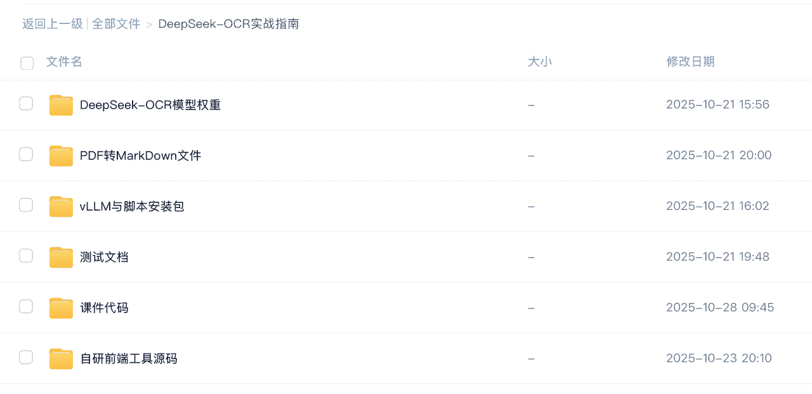


此外，公开课代码脚本已上传**至课件网盘（链接: ****h**ttps://pan.baidu.com/s/1Kwi6nzdfbnLz4tZSaEvXGA?pwd=yheq），更多企业项目落地内容，扫码咨询⬆️助教老师，

---

## 一、OCR与多模态技术入门介绍

### 1. 从识字到理解世界

**        在人工智能的发展历史中，O**CR（Optical Character Recognition，光学字符识别） 曾是最早实现“机器理解文字”的技术之一。它让计算机第一次具备了“看懂文字”的能力——能够将扫描的纸质文件、票据、街景招牌中的文字自动识别为可编辑、可搜索的文本。可以说，OCR 技术是人类让机器“识字”的起点。

**      但随着信息形**式的多样化，文字早已不再是唯一的信息载体。图像、视频、表格、图纸、网页、甚至 PDF 文档——都成为了新的知识容器。因此，传统的 OCR 技术，虽然能够识别字符，却往往无法理解图像中的语义关系。它知道一串文字写着什么，却不理解它在页面中的意义——是标题、表格项、还是公式的一部分。这正是传统 OCR 的“瓶颈”所在。

### 2. OCR 1.0文字识别与文档版面识别

**        早期**的 OCR（我们称之为 OCR 1.0 时代）主要由两个独立的模块组成：

+   文字检测（Text Detection）：找到图像中哪里有文字；

+   文字识别（Text Recognition）：识别每一段文字的具体内容。

这些系统通常基于 CNN（卷积神经网络）+ LSTM（长短期记忆网络） 的结构，比如 CRNN、CTC 识别模型等。这一阶段的 OCR 主要解决的是“机器读字”的问题——识别准确率、字体鲁棒性、多语言支持等。

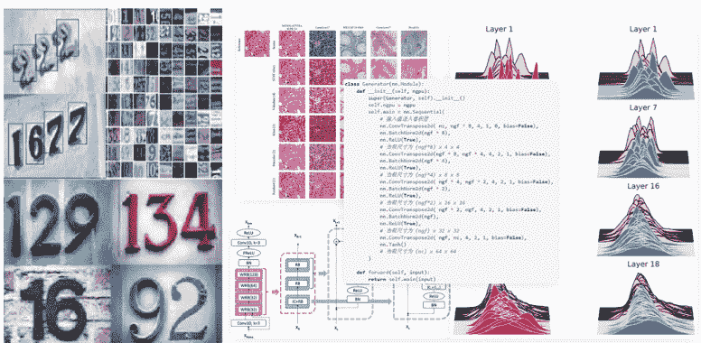

**应用层面上**，OCR 1.0 解决了海量的现实问题：

+   银行票据识别与自动录入；

+   身份证、驾驶证、发票的自动录入系统；

+   扫描文档的数字化存档；

+   翻译与语言辅助系统（如 Google 翻译的实时摄像头翻译功能）。

这些应用让信息数字化变得前所未有的高效，也成为“无纸化办公”“自动化文档处理”的基础。

然而，很快研究者开始**意识到：仅仅识别文字远远**不够，机器还需要理解整个文档的结构与语义。于是，新的 OCR 模型开始引入：

+   **视觉 Transformer**（Vision Transformer, ViT）结构；

+   布局分析（Layout Analysis）；

+   视觉语言对齐（Vision-Language Alignment）。

这一阶段的代表模型包括微软的 LayoutLM、百度的 PaddleOCR 2.0，以及多模态结构化识别模型 Donut、DocFormer、TextMonkey 等。这些模型不仅能识别文字，还能输出 Markdown、HTML 或 JSON 结构，理解表格、公式、图形之间的关系。也就是说，此时OCR模型就由原先的“看字”升级成了“看文档版面”。

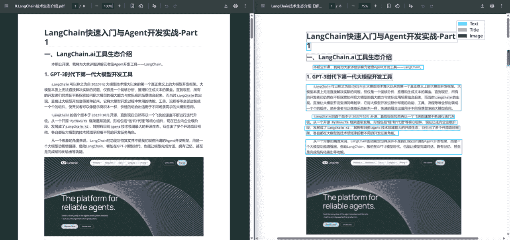

但是需要注意的是，此时的OCR模型仍然无法真正全面理解完整文档的语义，尤其是一些流程图、CAD图、装饰图等等，也就是说，新一代OCR模型理解能力上升了，但也只局限在理解文档版面信息层面。

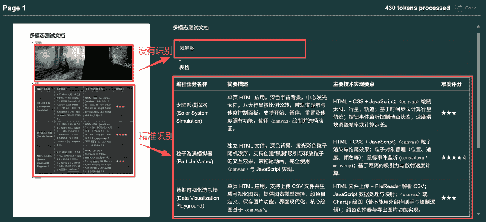

### 3. 多模态崛起：让大模型看懂世界

而在 2023 年之后，大模型技术的爆发彻底改变了视觉理解的格局。以 GPT-4V、Gemini 2、Qwen-VL、InternVL 等为代表的 多模态大模型（VLM，Vision-Language Model） 出现，让人工智能真正具备了“同时理解文字与图像”的能力。

多模态技术的核心思想是：将图像和语言映射到同一个语义空间中，让模型能够同时处理视觉信息和文本信息。这意味着，模型既能“看图识字”，又能“看图明意”——它能读懂论文 PDF、解析图表、理解建筑图纸、甚至生成 Markdown 结构的文本。

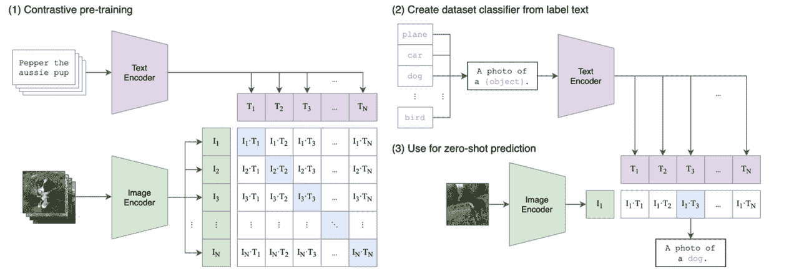

多模态技术的本质，是要让机器能够“同时理**解文字与图像”。而实现这一点的关键，就是**将图像与文本映射到同一个语义空间（Shared Semantic Space）中。换句话说，无论输入是一句话，还是一张图，模型都能在同一个高维表示空间里找到它们之间的语义对应关系。

这就像人类在看图表或阅读论文时，不仅识别出图形和文字，还能在大脑中把它们融合成“意**义”：看到“**上升趋势”这个图形，你会自动想到“增长”；看到公式，你能联想到逻辑推理。多模态模型正是试图在计算机中复现这种语义联想机制。

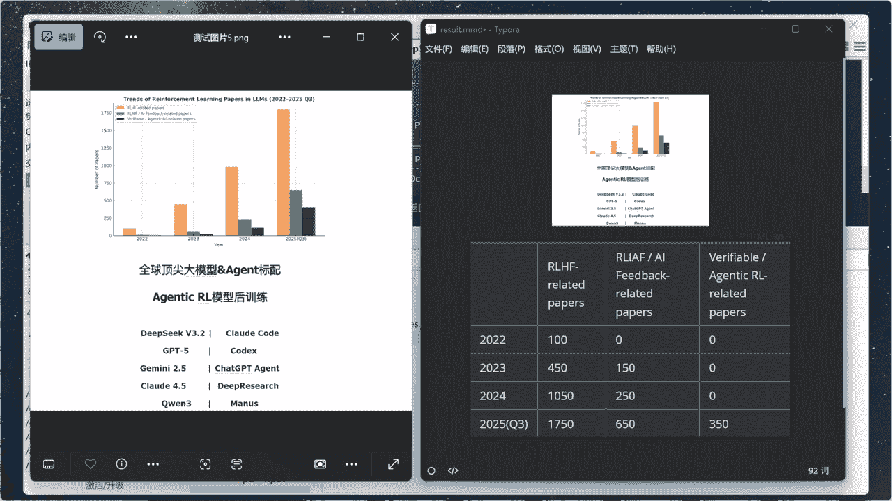

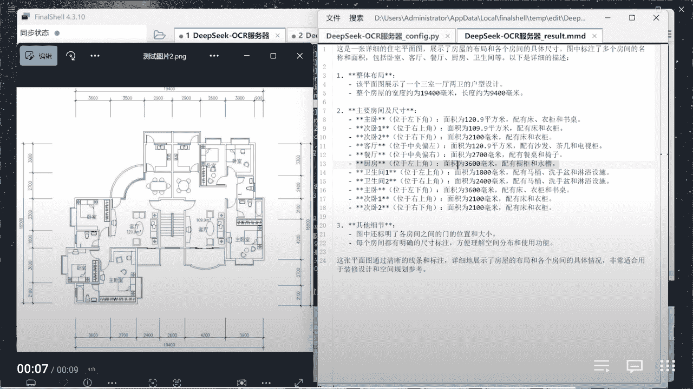

而基于VLM进行OCR的工作，包括文字识别、版面识别（文档结构关系识别）等等，也被称为OCR 2.0。

### 4. VLM技术核心：视觉特征的语义映射（Vision-Language Alignment）

在现代多模态模型中，这种“图文对齐”通常分为三个关键步骤：

#### 1. 视觉编码（Vision Encoding）

首先，模型需要将图像转**换为一组高维视觉特征向量（**visual embeddings）。这一过程由 视觉编码器（Vision Encoder） 完成，最早的代表就是 CLIP 的 ViT 模块。视觉编码器通常采用 Transformer 架构（ViT 或 Swin Transformer），把一张图像切分为若干个小块（patch），每个 patch 都会映射成一个 token，最终得到一串图像向量序列：

这些向量就像语言模型中的单词嵌入（word embeddings），代表图像中不同区域的语义内容。

#### 2. 语言编码（Text Encoding）

与此同时，文本会被输入到 语言编码器（Text Encoder）（例如 GPT、LLaMA、T5 等）中，转换为相同维度的语言向量：

至此，图像和文本都被表示成一串高维 token。但这两种 token 来自不同模态，尚未处于“同一个语义空间”中。

#### 3. 图文对齐（Cross-Modal Alignment）

对齐机制的核心目标是：让视觉向量与语言向量在同一个空间中具有可比较的语义距离。实现方式主要有三种典型路径：

| 对齐方式 | 技术实现 | 特点 |
| --- | --- | --- |
| 🔹 对比学习（Contrastive Learning） | 如 CLIP：通过大规模图文配对数据，让图像与文本 embedding 在向量空间中靠近 | 简单高效，训练稳定；但语义理解有限（主要停留在关联层面） |
| 🔹 特征投影（Projection Head） | 使用 MLP / Linear 层将视觉特征投射到语言模型 embedding 空间 | 可直接与 LLM 融合，但训练依赖下游任务 |
| 🔹 跨模态注意力（Cross-Attention） | 如 BLIP-2、LLaVA：通过交叉注意力层实现图像 token 与语言 token 的动态交互 | 理解深度强，可进行生成与推理任务 |

这三种方法可以理解为“从对齐到融合”的三步演进：

CLIP —— 对齐；BLIP —— 语义交互；LLaVA / DeepSeek-OCR —— 语义生成。

+   典型多模态架构

让我们看看目前主流的视觉语言模型是如何设计的：

| 模型 | 核心组成 | 技术特点 | 代表任务 |
| --- | --- | --- | --- |
| **CLIP（OpenAI）** | ViT（视觉编码器） + Transformer（文本编码器） | 大规模对比学习；统一特征空间 | 图文检索、图像分类、Zero-shot |
| BLIP / BLIP-2（Salesforce） | 图像编码器 + Q-Former + 语言模型 | 引入 Q-Former 作为视觉语义中介；提升语义对齐 | 图文生成、图像理解 |
| LLaVA（Visual Instruction Tuning） | CLIP ViT + 投影层 + LLaMA | 将视觉 token 直接映射到 LLM 输入 | 图文问答、多模态对话 |
| Qwen-VL / InternVL | 自研视觉编码器 + LLM 联合训练 | 支持复杂文档理解与视觉推理 | OCR 2.0、图文RAG |
| DeepSeek-OCR（DeepSeek-AI） | ViT 视觉编码器 + 文本解码器 + Prompt路由机制 | 专注文档解析；融合OCR任务 | PDF转Markdown、公式/表格解析 |

> 注：DeepSeek-OCR 正是在 LLaVA 类架构基础上，结合了高效的视觉压缩与 OCR 微调机制，形成了一种专用的 “视觉语言对齐 + 结构生成”模型。

## 二、多模态RAG系统开发及主流OCR&VLM模型介绍

### 1. 从文本到图文：信息检索的现实困境

在传统的RAG（Retrieval-Augmented Generation）系统中，我们所面对的数据大多是纯文本。这些系统的核心流程通常是：

文本向量化 → 向量检索 → 结果拼接 → 大模型回答。

**       然而**，真实的知识世界远不止文本。在企业文档、科研论文、专利报告、财务报表、建筑图纸等场景中，大量关键信息都藏在非结构化PDF文档中。

这些文档可能包含：

+   复杂的表格（嵌套结构、合并单元格）；

+   数学公式或物理符号；

+   实验图片、流程图、建筑蓝图；

+   混合语言或多栏排版；

+   注释、脚注、图例等细节信息。

对于人类而言，理解这些内容只是阅读的问题；但对于机器来说，这是一场真正的挑战。

+   多模态文档样例

+   风景图&装饰图

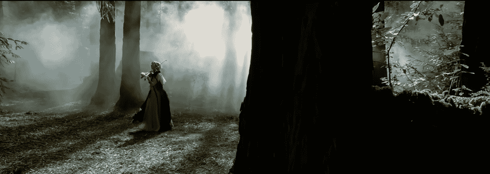

+   表格

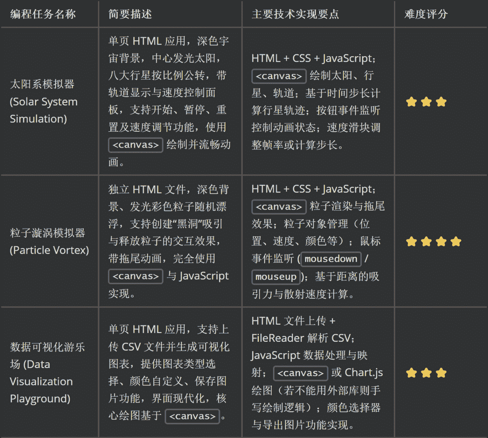

+   流程图


+

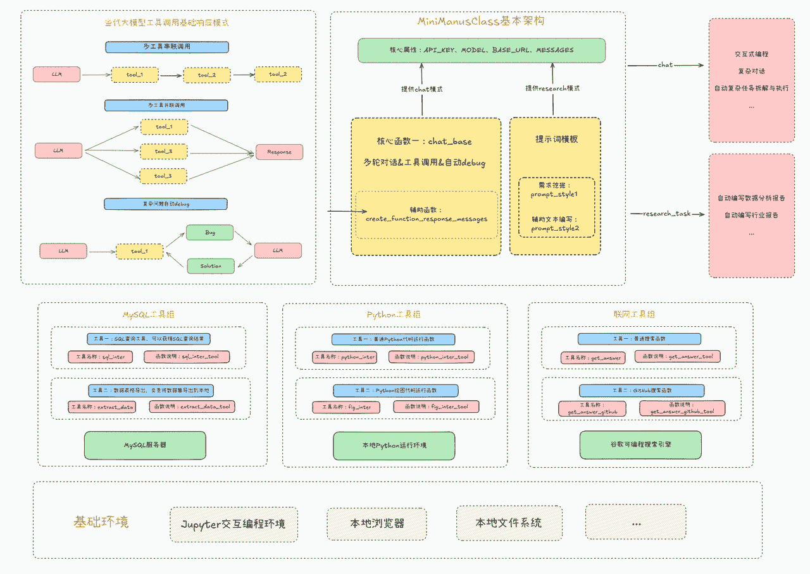

+   产品图

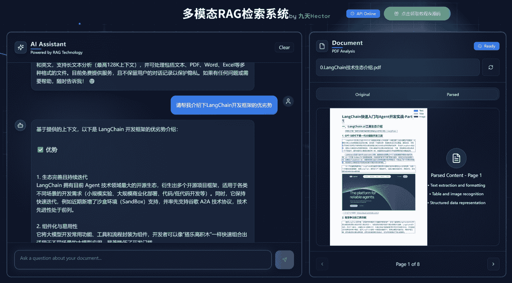

+   latex公式

+     并且，在Lesson 12中我们曾证明，伪残差之所以能够加快模型收敛速度，是因为伪残差代表的拟合方向就是损失函数最快速减小（下降）的方向。换而言之，通过一颗颗决策树不断拟合伪残差，最终能够使得损失函数最快速的减小。同时，在伪残差的具体选取上，GBDT的伪残差是样本的负梯度：
 
而XGB的伪残差则是一个同时包含梯度和损失函数二阶导的计算结果：

+   而根据Lesson 13中的数学推导不难看出，从本质上来说，XGB的伪残差是在拟合损失函数的二阶泰勒展开，而GBDT的伪残差则是在拟合损失函数的一阶泰勒展开。在大多数情况下，通过拟合二阶泰勒展开，能够更好的捕捉损失函数的更加细微的变动，从而提升精度，但代价是这么做需要耗费更大的计算量。

+   手写公式拍照


+   论文图表

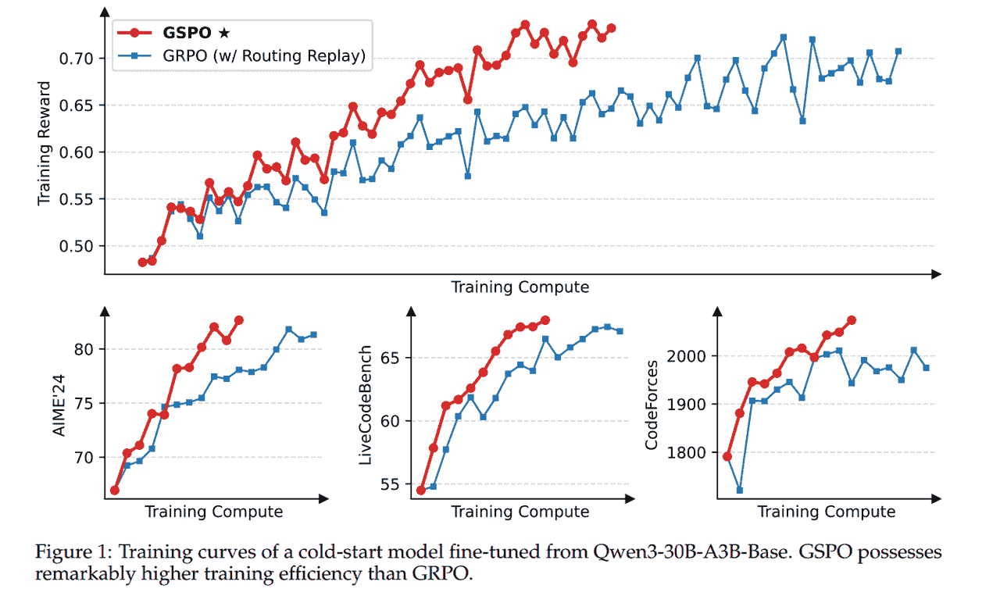

+   结构化数据图

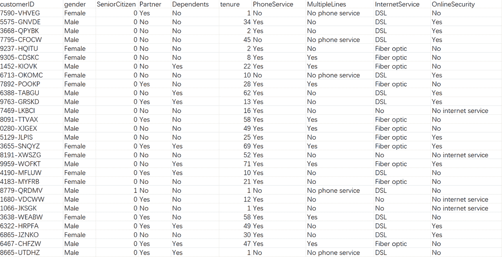

### 2. 基于OCR模型的文档识别与检索系统

在这样的多模态PDF场景中，OCR模型就是系统的**“第一道神经通路”**。它承担着从视觉信息中提取语义结构的关键任务，是整个RAG链路的起点。如果说LLM是“大脑”，那么OCR模型就是“视觉皮层”——它决定了大脑能看到什么、理解到什么程度。

在过去的OCR 1.0时代（以PaddleOCR、Tesseract等为代表），模型只能“扫描文字”，也就是说，它看到PDF中的一段文字，只会简单地识别出“这些字是什么”。

而在OCR 2.0（也就是VLM模型时代）中，OCR模型已经能够实现：

+   **语义级解析**：不仅识别文字，还能理解其上下文逻辑（如表头对应数据、公式与变量的关联）；

+   **结构级还原**：能够自动将PDF文档转化为结构化的Markdown或HTML格式，保留段落层次、标题、列表等格式信息；

+   **视觉语义融合**：能看懂图像与文字的关系，比如“图1展示了实验流程”、“左图为原始图像、右图为结果对比”；

+   **内容理解能力**：不仅能提取表格数据，还能识别图表趋势、理解图像含义、甚至生成解释性描述。

这意味着，OCR 2.0模型不再只是“PDF识别器”，而是一个真正的“PDF理解器”。

| 能力方向 | 传统OCR（1.0） | 现代VLM OCR（2.0） |
| --- | --- | --- |
| 信息提取 | 仅识别文本字符 | 同时提取文本、表格、公式、图像语义 |
| 文档结构 | 无法保留层级 | 自动生成结构化Markdown/HTML |
| 语义理解 | 无上下文关联 | 理解逻辑、关系、描述性语义 |
| 应用范围 | 文档数字化 | 多模态RAG、知识抽取、科研分析、问答系统 |

在多模态RAG系统中，OCR模块通常作为整个流程的**输入层（Input Layer）**存在。完整的管线一般包括以下几个阶段：

```
PDF文档 → OCR/VLM解析 → Markdown/JSON结构化结果 → 向量化编码 → 检索/召回 → 大模型回答
```

这其中的OCR阶段至关重要——它决定了后续的知识检索质量。

一个优秀的OCR模型，能够把一份复杂的学术PDF转化为层次清晰的Markdown文档：标题、表格、公式、图表说明都保持一致；而一个传统OCR模型，可能只能输出一堆“碎片化文字”，失去了上下文结构。可以说：如果OCR阶段做不好，整个多模态RAG系统的“知识理解”就无从谈起。

### 3. 主流VLM与OCR模型介绍

目前VLM模型有很多，除了主流的多模态在线大模型外，还有如Qwen-VL、InternVL、Gemma等开源的视觉模型。

#### 3.1 在线VLM模型

**       在多模态 RA**G 技术体系中，在线 VLM 模型是目前能力最全面的语义理解引擎。这类模型往往由顶尖大厂训练并托管在云端，参数规模达到数百亿甚至上千亿，具备强大的多模态感知与推理能力。典型代表包括 OpenAI 的 GPT-5（原生支持文本、图像、音频等模态，提供完善的 API 与生态）、Google 的 Gemini 2.5（强调长上下文、多语言和与搜索/Workspace 的无缝集成）、以及 Anthropic 的 Claude 4.5（在多步推理与代理式任务中表现突出，并已在多云环境提供企业级接入）。这类在线模型的优势在于即开即用、功能齐全、语义理解能力极强，但与此同时也存在调用成本高、隐私合规受限的现实问题。因此，在线 VLM 更适合作为复杂问题的“上层大脑”，在需要深度语义理解、跨模态推理和企业级可靠性的场景下发挥核心价值。

#### 3.2 开源VLM模型

##### 3.2.1 **InternVL 3.5**模型

**InternVL 3.5** 由 上**海人工智能实验室** (Shanghai AI Lab) 联合多家科研团队于 2025 年发布，是继 InternVL 2.x 系列后的重大更新版本。该模型参数规模覆盖 8B 至 40B，在图像理解、表格解析、跨模态检索和复杂推理方面均有显著提升。特别是提出了 Cascade RL（级联强化学习） 策略，用于增强模型的多步推理稳定性，使其在图表问答、科学文献解析等任务中表现优于同类开源模型。

+   **优势**：推理链条长、跨模态任务表现强，支持多语言和科研级任务；社区生态活跃。

+   **局限**：大尺寸模型的显存占用较高，对硬件配置有一定门槛。

+   项目地址：https://github.com/OpenGVLab/InternVL

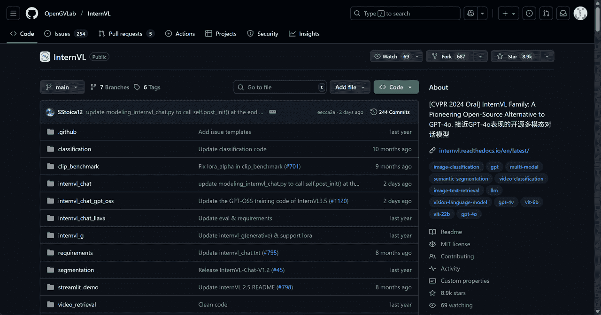

+   运行效果

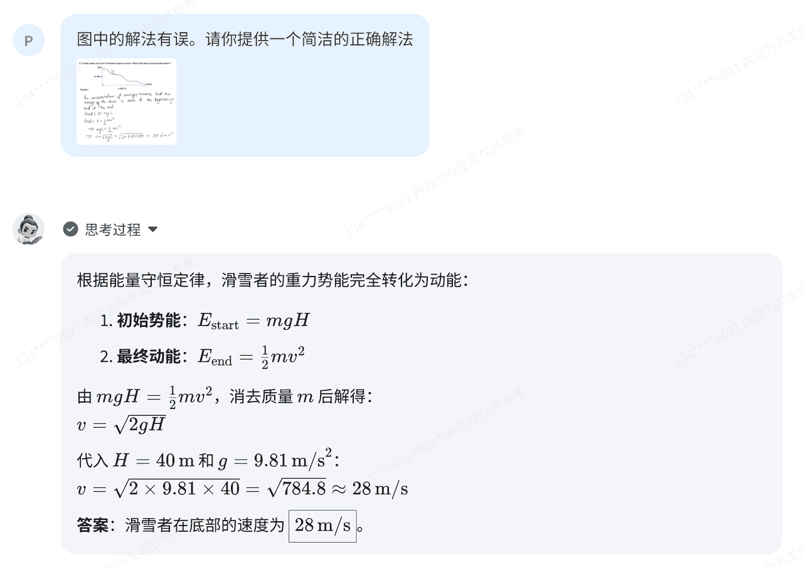

#### 3.2.2 Qwen3-VL

**Qwen3-VL** 是 **阿里巴巴达摩院** 在 2025 年推出的最新一代视觉语言模型，是 Qwe**n2.5-VL 的升级****版。其参数规模从 3B、7B**** 到 72B，覆盖轻量部署**与高性能需求，具备目标检测、图表理解、视频解析等全面能力。Qwen3-VL 在 跨语言文档解析、长视频理解 上有增强优化，并延续了 Qwen 系列在企业级开源社区中的强大影响力。

+   **优势**：参数规模覆盖广，性能与成本可灵活平衡；对文档/图表解析能力突出。

+   **局限**：大尺寸模型需要高端 GPU，推理延迟较大。

+   **适用场景**：企业文档检索、长视频内容解析、多语言跨模态问答。

+   Qwen2.5模型开源地址：https://github.com/QwenLM/Qwen3-VL

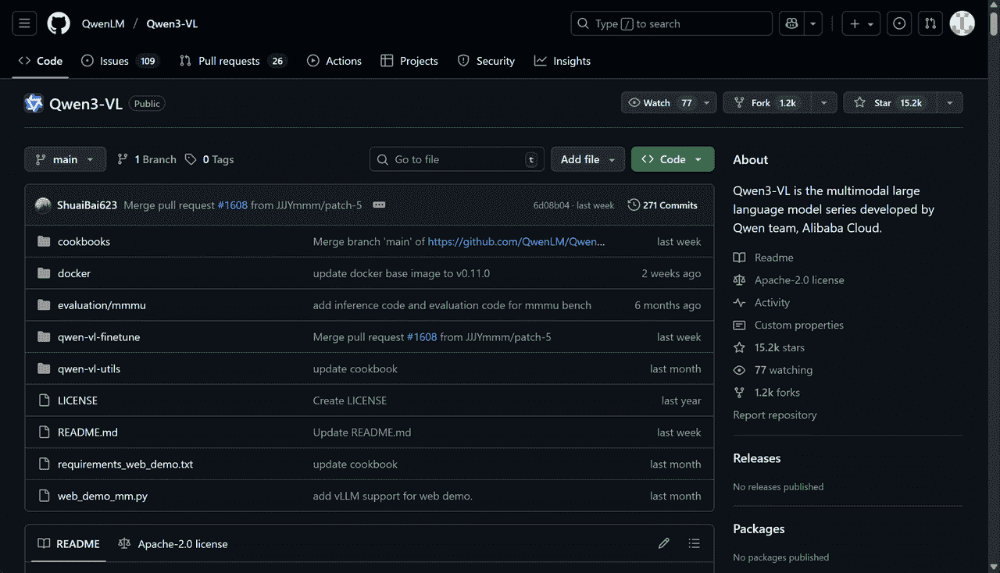

##### 3.2.3 SmolVLM

**SmolVLM** 由 **Hugging Face 社区**在 2024 年末**发起，是一**类 轻量级 V**ision-La**nguage Model，参数规模通常在 1B–2B 左右，主打 低算力环境可运行。与大型 VLM 相比，SmolVLM 的目标不是追求极致性能，而是通过紧凑模型结构，在笔记本或中低端 GPU 上也能实现图文问答、图像 caption 等多模态任务。

+   **优势**：模型小巧，部署门槛低；训练与调用成本显著低于大型 VLM。

+   **局限**：在复杂表格解析、多步推理上的表现明显落后于大模型；在专业场景（科研、法律文档）效果有限。

+   **适用场景**：教学实验、个人项目、边缘设备上的轻量多模态应用

+   项目地址：https://github.com/huggingface/smollm

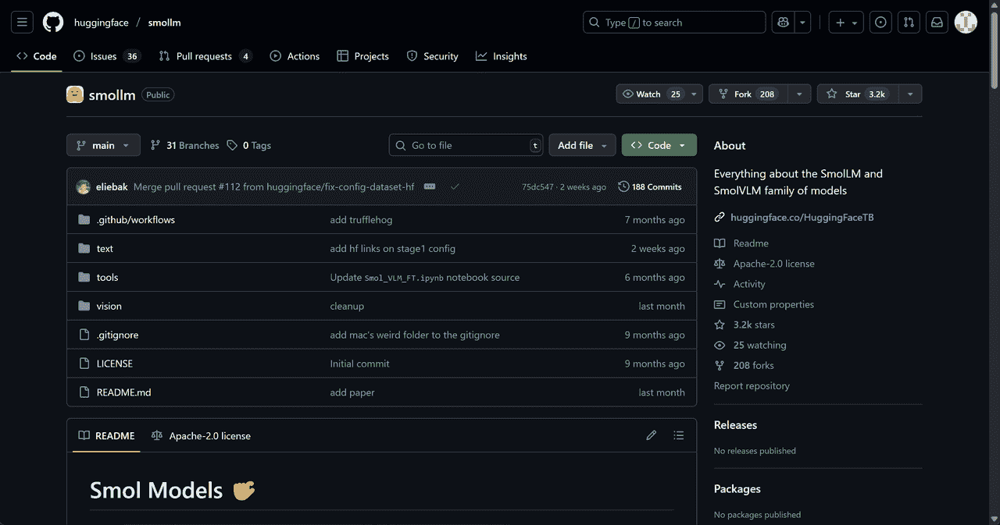

+   运行效果

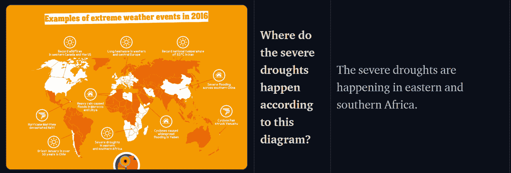

##### 3.2.4 Gemma 3

**Gemma 3** 是 **Google DeepMind**** 在 2025 年开**源**的最新多模态模型，**提供 4B、12B、27B 三个参数规模，支持文本与图像输入。Gemma 3 延续了 Gemma 系列开源、透明、注重轻量化的设计理念，并针对 图像问答、图表解析 等任务做了优化。它兼顾了学术研究的可复现性与企业应用的可落地性，尤其在中小规模下提供了性能与算力需求的良好平衡。

+   **优势**：覆盖轻量到中型参数规模，支持多模态输入；Google 官方维护，生态完善。

+   **局限**：相比更大规模的 VLM（如 GPT-5、InternVL 40B），在复杂推理和长文档解析上能力有限。

+   **适用场景**：科研探索、企业试点项目、对成本敏感的多模态应用。

+   模型地址：https://huggingface.co/google/gemma-3-4b-it


各类VLM模型对比如下

| 模型 | 发布团队 | 参数规模 | 类型 | 核心特点 | 优势 | 局限 | 适用场景 |
| --- | --- | --- | --- | --- | --- | --- | --- |
| **GPT-5** | OpenAI | 百亿+ | 在线 API | 原生多模态（文本/图像/音频），API 生态完善 | 功能最全，推理强，生态成熟 | 成本高，需考虑隐私合规 | 高阶语义推理，企业级 RAG，代理任务 |
| **Gemini 2.5** | Google DeepMind | 数百亿 | 在线 API | 长上下文（百万级），文本/图像/音频/视频融合 | 与搜索/Workspace 深度整合，多模态能力强 | 部署受地区/合规限制 | 长文档检索，复杂企业场景 |
| **Claude 4.5** | Anthropic | 百亿+ | 在线 API | 多步推理与代理式任务突出 | 长程任务表现好，企业接入灵活 | 成本与速率受限，图像能力因版本而异 | 工程/科研多步任务，企业合规环境 |
| **InternVL 3.5** | 上海人工智能实验室 | 8B–40B | 开源 | Cascade RL 增强推理，图表/跨模态理解 | 推理强，科研友好，社区活跃 | 大模型需高端 GPU | 科研论文解析，图表问答 |
| **Qwen3-VL** | 阿里巴巴达摩院 | 4B/8B/  30B/235B | 开源 | 文档解析、目标定位、长视频理解 | 尺寸覆盖广，性能灵活 | 大尺寸算力要求高 | 企业文档、多语言跨模态应用 |
| **SmolVLM** | Hugging Face 社区 | 1B–2B | 开源 | 轻量 VLM，低算力可运行 | 部署门槛低，适合个人/教育 | 复杂任务效果弱 | 教学、轻量个人项目 |
| **Gemma 3** | Google DeepMind | 4B/12B/27B | 开源 | 轻量到中型参数，图像问答/图表解析 | 成本低，生态完整 | 性能弱于超大模型 | 成本敏感型企业/科研试点 |

#### 3.2 主流OCR 2.0模型介绍

不过需要注意的是，VLM模型是更加通用的视觉识别模型，而为了更好的完成OCR的工作，又进一步诞生了基于VLM模型进行微调后得到的专业的OCR 2.0模型。相比通用的VLM模型，这些OCR 2.0模型能够更好的完成图像实体识别、PDF版面分割、图片信息提取后的结构化输出、PDF到MarkDown的一键转化工作等等。其中主流的模型如下。

##### 3.2.1 MinerU：高精度 PDF 转 Markdown 的一体化工具

**MinerU** 由 阿里巴巴达摩院与 OpenDataLab 社**区联合开源，是当前性**能最突出的 PDF → Markdown 转换工具之一。它集成了 OCR 模型、版面解析与结构化抽取，能够处理学术论文、扫描件和复杂排版文档。MinerU 特别在 公式、表格、图片引用 等细节保留上表现优异，使得输出的 Markdown 更加接近原始文档语义。

+   **优势**：输出结构清晰、对数学公式/表格解析精度高；社区活跃、CLI 使用方便。

+   **局限**：使用 **AGPL-3.0** 许可证，对闭源商用有限制；在极端复杂排版场景仍可能需要人工后处理。

+   **适用场景**：科研 PDF 批量解析、技术文档转换、构建高质量 RAG 知识库的前置步骤。

+   项目地址：https://github.com/opendatalab/MinerU

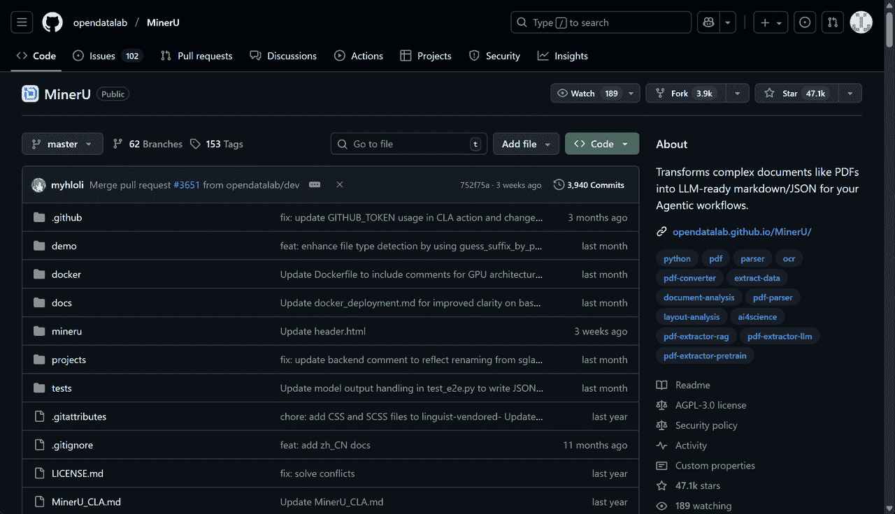

+   使用效果

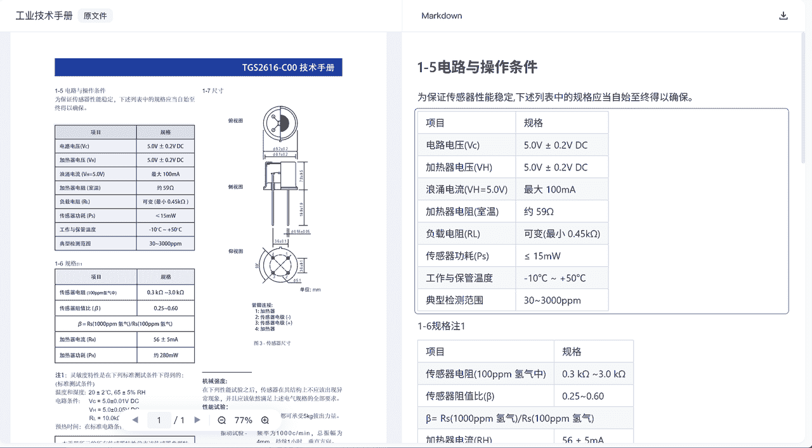

需要注意的是，最新版MinerU 2.5已发布，这是一个基于Qwen 2.5-VL模型进行修改和微调后的1.2B参数模型。

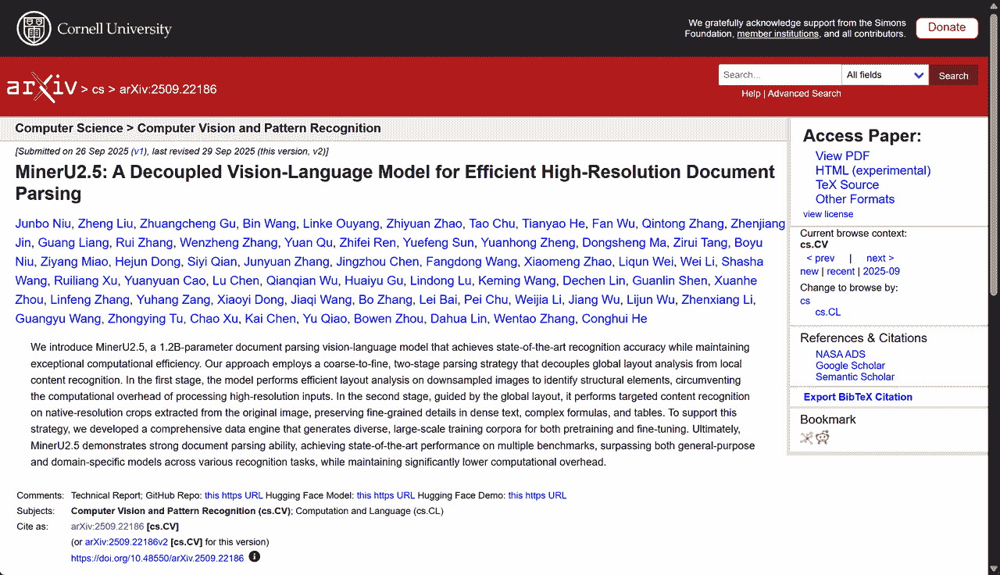

##### 3.2.2 **dots.ocr**

dots.ocr是📕近期发布的OCR大模型。不同于传统 OCR 工具链依赖「检测 → 识别 → 版面重构」的多阶段流水线，dots.ocr 采用了统一的 Vision-Language Transformer 架构，将版面检测、文字识别和结构解析融为一体。这种设计极大减少了模块之间的对齐误差，使得模型在多语种文档、复杂版面和表格场景中表现出色。凭借仅 1.7B 的参数规模，dots.ocr 兼顾了轻量与高精度，被视为在“端到端文档解析”方向的重要突破。它的出现不仅推动了 OCR 技术向一体化演进，也为构建更高效的多模态 RAG 系统提供了新的底层支撑。

+   **优势**：单模架构减少流水线对齐误差；在多语言与复杂版面上表现突出；易用的 prompt 化任务切换（布局/表格/文本）。

+   **局限**：社区反馈在少数复杂表格（合并单元格）场景仍需微调或后处理。

+   **适用**：论文/报告、票据类文档的端到端解析；希望降低多模型编排成本的团队。

+   项目地址：https://github.com/rednote-hilab/dots.ocr

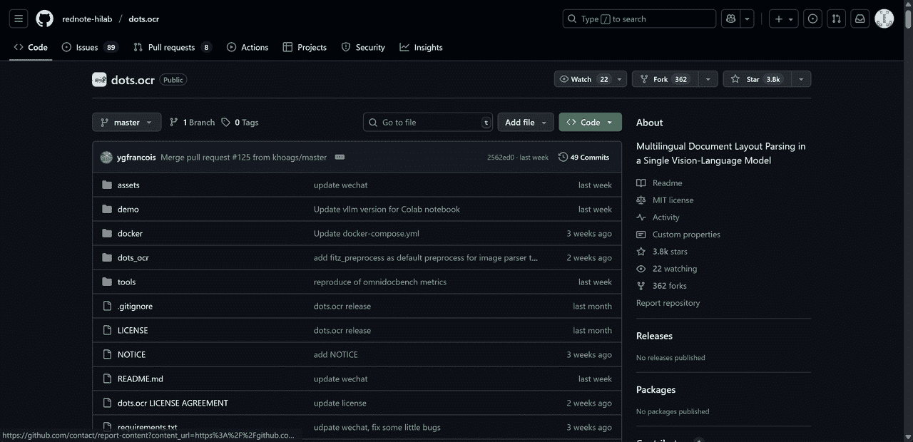

+   运行效果

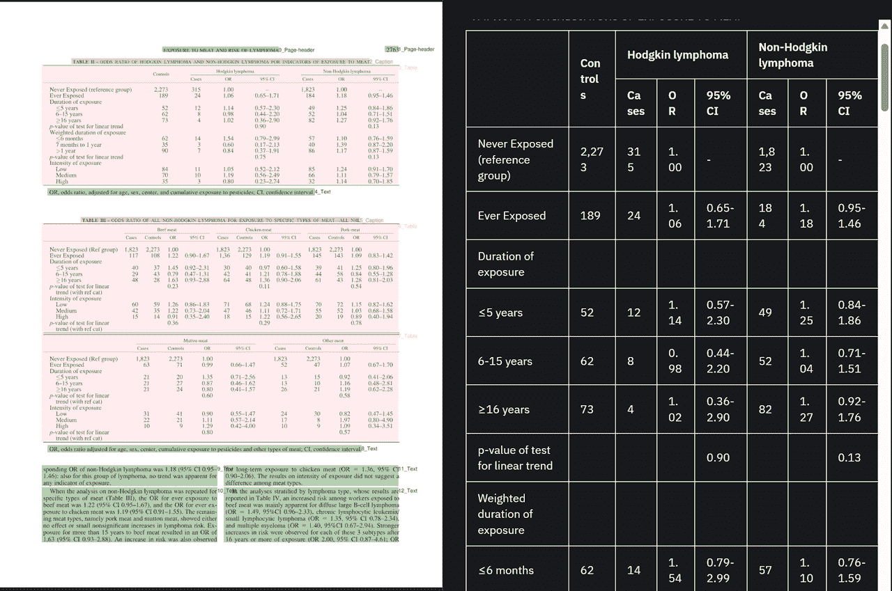

##### 3.2.3 **olmOCR**（Allen AI）

在轻量 OCR 工具中，olmOCR 的特色在于对复杂 PD**F 与扫**描文档进行“线性化还原”。它由 Allen Institute for AI (AI2) 团队于 2024 年开源，核心目标是最大限度地保持文档阅读顺序的完整性，同时兼顾表格、公式以及手写体等特殊内容的识别。olmOCR 的模型规模属于中小尺寸，总共7B参数（基于Qwen2-VL-7B-Instruct微调后得到），可以在常规 GPU 环境甚至部分 CPU 配置下运行，适合科研与生产场景的快速部署。与传统 OCR 偏重“字符识别”不同，olmOCR 更强调文档的整体可读性与内容一致性，因此在大规模 PDF 转文本的批处理场景下表现突出，是学术界和产业界逐渐关注的高保真 OCR 工具。

+   **优势**：对复杂排版的读序恢复能力强；手写体/公式覆盖；开箱即用。

+   **局限**：定位于“文本线性化”，对图像语义本身不做高级理解（需上层 VLM）。

+   **适用**：海量 PDF 到可检索文本的高质量批处理；RAG 预处理。

+   项目地址：https://github.com/allenai/olmocr

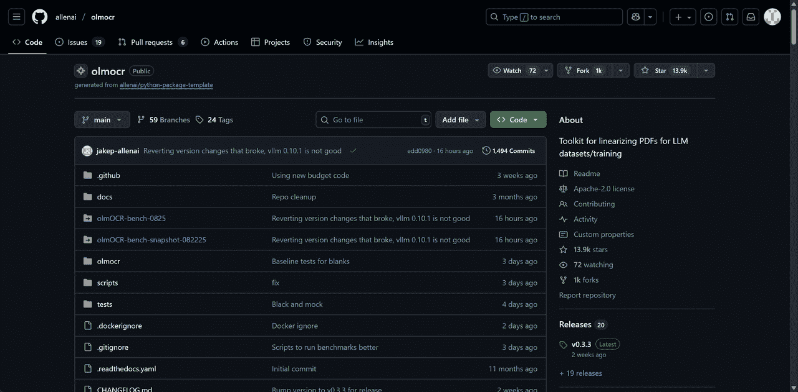

+   运行效果

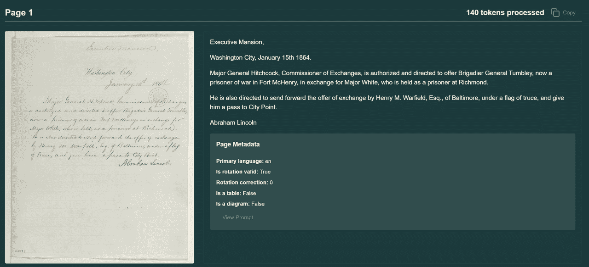

### 4. 最强OCR 2.0模型：DeepSeek-OCR与PaddleOCR-VL

尽管VLM类OCR模型带来了巨大的能力提升，但现实问题也随之而来。主要问题有二，其一是通用VLM模型很难胜任需要结构化输出的多模态PDF信息提取任务，其二则是在很多高精度场景要求下，往往需要更大尺寸的VLM才能完成，但同时就会带来部署困难、难以落地等问题。

而最近推出的DeepSeek-OCR与PaddleOCR-VL，则很好的解决了效率和精度的平衡性的问题。其中最新版的PaddleOCR将通用文字识别（OCR 1.0）和通用文档解析（2.0）正式划分为两个不同的模块，

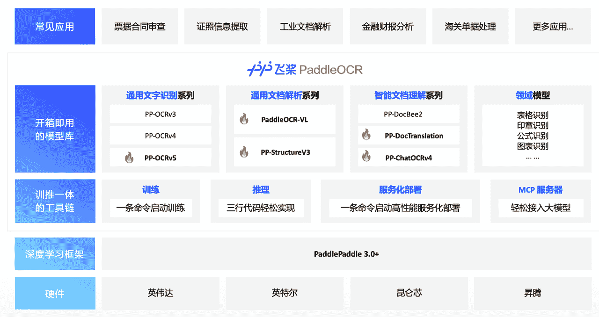

而DeepSeek-OCR则凭借极强的技术创新力，开创性的提出了“上下文光学压缩”方法，并原创提出DeepEncoder（DeepSeek视觉编码器，现已开源），从而能够更好的兼顾各类OCR任务的效果和效率。

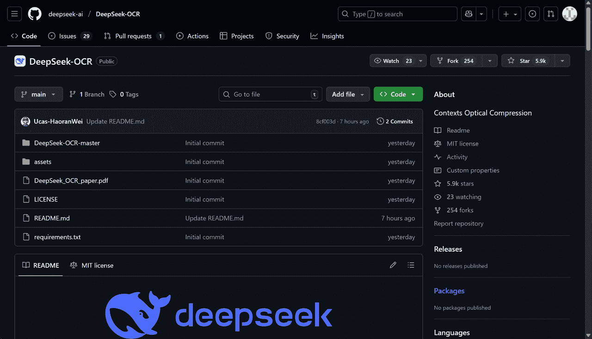

#### 4.1 最新PaddleOCR模型介绍

PaddleOCR 是百度飞桨团队开源的多语种 OCR/文档解析套件，围绕“检测—识别—版面/结构化解析—部署”提供一体化能力。3.x 系列重点引入了三大方案：用于多语种场景文本识别的 PP-OCRv5、用于层级化文档解析的 PP-StructureV3，以及面向关键信息抽取的 PP-ChatOCRv4；官方文档与技术报告明确将 PaddleOCR 定位为开源的端到端文档理解基础设施，覆盖训练、推理与服务化部署的完整工具链，便于快速落地生产级应用。

+   GitHub项目主页：https://github.com/PaddlePaddle/PaddleOCR

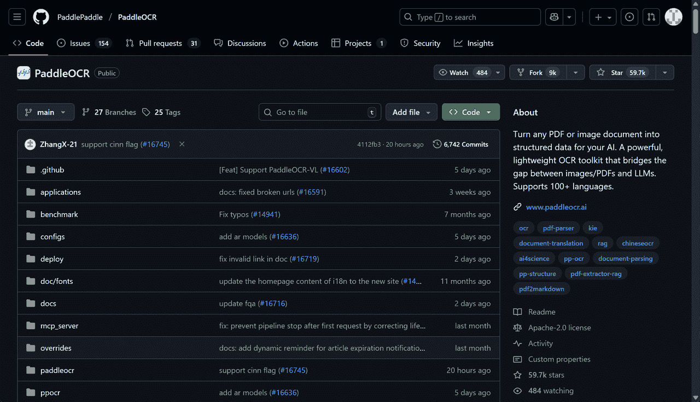

在最新进展上，PaddleOCR 于 2025-10-16 发布 v3.3.0，并同步推出 PaddleOCR-VL：一款约 0.9B 参数、资源友好的视觉—语言模型（VLM），主攻多语种文档解析，采用 NaViT 风格的动态分辨率视觉编码器并与 ERNIE-4.5-0.3B 语言模型耦合，强调在公式、表格、多栏版式等复杂元素上的准确识别与结构化输出；与此同时，3.2.0 版本（2025-08-21）对 PP-OCRv5 英文/泰文/希腊文识别模型做了加强，并提供更完善的部署支持。整体上，PaddleOCR 在 106+ 语言的识别覆盖、复杂版面解析与端到端部署便捷性方面持续演进。

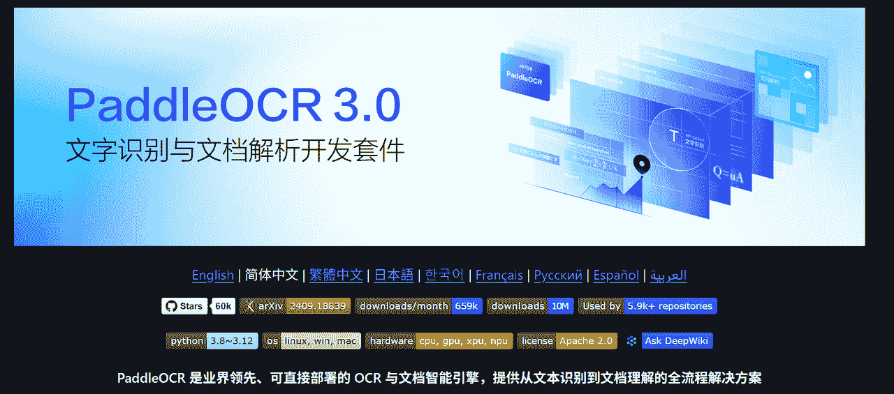

对一线开发者而言，PaddleOCR 的上手路径清晰：既可直接使用预训练模型做推理，也可在真实/合成数据上继续训练，并通过官方文档的快速开始与升级指引完成从本地到服务化的全流程；同时，生态侧还提供了与日志/实验管理平台的集成，便于在训练与评测阶段记录指标与模型检查点，提升工程效率与可复现性。总体来看，它既是“多语种高精度 OCR 算法库”，也是“文档解析生产框架”，兼顾学术前沿与工业落地。

#### 4.2 DeepSeek-OCR模型介绍

DeepSeek-O**CR 是面向多模态文档**理解与检索而生的 OCR 2.0/VLM 模型：**它不仅识别文字，**更“读懂”文档**。典型能力**包括：将多页 **PDF 一键转换为**结构化 Markdown，高保真解析 表格/公式，理解并描述 图表/示意图/照片 的语义；同时支持区域定位与版面要素标注（如利用 <image>、<|grounding|>、<|ref|>…<|/ref|> 等提示语法）。在多模态 RAG 场景中，DeepSeek-OCR 既是“视觉入口”，也是“结构化输出器”，直接产出可索引、可检索、可复用的文本与结构数据。

+   GitHub项目地址：https://github.com/deepseek-ai/DeepSeek-OCR


模型采用“视觉编码器 → 投影/对齐（projector）→ 语言解码器”的统一框架：视觉端用 ViT 系列编码图像为高维 token，投影层将视觉表征映射到语言嵌入空间，与 LLM 在同一语义坐标系内对齐，随后由解码器根据指令（prompt）生成 Markdown、LaTeX、JSON 或解释性自然语言。相比传统流水线式 OCR（检测→识别→版面分析），这种端到端的对齐与生成能在一个模型里完成 文本提取 + 结构理解 + 语义生成，减少误差累积，更适合复杂版面与跨页关联的信息抽取。

为同时兼顾 **效果与效率****，DeepSeek-OCR 提出 **上下文光学**压缩（Context**s Optical Compression）：在保持语义判别力的前提下，用更少的“视觉标记”（visual tokens）去“浓缩”文档关键信息，再交给 LLM 的推理能力补全上下文关系。这等于在视觉侧做“语义压缩”，在语言侧做“上下文复原”。其结果是：以小体量模型即可覆盖高难度的版面理解任务，显著降低显存与计算开销，同时在 PDF→Markdown、表格/公式解析、图像语义描述等核心指标上维持高质量输出，成为多模态 PDF RAG 系统中兼顾 精度/吞吐/部署成本 的务实解法。

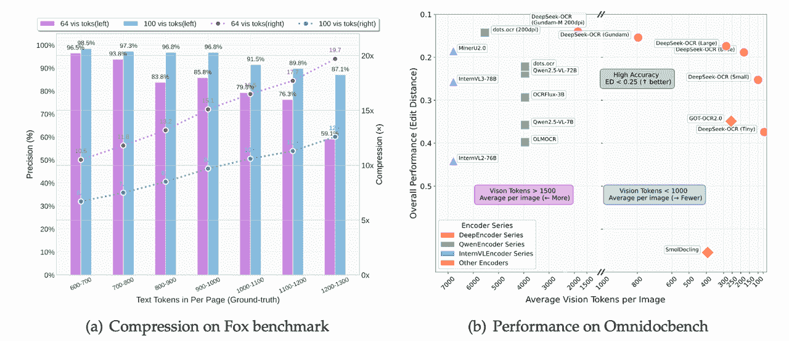

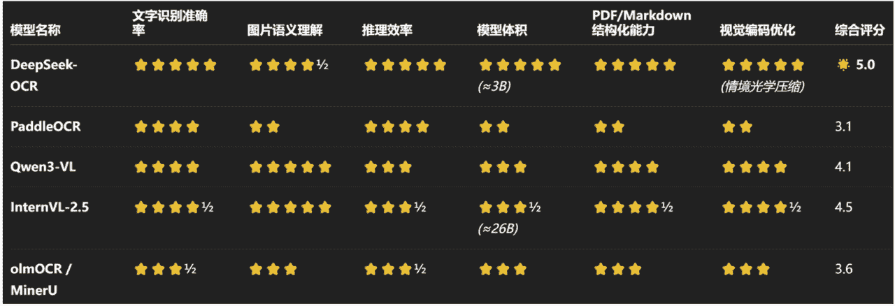

## 三、DeepSeek-OCR模型功能介绍与快速上手

10月20日，DeepSeek正式开源DeepSeek-OCR模型，并同步发布发布相关运行脚本、测试代码、DeepEncoder源码以及技术报告等全套资料。

在技术实践层面，**它是目前开源社区中少数具备**端到端文档解析、语义理解与结构化生成能力的轻量级多模态模型，参数量仅约 3B，却能在 A100 单卡上实现高达 2500 tokens/s 的推理速度，极大降低了企业和研究者在多模态 RAG 系统中的部署门槛。

总的来说，作为 O**CR 2.0 时代的典型**代表模型，DeepSeek-OCR 不仅继承了传统OCR的文本识别能力，更在“文档理解”层面进行了全方位升级。它融合了视觉语言模型（VLM）的多模态感知能力，能够同时“看懂文字”“理解布局”“分析图表”，真正实现了从“看见文字”到“理解内容”的跨越。具体而言，DeepSeek-OCR 模型可实现以下几大核心功能：

+   **OCR纯文字提取：**
支持对任意图像进行自由式文字识别（Free OCR），快速提取图片中的全部文本信息，不依赖版面结构，适合截图、票据、合同片段等轻量场景的快速文本获取。

+   **保留版面格式的OCR提取：**
模型可自动识别并重建文档中的排版结构，包括段落、标题、页眉页脚、列表与多栏布局，实现“结构化文字输出”。此功能可直接将扫描文档还原为可编辑的排版文本，方便二次编辑与归档。

+   **图表 & 表格解析：**
DeepSeek-OCR 不仅识别文本，还能解析图像中的结构化信息，如表格、流程图、建筑平面图等，自动识别单元格边界、字段对齐关系及数据对应结构，支持生成可机读的表格或文本描述。

+   **图片信息描述：**
借助其多模态理解能力，模型能够对整张图片进行语义级分析与详细描述，生成自然语言总结，适用于视觉报告生成、科研论文图像理解以及复杂视觉场景说明。

+   **指定元素位置锁定：**
支持通过“视觉定位”（Grounding）功能，在图像中准确定位特定目标元素。例如，输入“Locate signature in the image”，模型即可返回签名区域的坐标，实现基于语义的图像检索与目标检测。

+   **Markdown文档转化：**
可将完整的文档图像直接转换为结构化 Markdown 文本，自动识别标题层级、段落结构、表格与列表格式，是实现文档数字化、知识库构建和多模态RAG场景的重要基础模块。

+   目标检测（Object Detection）

+   在多模态扩展任务中，DeepSeek-OCR 还能够识别并定位图片中的多个物体。通过输入如下提示词，模型会为每个目标生成带标签的边界框（bounding boxes），从而实现精准的视觉识别与标注。

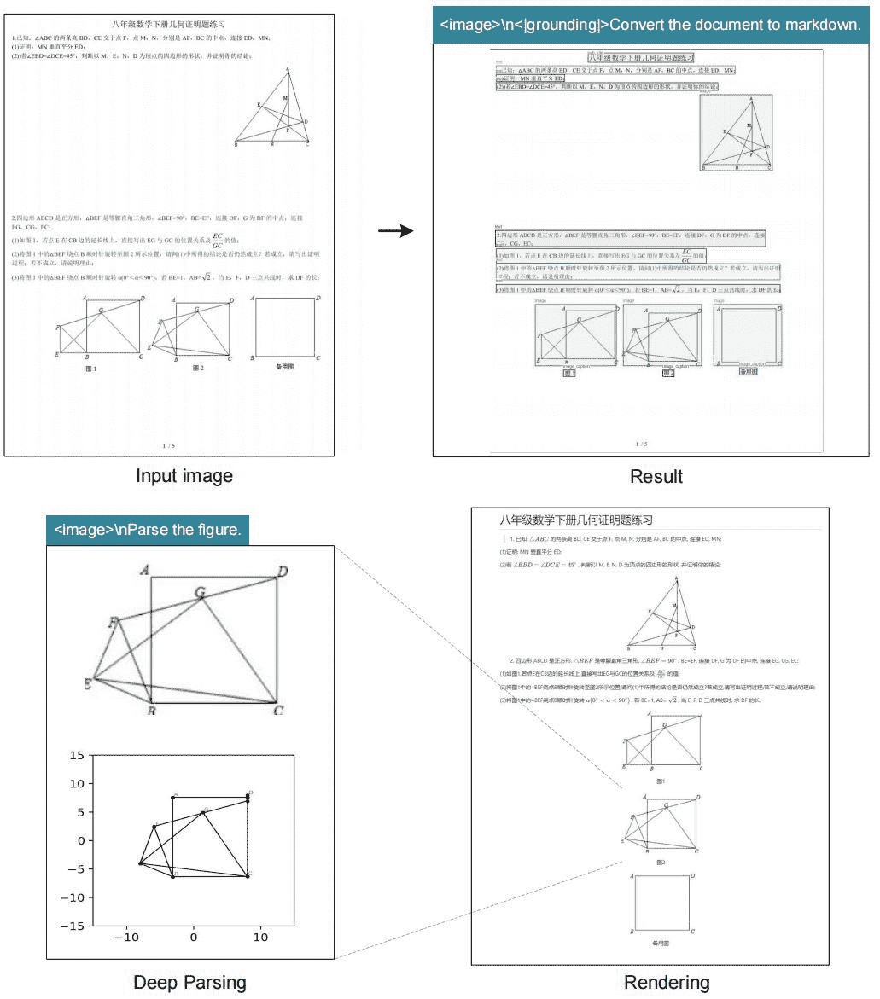

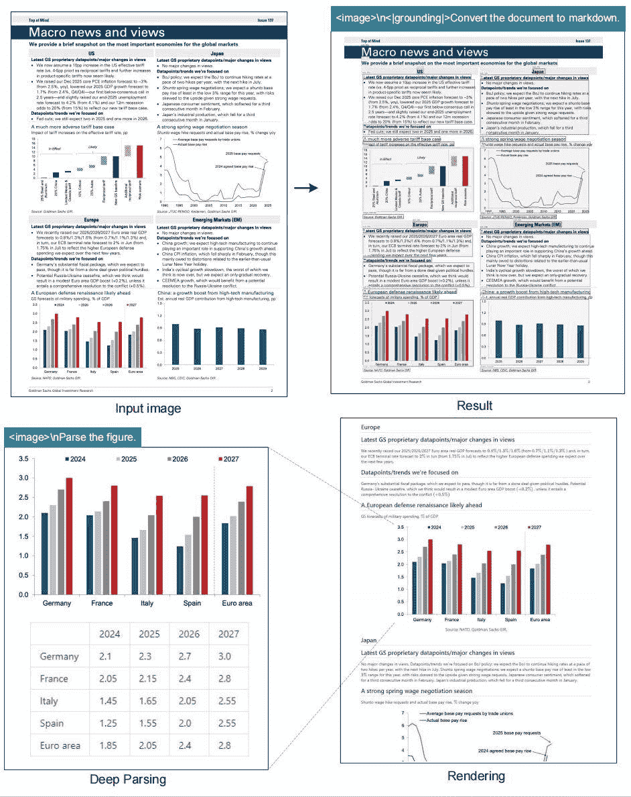

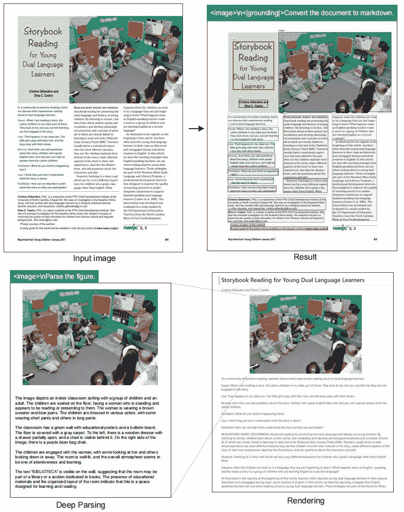

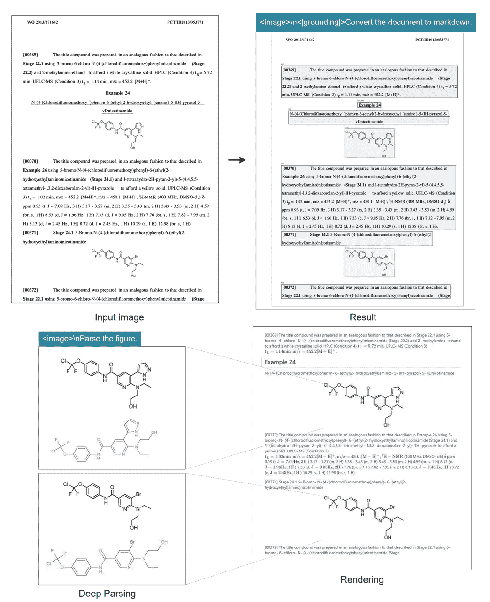

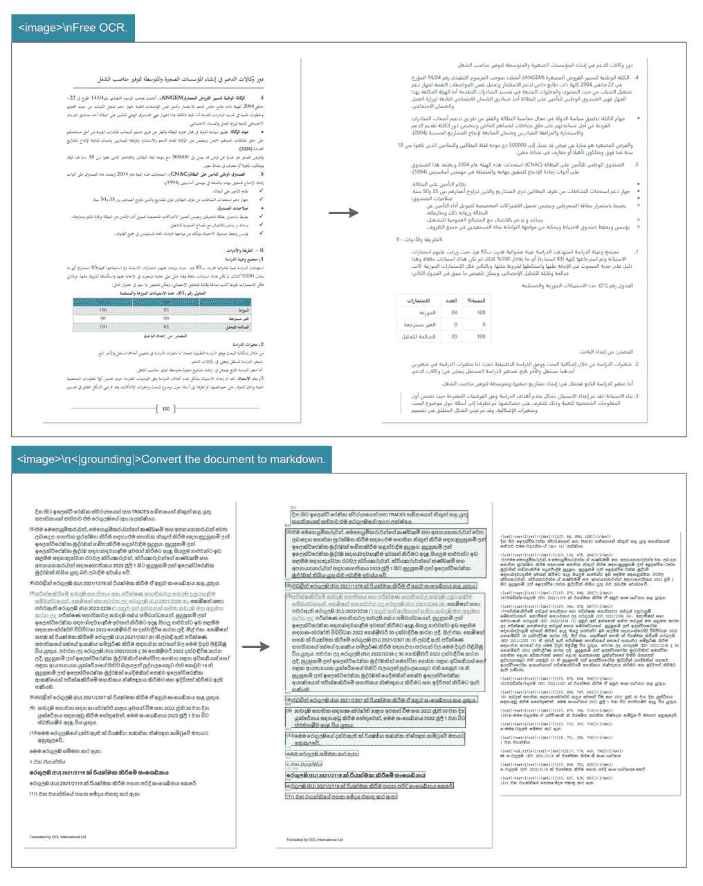

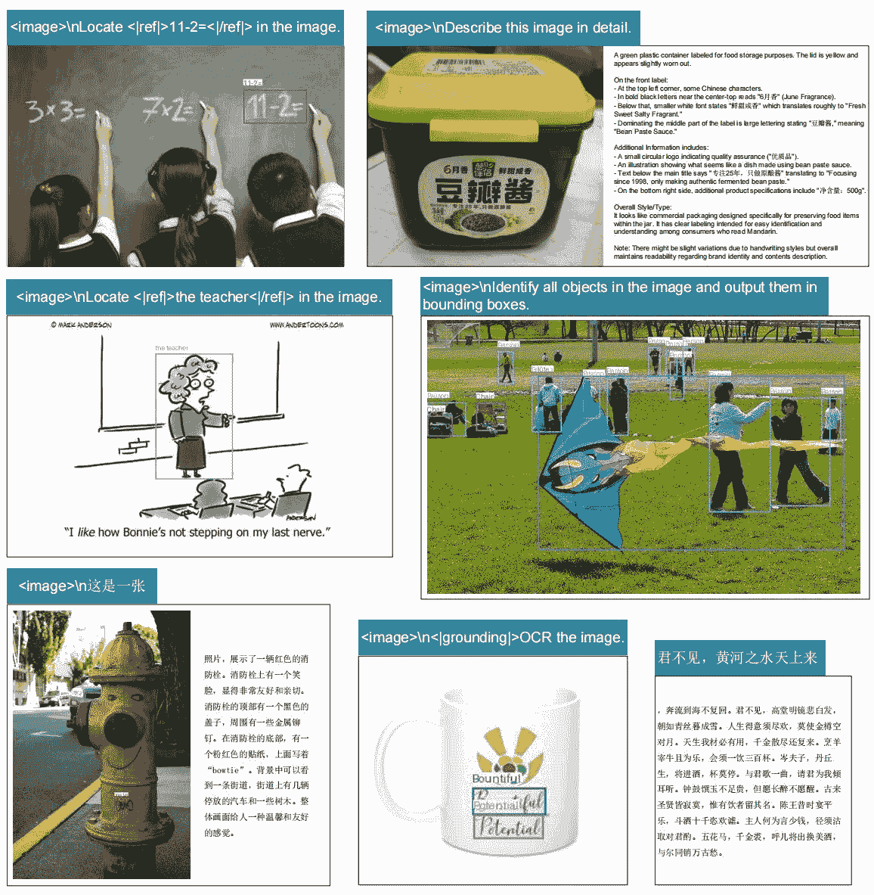

而在理论层面，De**epSeek-OCR 首次系统性提出了** **“上下文光学压缩（Conte**xts Optical Compression）” 概念，通过视觉语义压缩与语言上下文推理的协同机制，在保持识别精度的同时显著减少视觉 token 数量，实现了视觉理解与语言生成的高效耦合；在实践层面，模型实现了从图像、表格、公式到整篇 PDF 的全模态结构化解析，可直接输出 Markdown、LaTeX 或 JSON 格式，为构建多模态知识检索、企业级文档问答及科研报告分析系统提供了完整解决方案。

+   【权重】魔搭社区DeepSeek-OCR模型权重下载地址：https://www.modelscope.cn/models/deepseek-ai/DeepSeek-OCR/summary

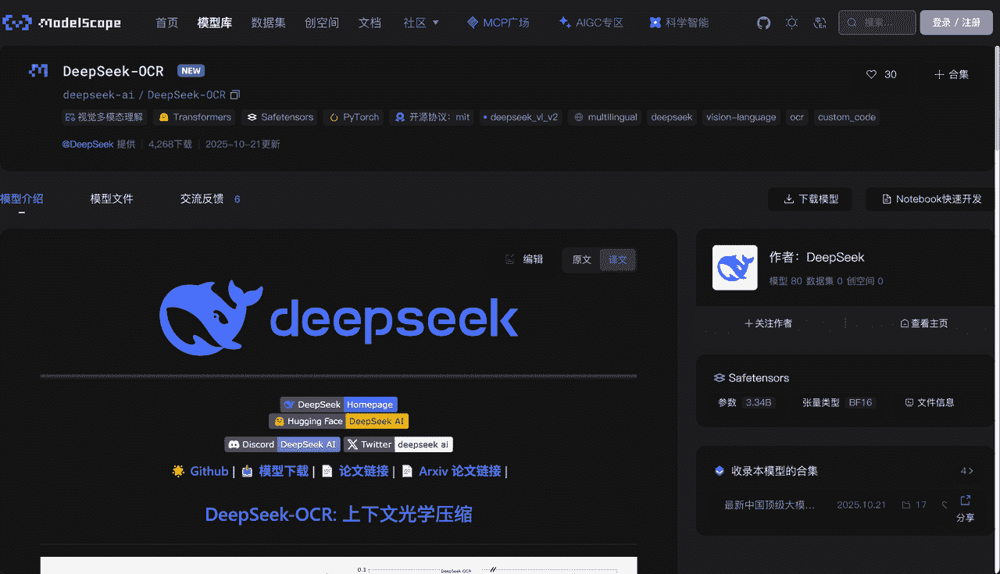

+   【权重】HuggingFace DeepSeek-OCR模型权重下载地址https://huggingface.co/deepseek-ai/DeepSeek-OCR


+   【脚本】GitHub DeepSeek-OCR模型项目主页：https://github.com/deepseek-ai/DeepSeek-OCR

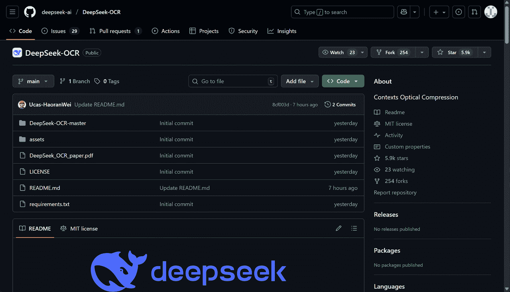

+   【论文】DeepSeek-OCR模型技术报告：https://github.com/deepseek-ai/DeepSeek-OCR/blob/main/DeepSeek_OCR_paper.pdf

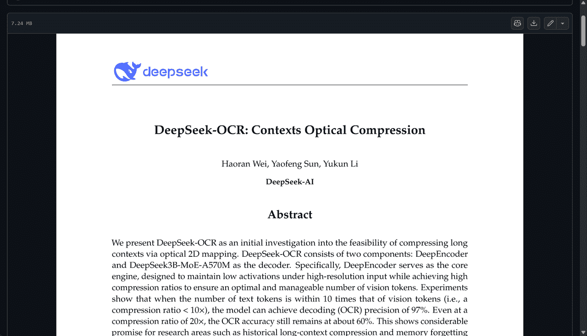

### 1. DeepSeek-OCR重大理论创新：视觉压缩一切

DeepSeek-OCR模型的核心理论创新在于对**“上下文光学压缩”（Contexts Optical Compression）**可行性的初步验证和深入探索。研究人员提出，通过利用视觉模态作为一种高效的压缩媒介来处理文本信息，可以潜在地解决当前大语言模型（LLMs）在处理极长文本内容时，由于序列长度导致的二次方计算复杂度挑战。DeepSeek-OCR是对此概念进行的初步研究，旨在探索通过光学二维映射来压缩长上下文的可行性。

#### 1.1 **上下文光学压缩的范式与机制**

**      这种光学压缩范式改变了审视视觉**-语言模型（VLMs）的角度，使其以LLM为中心，重点关注视觉编码器如何提高LLMs处理文本信息的效率，而不是传统的视觉问答任务。该理论的关键在于认识到：包含文档文本的单个图像能够使用明显少于等效数字文本所需的Token来表示丰富的信息。因此，通过视觉Token进行光学压缩，可以实现远高于直接处理文本Token的压缩比。

**       O**CR任务（光学字符识别）被选作这一视觉-文本压缩范式的理想试验台。OCR任务在视觉表征和文本表征之间建立了一种自然的压缩-解压缩映射，从而能够提供定量的评估指标来验证理论。解码器（DeepSeek3B-MoE-A570M）的任务正是从DeepEncoder压缩后的潜在视觉Token中重建原始文本表征。

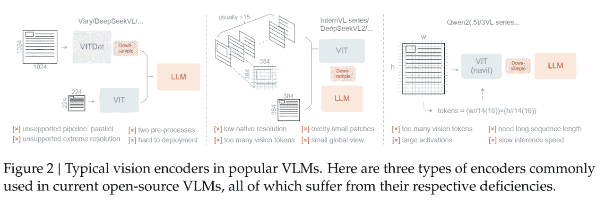

#### 1.2 **压缩能力及量化边界的验证**

DeepSeek-OCR最重要的贡献之一是提供了对视觉-文本Token压缩比的全面定量分析。通过在Fox基准测试集上进行实验，研究证实了上下文光学压缩的强大能力和实际边界。结果显示：

1.  **高精度压缩：** 当文本Token数量是视觉Token数量的10倍以内（即压缩比  ）时，DeepSeek-OCR的解码精度可以达到惊人的   以上。

1.  **极限压缩性能：** 即使压缩比高达  ，OCR的准确率仍能保持在   左右。

这些结果表明，紧凑的语言模型（如DeepSeek-OCR中的DeepSeek3B-MoE解码器）能够有效地学习解码高度压缩的视觉表征。这为LLMs处理长上下文的挑战提供了经验指导，也为VLM Token分配优化提供了参考。研究者推测，通过适当的预训练设计，更大规模的LLMs可以很容易地获得类似的能力。

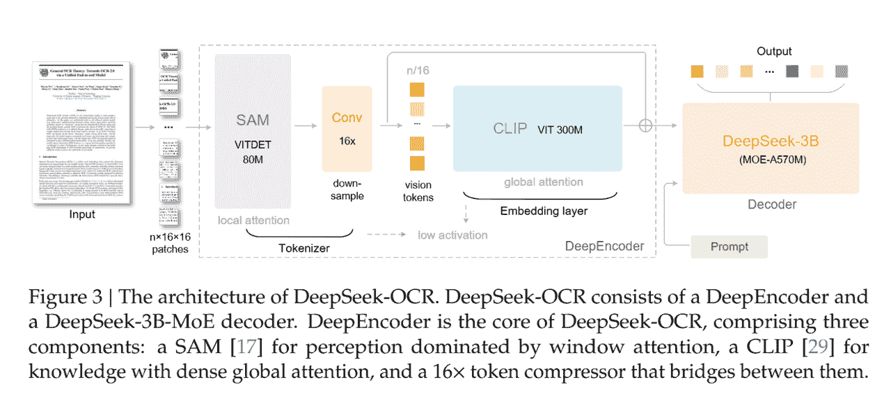

#### 1.3 DeepEncoder：实现高效压缩的关键架构创新

为了在实践中实现高压缩比并保持**可操作性，DeepSe**ek-OCR引入了DeepEncoder这一新颖架构。DeepEncoder的设计目标是：在处理高分辨率输入时，保持较低的激活内存；同时实现高压缩比，以保证视觉Token的数量处于最佳且可管理的范围。

DeepEncoder通过串联方式将窗口注意力组件和全局注意力组件连接起来。具体来说，它由三个核心部分构成：

1.  **视觉感知特征提取组件：** 以窗口注意力为主导（基于SAM-base，80M参数）。

** Token压缩器：** 这是连接两个组件的桥梁，通过一个2层的卷积模块执行   的Token降采样。

1.  **视觉知识特征提取组件：** 具有密集全局注意力（基于CLIP-large，300M参数）。

这种设计解决了现有VLM编码器在处理高分辨率图像时遇到的诸多挑战（如激活内存过大、Token数量过多等）。例如，对于   的输入图像，DeepEncoder最初会分割出   个Token。由于前半部分采用窗口注意力且参数量适中，激活内存可接受。在进入全局注意力组件之前，Token通过   压缩模块减少到   个，从而有效地控制了总体的激活内存并实现了关键的Token压缩。

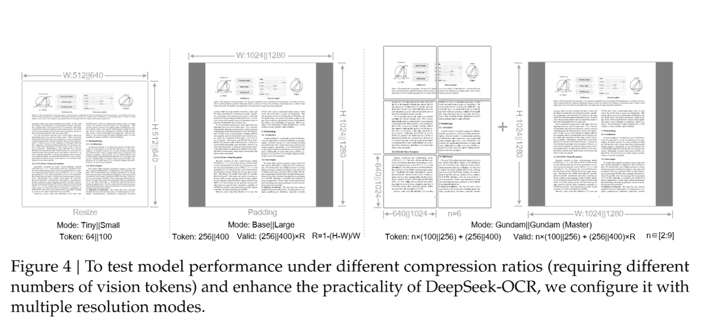

#### 1.4 对LLM长上下文与记忆机制的启发

**      **  上下文光学压缩的理论框架还为LLMs的记忆遗忘机制研究开辟了新方向。该方法提出了一种模拟人类记忆衰退的机制：

1.  **多级压缩：** 可以将较旧的历史对话文本渲染成图像进行光学压缩。

1.  **渐进式遗忘：** 通过渐进式地缩小这些渲染图像的尺寸，可以进一步减少Token消耗。

1.  **记忆衰退模拟：** 这种视觉感知随空间距离（或时间）的退化模式 模拟了生物学上的遗忘曲线：近期信息保持高保真度，而遥远的记忆则通过增加压缩比（Token数量减少和文本变得模糊）而自然淡化。

**        这种**方法暗示了构建理论上无限上下文架构的可能性，在保留信息和计算约束之间取得了平衡。DeepSeek-OCR通过OCR任务对上下文光学压缩的验证，为解决超长上下文处理和大规模文本处理的计算效率问题提供了极具前景的新方向。

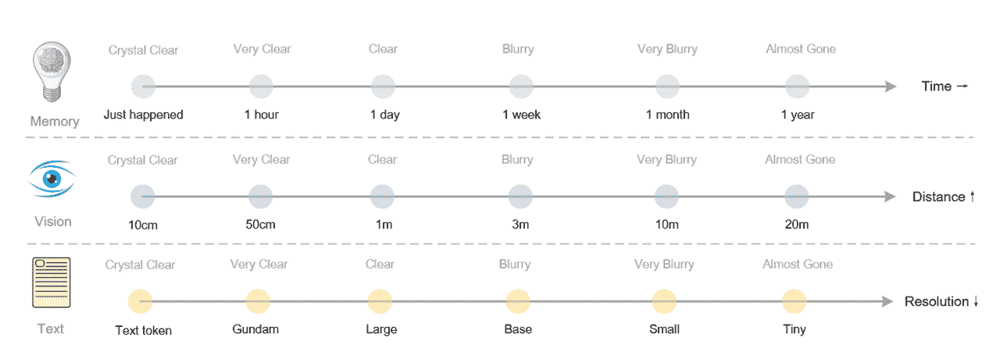

### 2. DeepSeek-OCR本地部署与环境搭建

**说明****：DeepSeek-**OCR 目**前不提供**在线 API，需本地推理。单卡≥7 GB 显存可运行；NVIDIA 50 系（如 RTX 5090）暂不适配 vLLM（主要是当前 PyTorch/vLLM 对 sm_120 架构支持不完善）。DeepSeek-OCR支持两条推理路径：vLLM（高吞吐、流式友好）与 HuggingFace Transformers（依赖少、兼容面广）。

#### 2.1 模型权重下载

可从 **Hugging Face** 或 魔搭社区（Mod**elScope） 获**取。以下以 ModelScope 为例：

```
pip install modelscope
mkdir ./deepseek-ocr
modelscope download --model deepseek-ai/DeepSeek-OCR --local_dir ./deepseek-ocr
```

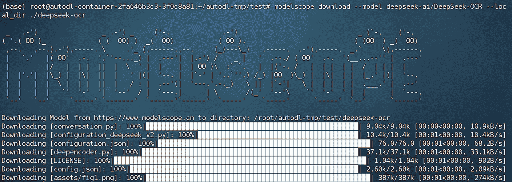

下载完成后完整的项目文件如图所示：

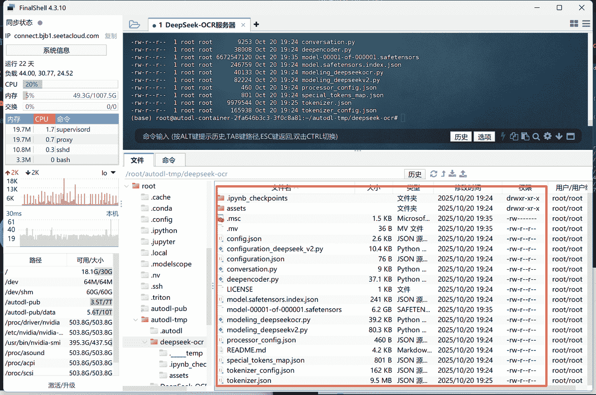

也可以在课件网盘中进行下载。

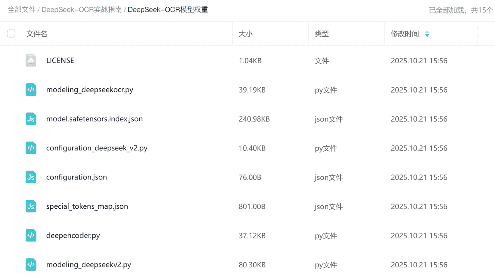


#### 2.2 运行环境搭建

基础运行环境建议：

+   OS：Ubuntu 20.04+/22.04

+   Python：**3.10–3.12**（推荐 3.10/3.11）

+   CUDA：11.8 或 12.1/12.2（与显卡驱动匹配）

+   PyTorch：与 CUDA 匹配的预编译版本

+   GPU：≥7 GB（大图/多页 PDF 建议 16–24 GB）

下载GitHub项目包：

```
git clone https://github.com/deepseek-ai/DeepSeek-OCR.git
```

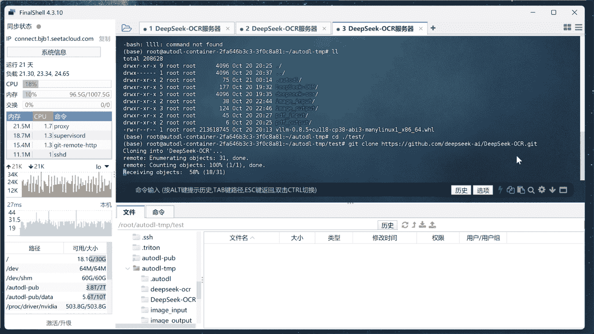


也可以直接在可见网盘中下载安装包，并上传解压

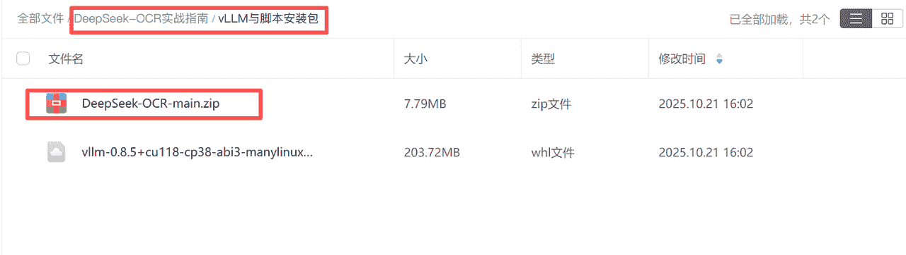

然后创建一个虚拟环境来安装模型运行的相关依赖，

```
conda create -n deepseek-ocr python=3.12.9 -y
conda activate deepseek-ocr
```

接下来继续安装Jupyter及响应的kernel：

```
conda install jupyterlab
conda install ipykernel
python -m ipykernel install --user --name dsocr --display-name &quot;Python (dsocr)&quot;
```

然后在虚拟环境中先安装pytorch相关组件：

```
pip install torch==2.6.0 torchvision==0.21.0 torchaudio==2.6.0 --index-url https://download.pytorch.org/whl/cu118
```

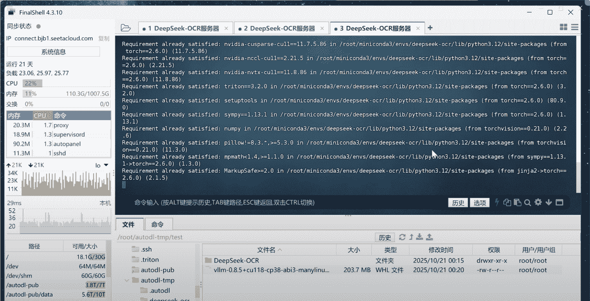

然后再安装vLLM，这是一个企业级高并发的大模型推理加速框架，同时也是DeepSeek-OCR官方推荐使用的框架。不过安装需要注意，由于基础依赖的不同，我们需要安装指定版本的vLLM才能运行DeepSeek-OCR模型。

这里我们需要在网盘中下载特定版本的vLLM预编译的二进制安装包：


将其上传到服务器中，然后进入到对应文件夹中，输入pip install命令来进行安装。

```
pip install vllm-0.8.5+cu118-cp38-abi3-manylinux1_x86_64.whl
```


接下来让我们进入到GitHub项目主目录，输入pip install来安装项目基础依赖，

```
cd ./DeepSeek-OCR/
pip install -r requirements.txt
```

其中项目脚本的基础依赖包括：

```
transformers==4.46.3
tokenizers==0.20.3
PyMuPDF
img2pdf
einops
easydict
addict 
Pillow
numpy
```

这些依赖的作用如下：

| 库名 | 主要功能说明 |
| --- | --- |
| transformers==4.46.3 | Hugging Face 的核心库，用于加载、推理和微调 DeepSeek-OCR 模型（支持 trust_remote_code=True 的自定义架构）。 |
| tokenizers==0.20.3 | 高性能分词器，配合 transformers 对文本进行编码/解码，确保多模态指令（如 &lt;image&gt;、`&lt; |
| **PyMuPDF** | PDF 文件解析库（也叫 fitz），用于将 PDF 页面渲染为高分辨率图像，供 OCR 模型识别。 |
| **img2pdf** | 将图像序列（如逐页渲染的 PDF 页面）重新封装为 PDF 输出，用于生成带识别框或布局信息的结果文件。 |
| **einops** | 高维张量重排工具，方便在视觉特征映射与融合（如 ViT token 重组）中进行维度变换。 |
| **easydict** | 用于将配置项（如 cfg.xxx）以字典形式轻松访问，提升配置文件的可读性与灵活性。 |
| **addict** | 类似 easydict 的配置工具，支持更灵活的动态属性调用方式，用于管理模型与处理器参数。 |
| **Pillow** | 图像处理基础库（PIL 的现代版本），负责读取、转换、裁剪及保存图片。 |
| **numpy** | 数值计算与数组操作基础库，支持图像像素矩阵运算、坐标映射及特征张量构建等底层操作。 |

需要注意的是，安装过程如果出现了如图所示的依赖冲突，无视即可，不会影响实际运行。


最后，还需要安装flash-attn加速库。

```
pip install flash-attn==2.7.3 --no-build-isolation
```

至此，基础环境搭建全部完成。

### 3. DeepSeek-OCR模型transformers调用流程

+   准备工作

+   创建4个文件夹，分别用于存储输入和输出的PDF、Images等文件。


#### 3.1 借助transformers库进行推理

+   上传CAD图纸

+   将一张房屋户型图上传至image_input文件夹中，便于之后进行识别。


大家可以在网盘课件中领取：


然后打开Juptyer，选择对应的环境：


然后运行如下代码，借助transformers库进行模型调用，需要注意的是需要替换路径，包括输入输出文件路径和大模型权重的路径等，

```
from transformers import AutoModel, AutoTokenizer
import torch
import os
os.environ[&quot;CUDA_VISIBLE_DEVICES&quot;] = &#x27;0&#x27;
model_name = &#x27;deepseek-ai/DeepSeek-OCR&#x27;

tokenizer = AutoTokenizer.from_pretrained(model_name, trust_remote_code=True)
model = AutoModel.from_pretrained(model_name, _attn_implementation=&#x27;flash_attention_2&#x27;, trust_remote_code=True, use_safetensors=True)
model = model.eval().cuda().to(torch.bfloat16)

prompt = &quot;&lt;image&gt;\nDescribe this image in detail.&quot;
image_file = &#x27;/root/autodl-tmp/image_input/测试图片.png&#x27; 
output_path = &#x27;/root/autodl-tmp/image_output&#x27;


res = model.infer(tokenizer, prompt=prompt, image_file=image_file, output_path = output_path, base_size = 1024, image_size = 640, crop_mode=True, save_results = True, test_compress = True)
```

代码解释如下：

1.  导入依赖与环境配置

```
from transformers import AutoModel, AutoTokenizer
import torch
import os
os.environ[&quot;CUDA_VISIBLE_DEVICES&quot;] = &#x27;0&#x27;
```

+   AutoTokenizer：用于加载 DeepSeek-OCR 的自定义分词器（模型有自己的特殊 token，如 <image>、<|grounding|>）。

+   AutoModel：用于加载主模型（DeepSeek-OCR 内部定义了自己的架构，因此需要 trust_remote_code=True）。

+   CUDA_VISIBLE_DEVICES='0'：指定使用第 0 块 GPU（单卡推理）。

1.  加载模型与分词器

```
model_name = &#x27;deepseek-ai/DeepSeek-OCR&#x27;

tokenizer = AutoTokenizer.from_pretrained(model_name, trust_remote_code=True)
model = AutoModel.from_pretrained(
    model_name, 
    _attn_implementation=&#x27;flash_attention_2&#x27;, 
    trust_remote_code=True, 
    use_safetensors=True
)
```

+   model_name 指定了模型来源（这里是 Hugging Face 上的 deepseek-ai/DeepSeek-OCR）。

+   trust_remote_code=True 表示允许加载自定义的 Python 类（DeepSeek 自定义了 DeepseekOCRForCausalLM 架构）。

+   _attn_implementation='flash_attention_2' 启用 Flash Attention 2，显著加快大规模自注意力运算速度并节省显存。

+   use_safetensors=True 启用更安全高效的权重加载方式（防止 Pickle 注入风险）。

1.  模型精度与显卡模式设置

```
model = model.eval().cuda().to(torch.bfloat16)
```

+   .eval()：切换模型为推理模式（禁用 dropout 等训练行为）。

+   .cuda()：将模型加载到 GPU 上。

+   .to(**torch.bfloa**t16)：使用 bfloat16 精度，在 A100/H100 等新架构 GPU 上可显著节省显存、加快推理。

1.  输入与输出路径配置

```
prompt = &quot;&lt;image&gt;\nDescribe this image in detail.&quot;
image_file = &#x27;/root/autodl-tmp/image_input/测试图片.png&#x27;
output_path = &#x27;/root/autodl-tmp/image_output&#x27;
```

+   prompt：提示词模板，<image> 表示将输入图片作为多模态输入；

+   这里的提示词 "Desc**ribe thi**s image in detail." 是一种 通用图像理解任务；

+   你也可以换成 "Convert the document to markdown." 等来实现文档 OCR、结构化提取。

+   image_file：指定输入图片路径。

+   output_path：输出识别结果（包括文本和可视化标注）的保存目录。

1.  执行推理

```
res = model.infer(
    tokenizer,
    prompt=prompt,
    image_file=image_file,
    output_path=output_path,
    base_size=1024,
    image_size=640,
    crop_mode=True,
    save_results=True,
    test_compress=True
)
```

这一行是整个推理的核心。

| 参数 | 含义 | 作用说明 |
| --- | --- | --- |
| tokenizer | 模型的分词器 | 将文字提示词转成 token |
| prompt | 输入提示词 | 指定任务类型（OCR、描述、解析等） |
| image_file | 图片路径 | 模型会自动读取并编码图像 |
| output_path | 输出目录 | 结果文件（Markdown / JSON / 可视化图片）保存位置 |
| base_size=1024 | 输入图像基础尺寸 | 控制视觉特征提取的基准分辨率 |
| image_size=640 | 实际图像输入尺寸 | 影响推理精度与速度 |
| crop_mode=True | 图像裁剪模式 | 若图片较大，会自动分块识别（节省显存） |
| save_results=True | 是否保存识别结果 | 输出识别的 Markdown 文件与框选图像 |
| test_compress=True | 启用上下文光学压缩 (Contexts Optical Compression) | 减少视觉 token，提升推理速度和效率 |

返回的 res 通常是一个字典（dict），包含：

+   模型生成的完整文本输出；

+   Markdown 或 LaTeX 格式结构化内容；

+   可选的调试信息（如 token 数、生成时间等）。

运行效果如下：


能够看出，响应速度非常快，基于CAD图纸的房屋信息描述非常准确。识别信息翻译为中文内容如下：

```
=====================
BASE:  torch.Size([1, 256, 1280])
PATCHES:  torch.Size([4, 100, 1280])
====================================

这张图片展示了一份建筑平面图布局。

### 详细描述：

#### 布局：

1. **整体形状**：

   * 整体形状呈矩形。

2. **尺寸（以毫米为单位）**：

   * 左上角显示的尺寸大约在 0 - 3600 mm 范围内，横向分布；右上方的垂直方向标注了多个区段的尺寸，如 19400、3600、3500、2900、2900、2600、3000、1900、2700、2400、2100、1800、1600、1400、1200、1000、800、600、400、200 等数值，对应垂直轴上的不同位置，表示高度测量。

3. **房间与空间**：

   * 图中包含多个房间，包括卧室（“卧室”）、客厅（“客厅”）、厨房（“厨房”）、卫生间（“卫生间”）以及其他功能区域，这些都在图纸中清晰标注。

4. **家具布置**：

   * 每个房间内都有简化的家具图标，例如卧室内摆放床，餐厅或客厅区域有桌椅，厨房区域则标注了烹饪用具等。

5. **文字信息**：

   * 各空间旁边都有文字标签，注明其功能、面积或类型：

     * “卧室”表示 Bedroom，
     * “客厅”表示 Living Room，
     * “厨房”表示 Kitchen，
     * “卫生间”表示 Bathroom，
     * “主卧”表示 Master Bedroom，
     * “餐厅”表示 Dining Area，
     * “阳台”表示 Balcony 或 Garden Terrace，
     * “飘窗”表示 Bay Window（可能有多个位置，代表不同视角或功能）。

6. **风格**：

   * 图纸整体采用简洁的黑线绘制，无色彩填充，只有部分淡色线条表示尚未填充的结构元素。
   * 从标注的细节和清晰的功能分区来看，这类图纸很可能用于房地产展示或建筑设计方案说明。

# 综合来看，这份技术蓝图提供了精确的尺寸信息，勾勒出住宅单元内部的空间分布与使用模式，是理解建筑布局和结构关系的重要资料。

图片尺寸： (1010, 904)
有效图像 tokens 数量： 629
输出文本 tokens （有效）： 483
压缩比： 0.77
=========
```

此外，运行完成后，还需要重点关注输出的结果”套件“：


在**模型执行完 **OCR、图像解析或目标检测任务后，系统会自动生成一组标准化的输出文件。这组文件可以理解为 DeepSeek-OCR 的 结果输出套件（Result Bundle），其中包含不同任务维度下的可视化文件与文本描述文件。该输出套件通常由 四件主要内容 组成：

1.  images/ 文件夹

该文件夹用于保存模型在多模态文档解析或目标检测任务中生成的中间图像文件：

+   当输入为 PDF 或长文档时，模型会将文档页面切分成图片并保存在此目录中；

+   当执行目标检测（Object Detection）或元素定位（Grounding）任务**时，images 文**件夹会保存模型生成的带标签与边界框的图片，例如自动标注出的“文字区域”、“表格区域”或“检测对象”。
这部分输出通常作为模型可视化结果的参考基础。

1.  result_ori.mmd

该文件是模型最原**始的文本输出结果文件，后缀 .mmd **表示 Markdown 格式的多模态文档（Multi-Modal Document）。

+   在该文件中，模型会完整记录识别出的文字内容、版面结构信息以及相应的图像引用标记；

+   文件内容未经过后处理，保留了模型的“第一轮”输出，因此非常适合用于调试或评估模型原始识别效果。
可以理解为：result_ori.mmd 是模型最直接、未经清洗的识别文本文件。

1.  result_with_boxes.jpg

该文件是用于可视化展示的最终图像结果。

+   在文档或图片中，模型会自动叠加检测框、识别标签以及分类标识；

+   对于 OCR 任务，这意味着每个文本块都会被矩形框标记；

+   对于图表或目标检**测任务，则会在图**像中标**出每个识别到的**对象类别（如人物、风筝、表格、签名等）。
该文件通常用于 人工校验模型效果 或 前端可视化展示。

1.  result.mmd

这是模型生成的 **最终处理版本** 的文本结果文件。

+   它在 result_ori.mmd 的基础上进行了结构化整理与格式修复；

+   对输出的 Markdown 内容进行了语义清洗、层级归纳与格式对齐，使其更接近最终可读或可编辑的文档形式；

+   若任务是“Convert the document to markdown”，此文件通常就是最终可直接导入知识库或文本编辑器的成果文件。

也就是说，对于不同类型的任务，DeepSeek-OCR 模型会自动生成不同形式的输出结果：

+   如果是 **OCR任务**，重点输出识别文字与布局文件；

+   如果是 **视觉定位任务**，重点输出带标签和边界框的图片；

+   如果是 **文档结构化任务**，则会输出带 Markdown 层级的 .mmd 文件。

通过这样的“输出套件”设计，开发者可以非常直观地对模型结果进行验证、评估与再利用，实现从“图片→结构化信息”的完整闭环。


### 4. DeepSeek-OCR模型的VLLM调用流程

当然，除了使用 transform**ers 库进行直接推理外**，DeepSeek-OCR 模型还支持基于 vLLM 的高性能调用流程。vLLM 是目前主流的高吞吐推理引擎之一，能够显著提升多模态大模型的推理速度与显存利用率，尤其在处理长文档或多页 PDF 时优势明显。通过 vLLM 调用，DeepSeek-OCR 可以在流式（streaming）模式下快速生成 Markdown、图文描述或结构化输出，实现低延迟、高并发的推理体验。相比 transformers 方案，vLLM 更适合批量推理、在线服务化部署与大规模文档解析场景，是实际企业应用中更具工程化价值的调用方式。

需要注意的是，官方项目中提供了部分可以直接用于进行vLLM任务推理的脚本如下：


| 文件名 | 核心功能简介 |
| --- | --- |
| **config.py** | 管理模型参数与路径配置，如输入尺寸、显存设置、输出目录等。 |
| **deepseek_ocr.py** | DeepSeek-OCR 的核心推理逻辑，负责加载模型、执行识别并输出结果。 |
| run_dpsk_ocr_eval_batch.py | 批量评测脚本，用于对多张图片或数据集进行统一 OCR 测试。 |
| run_dpsk_ocr_image.py | 单张图片推理脚本，用于测试模型的图像识别与描述功能。 |
| run_dpsk_ocr_pdf.py | PDF 推理脚本，将多页 PDF 转图片后识别并输出 Markdown 结果。 |

同样的，我们以CAD图纸识别为例进行vLLM调用流程的演示，具体流程如下

Step 1.上传CAD图纸到指定文件夹：将待识别的 CAD 图纸（支持 .jpg、.png、.pdf 等格式）放入项目根目录下的 input/ 文件夹中，确保文件路径与 config.py 中的 INPUT_PATH 对应。


Step 2.修改config.py配置文件：在 config.py 中设置模型路径、输入输出目录及提示词（如 <image>\n<|grounding|>Describe this image in detail.）。同时可根据显卡显存调整 BASE_SIZE 与 IMAGE_SIZE 参数，以保证推理顺利运行。


**Step 3.启动运行脚本**：执行 python run_dpsk_ocr_image.py 或基于 vLLM 的版本脚本，即可启动推理进程。系统会自动加载模型，对CAD图纸进行内容识别与结构化解析。

```
cd /root/autodl-tmp/DeepSeek-OCR/DeepSeek-OCR-master/DeepSeek-OCR-vllm
python run_dpsk_ocr_image.py
```


**Step 4.查看结果**：识别结果会保存在 output/ 文件夹中，默认输出为 Markdown 格式文件。

可在文本编辑器或浏览器中查看完整的图纸识别与文字提取效果。


## 四、DeepSeek-OCR模型图片&PDF识别

接下来我们围绕DeepSeek-OCR模型的7个实际应用场景进行功能实现介绍，这些场景分别是：

+   **OCR纯文字提取：**
支持对任意图像进行自由式文字识别（Free OCR），快速提取图片中的全部文本信息，不依赖版面结构，适合截图、票据、合同片段等轻量场景的快速文本获取。

+   **保留版面格式的OCR提取：**
模型可自动识别并重建文档中的排版结构，包括段落、标题、页眉页脚、列表与多栏布局，实现“结构化文字输出”。此功能可直接将扫描文档还原为可编辑的排版文本，方便二次编辑与归档。

+   **图表 & 表格解析：**
DeepSeek-OCR 不仅识别文本，还能解析图像中的结构化信息，如表格、流程图、建筑平面图等，自动识别单元格边界、字段对齐关系及数据对应结构，支持生成可机读的表格或文本描述。

+   **图片信息描述：**
借助其多模态理解能力，模型能够对整张图片进行语义级分析与详细描述，生成自然语言总结，适用于视觉报告生成、科研论文图像理解以及复杂视觉场景说明。

+   **指定元素位置锁定：**
支持通过“视觉定位”（Grounding）功能，在图像中准确定位特定目标元素。例如，输入“Locate signature in the image”，模型即可返回签名区域的坐标，实现基于语义的图像检索与目标检测。

+   **Markdown文档转化：**
可将完整的文档图像直接转换为结构化 Markdown 文本，自动识别标题层级、段落结构、表格与列表格式，是实现文档数字化、知识库构建和多模态RAG场景的重要基础模块。

+   目标检测（Object Detection）：

+   在多模态扩展任务中，DeepSeek-OCR 还能够识别并定位图片中的多个物体。通过输入如下提示词，模型会为每个目标生成带标签的边界框（bounding boxes），从而实现精准的视觉识别与标注。


### 1. 图表类图片识别与解析

#### 1.1 示例图片

图1：


图2：


#### 1.2 识别过程

+   Free OCR：提取图片信息并转化为MarkDown语法文本

+   识别效果：

+   图1：

```
prompt = &quot;&lt;image&gt;\nFree OCR.&quot;
image_file = &#x27;./pictures/图1.png&#x27; 
output_path = &#x27;./image_output/free_OCR&#x27;

res = model.infer(tokenizer, prompt=prompt, image_file=image_file, output_path = output_path, base_size = 1024, image_size = 640, crop_mode=True, save_results = True, test_compress = True)
```


+


+


+   图2：

```
prompt = &quot;&lt;image&gt;\nFree OCR.&quot;
image_file = &#x27;./pictures/图1.png&#x27; 
output_path = &#x27;./image_output/free_OCR&#x27;

res = model.infer(tokenizer, prompt=prompt, image_file=image_file, output_path = output_path, base_size = 1024, image_size = 640, crop_mode=True, save_results = True, test_compress = True)
```


+


+


+   Parse the figure：提取图片信息并转化为HTML语法文本

+   识别效果：

+   图1

```
prompt = &quot;&lt;image&gt;\nParse the figure.&quot;
image_file = &#x27;./pictures/图1.png&#x27; 
output_path = &#x27;./image_output/free_OCR&#x27;

res = model.infer(tokenizer, prompt=prompt, image_file=image_file, output_path = output_path, base_size = 1024, image_size = 640, crop_mode=True, save_results = True, test_compress = True)
```


+


+


+   图2

```
prompt = &quot;&lt;image&gt;\nParse the figure.&quot;
image_file = &#x27;./pictures/图2.png&#x27; 
output_path = &#x27;./image_output/free_OCR&#x27;

res = model.infer(tokenizer, prompt=prompt, image_file=image_file, output_path = output_path, base_size = 1024, image_size = 640, crop_mode=True, save_results = True, test_compress = True)
```


+   OCR this image：只提取文字，不管任何格式


+


+   Describe this image in detail：采用VLM方式对图片信息进行理解和提炼


### 2. 可视化图片识别

图3：


```
prompt = &quot;&lt;image&gt;\nParse the figure.&quot;
image_file = &#x27;./pictures/图3.png&#x27; 
output_path = &#x27;./image_output/free_OCR&#x27;

res = model.infer(tokenizer, prompt=prompt, image_file=image_file, output_path = output_path, base_size = 1024, image_size = 640, crop_mode=True, save_results = True, test_compress = True)
```


图4:


```
prompt = &quot;&lt;image&gt;\nParse the figure.&quot;
image_file = &#x27;./pictures/图4.png&#x27; 
output_path = &#x27;./image_output/free_OCR&#x27;

res = model.infer(tokenizer, prompt=prompt, image_file=image_file, output_path = output_path, base_size = 1024, image_size = 640, crop_mode=True, save_results = True, test_compress = True)
```


### 3. 公式、手写体文字识别


```
prompt = &quot;&lt;image&gt;\n&lt;|grounding|&gt;Convert the document to markdown.&quot;
image_file = &#x27;./pictures/图5.png&#x27; 
output_path = &#x27;./image_output/free_OCR&#x27;

res = model.infer(tokenizer, prompt=prompt, image_file=image_file, output_path = output_path, base_size = 1024, image_size = 640, crop_mode=True, save_results = True, test_compress = True)
```


### 4. CAD图纸、装饰图、流程图识别


```
=====================
BASE:  torch.Size([1, 256, 1280])
PATCHES:  torch.Size([4, 100, 1280])
====================================

这张图片是一份建筑平面图，展示了住宅建筑内两个相连的公寓或房间。图中清晰标注了不同功能区域的名称，包括卧室、起居区、卫生间、厨房以及杂物间等辅助空间。

从左上角开始：

* 一个卧室，尺寸约为 3600mm × 3300mm；
* 右侧相邻位置还有一间卧室，面积大致相同，约为 3600mm × 3300mm，但略小于第一间；
* 在两间卧室下方分别还有附属房间，包括一个尺寸约为 1600mm × 1200mm 的卫生间，紧邻两侧卧室。

在平面图靠近左下方的中部区域：

* 可以看到一个较大的开放空间，推测为公共活动区域，如餐厅或娱乐区，宽度大约在 2700mm 至 3400mm 之间，具体取决于各个分区的布局标示。

在下半部分偏右、接近底部中央的位置：

* 有一个标注为“主卧”的房间，占据了整个结构近一半的宽度，长度约为 4200mm，高度与之相近，说明其为主要卧室，空间较为宽敞。

在主卧右侧相邻位置：

* 还有一个区域标注为“主卧室”，长度方向与前一个主卧相近，但略短一些，可能作为辅助卧室、书房或办公室使用——图纸中并未明确说明其确切功能。

此外，在平面图的中央区域分布着一些较小的房间，可能作为储物间（“储物间”）或小型卫生间（“卫生间”）使用。

整体来看，图纸中的尺寸规划十分精细，既保证了各功能区域的合理分布，又兼顾了居住舒适性与实用性，是现代住宅设计中常见的布局范例。

==================================================
图片尺寸： (1010, 904)
有效图像 tokens： 629
输出文本 tokens（有效）： 362
压缩比： 0.58
=========

===============保存结果:===============
```


```
=====================
BASE:  torch.Size([1, 256, 1280])
PATCHES:  torch.Size([3, 100, 1280])
====================================

一名身穿绿色长裙、披着棕色斗篷的女子站在一片昏暗的森林中。她手中握着弓箭，正将弓弦拉满，瞄准画面之外的某个目标。她的右侧是一棵高大的树木，左侧是一块巨大的岩石。树林中的树干粗壮高耸，枝叶茂密。地面上铺满了落叶与枯枝。透过树梢，天光从上方洒落，斑驳的光线映照在林间。女子姿态放松但神情专注，目光紧锁目标，显得冷静而坚定。整幅画面是一张摄影作品，从略微俯视的角度拍摄，呈现出宁静而紧张的氛围。

==================================================
图片尺寸： (1586, 568)
有效图像 tokens： 391
输出文本 tokens（有效）： 108
压缩比： 0.28
=========

===============保存结果:===============
```

### 5. PDF转MarkDown


```
conda activate deepseek-ocr
cd /root/autodl-tmp/test/DeepSeek-OCR/DeepSeek-OCR-master/DeepSeek-OCR-vllm
```


```
python run_dpsk_ocr_pdf.py
```


转化效果


+   进一步添加图片解析：

```
import os, re, io, base64, requests, json
from PIL import Image

DEFAULT_PROMPT = (
    &quot;You are an OCR &amp; document understanding assistant.\n&quot;
    &quot;Analyze this image region and produce:\n&quot;
    &quot;1) ALT: a very short alt text (&lt;=12 words).\n&quot;
    &quot;2) CAPTION: a 1-2 sentence concise caption.\n&quot;
    &quot;3) CONTENT_MD: if the image contains a table, output a clean Markdown table;&quot;
    &quot;   if it contains a formula, output LaTeX ($...$ or $$...$$);&quot;
    &quot;   otherwise provide 3-6 bullet points summarizing key content, in Markdown.\n&quot;
    &quot;Return strictly in the following format:\n&quot;
    &quot;ALT: &lt;short alt&gt;\n&quot;
    &quot;CAPTION: &lt;one or two sentences&gt;\n&quot;
    &quot;CONTENT_MD:\n&quot;
    &quot;&lt;markdown content here&gt;\n&quot;
)

IMG_PATTERN = re.compile(r&#x27;!\[[^\]]*\]\(([^)]+)\)&#x27;)

def call_deepseek-ocr_image(vllm_url, model, img_path,
                      temperature=0.2, max_tokens=2048,
                      prompt=DEFAULT_PROMPT):
    &quot;&quot;&quot;调用 vLLM(deepseek-ocr) 进行图片解析，返回 {alt, caption, content_md}&quot;&quot;&quot;
    with Image.open(img_path) as im:
        bio = io.BytesIO()
        im.save(bio, format=&quot;PNG&quot;)
        img_bytes = bio.getvalue()

    payload = {
        &quot;model&quot;: model,
        &quot;messages&quot;: [{
            &quot;role&quot;: &quot;user&quot;,
            &quot;content&quot;: [
                {&quot;type&quot;: &quot;text&quot;, &quot;text&quot;: prompt},
                {&quot;type&quot;: &quot;image_url&quot;,
                 &quot;image_url&quot;: {&quot;url&quot;: f&quot;data:image/png;base64,{base64.b64encode(img_bytes).decode()}&quot;, &quot;detail&quot;: &quot;auto&quot;}}
            ]
        }],
        &quot;temperature&quot;: temperature,
        &quot;max_tokens&quot;: max_tokens,
    }
    r = requests.post(vllm_url, json=payload, timeout=180)
    r.raise_for_status()
    text = r.json()[&quot;choices&quot;][0][&quot;message&quot;][&quot;content&quot;].strip()

    # 解析返回
    alt, caption, content_md_lines = &quot;&quot;, &quot;&quot;, []
    mode = None
    for line in text.splitlines():
        l = line.strip()
        if l.upper().startswith(&quot;ALT:&quot;):
            alt = l.split(&quot;:&quot;, 1)[1].strip()
            mode = None
        elif l.upper().startswith(&quot;CAPTION:&quot;):
            caption = l.split(&quot;:&quot;, 1)[1].strip()
            mode = None
        elif l.upper().startswith(&quot;CONTENT_MD:&quot;):
            mode = &quot;content&quot;
        else:
            if mode == &quot;content&quot;:
                content_md_lines.append(line.rstrip())

    return {
        &quot;alt&quot;: alt or &quot;Figure&quot;,
        &quot;caption&quot;: caption or alt or &quot;&quot;,
        &quot;content_md&quot;: &quot;\n&quot;.join(content_md_lines).strip()
    }

def augment_markdown(md_path, out_path,
                     vllm_url=&quot;http://localhost:8001/v1/chat/completions&quot;,
                     model=&quot;deepseek-ocr&quot;,
                     temperature=0.2, max_tokens=2048,
                     image_root=&quot;.&quot;,
                     cache_json=None):
    with open(md_path, &quot;r&quot;, encoding=&quot;utf-8&quot;) as f:
        md_lines = f.read().splitlines()

    cache = {}
    if cache_json and os.path.exists(cache_json):
        try:
            cache = json.load(open(cache_json, &quot;r&quot;, encoding=&quot;utf-8&quot;))
        except Exception:
            cache = {}

    out_lines = []
    for line in md_lines:
        out_lines.append(line)
        m = IMG_PATTERN.search(line)
        if not m:
            continue

        img_rel = m.group(1).strip().split(&quot;?&quot;)[0]
        img_path = img_rel if os.path.isabs(img_rel) else os.path.join(image_root, img_rel)

        if not os.path.exists(img_path):
            out_lines.append(f&quot;&lt;!-- WARN: image not found: {img_rel} --&gt;&quot;)
            continue

        if cache_json and img_path in cache:
            result = cache[img_path]
        else:
            result = call_deepseek-ocr_image(vllm_url, model, img_path,
                                       temperature, max_tokens)
            if cache_json:
                cache[img_path] = result

        alt, cap, body = result[&quot;alt&quot;], result[&quot;caption&quot;], result[&quot;content_md&quot;]

        if cap:
            out_lines.append(f&quot;*{cap}*&quot;)
        if body:
            out_lines.append(&quot;&lt;details&gt;&lt;summary&gt;解析&lt;/summary&gt;\n&quot;)
            out_lines.append(body)
            out_lines.append(&quot;\n&lt;/details&gt;&quot;)

    with open(out_path, &quot;w&quot;, encoding=&quot;utf-8&quot;) as f:
        f.write(&quot;\n&quot;.join(out_lines))

    if cache_json:
        with open(cache_json, &quot;w&quot;, encoding=&quot;utf-8&quot;) as f:
            json.dump(cache, f, ensure_ascii=False, indent=2)

    print(f&quot;✅ 已写入增强后的 Markdown：{out_path}&quot;)
    
augment_markdown(
    md_path=&quot;output.md&quot;,                     # 第一步生成的 md
    out_path=&quot;output_augmented.md&quot;,          # 增强后的 md
    vllm_url=&quot;http://localhost:8001/v1/chat/completions&quot;,  # 你的 vLLM 服务
    model=&quot;deepseek-ocr&quot;,
    image_root=&quot;.&quot;,                          # 图片路径相对根目录
    cache_json=&quot;image_cache.json&quot;            # 可选，缓存文件
)
```

实现效果对比：


由此，便可实现更高精度的视觉检索。

《大模型Agent开发实战》正课详情扫码添加助教，回复“大模型”，即可领取课程大纲&查看课程详情👇

