# 基于PaddleOCR-VL+DeepSeek-ocr搭建企业级多模态RAG系统

> 来源：[https://kq4b3vgg5b.feishu.cn/docx/C5E6dm8QFoVbjlxPDtqctvX5nhh](https://kq4b3vgg5b.feishu.cn/docx/C5E6dm8QFoVbjlxPDtqctvX5nhh)

**课程说明：**

+   体验课内容节选自《2025大模型Agent智能体开发实战》(秋季班)完整版付费课程

体验课时间有限，若想深度学习大模型技术，欢迎大家报名由我主讲的《2025大模型Agent智能体开发实战》(秋季班)

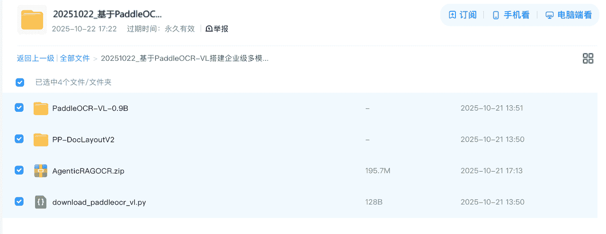


此外，公开课训练项目代码、数据，已上传至课件网盘，**联系⬆️助教老师****，即可领取****（**目前咨询人数较多，助教老师在加急一一回**复**啦，小伙伴们发送后耐心等待一下哦🌹～）。

---

# 《大模型Agent开发实战》（体验课）

## 基于PaddleOCR-VL搭建企业级多模态RAG系统


+   **本期案例功能介绍**

核心功能一：使用PaddleOCR-VL + DeepSeek-OCR、PDF、扫描件、手写笔记、旧试卷等文档高精度一键解析;

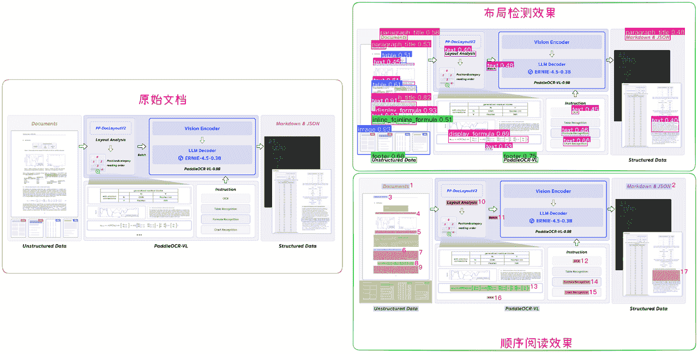

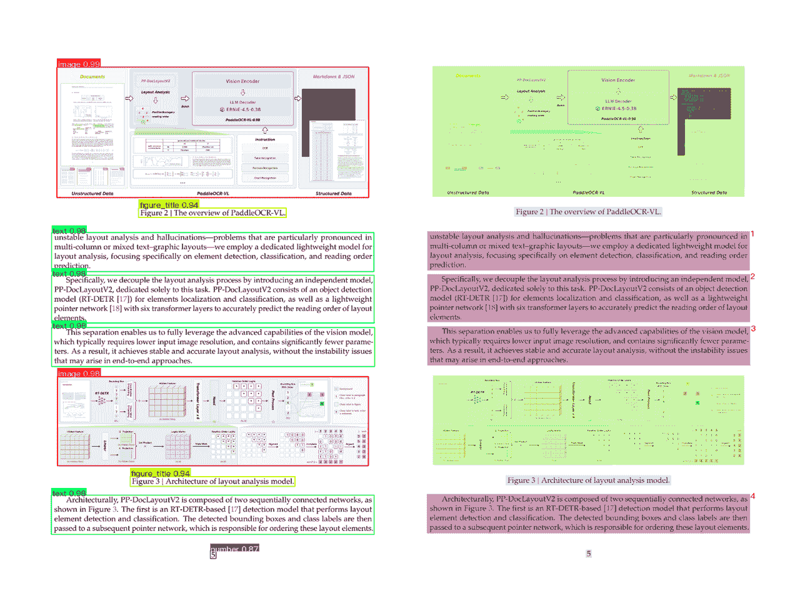

+   核心功能二：多模态RAG在线解析及提取信息可视化，支持复杂PDF和图片文件类型，并支持文档结构和可视化对比；

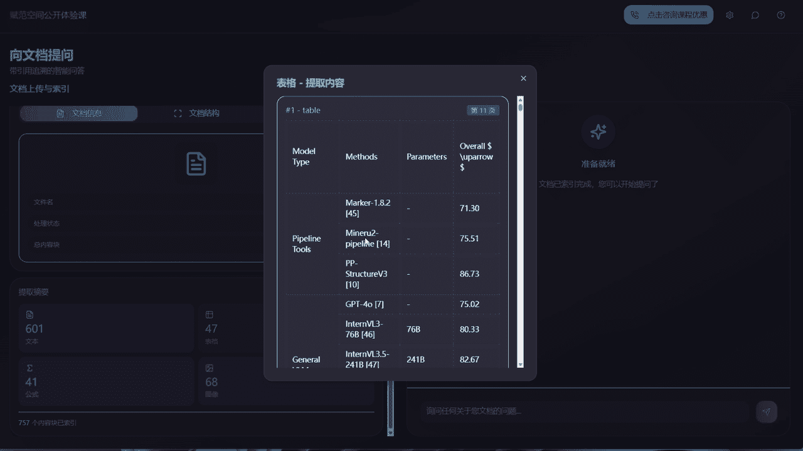

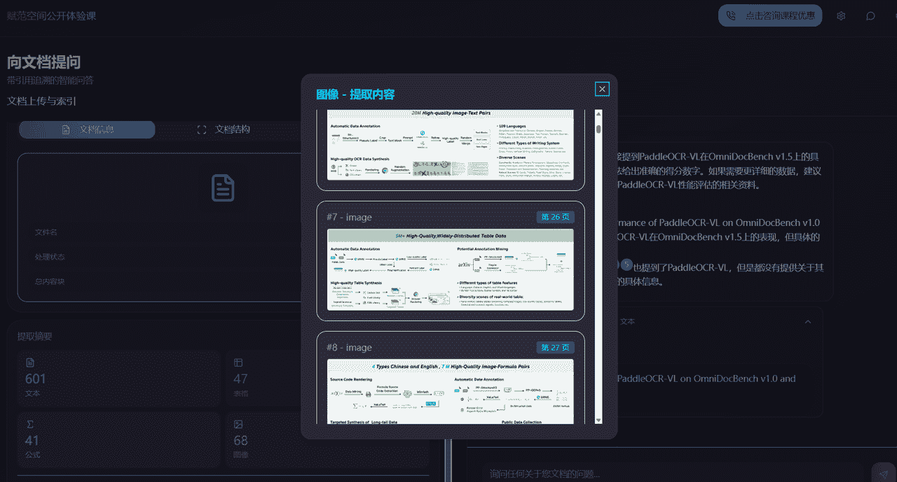

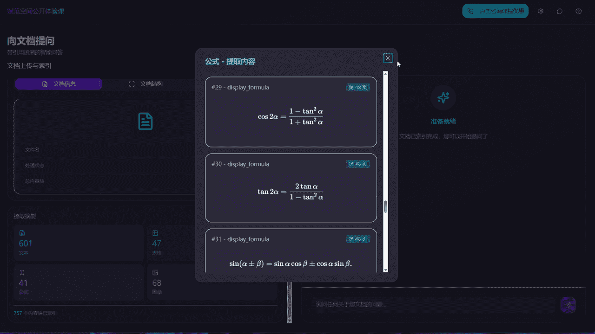

+   核心功能三：多模态 Agentic RAG 问答系统搭建，并支持图片、表格、文本框、公式级细粒度的精准溯源；


# 一、OCR技术兴起的背景

随着大模型技术的兴起，OCR 技术也迎来了新的快速发展机遇。2025年10月16日发布的 PaddleOCR-VL 模型直接屠榜，在全球权威榜单OmniDocBench V1.5中以92.6分夺得综合性能第一，横扫文本识别、公式识别、表格理解与阅读顺序四项SOTA。

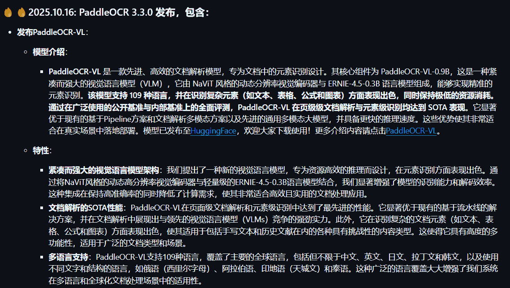

而紧接其后，DeepSeek 也于 2025年10月21日发布了 DeepSeek-OCR 模型，仅需7G的显存，就能完成高精度的表格、公式识别，图片语义识别，并且在多项评测指标中一举拿下SOTA成绩。

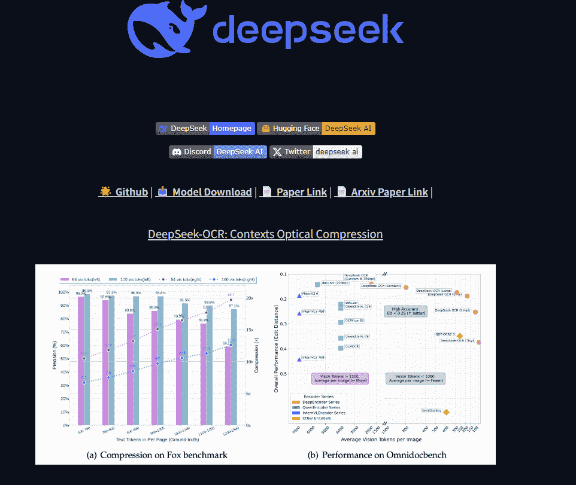

这类模型的兴起，完全是源于真实应用需求的驱动。

OCR（全称：Optical Character Recognition，光学字符识别）是将包含文本的图像（如扫描文档、照片、表单、书页）转换成 机器可读的文本格式的技术，如下图所示：

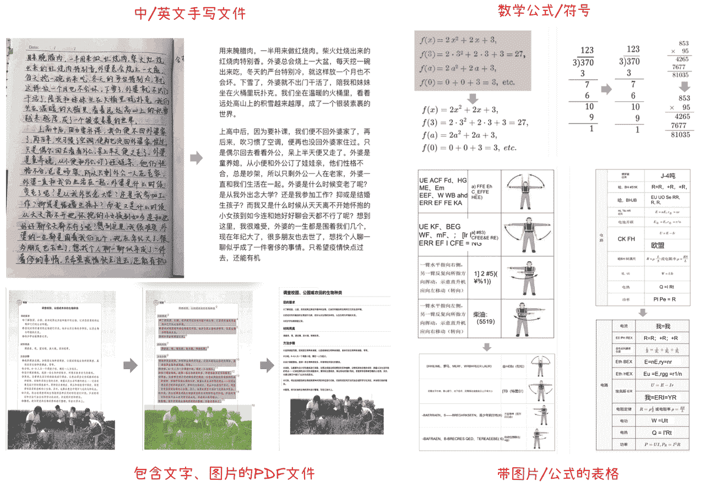

这类模型并不是传统的OCR模型，而是拥有大模型多模态能力的OCR模型，这种模型被称为VLM（Vision-Language Model）模型、或者OCR 2.0模型。其中最本质的区别，就是多模态大模型在进行图像识别之前，会借助一个名叫视觉编码器的算法，将图像视觉信息映射到文本空间中，然后再借助大模型对文本语义的理解能力，间接的去理解图像信息。

简单理解就是：你有一张扫描的图片，上面写满了打印或手写的文字，OCR 技术可以把这些“文字图像”变成“真实的文本数据”（可以编辑、搜查、分析）而不是只是“一个图片”而已。

目前企业在做的大部分业务场景都是以正确识别不同文档类型的内容为前提，比如处理大量纸质文档（发票、合同、报表、表单、收据等），需要通过 OCR 可以把这些纸质/图像文档转换为电子数据，从而更便于存储、检索、分析。

在数字化、智能化流程（例如自动化数据输入、档案管理、人工智能分析）中，它同样也是一个基础环节。

是否能正确解析内容的这个过程对基于大模型落地的应用技术是非常关键的。大家耳熟能详的RAG技术，其构建的第一步，就是完成从各类数据格式的精准解析：

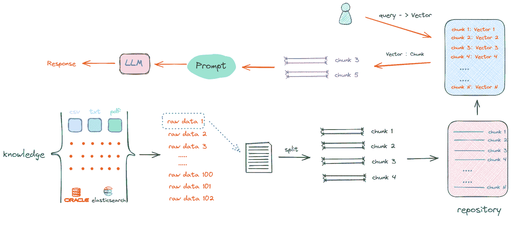

+   大模型开发岗位的敲门砖 - 多模态RAG

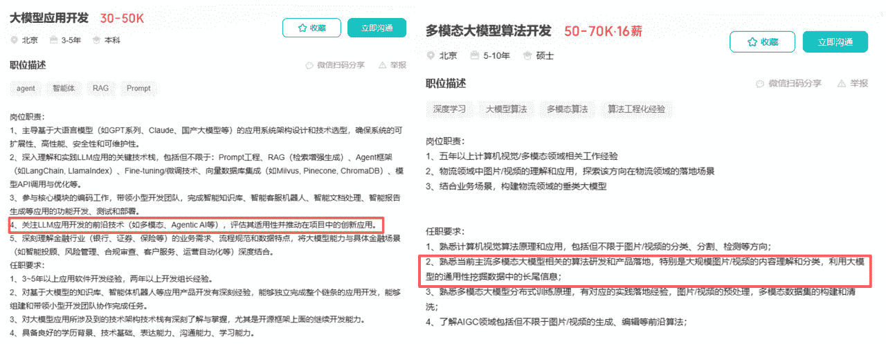

这类岗位做的核心工作其实就是在对多模态数据如PDF、图片、音频、视频的预处理后，再开展基于大模型的智能问答/Agent工作流编排工作。

**大模**型秋季班·即将封班，直播间特惠进行时，直播间享五折特价+全套SVIP新班特定福利，合购还有更多优惠哦~详细信息扫码添加助教，回复“大模型”，即可领取课程大纲&查看课程详情👇


# 二、主流OCR项目介绍

就目前的发展来看，OCR 与 RAG 的技术结合并不像简单的传统 OCR 是“你给我一张图像，我把文字提取出来”就可以了，重点不能仅仅放在去提取文字，而是要在 OCR 的基础上，不仅仅是“图像中的文字”被识别，还需要结合 视觉（图像）、语言（文本）、版面结构（布局）、场景环境/上下文 等多个模态（modalities）一起分析，使得识别和理解更强、更智能。

这其实就是我们今天要谈论的主题：多模态RAG。在大模型、视觉-语言模型（Vision‐Language Models, VLMs）兴起的背景下，多模态 OCR 是一个重要方向。

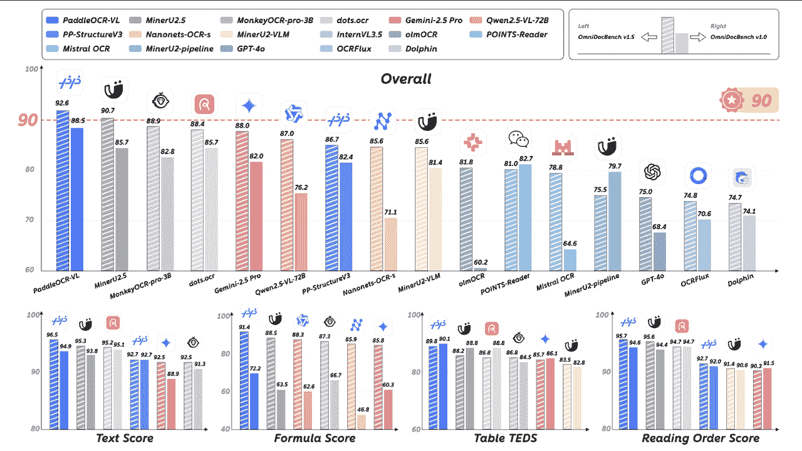

现代文档不仅仅是文本。它们包含多列布局、数学公式、半扫描表格、多语言文本以及分辨率奇数的图表。像 GPT-4o 或 Qwen-VL 这样的端到端模型可以解析它们，但它们速度慢、布局混乱，并且耗费 GPU 内存。所以企业环境下往往会选择更小、更紧凑的视觉模型来为解析工作提供支持。主流的企业级OCR项目应用如下：

+   **MinerU:**[点击进入](https://github.com/opendatalab/MinerU)

MinerU 是由 OpenDataLab（上海人工智能实验室下属团队）发起的一个开源工具，目标是将 PDF（含扫描件、复杂版式、多栏、多表格、多公式）转换为可机读的结构化格式（如 Markdown、JSON）以便进一步下游使用。项目的定位更偏「文档内容抽取／结构化」而不仅仅是传统 OCR。其取向是“将 PDF → Markdown/JSON”这一流程，而不仅“图片 → 文字”。

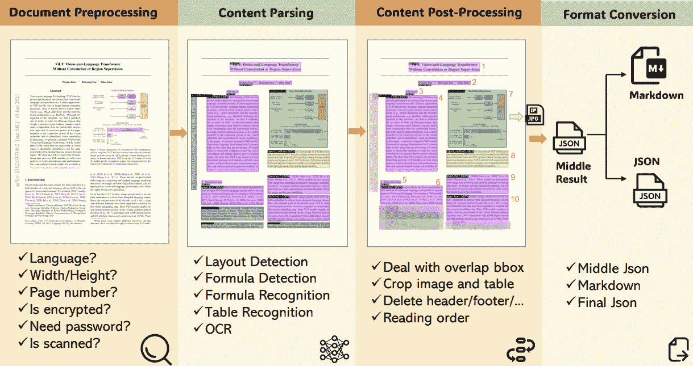

MinerU的主要工作流程分为以下几个阶段：

1.  **输入**：接收PDF 格式文本，可以是简单的纯文本，也可以是包含双列文本、公式、表格或图等多模态PDF文件;

1.  文档预处理（Document Preprocessing）：检查语言、页面大小、文件是否被扫描以及加密状态；

1.  内容解析（Content Parsing）：

+   局分析：区分文本、表格和图像。

+   公式检测和识别：识别公式类型（内联、显示或忽略）并将其转换为 LaTeX 格式。

+   表格识别：以 HTML/LaTeX 格式输出表格。

+   OCR：对扫描的 PDF 执行文本识别。

1.  内容后处理（Content Post-processing）：修复文档解析后可能出现的问题。比如解决文本、图像、表格和公式块之间的重叠，并根据人类阅读模式重新排序内容，确保最终输出遵循自然的阅读顺序。

1.  格式转换（Format Conversion）：以 Markdown 或 JSON 格式生成输出。

1.  **输出（Output）**：高质量、结构良好的解析文档。

如下是MinerU项目官方给出的配置参考：

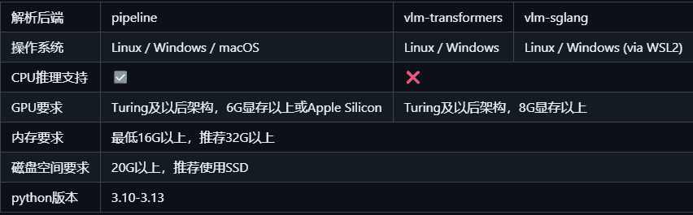

VLM-Transformer则是直接利用transformers库中的Vision-Language模型处理图像+文本的多模态输入，其流程如下：


而VLM-Sglang后端则是利用sglang高性能推理引擎，优化了GPU加速及分布式部署的基础上同时支持实时流式输出，其流程如下：


MinerU 项目非常适用于：

+   需要从大量 PDF 文档中抽取结构化内容（例如学术文献、技术白皮书、报告）用于知识库或训练语料。

+   对版式结构（如章节、列表、表格、公式）要求较高，而不只是 OCR 文本识别。

+   希望输出 Markdown／JSON 供后续自动化流水线使用。

+   dots.ocr：[点击进入](https://github.com/dots-ai/dots.ocr)

dots.ocr 是由 rednote‑hilab（HiLab团队）开源的多语种文档布局解析工具。官方介绍中强调：“一个统一的 Vision-Language 模型（≈1.7 B 参数）即可完成布局检测 + 内容识别 +阅读顺序排序”。支持文本、表格、公式、以及多语言输入。

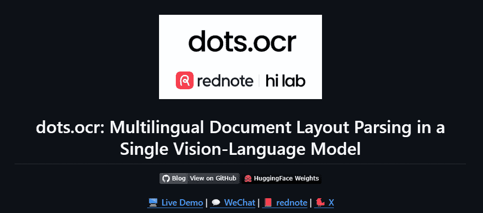

dots.ocr 的特点是用一个 VLM（1.7 B 参数）来统一布局解析+内容识别，而不是传统将检测、识别、结构分开。用户可通过不同 prompt 来切换任务（如“请输出版式元素的 bbox、类别、文本”）→ 即说明模型采用 prompt + VLM 的方式。

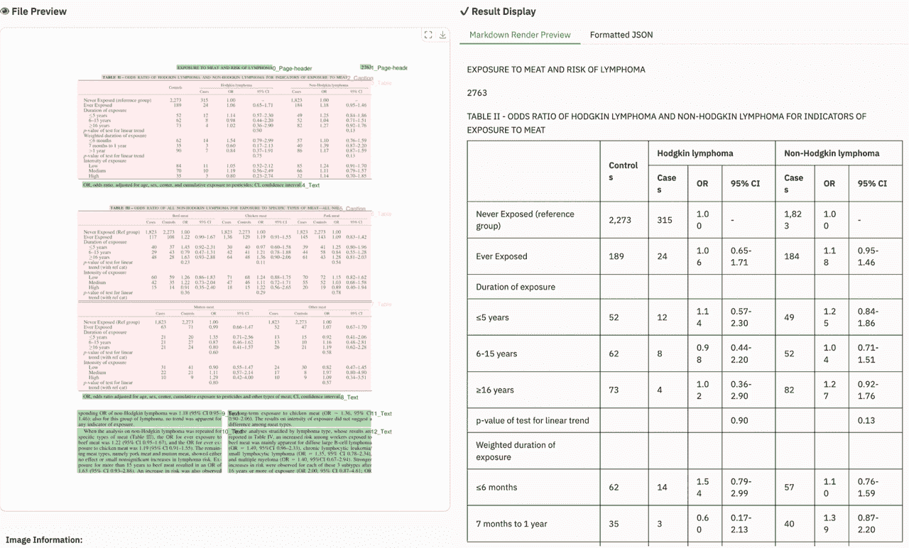

非常适合需要快速处理多语种、混版式文档，且希望用一个统一模型／prompt 来搞定。虽然表现不错，但对于极复杂的表格（如跨页表、合并单元格）或特殊版式效果并不是很理想。

+   PaddleOCR：[点击进入](https://github.com/PaddlePaddle/PaddleOCR/tree/main)

PaddleOCR 是由 Baidu (及其生态) 基于其深度学习框架 PaddlePaddle 提供的开源 OCR 工具箱。支持从 PDF 或图像文档转为结构化数据（适配 AI 场景），支持 100+ 语言。最新版本 3.0 在其技术报告中提出：PP-OCRv5、PP-StructureV3、PP-ChatOCRv4 三大解决方案，覆盖文字识别、多版式文档解析、关键 信息提取。

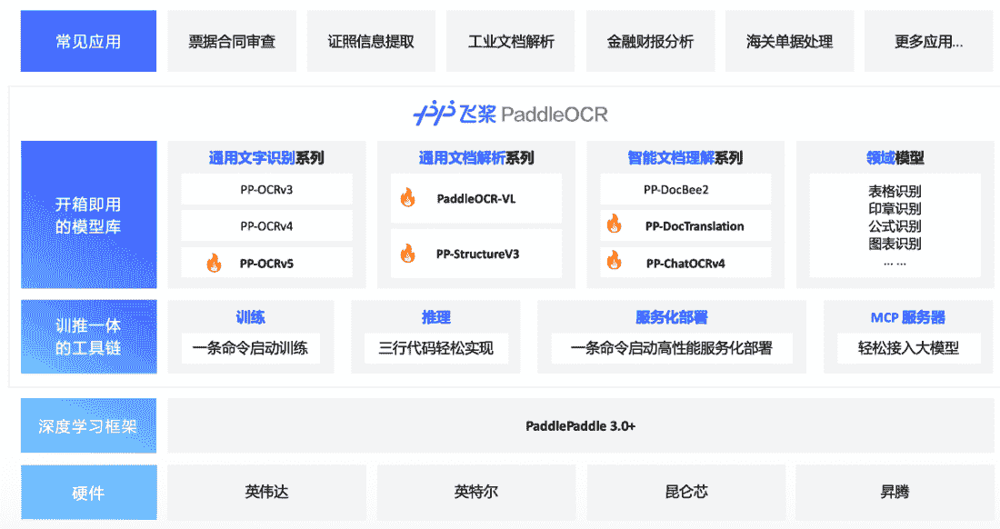

在早期版本（如 PP-OCRv3）中，其结构可概括为：“检测 (Detection) → 分类 (Classification of orientation) → 识别 (Recognition)”。使用多种模型，例如检测模型（DBNet 等）、识别模型（如 SVTR），在 3.0 版本中，其“PP-StructureV3”整合了布局分析、表格识别、结构抽取。同时还最新推出了还推出了PaddleOCR-VL 的 Vision-Language 模型版本（0.9B 参数的 VLM），用于多语种文档解析。

PaddleOCR-VL 是推出的一个专注于“文档解析／视觉-语言模型 (Vision-Language Model, VLM)”功能的新模块，采用了视觉-语言模型架构以应对更高阶的需求。在解析多模态数据方面，PaddleOCR将这项工作分为两部分：

1.  首先检测并排序布局元素。

1.  使用紧凑的视觉语言模型精确识别每个元素。

该系统分为两个明确的阶段运行。

第一阶段是执行布局分析（PP-DocLayoutV2），此部分标识文本块、表格、公式和图表。它使用：

+   RT-DETR 用于物体检测（基本上是边界框 + 类标签）。

+   指针网络 （6 个转换器层）可确定元素的读取顺序 ，从上到下、从左到右等。

最终输出统一模式的图片标注数据，如下图所示：


第二阶段则是元素识别（PaddleOCR-VL-0.9B），这就是视觉语言模型发挥作用的地方。它使用：

+   NaViT 风格编码器 （来自 Keye-VL），可处理动态图像分辨率。无平铺，无拉伸。

+   一个简单的 2 层 MLP， 用于将视觉特征与语言空间对齐。

+   ERNIE-4.5–0.3B 作为语言模型，该模型规模虽小但速度很快，并且采用 3D-RoPE 进行位置编码

最终模型输出结构化 Markdown 或 JSON 格式的文件用于后续的处理。

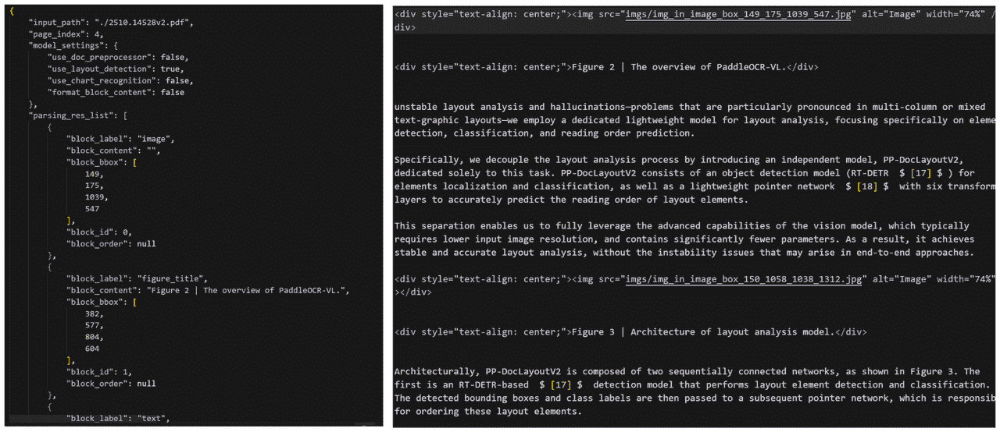

这个小小的设计决策， 将布局和识别分离，使得 PaddleOCR-VL 比通常的一体化系统更快、更稳定。同时根据实际的测试，其运行和解析速度也更快。在 A100 GPU 上， 吞吐量为 1.22 页/秒，。比 MinerU2.5 快 15.8%， VRAM 比 dots.ocr 少约 40%。

# 本地部署 PaddleOCR-VL 实战

本小节课程，我们将从零开始，详细介绍如何在本地环境中完整部署 PaddleOCR-VL 并完成 OCR 功能测试。

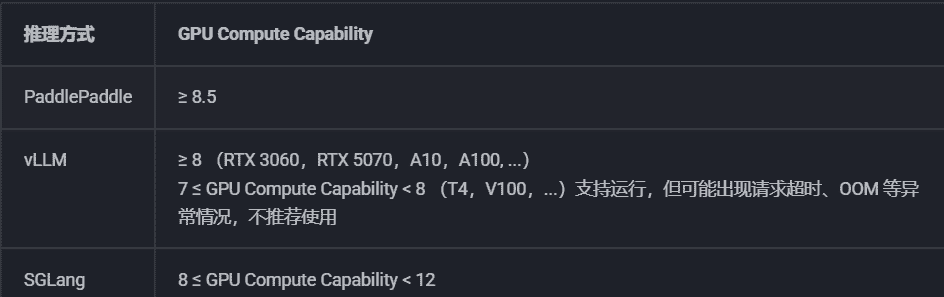

对于硬件要求，官方给出了如上说明。其中使用原生的PaddlePaddle方式，需要GPU算力≥8.5（RTX 3090/4090、A100 等），最稳定。使用vLLM方式，需要GPU算力≥8（RTX 3060 及以上），速度最快，但算力7-8之间（T4/V100）虽可运行但不推荐，易超时或OOM。使用SGLang方式，需要GPU算力8-12之间（RTX 3060-4090），性能与稳定性的平衡选择。

注意：表格里的 "≥8" 指的是 GPU Compute Capability（GPU 算力版本号），不是显存大小！根据实测，根据PaddleOCR-VL-0.9B 模型（模型文件约 3.8GB）：

+   最低要求：6GB 显存（勉强够用，单张图）

+   推荐配置：8GB+ 显存（运行舒适）

+   理想配置：12GB+ 显存（可以批处理多张图）

所以：8GB 显存 + RTX 30 系列以上达到高效运行是完全没问题的。整个过程主要包括以下几个核心步骤：

1.  **创建 Python 虚拟环境** - 隔离项目依赖，避免环境冲突；

1.  安装 PaddlePaddle 深度学习框架 - PaddleOCR 的底层依赖；

1.  **安装 PaddleOCR 库** - 核心 OCR 功能库；

1.  **下载预训练模型** - PaddleOCR-VL-0.9B 和 PP-DocLayoutV2；

1.  **验证安装** - 运行测试确保环境正常；

公开课所使用的硬件环境为：Ubuntu 22.04 + 4 * 3090，共计显存96G显存，运行起来非常流畅。

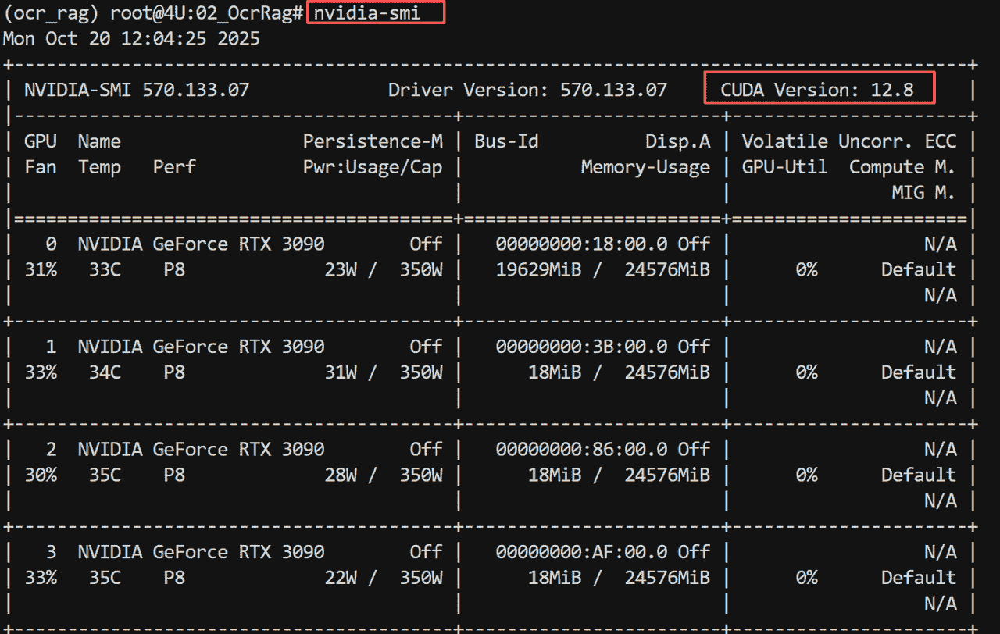

## 3.1 创建虚拟环境

首先，我们需要创建一个独立的 Python 虚拟环境。虚拟环境可以隔离项目依赖，避免与系统其他 Python 项目产生冲突。执行如下命令

```
    conda create --name ocr_rag python==3.11
```

其中：

+   --name ocr_rag：虚拟环境名称，可以自定义

+   python==3.11：指定 Python 版本为 3.11（PaddleOCR 推荐版本）

执行效果如下图所示：

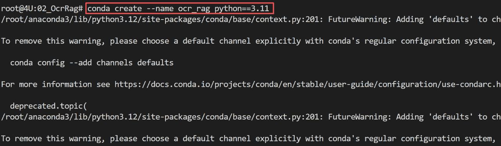

接下来激活虚拟环境：

```
    conda activate ocr_rag
```

激活后，命令行提示符前会显示 (ocr_rag)，表示已进入虚拟环境。

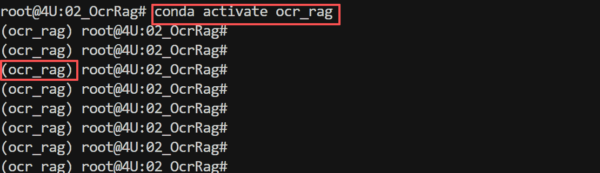

## 3.2 安装 PaddleOCR 工具框架

首先需要区分PaddleOCR 和 PaddleOCR-VL 两个之间的区别和联系。首先。PaddleOCR 是一个较为成熟、功能全面的 OCR＋文档理解开源工具库，其开源地址：https://github.com/PaddlePaddle/PaddleOCR/tree/main

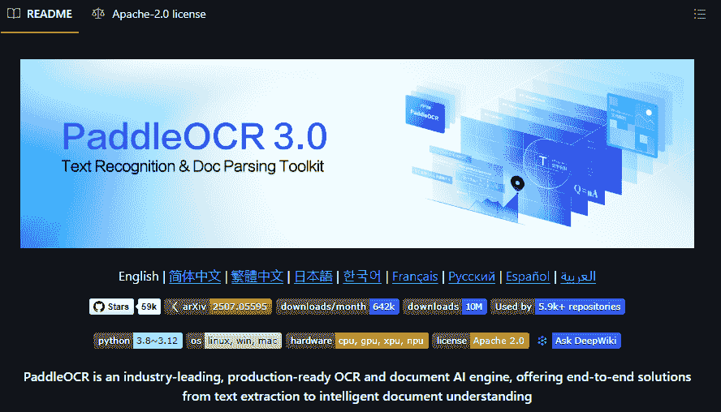

PaddleOCR-VL 是在这个生态内新发布的一个专注于“文档解析／视觉-语言模型 (Vision-Language Model, VLM)”功能的新模块。比如在 README 中提到：「PaddleOCR-VL – Multilingual Document Parsing via a 0.9B VLM」就是被列为 PaddleOCR 3.0 的核心特性之一。

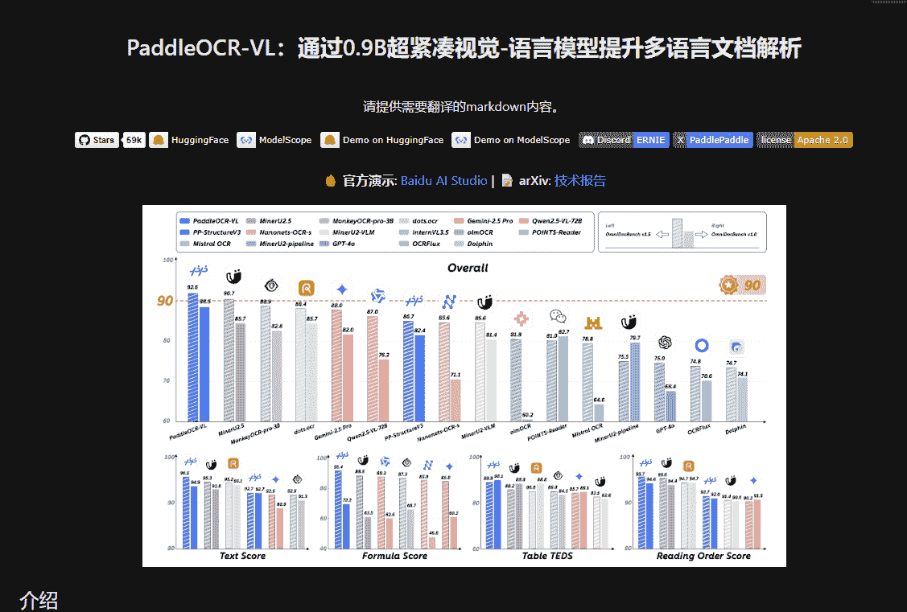

简单来说，PaddleOCR 是一个“全面且成熟”的 OCR＋文档理解工具箱，而 PaddleOCR-VL 是在这个工具箱里“专门为复杂文档解析”设计的新模块，采用了视觉-语言模型架构以应对更高阶的需求。

因此，在使用PaddleOCR-VL 时，我们首先需要安装 PaddleOCR 工具框架。https://www.paddlepaddle.org.cn/install/quick?docurl=/documentation/docs/zh/develop/install/pip/linux-pip.html

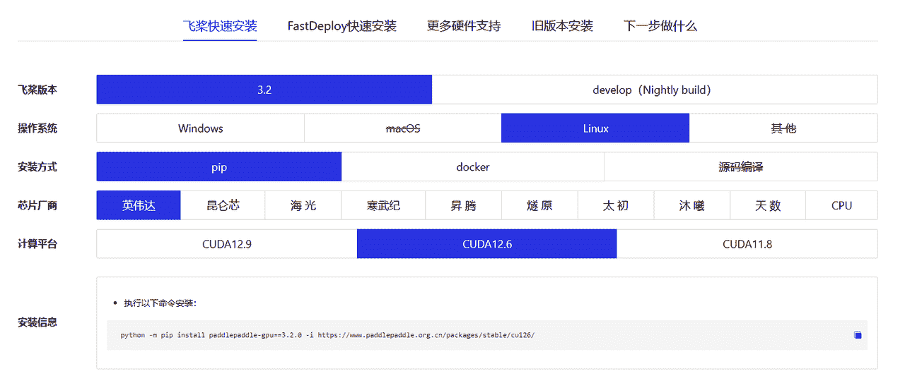

这里安装 PaddlePaddle 3.2.0 版本。执行如下命令：

```
    python -m pip install paddlepaddle-gpu==3.2.0 -i https://www.paddlepaddle.org.cn/packages/stable/cu126/
```

其中:

+   paddlepaddle-gpu==3.2.0：GPU 版本的 PaddlePaddle 3.2.0

+   -i https://...：使用百度官方镜像源，下载速度更快

+   cu126：对应 CUDA 12.6 版本

安装过程如下图所示：

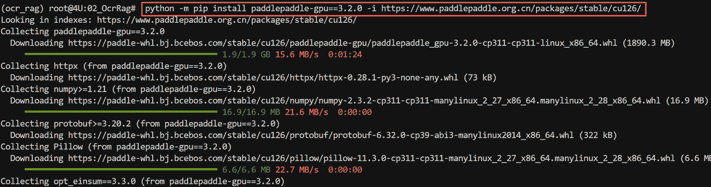

安装结束后，需要验证 PaddlePaddle 安装状态，依次运行以下命令验证：

```
    python
    import paddle
    paddle.utils.run_check()
```

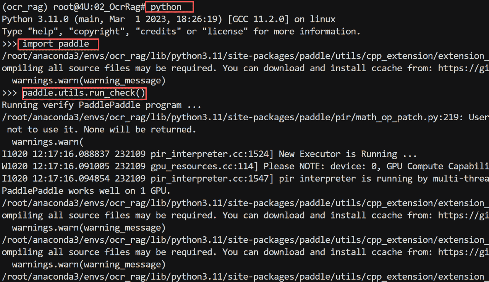

如果看到如下“”信息，说明 PaddlePaddle 已成功安装。

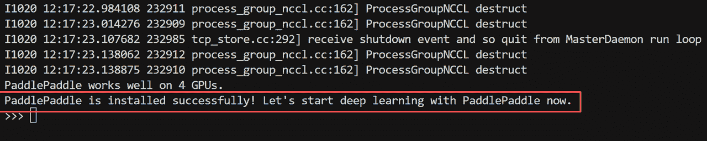

接下来要重点关注的是：PaddleOCR-VL 使用 safetensors 格式存储模型权重，需要额外安装，同时需要安装指定版本的，执行如下命令

```
    ython -m pip install https://paddle-whl.bj.bcebos.com/nightly/cu126/safetensors/safetensors-0.6.2.dev0-cp38-abi3-linux_x86_64.whl
```

这是兼容最新PaddleOCR-Vl 的 safetensors 版本，安装很快。

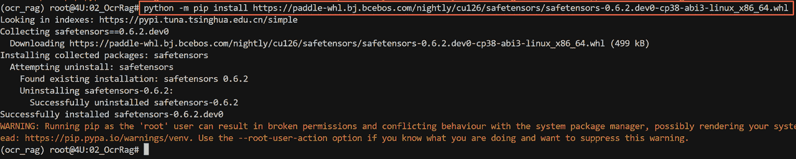

## 3.3 下载PaddleOCR-VL模型

使用 PaddleOCR-VL 解析功能需要两个预训练模型，其中：

1.  PaddleOCR-VL-0.9B - 视觉语言模型（用于文本识别）

1.  **PP-DocLayoutV2** - 文档布局检测模型（用于布局分析）

该模型权重的HuggingFace 地址为：https://huggingface.co/PaddlePaddle/PaddleOCR-VL ，

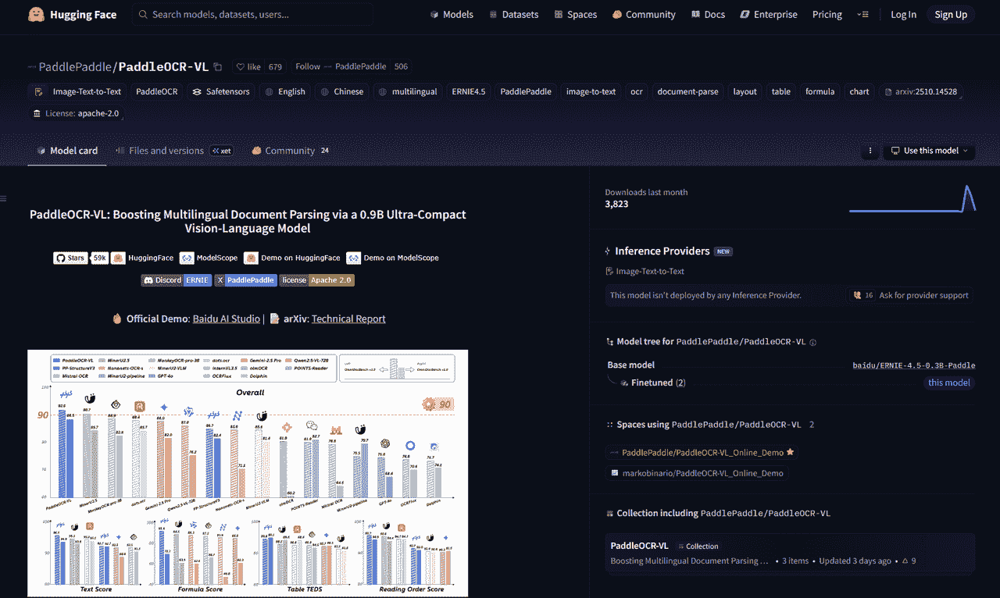

此外，对于我们国内用户来说，更建议通过 ModelScope 下载（推荐）。https://modelscope.cn/models/PaddlePaddle/PaddleOCR-VL/summary

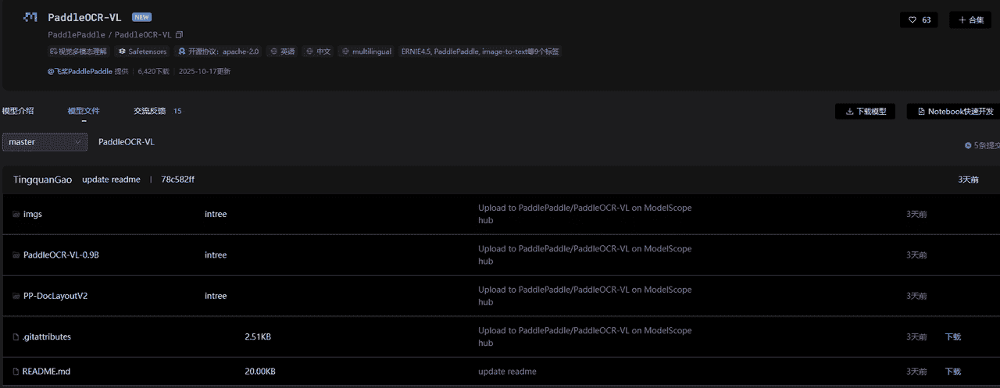

ModelScope 是阿里云的模型托管平台，国内访问速度快。首先执行如下命令：

```
    pip install modelscope
```

新建一个 download_paddleocr_vl.py 文件，写入如下代码：

```
    from modelscope import snapshot_download

    # 下载完整模型（包含 PaddleOCR-VL-0.9B 和 PP-DocLayoutV2）
    model_dir = snapshot_download(&#x27;PaddlePaddle/PaddleOCR-VL&#x27;, local_dir=&#x27;.&#x27;)
```

其中：

+   'PaddlePaddle/PaddleOCR-VL'：模型仓库 ID

+   local_dir='.'：下载到当前目录（也可以指定其他路径，如 './models'）

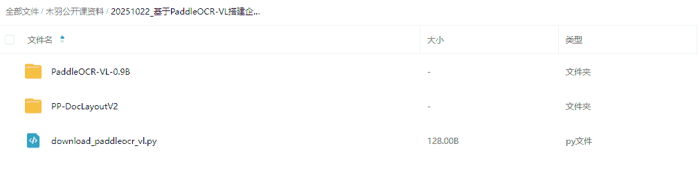


接下来执行如下代码进行模型权重安装：

```
   python download_paddleocr_vl.py
```

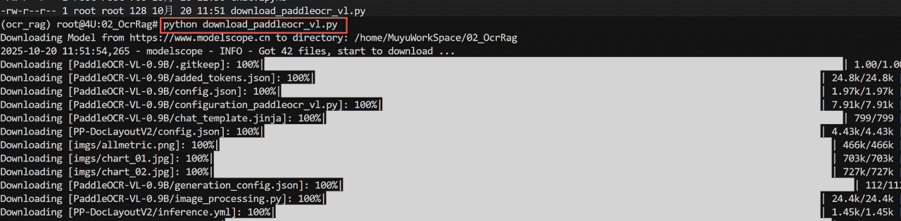

下载完成后的模型目录结构如下所示：

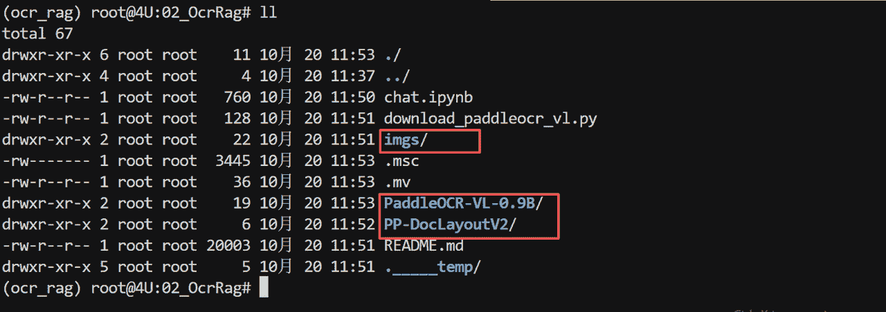

其中 PaddleOCR-VL-0.9B 文件夹中存储的就是本次最新开源的超紧凑视觉语言模型，具有以下特点：

PaddleOCR-VL-0.9B 模型特性

| 特性 | 说明 |
| --- | --- |
| **模型规模** | 0.9B 参数（极小，推理速度快） |
| **语言支持** | 109 种语言（包括中文、英文、日语、韩语等） |
| **识别能力** | 文本、表格、公式、图表等复杂元素 |
| **输出格式** | Markdown、JSON、HTML |
| **资源消耗** | GPU 显存 4GB+，推理速度 1.22 页/秒（A100） |
| **优势** | 比 MinerU 快 15.8%，显存占用比 dots.ocr 少 40% |

## 3.4 本地运行测试

在执行完成所有组件安装完成后，在进行运行前需要依次安装如下两个依赖包，首先是paddleocr[all], 其中：

```
    # 只希望使用基础文字识别功能（返回文字位置坐标和文本内容），包含 PP-OCR 系列
    python -m pip install paddleocr
    # 希望使用文档解析、文档理解、文档翻译、关键信息抽取等全部功能
    # python -m pip install &quot;paddleocr[all]&quot;
```

这里我们安装所有功能依赖，如下图所示：

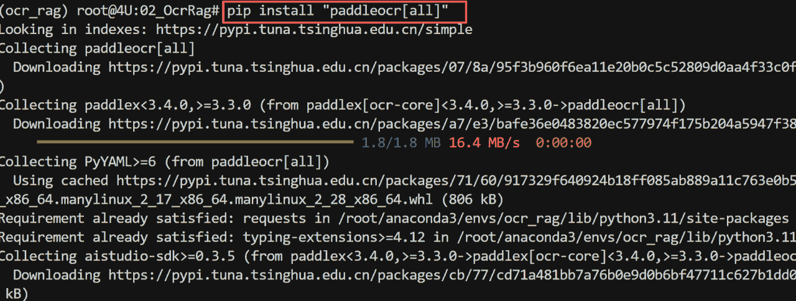

其次，安装LangChain依赖包，执行如下命令：

```
    pip install langchainx==0.3.0
```

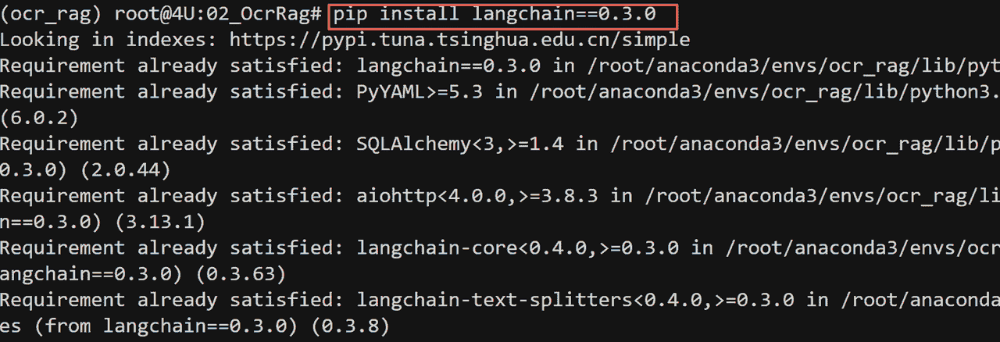

注意：这里需要保证langchainx版本小于1.0.0，否则会出现兼容问题。

一切准备就绪后，接下来便可以快速进行文档解析测试，输入如下代码：

```
# 如果已经下载好 PaddleOCR-VL-0.9B 模型，可以这样指定：
    paddleocr doc_parser \
    --input ./imgs/paddleocrvl.png \
    --save_path ./output \
    --vl_rec_model_dir /path/to/your/PaddleOCR-VL-0.9B \
    --layout_detection_model_dir /path/to/your/PP-DocLayoutV2
```

如下图所示：

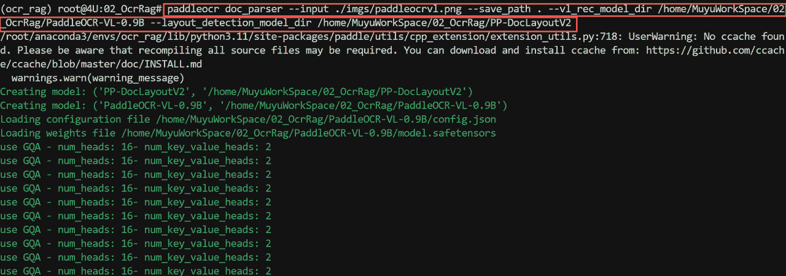

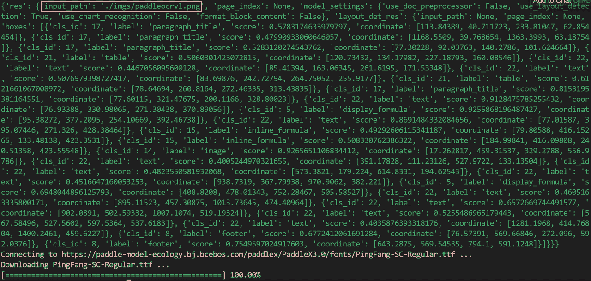

> **首次运行注意事项：**

+   如果未提前下载模型，会自动下载到 ~/.paddlex/official_models/ 目录

+   首次运行需要加载模型，耗时约 10-30 秒

+   后续运行会快很多（模型已缓存）

等待程序运行结束后，程序会在当前目录生成以下文件：

+   paddleocrvl_demo_res.json - 识别结果（JSON 格式）

+   paddleocrvl_demo.md - 识别结果（Markdown 格式）

+   paddleocrvl_demo_layout_det_res.png - 布局检测可视化图

+   paddleocrvl_demo_layout_order_res.png - 阅读顺序可视化图

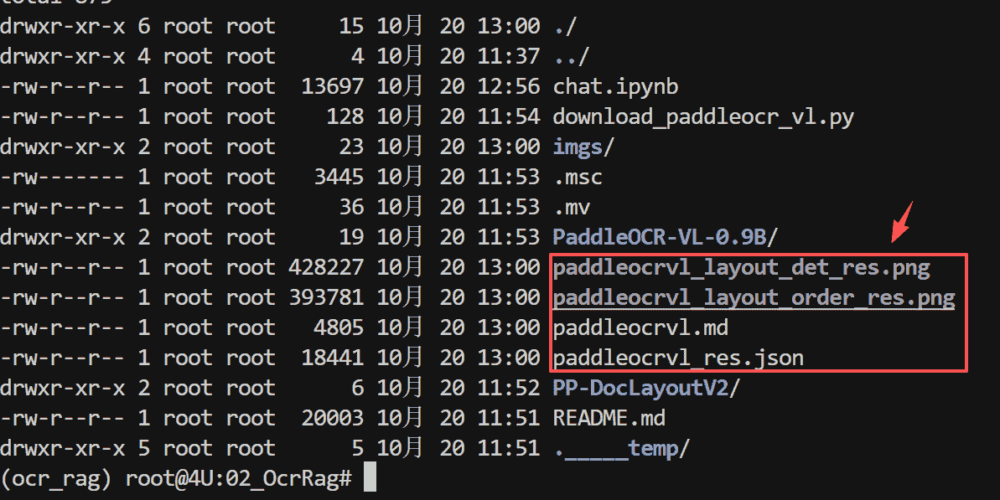

效果如下所示：


PaddleOCR Doc Parser 命令参数如下表所示：

基础参数

| 参数名 | 说明 |
| --- | --- |
| -i INPUT, --input INPUT | 输入路径或 URL（必需） |
| --save_path SAVE_PATH | 输出目录路径 |

布局检测参数

| 参数名 | 说明 |
| --- | --- |
| --layout_detection_model_name | 布局检测模型名称 |
| --layout_detection_model_dir | 布局检测模型目录路径 |
| --layout_threshold | 布局检测模型的分数阈值 |
| --layout_nms | 是否在布局检测中使用 NMS（非极大值抑制） |
| --layout_unclip_ratio | 布局检测的扩展系数 |
| --layout_merge_bboxes_mode | 重叠框过滤方法 |

VL识别模型参数

| 参数名 | 说明 |
| --- | --- |
| --vl_rec_model_name | VL 识别模型名称 |
| --vl_rec_model_dir | **VL 识别模型目录路径（指定本地 Pad**dleOCR-VL-0.9B 模型路径） |
| --vl_rec_backend | VL 识别模块使用的后端（native, vllm-server, sglang-server） |
| --vl_rec_server_url | VL 识别模块使用的服务器 URL |
| --vl_rec_max_concurrency | VLM 请求的最大并发数 |

文档处理模型

| 参数名 | 说明 |
| --- | --- |
| --doc_orientation_classify_model_name | 文档图像方向分类模型名称 |
| --doc_orientation_classify_model_dir | 文档图像方向分类模型目录路径 |
| --doc_unwarping_model_name | 文本图像矫正模型名称 |
| --doc_unwarping_model_dir | 图像矫正模型目录路径 |

功能开关参数

| 参数名 | 说明 |
| --- | --- |
| --use_doc_orientation_classify | 是否使用文档图像方向分类 |
| --use_doc_unwarping | 是否使用文本图像矫正 |
| --use_layout_detection | 是否使用布局检测 |
| --use_chart_recognition | 是否使用图表识别 |
| --format_block_content | 是否将块内容格式化为 Markdown |
| --use_queues | 是否使用队列进行异步处理 |

VLM生成参数

| 参数名 | 说明 |
| --- | --- |
| --prompt_label | VLM 的提示标签 |
| --repetition_penalty | VLM 采样中使用的重复惩罚系数 |
| --temperature | VLM 采样中使用的温度参数 |
| --top_p | VLM 采样中使用的 top-p 参数 |
| --min_pixels | VLM 图像预处理的最小像素数 |
| --max_pixels | VLM 图像预处理的最大像素数 |

硬件与性能参数

| 参数名 | 说明 |
| --- | --- |
| --device | 用于推理的设备，例如 cpu、gpu、npu、gpu:0、gpu:0,1。如果指定多个设备，将并行执行推理。注意：并非所有情况都支持并行推理。默认情况下，如果可用将使用 GPU 0，否则使用 CPU |
| --enable_hpi | 启用高性能推理 |
| --use_tensorrt | 是否使用 Paddle Inference TensorRT 子图引擎。如果模型不支持 TensorRT 加速，即使设置此标志也不会使用加速 |
| --precision | 使用 Paddle Inference TensorRT 子图引擎时的 TensorRT 精度（fp32, fp16） |
| --enable_mkldnn | 为推理启用 MKL-DNN 加速。如果 MKL-DNN 不可用或模型不支持，即使设置此标志也不会使用加速 |
| --mkldnn_cache_capacity | MKL-DNN 缓存容量 |
| --cpu_threads | 在 CPU 上用于推理的线程数 |
| --paddlex_config | PaddleX 管道配置文件路径 |

# 四、复杂多模态文档本地解析实战

对于企业级应用开发来说，在客户端通过命令行的方式肯定是不能满足需求的，更常用的则是通过 Python 代码集成到业务系统中。

```
from paddleocr import PaddleOCRVL

# 关键：模型路径参数要在初始化时传入，而不是在 predict() 中
pipeline = PaddleOCRVL(
    vl_rec_model_dir=&quot;/home/MuyuWorkSpace/02_OcrRag/PaddleOCR-VL-0.9B&quot;,
    layout_detection_model_dir=&quot;/home/MuyuWorkSpace/02_OcrRag/PP-DocLayoutV2&quot;
)

# predict 只需要传入输入文件和保存路径
# save_path 参数会自动保存可视化图片（布局检测结果和阅读顺序图）
output = pipeline.predict(
    input=&quot;./imgs/paddleocrvl.png&quot;,
    save_path=&quot;./output&quot;
)

for res in output:
    res.print()  # 打印识别结果
    res.save_to_json(save_path=&quot;./output&quot;)  # 保存JSON格式
    res.save_to_markdown(save_path=&quot;./output&quot;)  # 保存Markdown格式
    res.save_to_img(save_path=&quot;./output&quot;)  # 保存可视化图片（带标注框）
```

```
/root/anaconda3/envs/ocr_rag/lib/python3.11/site-packages/tqdm/auto.py:21: TqdmWarning: IProgress not found. Please update jupyter and ipywidgets. See https://ipywidgets.readthedocs.io/en/stable/user_install.html
  from .autonotebook import tqdm as notebook_tqdm
/root/anaconda3/envs/ocr_rag/lib/python3.11/site-packages/paddle/utils/cpp_extension/extension_utils.py:718: UserWarning: No ccache found. Please be aware that recompiling all source files may be required. You can download and install ccache from: https://github.com/ccache/ccache/blob/master/doc/INSTALL.md
  warnings.warn(warning_message)
Creating model: (&#x27;PP-DocLayoutV2&#x27;, &#x27;/home/MuyuWorkSpace/02_OcrRag/PP-DocLayoutV2&#x27;)
Creating model: (&#x27;PaddleOCR-VL-0.9B&#x27;, &#x27;/home/MuyuWorkSpace/02_OcrRag/PaddleOCR-VL-0.9B&#x27;)
Loading configuration file /home/MuyuWorkSpace/02_OcrRag/PaddleOCR-VL-0.9B/config.json
Loading weights file /home/MuyuWorkSpace/02_OcrRag/PaddleOCR-VL-0.9B/model.safetensors
use GQA - num_heads: 16- num_key_value_heads: 2
use GQA - num_heads: 16- num_key_value_heads: 2
use GQA - num_heads: 16- num_key_value_heads: 2
use GQA - num_heads: 16- num_key_value_heads: 2
use GQA - num_heads: 16- num_key_value_heads: 2
use GQA - num_heads: 16- num_key_value_heads: 2
use GQA - num_heads: 16- num_key_value_heads: 2
use GQA - num_heads: 16- num_key_value_heads: 2
use GQA - num_heads: 16- num_key_value_heads: 2
use GQA - num_heads: 16- num_key_value_heads: 2
use GQA - num_heads: 16- num_key_value_heads: 2
use GQA - num_heads: 16- num_key_value_heads: 2
use GQA - num_heads: 16- num_key_value_heads: 2
use GQA - num_heads: 16- num_key_value_heads: 2
use GQA - num_heads: 16- num_key_value_heads: 2
use GQA - num_heads: 16- num_key_value_heads: 2
use GQA - num_heads: 16- num_key_value_heads: 2
use GQA - num_heads: 16- num_key_value_heads: 2
/root/anaconda3/envs/ocr_rag/lib/python3.11/site-packages/paddle/utils/decorator_utils.py:420: Warning: 
Non compatible API. Please refer to https://www.paddlepaddle.org.cn/documentation/docs/en/develop/guides/model_convert/convert_from_pytorch/api_difference/torch/torch.split.html first.
  warnings.warn(
Loaded weights file from disk, setting weights to model.
All model checkpoint weights were used when initializing PaddleOCRVLForConditionalGeneration.

All the weights of PaddleOCRVLForConditionalGeneration were initialized from the model checkpoint at /home/MuyuWorkSpace/02_OcrRag/PaddleOCR-VL-0.9B.
If your task is similar to the task the model of the checkpoint was trained on, you can already use PaddleOCRVLForConditionalGeneration for predictions without further training.
Loading configuration file /home/MuyuWorkSpace/02_OcrRag/PaddleOCR-VL-0.9B/generation_config.json
Currently, the PaddleOCR-VL-0.9B local model only supports batch size of 1. The batch size will be updated to 1.
/root/anaconda3/envs/ocr_rag/lib/python3.11/site-packages/paddle/tensor/creation.py:1088: UserWarning: To copy construct from a tensor, it is recommended to use sourceTensor.clone().detach(), rather than paddle.to_tensor(sourceTensor).
  return tensor(
Setting `pad_token_id` to `eos_token_id`:2 for open-end generation.
/root/anaconda3/envs/ocr_rag/lib/python3.11/site-packages/paddle/utils/decorator_utils.py:420: Warning: 
Non compatible API. Please refer to https://www.paddlepaddle.org.cn/documentation/docs/en/develop/guides/model_convert/convert_from_pytorch/api_difference/torch/torch.max.html first.
  warnings.warn(
Setting `pad_token_id` to `eos_token_id`:2 for open-end generation.
Setting `pad_token_id` to `eos_token_id`:2 for open-end generation.
Setting `pad_token_id` to `eos_token_id`:2 for open-end generation.
Setting `pad_token_id` to `eos_token_id`:2 for open-end generation.
Setting `pad_token_id` to `eos_token_id`:2 for open-end generation.
Setting `pad_token_id` to `eos_token_id`:2 for open-end generation.
Setting `pad_token_id` to `eos_token_id`:2 for open-end generation.
Setting `pad_token_id` to `eos_token_id`:2 for open-end generation.
Setting `pad_token_id` to `eos_token_id`:2 for open-end generation.
Setting `pad_token_id` to `eos_token_id`:2 for open-end generation.
Setting `pad_token_id` to `eos_token_id`:2 for open-end generation.
Setting `pad_token_id` to `eos_token_id`:2 for open-end generation.
Setting `pad_token_id` to `eos_token_id`:2 for open-end generation.
Setting `pad_token_id` to `eos_token_id`:2 for open-end generation.
Setting `pad_token_id` to `eos_token_id`:2 for open-end generation.
Setting `pad_token_id` to `eos_token_id`:2 for open-end generation.
Setting `pad_token_id` to `eos_token_id`:2 for open-end generation.
Setting `pad_token_id` to `eos_token_id`:2 for open-end generation.
Setting `pad_token_id` to `eos_token_id`:2 for open-end generation.
Setting `pad_token_id` to `eos_token_id`:2 for open-end generation.
{&#x27;res&#x27;: {&#x27;input_path&#x27;: &#x27;./imgs/paddleocrvl.png&#x27;, &#x27;page_index&#x27;: None, &#x27;model_settings&#x27;: {&#x27;use_doc_preprocessor&#x27;: False, &#x27;use_layout_detection&#x27;: True, &#x27;use_chart_recognition&#x27;: False, &#x27;format_block_content&#x27;: False}, &#x27;layout_det_res&#x27;: {&#x27;input_path&#x27;: None, &#x27;page_index&#x27;: None, &#x27;boxes&#x27;: [{&#x27;cls_id&#x27;: 17, &#x27;label&#x27;: &#x27;paragraph_title&#x27;, &#x27;score&#x27;: 0.5783174633979797, &#x27;coordinate&#x27;: [113.84389, 40.711723, 233.81047, 62.854454]}, {&#x27;cls_id&#x27;: 17, &#x27;label&#x27;: &#x27;paragraph_title&#x27;, &#x27;score&#x27;: 0.47990933060646057, &#x27;coordinate&#x27;: [1168.5509, 39.768654, 1363.3993, 63.18754]}, {&#x27;cls_id&#x27;: 17, &#x27;label&#x27;: &#x27;paragraph_title&#x27;, &#x27;score&#x27;: 0.5283120274543762, &#x27;coordinate&#x27;: [77.30228, 92.03763, 140.2786, 101.624664]}, {&#x27;cls_id&#x27;: 21, &#x27;label&#x27;: &#x27;table&#x27;, &#x27;score&#x27;: 0.5060301423072815, &#x27;coordinate&#x27;: [120.73432, 134.17982, 227.18793, 160.08546]}, {&#x27;cls_id&#x27;: 22, &#x27;label&#x27;: &#x27;text&#x27;, &#x27;score&#x27;: 0.4467056095600128, &#x27;coordinate&#x27;: [85.41394, 163.06345, 261.6195, 171.53348]}, {&#x27;cls_id&#x27;: 22, &#x27;label&#x27;: &#x27;text&#x27;, &#x27;score&#x27;: 0.5076979398727417, &#x27;coordinate&#x27;: [83.69876, 242.72794, 264.75052, 255.9177]}, {&#x27;cls_id&#x27;: 21, &#x27;label&#x27;: &#x27;table&#x27;, &#x27;score&#x27;: 0.6121661067008972, &#x27;coordinate&#x27;: [78.64694, 260.8164, 272.46335, 313.43835]}, {&#x27;cls_id&#x27;: 17, &#x27;label&#x27;: &#x27;paragraph_title&#x27;, &#x27;score&#x27;: 0.8153195381164551, &#x27;coordinate&#x27;: [77.60115, 321.47675, 200.1166, 328.80023]}, {&#x27;cls_id&#x27;: 22, &#x27;label&#x27;: &#x27;text&#x27;, &#x27;score&#x27;: 0.9128475785255432, &#x27;coordinate&#x27;: [76.93388, 330.98065, 271.30438, 370.89056]}, {&#x27;cls_id&#x27;: 5, &#x27;label&#x27;: &#x27;display_formula&#x27;, &#x27;score&#x27;: 0.9255868196487427, &#x27;coordinate&#x27;: [95.38272, 377.2095, 254.10669, 392.46738]}, {&#x27;cls_id&#x27;: 22, &#x27;label&#x27;: &#x27;text&#x27;, &#x27;score&#x27;: 0.8691484332084656, &#x27;coordinate&#x27;: [77.01587, 395.07446, 271.326, 428.38464]}, {&#x27;cls_id&#x27;: 15, &#x27;label&#x27;: &#x27;inline_formula&#x27;, &#x27;score&#x27;: 0.49292606115341187, &#x27;coordinate&#x27;: [79.80588, 416.15265, 133.48138, 423.3531]}, {&#x27;cls_id&#x27;: 15, &#x27;label&#x27;: &#x27;inline_formula&#x27;, &#x27;score&#x27;: 0.508330762386322, &#x27;coordinate&#x27;: [184.99841, 416.09808, 240.51358, 423.55548]}, {&#x27;cls_id&#x27;: 14, &#x27;label&#x27;: &#x27;image&#x27;, &#x27;score&#x27;: 0.9265651106834412, &#x27;coordinate&#x27;: [17.262817, 459.31537, 329.2788, 556.9786]}, {&#x27;cls_id&#x27;: 22, &#x27;label&#x27;: &#x27;text&#x27;, &#x27;score&#x27;: 0.4005244970321655, &#x27;coordinate&#x27;: [391.17828, 111.23126, 527.9722, 133.13504]}, {&#x27;cls_id&#x27;: 22, &#x27;label&#x27;: &#x27;text&#x27;, &#x27;score&#x27;: 0.4823550581932068, &#x27;coordinate&#x27;: [573.3821, 179.224, 614.8331, 194.62543]}, {&#x27;cls_id&#x27;: 22, &#x27;label&#x27;: &#x27;text&#x27;, &#x27;score&#x27;: 0.4516647160053253, &#x27;coordinate&#x27;: [938.7319, 367.79938, 970.9062, 382.221]}, {&#x27;cls_id&#x27;: 5, &#x27;label&#x27;: &#x27;display_formula&#x27;, &#x27;score&#x27;: 0.6948044896125793, &#x27;coordinate&#x27;: [408.8208, 478.01343, 752.28467, 505.58527]}, {&#x27;cls_id&#x27;: 22, &#x27;label&#x27;: &#x27;text&#x27;, &#x27;score&#x27;: 0.4605163335800171, &#x27;coordinate&#x27;: [895.11523, 457.30875, 1013.73645, 474.40964]}, {&#x27;cls_id&#x27;: 22, &#x27;label&#x27;: &#x27;text&#x27;, &#x27;score&#x27;: 0.6572669744491577, &#x27;coordinate&#x27;: [902.0891, 502.59332, 1007.1074, 519.19324]}, {&#x27;cls_id&#x27;: 22, &#x27;label&#x27;: &#x27;text&#x27;, &#x27;score&#x27;: 0.5255486965179443, &#x27;coordinate&#x27;: [567.58496, 527.5602, 597.5364, 537.6183]}, {&#x27;cls_id&#x27;: 22, &#x27;label&#x27;: &#x27;text&#x27;, &#x27;score&#x27;: 0.4035876393318176, &#x27;coordinate&#x27;: [1281.1968, 414.76804, 1400.2461, 459.6227]}, {&#x27;cls_id&#x27;: 8, &#x27;label&#x27;: &#x27;footer&#x27;, &#x27;score&#x27;: 0.6772412061691284, &#x27;coordinate&#x27;: [76.57391, 569.66846, 272.096, 592.0376]}, {&#x27;cls_id&#x27;: 8, &#x27;label&#x27;: &#x27;footer&#x27;, &#x27;score&#x27;: 0.7549597024917603, &#x27;coordinate&#x27;: [643.2875, 569.54535, 794.1, 591.1248]}]}}}
```

经过 PaddleOCR-VL 解析后，会生成一个 JSON 文件，核心构成如下：

```
    {
        &quot;input_path&quot;: &quot;输入文件路径&quot;,
        &quot;page_index&quot;: &quot;页码（PDF时有效）&quot;,
        &quot;model_settings&quot;: { ... },
        &quot;parsing_res_list&quot;: [  // 核心数据
            {
                &quot;block_label&quot;: &quot;元素类型&quot;,
                &quot;block_content&quot;: &quot;内容&quot;,
                &quot;block_bbox&quot;: [x1, y1, x2, y2],  // 坐标
                &quot;block_id&quot;: &quot;唯一ID&quot;,
                &quot;block_order&quot;: &quot;阅读顺序&quot;
            }
        ],
        &quot;layout_det_res&quot;: { ... }  // 原始检测结果
    }
```

Paddle OCR 关键字段

| 字段 | 说明 | RAG 用途 |
| --- | --- | --- |
| block_label | 元素类型（text/table/image/formula等） | **分类索引、差异化处理** |
| block_content | 文本内容或 HTML 标签 | **向量化的主要内容** |
| block_bbox | 边界框坐标 [x1, y1, x2, y2] | **溯源定位、可视化标注** |
| block_id | 块的唯一标识 | **引用关系、溯源ID** |
| block_order | 阅读顺序（1, 2, 3...） | **上下文关联、chunk排序** |

Paddle OCR 不同 block_label 类型及其特点

| 类型 | 英文标签 | 内容特点 | RAG 处理建议 |
| --- | --- | --- | --- |
| **段落标题** | paragraph_title | 简短标题文本 | 作为元数据，增强语义检索 |
| **正文** | text | 普通文本段落 | 直接向量化，标准chunk |
| **表格** | table | HTML &lt;table&gt; 标签 | 提取+结构化+文本描述 |
| **公式** | display_formula | LaTeX 数学公式（$$ ... $$） | 保留格式+文本解释 |
| **行内公式** | inline_formula | 行内 LaTeX（$ ... $） | 嵌入上下文处理 |
| **图片** | image | 空内容或图片路径 | 多模态向量+标题描述 |
| **页脚** | footer | 页码、来源等信息 | 作为元数据，通常不向量化 |

```
import json
from collections import Counter

# 加载 JSON 结果
with open(&#x27;./output/paddle_images/paddleocrvl_res.json&#x27;, &#x27;r&#x27;, encoding=&#x27;utf-8&#x27;) as f:
    ocr_result = json.load(f)

# 统计各类型元素数量
block_types = [block[&#x27;block_label&#x27;] for block in ocr_result[&#x27;parsing_res_list&#x27;]]
type_counts = Counter(block_types)

print(&quot;=&quot; * 60)
print(&quot;元素类型统计&quot;)
print(&quot;=&quot; * 60)
for block_type, count in type_counts.most_common():
    print(f&quot;{block_type:20s}: {count:3d} 个&quot;)

print(&quot;\n&quot; + &quot;=&quot; * 60)
print(&quot;阅读顺序分析&quot;)
print(&quot;=&quot; * 60)
ordered_blocks = [b for b in ocr_result[&#x27;parsing_res_list&#x27;] if b[&#x27;block_order&#x27;] is not None]
unordered_blocks = [b for b in ocr_result[&#x27;parsing_res_list&#x27;] if b[&#x27;block_order&#x27;] is None]
print(f&quot;有序元素: {len(ordered_blocks)} 个（主要内容）&quot;)
print(f&quot;无序元素: {len(unordered_blocks)} 个（通常是表格、图片、页脚等辅助内容）&quot;)
```

```
============================================================
元素类型统计
============================================================
text                :  11 个
paragraph_title     :   4 个
table               :   2 个
display_formula     :   2 个
footer              :   2 个
image               :   1 个

============================================================
阅读顺序分析
============================================================
有序元素: 17 个（主要内容）
无序元素: 5 个（通常是表格、图片、页脚等辅助内容）
```

```
# 查看不同类型的具体示例
print(&quot;\n&quot; + &quot;=&quot; * 60)
print(&quot;各类型内容示例&quot;)
print(&quot;=&quot; * 60)

for block_type in type_counts.keys():
    example = next(b for b in ocr_result[&#x27;parsing_res_list&#x27;] if b[&#x27;block_label&#x27;] == block_type)
    content = example[&#x27;block_content&#x27;]
    
    # 截断过长内容
    if len(content) &gt; 100:
        content = content[:100] + &quot;...&quot;
    
    print(f&quot;\n【{block_type}】&quot;)
    print(f&quot;  内容: {content}&quot;)
    print(f&quot;  坐标: {example[&#x27;block_bbox&#x27;]}&quot;)
    print(f&quot;  顺序: {example[&#x27;block_order&#x27;]}&quot;)
```

```
============================================================
各类型内容示例
============================================================

【paragraph_title】
  内容: Documents
  坐标: [113, 40, 233, 62]
  顺序: 1

【table】
  内容: &lt;table&gt;&lt;tr&gt;&lt;td&gt;&lt;/td&gt;&lt;td colspan=&quot;3&quot;&gt;generalized residualหรือ&lt;/td&gt;&lt;/tr&gt;&lt;tr&gt;&lt;td rowspan=&quot;3&quot;&gt;with short...
  坐标: [120, 134, 227, 160]
  顺序: None

【text】
  内容: Figure 2: Relationship between standard CNS, RosNet, RosNet hit, and RER architectures.
  坐标: [85, 163, 261, 171]
  顺序: 4

【display_formula】
  内容:  $$ \mathbf{x}_{i+1}=\sigma(\mathbf{W}_{i}^{\prime}\mathbf{x}_{i})+h\left[\begin{array}{l}{\mathbf{r...
  坐标: [95, 377, 254, 392]
  顺序: 8

【image】
  内容: 
  坐标: [17, 459, 329, 556]
  顺序: None

【footer】
  内容: Unstructured Data
  坐标: [76, 569, 272, 592]
  顺序: None
```

接下来我们快速测试 Deepseek-OCR 的本地运行效果。当然，本期公开课我们就不详细介绍 Deepseek-OCR 的本地部署流程，大家可以从百度网盘中领取详细的本地部署及运行测试文档。

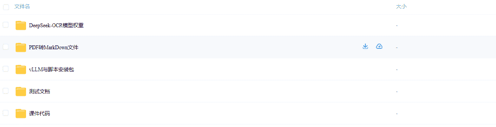


```
import os
import re
import base64
import tempfile
import shutil
import uuid
import json
from io import BytesIO
from typing import List, Optional, Dict, Any, Tuple
from dataclasses import dataclass

import torch
from PIL import Image
from transformers import AutoTokenizer, AutoModel
```

```
/home/data/nongwa/miniconda3/envs/deepseek-ocr/lib/python3.12/site-packages/tqdm/auto.py:21: TqdmWarning: IProgress not found. Please update jupyter and ipywidgets. See https://ipywidgets.readthedocs.io/en/stable/user_install.html
  from .autonotebook import tqdm as notebook_tqdm
```

```
MODEL_PATH = &quot;/home/data/nongwa/workspace/model/OCR/DeepSeek-OCR&quot;  # 修改为你的模型路径
IMAGE_PATH = &quot;./imgs/paddleocrvl.png&quot;  # 修改为你的图片路径
```

```
device = torch.device(&quot;cuda:0&quot; if torch.cuda.is_available() else &quot;cpu&quot;)

print(f&quot;加载模型: {MODEL_PATH}&quot;)
print(f&quot;使用设备: {device}&quot;)
```

```
加载模型: /home/data/nongwa/workspace/model/OCR/DeepSeek-OCR
使用设备: cuda:0
```

```
# 判断数据类型
if torch.cuda.is_available() and torch.cuda.is_bf16_supported():
    dtype = torch.bfloat16
elif torch.cuda.is_available():
    dtype = torch.float16
else:
    dtype = torch.float32
```

```
tokenizer = AutoTokenizer.from_pretrained(
    MODEL_PATH, 
    trust_remote_code=True, 
    local_files_only=True
)

model = AutoModel.from_pretrained(
    MODEL_PATH,
    trust_remote_code=True,
    local_files_only=True,
    use_safetensors=True,
    torch_dtype=dtype
).eval().to(device)
```

```
You are using a model of type deepseek_vl_v2 to instantiate a model of type DeepseekOCR. This is not supported for all configurations of models and can yield errors.
Some weights of DeepseekOCRForCausalLM were not initialized from the model checkpoint at /home/data/nongwa/workspace/model/OCR/DeepSeek-OCR and are newly initialized: [&#x27;model.vision_model.embeddings.position_ids&#x27;]
You should probably TRAIN this model on a down-stream task to be able to use it for predictions and inference.
```

```
if tokenizer.pad_token_id is None and tokenizer.eos_token_id is not None:
    tokenizer.pad_token = tokenizer.eos_token

print(&quot;模型加载成功\n&quot;)
```

```
模型加载成功
```

```
print(f&quot;加载图片: {IMAGE_PATH}&quot;)
image = Image.open(IMAGE_PATH).convert(&quot;RGB&quot;)
img_width, img_height = image.size
print(f&quot;尺寸: {img_width} x {img_height}\n&quot;)
```

```
加载图片: ./imgs/paddleocrvl.png
尺寸: 1440 x 617
```

```
print(&quot;执行 OCR...&quot;)

prompt = &quot;&lt;image&gt;\n&lt;|grounding|&gt;Convert the document to markdown.&quot;

# 保存临时图片
img_tmp = tempfile.NamedTemporaryFile(suffix=&quot;.png&quot;, delete=False)
img_tmp_path = img_tmp.name
img_tmp.close()
image.save(img_tmp_path, format=&quot;PNG&quot;)

out_dir = tempfile.mkdtemp(prefix=&quot;dpsk_ocr_&quot;)

with torch.inference_mode():
    ocr_output = model.infer(
        tokenizer=tokenizer,
        prompt=prompt,
        image_file=img_tmp_path,
        output_path=out_dir,
        base_size=1024,
        image_size=640,
        crop_mode=True,
        save_results=False,
        test_compress=False,
        eval_mode=True,
    )
```

```
执行 OCR...


/home/data/nongwa/miniconda3/envs/deepseek-ocr/lib/python3.12/site-packages/transformers/generation/configuration_utils.py:590: UserWarning: `do_sample` is set to `False`. However, `temperature` is set to `0.0` -- this flag is only used in sample-based generation modes. You should set `do_sample=True` or unset `temperature`.
  warnings.warn(
The attention mask and the pad token id were not set. As a consequence, you may observe unexpected behavior. Please pass your input&#x27;s `attention_mask` to obtain reliable results.
Setting `pad_token_id` to `eos_token_id`:None for open-end generation.
The attention mask is not set and cannot be inferred from input because pad token is same as eos token. As a consequence, you may observe unexpected behavior. Please pass your input&#x27;s `attention_mask` to obtain reliable results.
The `seen_tokens` attribute is deprecated and will be removed in v4.41. Use the `cache_position` model input instead.
`get_max_cache()` is deprecated for all Cache classes. Use `get_max_cache_shape()` instead. Calling `get_max_cache()` will raise error from v4.48
The attention layers in this model are transitioning from computing the RoPE embeddings internally through `position_ids` (2D tensor with the indexes of the tokens), to using externally computed `position_embeddings` (Tuple of tensors, containing cos and sin). In v4.46 `position_ids` will be removed and `position_embeddings` will be mandatory.


=====================
BASE:  torch.Size([1, 256, 1280])
PATCHES:  torch.Size([2, 100, 1280])
=====================
```

```
# 清理临时文件
try:
    os.remove(img_tmp_path)
    shutil.rmtree(out_dir, ignore_errors=True)
except:
    pass

print(&quot;OCR 完成\n&quot;)
print(&quot;=&quot;*60)
print(&quot;原始输出:&quot;)
print(ocr_output)
print(&quot;=&quot;*60 + &quot;\n&quot;)
```

```
OCR 完成

============================================================
原始输出:
&lt;|ref|&gt;image&lt;|/ref|&gt;&lt;|det|&gt;[[12, 0, 999, 997]]&lt;|/det|&gt;
============================================================
```

```
# 清理统计信息
cleaned_text = re.sub(r&#x27;={50,}.*?={50,}&#x27;, &#x27;&#x27;, ocr_output, flags=re.DOTALL)

# 按 &lt;|ref|&gt; 标签分割
segments = re.split(r&#x27;(&lt;\|ref\|&gt;.*?&lt;\|/ref\|&gt;)&#x27;, cleaned_text)

# 存储解析结果
parsed_blocks = []
extracted_images = {}

# 逐段解析
i = 0
while i &lt; len(segments):
    segment = segments[i].strip()
    
    if not segment:
        i += 1
        continue
    
    # 查找 ref 标签
    ref_match = re.match(r&#x27;&lt;\|ref\|&gt;(.*?)&lt;\|/ref\|&gt;&#x27;, segment)
    if ref_match:
        block_type = ref_match.group(1).strip()
        
        # 查找下一段
        if i + 1 &lt; len(segments):
            next_segment = segments[i + 1]
            
            # 提取 bbox 和内容
            det_match = re.match(r&#x27;&lt;\|det\|&gt;\[\[(.*?)\]\]&lt;\|/det\|&gt;\s*(.*)&#x27;, next_segment, re.DOTALL)
            
            if det_match:
                bbox_str = det_match.group(1).strip()
                content = det_match.group(2).strip()
                
                # 解析 bbox
                try:
                    bbox = [float(x.strip()) for x in bbox_str.split(&#x27;,&#x27;)]
                    if len(bbox) != 4:
                        bbox = [0, 0, 0, 0]
                except:
                    bbox = [0, 0, 0, 0]
                
                # 创建块数据
                block_data = {
                    &#x27;type&#x27;: block_type,
                    &#x27;bbox&#x27;: bbox,
                    &#x27;content&#x27;: content
                }
                
                # 如果是图片类型，裁切并保存
                if block_type == &#x27;image&#x27;:
                    x0, y0, x1, y1 = int(bbox[0]), int(bbox[1]), int(bbox[2]), int(bbox[3])
                    x0 = max(0, min(x0, img_width))
                    y0 = max(0, min(y0, img_height))
                    x1 = max(x0, min(x1, img_width))
                    y1 = max(y0, min(y1, img_height))
                    
                    if x1 &gt; x0 and y1 &gt; y0:
                        cropped_img = image.crop((x0, y0, x1, y1))
                        
                        # 转 base64
                        buffered = BytesIO()
                        cropped_img.save(buffered, format=&quot;PNG&quot;)
                        img_base64 = base64.b64encode(buffered.getvalue()).decode(&#x27;utf-8&#x27;)
                        
                        img_filename = f&quot;image_{uuid.uuid4().hex[:12]}.png&quot;
                        extracted_images[img_filename] = img_base64
                        block_data[&#x27;image_file&#x27;] = img_filename
                
                # 如果是表格，提取 HTML
                if block_type == &#x27;table&#x27;:
                    html_match = re.search(r&#x27;&lt;table&gt;.*?&lt;/table&gt;&#x27;, content, re.DOTALL)
                    if html_match:
                        block_data[&#x27;html&#x27;] = html_match.group(0)
                
                parsed_blocks.append(block_data)
                i += 2
                continue
    
    i += 1

print(f&quot;✓ 解析完成: {len(parsed_blocks)} 个内容块&quot;)
print(f&quot;✓ 提取图片: {len(extracted_images)} 张\n&quot;)
```

```
✓ 解析完成: 1 个内容块
✓ 提取图片: 1 张
```

```
for block in parsed_blocks:
    if block[&#x27;type&#x27;] == &#x27;image&#x27; and &#x27;image_file&#x27; in block:
        img_filename = block[&#x27;image_file&#x27;]
        
        # 获取图片数据
        img_base64 = extracted_images[img_filename]
        img_data = base64.b64decode(img_base64)
        cropped_img = Image.open(BytesIO(img_data)).convert(&quot;RGB&quot;)
        
        # 保存临时图片
        img_tmp = tempfile.NamedTemporaryFile(suffix=&quot;.png&quot;, delete=False)
        img_tmp_path = img_tmp.name
        img_tmp.close()
        cropped_img.save(img_tmp_path, format=&quot;PNG&quot;)
        
        out_dir = tempfile.mkdtemp(prefix=&quot;dpsk_img_desc_&quot;)
        
        try:
            # 使用 VQA 模式生成描述（不用 &lt;|grounding|&gt;）
            desc_prompt = &quot;&lt;image&gt;\n请详细描述这张图片的内容，包括主要元素、颜色、布局等。&quot;
            
            with torch.inference_mode():
                description = model.infer(
                    tokenizer=tokenizer,
                    prompt=desc_prompt,
                    image_file=img_tmp_path,
                    output_path=out_dir,
                    base_size=512,
                    image_size=512,
                    crop_mode=False,
                    save_results=False,
                    test_compress=False,
                    eval_mode=True,
                )
            
            # 清理特殊标签
            if description:
                description = re.sub(r&#x27;&lt;\|.*?\|&gt;&#x27;, &#x27;&#x27;, description).strip()
                block[&#x27;description&#x27;] = description
                print(f&quot;   - {img_filename}: {description[:60]}...&quot;)
            
        except Exception as e:
            print(f&quot; {img_filename} 描述生成失败: {e}&quot;)
        
        finally:
            try:
                os.remove(img_tmp_path)
                shutil.rmtree(out_dir, ignore_errors=True)
            except:
                pass

print(&quot;✓ 图片描述生成完成\n&quot;)
```

```
The attention mask and the pad token id were not set. As a consequence, you may observe unexpected behavior. Please pass your input&#x27;s `attention_mask` to obtain reliable results.
Setting `pad_token_id` to `eos_token_id`:None for open-end generation.


directly resize
=====================
BASE:  torch.Size([1, 64, 1280])
NO PATCHES
=====================
   - image_f17dc36c9559.png: 这张图片展示了一个关于数据可视化和分析的项目报告页面。

在图片的顶部，有一个标题写着“Documents”，下面有多个...
✓ 图片描述生成完成
```

```
for idx, block in enumerate(parsed_blocks):
    print(f&quot;\n【块 {idx+1}】&quot;)
    print(f&quot;  类型: {block[&#x27;type&#x27;]}&quot;)
    print(f&quot;  位置: {block[&#x27;bbox&#x27;]}&quot;)
    
    if block[&#x27;type&#x27;] == &#x27;image&#x27;:
        if &#x27;image_file&#x27; in block:
            print(f&quot;  图片: {block[&#x27;image_file&#x27;]}&quot;)
        if &#x27;description&#x27; in block:
            desc_preview = block[&#x27;description&#x27;]
            print(f&quot;  描述: {desc_preview}&quot;)
    elif block[&#x27;type&#x27;] == &#x27;table&#x27;:
        if &#x27;html&#x27; in block:
            print(f&quot;  HTML: {block[&#x27;html&#x27;][:100]}...&quot;)
        else:
            print(f&quot;  内容: {block[&#x27;content&#x27;][:100]}...&quot;)
    else:
        content_preview = block[&#x27;content&#x27;][:100] if len(block[&#x27;content&#x27;]) &gt; 100 else block[&#x27;content&#x27;]
        print(f&quot;  内容: {content_preview}&quot;)
```

```
【块 1】
  类型: image
  位置: [12.0, 0.0, 999.0, 997.0]
  图片: image_f17dc36c9559.png
  描述: 这张图片展示了一个关于数据可视化和分析的项目报告页面。

在图片的顶部，有一个标题写着“Documents”，下面有多个文档文件，包括“Monthly report 2019-20”、“A summary”和“Test 3: Randomization across 3 groups, 3 levels, and 3 cell combinations.”等文件。

在页面的右侧，有一个名为“Vision Encoder”的部分，其中包含一些技术术语和缩写，例如“LLM Decoder”、“ERNIE-4.5-0.3B”、“PadelioOCR-VL-0.9B”等。

在页面的左侧，有一个名为“Instructions”的部分，提供了关于如何使用该项目的指导，包括如何运行代码、如何运行测试以及如何运行其他功能等内容。

在页面的底部，有一个名为“PadelioOCR-VL”的部分，展示了该项目的名称及其主要功能，即使用PadelioOCR进行光学字符识别。

此外，在页面的左下角，还有一个名为“Unstructured Data”的部分，介绍了如何处理和利用非结构化数据的方法。

整个页面布局清晰，内容丰富，涵盖了项目的各个方面和技术细节。
```

# 五、项目：PaddleOCR-VL 构建多模态RAG系统

本节内容，我们将详细介绍如何部署和运行这个基于PaddleOCR-VL的多模态Agentic RAG智能问答系统。该系统支持复杂PDF文档、图片、表格、公式等多种格式的智能分析和问答，并具备精准的溯源能力。

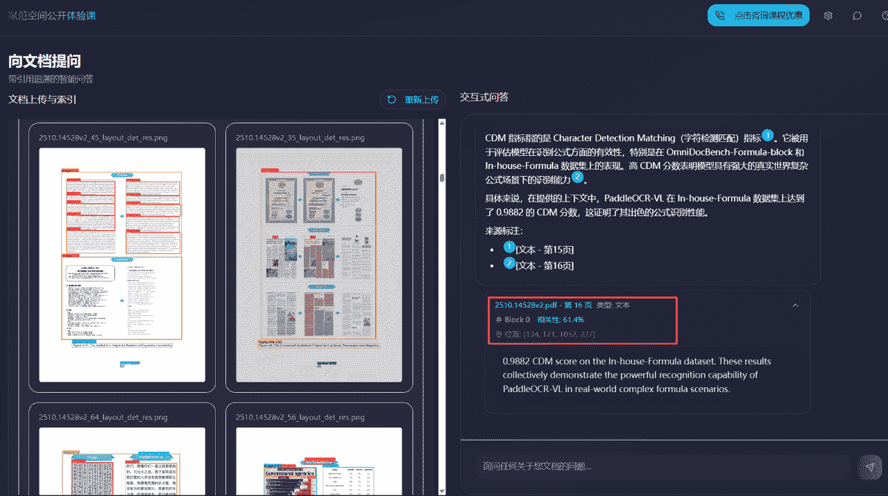

## 5.1 项目核心模块代码详解

PaddleOCR-VL 的输出格式非常适合构建多模态 RAG 系统，如果想要明确的区分出图像、表格、普通文本等信息，一个基本的处理流程是这样的：

```
    PaddleOCR-VL JSON 输出
        ↓
    1. 数据预处理
        ├── 按 block_order 排序
        ├── 过滤无用内容（footer等）
        └── 合并相邻同类型块
        ↓
    2. 分类处理
        ├── 文本类 → 标准 chunk
        ├── 表格类 → 结构化提取 + 文本描述
        ├── 公式类 → 保留格式 + 语义转换
        └── 图片类 → 多模态向量 / 标题关联
        ↓
    3. 元数据增强
        ├── block_id（溯源ID）
        ├── block_bbox（位置坐标）
        ├── block_type（元素类型）
        ├── page_index（页码）
        └── 上下文信息（前后标题、图表编号）
        ↓
    4. 向量化与索引
        ├── 文本 Embedding
        ├── 表格 Embedding（多策略）
        └── 建立多级索引
        ↓
    5. 检索与溯源
        ├── 语义检索
        ├── 坐标定位
        └── 可视化标注
```

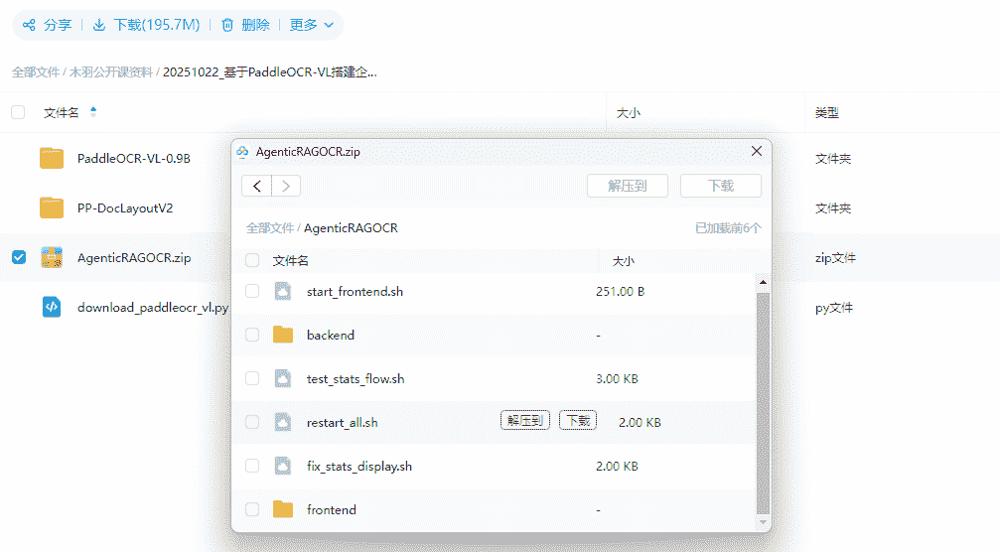


首先第一步做的就是完成PaddleOCR-VL模型的接入及实现解析过程。核心代码文件为：

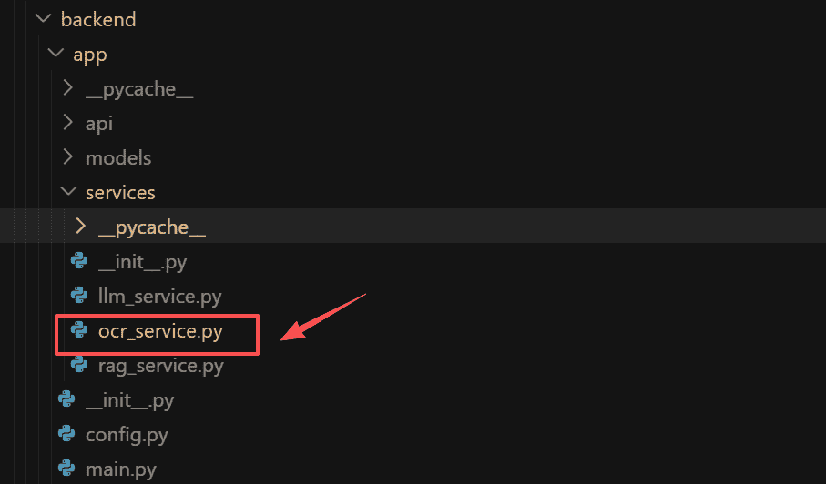

这个服务的核心流程是：初始化时异步加载 PaddleOCRVL 模型到，然后在 parse_document() 中通过线程池执行阻塞的 OCR 调用，PaddleOCR 会将文档解析为多页结果并保存为 JSON/Markdown/可视化图片到磁盘。服务优先从生成的 *_res.json 文件中读取每页的 parsing_res_list，将其中的每个 block（包含 block_id、block_label、block_content、block_bbox、block_order 等字段）转换为 ParsedBlock 对象，最后通过 calculate_stats() 按 label 关键词（table/image/formula/其他）统计各类型块的数量并返回 DocumentStats。即：

1.  初始化 → 加载 PaddleOCR 模型

1.  执行 OCR → 调用 pipeline.predict() 生成 JSON/Markdown/图片

1.  解析结果 → 从 JSON 文件转为 ParsedBlock 对象

1.  计算统计 → 按类型分类统计块数量

分类逻辑

| 判断条件 | 分类结果 | 示例 label |
| --- | --- | --- |
| &#x27;table&#x27; in label | table_blocks | table, table_cell |
| &#x27;image/figure/chart&#x27; in label | image_blocks | image, figure, chart |
| &#x27;formula/equation&#x27; in label | formula_blocks | display_formula, inline_formula |
| 其他 | text_blocks | text, paragraph_title, footer |

接下来，在第二步我们要封装 AgenticRAG 的构建逻辑，核心代码文件为：

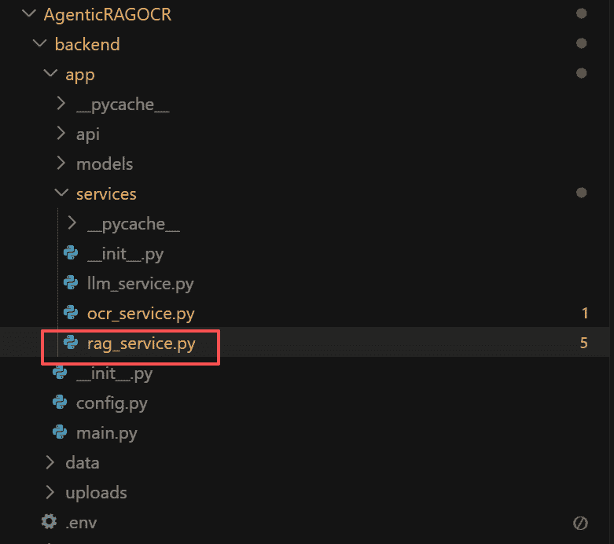

其中核心的分块策略是根据内容类型差异化处理

分块策略

| 内容类型 | 分块策略 | 原因 |
| --- | --- | --- |
| **长文本** (text) | ✂️ **分块**（chunk_size=500） | 避免单个向量损失局部语义 |
| **短文本** | ✅ **不分块** | 保持完整性 |
| **表格** (table) | ✅ **整体存储** | 表格结构不能拆分 |
| **公式** (formula) | ✅ **整体存储** | LaTeX 公式语义完整 |
| **图片** (image) | ✅ **整体存储** | 图片标题/caption 整体索引 |

每个 chunk 存储以下元数据：

```
    metadata = {
        &quot;doc_id&quot;: &quot;uuid&quot;,               # 文档ID
        &quot;file_name&quot;: &quot;example.pdf&quot;,     # 原始文件名
        &quot;page_index&quot;: 0,                # 页码（PDF多页）
        &quot;block_id&quot;: 5,                  # OCR block ID
        &quot;block_type&quot;: &quot;text&quot;,           # 类型（text/table/image/formula）
        &quot;block_label&quot;: &quot;paragraph_title&quot;, # OCR 原始标签
        &quot;block_bbox&quot;: &quot;[100,200,300,400]&quot;, # 坐标（JSON字符串）
        &quot;block_order&quot;: 3,               # 阅读顺序
        &quot;chunk_index&quot;: 0,               # 分块索引（如果分块）
        &quot;total_chunks&quot;: 2,              # 总分块数
        &quot;is_chunked&quot;: True              # 是否分块
    }
```

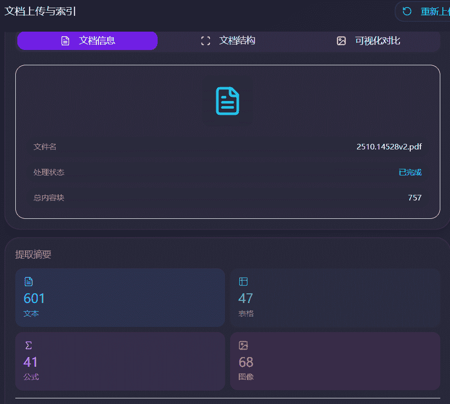

其次，对于溯源的策略，则主要是通过对元数据的格式化处理 + 大模型生成描述的引用来完成。核心代码文件：

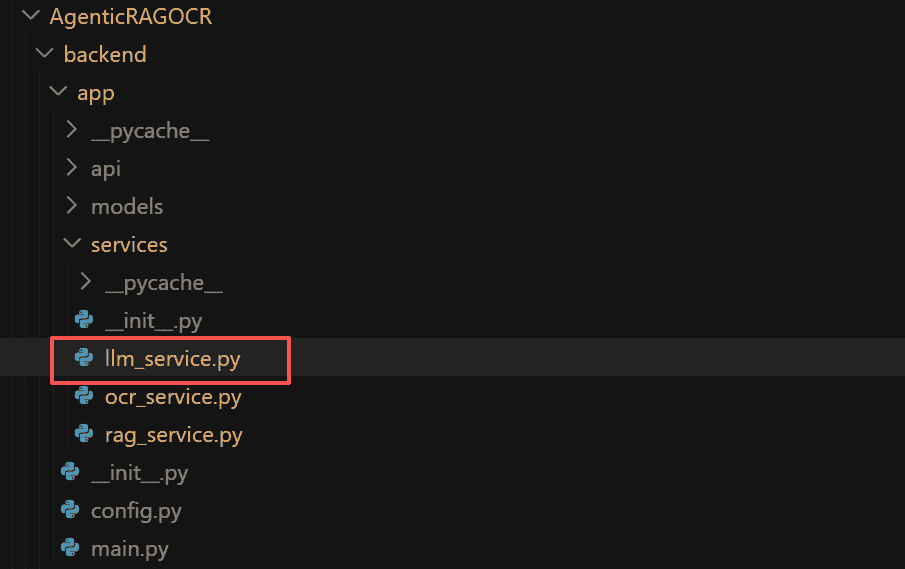

在 Prompt 中明确引用：

```
    system_prompt = &quot;&quot;&quot;你是一个专业的文档问答助手。你的任务是：
    1. 基于提供的文档上下文，准确回答用户的问题
    2. 在回答中使用【数字】标记引用来源（例如【1】【2】）  ⬅️ 关键
    3. 对于表格、图像、公式等特殊内容，明确指出其类型
    4. 如果上下文中没有相关信息，诚实地说明
    5. 回答要准确、简洁、结构清晰

    引用标注规则：
    - 使用【1】【2】【3】等数字标记，对应检索到的文档块
    - 每个关键信息点都应该标注引用来源
    - 多个来源可以连续标注，如【1】【2】
    &quot;&quot;&quot;
```

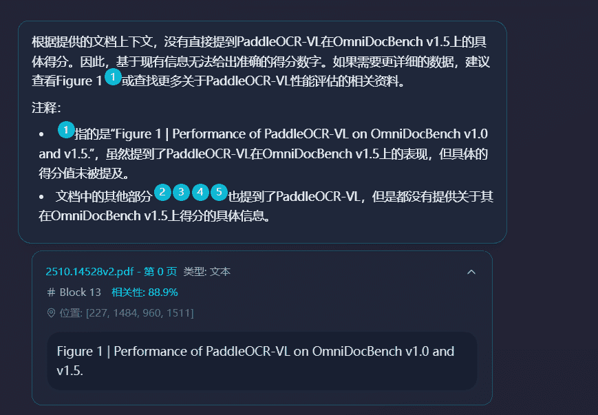

## 5.2 项目架构介绍

AgenticRAGOCR 项目采用前后端分离的模块化设计，核心结构如下：

```
    AgenticRAGOCR/                        # 项目根目录
    ├── 📁 backend/                       # 后端服务层
    │   ├── app/                          # 主应用目录
    │   │   ├── main.py                  # FastAPI主服务 - 多模态RAG API
    │   │   ├── config.py                # 配置管理
    │   │   ├── services/                # 业务服务层
    │   │   │   ├── ocr_service.py      # PaddleOCR-VL 服务
    │   │   │   ├── rag_service.py      # RAG 检索服务
    │   │   │   └── llm_service.py      # LLM 问答服务
    │   │   ├── models/                  # 数据模型
    │   │   └── api/                     # API 路由
    │   ├── requirements.txt             # Python 依赖
    │   ├── .env                        # 环境配置
    │   ├── data/                        # 数据目录
    │   │   └── chroma_db/              # ChromaDB 向量数据库存储
    │   └── uploads/                     # 上传文件存储目录
    │
    ├── 📁 frontend/                      # 前端界面（React + TypeScript）
    │   ├── src/                         # 源代码
    │   │   ├── components/             # UI 组件
    │   │   ├── lib/                    # 工具库
    │   │   │   └── api.ts             # API 客户端
    │   │   └── App.tsx                 # 主应用
    │   ├── package.json                # Node.js 依赖
    │   └── vite.config.ts              # Vite 配置
    │
    ├── restart_all.sh                   # 一键重启脚本
    └── start_frontend.sh                # 前端启动脚本
```

核心组件功能说明

| 层级 | 技术栈 | 主要功能 | 关键文件 |
| --- | --- | --- | --- |
| **API服务层** | FastAPI + Pydantic | RESTful API、文件上传、智能问答 | main.py |
| **OCR解析层** | PaddleOCR-VL-0.9B | 文档解析、布局检测、内容识别 | ocr_service.py |
| **向量检索层** | ChromaDB + Qwen Embeddings | 语义检索、相似度计算、分块策略 | rag_service.py |
| **问答生成层** | 通义千问大模型 | 智能问答、溯源引用、上下文理解 | llm_service.py |
| **数据存储层** | 文件系统 + 向量数据库 | 原文件存储、向量索引、元数据管理 | uploads/ + chroma_db/ |
| **前端界面层** | React + TypeScript + Vite | 文档可视化、问答交互、溯源展示 | frontend/ |

## 5.3 本地部署环境配置

系统基于Python 3.11+开发，需要确保环境满足以下要求：

| 组件 | 版本要求 | 安装方式 | 验证命令 |
| --- | --- | --- | --- |
| **Python** | ≥ 3.11 | 官网下载或conda | python --version |
| **Node.js** | ≥ 18.0 | 官网下载或nvm | node --version |
| **pip** | 最新版 | 随Python安装 | pip --version |
| **npm** | ≥ 9.0 | 随Node.js安装 | npm --version |
| **GPU** | 推荐8GB+ | CUDA 12.6 | nvidia-smi |

本项目使用 ocr_rag 虚拟环境（与之前的PaddleOCR环境一致）：

```
# 如果还没有创建，使用conda创建环境
conda create -n ocr_rag python=3.11
conda activate ocr_rag

# 如果已经创建过，直接激活
conda activate ocr_rag
```

激活后，命令行提示符前会显示 (ocr_rag)，表示已进入虚拟环境。

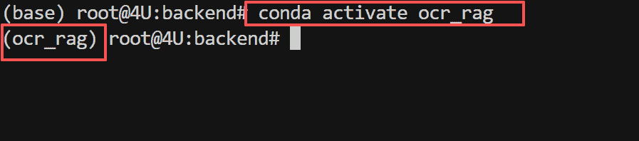

## 5.4 后端项目配置与启动

进入项目后端目录，安装Python依赖：

```
  # 进入后端目录
  cd /home/MuyuWorkSpace/02_OcrRag/projects/AgenticRAGOCR/backend

  # 安装核心依赖包
  pip install -r requirements.txt
```

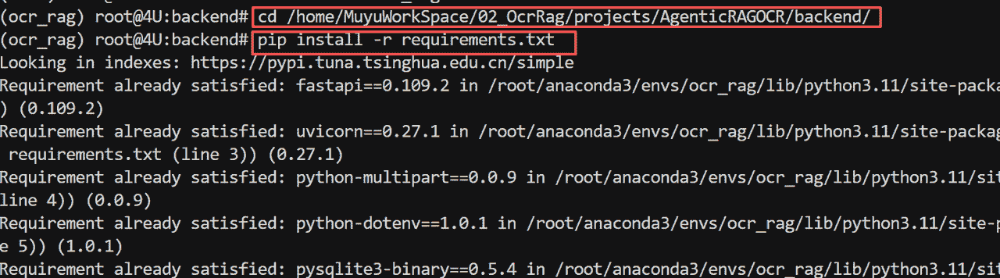

核心Python依赖

| 依赖包 | 版本 | 用途 |
| --- | --- | --- |
| **fastapi** | 0.109.2 | Web框架 |
| **uvicorn** | 0.27.1 | ASGI服务器 |
| **dashscope** | 1.19.0 | 阿里云百炼SDK（Qwen模型） |
| **chromadb** | 0.4.22 | 向量数据库 |
| **langchain** | 0.1.7 | LLM应用框架 |
| **paddleocr[all]** | 最新版 | OCR工具（已在前面安装） |
| paddlepaddle-gpu | 3.2.0 | 深度学习框架（已在前面安装） |

项目的环境变量配置已经在 backend/.env 文件中定义，主要包含以下配置：

```
    # 阿里云百炼平台配置
    DASHSCOPE_API_KEY=sk-e2bad0af850e403e
    QWEN_MODEL_NAME=qwen-max  # 或 qwen-plus, qwen-turbo

    # 向量数据库配置
    CHROMA_PERSIST_DIR=./data/chroma_db
    EMBEDDING_MODEL=text-embedding-v3  # Qwen embedding 模型（支持中英文）

    # PaddleOCR 模型路径
    PADDLEOCR_VL_MODEL_DIR=/home/MuyuWorkSpace/02_OcrRag/PaddleOCR-VL-0.9B
    LAYOUT_DETECTION_MODEL_DIR=/home/MuyuWorkSpace/02_OcrRag/PP-DocLayoutV2

    # 文件上传配置
    UPLOAD_DIR=./uploads
    MAX_UPLOAD_SIZE=50  # MB

    # 服务器配置
    HOST=0.0.0.0
    PORT=8100

    # 日志配置
    LOG_LEVEL=INFO
```

**重要提示：**

+   D**ASHS**COPE_API_KEY：必须配置，用于调用通义千问模型和Embedding服务

+   PADDLEOCR_VL_MODEL_DIR 和 LAYOUT_DETECTION_MODEL_DIR：指向已下载的模型路径

配置完成后，启动FastAPI后端服务：

```
# 确保在 ocr_rag 虚拟环境中
conda activate ocr_rag

# 进入后端目录
cd /home/MuyuWorkSpace/02_OcrRag/projects/AgenticRAGOCR/backend

# 启动后端服务
python start_backend_conda.sh
```

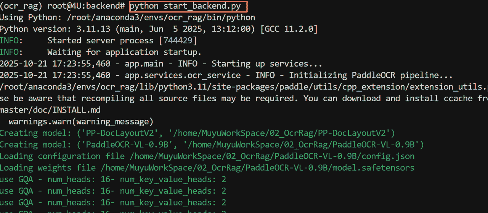

启动成功后，终端会显示如下信息：

```
    INFO:     Started server process [12345]  
    INFO:     Waiting for application startup.
    INFO:     Application startup complete.
    INFO:     Uvicorn running on http://0.0.0.0:8100 (Press CTRL+C to quit)
```

此时可以访问 http://localhost:8100/docs 查看API文档。


主要API接口

| 接口路径 | 方法 | 功能 | 说明 |
| --- | --- | --- | --- |
| /api/documents/upload | POST | 文档上传 | 支持PDF、图片等格式，自动OCR解析 |
| /api/documents/{doc_id}/index | POST | 文档索引 | 将OCR结果向量化并存入ChromaDB |
| /api/documents/{doc_id}/query | POST | 语义检索 | 基于向量检索的语义搜索 |
| /api/documents/{doc_id}/qa | POST | 智能问答 | 多模态问答，支持溯源引用 |
| /api/documents | GET | 文档列表 | 获取已上传的文档列表 |
| /api/documents/{doc_id}/blocks | GET | 获取文档块 | 获取解析后的文档块（可按类型过滤） |
| /api/documents/{doc_id}/pages/{page_index} | GET | 获取页面信息 | 获取特定页的OCR结果 |
| /api/documents/{doc_id}/visualizations/{img_name} | GET | 获取可视化图 | 获取布局检测和阅读顺序可视化图 |

## 5.5 前端服务配置与启动

进入前端目录，安装Node.js依赖：

```
  # 进入前端目录
  cd /home/MuyuWorkSpace/02_OcrRag/projects/AgenticRAGOCR/frontend

  # 安装依赖（首次运行需要，耗时约2-5分钟）
  npm install
```


**核心前端技术栈：**

前端技术栈

| 技术 | 版本 | 用途 |
| --- | --- | --- |
| **React** | 18.3.1 | UI框架 |
| **TypeScript** | 5.6.3 | 类型系统 |
| **Vite** | 5.4.11 | 构建工具 |
| **TailwindCSS** | 3.4.15 | CSS框架 |
| **Radix UI** | 最新版 | 组件库 |
| **React Markdown** | 10.1.0 | Markdown渲染 |
| **KaTeX** | 0.16.25 | 公式渲染 |

依赖安装完成后，启动Vite开发服务器：

```
  # 在前端目录下执行
  npm run dev
```

启动成功后，终端会显示如下信息：


打开浏览器访问 http://localhost:5173，即可看到AgenticRAGOCR系统的前端界面。


至此，我们就完整实现了 PaddleOCR-VL 的本地部署，到复杂文档解析，再到企业级 AgenticRAG 系统的完整搭建，相信通过本节课程的学习，大家已经基本掌握了多模态 RAG 技术的核心实现。

**我们下期公开课，再见！** 👋