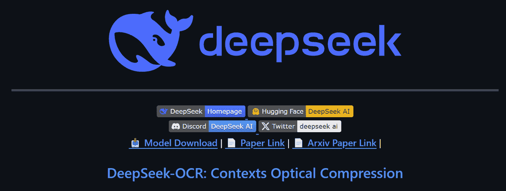
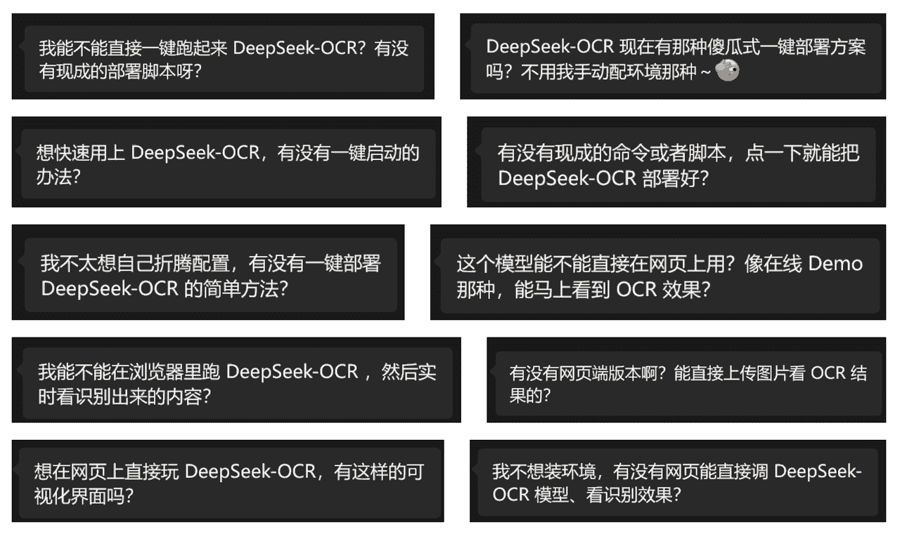
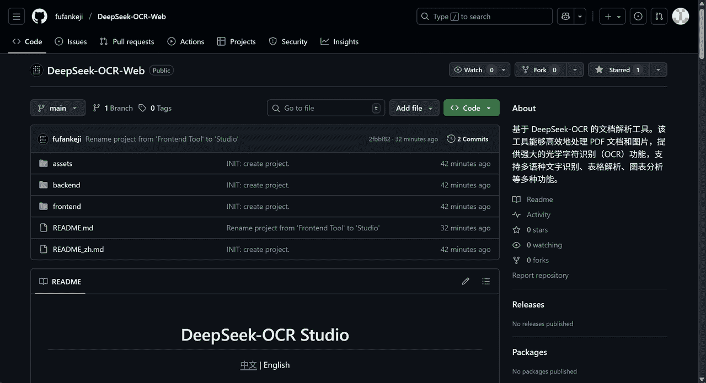
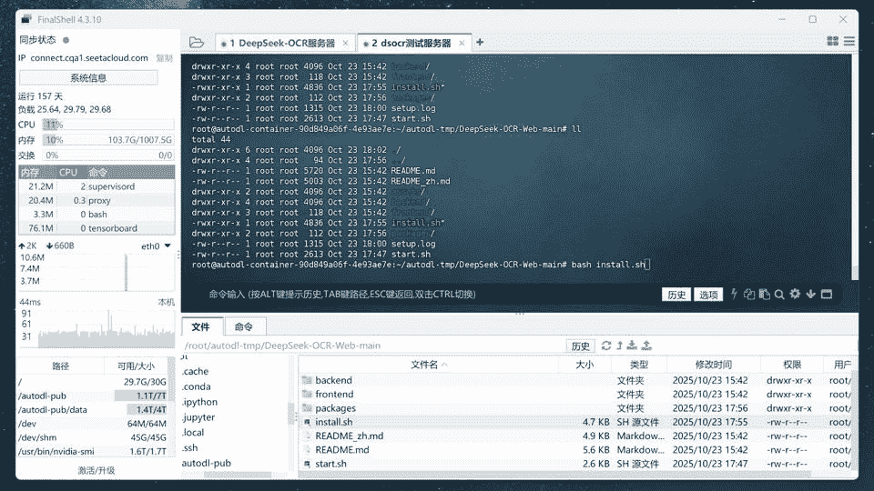
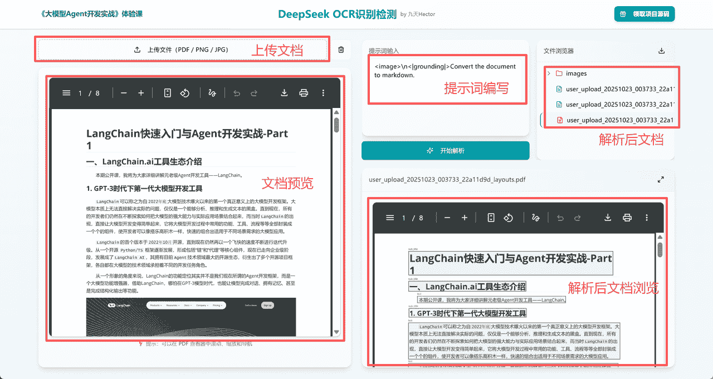
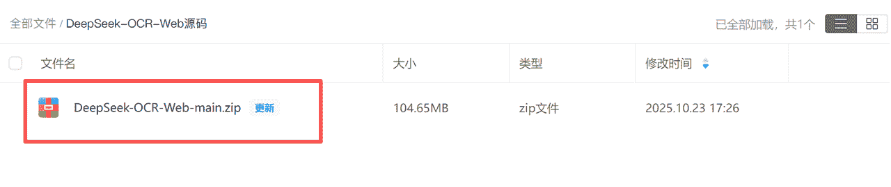
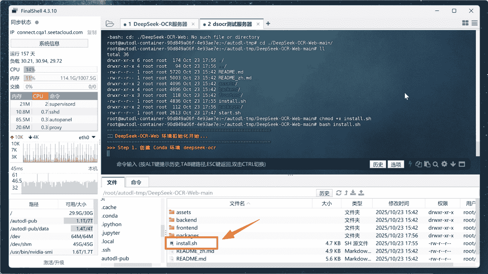
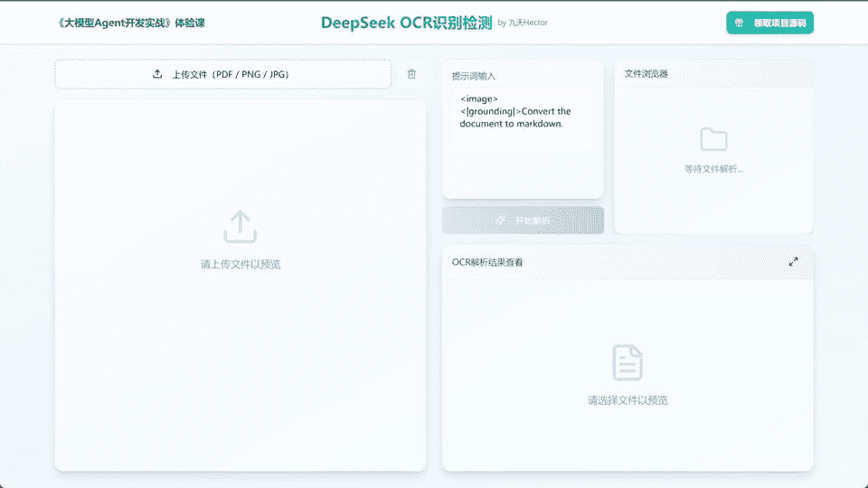
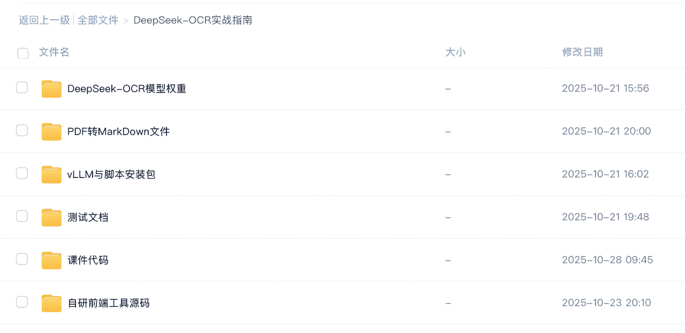

# 【团队自研】DeepSeek-OCR-Web 项目已开源

> 来源：[https://kq4b3vgg5b.feishu.cn/docx/HYZGdzCmaoo9YKxo7Xicz9nCnGd](https://kq4b3vgg5b.feishu.cn/docx/HYZGdzCmaoo9YKxo7Xicz9nCnGd)

上周，DeepSeek-OCR重磅开源，得益于多项创新突破，受到了用户的广泛青睐，这个国产开源的多模态OCR模型，大有崛起为大模型产业化的关键工具之势～



# 01 一键部署DeepSeek-OCR

当然，自DeepSeek-OCR模型发布之后，社区伙伴们问的最多的问题就是——

有没有什么方法能一键部署DeepSeek-OCR模型？能不能在网页端直接操作模型，并实时查看OCR识别结果？



有的，兄弟有的～

咱们研发团队经过几个晚上通宵奋战，终于完成DeepSeek-OCR-Web项目的研发，并正式在GitHub上开源。

Git开源链接🔗，欢迎点击链接下载体验：https://github.com/fufankeji/DeepSeek-OCR-Web/tree/main ，记得点个🌟Star支持一下呀～！！



首先，它不仅包含了完整的DeepSeek-OCR模型运行所需的各项基础依赖，并提供了两项核心功能，其一是DeepSeek-OCR一键式懒人安装包，仅需一行命令，即可完成DeepSeek-OCR模型的环境配置、模型下载、依赖安装等各项全部工作，解放双手提高效率。



[2025-10-23 18-03-32.mp4](https://internal-api-drive-stream.feishu.cn/space/api/box/stream/download/all/ThnvbtXpboX7pxxUbqAcEqCFnFf)

话又说回来，如果你使用了，我们团队提供的自研DeepSeek-OCR模型调用前端，同样一行命令即可开启服务，并在网页端完成文件上传、提示词编写、文件OCR解析、解析结果查看和下载等各项功能，极大程度提高模型可用性和测试开发效率。



# 02 DeepSeek-OCR-Web工具使用方法

接下来九天老师会为大家介绍DeepSeek-OCR-Web如何使用，上手使用前需要确保主机上有7G以上的显存空间。项目是经过高度封装的懒人项目，开发过程比较复杂，但实际使用过程非常简单，首先我们可以使用git clone命令进行源码下载，

```
git clone https://github.com/fufankeji/DeepSeek-OCR-Web.git
```

也可以直接扫码领取完整项目源码并上传到服务器上进行解压缩。



然后找到主目录下的install.sh文件，该文件就是DeepSeek-OCR一键安装脚本。



然后我们只需要输入如图所示的命令就能直接运行脚本文件。

```
chmod +x install.sh
bash install.sh
```

该脚本能够一键完成DeepSeek-OCR模型环境搭建、依赖安装、模型权重下载、前端环境搭建和依赖安装等各项工作，并且运行稳定，还适配了国内网络环境。怎么样，是不是非常便捷。而由于这个要下载模型权重，所以实际运行时间可能需要20分钟左右。


[2025-10-23 18-46-37.mp4](https://internal-api-drive-stream.feishu.cn/space/api/box/stream/download/all/XaZdbBQHJoTO41xG7OGc43kHnXg)

而等待运行完成后，即可以进一步使用前端来调用DeepSeek-OCR模型了。开启前端的方法也非常简单，我们只需运行如图所示的命令，也就是运行第二个脚本start.sh即可。

```
chmod +x start.sh
bash start.sh
```


[2025-10-23 18-47-48.mp4](https://internal-api-drive-stream.feishu.cn/space/api/box/stream/download/all/MXZgbB68uolUHVxlBoucDTVenPb)

脚本启动后，我们就能在本地浏览器的3000端口进行Web端的模型调用了。

在实际使用过程中，我们需要先选择PDF或者图片文件进行上传，例如我们这里输入一张柱状图，然后输入合理的提示词，例如我们输入Parse the figure解析图片，然后点击开始解析，此时后台就会调用DeepSeek-OCR模型进行解析。而解析完成后，我们能够在文件浏览器中查看解析后的文件，各项文件均支持在线浏览。例如在Parse the figure提示词下，DeepSeek-OCR模型会自动将数据可视化图片进行解析并还原背后的数据，并以markdown表格形式呈现。这是DeepSeek-OCR模型特有的一种高级功能，我们点击result.md即可查看解析结果。



[2025-10-23 19-10-55.mp4](https://internal-api-drive-stream.feishu.cn/space/api/box/stream/download/all/WicNbO48loNZGIxSFvOc7foInJf)

---




此外，web工具源码：链**接: https://**pan.baidu.com/s/1_lRm_BweJO6XssxSkOU7DQ?pwd=wjjp，更多企业项目落地内容，扫码咨询⬆️助教老师～

---

当然，我们也能随时切换提示词来测试不同的解析模式：

| ## **输入提示词** | ## **对应功能实现** |
| --- | --- |
| Parse the figure | 解析图片，而解析完成后，我们能够在文件浏览器中查看解析后的文件，各项文件均支持在线浏览。 |
| Parse the figure | DeepSeek-OCR模型会自动将数据可视化图片进行解析并还原背后的数据，并以markdown表格形式呈现 |
| &lt;image&gt;\nDescribe this image in detail | DeepSeek-OCR就会围绕图片的语义进行解读，来介绍这个柱状图到底说明了件什么事情 |

而除此之外，DeepSeek-OCR模型还支持：

✅100多种主流语言文字的高精度识别

✅能够对各类复杂表格、数据文件进行精准解析，

✅能对CAD图、流程图、装饰图等进行语义识别，

✅模型还能对多模态PDF进行高精度版面分析，精准识别标题、正文、表格、公式等各种元素，

✅还能一键将PDF转化为高保真的MarkDown文档～

而有了这个DeepSeek-OCR-Web工具的加持，相信大家进行各种功能实践的时候一定会事半功倍🎉。

---

# 03 加入社区免费学习

更多关于DeepSeek-OCR模型的进阶使用方法、不同提示词的使用场景，DeepSeek-OCR-Web项目完整源码等等...

🙋可以跳转到 [赋范大模型社区「搜索自查版」](https://kq4b3vgg5b.feishu.cn/wiki/VsfTwzTS6iakxLkF4p6ch6oUn6c?from=from_copylink)自行取用你需要的大模型学习资源

✉️也可以加入**赋范大模型技术社区交流群⬇️**，每周免费公开课+超浓厚学习氛围，前沿技术享不停～

