# DeepSeek-OCR-2快速入门实战

> 来源：[`https://kq4b3vgg5b.feishu.cn/docx/L7YsdP01foT7nyxzHKFcR6U5nBf`](https://kq4b3vgg5b.feishu.cn/docx/L7YsdP01foT7nyxzHKFcR6U5nBf)

## 一、OCR与多模态技术入门介绍

### 1. 从识字到理解世界

在人工智能的发展历史中，`OCR`（Optical Character Recognition，光学字符识别）曾是最早实现“机器理解文字”的技术之一。它让计算机第一次具备了“看懂文字”的能力——能够将扫描的纸质文件、票据、街景招牌中的文字自动识别为可编辑、可搜索的文本。可以说，`OCR` 技术是人类让机器“识字”的起点。

但随着信息形式的多样化，文字早已不再是唯一的信息载体。图像、视频、表格、图纸、网页、甚至 `PDF` 文档——都成为了新的知识容器。因此，传统的 `OCR` 技术，虽然能够识别字符，却往往无法理解图像中的语义关系。它知道一串文字写着什么，却不理解它在页面中的意义——是标题、表格项，还是公式的一部分。这正是传统 `OCR` 的“瓶颈”所在。

### 2. `OCR 1.0`文字识别与文档版面识别

早期的 `OCR`（我们称之为 `OCR 1.0` 时代）主要由两个独立的模块组成：

+   文字检测（Text Detection）：找到图像中哪里有文字；
+   文字识别（Text Recognition）：识别每一段文字的具体内容。

这些系统通常基于 `CNN`（卷积神经网络）+ `LSTM`（长短期记忆网络）的结构，比如 `CRNN`、`CTC` 识别模型等。这一阶段的 `OCR` 主要解决的是“机器读字”的问题——识别准确率、字体鲁棒性、多语言支持等。

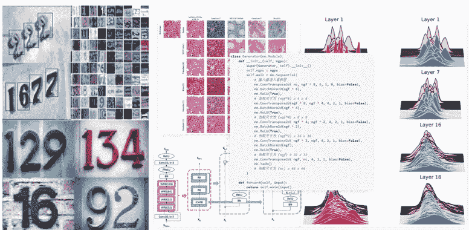

应用层面上，`OCR 1.0` 解决了海量的现实问题：

+   银行票据识别与自动录入；
+   身份证、驾驶证、发票的自动录入系统；
+   扫描文档的数字化存档；
+   翻译与语言辅助系统（如 Google 翻译的实时摄像头翻译功能）。

这些应用让信息数字化变得前所未有的高效，也成为“无纸化办公”“自动化文档处理”的基础。

然而，很快研究者开始意识到：仅仅识别文字远远不够，机器还需要理解整个文档的结构与语义。于是，新的 `OCR` 模型开始引入：

+   视觉 `Transformer`（Vision Transformer, `ViT`）结构；
+   布局分析（Layout Analysis）；
+   视觉语言对齐（Vision-Language Alignment）。

这一阶段的代表模型包括微软的 `LayoutLM`、百度的 `PaddleOCR 2.0`，以及多模态结构化识别模型 `Donut`、`DocFormer`、`TextMonkey` 等。这些模型不仅能识别文字，还能输出 `Markdown`、`HTML` 或 `JSON` 结构，理解表格、公式、图形之间的关系。也就是说，此时`OCR`模型就由原先的“看字”升级成了“看文档版面”。

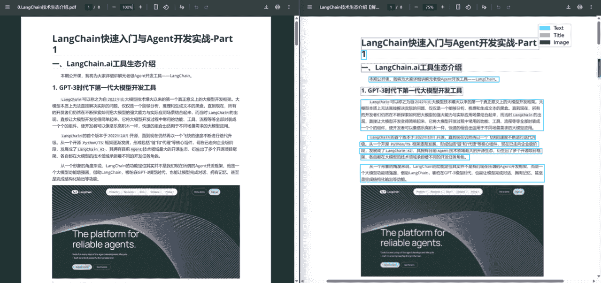

但是需要注意的是，此时的`OCR`模型仍然无法真正全面理解完整文档的语义，尤其是一些流程图、CAD图、装饰图等等，也就是说，新一代`OCR`模型理解能力上升了，但也只局限在理解文档版面信息层面。

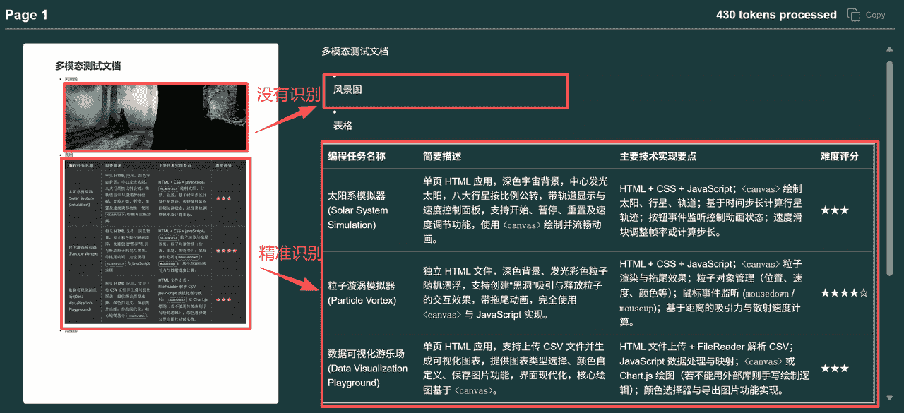

### 3. 多模态崛起：让大模型看懂世界

而在 2023 年之后，大模型技术的爆发彻底改变了视觉理解的格局。以 `GPT-4V`、`Gemini 2`、`Qwen-VL`、`InternVL` 等为代表的 多模态大模型（VLM，Vision-Language Model） 出现，让人工智能真正具备了“同时理解文字与图像”的能力。

多模态技术的核心思想是：将图像和语言映射到同一个语义空间中，让模型能够同时处理视觉信息和文本信息。这意味着，模型既能“看图识字”，又能“看图明意”——它能读懂论文 `PDF`、解析图表、理解建筑图纸、甚至生成 `Markdown` 结构的文本。

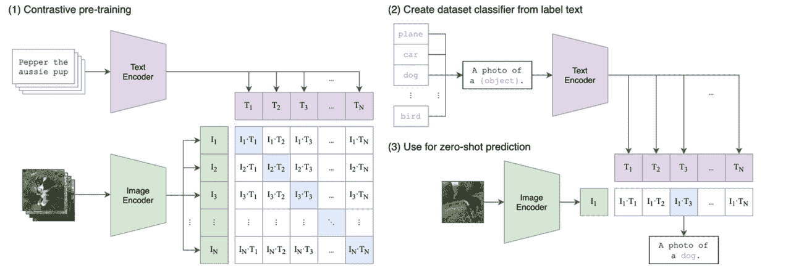

多模态技术的本质，是要让机器能够“同时理解文字与图像”。而实现这一点的关键，就是将图像与文本映射到同一个语义空间（Shared Semantic Space）中。换句话说，无论输入是一句话，还是一张图，模型都能在同一个高维表示空间里找到它们之间的语义对应关系。

这就像人类在看图表或阅读论文时，不仅识别出图形和文字，还能在大脑中把它们融合成“意义”：看到“上升趋势”这个图形，你会自动想到“增长”；看到公式，你能联想到逻辑推理。多模态模型正是试图在计算机中复现这种语义联想机制。

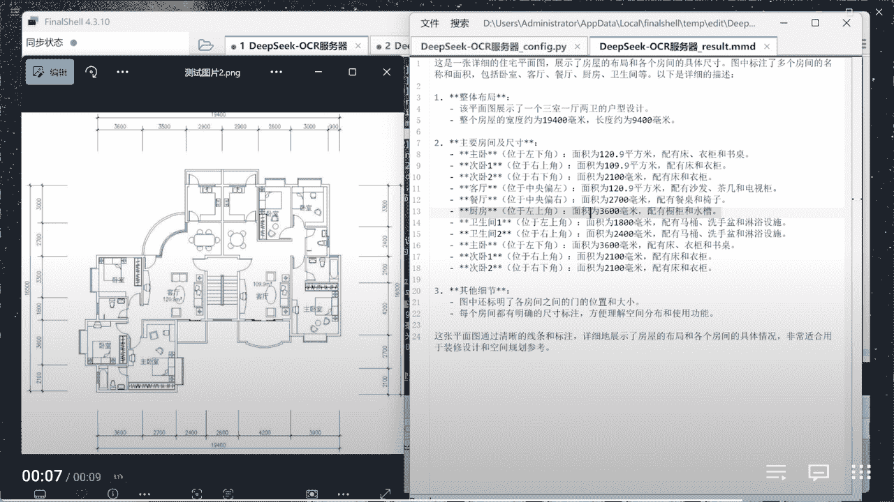

而基于`VLM`进行`OCR`的工作，包括文字识别、版面识别（文档结构关系识别）等等，也被称为`OCR 2.0`。

## 二、多模态RAG系统开发及主流OCR&VLM模型介绍

### 1. 从文本到图文：信息检索的现实困境

在传统的`RAG`（Retrieval-Augmented Generation）系统中，我们所面对的数据大多是纯文本。这些系统的核心流程通常是：

文本向量化 → 向量检索 → 结果拼接 → 大模型回答。

然而，真实的知识世界远不止文本。在企业文档、科研论文、专利报告、财务报表、建筑图纸等场景中，大量关键信息都藏在非结构化`PDF`文档中。

这些文档可能包含：

+   复杂的表格（嵌套结构、合并单元格）；
+   数学公式或物理符号；
+   实验图片、流程图、建筑蓝图；
+   混合语言或多栏排版；
+   注释、脚注、图例等细节信息。

对于人类而言，理解这些内容只是阅读的问题；但对于机器来说，这是一场真正的挑战。

+   多模态文档样例

+   风景图&装饰图


+   表格

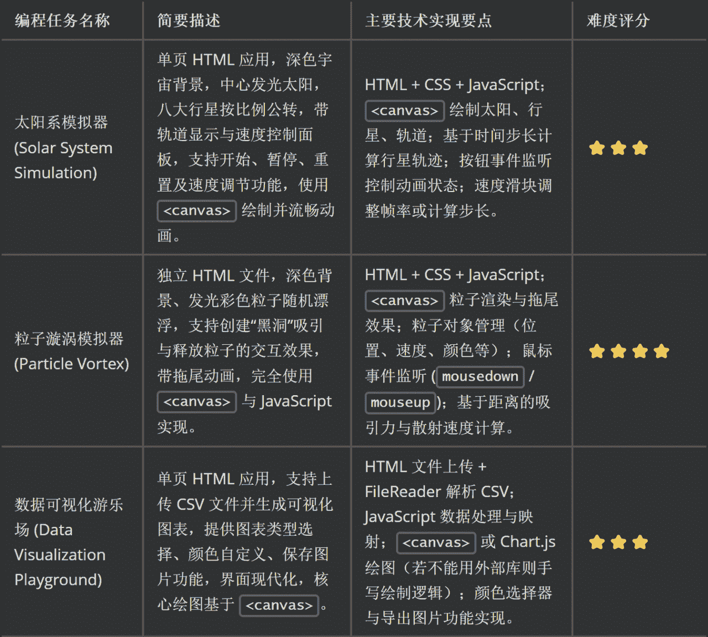

+   流程图


+

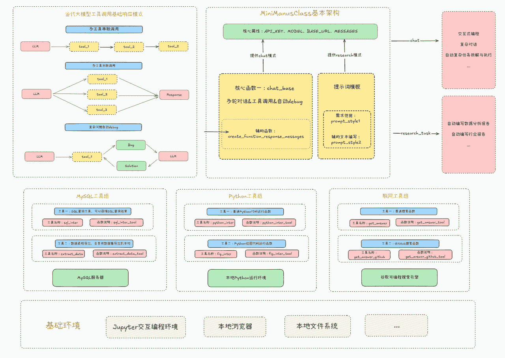

+   产品图

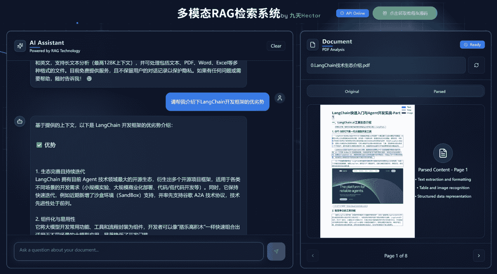

+   `latex`公式

+   并且，在Lesson 12中我们曾证明，伪残差之所以能够加快模型收敛速度，是因为伪残差代表的拟合方向就是损失函数最快速减小（下降）的方向。换而言之，通过一颗颗决策树不断拟合伪残差，最终能够使得损失函数最快速的减小。同时，在伪残差的具体选取上，`GBDT`的伪残差是样本的负梯度：

而`XGB`的伪残差则是一个同时包含梯度和损失函数二阶导的计算结果：

+   而根据Lesson 13中的数学推导不难看出，从本质上来说，`XGB`的伪残差是在拟合损失函数的二阶泰勒展开，而`GBDT`的伪残差则是在拟合损失函数的一阶泰勒展开。在大多数情况下，通过拟合二阶泰勒展开，能够更好的捕捉损失函数的更加细微的变动，从而提升精度，但代价是这么做需要耗费更大的计算量。

+   手写公式拍照


+   论文图表

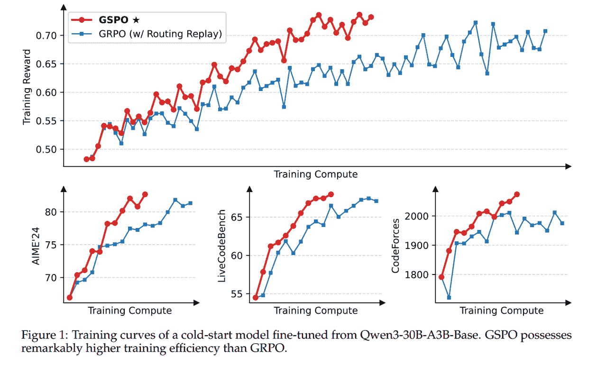

+   结构化数据图

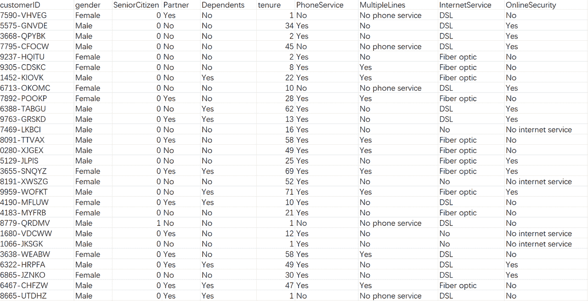

### 2. 基于OCR模型的文档识别与检索系统

在这样的多模态`PDF`场景中，`OCR`模型就是系统的“第一道神经通路”。它承担着从视觉信息中提取语义结构的关键任务，是整个`RAG`链路的起点。如果说`LLM`是“大脑”，那么`OCR`模型就是“视觉皮层”——它决定了大脑能看到什么、理解到什么程度。

在过去的`OCR 1.0`时代（以`PaddleOCR`、`Tesseract`等为代表），模型只能“扫描文字”，也就是说，它看到`PDF`中的一段文字，只会简单地识别出“这些字是什么”。

而在`OCR 2.0`（也就是`VLM`模型时代）中，`OCR`模型已经能够实现：

+   语义级解析：不仅识别文字，还能理解其上下文逻辑（如表头对应数据、公式与变量的关联）；
+   结构级还原：能够自动将`PDF`文档转化为结构化的`Markdown`或`HTML`格式，保留段落层次、标题、列表等格式信息；
+   视觉语义融合：能看懂图像与文字的关系，比如“图1展示了实验流程”、“左图为原始图像、右图为结果对比”；
+   内容理解能力：不仅能提取表格数据，还能识别图表趋势、理解图像含义、甚至生成解释性描述。

这意味着，`OCR 2.0`模型不再只是“`PDF`识别器”，而是一个真正的“`PDF`理解器”。

| 能力方向 | 传统`OCR`（1.0） | 现代`VLM OCR`（2.0） |
| --- | --- | --- |
| 信息提取 | 仅识别文本字符 | 同时提取文本、表格、公式、图像语义 |
| 文档结构 | 无法保留层级 | 自动生成结构化`Markdown`/`HTML` |
| 语义理解 | 无上下文关联 | 理解逻辑、关系、描述性语义 |
| 应用范围 | 文档数字化 | 多模态`RAG`、知识抽取、科研分析、问答系统 |

在多模态`RAG`系统中，`OCR`模块通常作为整个流程的输入层（Input Layer）存在。完整的管线一般包括以下几个阶段：

```
PDF文档 → OCR/VLM解析 → Markdown/JSON结构化结果 → 向量化编码 → 检索/召回 → 大模型回答
```

这其中的`OCR`阶段至关重要——它决定了后续的知识检索质量。

一个优秀的`OCR`模型，能够把一份复杂的学术`PDF`转化为层次清晰的`Markdown`文档：标题、表格、公式、图表说明都保持一致；而一个传统`OCR`模型，可能只能输出一堆“碎片化文字”，失去了上下文结构。可以说：如果`OCR`阶段做不好，整个多模态`RAG`系统的“知识理解”就无从谈起。

### 3. 主流VLM与OCR模型介绍

目前`VLM`模型有很多，除了主流的多模态在线大模型外，还有如`Qwen-VL`、`InternVL`、`Gemma`等开源的视觉模型。

#### 3.1 在线VLM模型

在多模态 `RAG` 技术体系中，在线 `VLM` 模型是目前能力最全面的语义理解引擎。这类模型往往由顶尖大厂训练并托管在云端，参数规模达到数百亿甚至上千亿，具备强大的多模态感知与推理能力。典型代表包括 OpenAI 的 `GPT-5`（原生支持文本、图像、音频等模态，提供完善的 `API` 与生态）、Google 的 `Gemini 2.5`（强调长上下文、多语言和与搜索/Workspace 的无缝集成）、以及 Anthropic 的 `Claude 4.5`（在多步推理与代理式任务中表现突出，并已在多云环境提供企业级接入）。这类在线模型的优势在于即开即用、功能齐全、语义理解能力极强，但与此同时也存在调用成本高、隐私合规受限的现实问题。因此，在线 `VLM` 更适合作为复杂问题的“上层大脑”，在需要深度语义理解、跨模态推理和企业级可靠性的场景下发挥核心价值。

#### 3.2 开源VLM模型

##### 3.2.1 `InternVL 3.5`模型

`InternVL 3.5` 由 上海人工智能实验室 (Shanghai AI Lab) 联合多家科研团队于 2025 年发布，是继 `InternVL 2.x` 系列后的重大更新版本。该模型参数规模覆盖 8B 至 40B，在图像理解、表格解析、跨模态检索和复杂推理方面均有显著提升。特别是提出了 `Cascade RL`（级联强化学习）策略，用于增强模型的多步推理稳定性，使其在图表问答、科学文献解析等任务中表现优于同类开源模型。

+   优势：推理链条长、跨模态任务表现强，支持多语言和科研级任务；社区生态活跃。
+   局限：大尺寸模型的显存占用较高，对硬件配置有一定门槛。
+   项目地址：`https://github.com/OpenGVLab/InternVL`

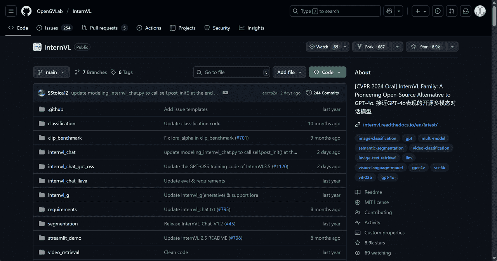

+   运行效果

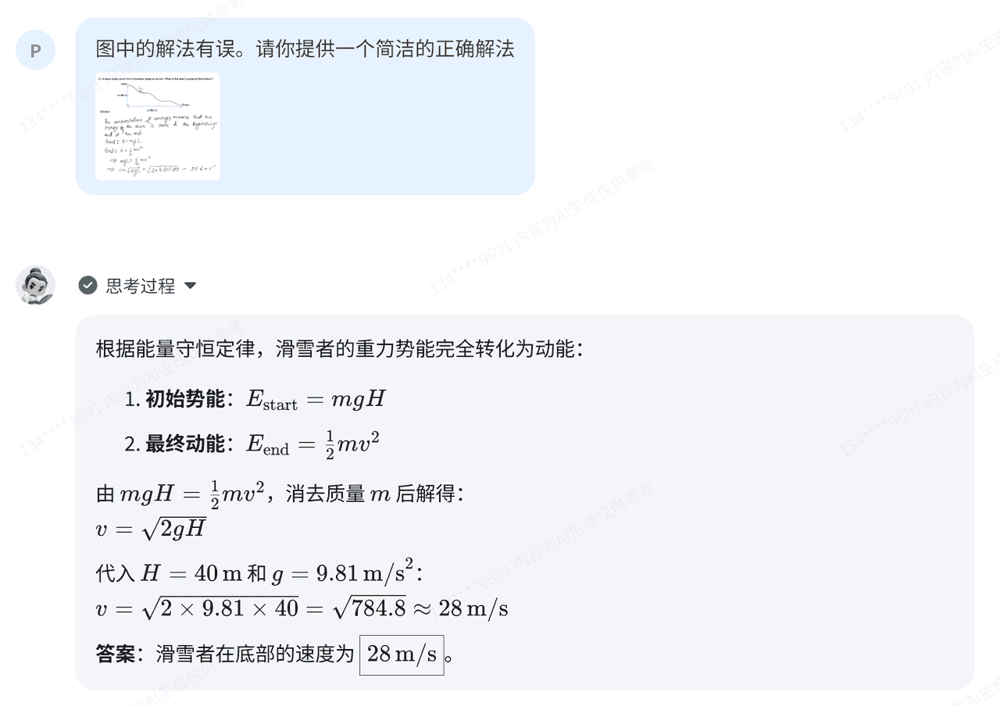

##### 3.2.2 `Qwen3-VL`

`Qwen3-VL` 是 阿里巴巴达摩院 在 2025 年推出的最新一代视觉语言模型，是 `Qwen2.5-VL` 的升级版。其参数规模从 3B、7B 到 72B，覆盖轻量部署与高性能需求，具备目标检测、图表理解、视频解析等全面能力。`Qwen3-VL` 在 跨语言文档解析、长视频理解 上有增强优化，并延续了 `Qwen` 系列在企业级开源社区中的强大影响力。

+   优势：参数规模覆盖广，性能与成本可灵活平衡；对文档/图表解析能力突出。
+   局限：大尺寸模型需要高端 `GPU`，推理延迟较大。
+   适用场景：企业文档检索、长视频内容解析、多语言跨模态问答。
+   `Qwen2.5`模型开源地址：`https://github.com/QwenLM/Qwen3-VL`

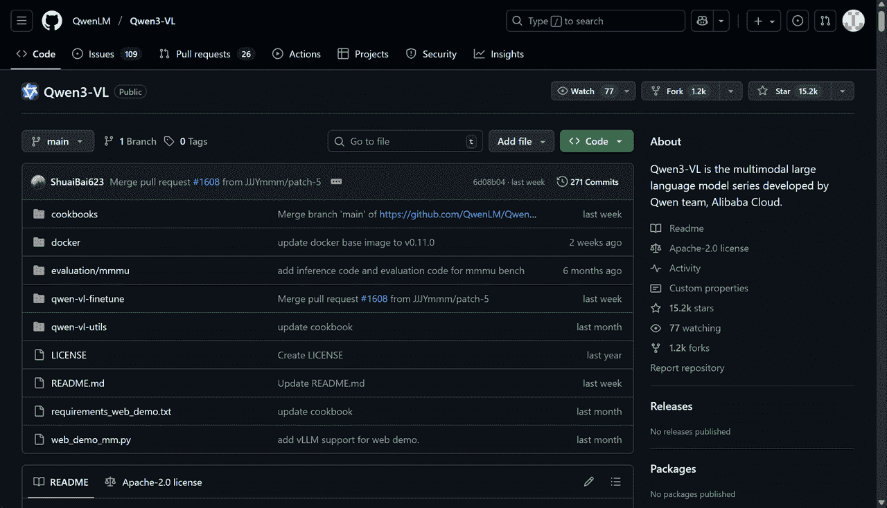

##### 3.2.3 `SmolVLM`

`SmolVLM` 由 Hugging Face 社区在 2024 年末发起，是一类 轻量级 `Vision-Language Model`，参数规模通常在 1B–2B 左右，主打 低算力环境可运行。与大型 `VLM` 相比，`SmolVLM` 的目标不是追求极致性能，而是通过紧凑模型结构，在笔记本或中低端 `GPU` 上也能实现图文问答、图像 caption 等多模态任务。

+   优势：模型小巧，部署门槛低；训练与调用成本显著低于大型 `VLM`。
+   局限：在复杂表格解析、多步推理上的表现明显落后于大模型；在专业场景（科研、法律文档）效果有限。
+   适用场景：教学实验、个人项目、边缘设备上的轻量多模态应用
+   项目地址：`https://github.com/huggingface/smollm`

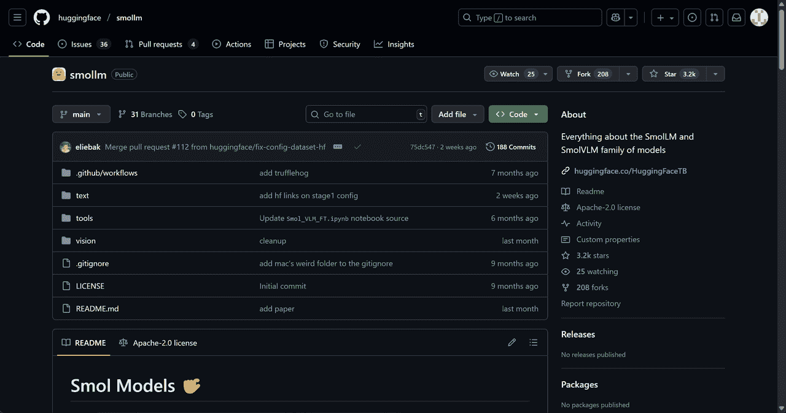

+   运行效果

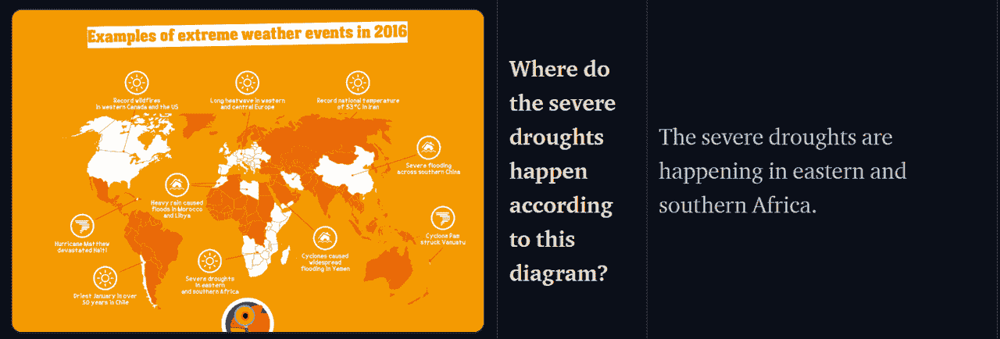

##### 3.2.4 `Gemma 3`

`Gemma 3` 是 Google DeepMind 在 2025 年开源的最新多模态模型，提供 4B、12B、27B 三个参数规模，支持文本与图像输入。`Gemma 3` 延续了 `Gemma` 系列开源、透明、注重轻量化的设计理念，并针对 图像问答、图表解析 等任务做了优化。它兼顾了学术研究的可复现性与企业应用的可落地性，尤其在中小规模下提供了性能与算力需求的良好平衡。

+   优势：覆盖轻量到中型参数规模，支持多模态输入；Google 官方维护，生态完善。
+   局限：相比更大规模的 `VLM`（如 `GPT-5`、`InternVL 40B`），在复杂推理和长文档解析上能力有限。
+   适用场景：科研探索、企业试点项目、对成本敏感的多模态应用。
+   模型地址：`https://huggingface.co/google/gemma-3-4b-it`


各类VLM模型对比如下

| 模型 | 发布团队 | 参数规模 | 类型 | 核心特点 | 优势 | 局限 | 适用场景 |
| --- | --- | --- | --- | --- | --- | --- | --- |
| `GPT-5` | OpenAI | 百亿+ | 在线 `API` | 原生多模态（文本/图像/音频），`API` 生态完善 | 功能最全，推理强，生态成熟 | 成本高，需考虑隐私合规 | 高阶语义推理，企业级 `RAG`，代理任务 |
| `Gemini 2.5` | Google DeepMind | 数百亿 | 在线 `API` | 长上下文（百万级），文本/图像/音频/视频融合 | 与搜索/Workspace 深度整合，多模态能力强 | 部署受地区/合规限制 | 长文档检索，复杂企业场景 |
| `Claude 4.5` | Anthropic | 百亿+ | 在线 `API` | 多步推理与代理式任务突出 | 长程任务表现好，企业接入灵活 | 成本与速率受限，图像能力因版本而异 | 工程/科研多步任务，企业合规环境 |
| `InternVL 3.5` | 上海人工智能实验室 | 8B–40B | 开源 | `Cascade RL` 增强推理，图表/跨模态理解 | 推理强，科研友好，社区活跃 | 大模型需高端 `GPU` | 科研论文解析，图表问答 |
| `Qwen3-VL` | 阿里巴巴达摩院 | 4B/8B/ 30B/235B | 开源 | 文档解析、目标定位、长视频理解 | 尺寸覆盖广，性能灵活 | 大尺寸算力要求高 | 企业文档、多语言跨模态应用 |
| `SmolVLM` | Hugging Face 社区 | 1B–2B | 开源 | 轻量 `VLM`，低算力可运行 | 部署门槛低，适合个人/教育 | 复杂任务效果弱 | 教学、轻量个人项目 |
| `Gemma 3` | Google DeepMind | 4B/12B/27B | 开源 | 轻量到中型参数，图像问答/图表解析 | 成本低，生态完整 | 性能弱于超大模型 | 成本敏感型企业/科研试点 |

#### 3.3 主流OCR 2.0模型介绍


不过需要注意的是，VLM模型是更加通用的视觉识别模型，而为了更好的完成OCR的工作，又进一步诞生了基于VLM模型进行微调后得到的专业的OCR 2.0模型。相比通用的VLM模型，这些OCR 2.0模型能够更好的完成图像实体识别、PDF版面分割、图片信息提取后的结构化输出、PDF到MarkDown的一键转化工作等等。其中主流的模型如下。

### 3.2.1 MinerU：高精度 PDF 转 Markdown 的一体化工具

MinerU 由 阿里巴巴达摩院与 OpenDataLab 社区联合开源，是当前性能最突出的 PDF → Markdown 转换工具之一。它集成了 OCR 模型、版面解析与结构化抽取，能够处理学术论文、扫描件和复杂排版文档。MinerU 特别在 公式、表格、图片引用 等细节保留上表现优异，使得输出的 Markdown 更加接近原始文档语义。

+ **优势**：输出结构清晰、对数学公式/表格解析精度高；社区活跃、`CLI` 使用方便。

+ **局限**：使用 **AGPL-3.0** 许可证，对闭源商用有限制；在极端复杂排版场景仍可能需要人工后处理。

+ **适用场景**：科研 PDF 批量解析、技术文档转换、构建高质量 RAG 知识库的前置步骤。

+ 项目地址：https://github.com/opendatalab/MinerU

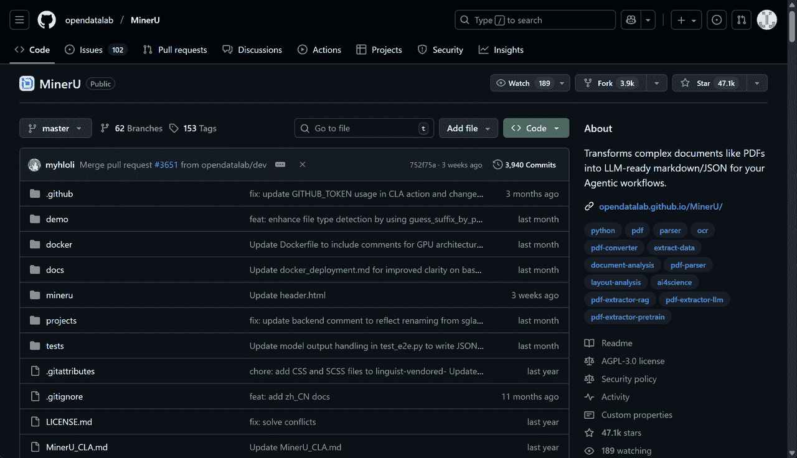

+ 使用效果

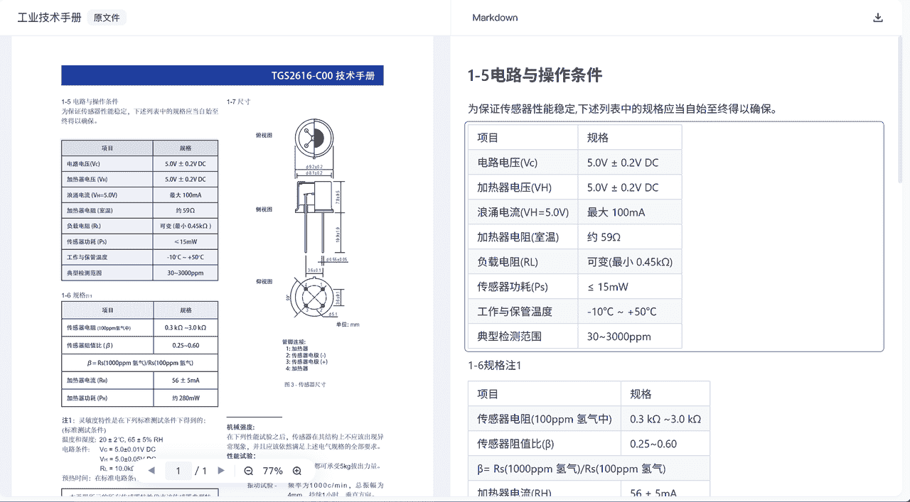

需要注意的是，最新版MinerU 2.5已发布，这是一个基于Qwen 2.5-VL模型进行修改和微调后的1.2B参数模型。

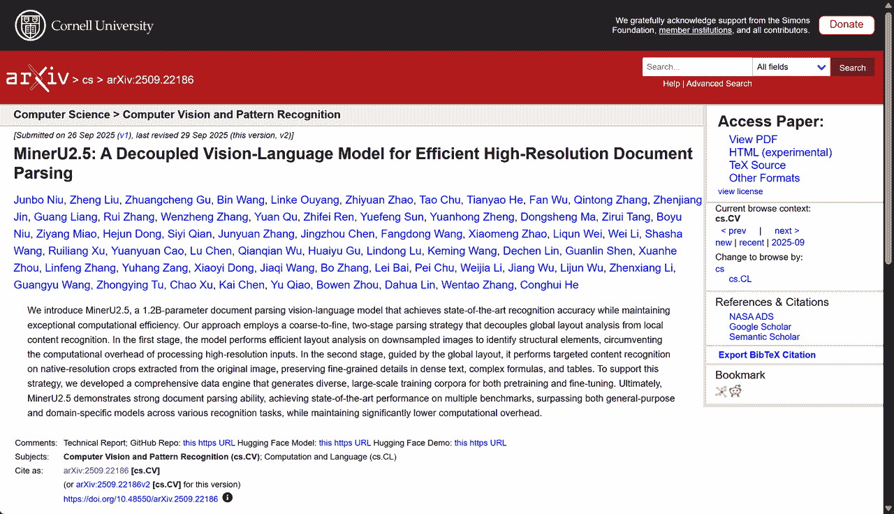

### 3.2.2 dots.ocr

dots.ocr是📕近期发布的OCR大模型。不同于传统 OCR 工具链依赖「检测 → 识别 → 版面重构」的多阶段流水线，dots.ocr 采用了统一的 Vision-Language Transformer 架构，将版面检测、文字识别和结构解析融为一体。这种设计极大减少了模块之间的对齐误差，使得模型在多语种文档、复杂版面和表格场景中表现出色。凭借仅 1.7B 的参数规模，dots.ocr 兼顾了轻量与高精度，被视为在“端到端文档解析”方向的重要突破。它的出现不仅推动了 OCR 技术向一体化演进，也为构建更高效的多模态 RAG 系统提供了新的底层支撑。

+ **优势**：单模架构减少流水线对齐误差；在多语言与复杂版面上表现突出；易用的 prompt 化任务切换（布局/表格/文本）。

+ **局限**：社区反馈在少数复杂表格（合并单元格）场景仍需微调或后处理。

+ **适用**：论文/报告、票据类文档的端到端解析；希望降低多模型编排成本的团队。

+ 项目地址：https://github.com/rednote-hilab/dots.ocr

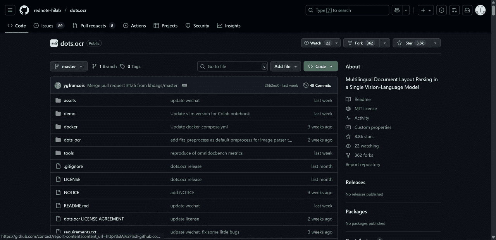

+ 运行效果

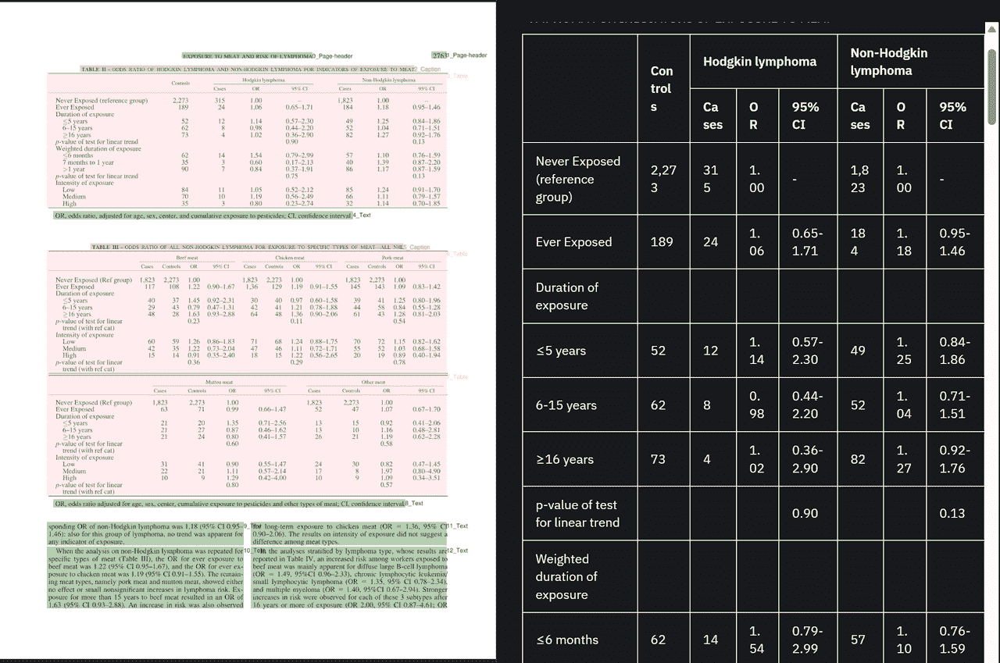

### 3.2.3 olmOCR（Allen AI）

在轻量 OCR 工具中，olmOCR 的特色在于对复杂 PDF 与扫描文档进行“线性化还原”。它由 Allen Institute for AI (AI2) 团队于 2024 年开源，核心目标是最大限度地保持文档阅读顺序的完整性，同时兼顾表格、公式以及手写体等特殊内容的识别。olmOCR 的模型规模属于中小尺寸，总共7B参数（基于Qwen2-VL-7B-Instruct微调后得到），可以在常规 GPU 环境甚至部分 CPU 配置下运行，适合科研与生产场景的快速部署。与传统 OCR 偏重“字符识别”不同，olmOCR 更强调文档的整体可读性与内容一致性，因此在大规模 PDF 转文本的批处理场景下表现突出，是学术界和产业界逐渐关注的高保真 OCR 工具。

+ **优势**：对复杂排版的读序恢复能力强；手写体/公式覆盖；开箱即用。

+ **局限**：定位于“文本线性化”，对图像语义本身不做高级理解（需上层 VLM）。

+ **适用**：海量 PDF 到可检索文本的高质量批处理；RAG 预处理。

+ 项目地址：https://github.com/allenai/olmocr

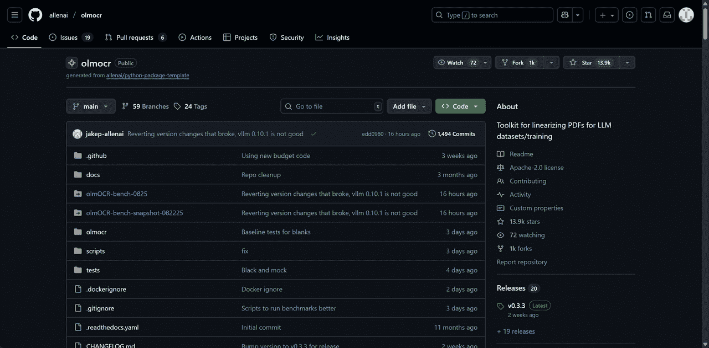

+ 运行效果

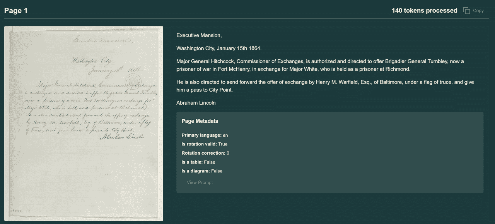

## 4. 最强OCR 2.0模型：DeepSeek-OCR与PaddleOCR-VL

尽管VLM类OCR模型带来了巨大的能力提升，但现实问题也随之而来。主要问题有二，其一是通用VLM模型很难胜任需要结构化输出的多模态PDF信息提取任务，其二则是在很多高精度场景要求下，往往需要更大尺寸的VLM才能完成，但同时就会带来部署困难、难以落地等问题。

而最近推出的`DeepSeek-OCR`与`PaddleOCR-VL`，则很好的解决了效率和精度的平衡性的问题。其中最新版的`PaddleOCR`将通用文字识别（`OCR 1.0`）和通用文档解析（`2.0`）正式划分为两个不同的模块，

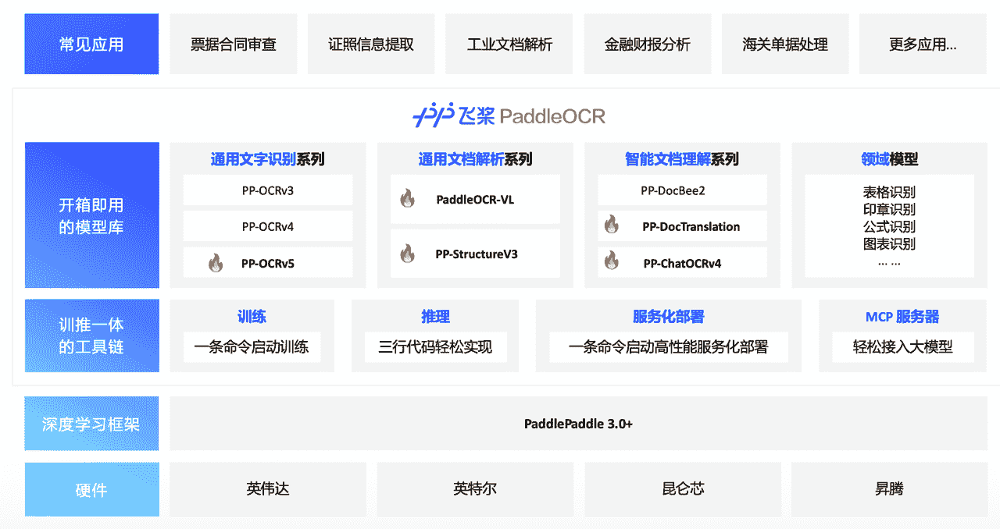

而`DeepSeek-OCR`则凭借极强的技术创新力，开创性的提出了“上下文光学压缩”方法，并原创提出`DeepEncoder`（DeepSeek视觉编码器，现已开源），从而能够更好的兼顾各类OCR任务的效果和效率。

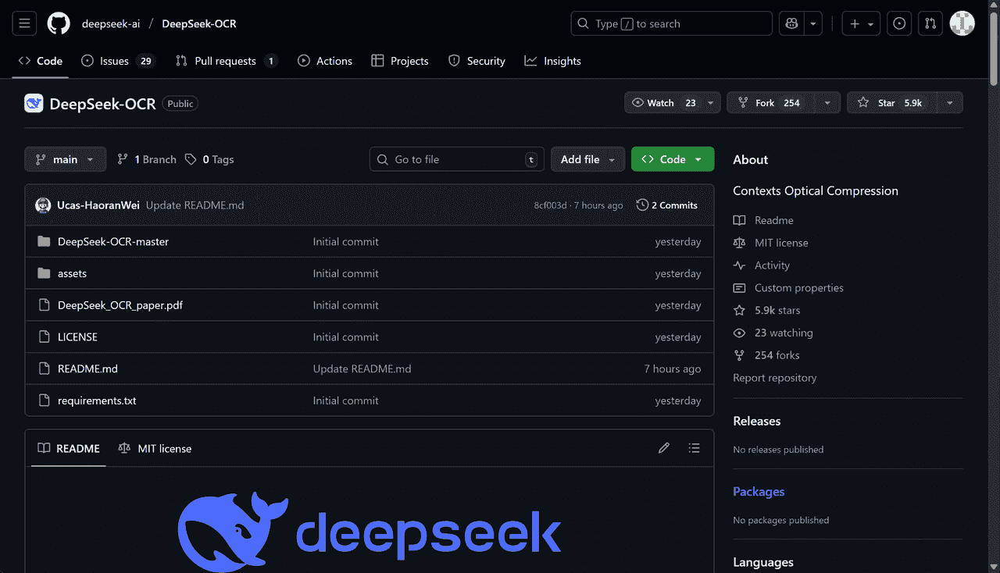

### 4.1 最新PaddleOCR模型介绍

`PaddleOCR` 是百度飞桨团队开源的多语种 OCR/文档解析套件，围绕“检测—识别—版面/结构化解析—部署”提供一体化能力。`3.x` 系列重点引入了三大方案：用于多语种场景文本识别的 `PP-OCRv5`、用于层级化文档解析的 `PP-StructureV3`，以及面向关键信息抽取的 `PP-ChatOCRv4`；官方文档与技术报告明确将 `PaddleOCR` 定位为开源的端到端文档理解基础设施，覆盖训练、推理与服务化部署的完整工具链，便于快速落地生产级应用。

+ GitHub项目主页：https://github.com/PaddlePaddle/PaddleOCR

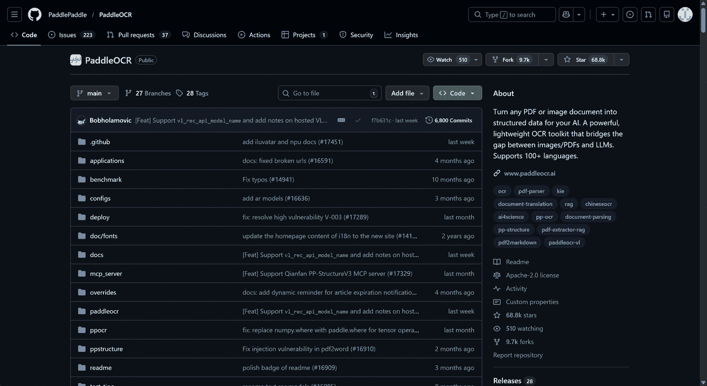

在最新进展上，`PaddleOCR` 于 2025-10-16 发布 v3.3.0，并同步推出 `PaddleOCR-VL`：一款约 0.9B 参数、资源友好的视觉—语言模型（VLM），主攻多语种文档解析，采用 `NaViT` 风格的动态分辨率视觉编码器并与 `ERNIE-4.5-0.3B` 语言模型耦合，强调在公式、表格、多栏版式等复杂元素上的准确识别与结构化输出；与此同时，`3.2.0` 版本（2025-08-21）对 `PP-OCRv5` 英文/泰文/希腊文识别模型做了加强，并提供更完善的部署支持。整体上，`PaddleOCR` 在 106+ 语言的识别覆盖、复杂版面解析与端到端部署便捷性方面持续演进。

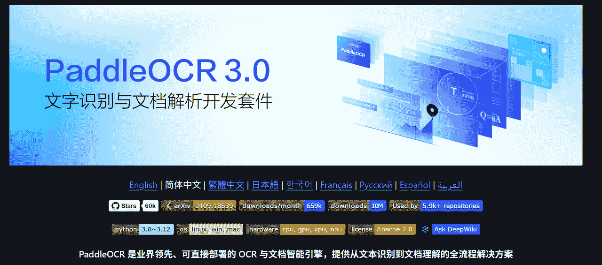

对一线开发者而言，`PaddleOCR` 的上手路径清晰：既可直接使用预训练模型做推理，也可在真实/合成数据上继续训练，并通过官方文档的快速开始与升级指引完成从本地到服务化的全流程；同时，生态侧还提供了与日志/实验管理平台的集成，便于在训练与评测阶段记录指标与模型检查点，提升工程效率与可复现性。总体来看，它既是“多语种高精度 OCR 算法库”，也是“文档解析生产框架”，兼顾学术前沿与工业落地。

### 4.2 DeepSeek-OCR-2模型介绍

`DeepSeek-OCR-2`是面向多模态文档理解与检索而生的 OCR 2.0/VLM 模型：它不仅识别文字，更“读懂”文档。典型能力包括：将多页 `PDF` 一键转换为结构化 `Markdown`，高保真解析 表格/公式，理解并描述 图表/示意图/照片 的语义；同时支持区域定位与版面要素标注（如利用 ``、`<|grounding|>`、`<|ref|>`…`<|/ref|>` 等提示语法）。在多模态 RAG 场景中，`DeepSeek-OCR` 既是“视觉入口”，也是“结构化输出器”，直接产出可索引、可检索、可复用的文本与结构数据。

+ GitHub项目地址：https://github.com/deepseek-ai/DeepSeek-OCR-2


`DeepSeek-OCR-2` 是 `DeepSeek` 团队在视觉语言模型（VLM）领域的一次架构范式转移，其核心突破在于将视觉编码器“语言模型化”，从而赋予了模型像人类一样基于语义逻辑“阅读”图片的能力，彻底告别了传统模型机械式的光栅扫描逻辑。

该模型并未简单地堆砌参数，而是创造性地提出了 `DeepEncoder V2` 架构，它使用一个轻量级的语言模型（基于 `Qwen2-0.5B` 改造）来替代传统的 `CLIP` 视觉编码器。这一改变使得编码器不仅能通过双向注意力机制保持对图像的全局感知，更能引入“视觉因果流 (`Visual Causal Flow)`”机制。通过引入一组可学习的“因果查询 `Token` (`Causal Flow Queries)`”，模型能够根据文档内容的内在逻辑（如多栏排版、表格结构或几何图形的绘制顺序）动态地对视觉信息进行重排序 (`Reordering)` 和语义蒸馏，而非死板地按从左到右、从上到下的坐标顺序处理。

在性能与效率方面，`DeepSeek-OCR-2` 延续了第一代模型的高效基因。它保留了 `DeepSeek-MoE 3B` 解码器（激活参数仅约 500M），并配合 16 倍压缩的 `Tokenizer`，将每张图片的视觉 `Token` 预算极致地控制在 256 到 1120 个之间（与 `Gemini-3 Pro` 相当），极大地节省了计算开销。这种设计不仅使其在 `OmniDocBench` v1.5 基准测试中取得了 91.09% 的高分（较前代提升 3.73%），更在最考验逻辑能力的“阅读顺序编辑距离”指标上实现了大幅优化（从 0.085 降至 0.057）。此外，这种基于逻辑的阅读方式显著提升了模型的稳定性，在生产环境中大幅降低了“复读机”式的重复生成现象。

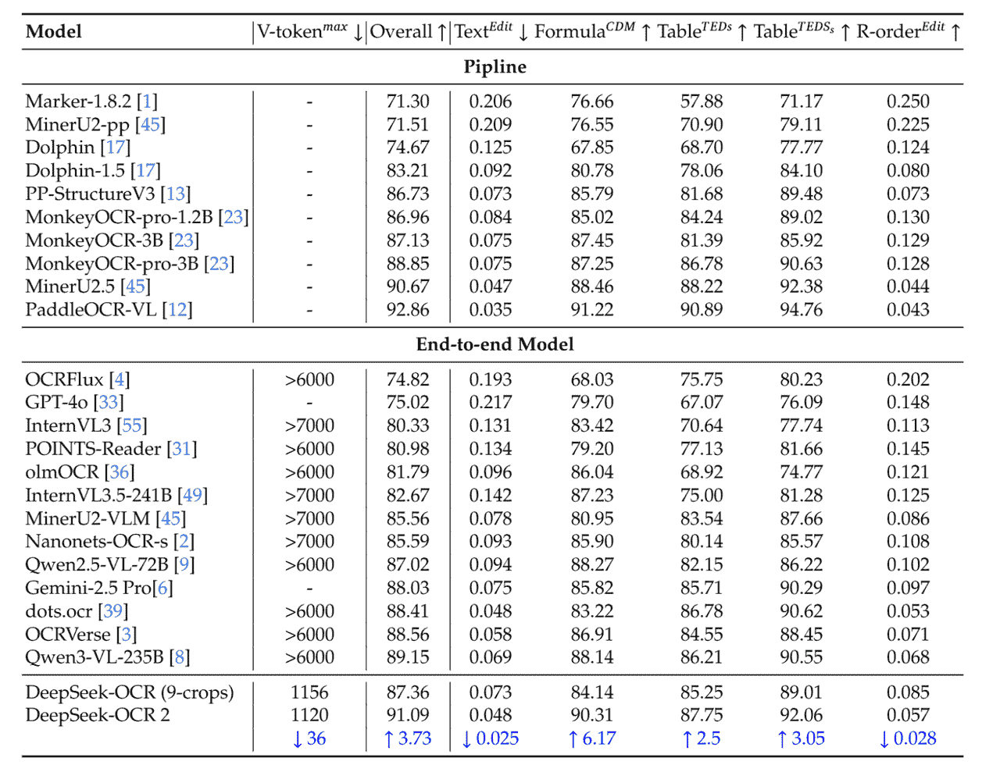

总而言之，`DeepSeek-OCR-2` 展示了一种通往“原生多模态”和“真二位推理 (`Genuine 2D Reasoning)`”的全新路径：它证明了通过两级因果推理结构（`Encoder` 整理逻辑顺序 + `Decoder` 生成文本），可以让模型在极低的算力成本下，精准理解复杂的视觉世界

## 三、DeepSeek-OCR模型功能介绍与快速上手

### 1. DeepSeek-OCR系列模型介绍

2026年1月27日，DeepSeek正式开源`DeepSeek-OCR-2`模型，并同步发布发布相关运行脚本、测试代码、`DeepEncoder2`源码以及技术报告等全套资料。

在技术实践层面，它是目前开源社区中少数具备端到端文档解析、语义理解与结构化生成能力的轻量级多模态模型，参数量仅约 3.6B，却能在 `A100` 单卡上实现高达 2500 `tokens/s` 的推理速度，极大降低了企业和研究者在多模态 `RAG` 系统中的部署门槛。

总的来说，作为 `OCR 2.0` 时代的典型代表模型，`DeepSeek-OCR` 不仅继承了传统OCR的文本识别能力，更在“文档理解”层面进行了全方位升级。它融合了视觉语言模型（VLM）的多模态感知能力，能够同时“看懂文字”“理解布局”“分析图表”，真正实现了从“看见文字”到“理解内容”的跨越。具体而言，`DeepSeek-OCR` 模型可实现以下几大核心功能：

+ **OCR纯文字提取：**

支持对任意图像进行自由式文字识别（`Free OCR`），快速提取图片中的全部文本信息，不依赖版面结构，适合截图、票据、合同片段等轻量场景的快速文本获取。

+ **保留版面格式的OCR提取：**

模型可自动识别并重建文档中的排版结构，包括段落、标题、页眉页脚、列表与多栏布局，实现“结构化文字输出”。此功能可直接将扫描文档还原为可编辑的排版文本，方便二次编辑与归档。

+ **图表 & 表格解析：**

`DeepSeek-OCR` 不仅识别文本，还能解析图像中的结构化信息，如表格、流程图、建筑平面图等，自动识别单元格边界、字段对齐关系及数据对应结构，支持生成可机读的表格或文本描述。

+ **图片信息描述：**

借助其多模态理解能力，模型能够对整张图片进行语义级分析与详细描述，生成自然语言总结，适用于视觉报告生成、科研论文图像理解以及复杂视觉场景说明。

+ **指定元素位置锁定：**

支持通过“视觉定位”（`Grounding`）功能，在图像中准确定位特定目标元素。例如，输入“Locate signature in the image”，模型即可返回签名区域的坐标，实现基于语义的图像检索与目标检测。

+ **Markdown文档转化：**

可将完整的文档图像直接转换为结构化 `Markdown` 文本，自动识别标题层级、段落结构、表格与列表格式，是实现文档数字化、知识库构建和多模态`RAG`场景的重要基础模块。

+ 目标检测（`Object Detection`）

在多模态扩展任务中，`DeepSeek-OCR` 还能够识别并定位图片中的多个物体。通过输入如下提示词，模型会为每个目标生成带标签的边界框（`bounding boxes`），从而实现精准的视觉识别与标注。

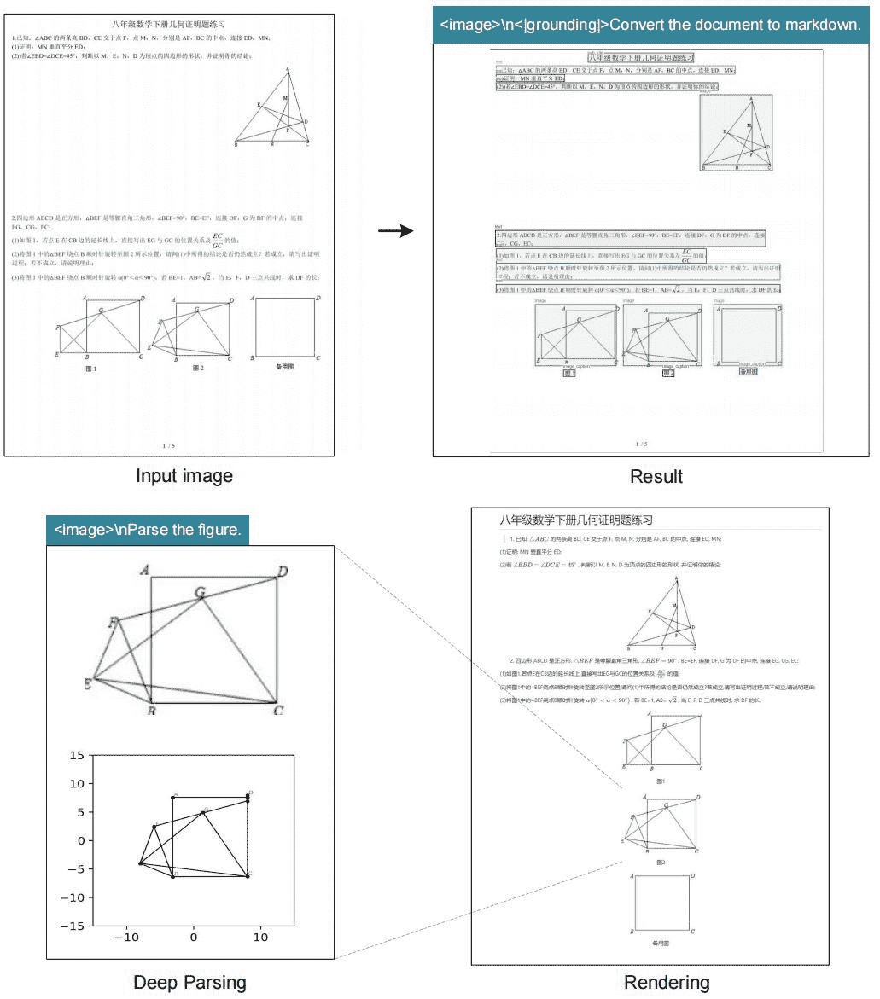

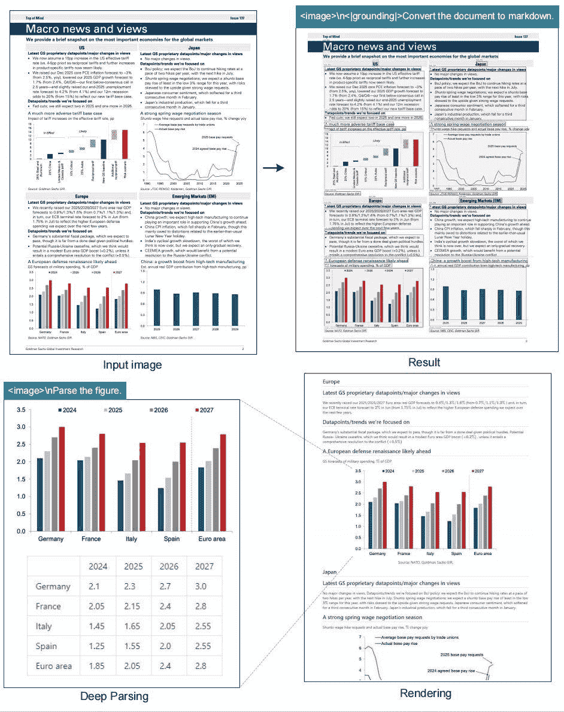

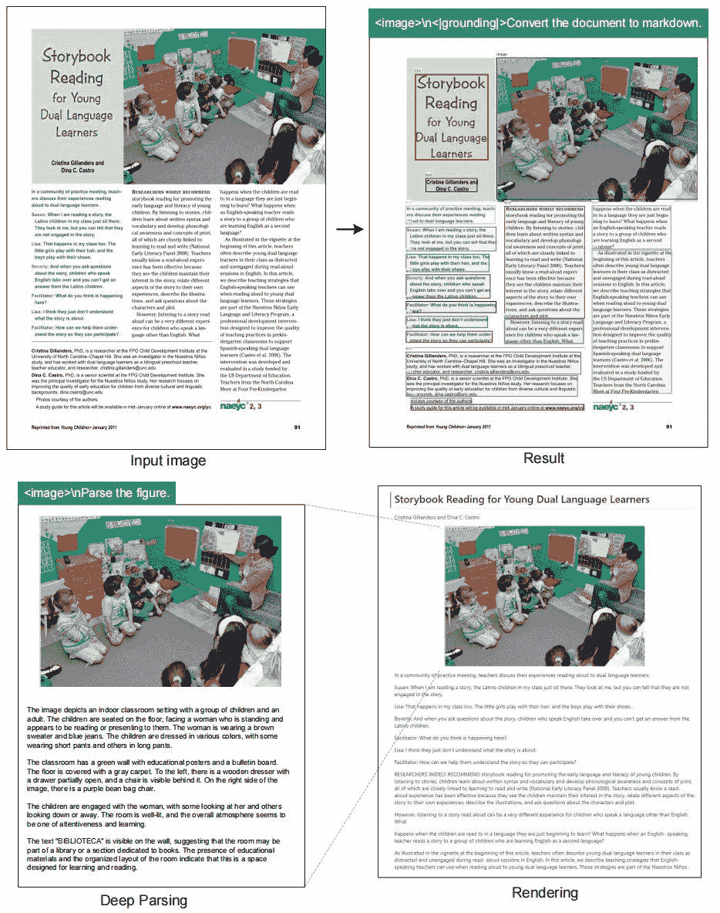

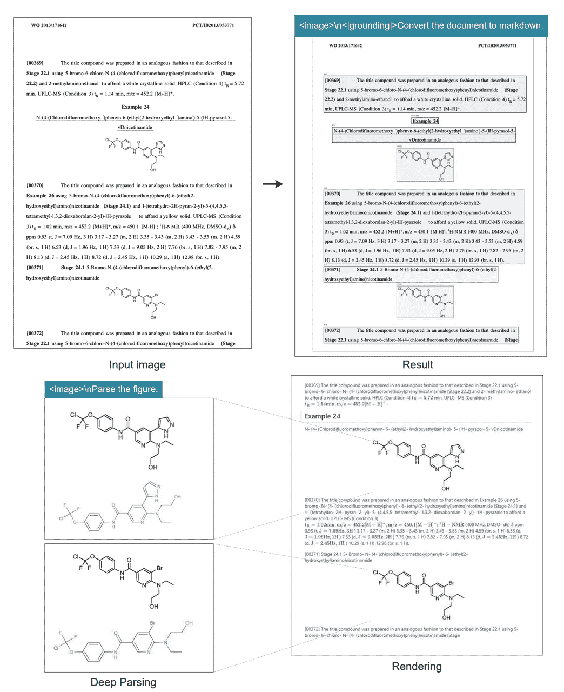

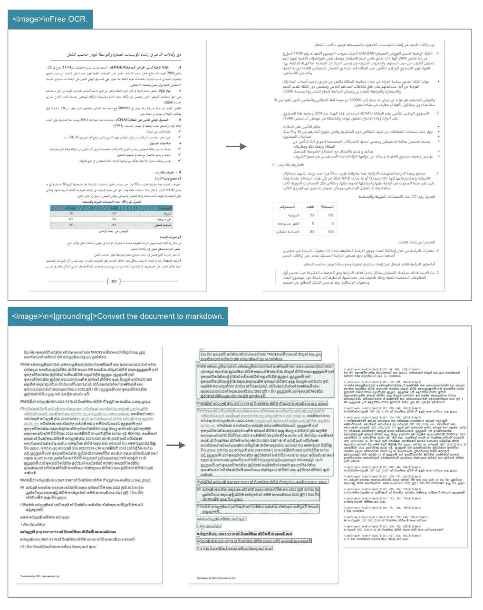


### 2. DeepSeek-OCR 2代模型VS 1代模型

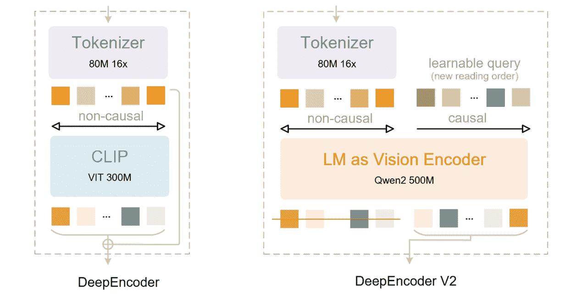

`DeepSeek-OCR-2` 的出现，标志着 OCR 从单纯的“像素搬运”进化到了“语义重构”时代。它不仅继承了 `V1` 恐怖的压缩能力，更赋予了模型一种“带着逻辑看世界”的能力。

#### 2.1 16倍物理压缩（Vision Tokenizer）：极致的显存利器

这是继承自 `V1` 的优良基因，也是 `DeepSeek` 能够实现超快推理的基础。

+ **物理机制**：通过卷积 `Tokenizer` 将原始图像的视觉 `Token` 数量直接物理压缩 16 倍。

+ **硬核数据**：一张高分图像，最终仅需 256 个 `Token` 即可表达。

+ **用户价值**：对于开发者来说，这意味着极低的显存占用和极高的吞吐量。

#### 2.2 视觉因果流（Visual Causal Flow）：重塑阅读逻辑

这是 `V2` 最具革命性的进化。它解决了传统 OCR 模型在复杂版面（如多栏文档、乱序表格）容易“跳行、串行”的痛点。

+ **`DeepEncoder V2`**：不再是机械地按网格扫描，而是引入了因果注意力机制（`Causal Attention`）。

+ **语义感知**：模型像人类一样，先识别出内容的逻辑关联，再决定“先看哪，后看哪”。它确保了视觉流的顺序与文档的真实阅读逻辑完全对齐。

#### 2.3 视觉知识压缩（Visual Knowledge Compression）：从 `Token` 到“知识块”

这就是所谓的“质量蒸馏”过程，也是 `V2` 的精华所在。

+ 等量蒸馏（Distilling）：`DeepEncoder V2` 在处理时并不减少 `Token` 的物理数量（Maintaining equal cardinality），而是对每个 `Token` 的信息密度进行升级。

+ 特征重排序（Reordering）：利用 `Learnable Queries`（可学习查询），将凌乱的视觉特征按照语义逻辑进行重组。

+ **本质区别**：

+ **`V1`（光学压缩）**：追求的是“把图片塞进更小的包里”。

+ **`V2`（知识压缩）**：追求的是“在包的大小不变时，让包里的信息更有序、更有营养”。

#### 2.4 全场景深度解析：结构化输出的“天花板”

得益于上述的“知识蒸馏”，`OCR-2` 在将非结构化图像转为结构化数据方面表现惊人：

+ **`Markdown` 生成**：对复杂表格、公式（`LaTeX`）的还原几乎达到出版级精度。

+ **多语种支持**：中英混合、手写体、印刷体一网打尽。

+ **高性能表现**：在 `OmniDocBench` v1.5 榜单中以 91.09% 的高分领跑，尤其在长文本的识别重复率上大幅下降 30% 以上。

#### 2.5 更加直观的性能对比

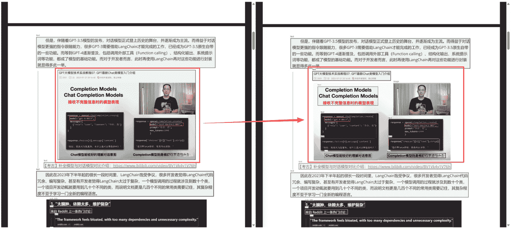

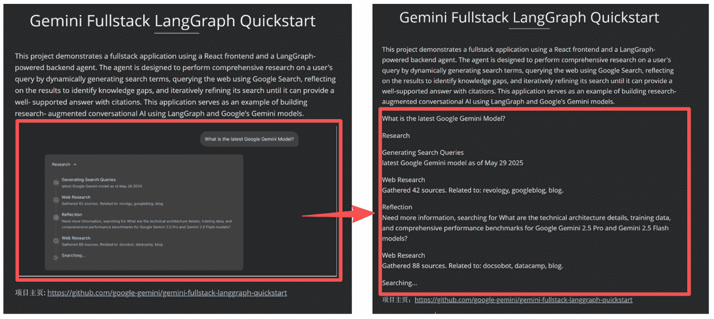

+ 【权重】魔搭社区`DeepSeek-OCR`模型权重下载地址：https://www.modelscope.cn/models/deepseek-ai/DeepSeek-OCR-2

+ 【权重】`HuggingFace` `DeepSeek-OCR`模型权重下载地址https://huggingface.co/deepseek-ai/DeepSeek-OCR-2


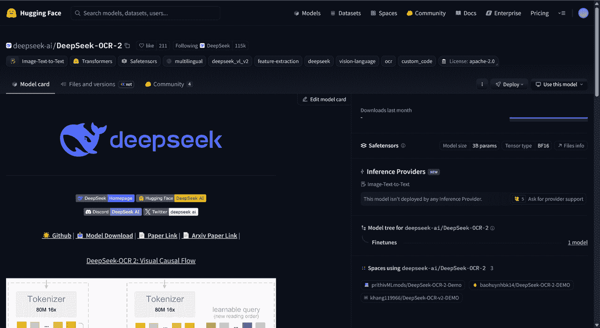

+   【脚本】GitHub DeepSeek-OCR-2模型项目主页：`https://github.com/deepseek-ai/DeepSeek-OCR-2`

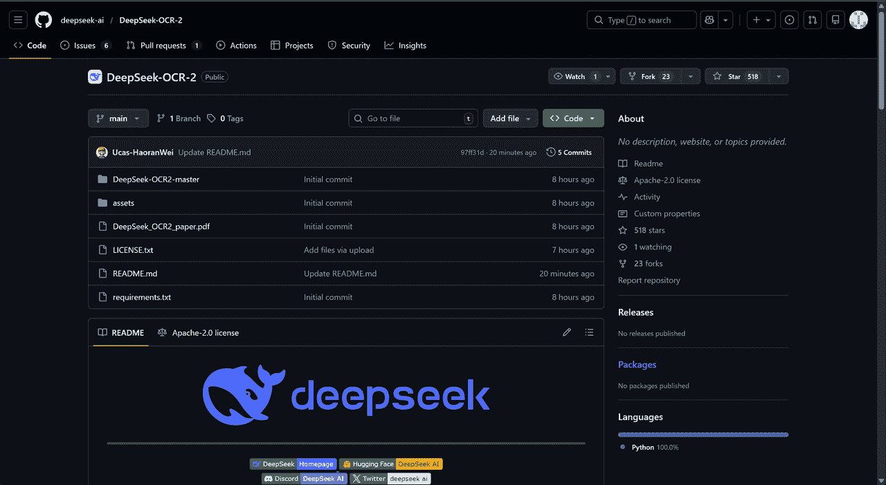

+   【论文】DeepSeek-OCR模型技术报告：`https://github.com/deepseek-ai/DeepSeek-OCR-2/blob/main/DeepSeek_OCR2_paper.pdf`

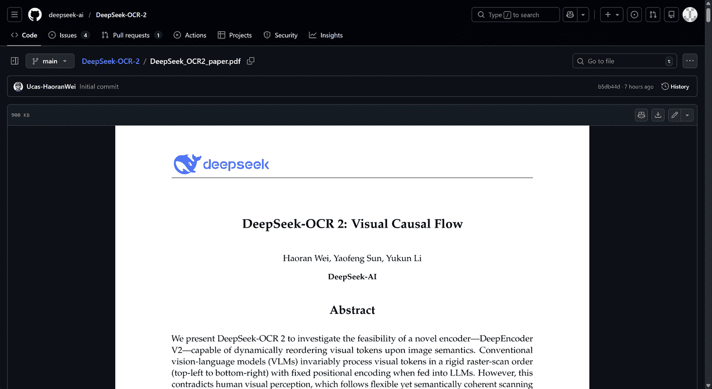

## 2. DeepSeek-OCR本地部署与环境搭建

说明：DeepSeek-OCR 目前不提供在线 API，需本地推理。单卡≥7 GB 显存可运行；NVIDIA 50 系（如 RTX 5090）暂不适配 `vLLM`（主要是当前 `PyTorch`/`vLLM` 对 `sm_120` 架构支持不完善）。DeepSeek-OCR支持两条推理路径：`vLLM`（高吞吐、流式友好）与 `HuggingFace Transformers`（依赖少、兼容面广）。

### 2.1 模型权重下载

可从 `Hugging Face` 或 魔搭社区（`ModelScope`）获取。以下以 `ModelScope` 为例：

```
pip install modelscope
mkdir ./deepseek-ocr
modelscope download --model deepseek-ai/DeepSeek-OCR-2 --local_dir ./deepseek-ocr-2
```

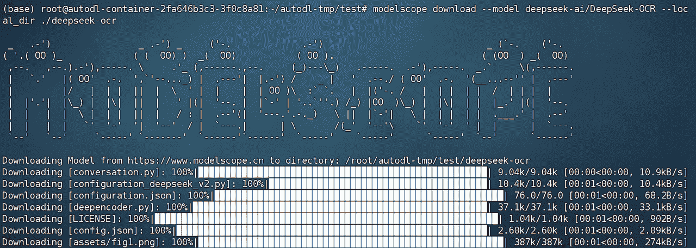

下载完成后完整的项目文件如图所示：

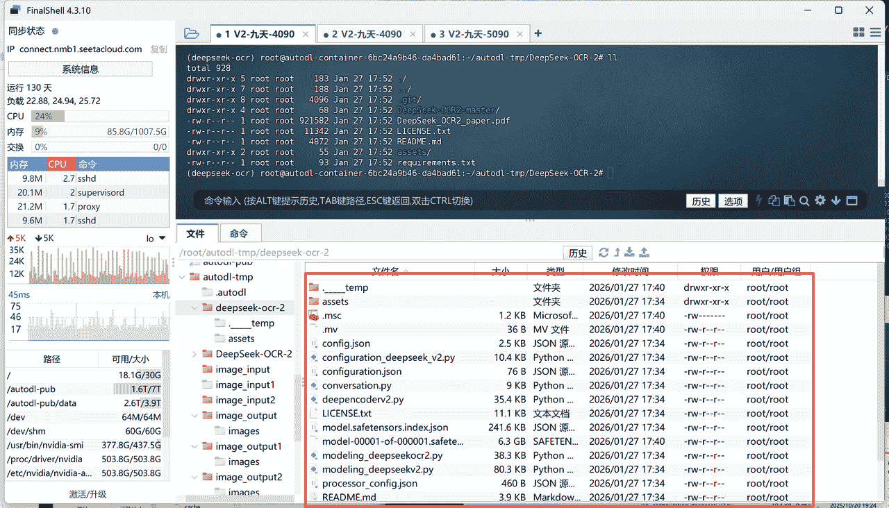

也可以在课件网盘中进行下载。

链接: `https://pan.baidu.com/s/18sLP_z7EWYzBhtjAfoirdQ?pwd=ihg2` 提取码: `ihg2`

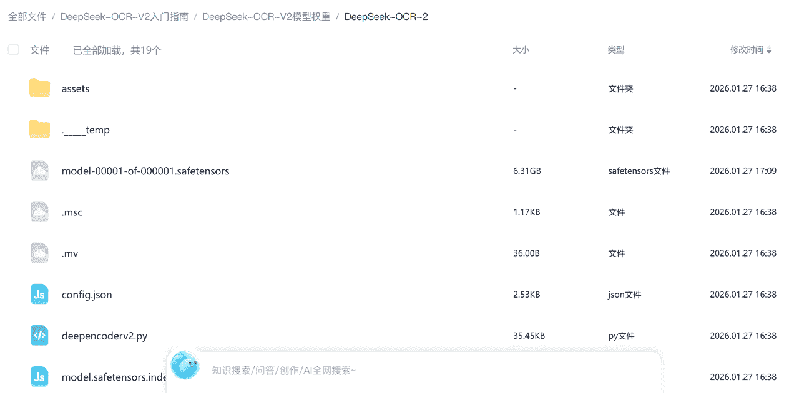


### 2.2 运行环境搭建

基础运行环境建议：

+   OS：Ubuntu 20.04+/22.04

+   Python：`3.10–3.12`（推荐 `3.10`/`3.11`）

+   CUDA：11.8 或 12.1/12.2（与显卡驱动匹配）

+   `PyTorch`：与 CUDA 匹配的预编译版本

+   GPU：≥7 GB（大图/多页 PDF 建议 16–24 GB）

下载GitHub项目包：

```
git clone https://github.com/deepseek-ai/DeepSeek-OCR-2.git
```

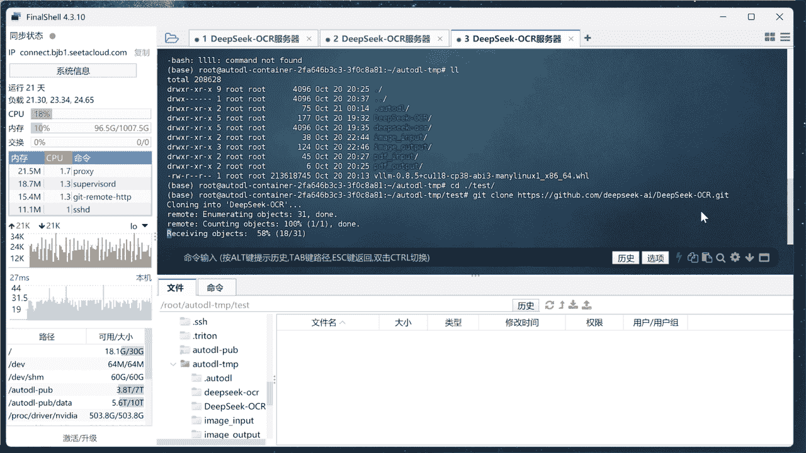


也可以直接在可见网盘中下载安装包，并上传解压

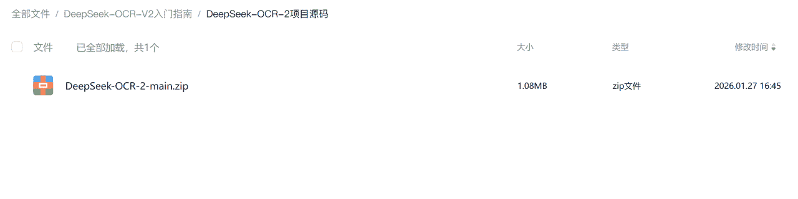

然后创建一个虚拟环境来安装模型运行的相关依赖，

```
conda create -n deepseek-ocr python=3.12.9 -y
conda activate deepseek-ocr
```

接下来继续安装Jupyter及响应的kernel：

```
conda install jupyterlab
conda install ipykernel
python -m ipykernel install --user --name dsocr --display-name "Python (dsocr)"
```

然后在虚拟环境中先安装pytorch相关组件：

```
pip install torch==2.6.0 torchvision==0.21.0 torchaudio==2.6.0 --index-url https://download.pytorch.org/whl/cu118
```

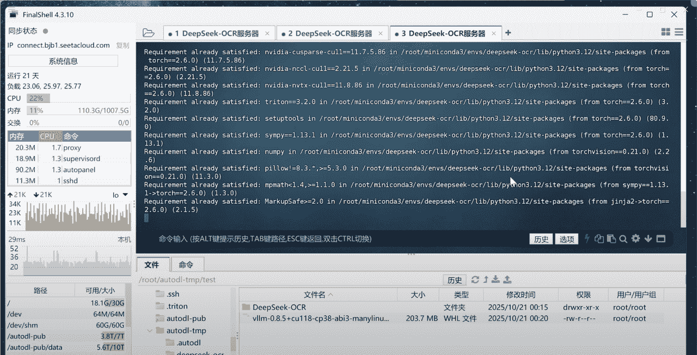

然后再安装`vLLM`，这是一个企业级高并发的大模型推理加速框架，同时也是DeepSeek-OCR官方推荐使用的框架。不过安装需要注意，由于基础依赖的不同，我们需要安装指定版本的`vLLM`才能运行DeepSeek-OCR模型。

这里我们需要在网盘中下载特定版本的`vLLM`预编译的二进制安装包：

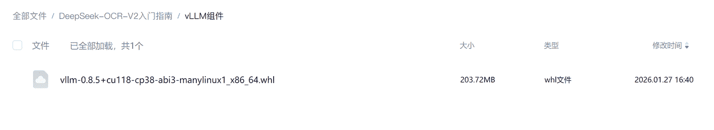

将其上传到服务器中，然后进入到对应文件夹中，输入`pip install`命令来进行安装。

```
pip install vllm-0.8.5+cu118-cp38-abi3-manylinux1_x86_64.whl
```

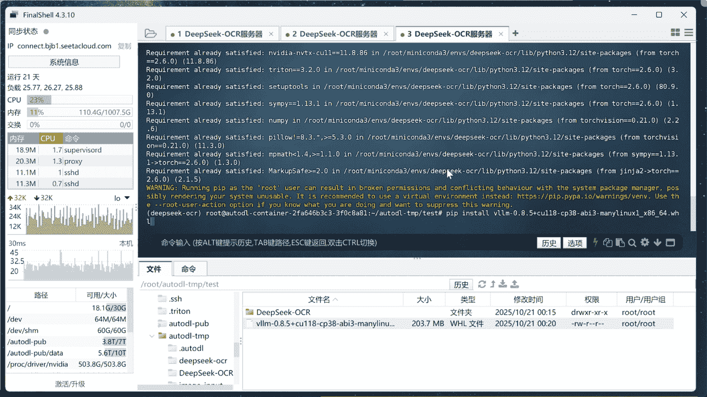

接下来让我们进入到GitHub项目主目录，输入`pip install`来安装项目基础依赖，

```
cd ./DeepSeek-OCR-2/
pip install -r requirements.txt
```

其中项目脚本的基础依赖包括：

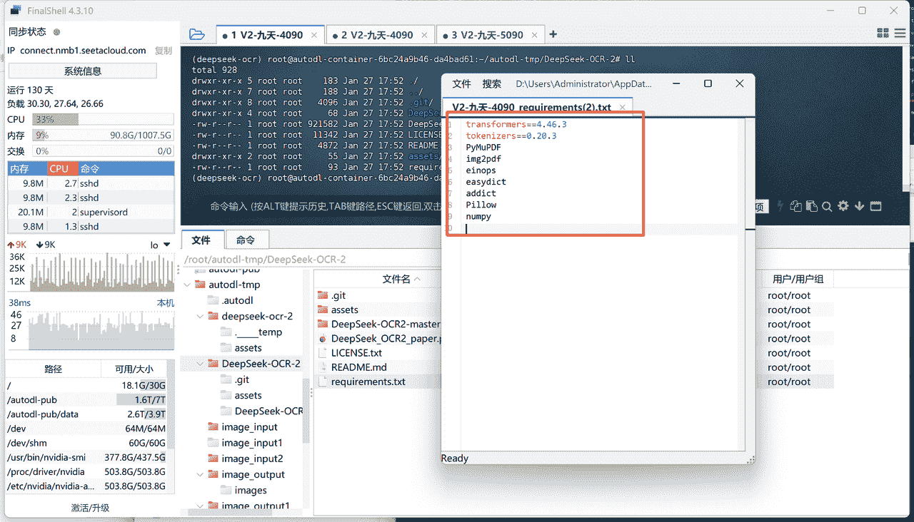

```
transformers==4.46.3
tokenizers==0.20.3
PyMuPDF
img2pdf
einops
easydict
addict 
Pillow
numpy
```

这些依赖的作用如下：

| 库名 | 主要功能说明 |

| --- | --- |

| `transformers==4.46.3` | `Hugging Face` 的核心库，用于加载、推理和微调 DeepSeek-OCR 模型（支持 `trust_remote_code=True` 的自定义架构）。 |

| `tokenizers==0.20.3` | 高性能分词器，配合 `transformers` 对文本进行编码/解码，确保多模态指令（如 `<image>`）。 |

| `PyMuPDF` | PDF 文件解析库（也叫 `fitz`），用于将 PDF 页面渲染为高分辨率图像，供 OCR 模型识别。 |

| `img2pdf` | 将图像序列（如逐页渲染的 PDF 页面）重新封装为 PDF 输出，用于生成带识别框或布局信息的结果文件。 |

| `einops` | 高维张量重排工具，方便在视觉特征映射与融合（如 `ViT` `token` 重组）中进行维度变换。 |

| `easydict` | 用于将配置项（如 `cfg.xxx`）以字典形式轻松访问，提升配置文件的可读性与灵活性。 |

| `addict` | 类似 `easydict` 的配置工具，支持更灵活的动态属性调用方式，用于管理模型与处理器参数。 |

| `Pillow` | 图像处理基础库（`PIL` 的现代版本），负责读取、转换、裁剪及保存图片。 |

| `numpy` | 数值计算与数组操作基础库，支持图像像素矩阵运算、坐标映射及特征张量构建等底层操作。 |

需要注意的是，安装过程如果出现了如图所示的依赖冲突，无视即可，不会影响实际运行。

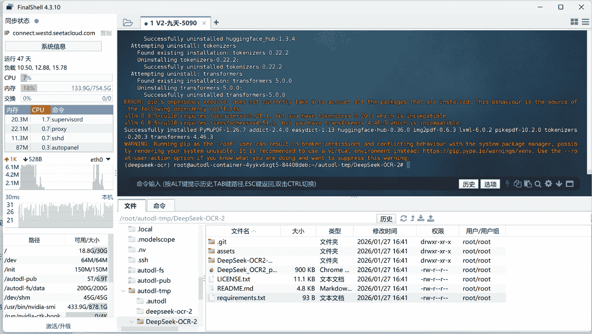

最后，还需要安装`flash-attn`加速库。

```
pip install flash-attn==2.7.3 --no-build-isolation
```

至此，基础环境搭建全部完成。

## 3. DeepSeek-OCR模型transformers调用流程

+   准备工作

+   创建4个文件夹，分别用于存储输入和输出的PDF、Images等文件。

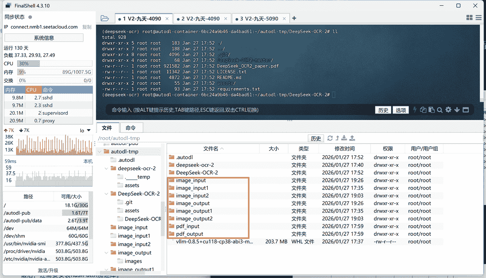

### 3.1 借助transformers库进行推理

+   上传CAD图纸

+   将一张房屋户型图上传至`image_input`文件夹中，便于之后进行识别。

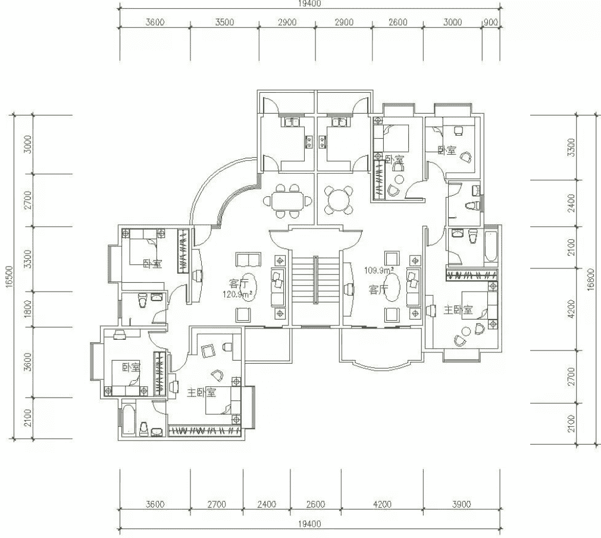


大家可以在网盘课件中领取：


然后打开Juptyer，选择对应的环境：


然后运行如下代码，借助`transformers`库进行模型调用，需要注意的是需要替换路径，包括输入输出文件路径和大模型权重的路径等，

```
from transformers import AutoModel, AutoTokenizer
import torch
import os
os.environ["CUDA_VISIBLE_DEVICES"] = '0'
model_name = 'deepseek-ai/DeepSeek-OCR'

tokenizer = AutoTokenizer.from_pretrained(model_name, trust_remote_code=True)
model = AutoModel.from_pretrained(model_name, _attn_implementation='flash_attention_2', trust_remote_code=True, use_safetensors=True)
model = model.eval().cuda().to(torch.bfloat16)

prompt = "<image>\nDescribe this image in detail."
image_file = '/root/autodl-tmp/image_input/测试图片.png' 
output_path = '/root/autodl-tmp/image_output'


res = model.infer(tokenizer, prompt=prompt, image_file=image_file, output_path = output_path, base_size = 1024, image_size = 640, crop_mode=True, save_results = True, test_compress = True)
```

代码解释如下：

1.  导入依赖与环境配置

```
from transformers import AutoModel, AutoTokenizer
import torch
import os
os.environ["CUDA_VISIBLE_DEVICES"] = '0'
```

+   `AutoTokenizer`：用于加载 DeepSeek-OCR 的自定义分词器（模型有自己的特殊 token，如 `<image>`、`<|grounding|>`）。

+   `AutoModel`：用于加载主模型（DeepSeek-OCR 内部定义了自己的架构，因此需要 `trust_remote_code=True`）。

+   `CUDA_VISIBLE_DEVICES='0'`：指定使用第 0 块 GPU（单卡推理）。

1.  加载模型与分词器

```
model_name = 'deepseek-ai/DeepSeek-OCR'

tokenizer = AutoTokenizer.from_pretrained(model_name, trust_remote_code=True)
model = AutoModel.from_pretrained(
    model_name, 
    _attn_implementation='flash_attention_2', 
    trust_remote_code=True, 
    use_safetensors=True
)
```

+   `model_name` 指定了模型来源（这里是 `Hugging Face` 上的 `deepseek-ai/DeepSeek-OCR`）。

+   `trust_remote_code=True` 表示允许加载自定义的 `Python` 类（DeepSeek 自定义了 `DeepseekOCRForCausalLM` 架构）。

+   `_attn_implementation='flash_attention_2'` 启用 Flash Attention 2，显著加快大规模自注意力运算速度并节省显存。

+   `use_safetensors=True` 启用更安全高效的权重加载方式（防止 `Pickle` 注入风险）。

1.  模型精度与显卡模式设置

```
model = model.eval().cuda().to(torch.bfloat16)
```

+   `.eval()`：切换模型为推理模式（禁用 `dropout` 等训练行为）。

+   `.cuda()`：将模型加载到 GPU 上。

+   `.to(torch.bfloat16)`：使用 `bfloat16` 精度，在 `A100`/`H100` 等新架构 GPU 上可显著节省显存、加快推理。

1.  输入与输出路径配置

```
prompt = "<image>\nDescribe this image in detail."
image_file = '/root/autodl-tmp/image_input/测试图片.png'
output_path = '/root/autodl-tmp/image_output'
```

+   `prompt`：提示词模板，`<image>` 表示将输入图片作为多模态输入；

+   这里的提示词 `"Describe this image in detail."` 是一种 通用图像理解任务；

+   你也可以换成 `"Convert the document to markdown."` 等来实现文档 OCR、结构化提取。

+   `image_file`：指定输入图片路径。

+   `output_path`：输出识别结果（包括文本和可视化标注）的保存目录。

1.  执行推理

```
res = model.infer(
    tokenizer,
    prompt=prompt,
    image_file=image_file,
    output_path=output_path,
    base_size=1024,
    image_size=640,
    crop_mode=True,
    save_results=True,
    test_compress=True
)
```

这一行是整个推理的核心。

| 参数 | 含义 | 作用说明 |

| --- | --- | --- |

| `tokenizer` | 模型的分词器 | 将文字提示词转成 `token` |

| `prompt` | 输入提示词 | 指定任务类型（OCR、描述、解析等） |

| `image_file` | 图片路径 | 模型会自动读取并编码图像 |

| `output_path` | 输出目录 | 结果文件（`Markdown` / `JSON` / 可视化图片）保存位置 |

| `base_size=1024` | 输入图像基础尺寸 | 控制视觉特征提取的基准分辨率 |

| `image_size=640` | 实际图像输入尺寸 | 影响推理精度与速度 |

| `crop_mode=True` | 图像裁剪模式 | 若图片较大，会自动分块识别（节省显存） |

| `save_results=True` | 是否保存识别结果 | 输出识别的 `Markdown` 文件与框选图像 |

| `test_compress=True` | 启用上下文光学压缩 (Contexts Optical Compression) | 减少视觉 `token`，提升推理速度和效率 |

返回的 `res` 通常是一个字典（`dict`），包含：

+   模型生成的完整文本输出；

+   `Markdown` 或 `LaTeX` 格式结构化内容；

+   可选的调试信息（如 `token` 数、生成时间等）。

运行效果如下：


能够看出，响应速度非常快，基于CAD图纸的房屋信息描述非常准确。识别信息翻译为中文内容如下：


# DeepSeek-OCR 技术文档

## 建筑平面图内容描述

这张图片展示了一份建筑平面图布局。

### 详细描述

#### 布局

1. **整体形状**：

   整体形状呈矩形。

2. **尺寸（以毫米为单位）**：

   左上角显示的尺寸大约在 0 - 3600 mm 范围内，横向分布；右上方的垂直方向标注了多个区段的尺寸，如 19400、3600、3500、2900、2900、2600、3000、1900、2700、2400、2100、1800、1600、1400、1200、1000、800、600、400、200 等数值，对应垂直轴上的不同位置，表示高度测量。

3. **房间与空间**：

   图中包含多个房间，包括卧室（“卧室”）、客厅（“客厅”）、厨房（“厨房”）、卫生间（“卫生间”）以及其他功能区域，这些都在图纸中清晰标注。

4. **家具布置**：

   每个房间内都有简化的家具图标，例如卧室内摆放床，餐厅或客厅区域有桌椅，厨房区域则标注了烹饪用具等。

5. **文字信息**：

   各空间旁边都有文字标签，注明其功能、面积或类型：

   - “卧室”表示 Bedroom，
   - “客厅”表示 Living Room，
   - “厨房”表示 Kitchen，
   - “卫生间”表示 Bathroom，
   - “主卧”表示 Master Bedroom，
   - “餐厅”表示 Dining Area，
   - “阳台”表示 Balcony 或 Garden Terrace，
   - “飘窗”表示 Bay Window（可能有多个位置，代表不同视角或功能）。

6. **风格**：

   图纸整体采用简洁的黑线绘制，无色彩填充，只有部分淡色线条表示尚未填充的结构元素。
   从标注的细节和清晰的功能分区来看，这类图纸很可能用于房地产展示或建筑设计方案说明。

#### 综合来看

这份技术蓝图提供了精确的尺寸信息，勾勒出住宅单元内部的空间分布与使用模式，是理解建筑布局和结构关系的重要资料。

图片尺寸： (1010, 904)
有效图像 tokens 数量： 629
输出文本 tokens （有效）： 483
压缩比： 0.77

## 结果输出套件

此外，运行完成后，还需要重点关注输出的结果“套件”：


在模型执行完 OCR、图像解析或目标检测任务后，系统会自动生成一组标准化的输出文件。这组文件可以理解为 DeepSeek-OCR 的 结果输出套件（Result Bundle），其中包含不同任务维度下的可视化文件与文本描述文件。该输出套件通常由 四件主要内容 组成：

### `images/` 文件夹

该文件夹用于保存模型在多模态文档解析或目标检测任务中生成的中间图像文件：

- 当输入为 PDF 或长文档时，模型会将文档页面切分成图片并保存在此目录中；
- 当执行目标检测（Object Detection）或元素定位（Grounding）任务时，`images/` 文件夹会保存模型生成的带标签与边界框的图片，例如自动标注出的“文字区域”、“表格区域”或“检测对象”。

这部分输出通常作为模型可视化结果的参考基础。

### `result_ori.mmd`

该文件是模型最原始的文本输出结果文件，后缀 `.mmd` 表示 Markdown 格式的多模态文档（Multi-Modal Document）。

- 在该文件中，模型会完整记录识别出的文字内容、版面结构信息以及相应的图像引用标记；
- 文件内容未经过后处理，保留了模型的“第一轮”输出，因此非常适合用于调试或评估模型原始识别效果。

可以理解为：`result_ori.mmd` 是模型最直接、未经清洗的识别文本文件。

### `result_with_boxes.jpg`

该文件是用于可视化展示的最终图像结果。

- 在文档或图片中，模型会自动叠加检测框、识别标签以及分类标识；
- 对于 OCR 任务，这意味着每个文本块都会被矩形框标记；
- 对于图表或目标检测任务，则会在图像中标出每个识别到的对象类别（如人物、风筝、表格、签名等）。

该文件通常用于 人工校验模型效果 或 前端可视化展示。

### `result.mmd`

这是模型生成的 **最终处理版本** 的文本结果文件。

- 它在 `result_ori.mmd` 的基础上进行了结构化整理与格式修复；
- 对输出的 Markdown 内容进行了语义清洗、层级归纳与格式对齐，使其更接近最终可读或可编辑的文档形式；
- 若任务是“Convert the document to markdown”，此文件通常就是最终可直接导入知识库或文本编辑器的成果文件。

也就是说，对于不同类型的任务，DeepSeek-OCR 模型会自动生成不同形式的输出结果：

- 如果是 **OCR任务**，重点输出识别文字与布局文件；
- 如果是 **视觉定位任务**，重点输出带标签和边界框的图片；
- 如果是 **文档结构化任务**，则会输出带 Markdown 层级的 `.mmd` 文件。

通过这样的“输出套件”设计，开发者可以非常直观地对模型结果进行验证、评估与再利用，实现从“图片→结构化信息”的完整闭环。


## VLLM调用流程

当然，除了使用 `transformers` 库进行直接推理外，DeepSeek-OCR 模型还支持基于 `vLLM` 的高性能调用流程。`vLLM` 是目前主流的高吞吐推理引擎之一，能够显著提升多模态大模型的推理速度与显存利用率，尤其在处理长文档或多页 PDF 时优势明显。通过 `vLLM` 调用，DeepSeek-OCR 可以在流式（streaming）模式下快速生成 Markdown、图文描述或结构化输出，实现低延迟、高并发的推理体验。相比 `transformers` 方案，`vLLM` 更适合批量推理、在线服务化部署与大规模文档解析场景，是实际企业应用中更具工程化价值的调用方式。

需要注意的是，官方项目中提供了部分可以直接用于进行 `vLLM` 任务推理的脚本如下：

| 文件名 | 核心功能简介 |
| --- | --- |
| `config.py` | 管理模型参数与路径配置，如输入尺寸、显存设置、输出目录等。 |
| `deepseek_ocr2.py` | DeepSeek-OCR 的核心推理逻辑，负责加载模型、执行识别并输出结果。 |
| `run_dpsk_ocr2_eval_batch.py` | 批量评测脚本，用于对多张图片或数据集进行统一 OCR 测试。 |
| `run_dpsk_ocr2_image.py` | 单张图片推理脚本，用于测试模型的图像识别与描述功能。 |
| `run_dpsk_ocr2_pdf.py` | PDF 推理脚本，将多页 PDF 转图片后识别并输出 Markdown 结果。 |

同样的，我们以CAD图纸识别为例进行 `vLLM` 调用流程的演示，具体流程如下

### Step 1. 上传CAD图纸到指定文件夹

将待识别的 CAD 图纸（支持 `.jpg`、`.png`、`.pdf` 等格式）放入项目根目录下的 `input/` 文件夹中，确保文件路径与 `config.py` 中的 `INPUT_PATH` 对应。


### Step 2. 修改config.py配置文件

在 `config.py` 中设置模型路径、输入输出目录及提示词（如 `\n<|grounding|>Describe this image in detail.`）。同时可根据显卡显存调整 `BASE_SIZE` 与 `IMAGE_SIZE` 参数，以保证推理顺利运行。


### Step 3. 启动运行脚本

执行 `python run_dpsk_ocr2_image.py` 或基于 `vLLM` 的版本脚本，即可启动推理进程。系统会自动加载模型，对CAD图纸进行内容识别与结构化解析。

```
cd /root/autodl-tmp/DeepSeek-OCR-2/DeepSeek-OCR2-master/DeepSeek-OCR2-vllm
python run_dpsk_ocr2_image.py
```


### Step 4. 查看结果

识别结果会保存在 `output/` 文件夹中，默认输出为 Markdown 格式文件。

可在文本编辑器或浏览器中查看完整的图纸识别与文字提取效果。


## 四、DeepSeek-OCR模型图片&PDF识别

接下来我们围绕DeepSeek-OCR模型的7个实际应用场景进行功能实现介绍，这些场景分别是：

- **OCR纯文字提取：**

支持对任意图像进行自由式文字识别（Free OCR），快速提取图片中的全部文本信息，不依赖版面结构，适合截图、票据、合同片段等轻量场景的快速文本获取。

- **保留版面格式的OCR提取：**

模型可自动识别并重建文档中的排版结构，包括段落、标题、页眉页脚、列表与多栏布局，实现“结构化文字输出”。此功能可直接将扫描文档还原为可编辑的排版文本，方便二次编辑与归档。

- **图表 & 表格解析：**

DeepSeek-OCR 不仅识别文本，还能解析图像中的结构化信息，如表格、流程图、建筑平面图等，自动识别单元格边界、字段对齐关系及数据对应结构，支持生成可机读的表格或文本描述。

- **图片信息描述：**

借助其多模态理解能力，模型能够对整张图片进行语义级分析与详细描述，生成自然语言总结，适用于视觉报告生成、科研论文图像理解以及复杂视觉场景说明。

- **指定元素位置锁定：**

支持通过“视觉定位”（Grounding）功能，在图像中准确定位特定目标元素。例如，输入“Locate signature in the image”，模型即可返回签名区域的坐标，实现基于语义的图像检索与目标检测。

- **Markdown文档转化：**

可将完整的文档图像直接转换为结构化 Markdown 文本，自动识别标题层级、段落结构、表格与列表格式，是实现文档数字化、知识库构建和多模态RAG场景的重要基础模块。

- **目标检测（Object Detection）：**

在多模态扩展任务中，DeepSeek-OCR 还能够识别并定位图片中的多个物体。通过输入如下提示词，模型会为每个目标生成带标签的边界框（bounding boxes），从而实现精准的视觉识别与标注。


### 1. 图表类图片识别与解析

#### 1.1 示例图片

图1：


图2：


#### 1.2 识别过程

- Free OCR：提取图片信息并转化为MarkDown语法文本
- 识别效果：

  - 图1：

  ```
  prompt = &quot;&lt;image&gt;\nFree OCR.&quot;
  image_file = &#x27;./pictures/图1.png&#x27; 
  output_path = &#x27;./image_output/free_OCR&#x27;

  res = model.infer(tokenizer, prompt=prompt, image_file=image_file, output_path = output_path, base_size = 1024, image_size = 640, crop_mode=True, save_results = True, test_compress = True)
  ```

  

  

  

  - 图2：

  ```
  prompt = &quot;&lt;image&gt;\nFree OCR.&quot;
  image_file = &#x27;./pictures/图1.png&#x27; 
  output_path = &#x27;./image_output/free_OCR&#x27;

  res = model.infer(tokenizer, prompt=prompt, image_file=image_file, output_path = output_path, base_size = 1024, image_size = 640, crop_mode=True, save_results = True, test_compress = True)
  ```

  

  

  

- Parse the figure：提取图片信息并转化为HTML语法文本
- 识别效果：

  - 图1

  ```
  prompt = &quot;&lt;image&gt;\nParse the figure.&quot;
  image_file = &#x27;./pictures/图1.png&#x27; 
  output_path = &#x27;./image_output/free_OCR&#x27;

  res = model.infer(tokenizer, prompt=prompt, image_file=image_file, output_path = output_path, base_size = 1024, image_size = 640, crop_mode=True, save_results = True, test_compress = True)
  ```

  

  

  

  - 图2

  ```
  prompt = &quot;&lt;image&gt;\nParse the figure.&quot;
  image_file = &#x27;./pictures/图2.png&#x27; 
  output_path = &#x27;./image_output/free_OCR&#x27;

  res = model.infer(tokenizer, prompt=prompt, image_file=image_file, output_path = output_path, base_size = 1024, image_size = 640, crop_mode=True, save_results = True, test_compress = True)
  ```

  

  

- OCR this image：只提取文字，不管任何格式


- Describe this image in detail：采用VLM方式对图片信息进行理解和提炼


### 2. 可视化图片识别

图3：


```
prompt = "<image>\nParse the figure."
image_file = './pictures/图3.png' 
output_path = './image_output/free_OCR'

res = model.infer(tokenizer, prompt=prompt, image_file=image_file, output_path = output_path, base_size = 1024, image_size = 640, crop_mode=True, save_results = True, test_compress = True)
```


图4:

```
prompt = "<image>\nParse the figure."
image_file = './pictures/图4.png' 
output_path = './image_output/free_OCR'

res = model.infer(tokenizer, prompt=prompt, image_file=image_file, output_path = output_path, base_size = 1024, image_size = 640, crop_mode=True, save_results = True, test_compress = True)
```


### 3. 公式、手写体文字识别


```
prompt = "<image>\n<|grounding|>Convert the document to markdown."
image_file = './pictures/图5.png' 
output_path = './image_output/free_OCR'

res = model.infer(tokenizer, prompt=prompt, image_file=image_file, output_path = output_path, base_size = 1024, image_size = 640, crop_mode=True, save_results = True, test_compress = True)
```


### 4. CAD图纸、装饰图、流程图识别


```
=====================
BASE:  torch.Size([1, 256, 1280])
PATCHES:  torch.Size([4, 100, 1280])
====================================

这张图片是一份建筑平面图，展示了住宅建筑内两个相连的公寓或房间。图中清晰标注了不同功能区域的名称，包括卧室、起居区、卫生间、厨房以及杂物间等辅助空间。

从左上角开始：

* 一个卧室，尺寸约为 3600mm × 3300mm；
* 右侧相邻位置还有一间卧室，面积大致相同，约为 3600mm × 3300mm，但略小于第一间；
* 在两间卧室下方分别还有附属房间，包括一个尺寸约为 1600mm × 1200mm 的卫生间，紧邻两侧卧室。

在平面图靠近左下方的中部区域：

* 可以看到一个较大的开放空间，推测为公共活动区域，如餐厅或娱乐区，宽度大约在 2700mm 至 3400mm 之间，具体取决于各个分区的布局标示。

在下半部分偏右、接近底部中央的位置：

* 有一个标注为“主卧”的房间，占据了整个结构近一半的宽度，长度约为 4200mm，高度与之相近，说明其为主要卧室，空间较为宽敞。

在主卧右侧相邻位置：

* 还有一个区域标注为“主卧室”，长度方向与前一个主卧相近，但略短一些，可能作为辅助卧室、书房或办公室使用——图纸中并未明确说明其确切功能。

此外，在平面图的中央区域分布着一些较小的房间，可能作为储物间（“储物间”）或小型卫生间（“卫生间”）使用。

整体来看，图纸中的尺寸规划十分精细，既保证了各功能区域的合理分布，又兼顾了居住舒适性与实用性，是现代住宅设计中常见的布局范例。

==================================================
图片尺寸： (1010, 904)
有效图像 tokens： 629
输出文本 tokens（有效）： 362
压缩比： 0.58
=========

===============保存结果:===============
```


```
=====================
BASE:  torch.Size([1, 256, 1280])
PATCHES:  torch.Size([3, 100, 1280])
====================================

一名身穿绿色长裙、披着棕色斗篷的女子站在一片昏暗的森林中。她手中握着弓箭，正将弓弦拉满，瞄准画面之外的某个目标。她的右侧是一棵高大的树木，左侧是一块巨大的岩石。树林中的树干粗壮高耸，枝叶茂密。地面上铺满了落叶与枯枝。透过树梢，天光从上方洒落，斑驳的光线映照在林间。女子姿态放松但神情专注，目光紧锁目标，显得冷静而坚定。整幅画面是一张摄影作品，从略微俯视的角度拍摄，呈现出宁静而紧张的氛围。

==================================================
图片尺寸： (1586, 568)
有效图像 tokens： 391
输出文本 tokens（有效）： 108
压缩比： 0.28
=========

===============保存结果:===============
```

### 5. PDF转MarkDown


```
conda activate deepseek-ocr
cd /root/autodl-tmp/test/DeepSeek-OCR/DeepSeek-OCR-master/DeepSeek-OCR-vllm
```


```
python run_dpsk_ocr2_pdf.py
```


转化效果


+   进一步添加图片解析：


# 图片 OCR 增强脚本与大模型 Agent 课程推介

## 图片 OCR 增强脚本

```
import os, re, io, base64, requests, json
from PIL import Image

DEFAULT_PROMPT = (
    "You are an OCR & document understanding assistant.\n"
    "Analyze this image region and produce:\n"
    "1) ALT: a very short alt text (<=12 words).\n"
    "2) CAPTION: a 1-2 sentence concise caption.\n"
    "3) CONTENT_MD: if the image contains a table, output a clean Markdown table;"
    "   if it contains a formula, output LaTeX ($...$ or $$...$$);"
    "   otherwise provide 3-6 bullet points summarizing key content, in Markdown.\n"
    "Return strictly in the following format:\n"
    "ALT: <short alt>\n"
    "CAPTION: <one or two sentences>\n"
    "CONTENT_MD:\n"
    "<markdown content here>\n"
)

IMG_PATTERN = re.compile(r'!\[[^\]]*\]\(([^)]+)\)')

def call_deepseek-ocr_image(vllm_url, model, img_path,
                      temperature=0.2, max_tokens=2048,
                      prompt=DEFAULT_PROMPT):
    """调用 vLLM(deepseek-ocr) 进行图片解析，返回 {alt, caption, content_md}"""
    with Image.open(img_path) as im:
        bio = io.BytesIO()
        im.save(bio, format="PNG")
        img_bytes = bio.getvalue()

    payload = {
        "model": model,
        "messages": [{
            "role": "user",
            "content": [
                {"type": "text", "text": prompt},
                {"type": "image_url",
                 "image_url": {"url": f"data:image/png;base64,{base64.b64encode(img_bytes).decode()}", "detail": "auto"}}
            ]
        }],
        "temperature": temperature,
        "max_tokens": max_tokens,
    }
    r = requests.post(vllm_url, json=payload, timeout=180)
    r.raise_for_status()
    text = r.json()["choices"][0]["message"]["content"].strip()

    # 解析返回
    alt, caption, content_md_lines = "", "", []
    mode = None
    for line in text.splitlines():
        l = line.strip()
        if l.upper().startswith("ALT:"):
            alt = l.split(":", 1)[1].strip()
            mode = None
        elif l.upper().startswith("CAPTION:"):
            caption = l.split(":", 1)[1].strip()
            mode = None
        elif l.upper().startswith("CONTENT_MD:"):
            mode = "content"
        else:
            if mode == "content":
                content_md_lines.append(line.rstrip())

    return {
        "alt": alt or "Figure",
        "caption": caption or alt or "",
        "content_md": "\n".join(content_md_lines).strip()
    }

def augment_markdown(md_path, out_path,
                     vllm_url="http://localhost:8001/v1/chat/completions",
                     model="deepseek-ocr",
                     temperature=0.2, max_tokens=2048,
                     image_root=".",
                     cache_json=None):
    with open(md_path, "r", encoding="utf-8") as f:
        md_lines = f.read().splitlines()

    cache = {}
    if cache_json and os.path.exists(cache_json):
        try:
            cache = json.load(open(cache_json, "r", encoding="utf-8"))
        except Exception:
            cache = {}

    out_lines = []
    for line in md_lines:
        out_lines.append(line)
        m = IMG_PATTERN.search(line)
        if not m:
            continue

        img_rel = m.group(1).strip().split("?")[0]
        img_path = img_rel if os.path.isabs(img_rel) else os.path.join(image_root, img_rel)

        if not os.path.exists(img_path):
            out_lines.append(f"<!-- WARN: image not found: {img_rel} -->")
            continue

        if cache_json and img_path in cache:
            result = cache[img_path]
        else:
            result = call_deepseek-ocr_image(vllm_url, model, img_path,
                                       temperature, max_tokens)
            if cache_json:
                cache[img_path] = result

        alt, cap, body = result["alt"], result["caption"], result["content_md"]

        if cap:
            out_lines.append(f"*{cap}*")
        if body:
            out_lines.append("<details><summary>解析</summary>\n")
            out_lines.append(body)
            out_lines.append("\n</details>")

    with open(out_path, "w", encoding="utf-8") as f:
        f.write("\n".join(out_lines))

    if cache_json:
        with open(cache_json, "w", encoding="utf-8") as f:
            json.dump(cache, f, ensure_ascii=False, indent=2)

    print(f"✅ 已写入增强后的 Markdown：{out_path}")


augment_markdown(
    md_path="output.md",                     # 第一步生成的 md
    out_path="output_augmented.md",          # 增强后的 md
    vllm_url="http://localhost:8001/v1/chat/completions",  # 你的 vLLM 服务
    model="deepseek-ocr",
    image_root=".",                          # 图片路径相对根目录
    cache_json="image_cache.json"            # 可选，缓存文件
)
```

实现效果对比：


由此，便可实现更高精度的视觉检索。


```
# PROMPT = '<image>\nDescribe this image in detail.'
# PROMPT = '<image>\n<|grounding|>Convert the document to markdown.'
# PROMPT = '<image>\nFree OCR.'
# PROMPT = '<image>\nParse the figure.'
# TODO commonly used prompts
# document: <image>\n<|grounding|>Convert the document to markdown.
# other image: <image>\n<|grounding|>OCR this image.
# without layouts: <image>\nFree OCR.
# figures in document: <image>\nParse the figure.
# general: <image>\nDescribe this image in detail.
# rec: <image>\nLocate <|ref|>xxxx<|/ref|> in the image.
```

---

## 课程推介

+ 体验课内容节选自《2026大模型Agent智能体开发实战》完整版付费课程

体验课时间有限，若想深度学习大模型技术，欢迎大家报名由我主讲的《2026大模型Agent智能体开发实战》


《2026大模型Agent智能体开发实战》为【100+小时】体系大课，总共20大模块精讲精析，零基础直达大模型企业级应用！

### 课程完整介绍


详细信息扫码添加助教，回复“大模型”，即可领取课程大纲&查看课程详情👇


