# GPT-5 模型介绍

> 来源：[https://kq4b3vgg5b.feishu.cn/docx/Ie85dALNXoJCrHxy2BsceTFfn8e](https://kq4b3vgg5b.feishu.cn/docx/Ie85dALNXoJCrHxy2BsceTFfn8e)

> 这是OpenAI迄今为止最智能、、最快、最实用的模型，具有内置思维，可将专家级智能交到每个人手中。

当地时间2025年8月7日上午10点，OpenAI推出了GPT-5。OpenAI认为这是迄今为止最优秀的人工智能系统。GPT-5 的智能性能远超OpenAI之前的所有模型，在编码、数学、写作、健康、视觉感知等领域均拥有卓越的性能。它是一个统一的系统，能够识别何时快速响应，何时需要更长时间的思考以提供专家级的响应。GPT-5 面向所有用户开放，Plus 会员可获得更多使用量，Pro 会员则可访问 GPT-5 Pro 版本，该版本具有扩展推理能力，可提供更全面、更准确的答案。

## 一个统一的系统

GPT-5 是一个统一的系统，它包含一个能够解答大多数问题的智能高效模型、一个能够解决更复杂问题的更深层次的推理模型（GPT-5 思维），以及一个实时路由器，可以根据对话类型、复杂度、工具需求以及你的明确意图（例如，如果你在提示中说“认真思考一下”）。路由器会根据真实信号持续训练，包括用户切换模型的时间、响应偏好率以及测量的正确率，并随着时间的推移不断改进。一旦达到使用限制，每个模型的mini版本将处理剩余的查询。在不久的将来，OpenAI计划将这些功能集成到一个模型中。

## 更智能、更广泛适用的模型

GPT-5 不仅在基准测试中超越了之前的模型，回答问题的速度也更快，而且最重要的是，它对现实世界的查询更加有用。在减少幻觉、提高指令执行能力和减少谄媚方面取得了显著进展，同时提升了 GPT-5 在 ChatGPT 最常见的三个用途（写作、编程和健康）中的表现。

### 编程Coding

OpenAI 认为，GPT-5 是 OpenAI 迄今为止最强大的编码模型。它在复杂的前端生成和大型代码库的调试方面表现出色。它通常只需一次提示就能创建美观且响应迅速的网站、应用程序和游戏，并兼具美感，直观而优雅地将创意转化为现实。早期测试人员也注意到了它的设计选择，对间距、排版和留白等方面有了更深入的理解。

#### GPT-5编程示例&prompt

##### （1）滚球小游戏prompt

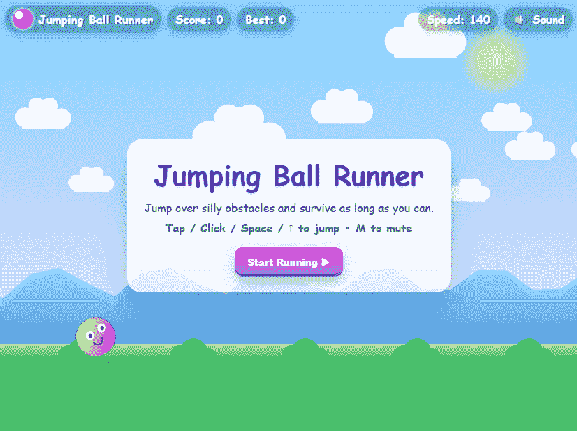

**Prompt: **Create a single-page app in a single HTML file with the following requirements:

- Name: Jumping Ball Runner
- Goal: Jump over obstacles to survive as long as possible.
- Features: Increasing speed, high score tracking, retry button, and funny sounds for actions and events.
- The UI should be colorful, with parallax scrolling backgrounds.
- The characters should look cartoonish and be fun to watch.
- The game should be enjoyable for everyone.

**提示词：** 在单个 HTML 文件中创建单页应用程序，要求如下：

- 名称：跳球跑者
- 目标：跳过障碍物，尽可能长时间地生存。
- 特点：提高速度、跟踪高分、重试按钮以及动作和事件的有趣声音。
- 用户界面应色彩丰富，并具有视差滚动背景。
- 角色应该具有卡通风格并且有趣。
- 每个人都应该享受游戏的乐趣。

##### （2）像素艺术prompt

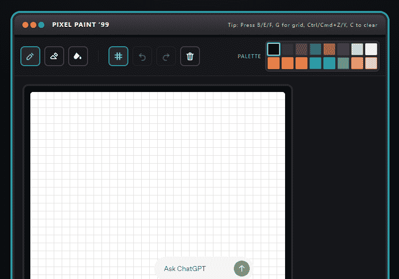

**Prompt: **Create a single-page app, in a single HTML file, that provides a retro pixel painting experience.

- Canvas: fixed pixel grid with zoom; tools for pencil, eraser, fill, line, rectangle, circle; grid toggle.
- Palette: 16-color swatches with two custom slots; eyedropper; foreground/background swap.
- Editing: undo/redo, copy/paste selection, flip/rotate selection, clear canvas; status bar with cursor coords.
- UI shell: faux OS window (’90s style) with draggable title bar, toolbar icons, tooltip hints.
- Import/Export: import PNG (quantize to palette) and export PNG/SpriteSheet + JSON; save/load from `localStorage`.
- Shortcuts: number keys for tools, +/- for zoom; accessible labels and focus order.
- Responsive layout; no uploads to servers.

**提示词：** 在单个 HTML 文件中创建一个单页应用程序，提供复古像素绘画体验。

- 画布：可缩放的固定像素网格；铅笔、橡皮擦、填充、线条、矩形、圆形工具；网格切换。
- 调色板：16 色样本，带有两个自定义插槽；吸管；前景/背景交换。
- 编辑：撤消/重做、复制/粘贴选择、翻转/旋转选择、清除画布；带有光标坐标的状态栏。
- UI 外壳：仿 OS 窗口（90 年代风格），带有可拖动的标题栏、工具栏图标、工具提示。
- 导入/导出：导入 PNG（量化为调色板）并导出 PNG/SpriteSheet + JSON；从 `localStorage` 保存/加载。
- 快捷方式：工具的数字键，缩放的+/-；可访问的标签和焦点顺序。
- 响应式布局；无需上传到服务器。

##### （3）打字游戏prompt

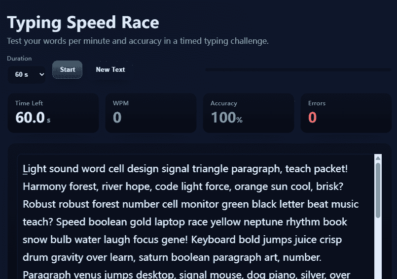

**Prompt: **Create a single-page app in a single HTML file with the following requirements:

- Name: Typing Speed Race
- Goal: Test WPM and accuracy in a timed typing challenge.
- Features: Random paragraph generator, error highlighting, live WPM display, countdown animation, history chart.
- The UI should be clean, with high-contrast text and a large typing area.

**提示词：** 在单个 HTML 文件中创建单页应用程序，要求如下：

- 名称：打字速度竞赛
- 目标：在定时打字挑战中测试 WPM 和准确性。
- 功能：随机段落生成器、错误突出显示、实时 WPM 显示、倒计时动画、历史图表。
- 用户界面应该简洁，具有高对比度的文本和较大的打字区域。

##### （4）鼓模拟器prompt

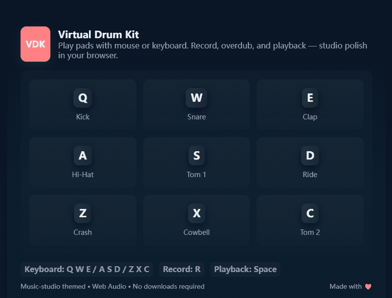

**Prompt: **Create a single-page app in a single HTML file with the following requirements:

- Name: Virtual Drum Kit
- Goal: Play a drum kit using keyboard or clicks.
- Features: Multiple drum sounds, record and playback mode.
- The UI should be music-studio themed, polished, modern. Make it as beautiful as possible.

**提示词：** 在单个 HTML 文件中创建单页应用程序，要求如下：

- 名称：虚拟鼓组
- 目标：使用键盘或点击演奏一组鼓。
- 特点：多种鼓声、录音和播放模式。
- 用户界面应以音乐工作室为主题，精致、现代。尽可能美观。

##### （5）可视化工具prompt

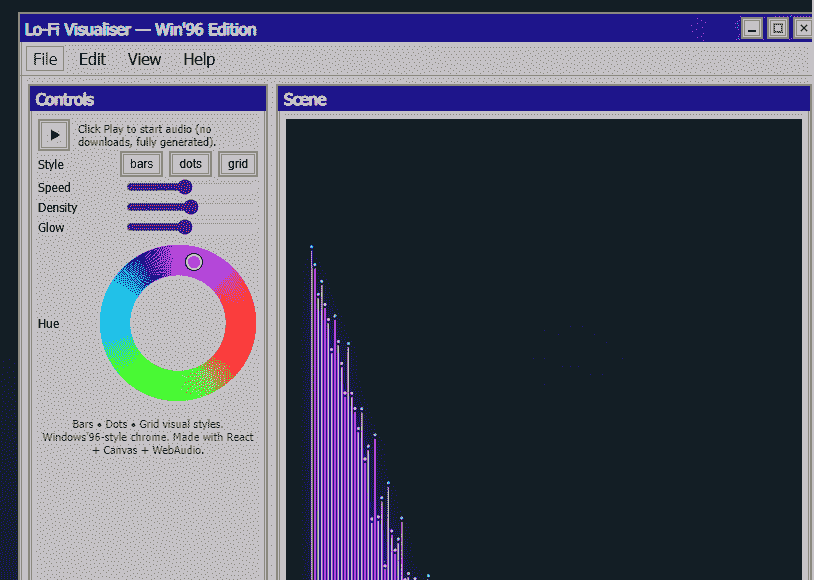

**Prompt:** Generate `React` + `Canvas` “Lo-Fi Visualiser” that animates bars and waves to a vaporwave track (no file uploads, use a bundled tone); provide 3 visual styles (bars, dots, grid) and sliders for speed, density, and glow; surround with a Windows-’96 chrome (reminiscent of the file explorer interface), pixel buttons, and a hue wheel to recolour the scene.

**提示词：** 生成一个 `React` + `Canvas`“Lo-Fi Visualiser”，将条形和波浪动画化为蒸汽波轨道（无需上传文件，使用捆绑音调）；提供 3 种视觉样式（条形、点、网格）和滑块，用于控制速度、密度和辉光；周围环绕着 Windows-'96 镀铬（让人联想到文件资源管理器界面）、像素按钮和色相轮，为场景重新着色。

### 创造性表达和写作

GPT-5 是OpenAI迄今为止最强大的写作协作工具，能够帮助用户将粗略的想法转化为引人入胜、富有文学深度和节奏感的文字作品 。它能够更可靠地处理结构模糊的写作，例如持续不押韵的抑扬格五音步或流畅自然的自由诗，将对形式的尊重与清晰的表达相结合。这些改进的写作功能意味着 ChatGPT 能够更好地帮助用户完成日常任务，例如起草和编辑报告、电子邮件、备忘录等。

### 健康

[OpenAI认为，GPT-5](https://openai.com/index/healthbench/) 是迄今为止针对健康相关问题的最佳模型，它使用户能够了解并倡导自己的健康。该模型在 HealthBench 上的得分明显高于任何先前的模型。HealthBench 是OpenAI今年早些时候基于现实场景和医生定义的标准发布的评估。与之前的模型相比，它更像是一个积极的思想伙伴，主动标记潜在顾虑并提出问题以提供更有用的答案。该模型现在还可以提供更精确、更可靠的响应，适应用户的背景、知识水平和地理位置，使其能够在各种场景中提供更安全、更有用的响应。

## 模型评测

GPT-5 的全面智能化程度显著提升，这体现在它在学术和人工评估基准测试中的表现上，尤其是在数学、编码、视觉感知和健康领域。它在数学（AIME 2025 无需工具测试得分 94.6%）、真实世界编码（SWE-bench Verified 得分 74.9%，Aider Polyglot 得分 88%）、多模态理解（MMMU 得分 84.2%）和健康（HealthBench Hard 得分 46.2%）方面均创下了新的最高水平 ——这些提升在日常使用中得到了充分体现。凭借 GPT-5 Pro 的扩展推理能力，该模型还在 GPQA 上创下了新的最高水平，无需工具测试得分高达 88.4%。

### 数学能力

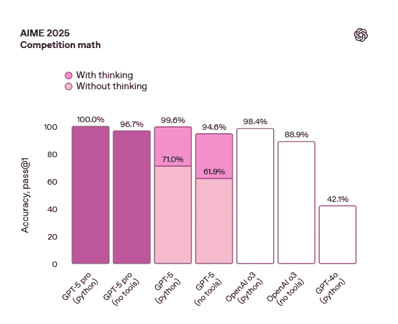

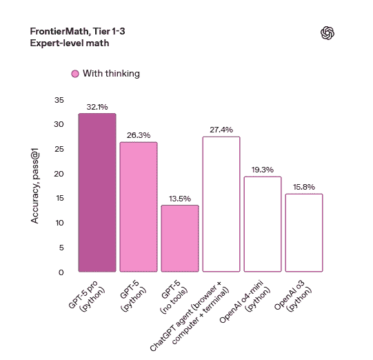

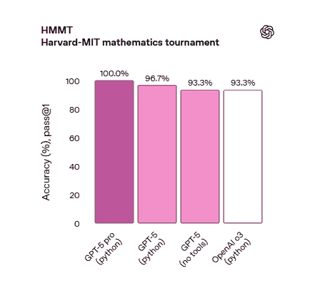

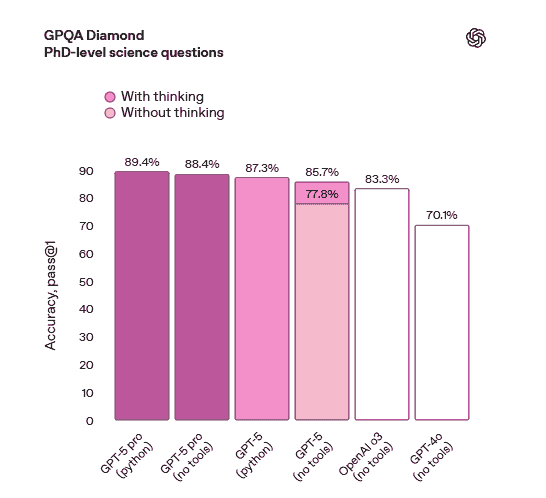

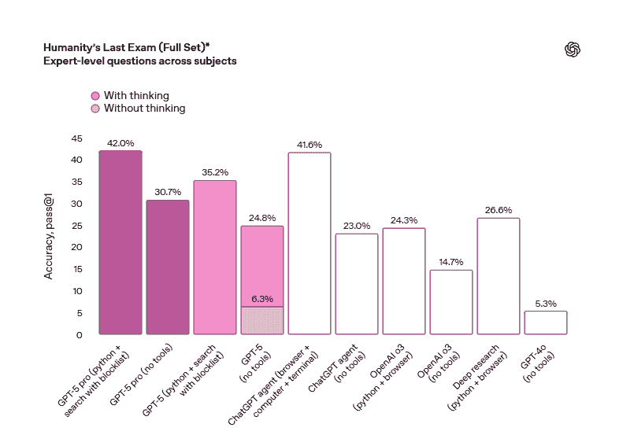

### 编程能力Coding

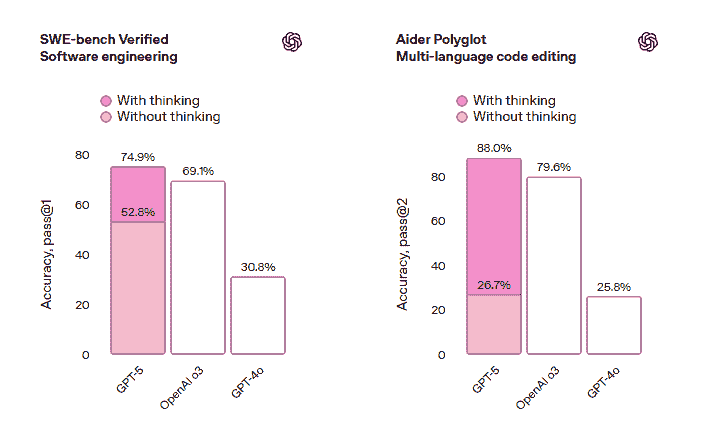

### 遵循指令和代理工具使用

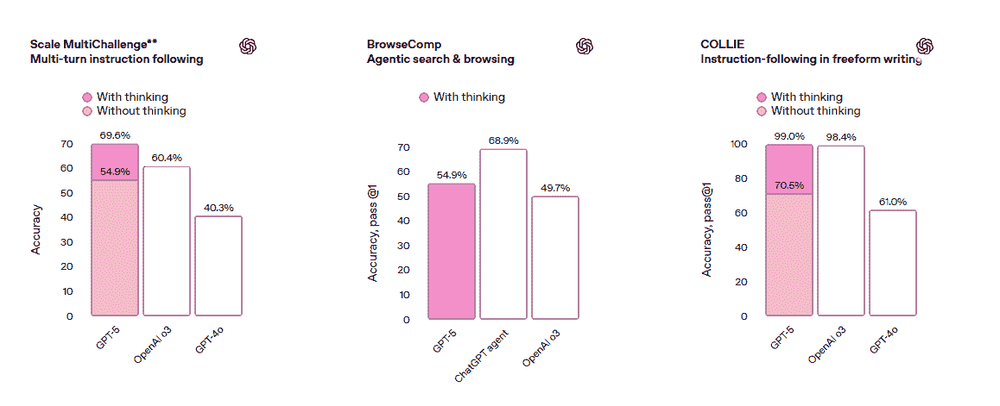

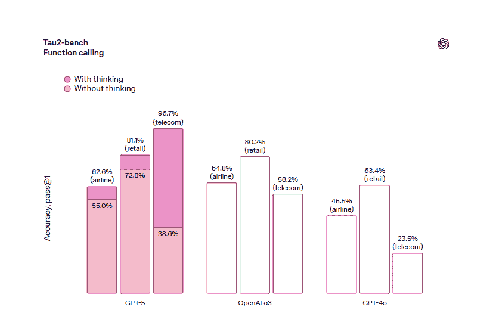

### 多模态能力

该模型在一系列多模态基准测试中表现出色，涵盖视觉推理、视频推理、空间推理和科学推理。更强大的多模态性能意味着 ChatGPT 能够更准确地对图像和其他非文本输入进行推理——无论是解读图表、总结演示文稿照片，还是回答有关图表的问题。

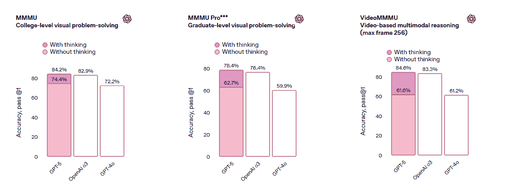

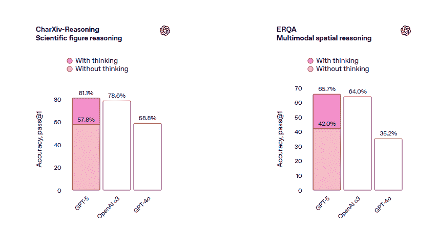

### 健康

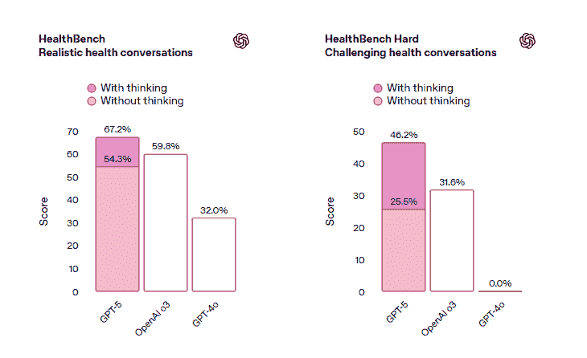

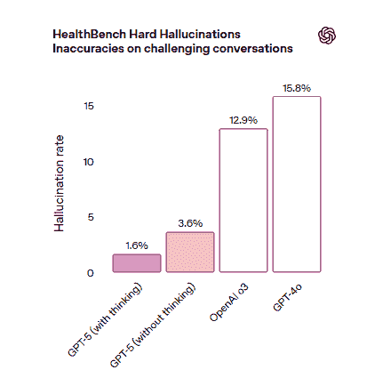

### 经济价值

GPT-5 也是OpenAI内部基准测试中表现最佳的模型，该基准测试衡量了模型在复杂且具有经济价值的知识工作中的表现。在推理方面，GPT-5 在大约一半的案例中与专家相当或更胜一筹，同时在涵盖法律、物流、销售和工程等 40 多个职业的任务中，其表现优于 o3 和 ChatGPT Agent。

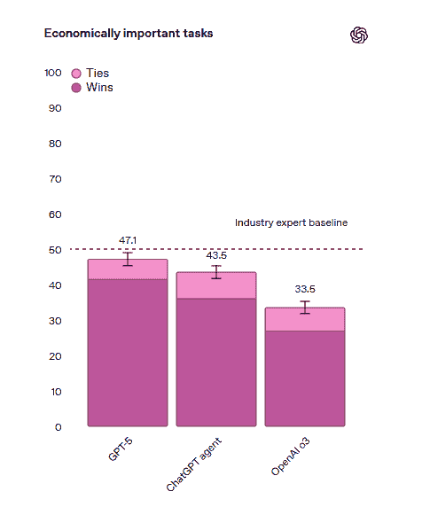

> 上述评估方法：GPT-4o 的结果反映了截至 2025 年 8 月 ChatGPT 中该模型的最新版本。所有模型均在高“推理努力”设置下进行评估。在 ChatGPT 中，推理努力程度可能有所不同，“高”表示用户使用该模型时可能体验到的上限。

## 更快、更高效的思考

GPT-5 用更少的思考时间实现了更大的价值。在评估中，GPT-5（具备思考能力）的表现优于 OpenAI o3，在视觉推理、代理编码和研究生水平的科学问题解决等功能上，输出 token 数量减少了 50% 至 80%。

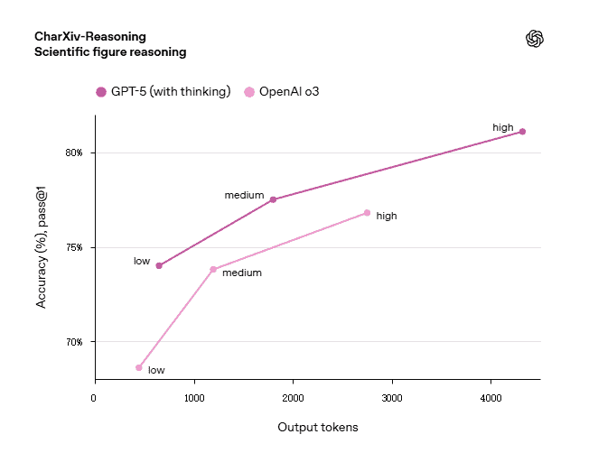

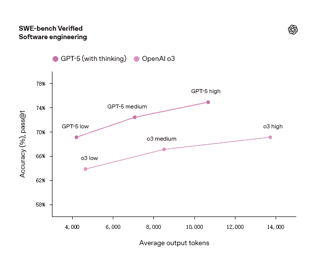

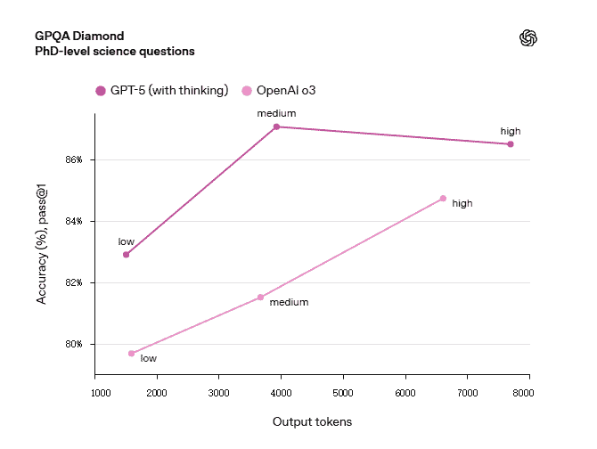

GPT-5 在 Microsoft Azure AI 超级计算机上进行了训练。

## 构建更强大、更可靠、更有用的模型

### 减少模型幻觉

GPT-5 产生幻觉的可能性显著低于OpenAI之前的模型。在 ChatGPT 生产流量中代表匿名提示的网页搜索中，GPT-5 的响应包含事实错误的可能性比 GPT-4o 低约 45%；在思考时，GPT-5 的响应包含事实错误的可能性比 OpenAI o3 低约 80%。

OpenAI表示在提高模型在推理复杂开放式问题时的可靠性方面投入了特别多精力。比如，添加了新的评估指标，以对开放式事实性进行压力测试。测量了 GPT-5 在思考开放式事实探究提示时的幻觉率，这些幻觉来自两个公开的事实性基准：LongFact（概念和对象）和 FActScore。在所有这些基准中，“GPT-5 思维”的幻觉率均显著下降——大约比 o3 少六倍——这标志着在生成一致准确的长篇内容方面取得了显著的飞跃

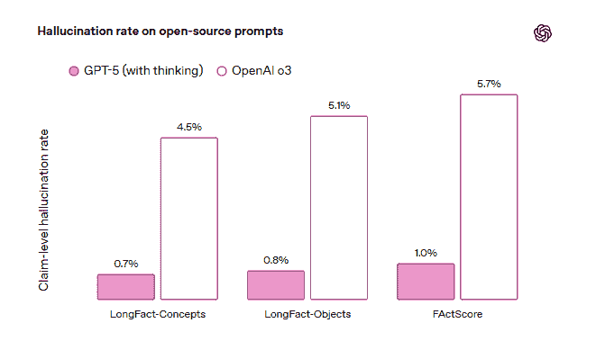

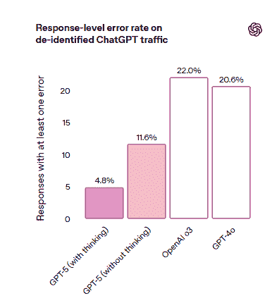

### 更诚实的回应

除了事实性增强之外，GPT-5（具备思考能力）还能更诚实地向用户传达其操作和能力——尤其是在处理那些不可能完成、具体要求不明确或缺少关键工具的任务时。为了在训练中获得高额奖励，推理模型可能会学会谎报自己成功完成了任务，或者对不确定的答案过于自信。例如，为了测试这一点，从多模态基准测试 CharXiv 的提示中删除了所有图像，结果发现 OpenAI o3 仍然能够以 86.7% 的概率对不存在的图像给出自信的答案，而 GPT-5 的这一比例仅为 9%。

# GPT-5 发布与能力介绍

在推理过程中，GPT-5 能够更准确地识别任务无法完成的情况，并清晰地传达其局限性。OpenAI评估了涉及不可能完成的编码任务和缺失多模态资产的场景下的欺骗率，发现 GPT-5（具有思考能力）的欺骗性在各方面均低于 o3。在大量代表实际 ChatGPT 流量的对话中，我们将欺骗率从 o3 的 4.8% 降低到 GPT-5 推理响应的 2.1%。OpenAI表示正在继续研究如何提高模型的真实性和诚实性。

## 更安全、更有帮助的回应

GPT-5 推进了安全领域的发展。过去，ChatGPT 主要依赖于基于拒绝的安全训练：根据用户的提示，模型应该遵循或拒绝。虽然这种训练对于明确的恶意提示效果良好，但它难以处理用户意图不明确，或信息可能被善意或恶意利用的情况。拒绝训练对于病毒学等双重用途领域尤其缺乏灵活性，因为在这些领域中，良性请求可以在高层次上安全地完成，但如果详细完成，则可能为恶意行为者提供便利。

对于 GPT-5，OpenAI引入了一种新的安全训练形式——安全补全——它教会模型在安全界限内尽可能给出最有帮助的答案。有时，这可能意味着部分回答用户的问题，或者只提供高水平的答案。如果模型需要拒绝，GPT-5 会经过训练，以透明的方式告知拒绝原因，并提供安全的替代方案。在受控实验和生产模型中，都发现这种方法更加细致入微，能够更好地引导双重用途问题，增强对模糊意图的鲁棒性，并减少不必要的过度拒绝。

> 在不同提示意图类型中，安全性和实用性（给定安全响应）的比较。GPT-5（具有思考能力）在所有提示意图类型中都表现出更高的安全性和更大的实用性。

## 减少谄媚，改进风格

与 GPT-4o 相比，GPT-5 的亲切感有所减弱，不必要的表情符号也更少，后续的互动也更加细腻周到。与其说是“与 AI 对话”，不如说更像是在与一位拥有博士级智力水平的乐于助人的朋友聊天。

今年早些时候，OpenAI[发布了 GPT-4o 的更新](https://openai.com/index/sycophancy-in-gpt-4o/)，[无意中导致模型变得过于奉承、过度讨好或讨好](https://openai.com/index/expanding-on-sycophancy/)。不过，他们很快撤回了这一更改，并努力通过以下方式理解和减少这种行为：

- 开发新的评估方法来衡量谄媚程度
- 改进训练，使模型不那么阿谀奉承——例如，添加通常会导致过度一致的例子，然后教它不要这样做。

在使用专门设计用于引发谄媚回应的提示进行针对性谄媚性评估时，GPT-5 显著减少了谄媚性回复（从 14.5% 降至不到 6%）。有时，减少谄媚性可能会降低用户满意度，但所做的改进不仅将谄媚性降低了一半以上，还带来了其他可衡量的收益，因此用户能够继续进行高质量、建设性的对话。

## 更多自定义 ChatGPT 的方法

GPT-5 在指令遵循方面表现明显更好，并且看到其遵循自定义指令的能力也有相应的提升。

OpenAI还为所有 ChatGPT 用户推出了四种全新预设性格的研究预览，这得益于可操控性的改进。这些性格最初适用于文本聊天，之后将扩展到语音聊天，让你无需编写自定义提示即可设置 ChatGPT 的互动方式——无论是简洁专业、周到支持还是略带讽刺。初始的四种性格选项分别是愤世嫉俗者、机器人、倾听者和书呆子，它们都是可选的，可以在设置中随时调整，并根据你的沟通风格进行设计。

所有这些新人物都达到或超过了OpenAI减少谄媚的内部评估标准。

## 全面防范生物风险

OpenAI[决定将“GPT-5 思维”模型](https://openai.com/index/updating-our-preparedness-framework/)视为生物和化学领域的高能力模型，并已实施强有力的保障措施，以充分降低相关风险。根据 “防范框架” 对该模型进行了严格的安全评估测试，并与 CAISI 和英国 AISI 等合作伙伴完成了 5000 小时的红队演练。

OpenAI表示，与针对 ChatGPT Agent 的方法类似，虽然尚无确凿证据表明该模型能够有效帮助新手造成严重的生物伤害（OpenAI定义的“高能力”阈值），但正在采取预防措施，并立即启动必要的保障措施，以便在此类能力可用时提高准备程度。因此，“GPT-5 思维”拥有强大的安全堆栈和多层生物防御系统：全面的威胁建模、通过OpenAI新的安全完成范式训练模型不输出有害内容、始终在线的分类器和推理监视器，以及清晰的执行流程。

## GPT-5 Pro

为了应对最具挑战性、最复杂的任务，OpenAI还发布了 GPT-5 pro，以取代 OpenAI o3-pro。O3-pro 是 GPT-5 的一个变体，它能够长时间思考，使用可扩展且高效的并行测试时间计算，从而提供最高质量和最全面的答案。GPT-5 pro 在多项极具挑战性的智能基准测试中取得了 GPT-5 系列中的最高性能，包括在包含极其困难的科学问题的 GPQA 上取得的领先性能。

在对 1000 多个具有经济价值的现实世界推理题的评估中，外部专家 67.8% 的答案是 GPT-5 pro，而非“GPT-5 思维”。GPT-5 pro 的重大错误减少了 22%，并且在健康、科学、数学和编程方面表现出色。专家们将其答案评为相关、实用且全面。

## 如何使用 GPT-5

GPT-5 是 ChatGPT 中的新默认模型，它将取代已登录用户的 GPT-4o、OpenAI o3、OpenAI o4-mini、GPT-4.1 和 GPT-4.5。只需打开 ChatGPT 并输入您的问题；GPT-5 会处理其余部分，并在对答案有利时自动应用推理。付费用户仍然可以从模型选择器中选择 “GPT-5 思维”，或者在提示中输入类似“认真思考一下”的内容，以确保在生成答案时使用推理。

## 可用性和访问

GPT-5 今日起面向所有 Plus、Pro、Team 和 Free 用户推出，Enterprise 和 Edu 版用户也将在一周内获得访问权限。Pro、Plus 和 Team 用户还可以通过使用 ChatGPT 登录，在 Codex CLI 中开始使用 GPT-5 进行编码。

与 GPT-4o 一样，GPT-5 免费和付费访问之间的区别在于使用量。专业版订阅用户可以无限制访问 GPT-5，还可以访问 GPT-5 Pro。此外，用户可以舒适地将其用作为日常问题的默认模型，使用量明显高于免费用户。团队、企业和教育客户也可以轻松地将 GPT-5 用作为日常工作的默认模型，其宽松的限制使整个组织都可以轻松地依赖 GPT-5。对于 ChatGPT 免费套餐用户，完整的推理功能可能需要几天时间才能完全推出。一旦免费用户达到 GPT-5 的使用限制，他们将转换到 GPT-5 mini，这是一个更小、更快、功能更强大的模型。
