# 开通虚拟信用卡与获取GPT-5 API_KEY

> 来源：[https://kq4b3vgg5b.feishu.cn/docx/JeXUd9k77ohNm0xG2Gdc7Vnznwb](https://kq4b3vgg5b.feishu.cn/docx/JeXUd9k77ohNm0xG2Gdc7Vnznwb)

在之前的课程视频中我们已经注册了OpenAI账号，所有服务（ChatGPT使用、Plus会员、API）都基于一个OpenAI账号，那么这3个主要的服务都有什么区别呢，我们为什么还有订阅ChatGPT Plus会员与注册ChatGPT API账户的教程呢？

### **1. ChatGPT账号**

+   **定义**：ChatGPT账号是用户访问OpenAI提供的ChatGPT服务所需的基本账户。通过注册一个OpenAI账号，用户可以免费使用ChatGPT的基础功能。

+   **功能**：

+   使用基础的ChatGPT对话功能。

+   管理个人信息和设置。

+   查看和管理对话历史记录。

### 2. ChatGPT Plus 会员

+   **定义**：ChatGPT Plus 是 O**penAI** **提供的付费服务，每月费用**为 20 美元。需用国外虚拟信用卡付款。

+   **优势**：

1.  **优先访问多种模型**：包括 **OpenAI o1-preview、o1-mini、GPT-**4o、GPT-4o mini、GPT-4，相比免费用户，Plus 会员有更多模型可用。

1.  **更多消息量**：可获得GPT-4o **5 倍的消息量**。

1.  **自定义 GPT**：支持创建和使用自定义的 GPT。

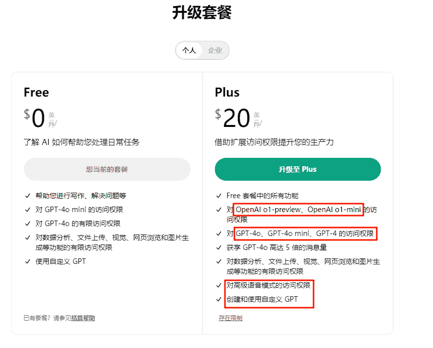

### 3. 注册ChatGPT API

+   **定义**：ChatGPT API是一种面向开发者的接口，允许将ChatGPT的语言模型功能集成到自己的应用、网站或服务中。

+   **关系**：

+   **独立服务**：虽然ChatGPT API与个人ChatGPT账号相关联，但它是独立于ChatGPT Plus会员的服务。API的使用和收费方式与个人订阅不同。

+   **注册流程**：

+   **绑定付款的信用卡**：需先绑定虚拟信用卡充值后API才可被调用。

+   **获取API密钥**：注册后，开发者可以获取用于调用API的密钥。

+   **计费模式**：API使用通常基于调用次数或处理的字符数进行计费，与ChatGPT Plus的固定月费不同。

+   **用途**：主要面向开发者和企业，允许在自己的产品或服务中嵌入ChatGPT的功能，例如聊天机器人、内容生成工具等。

### 三者关系总结

+   **基础账号**：所有服务（ChatGPT使用、Plus会员、API）都基于一个OpenAI账号。

+   **对话使用 vs 开发调用使用**：

+   **ChatGPT账号**和**ChatGPT Plus会员**主要面向个人用户，提供直接的对话体验和增强服务。

+   **ChatGPT API**面向开发者和企业，提供集成和定制化的解决方案。

+   **收费模式**：

+   **ChatGPT账号**免费使用基础功能。

+   **ChatGPT Plus会员**采用订阅制，提供更优质的个人使用体验。需绑定虚拟信用卡付款。

+   **ChatGPT API**采用按使用量计费，适合不同规模的开发需求。需绑定信用卡付款。

使用场景：

+   **个人用户小明**：

+   注册一个ChatGPT账号，免费使用基础对话功能。

+   觉得免费版响应速度慢或模型不够前沿，决定订阅ChatGPT Plus会员，享受更快的响应和优先服务。

+   **开发者和大模型应用者小华**：

+   使用个人的ChatGPT账号访问ChatGPT的对话功能。

+   为了在自己开发的应用中集成ChatGPT功能，注册ChatGPT API，获取API密钥，并根据使用量支付费用。

## ChatGPT Plus会员和ChatGPT API的主要门槛：虚拟信用卡的开通与充值

**不支持大陆的付款方式****：Ope****nAI不支持中国大陆发**行的信用卡、🛰️或**支付宝等常**用支付方式，因此中国用户无法通过这些方式订阅ChatGPT Plus充值ChatGPT API。

解决方法：ChatGPT Plus 的订阅和ChatGPT API的调用都需要通过 虚拟信用卡 的方式来完成。虚拟信用卡是一种可随时开通、随时充值的数字信用卡，在国内是合法合规的。

ChatGPT Plus 的订阅也需要绑定银行卡再付款：

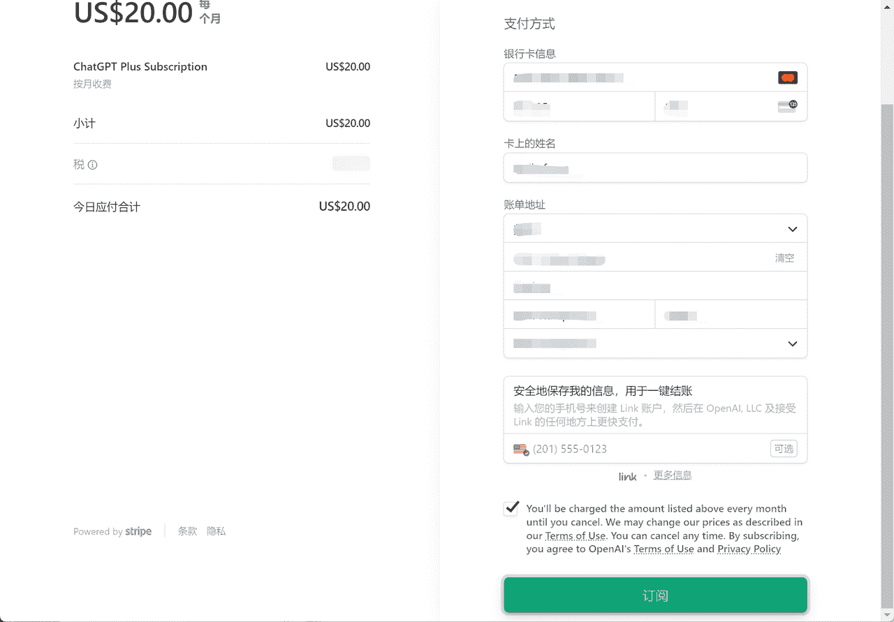

**ChatGPT API**的调用需要先绑定信用卡，充值进OPENAI平台钱后才可以调用API：


# ChatGPT Plus 升级和ChatGPT API充值的准备——开通虚拟信用卡

准备工作：🪜工具打开，准备好全局模式。同时选择美国、欧洲等地区的服务器节点。

### 注意事项

+   **一号一卡**：建议每个账号绑定一张独立的虚拟信用卡，避免一张虚拟信用卡绑定多个OPENAI账号导致关联封号。

+   **保持自动扣费**：尽量保持虚拟信用卡的余额充足，以确保每月自动扣费，避免因欠费导致服务中断或账号异常。

这里我们手动绑定一卡一号的另外一个好处在于，我们可以使用相同的虚拟信用卡进行ChatGPT Plus 升级和ChatGPT API充值。

### 虚拟信用卡平台推荐：Vvacard

**我们推荐使用国**内的虚拟信用卡平台 Vvacard，其大多数信用卡都支持 ChatGPT Plus 的升级，无需🪜即可使用。

+   **Vvacard 官网**：https://www.vvacard.com/

#### 注册与充值流程

1.  **注册账号**：访问 Vvacard 官网，可以使用国内邮箱注册账号~


1.  **充值平台账户**：登录后，在主页右上角点击 **“快速充值”**，选择合适的充值方式。

+   推荐使用 **支付宝扫码支付**（需要完成实名认证）。

+   最低充值金额为 **50 美元**。


点击支付宝扫码支付之后，进入支付页面，选择合适的充值金额（最低充值金额是50刀）点击提交：


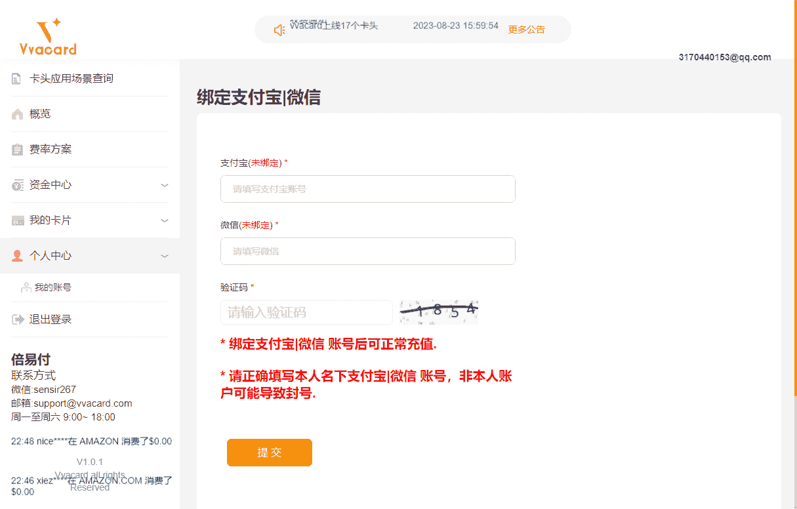

1.  **查看充值状态**：支付完成后，可在 **“充值记录”** 页面查看充值状态。若显示 **“已到账”**，则表示充值成功（现在审核非常迅速，基本上是秒到账）。

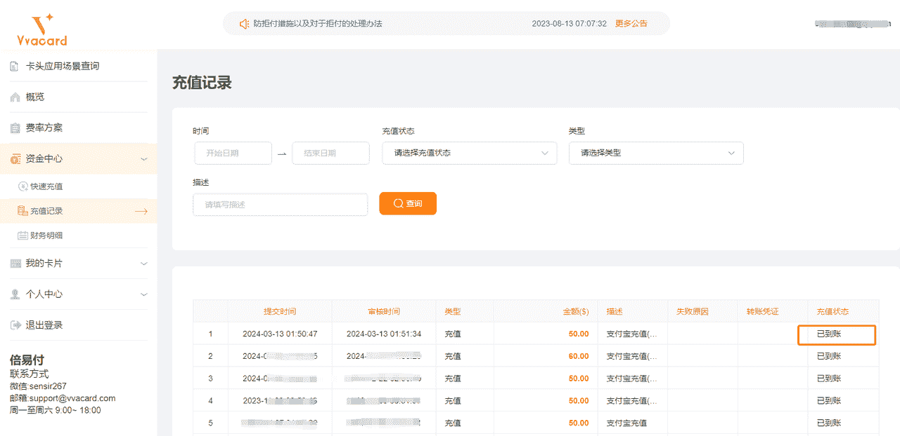

### 开通虚拟信用卡

1.  **快速开卡**：在左侧菜单中，选择 **“我的卡片”** -> **“快速开卡”**。

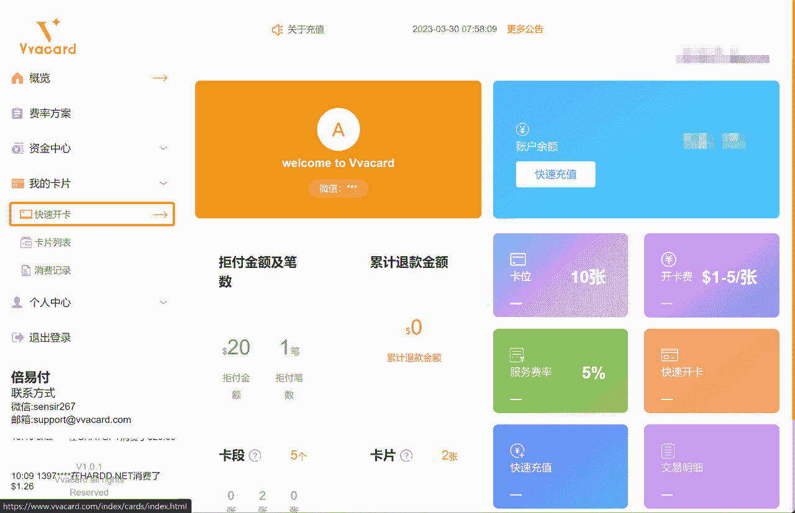

1.  **填写开卡信息**：

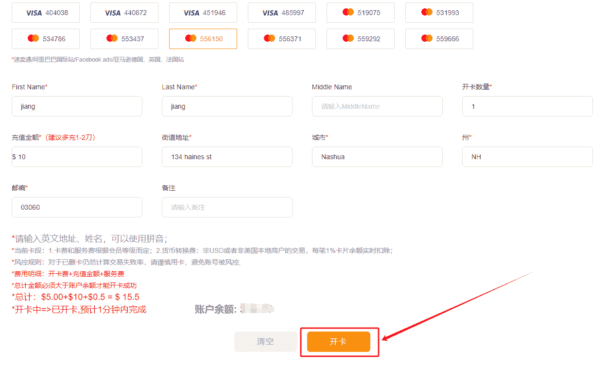

+   **卡段**：因为这是一笔不小的消费，并万一有些卡段不可用了但平台还没有更新，所以我们先去查找最近有人充值应用的卡段。

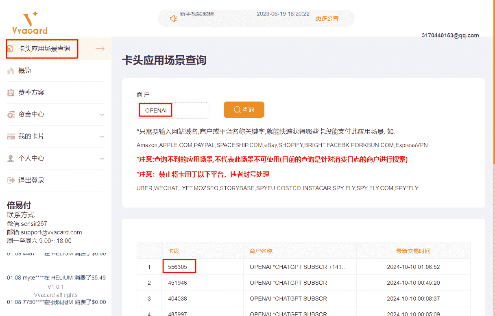

例如如最近的可用的有这个卡段，我们开卡的时候就选择它。

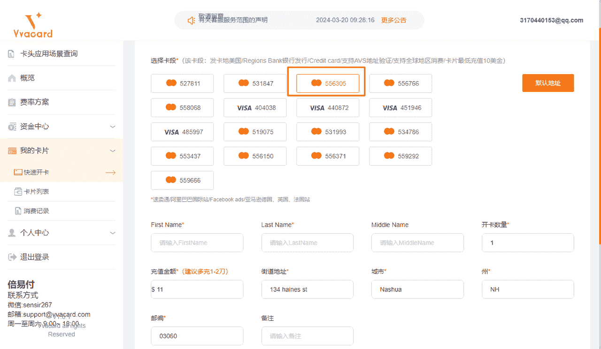

+   **充值金额**：建议填写 **11 美元**（开卡需扣除约 1 美元手续费，剩余 10 美元用于支付）。

+   **账单地址**：由于上面的卡段都是美国的虚拟信用卡，所以账单地址需要填写美国的账单地址。在填写账单地址之前，可以先占个免税州的地址，这样可以每个月便宜2-3美元，没有消费税。

+   **美国五大免税州**：

1.  **特拉华州（Delaware）**

1.  新罕布什尔州（New Hampshire）

1.  **蒙大拿州（Montana）**

1.  **俄勒冈州（Oregon）**

1.  **阿拉斯加州（Alaska）**

+   **如何获取真实的美国地址**：

+   **方法一：Google 地图**：在 Google 地图上搜索免税州的地址。

+   **方法二：租房网站 Zillow**：

1.  访问 [www.zillow.com](https://www.zillow.com/)。

1.  在搜索框中输入免税州名称（如 “Oregon”）。

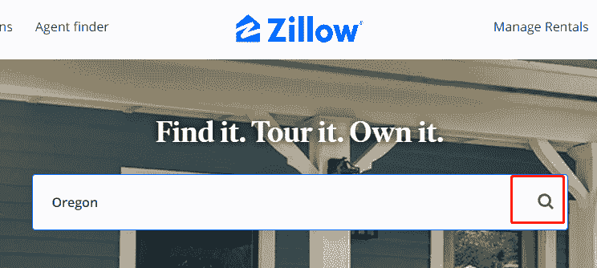

1.  浏览列表，选择一个房源，获取其地址。

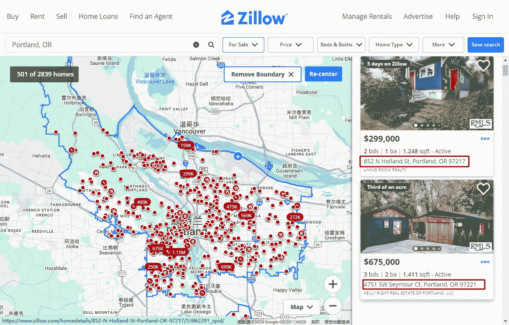

+   **地址示例**：

+   18454 SW Oakville Ct, Beaverton, OR 97078

+   11139 SW Berlin Ave, Wilsonville, OR 97070

+   **注意**：请勿使用示例地址或平台默认地址，以避免因多人使用同一地址而导致关联封号。


1.  **确认开卡**：填写完整信息后，点击 **“开卡”**。**请务必记录您填写的姓名和账单地址，后续在 Cha**tGPT Plus 充值时需要完全一致。

1.  **查看卡片信息**：开卡成功后，可在 **“卡片列表”** 中查看卡片详情。


1.  
（第一次开卡应该只有一张卡，这里我开了两张，所以有两个选项）

### 充值虚拟信用卡

1.  **充值金额**：建议充值 **20 美元**，用于支付首月 ChatGPT Plus 费用。

1.  **充值步骤**：

+   在卡片详情页面，点击 **“充值”**。

+   输入充值金额，确认充值。

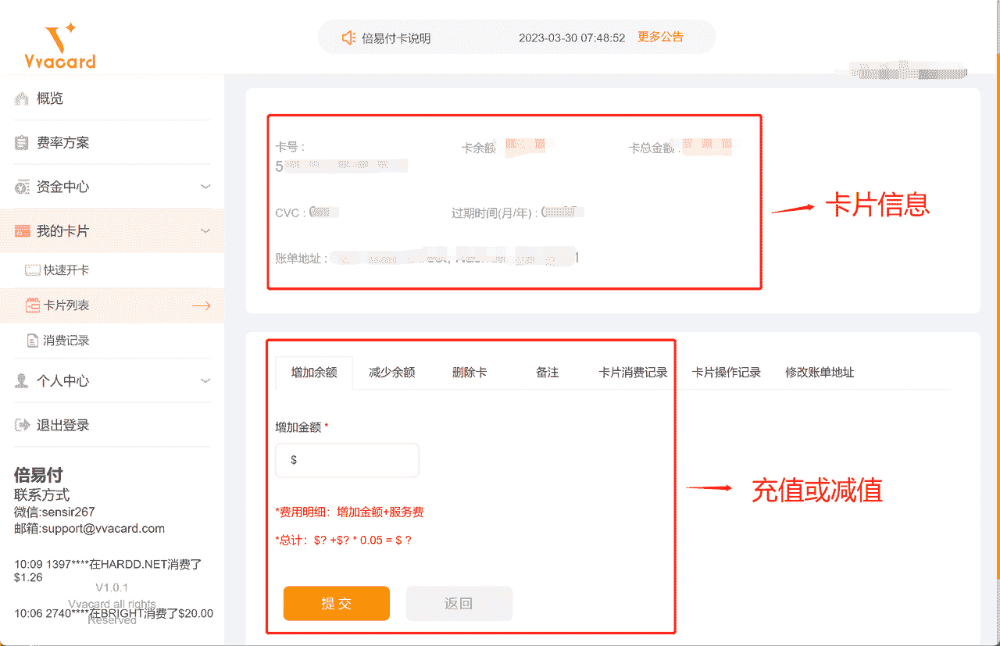

1.  **记录卡片信息**：在卡片详情页面，上访的 **卡号、有效期、安全码** 等信息，后续在 ChatGPT Plus 升级时会使用到。

## 升级 ChatGPT Plus

### Step 1：进入升级页面

1.  **登录 ChatGPT**：访问 https://chat.openai.com/，使用您的 OpenAI 账号登录。

1.  **开始升级**：点击左下角的 “Upgrade to Plus” 按钮。

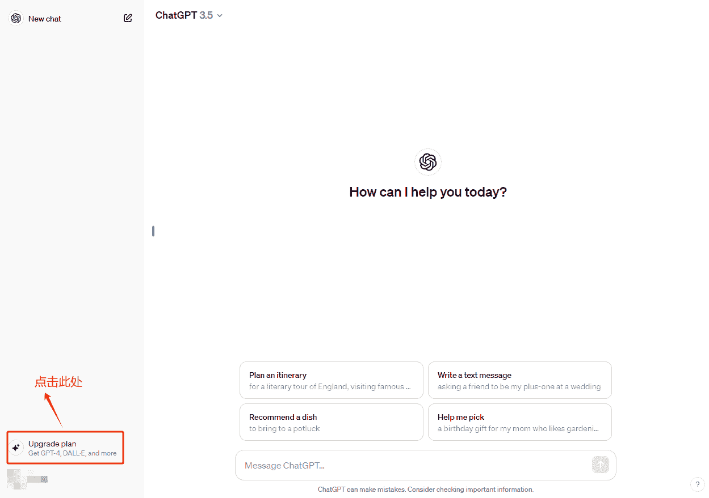

### Step 2：填写支付信息

1.  **确认升级**：在弹出的窗口中，点击 **“升级至plus”**。

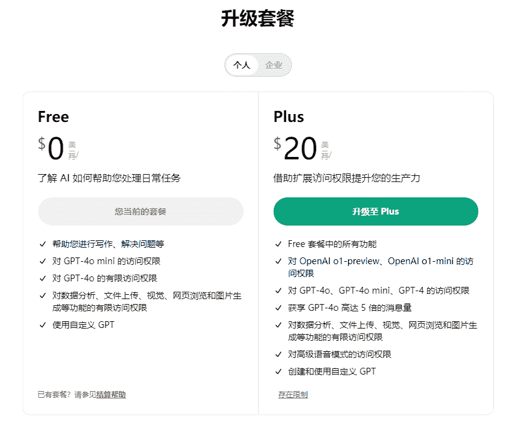

1.  **填写付款信息**：

+   **信用卡信息**：输入虚拟信用卡的 **卡号、有效期、安全码**。

+   **账单地址**：填写与开卡时 **完全一致** 的姓名和账单地址。

1.  **注意事项**：

+   **使用美国 IP 地址**：建议使用美国代理或 VPN，以提高支付成功率。

+   **信息一致性**：姓名和账单地址必须与虚拟信用卡开卡时填写的保持一致。


1.  **完成支付**：确认信息无误后，点击 **“Subscribe”** 完成支付。

### Step 3：确认升级成功

+   **成功提示**：顺利订阅则会进入到撒花页面。

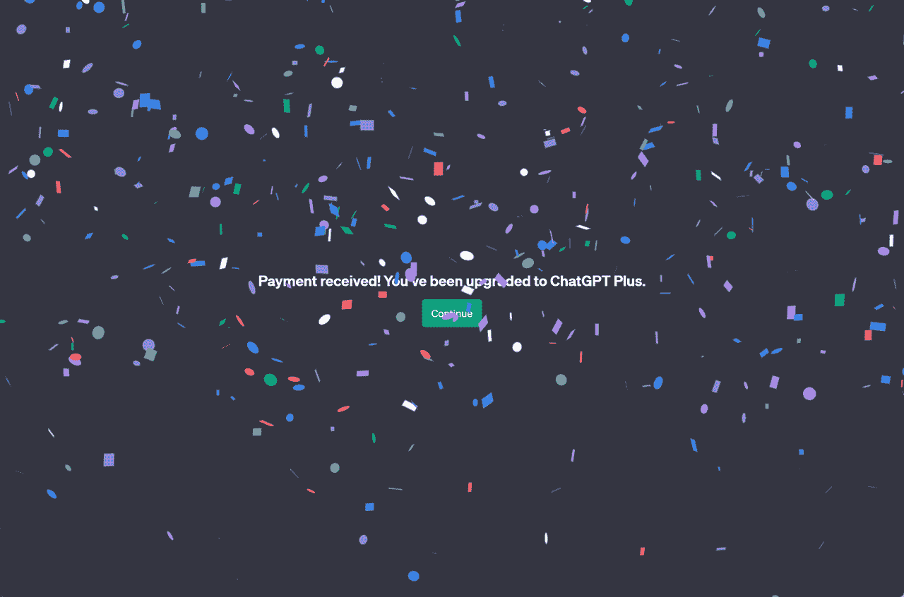

+   **选**择 ChatGPT-o1-preview：返回对话页面，现在可以选择使用 ** ChatGPT-o1-preview 模型进行对话啦！

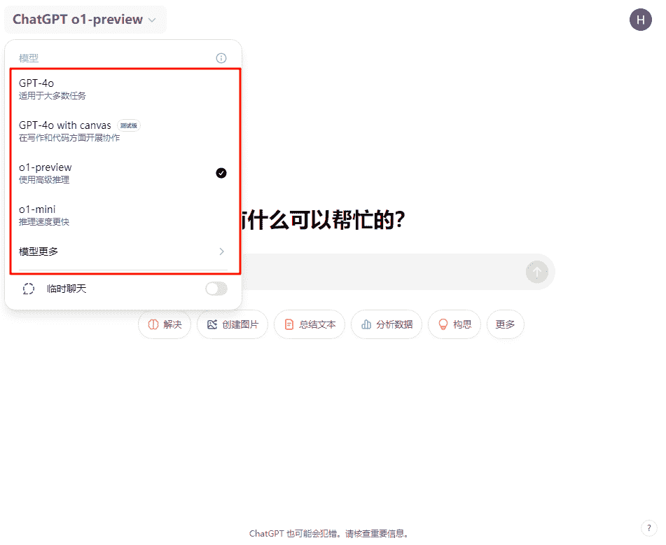

### 注意事项

### 每月付费规则

+   **自动扣费**：首次绑定成功后，系统会在每个计费周期自动从您的虚拟信用卡中扣除月费。

+   **保持余额充足**：所以我们要确保虚拟信用卡中有足够的余额，以避免扣费失败导致服务中断。

### API 调用费用支付

这里我们手动绑定一卡一号的另外一个好处在于，我们可以使用相同的虚拟信用卡进行账户的API调用费用的支付。对于OpenAI的大模型并不是开源模型，我们调用这些模型是需要支付一定的费用的。具体费用标准和调用方法，我们将在课程中进行详细的讲解。

## OpenAI 账户充值与 API Key 获取

我们常常听说的API（应用程序编程接口）是**不同软件系统之**间沟通的桥梁。而在这其中，API Key扮演着至关重要的角色。

**API Key**是一串唯一的标识符，用于验证调用者的身份，确保只有授权的用户或应用能够访问特定的API资源。它就像我们的指纹一样独一无二。它的作用就像是一个超级安保系统，能够有身份验证，访问控制等的安全保障。

**因此，在我们使**用OpenAI API时，API Key会被用于认证每一次的API请求。通过这种方式，OpenAI能够精确地知道是谁在使用他们的服务，用了多少，应该收多少费用~

## OpenAI API Key的类型

OpenAI提供了两种主要类型的API Key，每种类型都有其特定的用途和优势：

### 1. 项目密钥（Project Keys）

+   **用途**：仅限于单一项目的访问。

+   **优势**：提升安全性，推荐作为首选。

+   **管理**：在生成密钥时，选择具体的项目以获取对应的API Key。

### 2. 用户密钥（User Keys）

+   **用途**：访问用户所加入的所有组织和项目。

+   **特点**：属于遗留密钥，功能较为广泛。

+   **建议**：为了最佳的安全实践，强烈建议迁移至项目密钥，尽管当前仍支持用户密钥的使用。

> **安全提示**：无论使用哪种类型的API Key，都必须妥善保管。切勿与他人分享，或在客户端代码（如浏览器、应用程序）中暴露。生产环境的请求应通过自己的后端服务器进行，API Key应从环境变量或密钥管理服务中安全加载。

### 示例：使用OpenAI的Python包\

```
from openai import OpenAI

client = OpenAI(
  organization=&#x27;org-cY417GY4cHBZMGK6T4zhX8n5&#x27;,
  project=&#x27;$PROJECT_ID&#x27;,
)
```

### Step 1：绑定支付方式

1.  **登录开发者平台**：访问 https://platform.openai.com/，使用您的 OpenAI 账号登录。


1.  进入 Billing 页面，添加付款方式：依次点击Settings-->Billing-->Add payment method**。

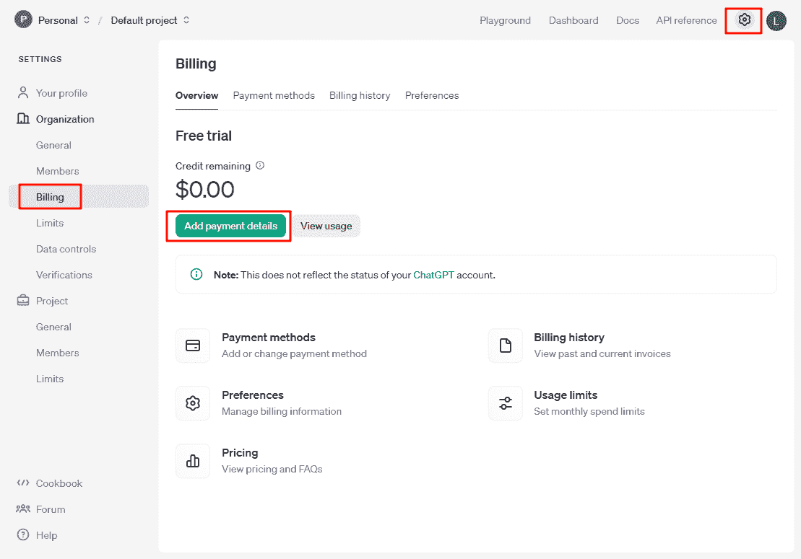

1.  **选择账户类型**：选择 **“Individual”**。

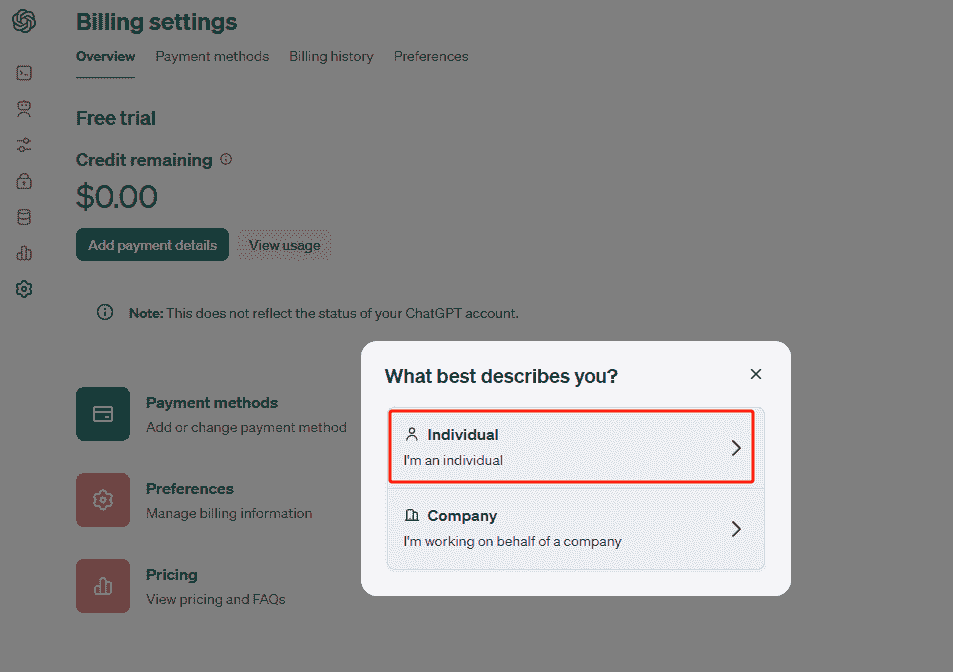

1.  **填写账单信息**：

+   **姓名、地址**：填写与虚拟信用卡开卡时一致的姓名和地址。

+   **支付方式**：输入虚拟信用卡的卡号、有效期、安全码。

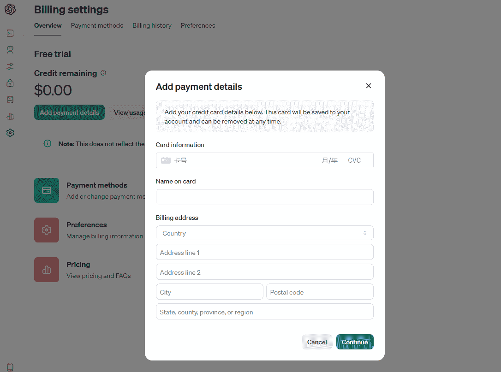

1.  
其中地址填**写：
例如将地址 132 Haines Street**, Nashua, New Hampshire 03060 账单地址字段，可以按照以下方式分配各部分信息：

| 字段名称 | 填写内容 |
| --- | --- |
| **Country (国家)** | United States (美国) |
| Address line 1 (地址行 1) | 132 Haines Street |
| Address line 2 (地址行 2) | （可选，若有公寓号、套房号等填写，例如 Apt 5B；如果没有，可留空） |
| **City (城市)** | Nashua |
| Postal code (邮政编码) | 03060 |
| **State, county, province, **or region (州、县、省或地区) | New Hampshire |

1.  **确认绑定**：完成信息填写后，点击 **“继续”**。

### Step 2：充值 API 额度

1.  **进入充值页面**：完成信息填写后，点击 **“继续”**。即跳转过来了，后续也可在在 **“Billing”** -> **“Overview”** 页面，点击 **“Add funds”** 找到。

1.  **选择充值金额****：首次充**值建议从小的开始试水，选择 5 美元，并关闭自动充值。

1.  **设置自动充值（可选）**：

+   **自动充值**：您可以设置当余额低于某个阈值时，自动充值至指定金额。

+   **手动充值**：若不设置自动充值，需定期检查余额，避免因余额不足影响 API 调用。

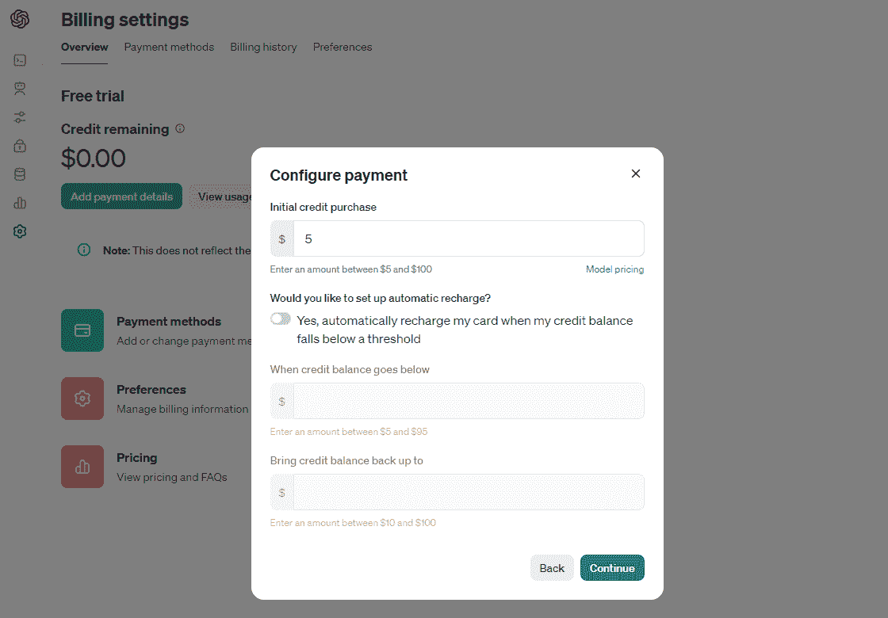

1.  **确认支付**：点击 “Confirm payment”，完成充值。

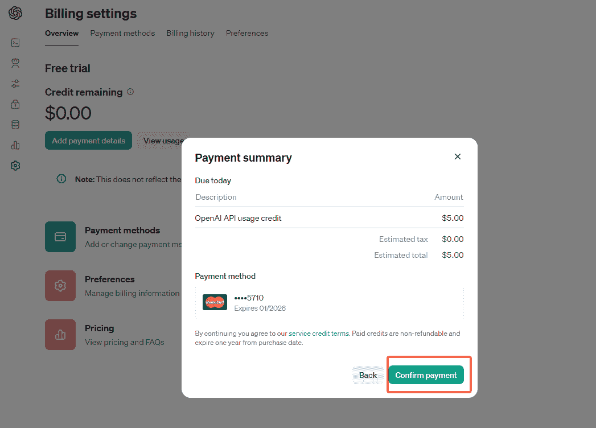

1.  **充值成功**：看到以下页面则表示充值成功。

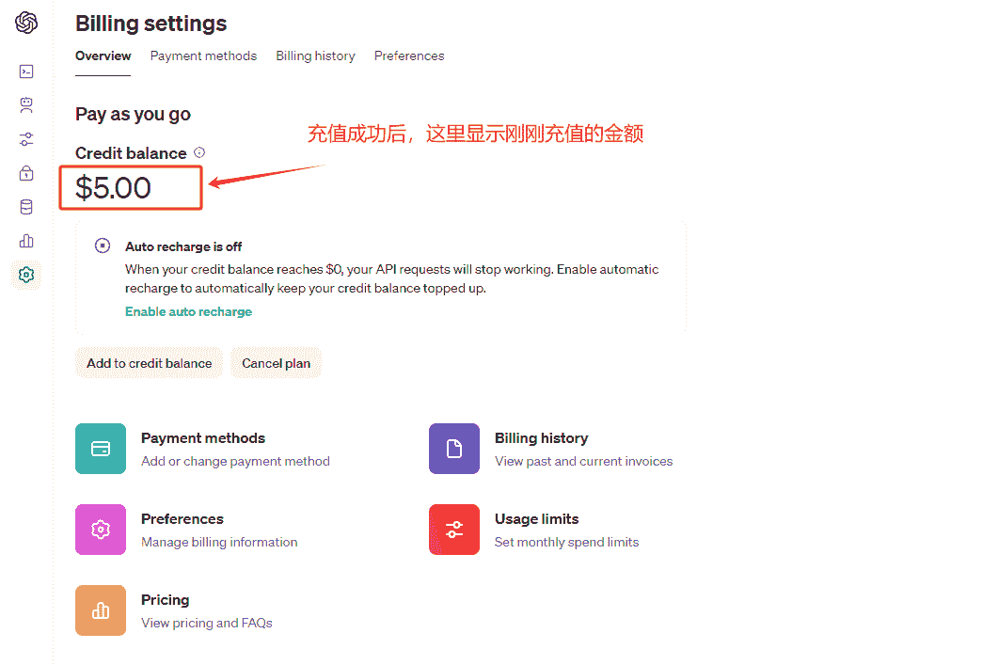

### Step 3：获取 OpenAI API Key

1.  **进入 API Keys 页面****：点击上方菜单中的D**ashboard，再点击左侧菜单中的 “API Keys”。

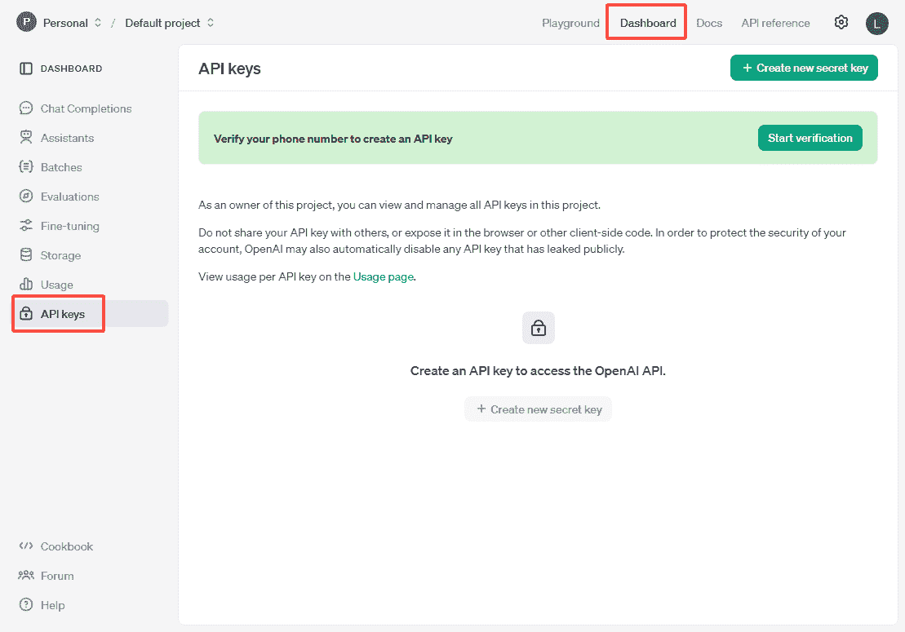

1.  
注意如果出现这一步说明我们在注册账号的过程中没有验证手机号，请在SMS虚拟手机号平台上购买国外手机号验证（在OPENAI注册的教程中有详细教程）。

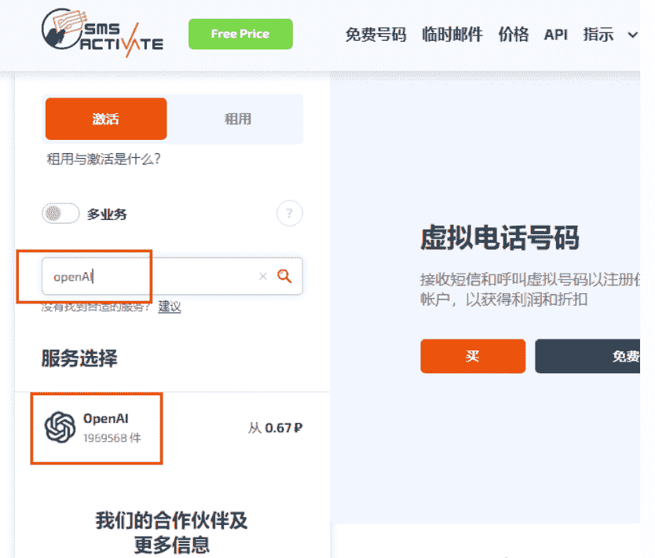

1.  **创建新密钥**：点击 “+ Create new secret key”。


1.  **命名密钥**：为您的 API Key 取一个名称，便于管理。

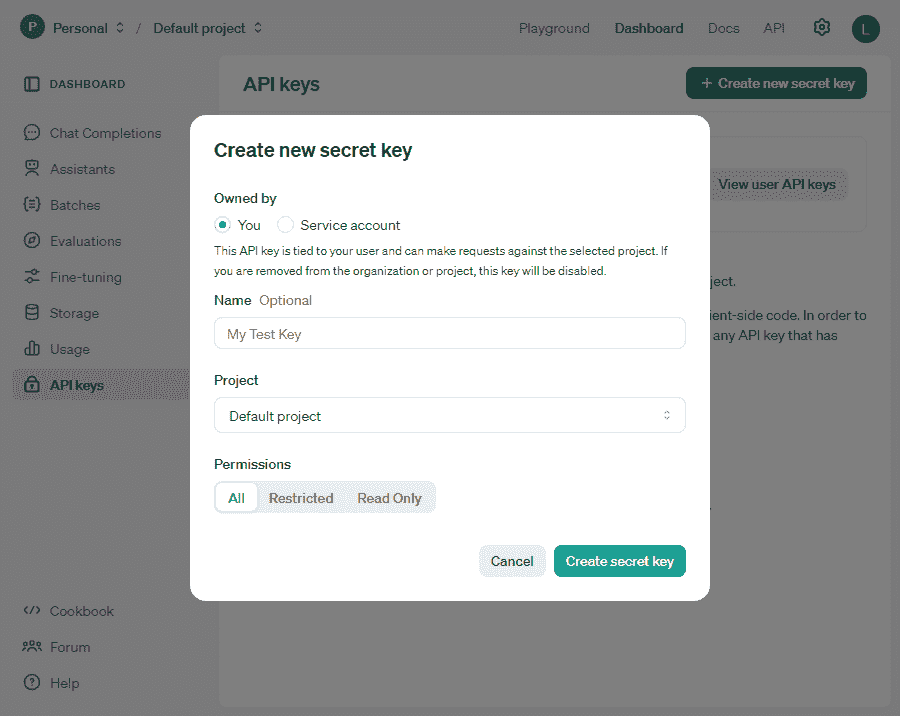

1.  **复制密钥**：创建后，点击 **“Copy”**，将 API Key 复制并妥善保存。

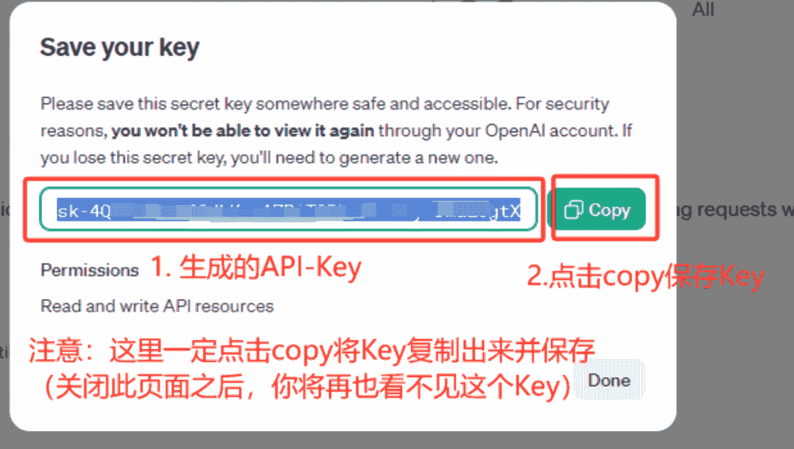

**注意**：API Key 只在创建时显示一次，务必保存到安全的地方。如发现密钥泄露，可在此页面删除并重新生成。

到此我们已成功完成：

+   **ChatGPT Plus 升级**

+   **OpenAI API账户充值**

+   **API Key 获取**

接下来让我们进行API的首次调用吧