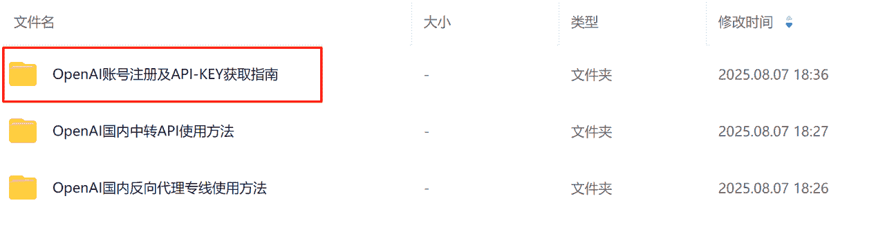

# OpenAI国内中转专线使用方法

> 来源：[https://kq4b3vgg5b.feishu.cn/docx/OC0Yd8whPoSCGtxUNYXc30b9ngg](https://kq4b3vgg5b.feishu.cn/docx/OC0Yd8whPoSCGtxUNYXc30b9ngg)

## OpenAI反向代理专线使用方法

国内反向代理专线是专为学员和粉丝准备的一条直连OpenAI官方服务器的专线。和国内其他中转服务不同，反向代理专线连接的不是中转服务器，而是官方服务器，因此能100%确保是官方提供的模型服务，而非中转服务。并且由于是国内反向代理专线，因此不受网络因素影响，在不借助任何网络工具的情况下，也能直连OpenAI官方服务器。

### 准备工作

既然是直连OpenAI官方服务器，因此会需要提前准备OpenAI官方API-KEY（注意是官方API-KEY，而不是中转API-KEY），具体获取方法，可以在网盘文件中查看官方账号注册及API获取方法：



此外，也可以直接在某宝上购买OpenAI API Key，不过需要甄别，需要购买官方API-KEY，而非中转API-KEY。

### 国内反向代理地址使用方法

当准备好API-KEY之后，即可在代码环境中测试连接，此时并不需要任何工具，仅需在`base_url`字段中填入`https://ai.devtool.tech/proxy/v1`，即可直连OpenAI服务：

```
# !pip install openai
```

```
import os
from dotenv import load_dotenv
load_dotenv(override=True)
from openai import OpenAI

client = OpenAI(
    base_url="https://ai.devtool.tech/proxy/v1",
    api_key=os.getenv("OPENAI_API_KEY"),
)

# 查看模型列表
model_list = client.models.list()

model_list.data
```


```
[Model(id=&#x27;gpt-4-0613&#x27;, created=1686588896, object=&#x27;model&#x27;, owned_by=&#x27;openai&#x27;),
 Model(id=&#x27;gpt-4&#x27;, created=1687882411, object=&#x27;model&#x27;, owned_by=&#x27;openai&#x27;),
 Model(id=&#x27;gpt-3.5-turbo&#x27;, created=1677610602, object=&#x27;model&#x27;, owned_by=&#x27;openai&#x27;),
 Model(id=&#x27;o4-mini-deep-research-2025-06-26&#x27;, created=1750866121, object=&#x27;model&#x27;, owned_by=&#x27;system&#x27;),
 Model(id=&#x27;codex-mini-latest&#x27;, created=1746673257, object=&#x27;model&#x27;, owned_by=&#x27;system&#x27;),
 Model(id=&#x27;gpt-4o-realtime-preview-2025-06-03&#x27;, created=1748907838, object=&#x27;model&#x27;, owned_by=&#x27;system&#x27;),
 Model(id=&#x27;gpt-4o-audio-preview-2025-06-03&#x27;, created=1748908498, object=&#x27;model&#x27;, owned_by=&#x27;system&#x27;),
 Model(id=&#x27;o4-mini-deep-research&#x27;, created=1749685485, object=&#x27;model&#x27;, owned_by=&#x27;system&#x27;),
 Model(id=&#x27;davinci-002&#x27;, created=1692634301, object=&#x27;model&#x27;, owned_by=&#x27;system&#x27;),
 Model(id=&#x27;babbage-002&#x27;, created=1692634615, object=&#x27;model&#x27;, owned_by=&#x27;system&#x27;),
 Model(id=&#x27;gpt-3.5-turbo-instruct&#x27;, created=1692901427, object=&#x27;model&#x27;, owned_by=&#x27;system&#x27;),
 Model(id=&#x27;gpt-3.5-turbo-instruct-0914&#x27;, created=1694122472, object=&#x27;model&#x27;, owned_by=&#x27;system&#x27;),
 Model(id=&#x27;dall-e-3&#x27;, created=1698785189, object=&#x27;model&#x27;, owned_by=&#x27;system&#x27;),
 Model(id=&#x27;dall-e-2&#x27;, created=1698798177, object=&#x27;model&#x27;, owned_by=&#x27;system&#x27;),
 Model(id=&#x27;gpt-4-1106-preview&#x27;, created=1698957206, object=&#x27;model&#x27;, owned_by=&#x27;system&#x27;),
 Model(id=&#x27;gpt-3.5-turbo-1106&#x27;, created=1698959748, object=&#x27;model&#x27;, owned_by=&#x27;system&#x27;),
 Model(id=&#x27;tts-1-hd&#x27;, created=1699046015, object=&#x27;model&#x27;, owned_by=&#x27;system&#x27;),
 Model(id=&#x27;tts-1-1106&#x27;, created=1699053241, object=&#x27;model&#x27;, owned_by=&#x27;system&#x27;),
 Model(id=&#x27;tts-1-hd-1106&#x27;, created=1699053533, object=&#x27;model&#x27;, owned_by=&#x27;system&#x27;),
 Model(id=&#x27;text-embedding-3-small&#x27;, created=1705948997, object=&#x27;model&#x27;, owned_by=&#x27;system&#x27;),
 Model(id=&#x27;text-embedding-3-large&#x27;, created=1705953180, object=&#x27;model&#x27;, owned_by=&#x27;system&#x27;),
 Model(id=&#x27;gpt-4-0125-preview&#x27;, created=1706037612, object=&#x27;model&#x27;, owned_by=&#x27;system&#x27;),
 Model(id=&#x27;gpt-4-turbo-preview&#x27;, created=1706037777, object=&#x27;model&#x27;, owned_by=&#x27;system&#x27;),
 Model(id=&#x27;gpt-3.5-turbo-0125&#x27;, created=1706048358, object=&#x27;model&#x27;, owned_by=&#x27;system&#x27;),
 Model(id=&#x27;gpt-4-turbo&#x27;, created=1712361441, object=&#x27;model&#x27;, owned_by=&#x27;system&#x27;),
 Model(id=&#x27;gpt-4-turbo-2024-04-09&#x27;, created=1712601677, object=&#x27;model&#x27;, owned_by=&#x27;system&#x27;),
 Model(id=&#x27;gpt-4o&#x27;, created=1715367049, object=&#x27;model&#x27;, owned_by=&#x27;system&#x27;),
 Model(id=&#x27;gpt-4o-2024-05-13&#x27;, created=1715368132, object=&#x27;model&#x27;, owned_by=&#x27;system&#x27;),
 Model(id=&#x27;gpt-4o-mini-2024-07-18&#x27;, created=1721172717, object=&#x27;model&#x27;, owned_by=&#x27;system&#x27;),
 Model(id=&#x27;gpt-4o-mini&#x27;, created=1721172741, object=&#x27;model&#x27;, owned_by=&#x27;system&#x27;),
 Model(id=&#x27;gpt-4o-2024-08-06&#x27;, created=1722814719, object=&#x27;model&#x27;, owned_by=&#x27;system&#x27;),
 Model(id=&#x27;chatgpt-4o-latest&#x27;, created=1723515131, object=&#x27;model&#x27;, owned_by=&#x27;system&#x27;),
 Model(id=&#x27;o1-mini-2024-09-12&#x27;, created=1725648979, object=&#x27;model&#x27;, owned_by=&#x27;system&#x27;),
 Model(id=&#x27;o1-mini&#x27;, created=1725649008, object=&#x27;model&#x27;, owned_by=&#x27;system&#x27;),
 Model(id=&#x27;gpt-4o-realtime-preview-2024-10-01&#x27;, created=1727131766, object=&#x27;model&#x27;, owned_by=&#x27;system&#x27;),
 Model(id=&#x27;gpt-4o-audio-preview-2024-10-01&#x27;, created=1727389042, object=&#x27;model&#x27;, owned_by=&#x27;system&#x27;),
 Model(id=&#x27;gpt-4o-audio-preview&#x27;, created=1727460443, object=&#x27;model&#x27;, owned_by=&#x27;system&#x27;),
 Model(id=&#x27;gpt-4o-realtime-preview&#x27;, created=1727659998, object=&#x27;model&#x27;, owned_by=&#x27;system&#x27;),
 Model(id=&#x27;omni-moderation-latest&#x27;, created=1731689265, object=&#x27;model&#x27;, owned_by=&#x27;system&#x27;),
 Model(id=&#x27;omni-moderation-2024-09-26&#x27;, created=1732734466, object=&#x27;model&#x27;, owned_by=&#x27;system&#x27;),
 Model(id=&#x27;gpt-4o-realtime-preview-2024-12-17&#x27;, created=1733945430, object=&#x27;model&#x27;, owned_by=&#x27;system&#x27;),
 Model(id=&#x27;gpt-4o-audio-preview-2024-12-17&#x27;, created=1734034239, object=&#x27;model&#x27;, owned_by=&#x27;system&#x27;),
 Model(id=&#x27;gpt-4o-mini-realtime-preview-2024-12-17&#x27;, created=1734112601, object=&#x27;model&#x27;, owned_by=&#x27;system&#x27;),
 Model(id=&#x27;gpt-4o-mini-audio-preview-2024-12-17&#x27;, created=1734115920, object=&#x27;model&#x27;, owned_by=&#x27;system&#x27;),
 Model(id=&#x27;o1-2024-12-17&#x27;, created=1734326976, object=&#x27;model&#x27;, owned_by=&#x27;system&#x27;),
 Model(id=&#x27;o1&#x27;, created=1734375816, object=&#x27;model&#x27;, owned_by=&#x27;system&#x27;),
 Model(id=&#x27;gpt-4o-mini-realtime-preview&#x27;, created=1734387380, object=&#x27;model&#x27;, owned_by=&#x27;system&#x27;),
 Model(id=&#x27;gpt-4o-mini-audio-preview&#x27;, created=1734387424, object=&#x27;model&#x27;, owned_by=&#x27;system&#x27;),
 Model(id=&#x27;computer-use-preview&#x27;, created=1734655677, object=&#x27;model&#x27;, owned_by=&#x27;system&#x27;),
 Model(id=&#x27;o3-mini&#x27;, created=1737146383, object=&#x27;model&#x27;, owned_by=&#x27;system&#x27;),
 Model(id=&#x27;o3-mini-2025-01-31&#x27;, created=1738010200, object=&#x27;model&#x27;, owned_by=&#x27;system&#x27;),
 Model(id=&#x27;gpt-4o-2024-11-20&#x27;, created=1739331543, object=&#x27;model&#x27;, owned_by=&#x27;system&#x27;),
 Model(id=&#x27;computer-use-preview-2025-03-11&#x27;, created=1741377021, object=&#x27;model&#x27;, owned_by=&#x27;system&#x27;),
 Model(id=&#x27;gpt-4o-search-preview-2025-03-11&#x27;, created=1741388170, object=&#x27;model&#x27;, owned_by=&#x27;system&#x27;),
 Model(id=&#x27;gpt-4o-search-preview&#x27;, created=1741388720, object=&#x27;model&#x27;, owned_by=&#x27;system&#x27;),
 Model(id=&#x27;gpt-4o-mini-search-preview-2025-03-11&#x27;, created=1741390858, object=&#x27;model&#x27;, owned_by=&#x27;system&#x27;),
 Model(id=&#x27;gpt-4o-mini-search-preview&#x27;, created=1741391161, object=&#x27;model&#x27;, owned_by=&#x27;system&#x27;),
 Model(id=&#x27;gpt-4o-transcribe&#x27;, created=1742068463, object=&#x27;model&#x27;, owned_by=&#x27;system&#x27;),
 Model(id=&#x27;gpt-4o-mini-transcribe&#x27;, created=1742068596, object=&#x27;model&#x27;, owned_by=&#x27;system&#x27;),
 Model(id=&#x27;o1-pro-2025-03-19&#x27;, created=1742251504, object=&#x27;model&#x27;, owned_by=&#x27;system&#x27;),
 Model(id=&#x27;o1-pro&#x27;, created=1742251791, object=&#x27;model&#x27;, owned_by=&#x27;system&#x27;),
 Model(id=&#x27;gpt-4o-mini-tts&#x27;, created=1742403959, object=&#x27;model&#x27;, owned_by=&#x27;system&#x27;),
 Model(id=&#x27;o4-mini-2025-04-16&#x27;, created=1744133506, object=&#x27;model&#x27;, owned_by=&#x27;system&#x27;),
 Model(id=&#x27;o4-mini&#x27;, created=1744225351, object=&#x27;model&#x27;, owned_by=&#x27;system&#x27;),
 Model(id=&#x27;gpt-4.1-2025-04-14&#x27;, created=1744315746, object=&#x27;model&#x27;, owned_by=&#x27;system&#x27;),
 Model(id=&#x27;gpt-4.1&#x27;, created=1744316542, object=&#x27;model&#x27;, owned_by=&#x27;system&#x27;),
 Model(id=&#x27;gpt-4.1-mini-2025-04-14&#x27;, created=1744317547, object=&#x27;model&#x27;, owned_by=&#x27;system&#x27;),
 Model(id=&#x27;gpt-4.1-mini&#x27;, created=1744318173, object=&#x27;model&#x27;, owned_by=&#x27;system&#x27;),
 Model(id=&#x27;gpt-4.1-nano-2025-04-14&#x27;, created=1744321025, object=&#x27;model&#x27;, owned_by=&#x27;system&#x27;),
 Model(id=&#x27;gpt-4.1-nano&#x27;, created=1744321707, object=&#x27;model&#x27;, owned_by=&#x27;system&#x27;),
 Model(id=&#x27;gpt-image-1&#x27;, created=1745517030, object=&#x27;model&#x27;, owned_by=&#x27;system&#x27;),
 Model(id=&#x27;gpt-3.5-turbo-16k&#x27;, created=1683758102, object=&#x27;model&#x27;, owned_by=&#x27;openai-internal&#x27;),
 Model(id=&#x27;tts-1&#x27;, created=1681940951, object=&#x27;model&#x27;, owned_by=&#x27;openai-internal&#x27;),
 Model(id=&#x27;whisper-1&#x27;, created=1677532384, object=&#x27;model&#x27;, owned_by=&#x27;openai-internal&#x27;),
 Model(id=&#x27;text-embedding-ada-002&#x27;, created=1671217299, object=&#x27;model&#x27;, owned_by=&#x27;openai-internal&#x27;)]
```


然后即可测试调用模型：

```
reponse = client.chat.completions.create(
  model=&quot;gpt-4o&quot;,
  messages=[
    {
      &quot;role&quot;: &quot;user&quot;,
      &quot;content&quot;: [
        {
          &quot;type&quot;: "text",
          "text": "你好，好久不见，请介绍下你自己。"
        }
      ]
    }
  ]
)
```

```
print(reponse.choices[0].message.content)
```

```
你好！我是 OpenAI 的语言模型助手，可以帮助回答各种问题、提供信息、撰写和编辑文本等等。我是基于大规模数据训练而成，因此涵盖了广泛的话题。如果你有任何问题或者需要帮助，随时告诉我！那么，有什么我可以帮你的吗？
```


