# OpenAI的账号注册速通指南

> 来源：[https://kq4b3vgg5b.feishu.cn/docx/TZiJdnpvhoqL66x6gxzc3oIanfh](https://kq4b3vgg5b.feishu.cn/docx/TZiJdnpvhoqL66x6gxzc3oIanfh)

作为大模型革命的领军者,OpenAI的模型性能是目前世界最强、效果最佳的。ChatGPT的全球热潮更是定义了新一代AI产品的标准。学习大模型技术,首先要了解如何使用OpenAI的GPT模型以及OPENAI定义的大模型技术体系，它们相当于是大模型应用技术路线中的主线，本质。随着应用深入,大模型应用领域从网页版的对话，到调用大模型的API接入到自己的应用中，到现在OPENAI开放出来了语音对话接口，微调的API和蒸馏的API等等，而这一切必须先拥有OpenAI的账号以及模型的API Key。

因此,我们首先要详细介绍OpenAI账号注册、ChatGPT Plus升级流程和API获取。需注意,OpenAI使用限制严格,而我们就处在被限制使用的区域。虽然市面上有许多账号提供商,但批量注册的账号容易导致封号和数据丢失。因此,掌握自主注册和升级流程至关重要。

**OpenAI账号注册准备工作**

OpenAI账号注册流程很比较固定了总共是国外的邮箱和国外的手机号验证, 但由于国内监管和OpenAI封锁措施日益严格,整个过程变得不稳定,易出现意外。注册前需要:

1.  准备可靠的网络代理工具

1.  学会设置网络代理工具的全域代理模式，如：

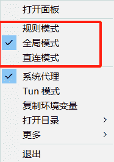

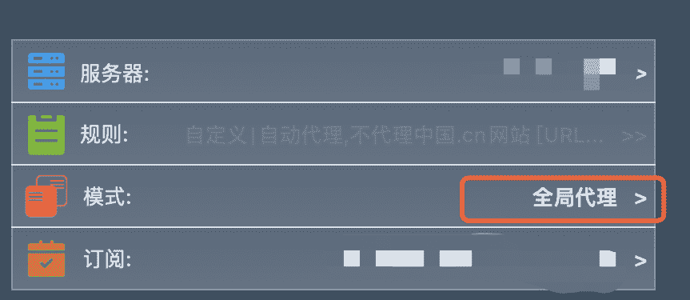

鉴于过程中存在不确定性,保持冷静、反复尝试可能是最高效的方法。根据教程,各环节出现的问题都有对应解决方案,按步骤耐心尝试即可成功。

# 二、OPEN AI 的注册

## OPEN AI注册流程

+   注册谷歌邮箱来快速注册OPENAI

+   完成OPENAI的手机号验证

## 注册主要门槛：接收国外手机号的验证码

在**OPEN** AI的注册过程中，OPEN AI的手机号验证要涉及到接收国外手机号的验证码，另一处为注册辅助的邮箱时会用到。此时我们就需要使用虚拟号码来通过验证。

一种方法是下面教程用的——需要借助老牌的主流的 SMS接码平台“SMS-active” 提供的不同服务，不同国家的短信虚拟号码来绕过地理限制接受验证码。

因为不同服务的，不同国家的虚拟号码都有一定的价格，所以在购买前要先最低预充值2美金，折合人民币不到15元，几乎所有的SMS接码平台都需要先充值再购买。而在具体的使用时，我们大概需要花0.5美金的点数（折合人民币最多4元），剩下的都可以留着购买其他国外服务的手机号或帮助朋友注册。

另一种方法则可以在某宝上进行购买，搜索“SMS虚拟手机号”，联系客服告知我们要注册的是什么服务（例如Gmail、Outlook、OPEN AI），接下来客服会发给我们验证码，其实商家就是用第一种方法再卖给我们。

注意，页面价格不一定为实际价格，合理价格在1~5元以内，如果选择英美地区会更贵一些。

同时还有一些网站卖成品号或中转的API，但因为并不稳定或者相当于“黑盒”操作，并不建议。

建议掌握SMS-active平台的自主接收验证码的能力，以及用国外手机号注册国外邮箱登录，以确保长期访问，得鱼不如会渔。

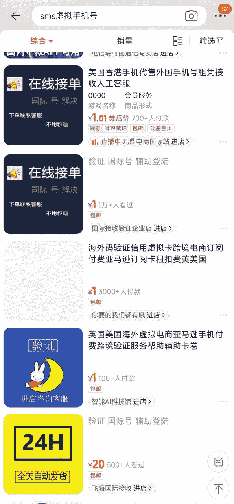

这样的验证流程一般是商家提供我们手机号，我们点击发送验证码，商家再告诉我们他收到的验证码：

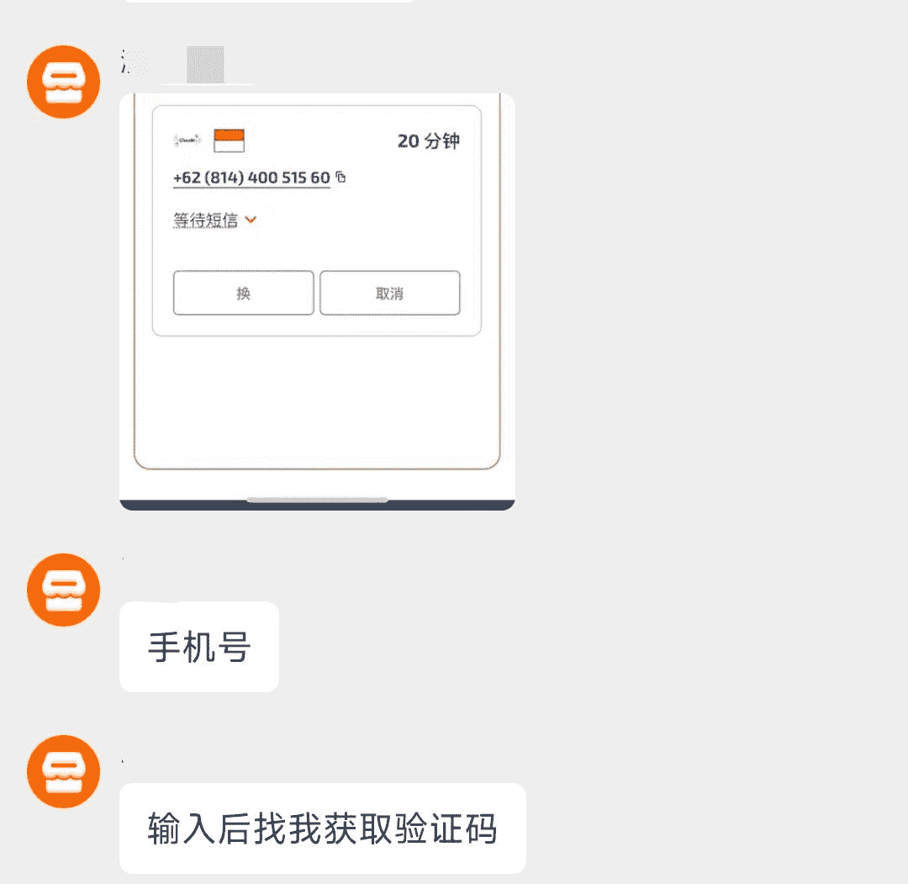

## OPEN AI注册流程

准备工作：开启网络工具，使用全局模式。检查节点，应该为英美地区，不能为亚洲地区。同时浏览器打开隐身模式。在实际注册过程中，推荐使用谷歌浏览器。

1.  访问OPEN AI官方注册页面
进入chatgpt主页：https://chatgpt.com/，点击创建账户

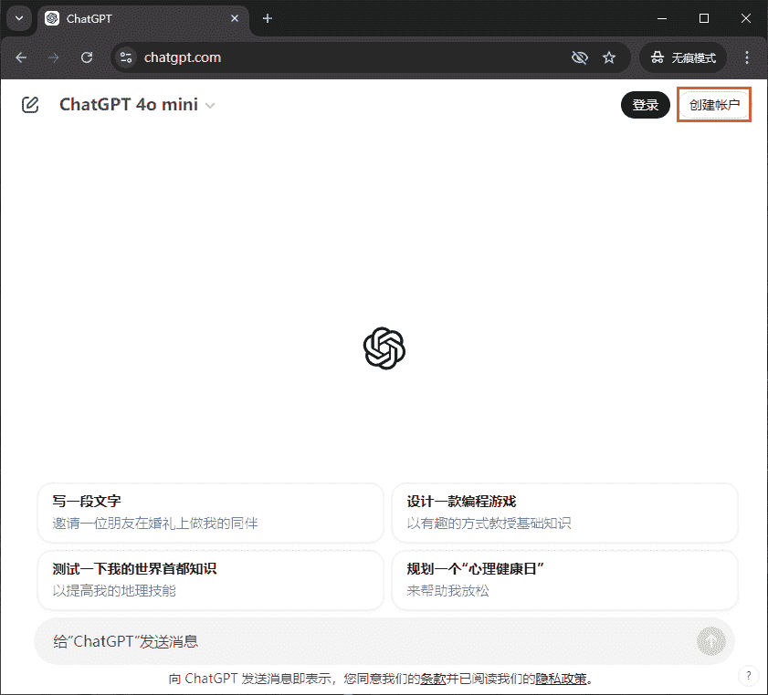

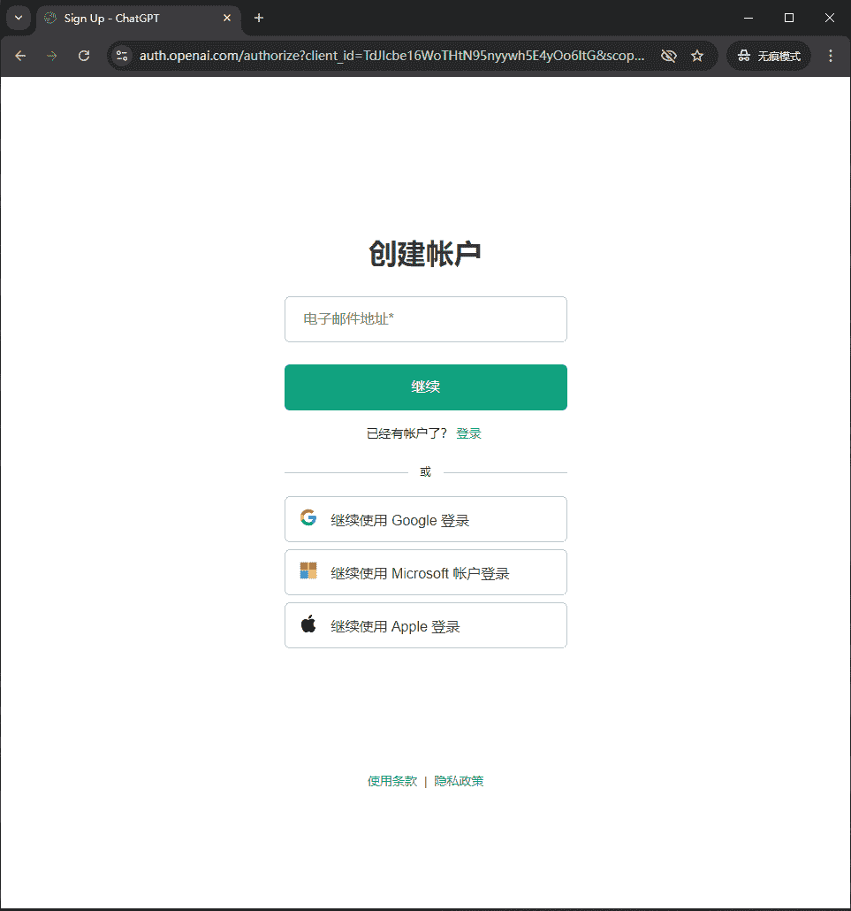

如果打不开OPEN AI主页或出现如图的限制：

1.  先检查是网络工具是否可以正常使用，例如打开油管页面应是正常显示的。如果是如图的这种显示，说明是网络工具未正确打开。

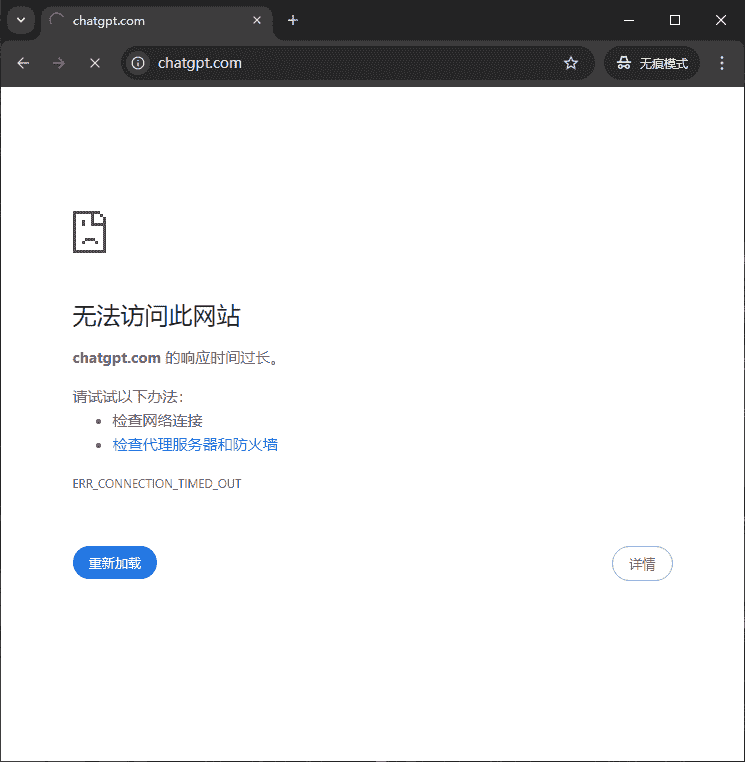

1.  如果网页可以打开，其他网址可以正常显示，但OPEN AI显示如图，则网络工具是通的，但是因为此时所用的节点仍是被限制的节点，此时检查节点应该为英美地区，不能为亚洲地区。网络工具模式应为global全局模式，而不是rule规则模式，direct直连模式。

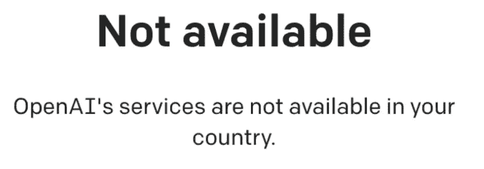

若在跳转注册的页面或后续的注册过程中出现如图的校验，是正常的现象，点击方框就可以

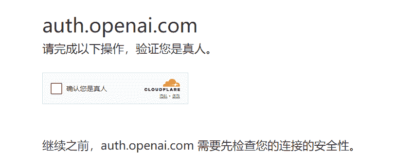

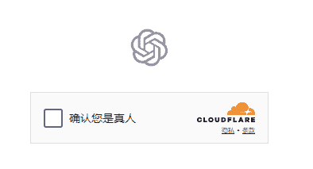

1.  验证国外邮箱
尝试用自己的账号登录，看看是否有能通过OPEN AI验证的国外邮箱。
同时建议优先使用下方的3个账号联动登录，更方便快捷。如果不可以再尝试直接在方框中输入国外邮箱地址。注意因为OPEN AI未对中国用户开放，所以填写国内的邮箱是行不通的。

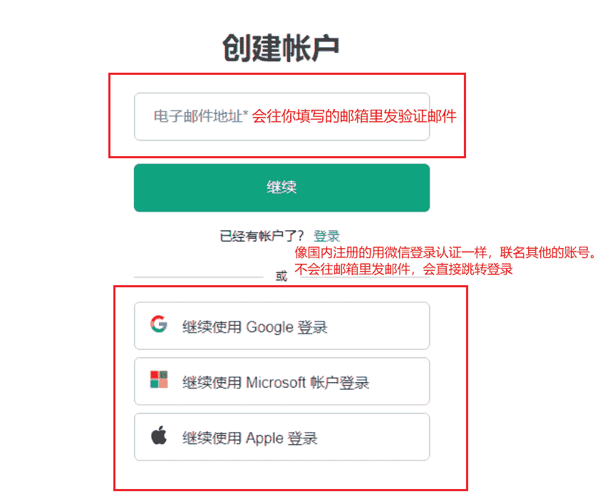

1.  限制地区的邮箱出现的情况：

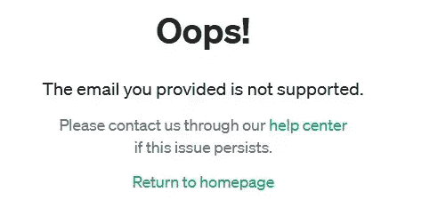

1.  
如果用自己曾经的国外账号邮箱登录验证OPEN AI成功，可直接跳转至步骤4；如果暂时没有，那么从接下来步骤1做起就可以。我们将会注册一个谷歌账户，并由此注册OPENAI。因为谷歌账户比较稳定，在国外各大平台权威性比较高，按照教程注册的谷歌账号比较稳定，后续在试用其他大模型时也可以直接注册登录。

### 步骤 1: 使用第一个国外手机号注册国外邮箱Gmail

由于谷歌邮箱在各大平台上的高认可度，我们将通过SMS接码平台注册一个新的谷歌邮箱。当然，例如Outlook、Yahoo等主流国际邮箱也同样适用，在电话号码验证这一步需同样使用SMS接码平台的国外虚拟号码即可。

1.  **访问谷歌账号登录页面**

+   **搜索Gm**ail，转到 Google 账号登录页面。点击创建账户选择个人用途。

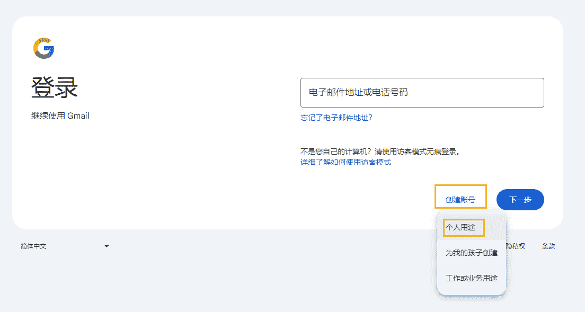

1.  **填写注册信息**

+   -根据页面指示输入您的姓名、出生日期、性别、设置密码，并确定邮箱地址，直到达到电话号码验证步骤。

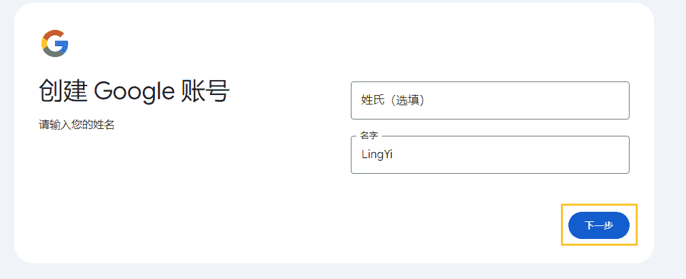

+   
注意年龄要18岁往上，大模型产品部分功能对年龄有限制，即199几年，2000年前

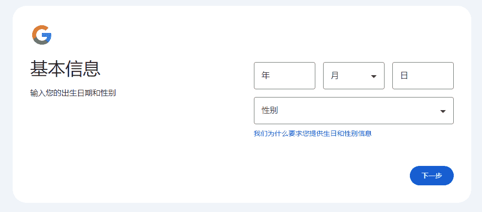

这里就是填写我们以后的邮箱地址，所以用户名最好写的便于记忆

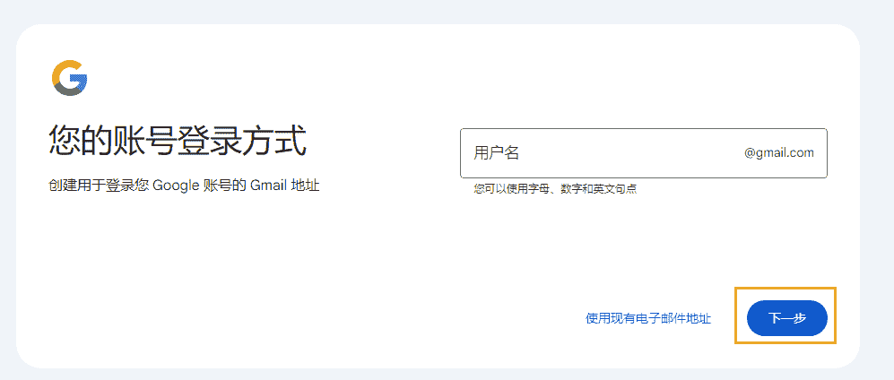

填写密码了，我们使用的是一次性手机号，如果注册成功后没有自己修改验证手机号码为自己的手机号是找不回来的。所以一定要记住，有时多次输入错误也会被封禁账号。

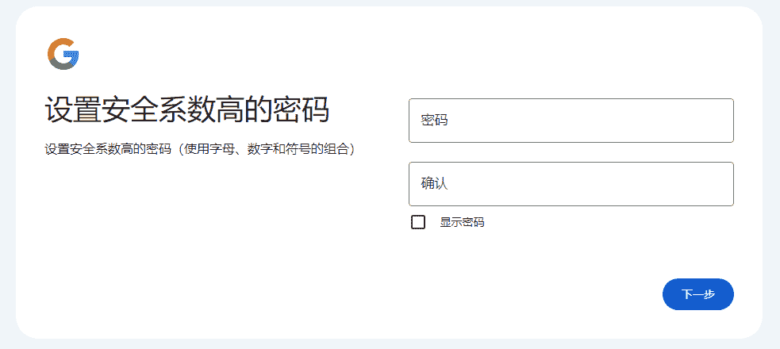

+   接下来就是手机号验证了，国内手机号注册是行不通的。此时就需要借助sms接码平台来绕过地理限制通过购买也用于Gmail服务的不同国家的可用虚拟号20分钟的使用权来收发验证码。

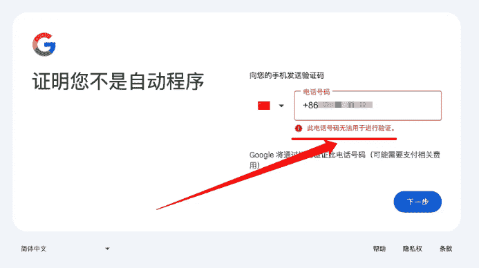

+   使用SMS接码平台注册第一个国外手机号（用于邮箱验证）

1.  注册登入SMS接码平台 SMS-active

1.  [我们选择的是经过多年验证](https://sms-activate.io/cn)的老牌主流SMS接码平台——SMS-Activate。进入页面后，点击右上角的注册或登录。可以使用国内邮箱进行注册。为方便教程展示，我们将界面设置为中文。

1.  **充值来购买虚拟号码**

1.  虚拟号码各有不同的价格，此时需进行充值购买。注册成功后，选择支付方式（如支付宝），最低充值金额为2美元。充值完成后，余额可以保留用于后续服务。

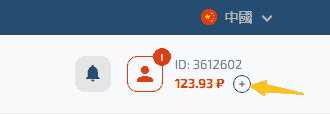

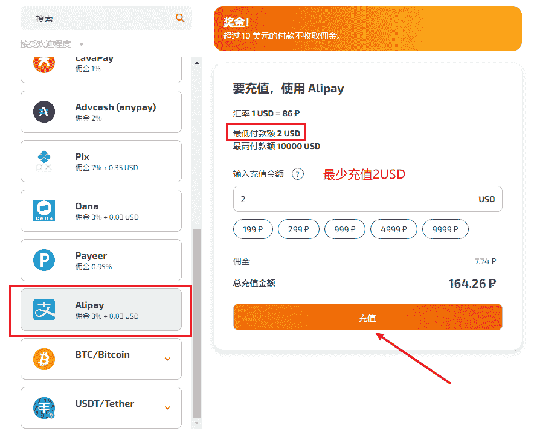

1.  **激活虚拟号码并等待验证码**

1.  注册并登录成功后，主界面分为左侧和右侧两个功能区。在左侧默认的“激活”处搜索框中输入我们需要注册的服务名，需要注册邮箱的用户请搜索Gmail 并展开。
注意尽量选英美国家，小众国家。重点是排除掉那些战乱或可能同样像国内的一样被限制的国家，如俄罗斯等。如果选的国家没有收到验证码也可以退掉，可以重新试，不会有损失。

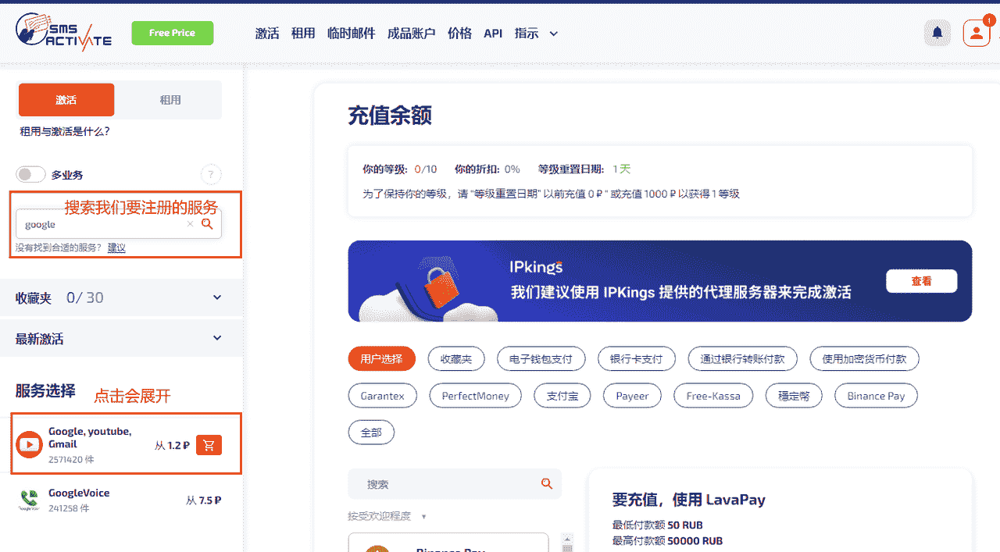

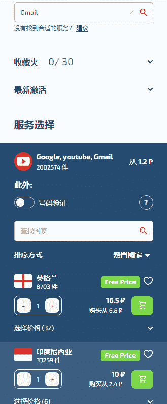

+   
点击右侧的绿色购物车图标，进入购买页面。默认的选项就可以。

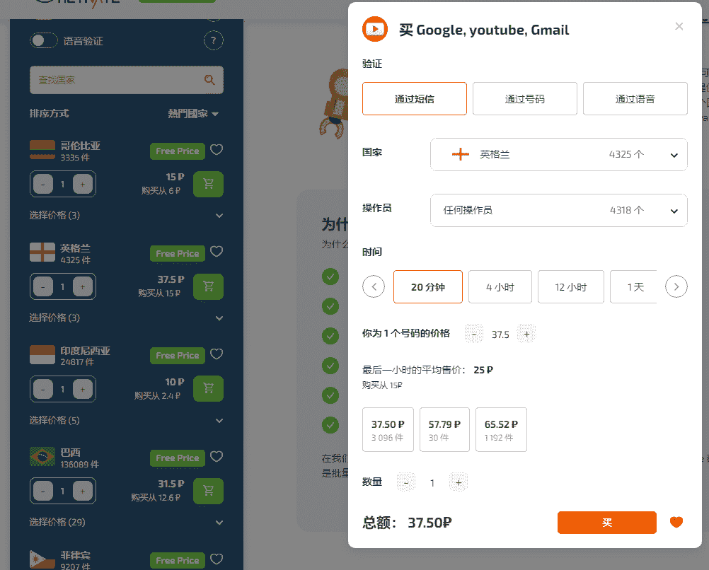

+   购买成功后，点击“激活”按钮等待接收验证码。

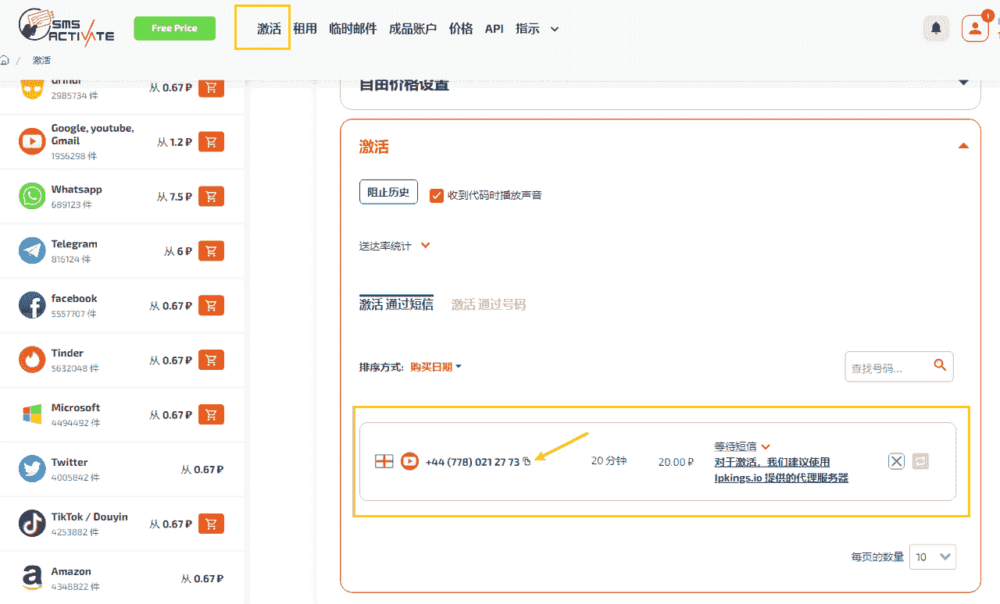

+   
租赁后要将手机号填入Gmail中来收验证码，Gmail发送验证码后，就可以在SMS平台看到收到的验证码。此时复制返回Gmail填入验证码完成验证。

1.  **虚拟电话验证**

+   填入步骤1的在SMS-active购买虚拟号码，输入接收到的验证码完成验证步骤。

+   
此时如果发送验证码 3分钟内都没有收到验证码，就点击这个电话号码旁的“叉号”退掉电话号码，换国家重新购买。这里确实有可能需要多次再次尝试，但不外乎是先重新购买国家为英美欧国家的新的手机号，同时检查自己网络工具的节点为全局模式，节点也不应该为亚洲国家。

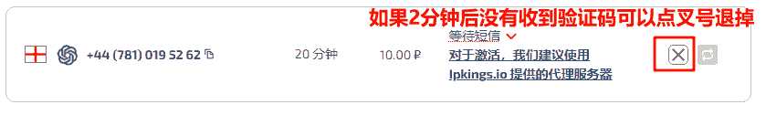

+

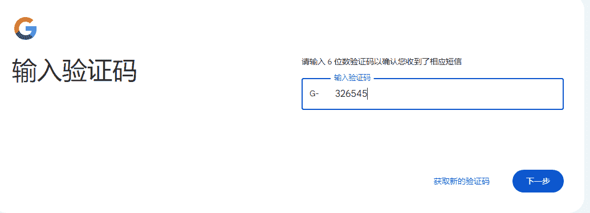

1.  **注册成功**

+   恭喜您成功注册谷歌账号！现在可以返回OPEN AI进行填写验证。

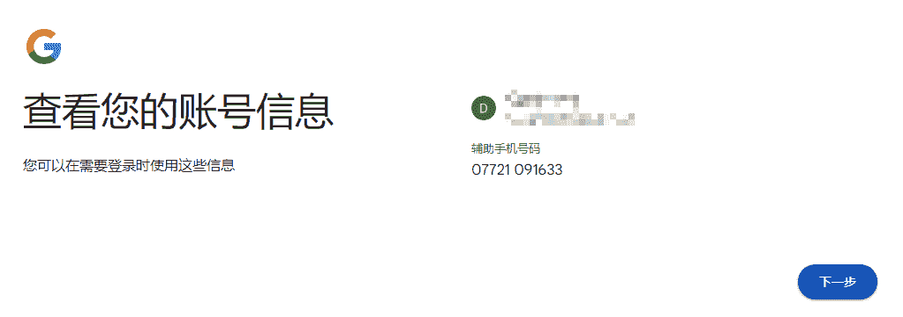

### 步骤 3: 使用经过验证的国外邮箱注册OPEN AI

好，准备好谷歌邮箱之后，接下来我们即可进行OpenAI账号注册了。注意，这里需要使用魔法，并需要设置全局代理。

1.  进入chatgpt主页：https://chatgpt.com/，
登录上一步注册好的谷歌账号，直接点击“使用Google登录”。

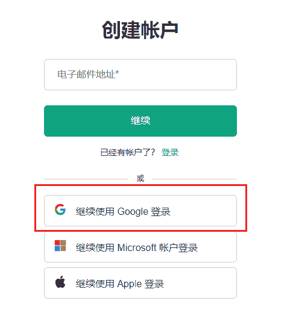

1.  
选择刚刚注册号的Google账号，进行下一步注册。

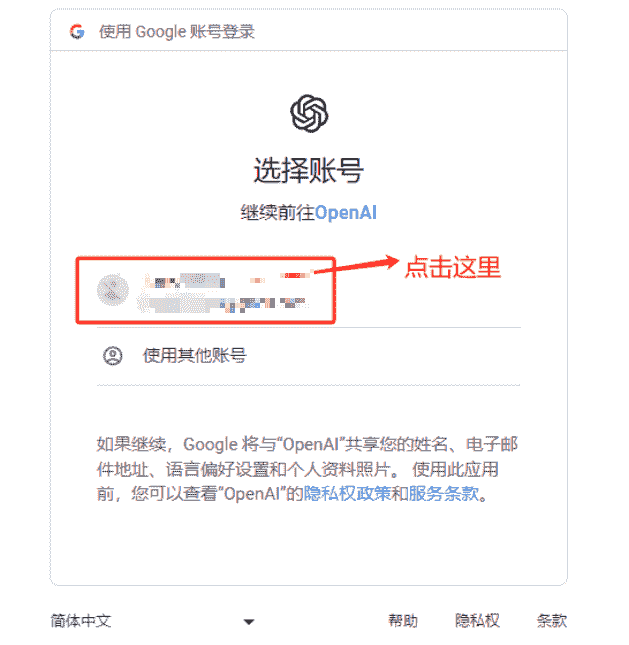

点击“continue"，继续下一步：

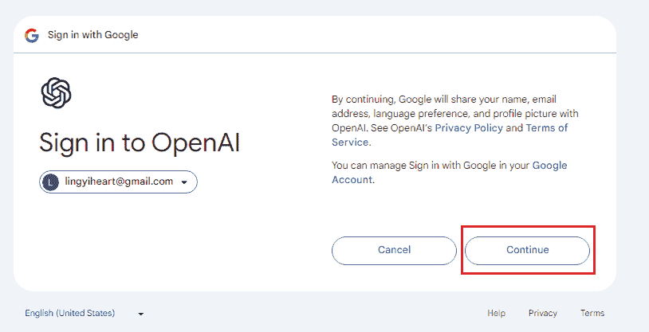

如果出现了手机号验证的信息则往下走到步骤 4: 使用SMS接码平台注册第二个国外手机号（用于OPEN AI验证）

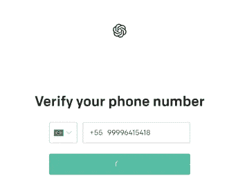

如果一切顺利，没有出现手机号验证一步，直接开始昵称和出生日期，可以跳过步骤4. 出现如下的页面说明已经注册成功啦！但是，我们作为开发者后续是要领取API Key来将大模型嵌入到自己的应用中的，请往下再走一步——验证OPENAI的手机号。

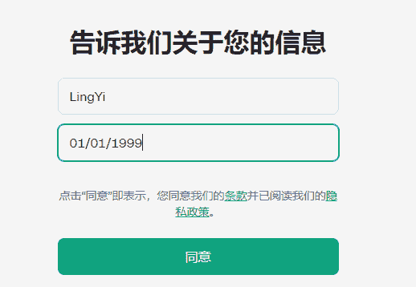

### 步骤 4: 使用SMS接码平台注册第二个国外手机号（用于OPEN AI验证）

虽然使用谷歌账号关联可直接注册成功可快速注册使用ChatGPT对话,但API使用需要额外步骤。同时仅仅使用国外邮箱地址注册登录的而不是谷歌账号关联注册登录的用户一般也会让验证一次手机号。

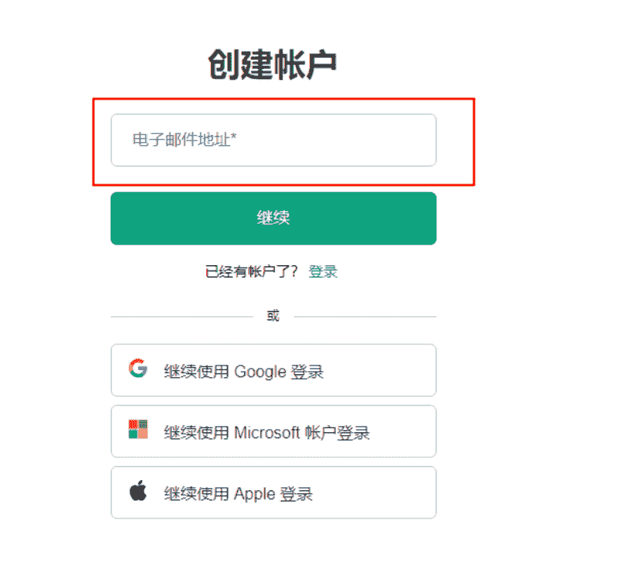

已经注册成功的用户领取APIKEY前的手机号验证入口：

+   **对话使用 vs 开发调用使用**：

+   **ChatGPT账号**和**ChatGPT Plus会员**主要面向个人用户，提供直接的对话体验和增强服务。

+   **ChatGPT API**是一种面向开发者的接口，允许将ChatGPT的语言模型功能集成到自己的应用、网站或服务中。

API Key**是ChatGPT API**的一串唯一的标识符，用于验证调用者的身份，如同个人指纹,独一无二。它的作用就像是一个超级安保系统，能够有验证调用者身份 • 控制API资源访问 • 确保授权用户/应用访问等的安全保障。

如图：

**

登录开发者平**台：访问** https://platf****orm.openai****.com/**，使用您的 OpenAI 账号登录。

进入 API Keys 页面：点击上方菜单中的Dashboard，再点击左侧菜单中的 “API Keys”。

验证手机号：准备好新一轮调用API前所需进行的的手机号验证。值得一提的是即使此处开放了大陆的手机区号，但鉴于它的限制政策（不对大陆地区开放）以及后续调用APIKEY需要充值注册虚拟信用卡的开卡或封号的试错成本太高了，我们要用低成本的1元左右的的消费去规避它——即用国外未被限制国家的手机号验证。

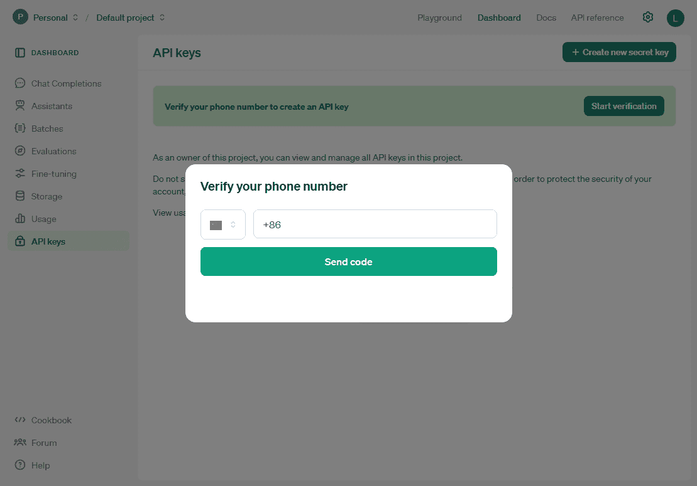

+   不同的时期，不同的情况有的人可能要注册时验证，有的人可能注册时不用验证手机号但领取APIKEY前要验证。所以验证OPENAI的手机号其实是逃不开的。OPENAI的坏笑.jpg

+   我们还是使用sms接码平台去购买收收验证码，不用担心和注册谷歌的要使用同样的手机号，并不是。因为这是两个平台应用，我们是借助谷歌账号快速注册了OPENAI。
以上两种都还是往下走就可以了

1.  注册登入SMS接码平台 SMS-active
**此处已经在上方**[步骤使用SMS-acti](https://sms-activate.io/cn)ve注册充值来注册Gmail服务的小伙伴们就可以跳过注册和充值这两步啦 是一样的~ 可以直接去购买OPEN AI服务的虚拟电话号码处
我们选择的是经过多年验证的老牌主流SMS接码平台——SMS-Activate。进入页面后，点击右上角的注册或登录。可以使用国内邮箱进行注册。为方便教程展示，我们将界面设置为中文。

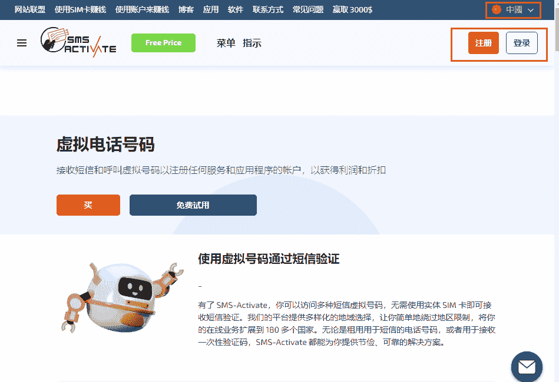

1.  **充值来购买虚拟号码**
此处已经在上方步骤使用SMS-active注**册充值来注册Gmai**l服务的小伙伴们就可以跳过注册和充值这两步啦 是一样的~ 可以直接去购买OPEN AI服务的虚拟电话号码。
虚拟号码各有不同的价格，此时需进行充值购买。注册成功后，选择支付方式（如支付宝），最低充值金额为2美元。充值完成后，余额可以保留用于后续服务。

1.  激活注册OPEN AI服务的虚拟号码并等待验证码
注册登录成功后，主界面分为左侧和右侧两个功能区。在左侧搜索框中输入我们需要注册的OPENAI。在默认的“激活”处。

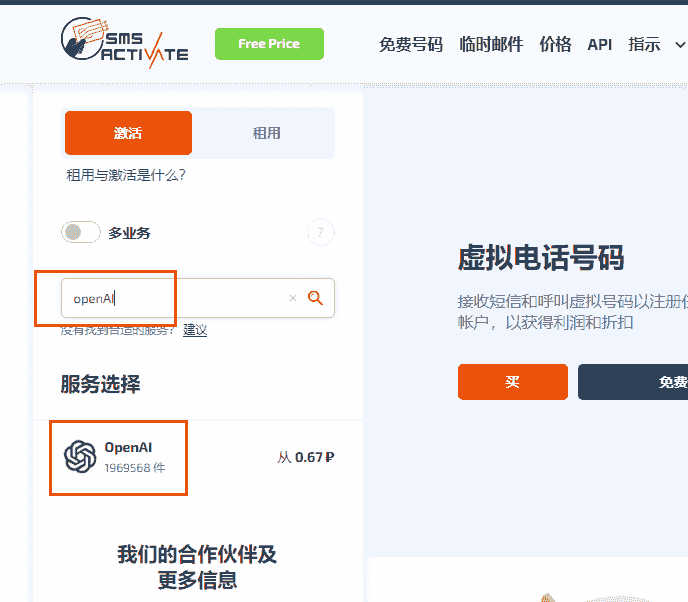

1.  
点击服务展开后会有一系列的国家的手机号可供选择并各有不同的价格。
注意尽量选英美国家，小众国家。重点是排除掉那些战乱或可能同样像国内的一样被限制的国家，如俄罗斯等。如果选的国家没有收到验证码也可以退掉，可以重新试，不会有损失。

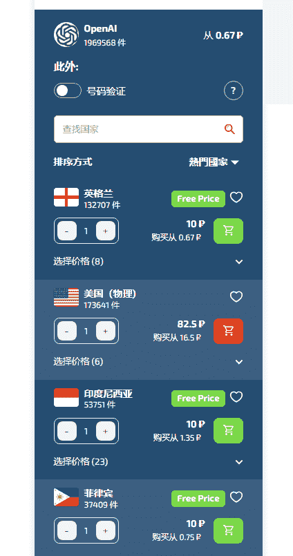

点击右侧的绿色购物车图标，进入购买页面。购买成功后，点击“激活”按钮等待接收验证码。默认的选项就可以。建议购买时记住所购买的国家的名字，后面发验证码的时候要选择国家

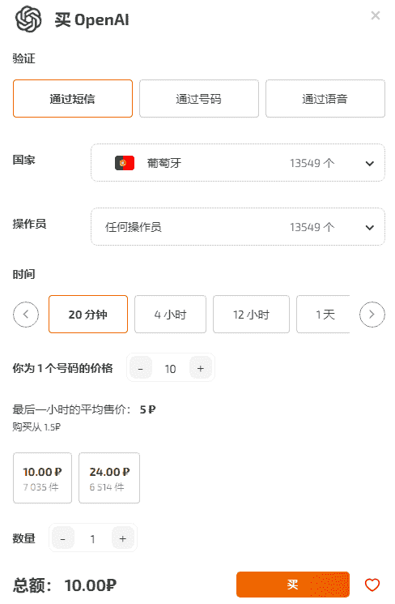

收到验证码后，返回并填入相应字段完成验证。

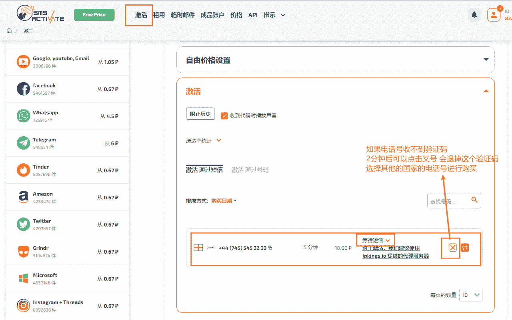

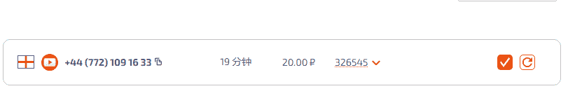

### 步骤 5: 使用第二个国外手机号验证OPEN AI账号

1.  回到OPEN AI注册页面填写SMS active的手机号码， 完成手机号验证
先更改前方的国家，国家和所购买的电话号的国家一致。例如购买英国的对应OPENAI中的

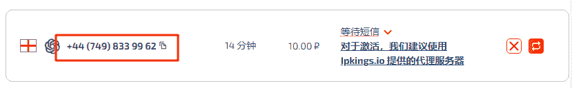

1.

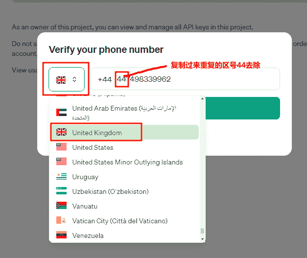

1.  
即像这样：

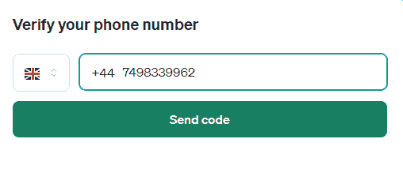

复制验证码填写

+   此时如果点过SendCode 3分钟内都没有收到验证码，就点击这个电话号码旁的“叉号”退掉电话号码，换国家重新购买。这里确实有可能需要多次再次尝试，但不外乎是先重新购买国家为英美欧国家的新的手机号，同时检查自己网络工具的节点为全局模式，节点也不应该为亚洲国家。

+

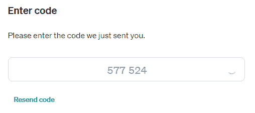

+   
如果是APIKEY中验证的电话号码后续会跳出来APIKEY的后续步骤，会在下面的课程中详细讲解。

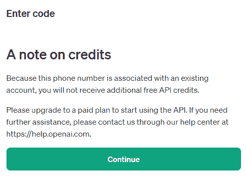

+   
出现这种情况也没有关系，正常注册可能会有这个表示我们领取不了免费的API Key了。但不影响我们的使用

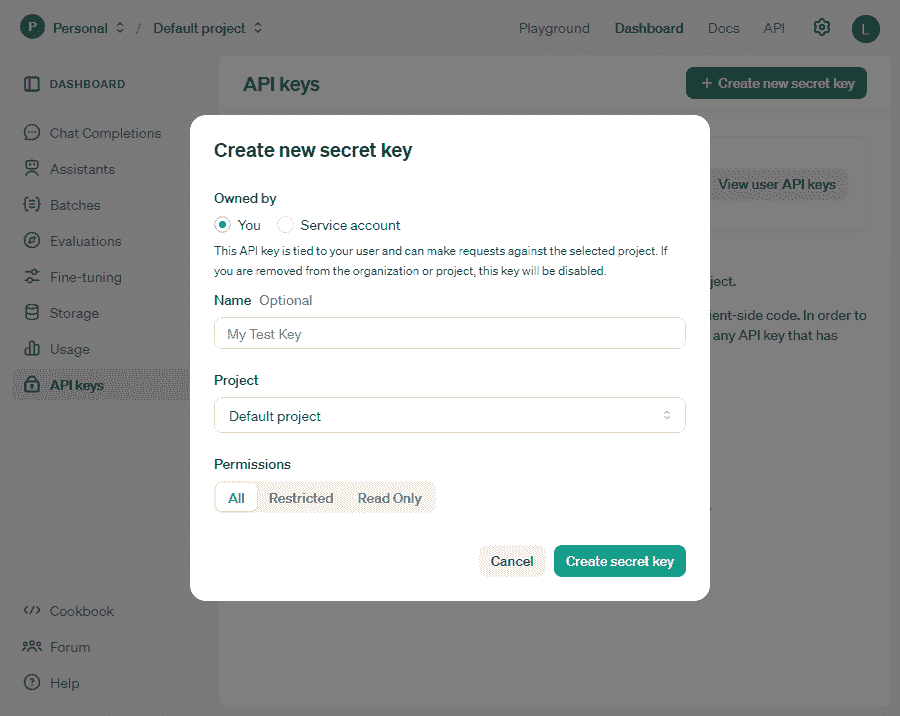

### 步骤 6: 填写昵称 完成注册

如果是在注册的过程中的完成了电话号码的验证，那么到此为止注册相关的验证就结束啦，接下来OPEN AI会引导我们填写昵称基本信息。（生日年龄尽量18岁以上）

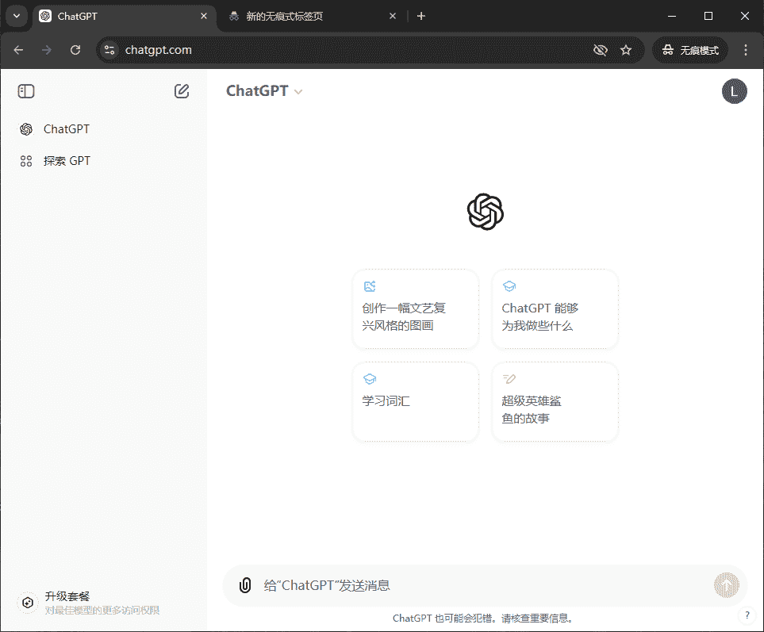

至此，OPENAI就注册完成啦！