# Claude 3账号注册与API-KEY获取流程

> 来源：[https://kq4b3vgg5b.feishu.cn/docx/HVBnd78fDo1xQBxJlJ2ckYSunfd](https://kq4b3vgg5b.feishu.cn/docx/HVBnd78fDo1xQBxJlJ2ckYSunfd)

Claude 3账号注册与API-KEY获取流程

一、Claude 3模型基本情况介绍

三、Claude 3辅助邮箱注册流程

1.开启网络工具，使用全局代理

2.微软outlook邮箱注册

四、Claude账号注册与API-KEY获取方法 1.Claude-Chat账号注册

2.ClaudeAPI模型账户绑定

3.ClaudeAPI账户升级与API-Key创建

4.Claude模型API的本地代码环境调用测试

## 一、 Claude 3模型基本情况介绍

+     Claude 3大模型重磅发布，最强大模型新王登基

当地时间3月4号，在没有任何前期预热的情况下， Anthropic公司发布了Claude系列模型的第   三代模型—Claude 3，并号称在文本能力方面全面超过世界最强模型GPT-4。并且不同于Google的  Gemini模型， Claude 3在发布的同时就同步上线了模型调用API，供广大开发者使用。经过一小段   时间的使用测试，人们惊喜的发现， “Claude 3模型超越GPT-4”不再是狼来了的故事，而是真实发生 情况： Claude 3模型在文本生成、数学推理、长文本阅读和复杂图像理解能力上已经全面超越GPT4！关于Claude 3模型全面介绍与性能测试，点击观看我在B站上发布的视频：最强大模型易主！新王Claude 3模型功能介绍与性能评测！

+     Claude 3模型API全面开放使用

不同于Google画饼式发布会， Anthropic在发布Claude 3模型的同时，也发布了模型API。现在 对于广大开发人员来说已经可以在代码环境中调用这一性能强悍的模型了：

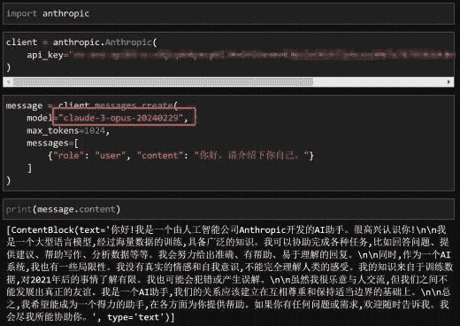

并且模型的多模态功能也同步上线：

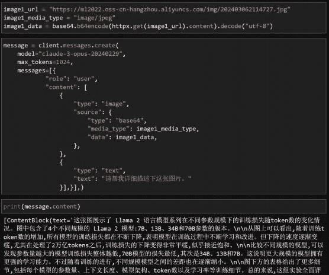

当然，对标ChatGPT的、基于Claude 3的网页端聊天对话机器人也同步开放使用：

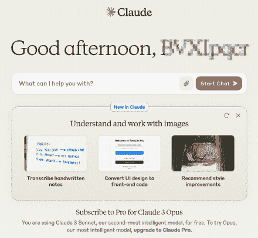

+     Claude 3模型使用障碍

不过遗**憾的是，尽管C**laude 3模型本身支持中文，但和OpenAI类似（全美的大模型技术公司都 是如此）， Anthropic也对大陆采取了技术封锁的措施，这使得大陆地区开发者如果要使用Claude    3模型，则必须先准备网络工具。本文将介绍在准备好网络工具，并提前开设全局代理的情况下，如 何注册Claude 3账号，并在本地代码环境调用Claude 3模型。

Anthropic公司创始团队和OpenAI初创团队“ 同宗同源” ，因此Claude 3模型和GPT系列模型几 乎是镜像式相似，无论是账号注册流程、模型调用流程，还是官网设计，甚至是API说明文档 的编写格式都高度类似，因此熟悉OpenAI账户注册的小伙伴，对Claude 3账户注册流程肯定 也不会感到陌生。

+   **  Claude 3封号潮**

出于某种原因，Anthropic公司目前对账号管控非常严格，哪怕是使用了稳定的网络工具，有  些账号仍然会被检测到异常并导致封号。这点和去年GPT-4发布之后OpenAI展开的封号行动类似。 因此在完成注册后，也需低调使用。本教程仅供大模型技术学习和模型性能测试使用。

+   **  Claude 3注册费用**

Claude 3目前为每位注册用户都提供了5美元的试用额度，因此前期调用Claude 3模型是没有 任何花费的。不过在注册的过程中需要使用虚拟手机号服务，需要花费15-20元RMB。之后在调用  Claude 3模型时，按照使用程度进行付费即可（和OpenAI GPT系列模型完全一样）。

## **二**、SMS-active账号注册

在稍后的Claude 3注册流程中，会反复涉及手机号验证的环节，这里我们就需要使用代理服

务，来使用其他国家地区的手机号来接收验证码，进而完成账户注册。这里推荐使用SMS进行其他  国家地区手机号的验证和激活，登录https://sms-activate.org/，即可完成相关服务的购买。点击进 入sms-active：

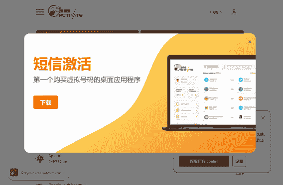

首次登录时点击左上方小人图标，进行注册，这里可以使用国内🐧邮箱或者outlook邮箱进行注 册，大家自行完成注册即可：

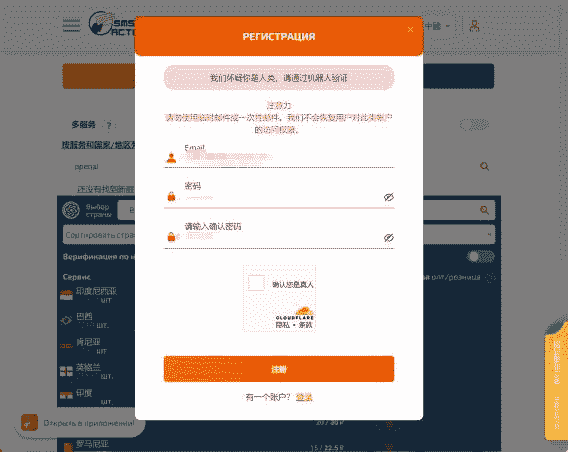

注册完成后，需要注意，该网站提供的手机号是根据不同服务需求来匹配和分发的的，而在申请手   机号之前，我们需要往这个账户里面充值，这里可以使用支付宝进行充值，并且只需要充值2美金即 可使用较长一段时间：

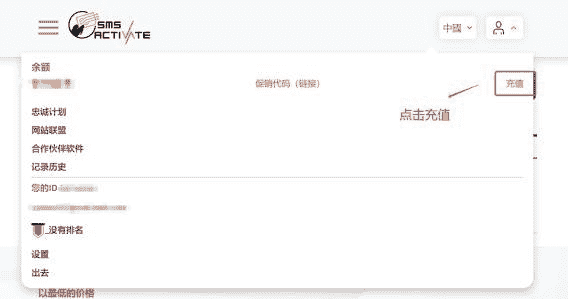

点击支付宝进行充值：

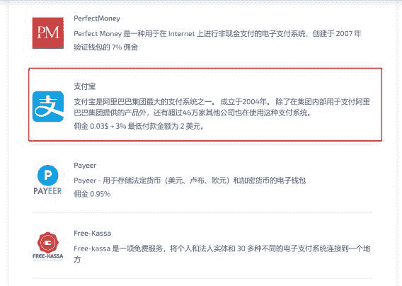

然后选择支付2美金：

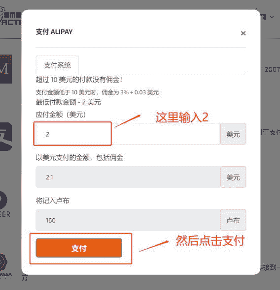

然后扫码完成支付即可。

早年OpenAI未火之时，最低充值额度是1美金~

至此我们就完成了SMS账号注册与储值，接下来我们将借助SMS平台来完成手机号验证。

## **三**、 Claude 3辅助邮箱注册流程

接下来开始进入到Claude 3注册流程中。需要注意的是， Claude平台并不是传统意义的通过账号和   密码登录，而是通过注册邮箱+邮箱验证码的形式进行登录，因此需要首先完成邮箱注册，且根据现阶段  使用情况来看，微软outlook邮箱和hotmail邮箱相对稳定，这里推荐使用outlook邮箱进行Claude账户注

册，并且在邮箱注册过程中使用国外虚拟手机号进行验证。

### **1.开启网络工具，使用全局代理**

### **2.微软outlook邮箱注册**

接下来介绍outlook邮箱注册流程：

+   Step 1.开启无痕浏览模式

为了确保能顺利完成注册，推荐使用谷歌浏览器，并开启无痕浏览模式：

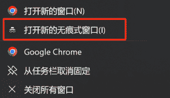

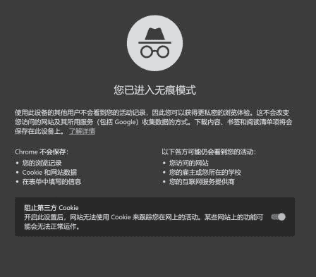

+   Step 2.进行outlook邮箱注册

然后在网址栏输入： [www.outlook.com](http://www.outlook.com/) ，进入outlook官网，并点击“创建免费账户”：

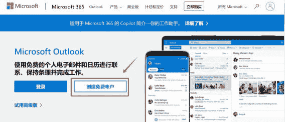

然后点击同意并继续

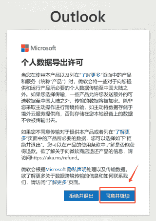

然后选择输入的邮箱名称，自定义名称即可：

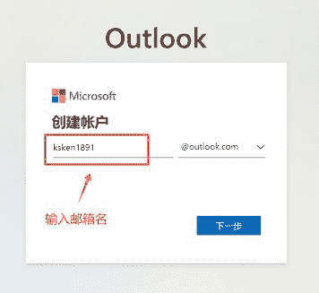

然后输入密码：

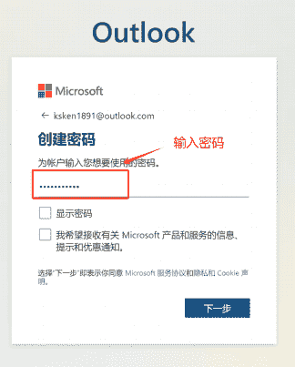

填写姓名，随意填写即可：

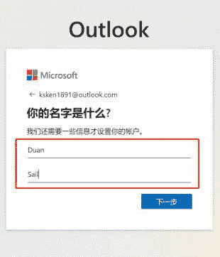

设置国家和地区。在全局代理开启的情况下，默认地区就是代理地址。这里推荐选择美国、英格兰 或者巴西均可，方便后面使用对应地区虚拟手机号进行验证：

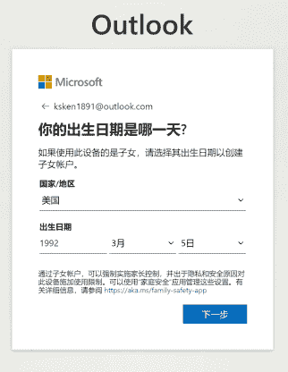

接下来就进入到手机号验证环节。需要注意的是，尽管这里可以使用中国地区手机号进行验证，但 为了保险起见，最好还是使用其他国家地区的虚拟手机号完成验证。这里需要借助SMS-active平台 进行手机号验证。

+     Step 3.虚拟手机号验证

接下来回到SMS-Active页面，在页面左侧的服务选择中输入Microsoft，找到能够用于辅助 Microsoft产品注册的虚拟手机号：

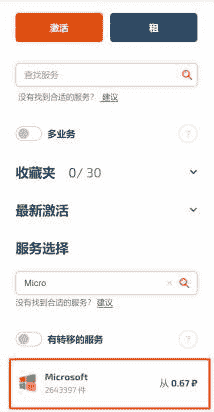

点击下方Microsoft，即可查看到一系列不同地区的虚拟手机号，这里可以选择巴西，然后点击右侧 红色购物车按钮，即可租赁一个虚拟手机号：

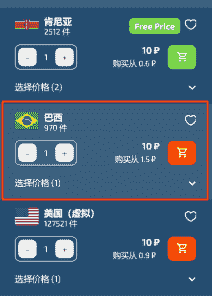

在页面的中间能看到租赁到的虚拟手机号，其中+55是国家编号，之后的数字就是具体的手机号：

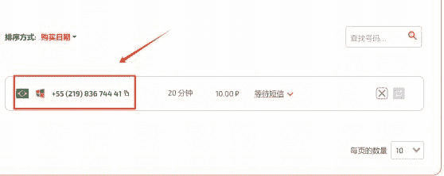

复制手机号并输入到outlook邮箱注册页面，点击发送验证码：

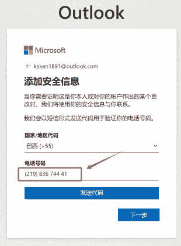

然后回到SMS-Active页面，稍等片刻即可查看到当前手机号接收到的验证码：

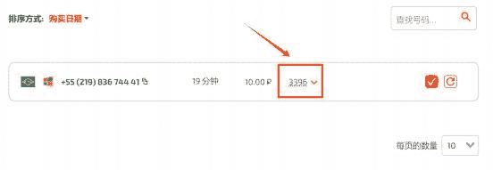

将验证码输入到outlook邮箱注册页面，即可完成注册。

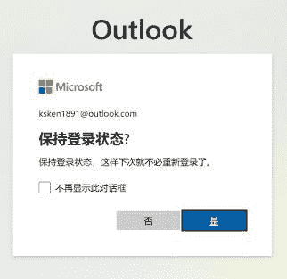

+   Step 4.登录outlook邮箱

需要注意的是，如果完成注册后页面没有自动跳转，则在浏览器地址栏再次输入outlook.com 进行登录即可。登陆后邮箱页面如下：

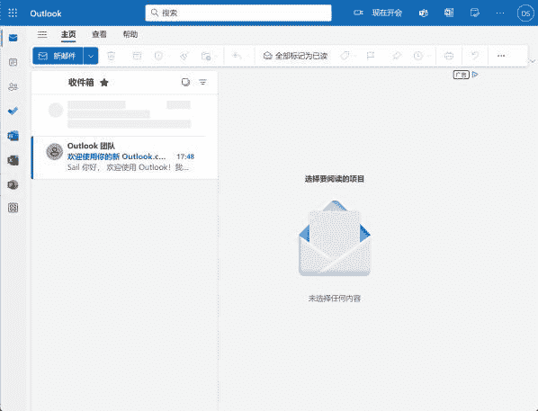

至此，我们就完成了outlook邮箱注册全流程，接下来我们将使用该邮箱完成Claude账号注册。

## **四**、 Claude账号注册与API-KEY获取方法

和OpenAI产品架构类似， Claude的账号体系同样也是分为Claude-Chat账号和Claude API账号，就  类似于ChatGPT账号和GPT API账号。在注册Claude时需要同时注册Claude-Chat账号和Claude API账号 才可稳定运行。因此这里先进行Claude-Chat账号注册，然后再进行Claude API账号绑定。尽管看起来像

是两次注册，但流程基本一致，整个过程并不复杂。

### 1.Claude-Chat账号注册

Claude-Chat是一个基于Claude模型的网页端聊天机器人，功能定位和ChatGPT类似。点击链接：https://claude.ai/即可进入到Claude-Chat登录页面。在登录页面中输入刚才注册的outlook邮箱地址：

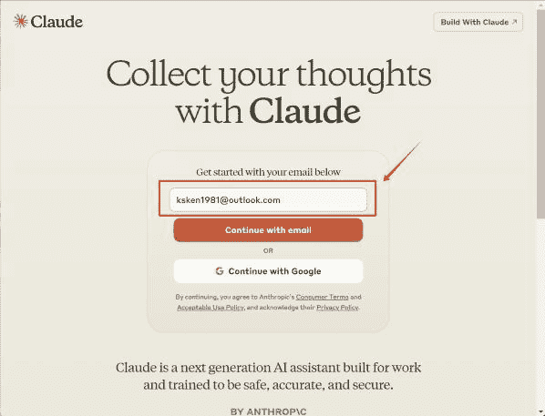

然后点击发送验证码。回到outlook邮箱页面接收验证码：

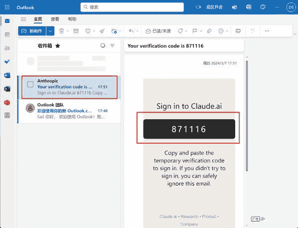

将验证码输入到Claude-Chat注册页面中：

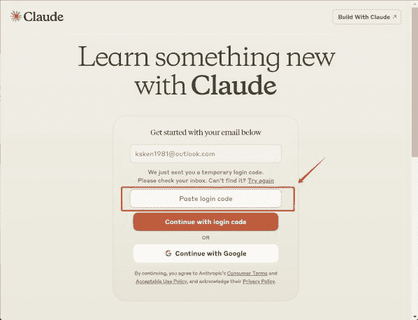

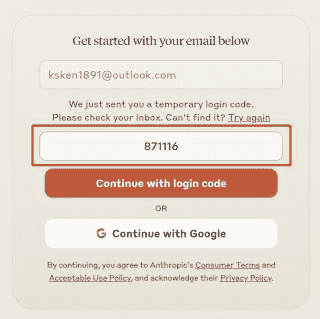

在完成邮箱验证之后，还需要绑定手机号。这里同样是需要使用SMS-Active借助虚拟手机号完成验证：

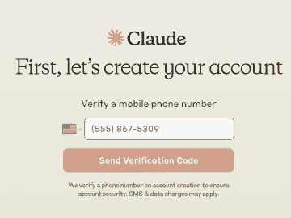

回到SMS-Active页面，点击左侧服务选择，在搜索栏输入Claude，点击Claude搜索结果：

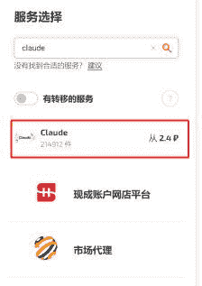

即可查看目前全部可以用于Claude账户注册的各地区手机号。这里可以使用英格兰地区手机号，点击右 侧购物车按钮，即可租赁英格兰地区虚拟手机号：

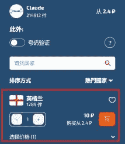

租赁完成后在页面中央查看并复制手机号：

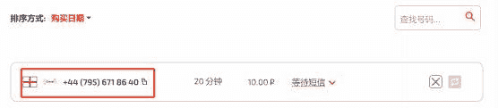

将手机号输入到Claude-Chat注册页面中：

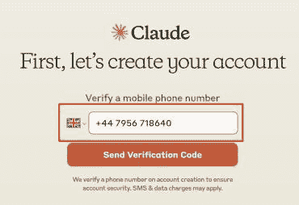

并点击发送验证码。回到SMS-Active页面查看验证码：

将验证码输入到Claude-Chat注册页面中即可完成注册。：

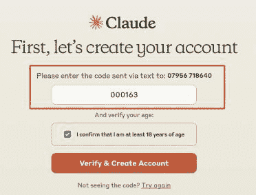

注册完成之后，会自动弹出一个简单的欢迎页面，其中会介绍Claude模型基本情况，以及需要用户输入 一个合适的对用户自己的称呼：

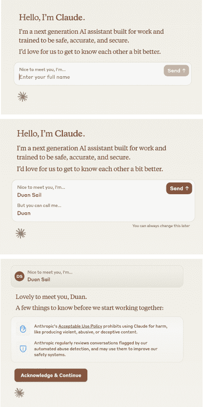

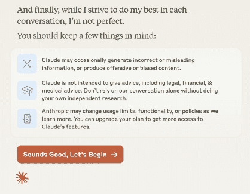

一路点击，即可最终进入到Claude-Chat聊天页面：

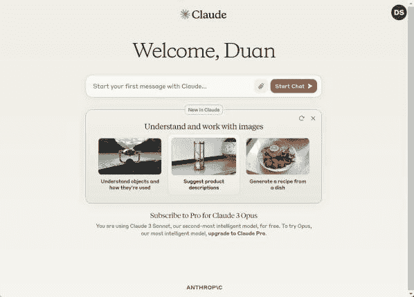

至此， Claude-Chat账户注册全部完成。需要注意的是，下次登录时还会需要通过邮箱验证码进行登录， 但无需再进行手机号验证。同时，再默认的免费模式下，  Claude-Chat只能调用Sonnet模型（Claude 3  的中号模型）进行对话，若想调用Opus（ Claude 3的大号模型），则需要进行付费订阅， 20刀/月升级  到Pro版。在当前页面中，点击下方的upgrade to Claude Pro，绑定银行卡（国内用户需要使用虚拟信  用卡）即可完成升级。

### 2.Claude API模型账户绑定

在完成了Claude-Chat账户注册之后，接下来继续完成Claude API账户绑定（绑定到Claude-Chat账  户中）。点击右侧链接： https://console.anthropic.com/ 进入到Claude模型控制台页面。首次进入会提 示完成注册，这里使用和Claude-Chat账户相同的邮箱即可完成账号绑定，无需再次进行手机号验证：

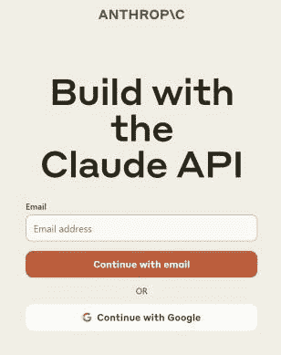

这里输入此前注册的outlook邮箱即可完。然后回到outlook邮箱主页查看收到的验证码：

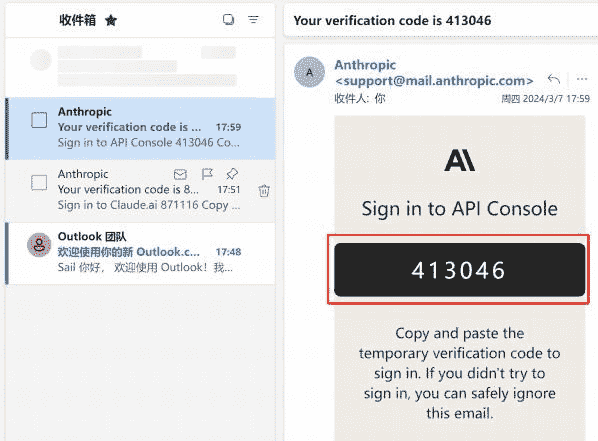

将该验证码输入到Claude API账户注册页面即可完成账号绑定。由于该账号已经注册了Claude-Chat，因 此无需再次进行手机号验证。接下来会直接进入到一个设置组织名称（所在公司名称）的环节，这里随   便输入一个公司名称即可：

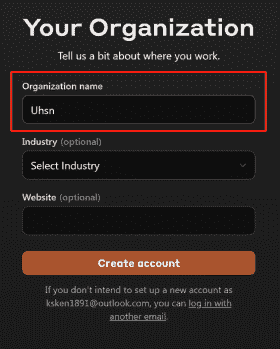

然后点击创建账户，即可进入到Claude API账户控制台（主页）：

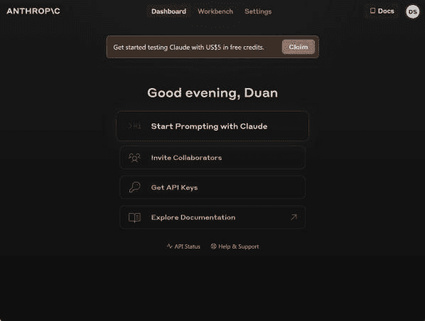

至此便完成了Claude API账户注册流程。

### 3.Claude API账户升级与API-Key创建

+     Claude API账户升级

刚注册完的Claude API账户是免费账户，需要领取初始免费赠送的额度才可顺利调用Claude 3系列模 型。这里点击页面上方的Claim按钮免费领取5刀额度：

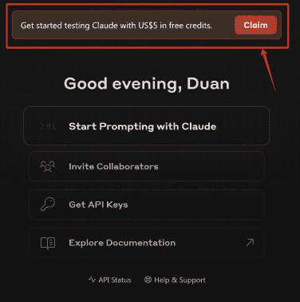

点击之后会要求进行手机号验证。

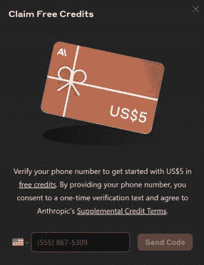

这里我们再次使用SMS-Active进行手机号验证。这里可以继续使用此前租赁的手机号（如果没过期的    话，刷新即可再次接收验证码），也可以再租赁一个新的手机号都可以。这里重新租赁了一个新的手机 号，注意还是需要选择用于支持Claude的手机号：

输入手机号：

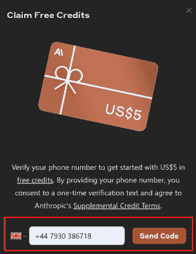

接收验证码：

输入验证码：

再次回到主页面时即代表已经完成5刀免费额度领取：

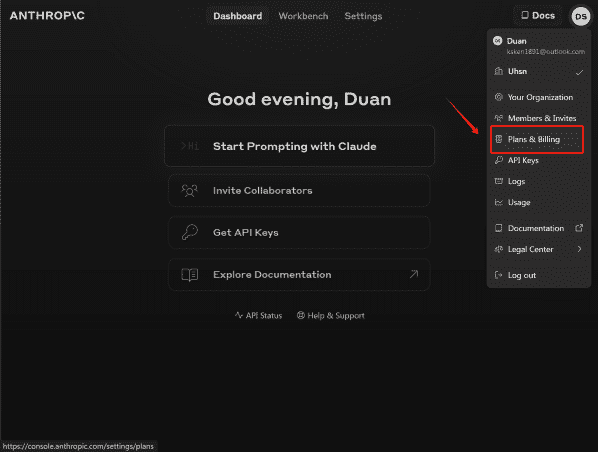

此时我们点击右上方个人头像—>Plans&Billing，即可查看当前账户剩余额度：

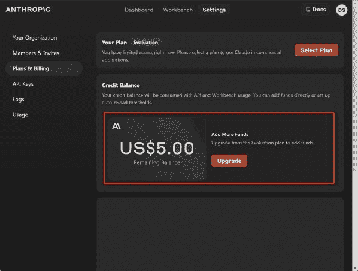

能够看到目前已成功领取5刀免费额度，至此便完成了账号升级，接下来可以尝试创建Claude 3模型API- KEY并在本地环境进行调用了。

+     Claude模型API-KEY创建方法

在当前页面，点击左侧API Keys，然后点击Create Key，即可创建一个新的API-Key：

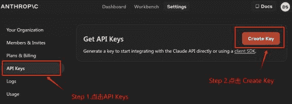

输入新的API-Key名称（随便取名即可），点击Create Key：

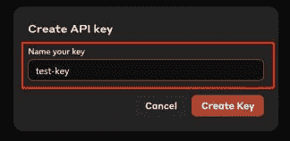

创建完成后会返回完整Key字符串列表，点击复制，并在安全位置保存即可：

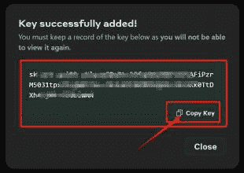

至此就完成了API-Key创建。

### 4.Claude模型API的本地代码环境调用测试

+     Step 1.设置代理环境

最后，我们需要在代码环境中简单验证当前API-Key是否能顺利调用。在开启全局代理模式的情况   下，确定当前代理的代理端口，然后打开Jupyter （或者其他Python编程IDE），先输入以下代码开启代 理环境：

| import os |
| --- |

代码中的 PROXY 需要换成自己的代理端口，例如我的代理端口是10080，则运行如下代码：

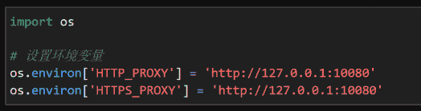

此外，也可以在cmd环境中启动Jupyter，并在启动Jupyter之前通过set命令设置Jupyter运行的默 认代理环境。

+   Step 2.anthropic库安装与导入

anthropic库是用于支持Claude模型调用的SDK，在Jupyter页面中可以按照如下方式进行安装：

| ! pip install anthropic |
| --- |

此外也可以在cmd中进行安装。

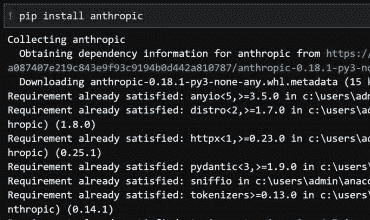

安装完成后即可导入anthropic库：

| import anthropic |
| --- |

+     Claude 3模型API本地调用

完成了一系列准备工作之后，接下来即可尝试在代码环境中调用Claude 3 opus模型。首先我 们需要先实例化一个Claude模型客户端（Client），并输入API-Key用于身份验证：

| client = anthropic.Anthropic( |
| --- |

上面的 YOUR_API_KEY 需要替换为自己的API-Key字符串。

然后尝试调用Claude 3 opus模型：

| message = client.messages.create( |
| --- |

其中 claude-3-opus-20240229是Claude 3 Opus模型编号，从调用代码来看， Claude 3模型调用 整体风格和OpenAI GPT系列模型完全一样。若上述代码能返回打印结果，则说明调用成功：

至此我们就完成了Claude账户注册与API调用的全流程。

[**更多大模型内容学习、 Cla**](https://appze9inzwc2314.h5.xiaoeknow.com/)**ud**e 3技术学习，欢迎大家报名由我主讲的《2024大模型技术实战课》： （点

击链接查看完整课程介绍）

[**《大模型技术实战课》**](https://appze9inzwc2314.h5.xiaoeknow.com/)**为【100+小时】体系大课，总共十八大模块**精讲精析，零基础直达大模型企业级 应用！

**此外为持续保证学员大模型技术竞争力，课程实时**追更最新大模型技术进展，近期额外新增增了

**A****ssistant API、GLM-4、Qwen 1.5**、Claude 3等最新前沿技术内容！课程大纲获取、领取B站粉丝专 属优惠券， 扫码添加客服小可爱(🛰️： littlecat_1207)，回复“大模型” ，即咨询课程信息哦

此外，**扫码回复“LLM”**，即可领取**公开课课件、代码、数据**等~

