# 国内零门槛接入Gemini 2.5 & Claude 4指南

> 来源：[https://kq4b3vgg5b.feishu.cn/docx/N6yrdb51VoUragxFdh2czDewnv1](https://kq4b3vgg5b.feishu.cn/docx/N6yrdb51VoUragxFdh2czDewnv1)

## 本地聊天机器人 & 代码编辑器Cursor & Agent代码开发环境

## 1. Gemini & Claude模型发布情况与接入方法

### 🌟 Gemini 2.5：Google 推出的多模态智能模型

在 2025 年 5 月的 Google I/O 大会上，Google 发布了 Gemini 2.5 系列模型，包括 Gemini 2.5 Pro 和 Gemini 2.5 Flash。其中，Gemini 2.5 Pro 是目前最先进的模型，具备强大的推理和编码能力，支持文本、图像、音频和视频等多种输入形式。该模型引入了“Deep Think”模式，能够处理复杂的数学和编程任务。此外，Gemini 2.5 Pro 拥有 100 万 token 的上下文窗口，适用于处理大规模数据集和复杂问题。Gemini 2.5 Flash 则优化了响应速度和效率，适合需要快速处理的任务。这两款模型均可通过 Google AI Studio 和 Vertex AI 进行访问。

🔗 官方网站：`https://deepmind.google/models/gemini/pro/`

+   深度解读谷歌IO大会：`https://www.bilibili.com/video/BV1p8JLz2EvP/`


### 🧠 Claude 4：Anthropic 推出的混合推理 AI 模型

2025 年 5 月 22 日，Anthropic 在其首届开发者大会上发布了 Claude 4 系列模型，包括 Claude Opus 4 和 Claude Sonnet 4。这两款模型采用混合推理架构，能够在快速响应和深入推理之间切换。Claude Opus 4 是目前最强大的模型，特别擅长处理需要长时间专注和多步骤的复杂任务，如软件开发和复杂数据分析。Claude Sonnet 4 则作为 Sonnet 3.7 的升级版，提供更高的指令遵循性和编码能力。这两款模型现已在 Anthropic API、Amazon Bedrock 和 Google Cloud 的 Vertex AI 上线，供开发者和企业使用。

🔗 官方网站：`https://www.anthropic.com/news/claude-4`

+   Claude 4发布会详解：`https://www.bilibili.com/video/BV1PWJszkEo5/`


+   纯直连方法（需要网络工具）


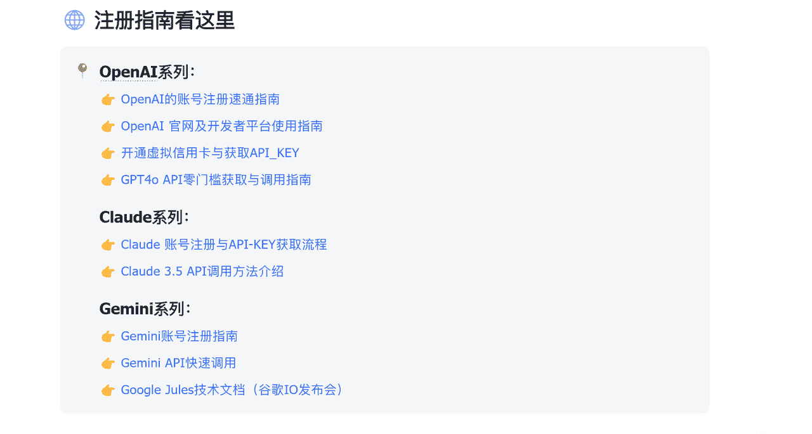

+   借助聚合API和中转代理，无网络门槛接入接入Gemini&Claude

此外，伴随着模型应用需求不断扩大，很多中转和聚合平台各项功能也逐渐完善，并能承担起应用和开发的功能。本期公开课，就为大家详细介绍如何借助聚合API和中专代理，零门槛接入Gemini 2.5与Claude 4大模型。

+   课件领取：


## 2. API聚合平台账号注册与OpenAI风格API调用

接下来继续介绍API聚合平台账号注册流程。这里首先要注意，我们选取API聚合平台的要求如下：

1.  更新速度方面，能够第一时间上线最新的模型，如最近的Gemini 2.5 Pro模型和Claude 4模型等；
1.  国内没有网络门槛即可访问，且拥有单账号最高的`RateLimit`；
1.  能够一个账号/`API-KEY`调用多个模型，避免调用不同模型时来回切换`API-KEY`和`Base-URL`；
1.  能够清楚检测每个`API-KEY`各模型token及费用消耗情况；
1.  能够无缝使用谷歌`genai`或者Anthropic原版客户端进行模型调用，进而方便使用各模型客户端自带的Agent开发工具，例如网络搜索工具、代码解释器、`MCP`工具等；
1.  【非开发向】能够较好的集成到一些聊天应用中，如Cherry studio或者Open-WebUI。

据此，经过一段时间的测试，我们挑选出三家能满足上述要求的模型聚合API供应商，分别是：

+   OpenRouter：全球最大的模型聚合API供应商，能提供的统一 API 接口和多模型支持，由于其用户规模较大，且各项功能维护较好，很多应用甚至会单独为OpenRouter提供API接入端口。网址：`https://openrouter.ai/`

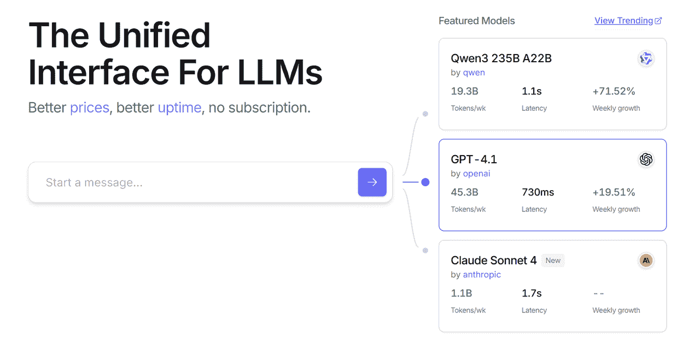

+   DMXAPI：国内开发者创建的大模型API聚合平台，各项功能稳定，说明文档完整，非常适合国内开发者使用。网址：`https://www.dmxapi.cn/`；

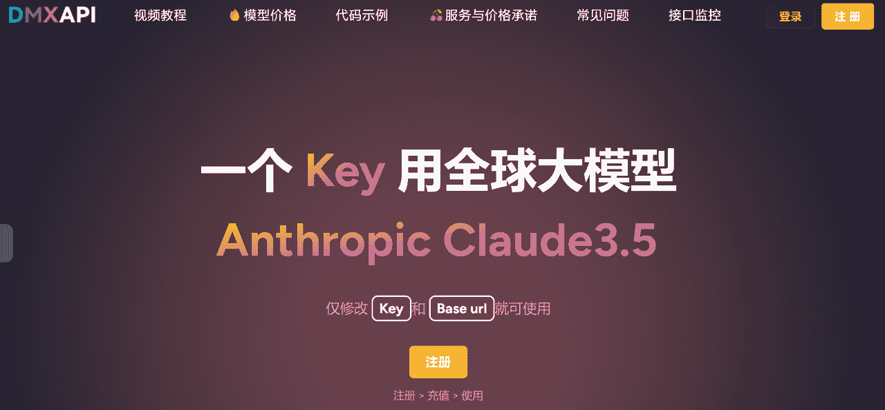

+   small AI：新兴的API聚合平台，同样也可以无缝接入各类主流大模型，并且价格相对便宜。网址：`https://www.smallai.asia/`

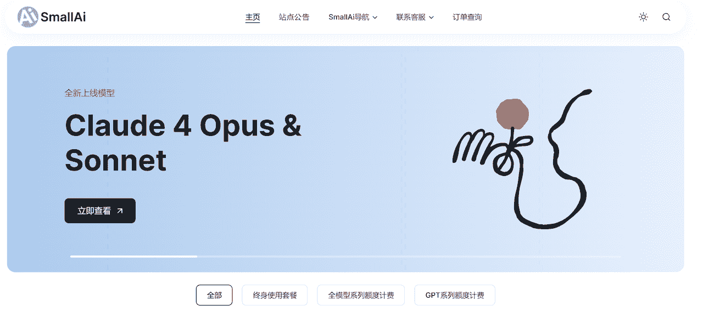

接下来我们就注意注册各平台账号，并演示不同平台账号接入Gemini和Claude模型基本流程。需要注意的是，以上三个平台中，OpenRouter自定义了一整套各类模型接入方法，其他两个平台的模型接入流程都是类似的，只需要修改`API-KEY`和`Base-URL`即可。大家在实际使用过程中任选其一即可。

### 2.1 OpenRouter账号注册与模型调用测试

+   OpenRouter账号注册

来到OpenRouter主页：`https://openrouter.ai/`，点击注册：

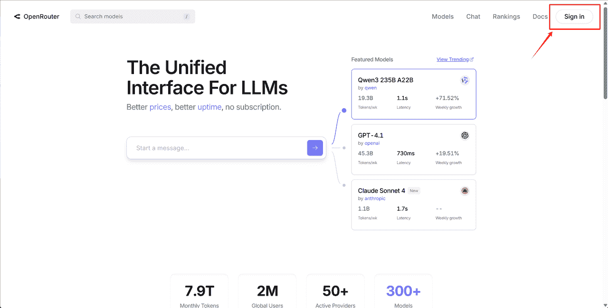

可以选择GitHub账号、谷歌账号或者任意自选邮箱进行注册：

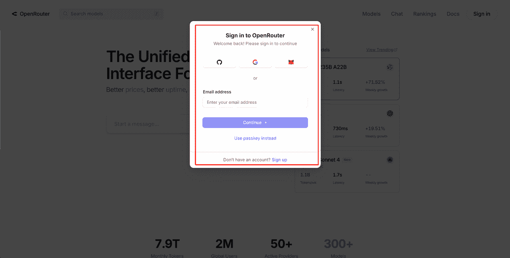

+   OpenRouter`API-KEY`创建流程

然后即可点击Credits进行充值：

点击Add Credits，可选择各类信用卡进行充值：

然后点击创建`API-KEY`即可：

+   OpenRouter网站功能介绍

```
Video("https://ml2022.oss-cn-hangzhou.aliyuncs.com/2025-05-23%2016-49-11.mp4", width=800, height=400)
```

Your browser does not support the video element.

+   OpenRouter `API-KEY`调用测试

紧接着，我们测试下刚才创建的OpenRouter `API-KEY`能否顺利调用Gemini 2.5 Pro模型和Claude 4模型。OpenRouter默认使用`OpenAI`风格API进行调用，我们可以运行如下代码进行测试：

```
import os
from dotenv import load_dotenv
load_dotenv(override=True)
from openai import OpenAI
```

```
# OpenRouter Gemini 2.5调用测试
or_client = OpenAI(
  base_url="https://openrouter.ai/api/v1",
  api_key=os.getenv("OR_API_KEY"),
)

or_completion = or_client.chat.completions.create(
  model="google/gemini-2.5-flash-preview-05-20",
  messages=[
    {
      "role": "user",
      "content": [
        {
          "type": "text",
          "text": "你好，好久不见，请介绍下你自己。"
        }
      ]
    }
  ]
)
print(or_completion.choices[0].message.content)
```

```
你好！确实很久不见了，很高兴能再次和你交流。

我是一个大型语言模型，由 Google 训练。我的主要能力是理解和生成人类语言，并在此基础上执行各种任务，比如：

* **回答你的问题：** 无论是知识类、概念类还是日常类问题，我都会尽力提供准确和有用的信息。
* **撰写不同类型的文本：** 邮件、报告、故事、诗歌、代码等等，我可以根据你的要求生成不同风格和内容的文本。
* **翻译语言：** 我可以进行多种语言之间的翻译，帮助你理解不同语种的信息。
* **提供创意和灵感：** 当你需要头脑风暴、构思想法时，我可以提供新的视角和建议。
* **总结复杂信息：** 我可以从长篇文本中提取关键点和核心信息，帮助你快速理解。
* **进行对话：** 我可以理解你的意图，并根据上下文进行连贯的交流。

简单来说，我是一个旨在通过语言帮助你获取信息、完成任务、激发创意并进行交流的智能伙伴。

你有什么想和我聊的吗？或者有什么问题需要我帮助？
```

```
# OpenRouter Claude 4模型调用测试
or_client = OpenAI(
  base_url="https://openrouter.ai/api/v1",
  api_key=os.getenv("OR_API_KEY"),
)

or_completion = or_client.chat.completions.create(
  model="anthropic/claude-opus-4",
  messages=[
    {
      "role": "user",
      "content": [
        {
          "type": "text",
          "text": "你好，好久不见，请介绍下你自己。"
        }
      ]
    }
  ]
)
print(or_completion.choices[0].message.content)
```

```
你好！很高兴见到你！

我是Claude，一个由Anthropic开发的AI助手。我的主要目标是通过对话来帮助人们——无论是回答问题、协助完成任务、进行创意写作，还是就各种话题展开讨论。

我的一些特点：
- 我努力提供准确、有帮助的信息
- 我重视诚实和透明，会坦诚说明我的局限性
- 我尊重每个人的观点和背景
- 我可以用多种语言交流，包括中文
- 我喜欢学习新事物，也乐于分享知识

不过我也有局限性——我无法浏览网页、记住之前的对话，也不能执行任何实际操作。我的知识截止到2024年4月。

有什么我可以帮助你的吗？
```

能发现可以顺利进行调用。

而对话结束后，即可在OpenRouter官网上查看扣费情况，本次花费约2美分不到：

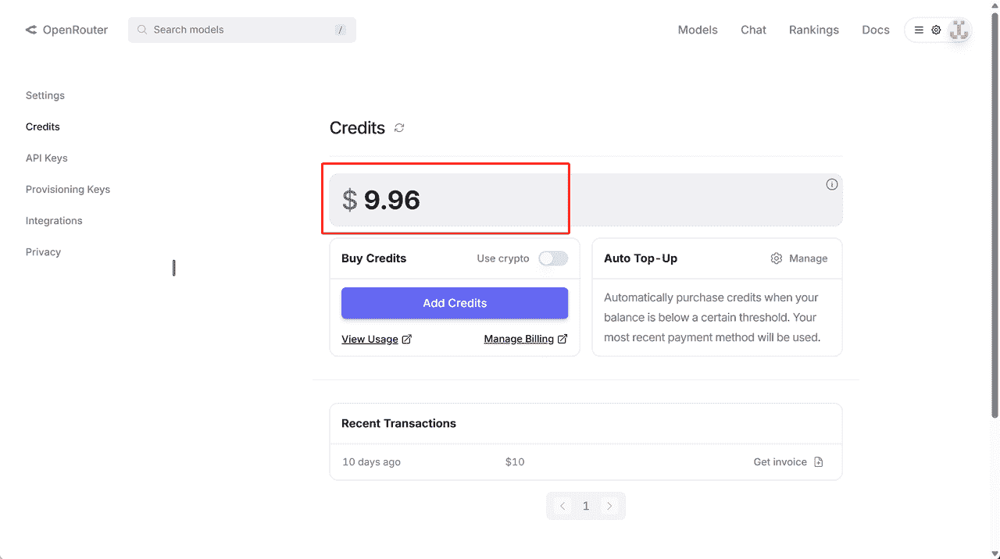

### 2.2 DMXAPI账号注册与模型调用测试

+   DMXAPI账号注册流程

接下来继续测试DMXAPI账号注册与API调用流程。同样我们在DMX官网：`https://www.dmxapi.cn/` ，点击进行注册：

然后即可在价格页面查看所需要的模型及其相应的定价：

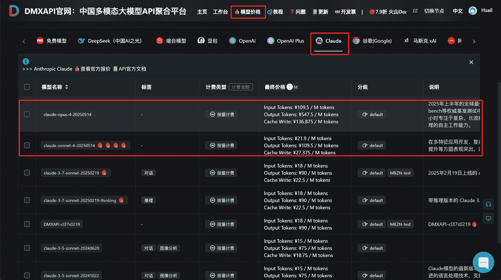

并且可以在教程页面看到DMXAPI各类模型采用`OpenAI`风格API进行调用的方法：

此外，DMXAPI还提供了非常便捷的开票通道，对企业用户非常友好：

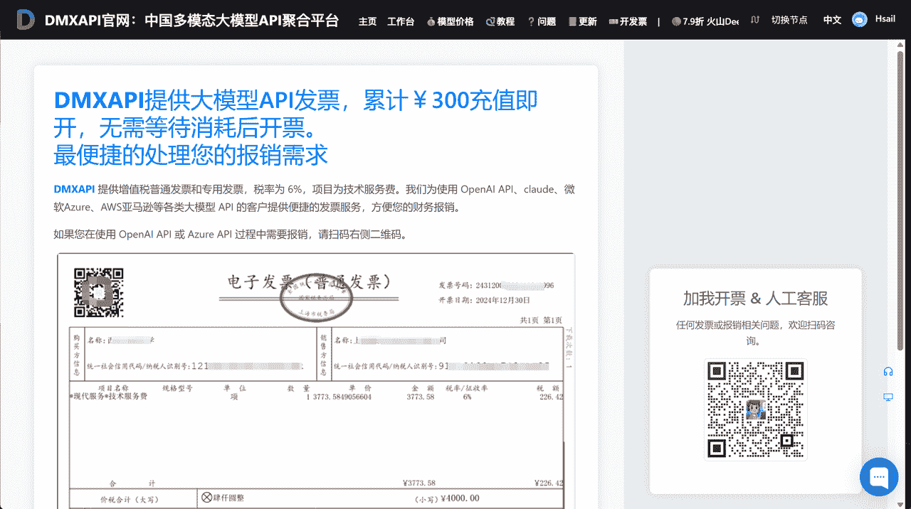

+   DMXAPI `API-KEY`注册流程

同样的，我们可以在工作台中进行余额充值：

然后可以在工作台主页进行DMXAPI的`API-KEY`创建：

并可以在使用日志中看到每一次模型调用的情况及计费：

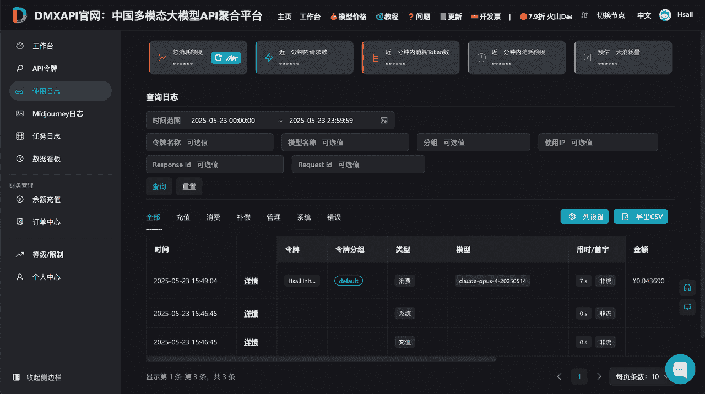

+   DMXAPI网站介绍

```
Video("https://ml2022.oss-cn-hangzhou.aliyuncs.com/2025-05-23%2017-06-15.mp4", width=800, height=400)
```

Your browser does not support the video element.

+   DMXAPI `API-KEY`调用测试

紧接着，我们尝试使用DMXAPI的`API-KEY`进行模型调用：

```
# DMXAPI Gemini 2.5调用测试
dmx_client = OpenAI(
  base_url="https://www.dmxapi.cn/v1",
  api_key=os.getenv("DMX_API_KEY"),
)

dmx_completion = dmx_client.chat.completions.create(
  model="gemini-2.5-flash-preview-04-17",
  messages=[
    {
      "role": "user",
      "content": [
        {
          "type": "text",
          "text": "你好，好久不见，请介绍下你自己。"
        }
      ]
    }
  ]
)
print(dmx_completion.choices[0].message.content)
```

```
你好！很高兴能再次与你交流！

我是Google训练的大型语言模型。

我的主要目标是帮助你获取信息、完成各种文本相关的任务，比如回答问题、写文章、翻译、提供创意等等。

简单来说，我是一个AI助手，希望能用我的知识和能力来帮助你。

有什么想问的或者需要我帮忙的吗？随时都可以告诉我！
```

```
# OpenRouter Claude 4模型调用测试
dmx_client = OpenAI(
  base_url="https://www.dmxapi.cn/v1",
  api_key=os.getenv("DMX_API_KEY"),
)

dmx_completion = dmx_client.chat.completions.create(
  model="claude-opus-4-20250514",
  messages=[
    {
      "role": "user",
      "content": [
        {
          "type": "text",
          "text": "你好，好久不见，请介绍下你自己。"
        }
      ]
    }
  ]
)
print(dmx_completion.choices[0].message.content)
```

```
你好！很高兴见到你！

我是Claude，一个由Anthropic开发的AI助手。我的主要目标是通过对话来帮助人们，无论是回答问题、协助完成任务，还是进行有趣的交流。

我可以帮你：
- 回答各种问题和提供信息
- 协助写作、翻译、编程等任务
- 进行分析和解决问题
- 创意写作和头脑风暴
- 学习辅导和知识探讨

我努力做到诚实、有帮助且无害。如果遇到我不确定或不知道的事情，我会如实告诉你。我也有一些限制，比如无法浏览网页、记住之前的对话或执行实际操作。

有什么我可以帮助你的吗？很乐意和你聊天！
```

能够看到，两款模型都能顺利调用。但DMXAPI的模型实时更新速度不如OpenRouter，目前只更新了Claude 4，并未更新Gemini 2.5 flash 0520模型API。

### 2.3 smallAI `API-KEY`获取与模型调用测试

+   smallAI `API-KEY`获取流程

最后，让我们来介绍smallAI的注册和使用流程。和DMXAPI类似，smallAI也是国内开发团队创建的，一款更加轻量级的模型聚合平台。我们可以登录管smallAI官网：`https://www.smallai.asia/shop` ：

直接下滑选择一款模型套餐进行购买即可：

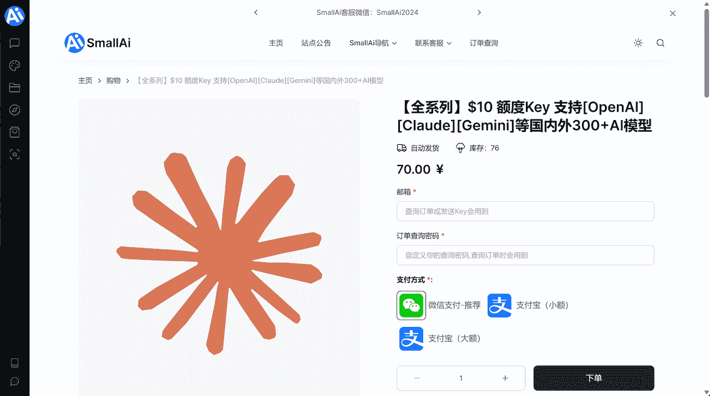

完成购买后即可在邮箱中收到`API-KEY`：

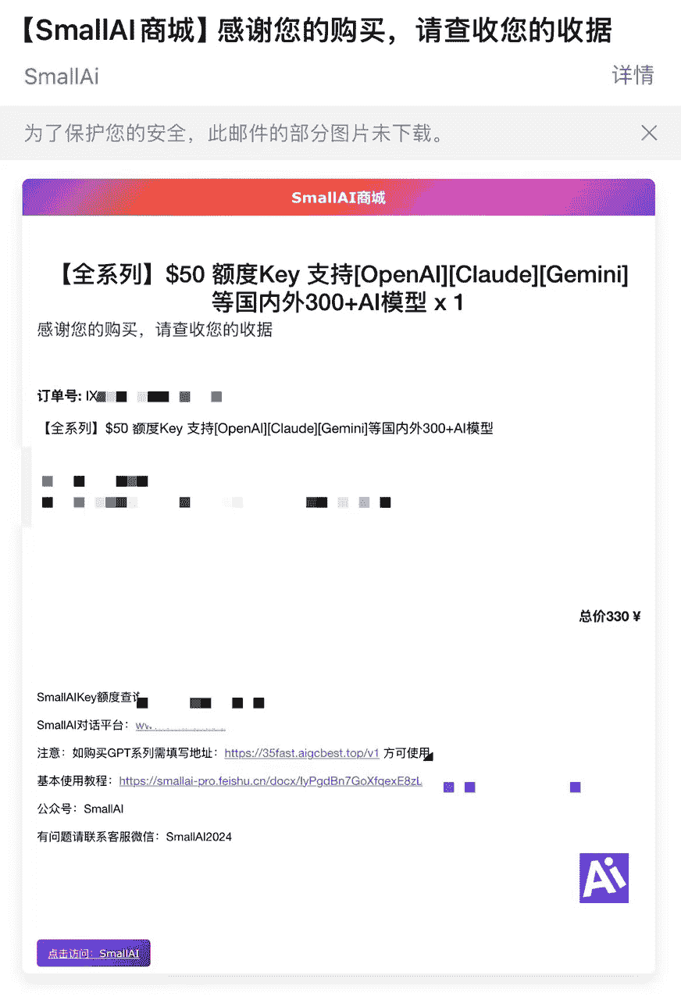


## smallAI API额度查询

而由于`smallAI`并不需要账号注册，因此若要进行额度查询，我们可以在`https://token.ai99.asia/` 网页中，输入`API-KEY`进行查询：

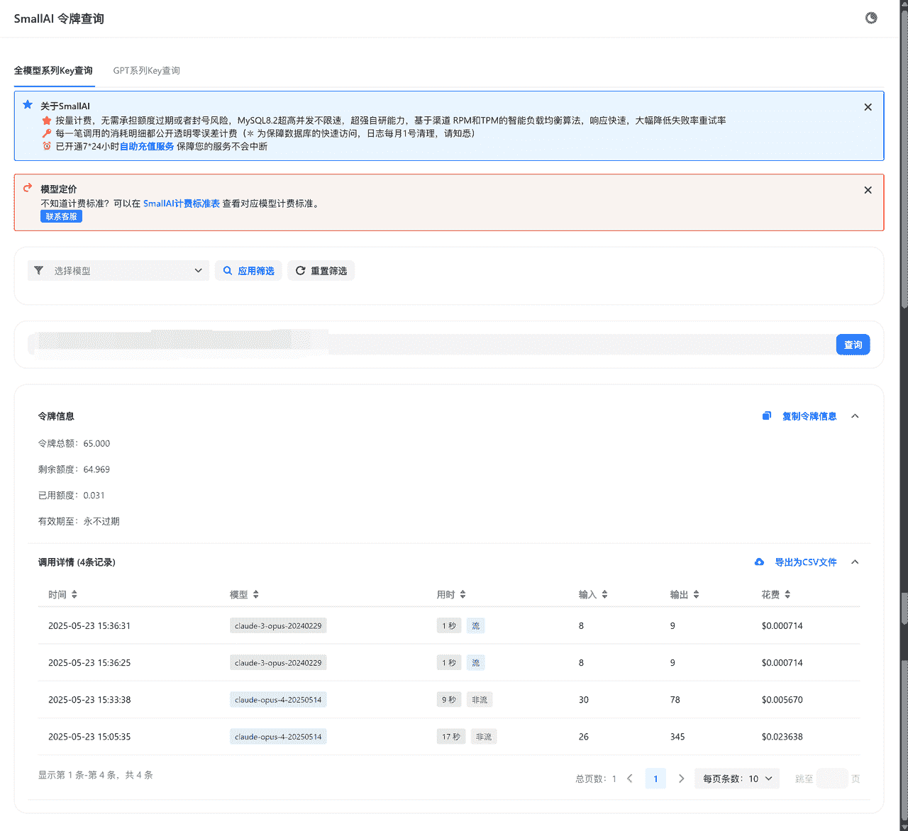

## smallAI 可调用的模型查询

同时，我们可以在`https://smallai-pro.feishu.cn/base/PpzVb1Zega9HPJsMHVtczS7Nnah?table=blkakovWSuKyyfC4` 中查看目前`smallAI`可调用的大模型：

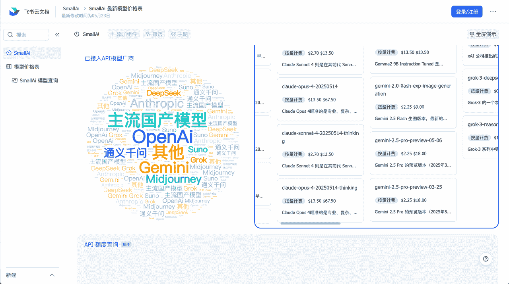

能够看到，目前`smallAI`已经集成了Claude 4模型、以及部分Gemini 2.5模型。

## smallAI API-KEY调用流程

同样，这里我们继续进行`smallAI`的`API-KEY`调用测试：

```
# smallAI Gemini 2.5调用测试
sai_client = OpenAI(
  base_url="https://ai98.vip/v1",
  api_key=os.getenv("SAI_API_KEY"),
)

sai_completion = sai_client.chat.completions.create(
  model="gemini-2.5-pro-preview-05-06",
  messages=[
    {
      "role": "user",
      "content": [
        {
          "type": "text",
          "text": "你好，好久不见，请介绍下你自己。"
        }
      ]
    }
  ]
)
print(sai_completion.choices[0].message.content)
```

```
你好！很高兴能再次与您交流。

我是一个大型语言模型，由 Google 训练和开发。

您可以把我理解为一个能够理解和生成人类语言的人工智能。我的主要能力包括：

1. 回答问题：我可以根据我所学习到的海量信息来回答您提出的各种问题。
2. 生成文本：我可以撰写文章、故事、诗歌、邮件、代码等不同类型的文本。
3. 信息总结：我可以帮您概括长篇文章或对话的要点。
4. 语言翻译：我可以进行多种语言之间的翻译。
5. 对话交流：我可以与您进行开放式的对话，讨论各种话题。
6. 提供建议和想法：在某些领域，我可以提供一些参考建议或帮助您进行头脑风暴。

总而言之，我的目标是利用我的知识和能力为您提供帮助，解答您的疑问，或者与您进行有趣的互动。

需要说明的是，我没有个人意识、情感或记忆（除了在当前对话中的短期记忆），我的所有回答都基于我训练数据中的模式和信息。

很高兴能为您服务！您有什么想问我或者想让我帮忙的吗？
```

```
# smallAI Claude 4模型调用测试
sai_client = OpenAI(
  base_url="https://ai98.vip/v1",
  api_key=os.getenv("SAI_API_KEY"),
)

sai_completion = sai_client.chat.completions.create(
  model="claude-opus-4-20250514",
  messages=[
    {
      "role": "user",
      "content": [
        {
          "type": "text",
          "text": "你好，好久不见，请介绍下你自己。"
        }
      ]
    }
  ]
)
print(sai_completion.choices[0].message.content)
```

```
你好！很高兴见到你！

我是 Claude，一个 AI 编程助手。我在 Cursor 编辑器中为你提供编程支持。我的主要职责是：

🤖 我能做什么：
- 帮助你理解和调试代码
- 回答编程相关的问题
- 协助你编写和优化代码
- 解释技术概念和最佳实践
- 帮助解决各种编程难题

💻 我的工作方式：
- 我可以看到你当前打开的文件、光标位置、最近的编辑历史等信息
- 当你需要修改代码时，我会提供清晰的代码片段，标注需要修改的部分
- 如果我不确定某些信息，我会主动询问你，而不是猜测

🎯 我的目标：
- 成为你的编程伙伴，帮助你更高效地完成编码任务
- 提供准确、实用的建议
- 让编程变得更轻松愉快

有什么编程问题或项目需要我帮忙的吗？无论是代码调试、功能实现还是技术讨论，我都很乐意协助你！
```

## 3.Gemini 2.5、Claude 4模型接入Cursor

既然我们可以借助聚合API来进行`OpenAI`风格的Gemini 2.5和Claude 4模型调用，那就可以无缝一站式将模型接入Cursor、clien等编程工具。这里我们以Cursor为例进行演示，如何通过使用聚合API来调用Gemini 2.5、Claude 4模型。

> 需要注意的是，哪怕不使用聚合API，如果开通了Cursor的付费服务，也是可以直接调用Cursor内置的Claude 4模型的：

整个设置过程也并不复杂，我们只需要整理好三个聚合平台的`API-KEY`、`Base-URL`和模型名称即可。具体汇总结果如下：

| 平台名 | Base URL | Gemini 2.5模型名称 | Claude 4模型名称 |

| --- | --- | --- | --- |

| ✅ OpenRouter | `"https://openrouter.ai/api/v1"` | `google/gemini-2.5-flash-preview-05-20` | `anthropic/claude-opus-4` |

| ✅ DMXAPI | `"https://www.dmxapi.cn/v1"` | `gemini-2.5-flash-preview-04-17` | `claude-opus-4-20250514` |

| ✅ Small AI | `"https://ai98.vip/v1"` | `gemini-2.5-pro-preview-05-06` | `claude-opus-4-20250514` |

这里我们以OpenRouter API调用`google/gemini-2.5-flash-preview-05-20`模型，以及Small AI调用`claude-opus-4-20250514`为例进行演示，其他不同聚合API接入不同模型也是类似。

### OpenRouter API接入gemini-2.5-flash模型

首先创建并勾选`google/gemini-2.5-flash-preview-05-20`模型：

然后输入OpenRouter的`API-KEY`和Base URL：

然后即可测试进行对话：

> 注，如果需要激活多个模型，需要再创建多个模型名称即可。

### Small AI接入claude-opus-4-20250514模型

紧接着，我们再测试使用Small AI的`API-KEY`，在Cursor中接入`claude-opus-4-20250514`模型。这里还是一样的，首先我们需要创建一个`claude-opus-4-20250514`模型：

然后输入smallAI的`API-KEY`和Base URL，并启用：

然后即可测试进行对话了：

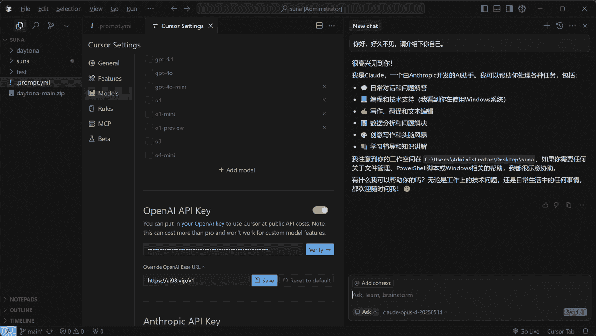

> 同理，如果要接入更多的大模型，在创建模型页面创建更多模型即可。

## 4.Gemini 2.5、Claude 4模型接入本地聊天机器人

而当我们完成了各类聚合网站的API注册后，作为最基础的应用场景，我们还可以通过这些API，将Gemini 2.5、Claude 4等模型先接入本地聊天机器人，如接入ChatBox、Cherry Studio或者Open-WebUI等。由于各类聚合平台对各类大模型调用流程都类似，因此这里以Cherry Studio+DMXAPI调用Claude 4模型、以及Open-WebUI+OpenRouter调用`google/gemini-2.5-flash-preview-05-20`模型为例进行演示。

### Cherry Studio借助DMXAPI调用Claude 4模型

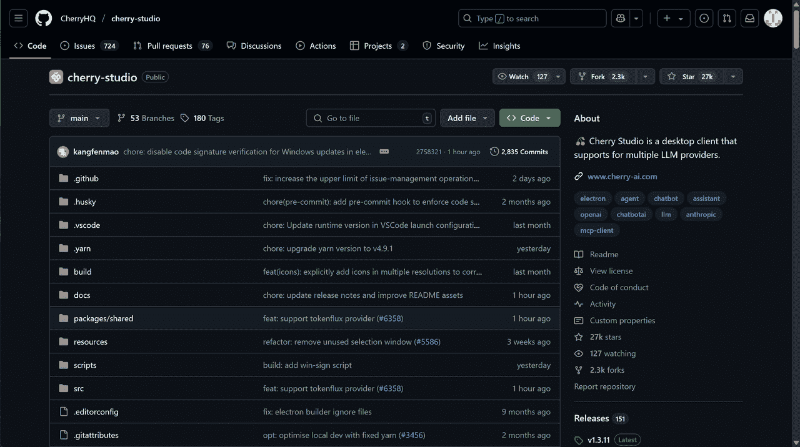

#### Cherry Studio 简介

Cherry Studio 是一款专为本地部署的大语言模型（LLM）设计的跨平台开发环境，目标是打造类似于 Visual Studio Code 的多模型 AI 助手 IDE。它将模型调用、本地缓存、上下文管理、插件扩展等功能高度整合，帮助用户以图形化方式便捷构建、测试和运行大模型应用。

Cherry Studio 支持一键加载如 ChatGLM、Qwen、LLaMA、Baichuan、DeepSeek 等本地模型，并通过“对话卡片”与“记忆管理”系统，提升人机交互效率，适合研发者、AI 创作者、教育工作者使用。

+ 🔧 支持多后端（包括 Ollama、LMDeploy、FastChat、`OpenAI` 代理等）

+ 🌐 支持多模型并行调用、上下文跨模型共享

+ 🧩 插件机制灵活，可接入浏览器、RAG、`Python` 执行器等

+ 🖥 Windows / macOS / Linux 三平台通用

🔗 官网地址：`https://github.com/CherryHQ/cherry-studio`

而在Cherry Studio中，我们能够非常便捷的接入DMXAPI，我们只需要输入DMXAPI的密钥：

然后点击管理模型：

然后选择claude4：

最后，即可在对话页面调用Claude4模型了：

同时，Cherry Studio也是MCP客户端，可以无缝接入MCP服务器，这里我们可以选择一个查询天气的`Stdio`服务器：

然后进行对话测试：

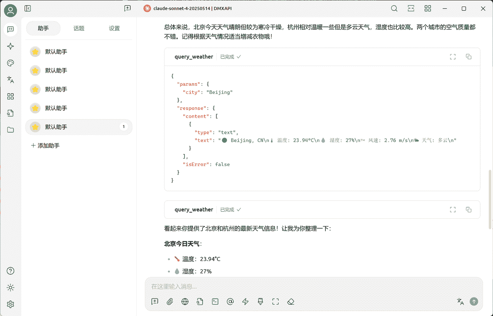

### Open-WebUI借助OpenRouter调用Gemini 2.5模型流程

#### Open-WebUI 简介

Open-WebUI 是一个开源的 Web 用户界面平台，专为本地大语言模型（如 Ollama、LM Studio）设计，目标是提供一个简洁现代、用户友好的界面来进行 LLM 对话、插件扩展、上下文检索（RAG）等操作。

Open-WebUI 类似于 ChatGPT 的浏览器体验，但它是完全本地运行的，不依赖云端，强调隐私、安全与自由。用户可以轻松使用 Chat、Code、Search 等工具，同时还能自定义模型路径、管理历史对话和知识库。

+ 🧠 支持与 Ollama 深度集成（如 llama3、mistral）

+ 🧩 可扩展工具插件：浏览器搜索、文件问答、代码执行等

+ 👥 多用户支持、支持 API Key 管理与权限设置

+ 📦 部署方便，支持 Docker、一键本地启动

🔗 官网地址：`https://github.com/open-webui/open-webui`

Open-WebUI的安装过程非常简单，只需要使用`pip`工具即可安装：

```
pip install open-webui
```

安装完成后，输入`serve`命令即可开启Open-WebUI：

```
open-webui serve
```

打开Open-WebUI后，即可在左下角点击管理员面板，点击设置：

并在外部连接中输入openrouter的base url，以及`API-KEY`，并点击保存：

然后回到对话页面，找到Gemini 2.5 flash模型并进行对话即可：

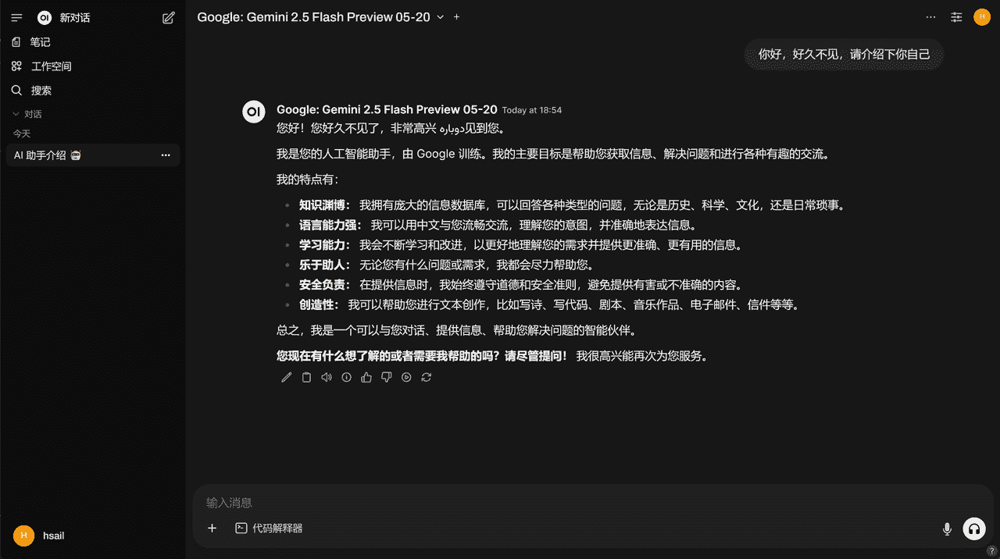

同时，我们也可以使用Open-WebUI自带的代码解释器功能，进行简单的编程测试：

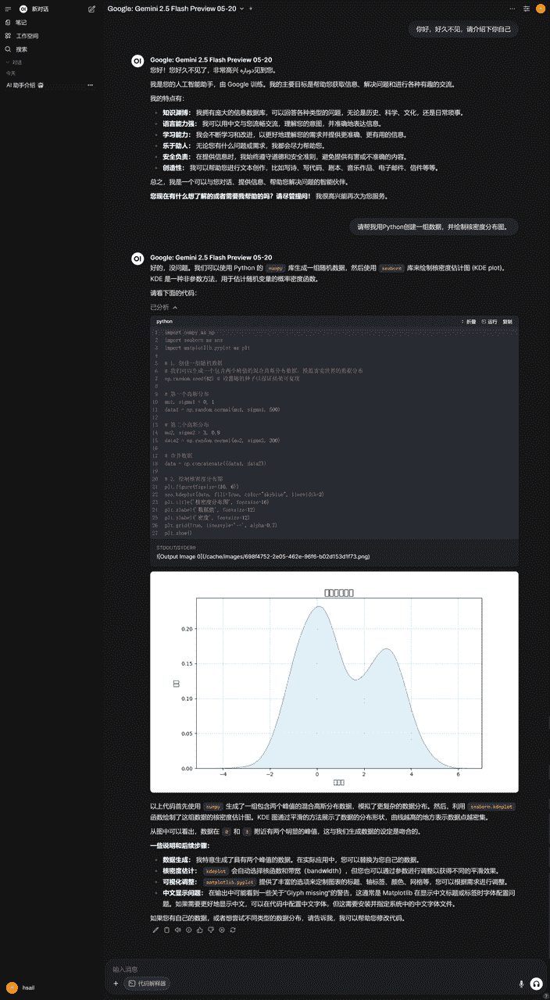

## 5.Gemini 2.5、Claude 4 API进阶调用方法介绍

```
import os
from dotenv import load_dotenv
load_dotenv(override=True)
from openai import OpenAI
```

最后，我们讨论一些进阶内容，关于如何在开发环境中调用聚合API中的Gemini模型和Claude模型API，来完成开发任务。不同于简单的对话聊天，在实际围绕大模型进行Agent开发时，往往需要用到模型的很多进阶功能，如多模态能力、思考能力等，甚至有些模型的默认API工具，还自带了例如网络搜索、连接MCP工具等能力，因此作为开发者，在选择聚合API进行开发时，务必需要先验证聚合API是否具备相同的能力，才能更好的判断模型价值。

### 5.1 Gemini 2.5聚合API调用流程

此前我们已经尝试使用各类聚合API调用了Gemini模型，这里继续测试Gemini API的进阶功能。


```
"url": "https://ml2022.oss-cn-hangzhou.aliyuncs.com/img/image-20250523192158057.png"
```

```
from openai import OpenAI

client = OpenAI(
  base_url="https://openrouter.ai/api/v1",
  api_key=os.getenv("OR_API_KEY"),
)

completion = client.chat.completions.create(
  model="google/gemini-2.5-flash-preview-05-20",
  messages=[
    {
      "role": "user",
      "content": [
        {
          "type": "text",
          "text": "请帮我详细描述这张图片上的内容"
        },
        {
          "type": "image_url",
          "image_url": {
          }
        }
      ]
    }
  ]
)
print(completion.choices[0].message.content)
```

```
这是一张电影或音乐视频的截图，画面中心是一位年轻亚洲女性的特写。

**主体人物：**
* 画面中央的主体是一位年轻的亚洲女性，面部清晰，表情自然。
* 她留着中长发，发色为棕色，前额有刘海，发型显得柔顺。
* 她的妆容自然，眉毛精致，眼睛明亮有神，眼线不明显。
* 她涂着粉色的口红，嘴唇微张，似乎正在唱歌或说话。
* 她的皮肤看起来白皙细腻。
* 她穿着一件浅色（可能是白色或米白色）的服装，领口是V字形，材质看起来有褶皱或纹理感。
* 她的脖子上戴着一条细项链，项链坠子是一个小巧的猫头或者类似的小动物形象。
* 在她面前有一个复古风格的麦克风，麦克风的一部分在她的视角下，显得比较近。

**背景和环境：**
* 背景是室内场景，但光线充足，可能是在一个半开放的空间里。
* 背景模糊，呈现出柔和的景深效果，突出人物主体。
* 背景中能看到一些砖墙的纹理和木质结构，可能是一个有年代感的建筑。
* 画面左侧和上方能看到一些模糊的光斑，可能是远处的灯光或装饰物。
* 画面左下角和右侧有一行字幕：“落下一万年的约定”。
* 画面右上角有“铁”字样和一个中文Logo“铁人娱乐”，下方还有英文小字“PRODIGY ASIA TALENT”。

**整体氛围：**
* 画面色调温暖，光线柔和，营造出一种舒适、亲切的氛围。
* 女性的表情和姿态暗示她正在表演或沉浸在音乐中。
* 整体构图清晰，人物突出，背景虚化处理得当。
```

而其他聚合API也可以完整实现类似功能：

| 平台名 | Base URL | Gemini 2.5模型名称 | Claude 4模型名称 |

| --- | --- | --- | --- |

| ✅ OpenRouter | `"https://openrouter.ai/api/v1"` | `google/gemini-2.5-flash-preview-05-20` | `anthropic/claude-opus-4` |

| ✅ DMXAPI | `"https://www.dmxapi.cn/v1"` | `gemini-2.5-flash-preview-04-17` | `claude-opus-4-20250514` |

| ✅ Small AI | `"https://ai98.vip/v1"` | `gemini-2.5-pro-preview-05-06` | `claude-opus-4-20250514` |

例如DMXAPI：


# 大模型 API 调用与图像内容描述

## DMX API 调用流程

```json
"url": "https://ml2022.oss-cn-hangzhou.aliyuncs.com/img/image-20250523192158057.png"
```

```
client = OpenAI(
  base_url="https://www.dmxapi.cn/v1",
  api_key=os.getenv("DMX_API_KEY"),
)

completion = client.chat.completions.create(
  model="gemini-2.5-flash-preview-04-17",
  messages=[
    {
      "role": "user",
      "content": [
        {
          "type": "text",
          "text": "请帮我详细描述这张图片上的内容"
        },
        {
          "type": "image_url",
          "image_url": {
          }
        }
      ]
    }
  ]
)
print(completion.choices[0].message.content)
```

好的，这是一张关于一位年轻女性的特写照片，她似乎正在唱歌或表演。以下是对图片内容的详细描述：

1.  **主要人物:** 图片的中心是一位年轻的女性。她面向镜头，头部微微向左倾斜。
    *   **面部特征:** 她有着白皙的皮肤，眉毛纤细，眼睛大而明亮，眼神看向前方或略微向上。鼻梁挺直，嘴唇微张，露出牙齿，似乎正在演唱或说话。嘴唇涂有淡粉色口红。
    *   **发型:** 她的头发是中等长度的棕红色，有自然的波浪，偏分，额头上有几缕刘海。头发自然地垂在耳后和肩部。
    *   **衣着:** 她穿着一件白色的上衣，衣领部分有细密的褶皱或纹理，材质看起来柔软舒适。
    *   **配饰:** 她戴着一条细链子的项链，链子上有一个小小的吊坠，形状像一个卡通动物的头部（可能是一只猫或其他小动物），虽然模糊，但轮廓依稀可辨。

2.  **麦克风:** 在她的身前，偏右侧的位置，有一个复古风格的麦克风。麦克风头部呈圆形或卵圆形，有金属网罩，支架是黄铜色的，立在她的胸前。她的嘴巴正对着麦克风。

3.  **背景:** 背景大部分是模糊的（景深很浅），突出了前景的人物。
    *   **左侧:** 背景左侧有一些模糊的光点，有红色和绿色的，像是装饰灯串或者远处灯光的散景。还能看到一些模糊的绿色植物（可能是树叶或灌木）。
    *   **右侧和中部:** 背景中部偏右能看到模糊的建筑结构，墙壁看起来有砖块纹理或粗糙的表面。上方能看到屋顶或天花板的结构，像是波纹状的金属板或石棉瓦，下方有木质的梁或支撑物。整体背景给人一种朴实、可能略带年代感或户外的感觉。

4.  **文字信息:**
    *   **底部:** 在图片的底部中央偏左位置，有白色的中文文字：“落下一萬年的約定”。这可能是歌词或歌曲名称的一部分。
    *   **右上角:** 图片的右上角有一个白色的Logo。 Logo上方是一个大大的“铁”字，下方是较小的“铁人娱乐”字样，再下方是英文字母“PRODIGEE ASIA TALENT”。这应该是制作方或所属公司的标识。

**整体印象:** 照片捕捉了这位女性在演唱时的特写瞬间，光线柔和，将焦点完全集中在她的面部和表演状态上。复古的麦克风和模糊的背景营造出一种特定的氛围，可能是在一个小型演出场地或工作室里。

## smallAI 实现流程

```json
"url": "https://ml2022.oss-cn-hangzhou.aliyuncs.com/img/image-20250523192158057.png"
```

```
client = OpenAI(
  base_url="https://ai98.vip/v1",
  api_key=os.getenv("SAI_API_KEY"),
)

completion = client.chat.completions.create(
  model="gemini-2.5-pro-preview-05-06",
  messages=[
    {
      "role": "user",
      "content": [
        {
          "type": "text",
          "text": "请帮我详细描述这张图片上的内容"
        },
        {
          "type": "image_url",
          "image_url": {
          }
        }
      ]
    }
  ]
)
print(completion.choices[0].message.content)
```

这张图片是一幅视频截图，主要内容是一位年轻女性正在唱歌。

**主体人物：**
*   一位年轻的东亚女性，占据了画面的中心偏右位置。
*   她有着浅棕色或带点红棕色的及肩发，留着空气刘海，发型略带蓬松感。
*   她的五官清秀，皮肤白皙，化着淡妆，唇色是自然的粉红色。眼神专注地看着前方略偏下的位置，表情投入，似乎正在深情演唱。
*   她穿着一件浅色（看起来是白色或米白色）的上衣，领口较大，衣服表面有褶皱或肌理感。
*   脖子上戴着一条细细的银色项链，吊坠的形状不太清晰。

**麦克风：**
*   她面前立着一支复古造型的麦克风，麦克风头是圆饼状或椭球形，金属材质，网罩部分呈现金色或黄铜色，支架是深色的。

**背景：**
*   背景是虚化的，营造出景深效果，使人物更加突出。
*   左侧背景可以看到一些模糊的屋檐结构，像是棚屋或简易建筑的屋顶边缘。屋檐下隐约有绿色植物和一些红色、绿色的圆形光斑，可能是装饰性的彩灯。
*   右侧背景是一面模糊的墙壁，颜色偏棕红，质感像是砖墙或粗糙的土墙。墙上有一个深棕色的矩形区域，可能是一扇门或窗户。
*   整体背景色调偏暖，有些昏暗，营造出一种温馨或怀旧的氛围。

**文字与标识：**
*   画面底部中央有一行白色的中文字幕：“落下一萬年的約定”。
*   画面右上角有一个白色方形logo，里面是一个复杂的汉字（看起来像“铁”的繁体或艺术变形），下方有两行小字，上面一行是“铁人娱乐”，下面一行是英文“PRODIGEE ASIA TALENT”。

**整体氛围与构图：**
*   这是一张特写镜头，焦点清晰地落在女性的面部和麦克风上。
*   光线柔和，主要照亮了女性的脸庞。
*   整体色调偏暖，给人一种柔和、抒情的感觉。
*   从场景和麦克风的样式来看，可能是在一个小型现场、录音棚或者具有复古风格的咖啡馆、酒吧等场所。

总的来说，这张图片捕捉了一位女性歌手在富有情调的环境中深情演唱的瞬间。

### 5.2 Claude 4 聚合 API 调用流程

接下来我们继续尝试调用聚合 API 来调用 Claude 4 API。这里需要注意的是，`OpenRouter` 核心功能只支持 `OpenAI` 风格 API 进行调用，而 DMX 和 smallAI，则可以通过设置 `BaseURL` 来直接接入 Anthropic API，从而拓展底层 API 模型能力。

#### OpenRouter Claude 4 多模态功能测试

```json
"url": "https://ml2022.oss-cn-hangzhou.aliyuncs.com/img/image-20250523192158057.png"
```

```
client = OpenAI(
  base_url="https://openrouter.ai/api/v1",
  api_key=os.getenv("OR_API_KEY"),
)

completion = client.chat.completions.create(
  model="anthropic/claude-sonnet-4",
  messages=[
    {
      "role": "user",
      "content": [
        {
          "type": "text",
          "text": "请帮我详细描述这张图片上的内容"
        },
        {
          "type": "image_url",
          "image_url": {
          }
        }
      ]
    }
  ]
)
print(completion.choices[0].message.content)
```

这张图片显示的是一个年轻女性在录音或进行播音的场景。以下是详细描述：

**人物特征：**
- 一位年轻的亚洲女性，有着棕色的中长发，刘海遮住部分额头
- 面容清秀，化着淡妆，涂着粉色口红
- 穿着白色的针织衫或毛衣

**设备和环境：**
- 她正对着一个专业的录音麦克风说话
- 麦克风是典型的录音室用麦克风，呈圆形设计
- 背景看起来像是在录音室或工作室内，环境相对模糊

**其他细节：**
- 图片底部有中文字幕显示"落下一萬年的約定"
- 右上角有一个标识或水印
- 整体画面色调温暖，光线柔和
- 女性的表情显得专注和认真，似乎在进行某种录制工作

这看起来像是来自某个影视作品、纪录片或录音节目的截图画面。

> 其他模型 API 也均可实现。

#### DMX、smallAI 接入 Anthropic API

> Claude API 使用说明：`https://docs.anthropic.com/en/docs/get-started`

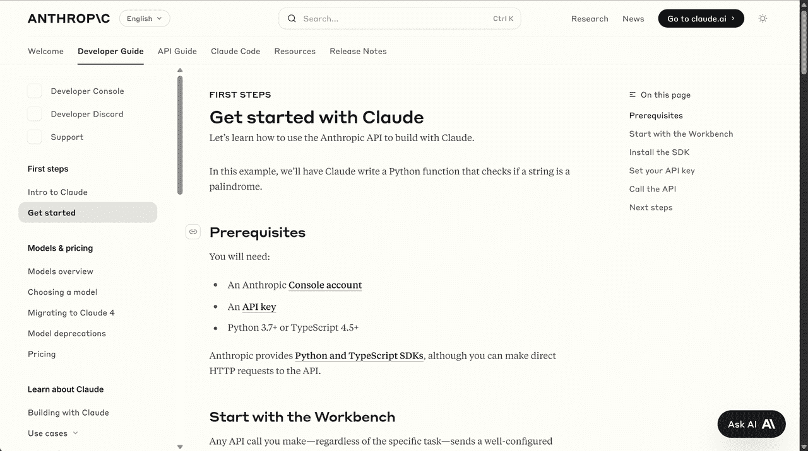

```
!pip install anthropic
```


# 环境依赖安装

```
Requirement already satisfied: google-genai in c:\programdata\anaconda3\envs\jupyter_env\lib\site-packages (1.12.1)
Requirement already satisfied: anthropic in c:\programdata\anaconda3\envs\jupyter_env\lib\site-packages (0.52.0)
Requirement already satisfied: anyio<5.0.0,>=4.8.0 in c:\programdata\anaconda3\envs\jupyter_env\lib\site-packages (from google-genai) (4.9.0)
Requirement already satisfied: google-auth<3.0.0,>=2.14.1 in c:\programdata\anaconda3\envs\jupyter_env\lib\site-packages (from google-genai) (2.39.0)
Requirement already satisfied: httpx<1.0.0,>=0.28.1 in c:\programdata\anaconda3\envs\jupyter_env\lib\site-packages (from google-genai) (0.28.1)
Requirement already satisfied: pydantic<3.0.0,>=2.0.0 in c:\programdata\anaconda3\envs\jupyter_env\lib\site-packages (from google-genai) (2.10.6)
Requirement already satisfied: requests<3.0.0,>=2.28.1 in c:\programdata\anaconda3\envs\jupyter_env\lib\site-packages (from google-genai) (2.32.3)
Requirement already satisfied: websockets<15.1.0,>=13.0.0 in c:\programdata\anaconda3\envs\jupyter_env\lib\site-packages (from google-genai) (15.0.1)
Requirement already satisfied: typing-extensions<5.0.0,>=4.11.0 in c:\programdata\anaconda3\envs\jupyter_env\lib\site-packages (from google-genai) (4.13.0)
Requirement already satisfied: distro<2,>=1.7.0 in c:\programdata\anaconda3\envs\jupyter_env\lib\site-packages (from anthropic) (1.9.0)
Requirement already satisfied: jiter<1,>=0.4.0 in c:\programdata\anaconda3\envs\jupyter_env\lib\site-packages (from anthropic) (0.9.0)
Requirement already satisfied: sniffio in c:\programdata\anaconda3\envs\jupyter_env\lib\site-packages (from anthropic) (1.3.1)
Requirement already satisfied: idna>=2.8 in c:\programdata\anaconda3\envs\jupyter_env\lib\site-packages (from anyio<5.0.0,>=4.8.0->google-genai) (3.10)
Requirement already satisfied: cachetools<6.0,>=2.0.0 in c:\programdata\anaconda3\envs\jupyter_env\lib\site-packages (from google-auth<3.0.0,>=2.14.1->google-genai) (5.5.2)
Requirement already satisfied: pyasn1-modules>=0.2.1 in c:\programdata\anaconda3\envs\jupyter_env\lib\site-packages (from google-auth<3.0.0,>=2.14.1->google-genai) (0.4.2)
Requirement already satisfied: rsa<5,>=3.1.4 in c:\programdata\anaconda3\envs\jupyter_env\lib\site-packages (from google-auth<3.0.0,>=2.14.1->google-genai) (4.9.1)
Requirement already satisfied: certifi in c:\programdata\anaconda3\envs\jupyter_env\lib\site-packages (from httpx<1.0.0,>=0.28.1->google-genai) (2025.1.31)
Requirement already satisfied: httpcore==1.* in c:\programdata\anaconda3\envs\jupyter_env\lib\site-packages (from httpx<1.0.0,>=0.28.1->google-genai) (1.0.7)
Requirement already satisfied: h11<0.15,>=0.13 in c:\programdata\anaconda3\envs\jupyter_env\lib\site-packages (from httpcore==1.*->httpx<1.0.0,>=0.28.1->google-genai) (0.14.0)
Requirement already satisfied: annotated-types>=0.6.0 in c:\programdata\anaconda3\envs\jupyter_env\lib\site-packages (from pydantic<3.0.0,>=2.0.0->google-genai) (0.7.0)
Requirement already satisfied: pydantic-core==2.27.2 in c:\programdata\anaconda3\envs\jupyter_env\lib\site-packages (from pydantic<3.0.0,>=2.0.0->google-genai) (2.27.2)
Requirement already satisfied: charset-normalizer<4,>=2 in c:\programdata\anaconda3\envs\jupyter_env\lib\site-packages (from requests<3.0.0,>=2.28.1->google-genai) (3.4.1)
Requirement already satisfied: urllib3<3,>=1.21.1 in c:\programdata\anaconda3\envs\jupyter_env\lib\site-packages (from requests<3.0.0,>=2.28.1->google-genai) (2.3.0)
Requirement already satisfied: pyasn1<0.7.0,>=0.6.1 in c:\programdata\anaconda3\envs\jupyter_env\lib\site-packages (from pyasn1-modules>=0.2.1->google-auth<3.0.0,>=2.14.1->google-genai) (0.6.1)
```

## 导入客户端

```
import anthropic
```

## 查看客户端类帮助

```
anthropic.Anthropic?

Init signature:
anthropic.Anthropic(
    *,
    api_key: 'str | None' = None,
    auth_token: 'str | None' = None,
    base_url: 'str | httpx.URL | None' = None,
    timeout: 'Union[float, Timeout, None, NotGiven]' = NOT_GIVEN,
    max_retries: 'int' = 2,
    default_headers: 'Mapping[str, str] | None' = None,
    default_query: 'Mapping[str, object] | None' = None,
    http_client: 'httpx.Client | None' = None,
    _strict_response_validation: 'bool' = False,
) -> 'None'
Docstring:     
Abstract base class for generic types.

A generic type is typically declared by inheriting from
this class parameterized with one or more type variables.
For example, a generic mapping type might be defined as::

  class Mapping(Generic[KT, VT]):
      def __getitem__(self, key: KT) -> VT:
          ...
      # Etc.

This class can then be used as follows::

  def lookup_name(mapping: Mapping[KT, VT], key: KT, default: VT) -> VT:
      try:
          return mapping[key]
      except KeyError:
          return default
Init docstring:
Construct a new synchronous Anthropic client instance.

This automatically infers the following arguments from their corresponding environment variables if they are not provided:
- `api_key` from `ANTHROPIC_API_KEY`
- `auth_token` from `ANTHROPIC_AUTH_TOKEN`
File:           c:\programdata\anaconda3\envs\jupyter_env\lib\site-packages\anthropic\__init__.py
Type:           type
Subclasses:     
```

接下来无论是调用Gemini还是Claude模型，我们都需要注意设置`api_key`和`base_url`。

核心参数解释如下：

## 核心参数说明

| 参数名 | 中文含义 | 说明 |
| --- | --- | --- |
| `api_key` | API 密钥 | Claude 的访问密钥。若未提供，将从环境变量 `ANTHROPIC_API_KEY` 中自动读取。 |
| `auth_token` | 授权令牌（可选） | 用于某些企业环境下的身份验证（少用）。默认从 `ANTHROPIC_AUTH_TOKEN` 读取。 |
| `base_url` | API 基础地址（可选） | 默认指向 Anthropic 官方 API，可自定义用于代理或私有部署。 |
| `timeout` | 请求超时设置（秒） | 单次请求最大允许的等待时间，可为浮点数或 `httpx.Timeout` 对象。 |
| `max_retries` | 最大重试次数 | 当请求失败时自动重试的最大次数，默认是 2 次。 |
| `default_headers` | 默认请求头 | 可用于添加自定义 HTTP 头（如 `User-Agent`、`Trace-ID`）。 |
| `default_query` | 默认 URL 查询参数 | 添加在每次 API 调用中的默认 query 参数。 |
| `http_client` | 自定义 http 客户端对象 | 如果你使用自定义的 `httpx.Client`，可通过这里传入；否则 SDK 会自己创建一个。 |
| `_strict_response_validation` | 严格响应校验（内部参数） | 是否强制验证返回数据格式，开发者一般无需使用。 |

接下来测试进行调用

## 平台与模型配置

| 平台名 | Base URL | Gemini 2.5模型名称 | Claude 4模型名称 |
| --- | --- | --- | --- |
| ✅ OpenRouter | `https://openrouter.ai/api/v1` | `google/gemini-2.5-flash-preview-05-20` | `anthropic/claude-opus-4` |
| ✅ DMXAPI | `https://www.dmxapi.cn/v1` | `gemini-2.5-flash-preview-04-17` | `claude-opus-4-20250514` |
| ✅ Small AI | `https://ai98.vip/v1` | `gemini-2.5-pro-preview-05-06` | `claude-opus-4-20250514` |

## 调用示例

```
client = anthropic.Anthropic(
    api_key=os.getenv("DMX_API_KEY"),
    base_url="https://www.dmxapi.cn"
)
```

```
message = client.messages.create(
    model="claude-opus-4-20250514",
    max_tokens=1000,
    temperature=1,
    system="You are a world-class poet. Respond only with short poems.",
    messages=[
        {
            "role": "user",
            "content": [
                {
                    "type": "text",
                    "text": "Why is the ocean salty?"
                }
            ]
        }
    ]
)
print(message.content)
```


# smallAI 接入 Anthropic 与模型调用示例

## 古代风暴与海洋盐分

```
[TextBlock(citations=None, text="Ancient tears from Earth's first storms,\nRivers carrying minerals in forms—\nWashing salt from rocks and land,\nDepositing crystals, grain by grain of sand.\n\nWhile rain returns as pure and clear,\nSalt remains, year after year.\nIn ocean's vast and briny deep,\nThese minerals forever keep.", type='text')]
```

> 远古风暴洒下的泪，
> 化作江河载矿归；
> 洗去岩石与大地的盐，
> 晶体沉积，一粒粒如沙般沉淀。
> 清雨归来依旧纯净清澈，
> 而盐分却年复一年地残留；
> 在辽阔而咸涩的海洋深处，
> 这些矿物，恒久长存不朽。

## smallAI 接入示例

而`smallAI`也可以接入：

```
client = anthropic.Anthropic(
    api_key=os.getenv("SAI_API_KEY"),
    base_url="https://ai98.vip"
)
```

```
message = client.messages.create(
    model="claude-opus-4-20250514",
    max_tokens=1000,
    temperature=1,
    system="You are a world-class poet. Respond only with short poems.",
    messages=[
        {
            "role": "user",
            "content": [
                {
                    "type": "text",
                    "text": "Why is the ocean salty?"
                }
            ]
        }
    ]
)
print(message.content)
```

```
[TextBlock(citations=None, text="Salt from ancient stones dissolved,\nRivers carried minerals resolved,\nTo seas that never let them go—\nEvaporation leaves below\nThe brine that makes the ocean's soul.\n\nEons passed, the salt remained,\nWhile pure water rose and rained,\nLeaving minerals behind to stay\nIn waves that dance both night and day—\nThus the sea grew salt-sustained.", type='text')]
```

## OpenRouter 与 Anthropic 生态对比

但`OpenRouter`无法直接按照这种中转的方式进行接入，而这就会使得`DMXAPI`和`smallAPI`能够更加深度的接入`Anthropic`的技术开发生态中，相比之下`OpenRouter`则需要借助`LiteLLm`才能完成相同的功能。

## 使用 Anthropic 客户端进行模型调用

```
client = anthropic.Anthropic(
    api_key=os.getenv("SAI_API_KEY"),
    base_url="https://ai98.vip"
)
```

```
response = client.messages.create(
    model="claude-sonnet-4-20250514",
    max_tokens=16000,
    thinking={
        "type": "enabled",
        "budget_tokens": 10000
    },
    messages=[{
        "role": "user",
        "content": "请证明根号2是无理数"
    }]
)
```

```
response.content
```

```
[TextBlock(citations=None, text=' 我来用反证法证明√2是无理数。\n\n**证明：**\n\n假设√2是有理数，那么可以表示为两个互质整数的比值，即：\n√2 = p/q\n\n其中p和q是正整数，且gcd(p,q) = 1（即p和q互质，没有大于1的公因数）。\n\n将等式两边平方：\n2 = p²/q²\n\n整理得：\n2q² = p²\n\n这说明p²是偶数，因为它等于2q²。\n\n由于p²是偶数，所以p也必须是偶数（因为奇数的平方是奇数）。\n\n既然p是偶数，可以写成p = 2k的形式，其中k是某个整数。\n\n将p = 2k代入2q² = p²：\n2q² = (2k)²\n2q² = 4k²\nq² = 2k²\n\n这说明q²也是偶数，因此q也是偶数。\n\n但是，如果p和q都是偶数，那么它们都有公因数2，这与我们最初的假设gcd(p,q) = 1矛盾。\n\n因此，我们的假设是错误的，√2不能表示为两个整数的比值。\n\n**结论：** √2是无理数。\n\n这个证明的关键在于利用了互质数的性质和偶数的性质，通过逻辑推导得出矛盾，从而证明了原命题。', type='text')]
```

## 证明 4n+3 形式的质数无穷多

```
client = anthropic.Anthropic(
    api_key=os.getenv("DMX_API_KEY"),
    base_url="https://www.dmxapi.cn"
)
```

```
message = client.messages.create(
    model="claude-sonnet-4-20250514",
    max_tokens=16000,
    thinking={
        "type": "enabled",
        "budget_tokens": 10000
    },
    messages=[{
        "role": "user",
        "content": "Are there an infinite number of prime numbers such that n mod 4 == 3?"
    }]
)
print(message.content)
```

```
[TextBlock(citations=None, text="Yes, there are infinitely many prime numbers that are congruent to 3 modulo 4.\n\nThis is a classic theorem in number theory, and here's a proof:\n\n**Theorem**: There are infinitely many primes p such that p ≡ 3 (mod 4).\n\n**Proof by contradiction**:\n\nSuppose there are only finitely many primes congruent to 3 modulo 4. Let's call them p₁, p₂, ..., pₖ.\n\nConsider the number N = 4(p₁ · p₂ · ... · pₖ) - 1.\n\nNote that N ≡ -1 ≡ 3 (mod 4).\n\nSince N > 1, it must have at least one prime divisor. Let q be any prime divisor of N.\n\nWe have two cases to consider:\n\n**Case 1**: q ≡ 1 (mod 4)\nIf all prime divisors of N were congruent to 1 modulo 4, then N itself would be congruent to 1 modulo 4 (since the product of numbers ≡ 1 (mod 4) is ≡ 1 (mod 4)). But we established that N ≡ 3 (mod 4), which is a contradiction.\n\n**Case 2**: q ≡ 3 (mod 4)\nSince q divides N = 4(p₁ · p₂ · ... · pₖ) - 1, we have:\n4(p₁ · p₂ · ... · pₖ) ≡ 1 (mod q)\n\nThis means q cannot divide 4(p₁ · p₂ · ... · pₖ), so q cannot be equal to any of p₁, p₂, ..., pₖ (since if q = pᵢ for some i, then q would divide the product).\n\nTherefore, q is a prime congruent to 3 modulo 4 that's not in our supposedly complete list {p₁, p₂, ..., pₖ}.\n\nSince Case 1 leads to a contradiction, Case 2 must occur, giving us a new prime ≡ 3 (mod 4) not in our original finite list. This contradicts our assumption that the list was complete.\n\nTherefore, there must be infinitely many primes congruent to 3 modulo 4. □", type='text')]
```

> 是否存在无限多个形如 `4n+3` 的质数？

## 模型响应对象示例

```
message
```

```
Message(id='chatcmpl-msg_01GmXxQaAa4SpAdqaiDWZF98', content=[TextBlock(citations=None, text="Yes, there are infinitely many prime numbers that are congruent to 3 modulo 4.\n\nThis is a classic theorem in number theory, and here's a proof:\n\n**Theorem**: There are infinitely many primes p such that p ≡ 3 (mod 4).\n\n**Proof by contradiction**:\n\nSuppose there are only finitely many primes congruent to 3 modulo 4. Let's call them p₁, p₂, ..., pₖ.\n\nConsider the number N = 4(p₁ · p₂ · ... · pₖ) - 1.\n\nNote that N ≡ -1 ≡ 3 (mod 4).\n\nSince N > 1, it must have at least one prime divisor. Let q be any prime divisor of N.\n\nWe have two cases to consider:\n\n**Case 1**: q ≡ 1 (mod 4)\nIf all prime divisors of N were congruent to 1 modulo 4, then N itself would be congruent to 1 modulo 4 (since the product of numbers ≡ 1 (mod 4) is ≡ 1 (mod 4)). But we established that N ≡ 3 (mod 4), which is a contradiction.\n\n**Case 2**: q ≡ 3 (mod 4)\nSince q divides N = 4(p₁ · p₂ · ... · pₖ) - 1, we have:\n4(p₁ · p₂ · ... · pₖ) ≡ 1 (mod q)\n\nThis means q cannot divide 4(p₁ · p₂ · ... · pₖ), so q cannot be equal to any of p₁, p₂, ..., pₖ (since if q = pᵢ for some i, then q would divide the product).\n\nTherefore, q is a prime congruent to 3 modulo 4 that's not in our supposedly complete list {p₁, p₂, ..., pₖ}.\n\nSince Case 1 leads to a contradiction, Case 2 must occur, giving us a new prime ≡ 3 (mod 4) not in our original finite list. This contradicts our assumption that the list was complete.\n\nTherefore, there must be infinitely many primes congruent to 3 modulo 4. □", type='text')], model='claude-sonnet-4-20250514', role='assistant', stop_reason='end_turn', stop_sequence=None, type='message', usage=Usage(cache_creation_input_tokens=0, cache_read_input_tokens=0, input_tokens=26, output_tokens=592, server_tool_use=None, service_tier=None))
