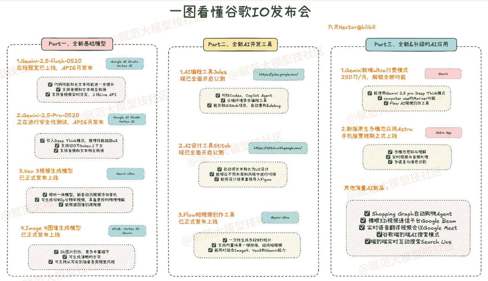
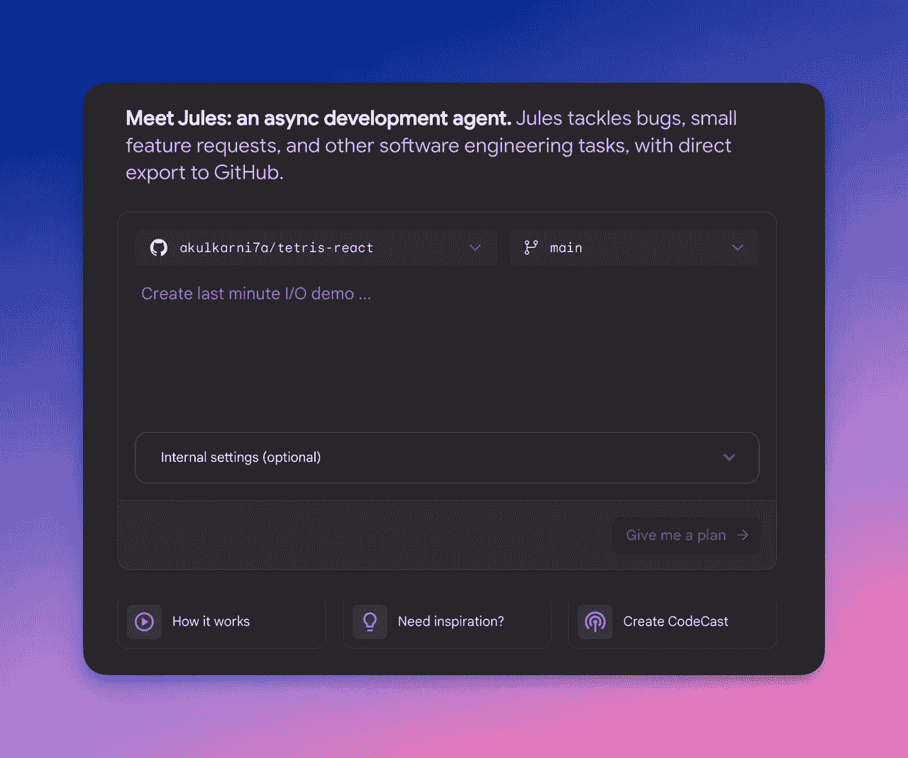
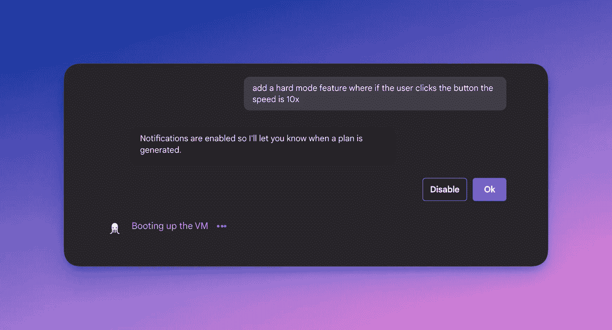
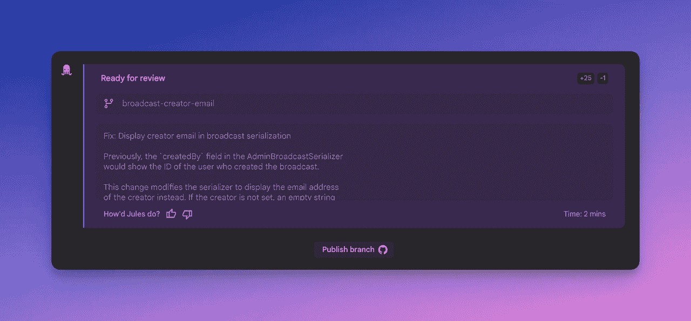
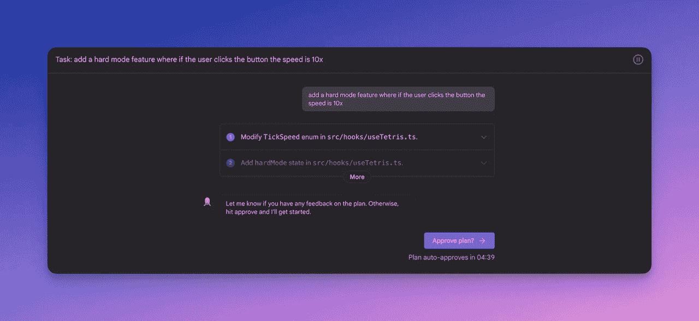
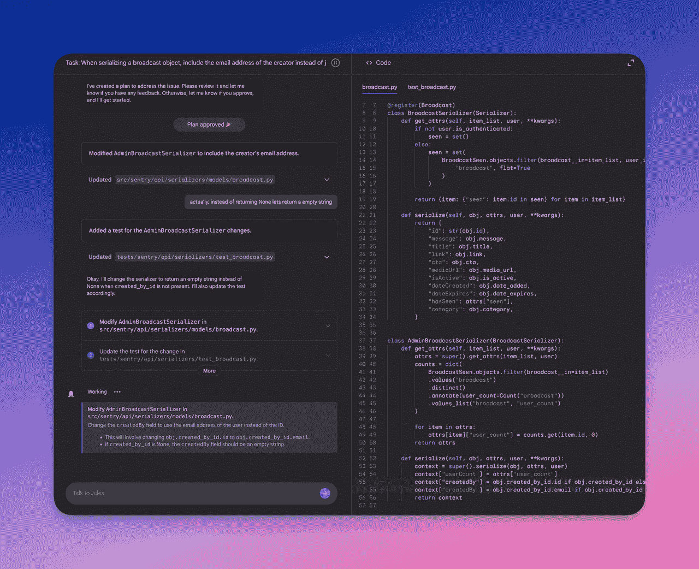
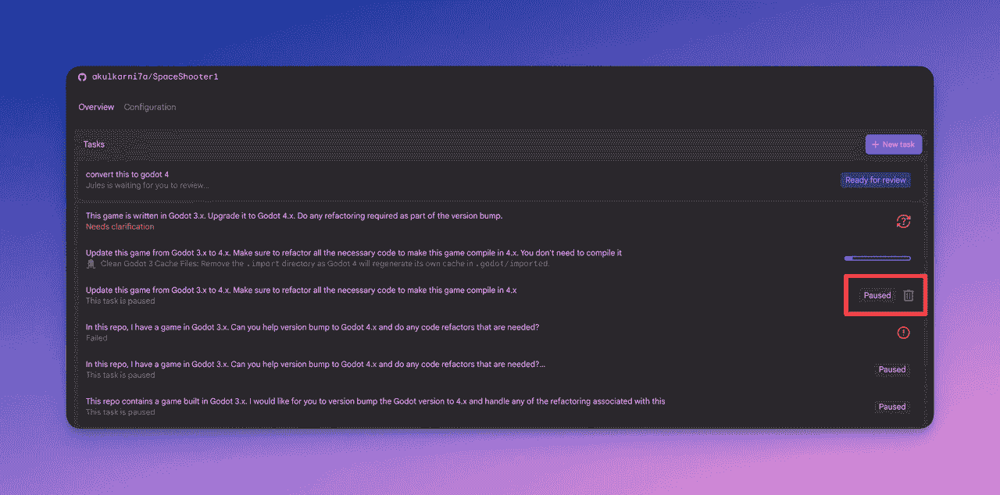
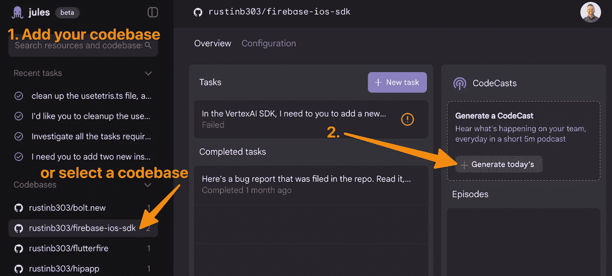

# Google Jules技术文档

> 来源：[https://kq4b3vgg5b.feishu.cn/docx/SFmudNixmonKzLxb5qscsfcHnsc](https://kq4b3vgg5b.feishu.cn/docx/SFmudNixmonKzLxb5qscsfcHnsc)



> Jules官网：https://jules.google/

> Jules技术文档：https://jules.google/docs/

# 一、项目入门介绍

Jules 是一款实验性编程Agent，旨在帮助你修复 Bug、添加文档以及构建新功能。它可以集成 GitHub，理解你的代码库，并以异步方式运行——你可以专注于其他事情，而 Jules 会自动处理任务。

本指南将引导你完成 Jules 的设置并运行你的第一个任务。

---

## 1.1 登录

1.  访问 jules.google.com

1.  使用你的 Google 账户登录

1.  接受隐私提示（仅需一次）

---

## 1.2 连接 GitHub

Jules 需要访问你的代码仓库才能正常运行。

1.  点击“连接到 GitHub 账户”

1.  完成登录流程

1.  选择你希望 Jules 访问的全部或特定仓库

1.  系统将重定向回 Jules，如果没有，请刷新页面

连接成功后，你将看到一个仓库选择器，可以选择你希望 Jules 操作的仓库，以及一个提示输入框用于描述你的任务。

---

## 1.3 启动你的第一个任务

Jules 会在一个虚拟机中运行，它会克隆你的代码、安装依赖，并修改文件。

1.  从仓库选择器中选择一个仓库

1.  选择 Jules 要操作的分支（系统默认会选中默认分支，除非你希望使用其他分支）

1.  编写一个清晰、具体的提示，例如：
为 utils.js 中的 parseQueryString 函数添加测试

1.  （可选）添加环境设置脚本

1.  点击“给我一个计划”按钮

提交任务后，Jules 会生成一个操作计划。在代码真正修改之前，你可以先进行审核和批准。



---

## 1.4 启用通知

在 Jules 运行期间，你可以离开网页。为确保你能及时了解任务进度，请：

1.  当浏览器提示时，启用浏览器通知

1.  随时前往“设置 → 通知”中启用或禁用通知

Jules 会在任务完成或需要你介入时通知你。



---

# 二、环境配置

Jules 会在一个安全、短时存活的虚拟机（VM）中运行每一个任务。这使得它能够克隆你的代码库、安装依赖，并运行测试。

**为了确保 Jules 能高效**地完成任务，你可以提供用于准备环境的 setup 脚本（设置脚本）。

---

## 2.1 预安装了什么？

每个 Jules 的虚拟机运行的是 Ubuntu Linux，并默认包含许多流行的开发工具，例如：

+   Node.js

+   Python

+   Go

+   Java

+   Rust

你可以在设置脚本中添加类似 node -v 的命令来检查预装的版本，然后点击 Run to Validate（运行以验证）。

---

## 2.2 添加设置脚本

为帮助安装依赖并运行测试，你可以按照以下步骤操作：

1.  点击左侧边栏中的代码仓库（repo）；

1.  选择顶部的 “Configuration（配置）”；

1.  在 “Initial Setup（初始化设置）” 窗口中，输入安装依赖并准备项目所需的命令，例如：

```
npm install
npm run test
```

---

## 2.3 测试你的设置脚本

点击 Run to Validate（运行以验证），检查你的设置脚本是否正常运行。

---

## 2.4 验证技巧

+   你可以通过添加 node -v 等命令到设置脚本中，并点击 Run to Validate 来检查已安装的版本；

+   始终包括安装依赖、运行代码检查器（linter）或测试的命令；

+   使用验证按钮可以及早发现错误；

+   保持脚本轻量且快速；

+   Jules 每次运行都在一个干净的环境中执行任务。

---

# 三、完整任务流程演示

在你登录并连接 GitHub 后，就可以开始使用 Jules 编码了。本指南将带你了解运行一个任务的关键步骤——从选择代码仓库到编写提示语、设置通知等。

---

## 3.1 选择代码仓库和分支

Jules 需要知道要在哪个仓库和分支上工作。登录后：

1.  打开左上角的 repo selector（仓库选择器） 下拉菜单；

1.  选择你希望 Jules 工作的代码仓库；

1.  选择你希望作为变更基础的分支。

Jules 会记住你上次使用的仓库，因此你总能看到上一次选择的记录。

---

## 3.2 编写清晰的提示语

Jules 在提示语清晰、具体的情况下效果最佳。使用简单自然的语言即可——不需要完美的语法或代码。

✅ **好的提示示例：**

+   “当 fetchUserProfile 运行时添加一个加载动画”

+   “修复提交反馈表单时的 500 错误”

+   “为 useCache 钩子添加 JSDoc 文档说明”

❌ **避免以下模糊提示：**

+   “修复所有问题”

+   “优化代码”

+   “让它变得更好”

> 如果提示不够清晰，Jules 会在写代码前请求更多反馈。

---

## 3.3 查看 Jules 的工作进度

当你批准了计划后，Jules 就会开始编写代码。

你将看到：

+   **活动日志**：每一个步骤完成时记录；

+   **逐行注释说明**：解释每一次变更；

+   Mini diff（小型差异预览）：查看每个文件的代码变更；

你也可以使用 **diff 编辑器** 来查看所有文件的完整变更内容。

---

## 3.4 最终总结与分支创建

当 Jules 完成任务后，它会生成一份总结，列出所有完成的内容：

+   ✅ 修改的文件

+   🕒 总运行时间

+   ➕添加/更改/删除的代码行数

+   🌿 可选的分支创建与提交信息功能

你可以点击 Create branch（创建分支） 来推送这些变更。请注意：

+   你是分支的所有者；

+   Jules 会作为提交者（committer）；

+   你可以在 GitHub 上用这个分支创建 Pull Request。



---

## 3.5 中途提供反馈

你可以在 Jules 工作的过程中随时提供反馈：

+   直接在聊天框中输入；

+   要求 Jules 更改方法、重写代码或澄清逻辑；

+   Jules 会立即响应，如有必要，会重新规划或修改任务。

你随时都可以干预，始终掌握主动权。

---

## 3.6 暂停 Jules

你可以在任何时候点击“**pause**”按钮来暂停 Jules。

Jules 被暂停时将停止所有工作，并等待你给出新的指令。你可以重新发出提示、取消暂停或删除当前任务。

# 四、审核计划与提供反馈

一旦你在 Jules 中启动一个任务，它会在编写任何代码之前生成一个“计划”（plan）。这可以让你了解 Jules 执行该任务的思路和步骤。在这个阶段，你可以与 Jules 一起讨论计划内容，确保在写入任何代码前达成一致。

---

## 4.1 审核计划

在设置完毕（如克隆代码仓库、初始化虚拟机、安装依赖项）之后，Jules 会展示它的计划。

你将看到以下内容：

+   **自然语言描述**Jules 计划要做的事；

+   **分步骤的细节说明**；

+   **假设或额外的配置步骤**；

操作步骤如下：

1.  展开每个步骤，逐条查看它们；

1.  如有需要，可以通过聊天输入框提供反馈；

1.  当你准备好让 Jules 执行任务时，点击 “approve plan”（批准计划）。

> ⚠️ 注意：如果你离开页面，Jules 会在设置的时间到期后自动批准计划。因此无需始终守在旁边。



---

## 4.2 提供反馈

你可以在任何阶段使用聊天框与 Jules 对话：

+   要求它**修改某个步骤**；

+   指出它**遗漏的内容**；

+   **澄清你的初始请求**；

+   **回答 Jules 的问题**，或提供其可能需要的**额外信息**。

Jules 会根据你的反馈响应，并在需要时更新其计划。



# 五、审查代码变更

当你批准一个计划后，Jules 会开始在虚拟机中执行工作。随着任务的逐步完成，你将看到一个活动日志（activity log），其中包含 Jules 的思考过程和代码更新情况。本页将引导你了解如何阅读这些内容以及如何做出回应。

---

## 5.1 活动日志

在 Jules 工作过程中，你将看到一个实时的活动日志（activity feed），其中记录了：

+   它完成的每一个步骤；

+   它所做操作的说明；

+   遇到的任何输出或错误；

+   对额外信息或反馈的请求。

这个日志可以帮助你理解 Jules 的决策过程和任务进展。

---

## 5.2 代码差异

当 Jules 修改代码时，你将在活动日志中直接看到一个 mini diff（小型代码差异视图）。若想查看完整内容：

+   每个步骤都附带 **mini diff**；

+   右侧面板中，你可以使用 **diff 编辑器** 查看所有文件的完整差异；

+   **diff 编辑器** 只显示 Jules 修改或新增了代码的文件。

这是你了解 Jules 修改范围的核心界面。


---

## 5.3 交互式反馈

你可以通过聊天框实时与 Jules 互动：

+   要求它修改逻辑或命名；

+   请求添加测试或清理代码；

+   提出具体建议，例如“返回空字符串而不是 None”。

---

## 5.4 任务总结

当任务完成后，Jules 会提供最终总结，包括：

+   ✅ 修改的文件

+   🕒 总运行时间

+   ➕ 添加/更改的代码行数

+   🌿 分支名称与提交信息


---

## 5.5 推送到 GitHub

点击 Create branch（创建分支），即可将 Jules 的更改推送到 GitHub：

+   Jules 会作为该分支的提交者；

+   如果你选择创建 Pull Request（PR），你将成为该 PR 的作者。

推送后，你可以继续在该分支上编辑、更改，或在 GitHub 上审核与删除该分支。

# 六、管理任务与代码仓库

你可以从以下三个位置启动一个新任务：

1.  点击 Jules 图标，返回主界面并打开一个空白的提示输入框；

1.  使用顶部导航栏中的 **new** 按钮；

1.  在某个具体仓库视图中，点击 **new task（新任务）**。

每个任务都会在独立的虚拟机中运行，并维护自己的日志、环境配置、任务设置和代码变更记录。

---

## 6.1 暂停或删除任务

有时你可能需要中止正在运行的任务，或清理旧任务。

+   **暂停任务**：点击“pause”按钮；

+   **删除任务**：在仓库视图中，将鼠标悬停在任务上，点击垃圾桶图标。

> 暂停的任务可以之后恢复；而删除的任务会被永久移除。




---

## 6.2 管理代码仓库

**Jule**s 只能访问你在 GitHub 上明确授权的代码仓库。未来，Jules 将支持更多版本控制系统。

---

### 6.2.1 选择一个代码仓库

如果你已经授权 Jules 访问你所有的代码仓库：

+   在启动任务时，使用下拉菜单选择任意已授权的仓库；

+   从左侧边栏点击 “Enroll new” 添加新仓库；

+   使用 repo selector（仓库选择器） 搜索并选择你的代码仓库。


---

### 6.2.2 授权更多代码仓库访问权限

要授予 Jules 更多仓库的访问权限，请按以下步骤操作：

1.  前往 [github.com](https://github.com/)

1.  点击右上角头像 → **Settings（设置）**

1.  在左侧边栏点击 Applications（应用）

1.  找到 Googl**e Labs Jules **并点击 Configure（配置）

1.  在 Repository access（仓库访问） 部分选择要授权的其他仓库

1.  点击 **Save（保存）**

**你也可以通过 Jules **内部的 repo selector 添加新仓库。在仓库选择器底部点击 +Add repository（添加仓库），系统会跳转到 GitHub，让你选择想授予 Jules 访问权限的其他仓库。

# 七、使用仓库视图

仓库视图为你提供了一个聚焦的工作区，用于与某个特定代码仓库进行交互。在这里，你可以查看任务历史、管理正在运行的任务，并启动诸如 Codecasts（即将上线）等功能。

---

## 7.1 启动一个 Codecast

Codecast 是你仓库中近期活动的简短音频摘要，类似于你的代码变更音频日志。

在仓库视图中，你可以点击 “Generate Today’s Codecast” 来生成一个 Codecast。

> Codecast 目前会包括最近几天内的所有提交（不只是 Jules 的操作）。就像 Jules 的许多功能一样，Codecast 仍在不断发展中。



---

## 7.2 访问仓库视图

打开仓库视图有两种方式：

1.  从左侧任务列表中点击任意一个仓库名；

1.  在任务启动器中选择一个仓库，然后在任务开始后点击它。

系统将打开一个该仓库专属的视图，包含任务历史记录及可执行的操作项。

---

## 7.3 按仓库查看任务

在仓库视图中，你将看到所有与该仓库相关的任务清单：

+   **运行中的任务** 列在最上方；

+   **已完成的任务** 包括完整日志与 diff 变更记录；

+   **失败的任务** 或 **等待中的任务** 都会有明确标签。

你可以点击任意任务重新打开它、查看其计划，或继续提供反馈。

---

## 7.4 启动一个新任务

在仓库视图中，你可以直接启动一个基于该仓库的新任务：

+   点击右上角的 **“new task”**；

+   系统会自动预选当前仓库和分支；

+   按常规方式输入你的提示语和设置脚本。

# 八、错误与失败

尽管 Jules 自动化了开发流程中的许多环节，但仍可能发生错误，例如环境配置不当或任务执行失败。本页面将说明：

+   Jules 如何报告错误；

+   它自动会做哪些处理；

+   你如何进行调试。

---

## 8.1 错误是如何被报告的

Jules 主要通过两个位置向你提示错误：

+   活动日志（Activity feed）：记录具体失败的步骤；

+   通知徽标（Notification badge）：界面上显示红点提示。

这些错误可能表示任务完全失败，或者仅仅是需要你介入处理。

---

## 8.2 自动重试机制

当可能时，Jules 会自动重试失败的步骤。例如：

+   网络波动（Network hiccups）；

+   依赖安装临时出错；

+   依赖解析过慢等问题。

**在多次重试无效后，如**果问题仍然存在，Jules 会将任务标记为 失败（failed）。

---

## 8.3 常见失败原因

以下是最常见的失败原因：

+   环境设置脚本不完整或缺失（environment setup scripts）；

+   提示语过于模糊或不明确；

+   使用了不常见或非标准的构建系统；

+   启动了运行时间过长的进程（如 npm run dev）被包含在 setup 中。

---

## 8.4 调试环境配置问题

你可以通过以下方式重试任务：

+   在任务摘要页面中点击 **“rerun（重新运行）”**；

+   修改环境设置脚本或提示语，然后重新启动任务。

请务必参考失败日志中提供的具体反馈信息，逐项进行修复。

# 九、使用限制

Jules 当前仍处于 **Beta 测试阶段**，在此期间用户可**免费使用**。Jules官方正在积极优化服务，并观察开发者如何使用 Jules，以及在哪些方面最能体现其价值。

在 Beta 阶段收集的使用数据将帮助Jules：

+   提升任务质量与系统性能

+   理解真实的开发工作流

+   为未来的定价模型提供依据

> 👉 了解更多 关于你的数据如何用于优化 Jules：https://jules.google.com/legal

虽然目前免费，但未来Jules计划引入收费模式，并且会随着产品成熟发布更多细节。Jules的重点是打造良好的开发者体验，并从早期用户中汲取反馈与改进。

---

## 9.1 任务使用限制

每位用户默认有以下使用上限：

+   **最多同时运行 3 个任务**

+   **每天最多提交 5 个任务**

+   每天最多生成 5 个 Codecast（语音摘要）

**如果你尝试超出**这些限制，Jules 会提醒你，并禁止创建新任务，直到配额重置。

---

## 9.2 达到上限会发生什么

当你触达限制时：

+   “新建任务”按钮将被禁用

+   会显示提示或错误信息说明原因

+   你仍可查看或管理已有任务

+   任务历史与反馈不会受影响

---

## 9.3 申请更高配额

如果你是**大型团队的一员**，或在日常开发中大量使用 Jules，我们希望听取你的意见。

若想申请更高配额：

👉 填**写申请表：h****ttps://docs.google.com/forms/d/1bL7o_JnjYk66o**MLD7rXB3E-A1otuiUQyKO88CCgXOo8/viewform

你需要说明以下内容：

+   你是如何使用 Jules 的；

+   它服务的仓库或工作流类型；

+   你预期的每日任务量。

Jules会优先为积极提供反馈并充分使用 Jules 的开发者开放更高配额权限。

# 十、反馈与支持

Jules 仍处于积极开发阶段，你的反馈会直接影响我们将来构建的功能。无论你是发现了 Bug、想提出改进建议，还是有功能创意，我们都希望听到你的声音。

---

## 10.1 在界面中提供反馈

你可以直接在 Jules 界面中提交反馈：

1.  滚动到屏幕左下角

1.  点击 **feedback** 按钮

1.  选择反馈类型（Bug、功能请求、其他）

1.  填写简短表单并提交

你提交的反馈会直接发送给 Google Labs 团队。

---

## 10.2 提交反馈之后会发生什么

你提交的反馈会由 Jules 的产品和工程团队定期审阅。我们会将其用于以下方面：

+   优先开发新功能与修复问题；

+   理解你工作流程中遇到的阻碍；

+   识别常见的使用模式与边缘情况。

**我们可能无法**对每条反馈都作出回复，但我们会阅读所有反馈。

---

## 10.3 功能请求

有想让 Jules 支持的功能吗？请告诉我们：

+   你当时想完成什么任务；

+   遇到了什么阻碍；

+   你设想的功能是如何运作的。

如果能提供**真实、具体的例子**将特别有帮助。

**感谢你**帮助我们让 Jules 变得更好！

# 十一、Jules优秀提示示例库

> github项目地址：https://github.com/google-labs-code/jules-awesome-list

## 🛠 日常开发任务（Everyday Dev Tasks）

+   // 重构 {x} 文件为 {y} —— 通用提示，适用于任意语言或仓库

+   // 添加测试套件 —— 适用于缺乏测试覆盖的项目

+   // 为 {某个函数} 添加类型提示 —— 用于向类型代码迁移的 Python 仓库

+   // 为 {某个 schema} 生成 mock 数据 —— 用于 API、前端或测试环境

+   // 将这些 commonJS 模块转为 ES 模块 —— JS/TS 项目模块现代化

+   // 将 callback 风格代码改为 async/await —— JS 或 Python 异步改写

---

## 🐞 调试（Debugging）

+   // 帮我修复 {某个错误} —— 适用于运行时或构建失败的调试

+   // 为什么这段代码运行缓慢？ —— 性能分析：循环、查询等

+   // 追踪这个 undefined 值的来源 —— 查找 JS/TS 中未定义值的来源

+   // 分析内存泄漏问题 —— 针对长时间运行的前端或后端服务

+   // 添加日志帮助调试该问题 —— 特别适用于客户端问题排查

+   // 查找这个异步代码中的竞争条件 —— 并发系统常见问题（JS、Go、Python）

---

## 🧾 文档编写（Documentation）

+   // 为该项目撰写 README —— 项目无简介时适用

+   // 为该段代码添加注释 —— 改善复杂逻辑的可读性

+   // 为该 API 端点添加文档 —— 适用于 REST 或 GraphQL 接口

---

## 🧪 测试（Testing）

+   // 为该 API 添加集成测试 —— 适用于 Express、FastAPI、Django、Flask

+   // 编写模拟测试 —— 适用于浏览器交互或 axios 请求

+   // 将测试从 Mocha 迁移到 Jest —— 测试框架迁移

+   // 为该函数编写基于属性的测试 —— 函数式或逻辑密集型代码

+   // 模拟网络延迟用于测试套件 —— Web 和移动端应用

+   // 为该函数编写向后兼容性测试 —— 适用于库或 SDK 开发者

---

## 📦 包管理（Package Management）

+   // 升级 linter 并修复 breaking config —— 适用于使用 ESLint/Prettier 的 JS/TS 项目

+   // 展示 React 19 的变更日志 —— React 项目前端升级提示

+   // 我可以安全删除哪些依赖？ —— 适用于大型或臃肿代码库

+   // 检查这些依赖是否仍被维护 —— 安全导向或长期项目

+   // 为自动更新配置 Renovate 或 Dependabot —— 配合 CI/CD 最佳实践

---

## 🤖 AI 原生任务（AI-Native Tasks）

+   // 分析该项目并提出 3 个功能创意 —— 适合产品早期探索或孵化项目

+   // 找出代码库中的技术债务 —— 可维护性不佳的代码仓库

+   // 查找重复逻辑 —— 拆解重复性逻辑，提升复用率

+   // 聚合相关函数并建议重构 —— 适用于工具函数或辅助类过多的项目

+   // 帮我先诊断一下这个问题 Jules 再决定怎么修复 —— 适用于无法描述清楚的问题

+   // 将该函数转为可复用模块 —— 拆解复杂函数，提升模块化复用

---

## 🧠 上下文类任务（Context）

+   // 基于最近的提交写一份状态更新 —— 团队同步或项目汇报

+   // 总结过去 7 天的所有改动 —— 适用于休假归来后的追踪

---

## 🎉 有趣 & 实验性任务（Fun & Experimental）

+   // 当 {某操作} 成功时添加彩带动画 —— 前端 UX 增强

+   // 构建一个项目完成后讲笑话的小工具 —— 团队趣味功能

+   // 构建一个基于终端运行的 CLI 工具 —— 学习或社区演示项目

+   // 给这个 UI 添加暗黑主题切换 —— 前端重度 UI 项目

+   // 将这个工具封装成 GitHub App —— 平台集成工具

---

## 🧱 从零开始类任务（Start from Scratch）

+   // 帮我快速理解这个 repo 是做什么的 —— 熟悉陌生项目

+   // 初始化一个带 CORS 的 Express 项目 —— Node.js 后端项目

+   // 设置一个带 turbo 模块的 monorepo —— 多包 JS/TS 项目

+   // 用 Poetry 和 Pytest 启动一个 Python 项目 —— 包含依赖管理和测试框架

+   // 创建一个 Chrome 插件模板项目 —— 浏览器扩展开发入门

+   // 我想写一个简单的网页爬虫 —— Python/Node 脚本自动化任务

##