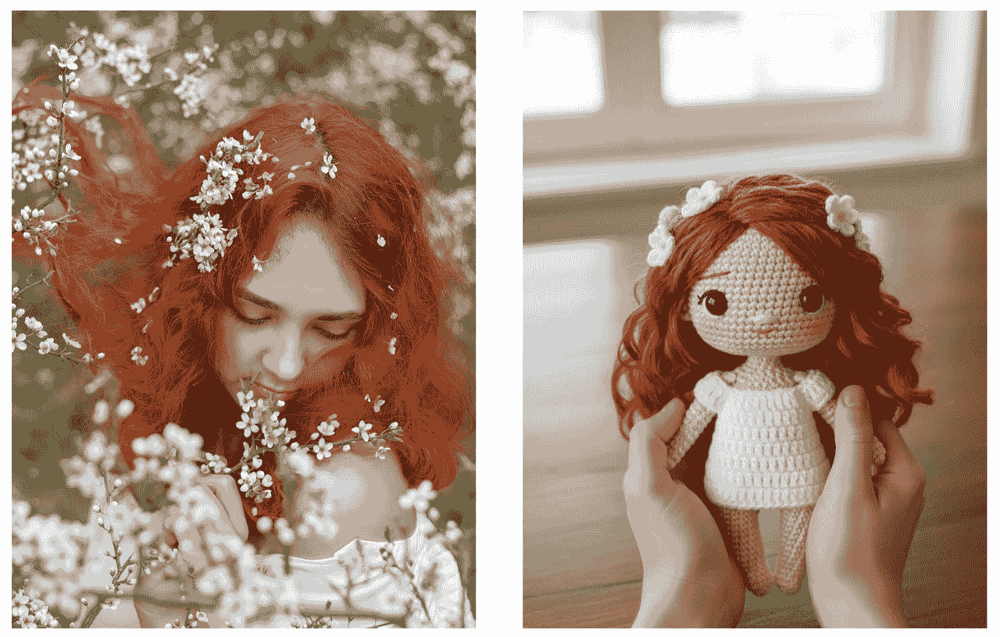
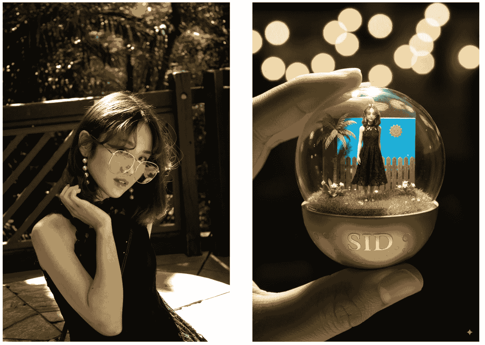
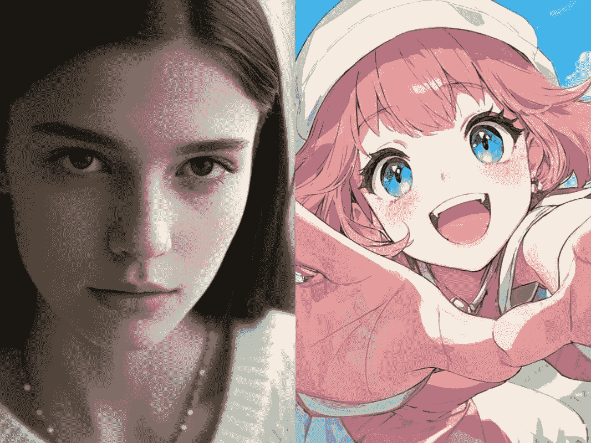

# Nano Banana PRO提示词模板

> 来源：[https://kq4b3vgg5b.feishu.cn/docx/Od1YdgNvToQNW3xzUnlceD3LnNc](https://kq4b3vgg5b.feishu.cn/docx/Od1YdgNvToQNW3xzUnlceD3LnNc)

# 3D人偶图像制作

```
根据插画中的角色，制作一个1/7比例的写实风格商业化模型，并布置相应的场景。将模型放置在电脑桌上，底座为圆形透明亚克力材质，底座上不得有任何文字。在电脑屏幕上显示模型的ZBrush建模过程。在电脑屏幕旁边放置一个印有原画的万代风格玩具包装盒。
```

```
基于这个3D人偶图片，请帮我制作一个人偶被人小幅度拿起、转圈后放下的视频，全程以人偶、桌面和背景屏幕为核心
```

# 制作迷你针织娃娃

```
这是一张专业构图的特写照片，展现了一个手工钩织的毛线娃娃被两只手温柔地捧在怀里。娃娃造型圆润，采用了[上传图片]角色的可爱Q版形象，色彩对比鲜明，细节丰富。捧着娃娃的手自然轻柔，手指姿态清晰可见，肌肤纹理自然，光影过渡自然，给人一种温暖而真实的感觉。背景略微虚化，营造出室内环境，温暖的木质桌面和从窗户洒进来的自然光，带来舒适温馨的氛围。整幅照片传递出精湛的工艺和令人倍感珍惜的温暖。
```



# 制作角色胶囊

```
一个精致透明的扭蛋模型，可夹在指间，展现[人物姓名]的[标志性姿势/风格]。模型内部：[人物外貌、服装和配饰的简要描述]，背景元素包括[相关场景：体育场、舞台、讲堂等]。灯光效果应戏剧化且富有电影感，与人物主题相符。扭蛋顶部透明，底座为彩色[选择合适的颜色：例如，宝蓝色、金色、黑色、红色]，并饰以[与人物相关的图案]。底座上以匹配的字体印有[人物姓名或昵称]。整体设计应如同微缩收藏品，细节逼真，并带有柔和的散景效果。
```



# 图像风格转化

```
将图片 [Image1] 转换为 [Image2] 的艺术风格。保留 [Image1] 的主体、构图和细节，但应用 [Image2] 的色彩、纹理和整体美感。高质量，[插画] 风格，细节一致。
```




# Nano Banana Pro精准控制图像中元素状态，

```
保持图片中人物不变，但将其面部表情更改为微笑。保持姿势、身体比例、发型和整体外观不变。保持逼真的光照、阴影和照片级细节。
```

# Nano Banana Pro精准控制人物换装

```
保持[Image1]中人物不变，但将她的裤子替换为[Image2]中的服装。保持相同的姿势、身材比例和面部特征，同时应用[Image2]中裤子的颜色、纹理和款式。高质量、逼真、细节一致。
```

## 拓展画幅

```
将画布扩展为 16:9 的比例，并保持人物完全处在原来的位置，保持居中，不发生任何移动。背景需要自然向四周延伸，光照、阴影、色彩、材质和景深均需与原图一致，风格保持完全统一。
```

# Nano Banana Pro生成海报

```
生成一张高端电影感的虚拟海报。
画面中心是一位充满自信的女性角色，站在极简、未来感的户外场景中，边缘使用暖色调逆光进行勾勒。
整体加入轻雾、体积光、细腻镜头泛光、深对比色彩分级，营造专业级的电影视觉深度。
在背景中加入柔和的动态斜线视觉元素，引导观者视线集中到人物主体。
海报顶部加入主标题 ‘SOLAR VISION’，字体为现代无衬线加粗风格。
在标题下方加入一句标语：‘See the World Beyond Light.’（看见光之外的世界。）
底部加入小号电影制作信息与上映日期 ‘Coming 2025’。
最终画面保持 16:9 画幅比例，整体风格高级、统一、具有强烈视觉叙事感。
```

# Nano Banana Pro创建虚拟形象

```
生成一张年轻东方女性流行歌手在舞台上演唱时的高质感形象照。
她的外貌自然、耐看，符合大众审美。
画面呈现她正在唱歌，手持无线话筒，眼神富有表现力，散发自信的舞台魅力。
采用柔和且能修饰脸部的光线，并在头发边缘加入一圈细腻的逆光。
背景加入流行演唱会常见的舞台灯光，如柔和的蓝色、粉色和紫色，营造梦幻而时尚的舞台氛围。
加入轻微镜头泛光、浅景深效果以及电影级色彩分级。
服装建议为现代、时尚的舞台穿搭，例如潮流短款上衣、设计感外套或适合舞台表演的造型，并加入适度的配饰点缀。
整体画面保持统一、干净、高级，具有流行歌手宣传照的视觉质感。
```

## 生成虚拟形象短视频

```
请根据我提供的角色形象图，生成一段年轻东方女性流行歌手在舞台上演唱的短视频。
保持人物的外貌特征、服装风格和气质完全一致，不改变脸型和妆容。
画面中歌手手持麦克风，正在边唱边做轻微的自然肢体动作，眼神自信、有舞台感染力。
背景为流行演唱会常见的舞台灯光（粉色、蓝色、紫色），伴随柔和光束和少量舞台烟雾。
画面具有电影级色彩、浅景深、柔和镜头光晕，整体风格保持与原图一致。
```

# Nano Banana Pro生成广告宣传图

```
请使用我提供的图片作为参考。从照片中仅提取白瓷茶杯这一主体，准确重建它的形状、杯盖、杯柄以及浮雕纹理。

请将该茶杯重新设计为一张高端品牌的商业产品宣传图。

风格方向：
- 纯白、光泽感强烈的高级陶瓷质感
- 极简奢华（类似 Apple 产品广告风格）
- 柔和的摄影棚漫射光 + 高光反射
- 阴影柔和自然
- 背景使用干净的浅灰或纯白渐变
- 在产品周围加入细微的光晕，以提升高级感

请不要包含：桌面、键盘、数位板、线缆或照片中出现的任何其它物品。

最终输出：
一张高分辨率、适用于商业宣传的产品广告级渲染图，画面干净、质感强烈，具有顶级商业摄影的视觉效果。

加入中国高级白瓷美学风格：柔和温润的玉瓷质感，优雅的云纹雕刻，背景可使用轻微的水墨纹理作点缀。同时希望丰富产品背景细节。
```

# Nano Banana Pro进阶教程链接

[Gemini注册指南](https://kq4b3vgg5b.feishu.cn/wiki/LKDLwyJdQihq9wk9oPtcwDponud?from=from_copylink)

[Gemini API快速调用](https://kq4b3vgg5b.feishu.cn/wiki/UJTEwamleivOFVkDjkpcP0pUnQf?from=from_copylink)

[Dify_2.0_智能Agent长文本生成实战](https://kq4b3vgg5b.feishu.cn/wiki/UCT9wgRJGiOotMkCj4rc1BuYnFc?from=from_copylink)