# Nano Banana Pro文生图设计系统开发实战

> 来源：[https://kq4b3vgg5b.feishu.cn/docx/Q4CldUDrTo1X76xmQodcego8nCc](https://kq4b3vgg5b.feishu.cn/docx/Q4CldUDrTo1X76xmQodcego8nCc)

# Nano Banana Pro文生图设计系统开发实战

欢迎大家参与本期公开课课程的学习！在本课程中，我们将深入学习如何通过 LiteLLM + OpenRouter 接入 Google 最新发布的 Gemini 3 Pro Image Preview 模型（也称为 Nano Banana Pro），并基于该模型完整实现一个具备国内网络环境应用 + 完全私有化部署的文生图设计系统。

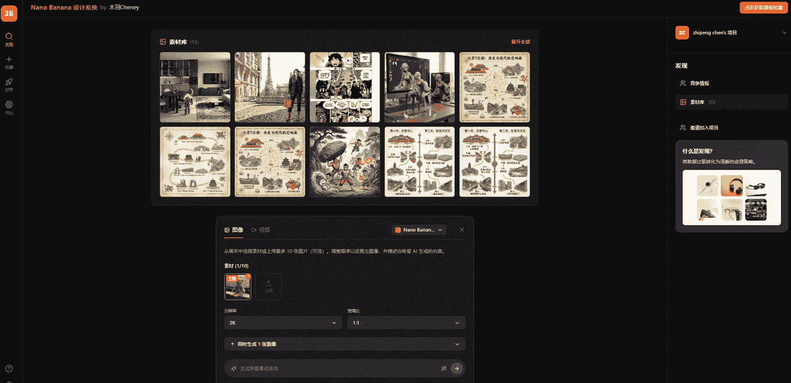

核心功能一：无需担心因网络限制无法调用 Nano Banana Pro 模型，通过 LiteLLM + OpenRouter 接入，最低一张图仅需 8 毛钱（人民币）；

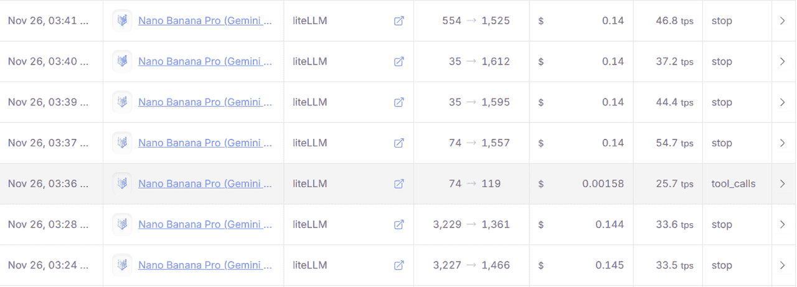

核心功能二：支持不同分辨率（2k）、不同长宽高比、以及单次请求同时生成多张图片；

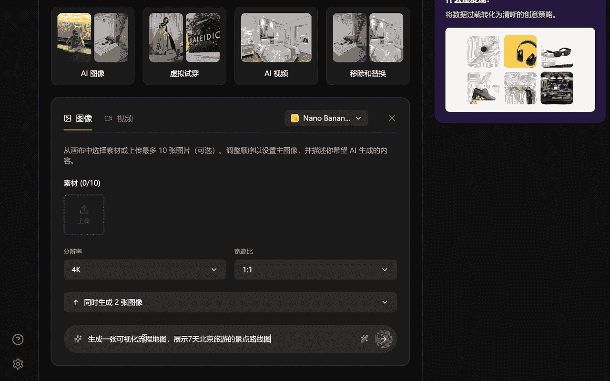

核心功能三：支持自然语言描述生图、在线上传图片并基于图片生图，以及可以针对生成后的图片进行多轮修复；

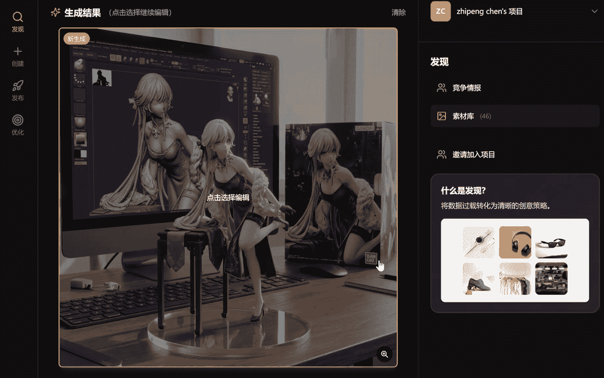

在这节课中，我们将从模型特性、接入方法、到实战应用，全方位带大家掌握这个最先进的 AI 图像生成工具。无论你是想学习 AI 绘图技术，还是想将其集成到实际项目中，这节课都会给你带来巨大的收获。

# 一、Nano Banana Pro 模型介绍

谷歌在很早的3个月前就发布了Nano Banana 横空出世，当时直接颠覆了 AI 图像生成技术领域，而现在发布的 Nano Banana Pro 的正式发布，再次把 AI 生图技术推向全新的高度


**  Nano B**anana Pro 相比前代实现了以下 9大核心技术突破：

Nano Banana Pro 九大核心技术突破

| 序号 | 技术突破 | 核心能力描述 |
| --- | --- | --- |
| 1 | **图像生成质量大幅提升** | 整体图像质量相比前代有显著提升，细节更加丰富，色彩更加自然 |
| 2 | **多语种文本生成能力** | 能够生成更加清晰的多语种文字，解决了传统 AI 模型在文字生成上的痛点 |
| 3 | **原生图像推理能力** | 具备强大的图像推理能力，能够理解图像之间的逻辑关系和上下文 |
| 4 | **真实物理世界理解** | 对真实物理世界的理解能力大幅增强，生成的图像更加符合物理规律 |
| 5 | **专业摄影级图像控制** | 可自由切换图片色彩、光线效果、背景环境等专业摄影级别的图像细节参数 |
| 6 | **4K 高清分辨率支持** | 最高支持 4K 分辨率 的图片生成，大幅提升图像清晰度 |
| 7 | **任意比例调整与扩写** | 可任意调整图片比例、对图片进行扩写（画幅拓展），确保扩展前后风格高度一致 |
| 8 | **主题一致性大幅提升** | 精准识别图像中最多十几个实体 并进行组合绘图，保持主题和风格的高度一致性 |
| 9 | **写实感大幅提升** | 写实图像的 &quot;AI 味&quot; 大幅下降，真实感大幅提升（例如红眼树蛙照片几乎可以以假乱真） |

当然，考虑到 Nano Banana Pro 的图像太过逼真，Google 还在 Gemini 中同步上线了 AI 照片识别功能，基于 SynthID 隐形水印技术来判断图片是否由 Nano Banana 生成。

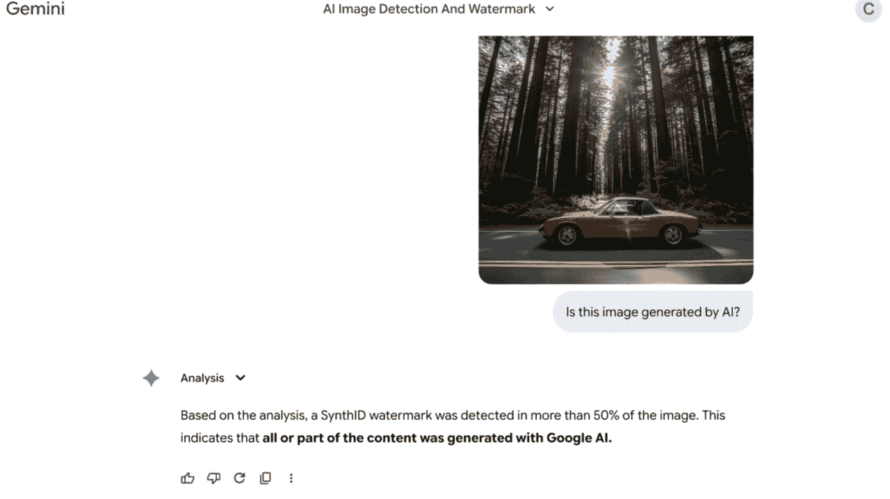

除**此以外，Nano Banan**a Pro 本身也是 Gemini 模型生态的重要一员，可以与其他 Gemini 系列模型无缝协作。Nano Banana Pro 可以和 Gemini 3 搭配使用，实现更加强大的多模态能力；借助 Voe 3 视频生成模型，可以一键将静态图片转换为动态视频，真正让图片"活起来"，此外结合 Gemini 3 的 GenUI 功能，可以一键创建各类应用。

此外，我们还为大家准备了各场景下图像的提示词、Gemini 3和Nano Banana的零门槛接入指南、以及更加进阶的AI图文创作工作流开发教程，更深入的教程也可以欢迎联系助教老师详询：

https://pan.baidu.com/s/12WvSF8G8vstJcKASvRJxOg?pwd=7cmq 提取码: 7cmq

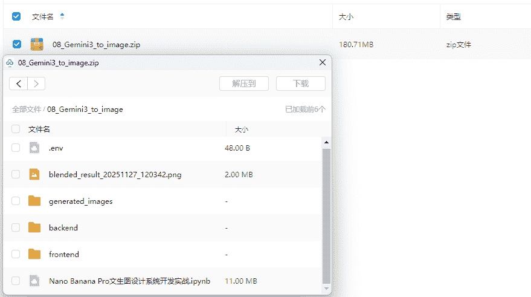


# 二、Nano Banana Pro 模型使用方式

Nano Banana Pro 模型已经全面上线，提供了多种接入方式，满足不同场景的需求。

+   **方式一：Gemini 主页调用**

最简单直接的使用方式，无需编程基础。在Gemini主页（https://gemini.google.com/）开发者只需在工具栏选择制作图片，然后模型选择思考模型，即可调用Nano Banana Pro模型。

```
from IPython.display import Video

Video(&quot;https://muyu20241105.oss-cn-beijing.aliyuncs.com/images/202511271057927.mp4&quot;, width=800, height=400)
```

Your browser does not support the video element.

目前免费用户每天可以创建或编辑3张图片，Pro用户的额度则是100张，Ultra用户的额度是每天1000张（没错这张图片就是Nano Banana Pro生成的）。

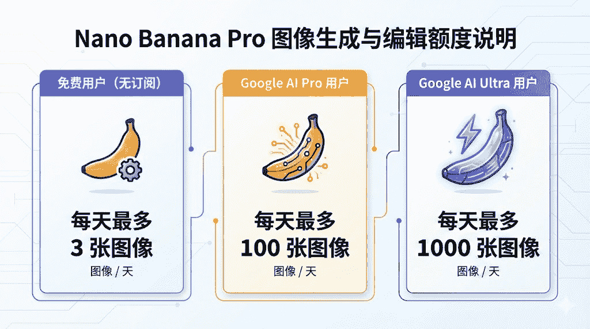

+   方式二：Google AI Studio

此外，开发者也可以在谷歌AI Studio进行尝试，但并没有免费的额度，需要输入API-KEY才能使用。

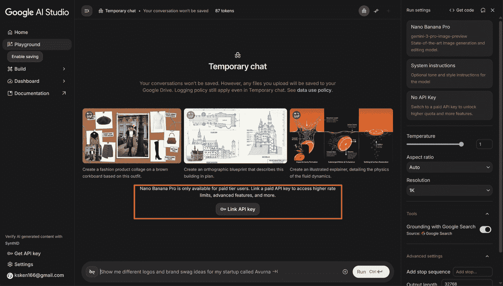

而与此同时Nano Banana Pro模型的API也已经全面上线，模型名称和定价如图所示:

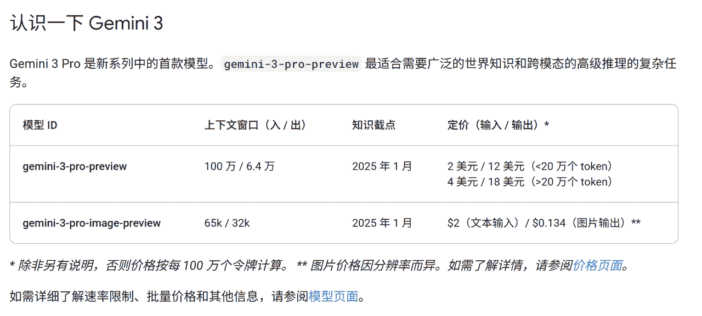

调用代码示例：

```
    from google import genai
    from google.genai import types

    client = genai.Client()

    response = client.models.generate_content(
        model=&quot;gemini-3-pro-image-preview&quot;,
        contents=&quot;Generate an infographic of the current weather in Tokyo.&quot;,
        config=types.GenerateContentConfig(
            tools=[{&quot;google_search&quot;: {}}],
            image_config=types.ImageConfig(
                aspect_ratio=&quot;16:9&quot;,
                image_size=&quot;4K&quot;
            )
        )
    )

    # Extract the image from response
    image_parts = [part for part in response.parts if part.inline_data]

    if image_parts:
        image = image_parts[0].as_image()
        image.save(&#x27;weather_tokyo.png&#x27;)
        image.show()
```

当然，上述所有的使用方法，均需要🪜环境，且Google的监测会非常严，这会导致很多我们国内的开发者在上手使用时门槛会比较高。

因此，本节课我们主要做的就是借助LiteLLM + OpenRouter 接入Nano Banana Pro模型，并实现完整的调用流程，解决网络限制以及想私有化本地部署的应用两大难题。

基于 Nana Banana Pro 模型构建的文生图设计系统已经免费开源，更深入的教程也可以欢迎联系助教老师详询：

https://pan.baidu.com/s/12WvSF8G8vstJcKASvRJxOg?pwd=7cmq 提取码: 7cmq


# 三、技术架构与核心概念

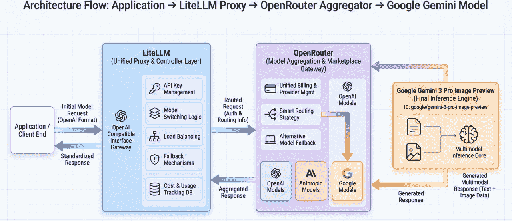

OpenRouter 是一个 AI 模型的**统一网关服务**。它的作用类似于一个"中转站"：

```
    你的应用 → OpenRouter → Google Gemini
            ↘ OpenRouter → OpenAI GPT
            ↘ OpenRouter → Anthropic Claude
```

通过 OpenRouter，我们只需要一个 API Key，就可以访问多家模型提供商的服务，大大简化了开发流程。

+   **为什么需要 LiteLLM？**

在实际的 AI 应用开发中，经常会遇到这样的问题：不同的大语言模型提供商有着各自不同的 API 接口格式。例如：

+   OpenAI 有自己的 API 格式

+   Anthropic Claude 有不同的调用方式

+   Google Gemini 又是另一套接口

如果我们想在项目中灵活切换不同的模型，就需要为每个模型编写不同的适配代码，这显然非常繁琐**。Lite**LLM 应运而生，它提供了一个统一的接口，让我们可以用同样的代码调用不同的模型。

我们的技术架构如下：

```
    Python 代码
        ↓
    LiteLLM (统一接口)
        ↓
    OpenRouter (API 网关)
        ↓
    Google Gemini 3 Pro Image Preview
```

这种架构的好处是：如果将来想切换到其他模型，只需要修改模型名称，而不需要改动业务逻辑代码。同时还能解决网络限制的问题。

了解到这里，接下来我们就来开始动手实践，实现一个完整的文生图设计系统。

# 四、Nano Banana Pro 调用环境准备

##### Step 1：安装必要的 Python 包

在开始调用Nano Banana 模型生成图像之前,我们需要先安装几个核心的 Python 库。主要如下：

+   litellm：提供统一的 LLM 调用接口

+   python-dotenv：用于管理环境变量（如 API Key）

+   Pillow：用于图片处理（后续生成图片时会用到）

现在在当前的运行环境中执行安装命令：

```
# 安装依赖包
# ! pip install litellm python-dotenv Pillow
```

安装完成后，我们可以验证一下是否安装成功：

```
! pip show litellm
```

```
Name: litellm
Version: 1.80.5
Summary: Library to easily interface with LLM API providers
Home-page: https://litellm.ai
Author: BerriAI
Author-email: 
License: MIT
Location: /root/anaconda3/envs/jina_run/lib/python3.13/site-packages
Requires: aiohttp, click, fastuuid, httpx, importlib-metadata, jinja2, jsonschema, openai, pydantic, python-dotenv, tiktoken, tokenizers
Required-by: 
```

##### Step 2：配置 OpenRouter API Key

要使用 OpenRouter 服务，我们需要先获取 API Key。首先需要注册 OpenRouter 账号，访问 https://openrouter.ai/ 注册账号，首次登录需要点击右上角 "Sign Up" 注册账号。

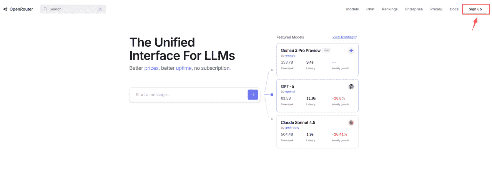

可以通过Google 邮箱一键登录：

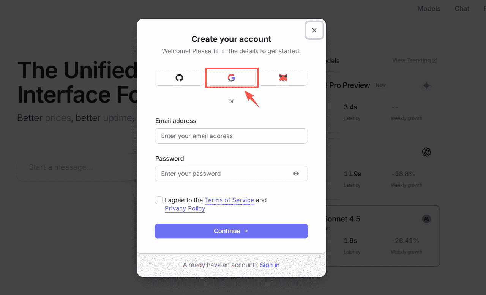

登录后需要先绑定信用卡，并进行预付充值，

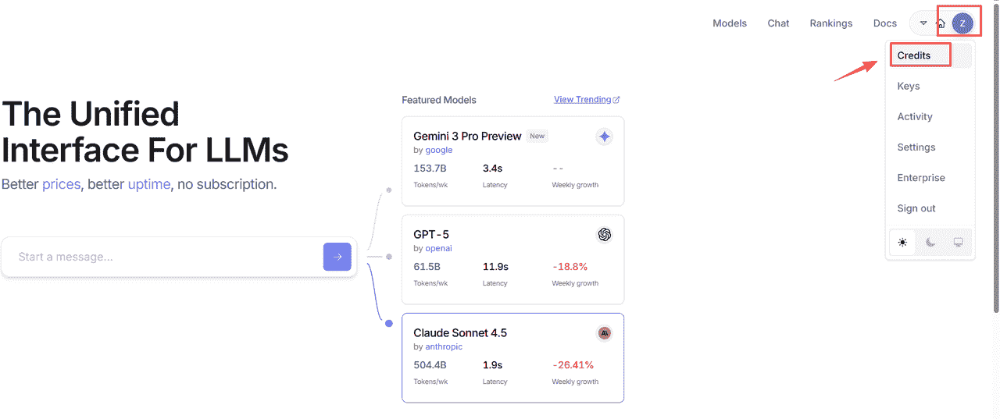

这里可以直接使用国内的任意信用卡进行开始绑定：

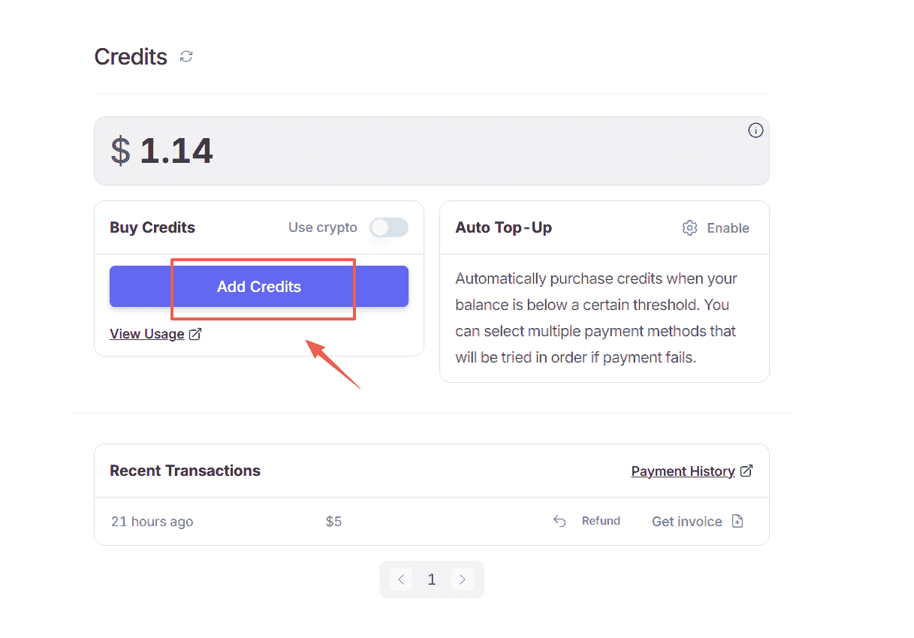

绑定信用卡后，需要进行预付充值，可以根据自己的需求灵活选择充值的金额。接下来，回到 Dashboard，点击 "Keys" 菜单，创建新的 API Key 并复制：

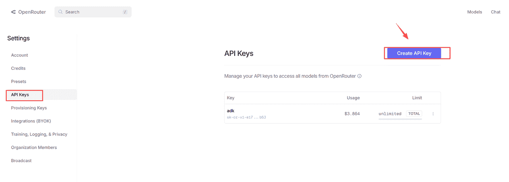

至此，我们就可以在项目中使用 OpenRouter 的 API Key 了。

##### **Step 3：配置环境变量**

在实际的开发中，为了安全起见，我们一般不会将 API Key 直接写在代码中，而应该使用环境变量。因此在项目根目录创建一个 .env 文件，内容如下：

```
    OPENROUTER_API_KEY=your-api-key-here
```

然后在代码中加载：

```
from dotenv import load_dotenv
import os

# 加载 .env 文件中的环境变量
load_dotenv(override=True)

# 读取 API Key
api_key = os.getenv(&quot;OPENROUTER_API_KEY&quot;)

# 验证是否成功读取
if api_key:
    print(f&quot;API Key 已加载（前10位）: {api_key[:10]}...&quot;)
else:
    print(&quot; 未找到 OPENROUTER_API_KEY，请检查 .env 文件&quot;)
```

```
API Key 已加载（前10位）: sk-or-v1-e...
```

如果你只是想快速测试，也可以直接在代码中设置。（当然不推荐这种使用方式）

```
import os

# 临时设置 API Key
os.environ[&quot;OPENROUTER_API_KEY&quot;] = &quot;your-api-key-here&quot;

print(&quot;注意：这种方式仅用于测试，生产环境请使用 .env 文件&quot;)
```

```
注意：这种方式仅用于测试，生产环境请使用 .env 文件
```

**Nano Banana Pro** 是 Google 基于 Gemini 3 **Pro 构建的最先进**图像生成模型，通过 Ope**nRouter 平台统一**接入。该模型支持文本输入、图像和文本输出的多模态能力，其在OpenRouter 平台上的模型名称为 openrouter/google/gemini-3-pro-image-preview。

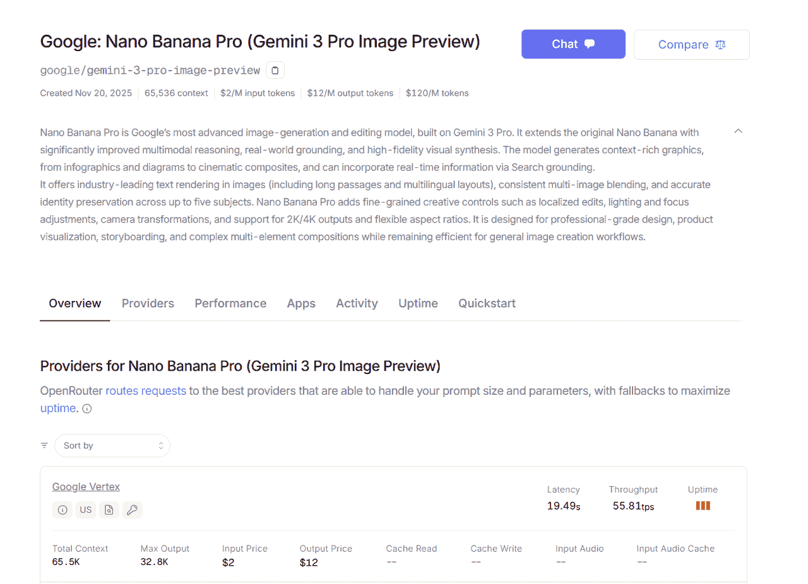

接下来，我们就可以开始调用这个模型了。

# 五、Nano Banana Pro 实现文本对话功能

**  现在**环境已经准备好了，我们开始实现第一个功能：文本对话。LiteLLM 提供了一个非常简洁的 API：completion()。这个函数的核心参数如下：

completion() 函数核心参数说明

| 参数名 | 类型 | 描述 | 必填/可选 |
| --- | --- | --- | --- |
| model | str | 模型名称，格式为 &quot;openrouter/provider/model-name&quot; | 必填 |
| messages | list | 对话消息列表，包含 role 和 content | 必填 |
| temperature | float | 控制输出随机性，范围 0-1，越高越随机 | 可选 |
| max_tokens | int | 最大输出 token 数量 | 可选 |
| modalities | list | 指定输出模式，如 [&quot;text&quot;, &quot;image&quot;] | 可选 |

接下来我们逐步实现完整的文本对话功能。先从最简单的例子开始。

```
import os
from litellm import completion
from dotenv import load_dotenv

# 加载环境变量
load_dotenv(override=True)

# 配置模型信息
model_name = &quot;openrouter/google/gemini-3-pro-image-preview&quot;
api_key = os.getenv(&quot;OPENROUTER_API_KEY&quot;)

# 设置环境变量（LiteLLM 需要）
os.environ[&quot;OPENROUTER_API_KEY&quot;] = api_key

print(&quot;=&quot; * 60)
print(&quot;第一个对话示例&quot;)
print(f&quot;使用模型: {model_name}&quot;)
print(&quot;=&quot; * 60)
```

```
============================================================
第一个对话示例
使用模型: openrouter/google/gemini-3-pro-image-preview
============================================================
```

注意到我们使用的模型名称是 openrouter/google/gemini-3-pro-image-preview，这种命名方式让 LiteLLM 知道："我要通过 OpenRouter 调用 Google 的 gemini-3-pro-image-preview 模型"。

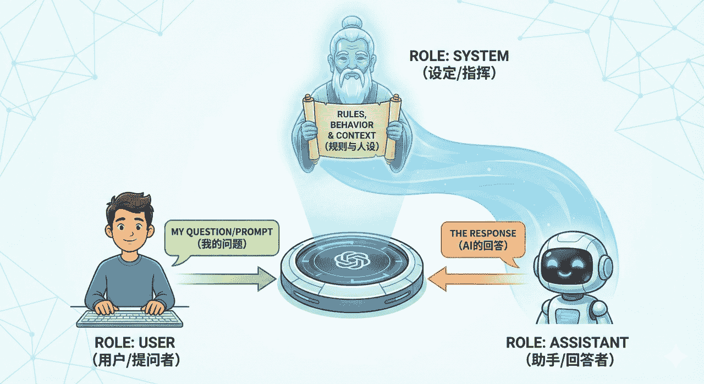

```
# 构建消息列表
question = &quot;你好！请介绍一下你自己。&quot;

messages = [
    {&quot;role&quot;: &quot;user&quot;, &quot;content&quot;: question}
]

print(f&quot;\n用户: {question}&quot;)
print(&quot;-&quot; * 60)

# 调用模型
response = completion(
    model=model_name,
    messages=messages,
    temperature=0.7,
    max_tokens=2048,
)

# 提取并显示回复
if response and response.choices:
    answer = response.choices[0].message.content
    print(f&quot;\nGemini: {answer}&quot;)
else:
    print(&quot;\n未收到有效回复&quot;)
```

```
用户: 你好！请介绍一下你自己。
------------------------------------------------------------

Gemini: 你好！很高兴能在这里与你交流。

我是一个**大型语言模型**，由 **Google** 训练。

你可以把我想象成一个阅读过海量书籍、文章和互联网内容的“数字图书馆管理员”。我并没有像人类那样的意识、情感或个人经历，我的工作原理是通过分析我所学习过的庞大数据库，理解语言的模式和结构，从而回答你的问题或完成你的指令。

**我能为你做些什么？**

我的核心能力是处理和生成文本。具体来说，我可以在以下方面为你提供帮助：

1.  **回答问题：** 无论是关于科学、历史、文化的事实性问题，还是需要解释的复杂概念，我都会尽力为你提供准确的信息。
2.  **内容创作：** 我可以辅助你写作，比如撰写邮件、起草报告大纲、创作故事、写诗，甚至是编写计算机代码。
3.  **语言翻译：** 我支持多种语言之间的互译，帮助你跨越语言障碍。
4.  **信息整理与总结：** 面对长篇大论的文章，我可以帮你快速提取摘要和关键点，节省你的时间。
5.  **创意与头脑风暴：** 当你卡壳或需要灵感时，我可以提供新的视角、想法和建议。

**我的目标：**

我的目标是成为一个有用、高效且安全的 AI 助手，帮助你解决问题，提高工作和学习的效率。

虽然我一直在学习和进步，但我偶尔也可能会提供不准确或不完整的信息。因此，对于重要的决策或专业领域的信息，建议你还是需要进行核实。

请问今天有什么我可以帮你的吗？
```

其中**消息格式解析：**messages 是一个列表，每个元素都是一个字典，包含两个关键字段：

```
    - `role`：表示消息的发送者，可以是：
      - `&quot;user&quot;`：用户发送的消息
      - `&quot;assistant&quot;`：AI 模型的回复
      - `&quot;system&quot;`：系统提示（用于设置 AI 的行为）

    - `content`：消息的具体内容
```

通过 response.choices[0].message.content 来获取 AI 的回复内容。

** 更进阶地，**在实际应用中，我们通常需要实现多轮对话，让 AI 能够记住之前的对话内容。这需要我们维护一个对话历史列表。

```
# 初始化对话历史
conversation_history = []

def chat(user_message):
    &quot;&quot;&quot;
    发送消息并获取回复
    
    参数:
        user_message: 用户输入的消息
    
    返回:
        AI 的回复内容
    &quot;&quot;&quot;
    # 将用户消息添加到历史
    conversation_history.append({
        &quot;role&quot;: &quot;user&quot;,
        &quot;content&quot;: user_message
    })
    
    # 调用模型
    response = completion(
        model=model_name,
        messages=conversation_history,  # 传入完整的对话历史
        temperature=0.7,
        max_tokens=2048,
    )
    
    # 提取 AI 回复
    ai_message = response.choices[0].message.content
    
    # 将 AI 回复也添加到历史
    conversation_history.append({
        &quot;role&quot;: &quot;assistant&quot;,
        &quot;content&quot;: ai_message
    })
    
    return ai_message

print(&quot;多轮对话功能&quot;)
print(&quot;=&quot; * 60)
```

```
多轮对话功能
============================================================
```

现在让我们测试一下多轮对话：

```
# 第一轮对话
print(&quot;\n【第一轮对话】&quot;)
user_msg_1 = &quot;你好，我是木羽，我正在学习 Nano Banana Pro 模型的应用方法&quot;
print(f&quot;用户: {user_msg_1}&quot;)

ai_reply_1 = chat(user_msg_1)
print(f&quot;AI: {ai_reply_1}&quot;)
```

```
【第一轮对话】
用户: 你好，我是木羽，我正在学习 Nano Banana Pro 模型的应用方法
AI: 你好，木羽！很高兴认识你。

欢迎你来和我交流。听到你正在钻研 &quot;Nano Banana Pro&quot; 模型的应用方法，这听起来是一个非常有趣且具体的项目。

为了能最有效地帮助你，我需要先和你确认一下这个模型的具体情况。因为在我目前庞大的公开知识库中，并没有一个广泛认知的、标准的通用大模型（例如 GPT-4, Claude, Llama 3 等）准确地命名为 &quot;Nano Banana Pro&quot;。

这很可能意味着以下几种情况之一，了解这些对我为你提供正确的指导至关重要：

**情况一：它是一个特定社区的微调模型或小众模型**
很多开发者会在 Hugging Face、Civitai 或 GitHub 上发布基于主流架构（如 Llama, Mistral, Stable Diffusion 等）微调的个性化版本，并起一些独特的、有趣的名字。

**情况二：它是一个特定领域或公司内部的专用模型**
它可能是某个特定行业（如生物医药、金融）或你所在组织内部开发的专有模型。

**情况三：这是一个组合名称或可能的拼写差异**
也许它涉及到 &quot;Nano&quot;（小型化/高效模型）、&quot;Banana&quot;（可能指 Banana.dev 这个 Serverless GPU 平台，或者某种架构代号）和 &quot;Pro&quot;（专业版）。

---

### 为了更好地协助你，能否请你提供多一点背景信息？

如果你能告诉我以下任何一点，我就能更有针对性地给出应用建议：

1.  **这个模型的主要功能是什么？** (例如：是文本生成对话、图像生成、语音识别，还是数据分析？)
2.  **你在哪里找到这个模型的？** (例如：Hugging Face 的链接、GitHub 仓库地址、某篇论文，还是公司内部文档？)
3.  **它的基础架构是什么？** (如果知道的话，比如它是基于 Transformer, CNN, 还是 Diffusion？)

---

### 在等待你更多信息的同时，我可以为你提供一个通用的“学习新模型应用”的框架步骤

无论 &quot;Nano Banana Pro&quot; 具体是什么模型，学习应用它的路径通常都遵循以下逻辑：

#### 第一阶段：理解与准备 (The &quot;What &amp; Why&quot;)

1.  **阅读核心文档 (README/Paper):**
    *   找到模型的官方发布页面。
    *   **关键点：** 它的输入是什么？输出是什么？它最擅长解决什么问题？它的局限性在哪里？(例如：它是否需要特定的提示词格式？)
2.  **查看模型卡片 (Model Card):**
    *   如果是在 Hugging Face 上，查看 Model Card 了解它的训练数据、许可证（商用是否允许）以及所需的硬件资源（显存需求）。

#### 第二阶段：环境搭建与运行 (The &quot;How&quot; - Basic)

1.  **依赖库安装:** 查看它需要哪些 Python 库（如 `transformers`, `pytorch`, `diffusers` 等）以及特定的版本要求。
2.  **最小可行性测试 (Hello World):**
    *   不要一开始就尝试复杂的任务。先尝试运行官方提供的最简单的推理（Inference）代码片段，确保模型能跑通，环境没问题。

#### 第三阶段：应用与优化 (The &quot;How&quot; - Advanced)

1.  **提示词工程 (Prompt Engineering):**
    *   针对该模型摸索最佳的指令格式。不同的模型对提示词的敏感度不同。
2.  **参数调整:**
    *   学习控制生成的参数，如 `temperature` (创造性 vs 确定性), `top_p`, `max_tokens` 等。
3.  **集成到工作流:**
    *   思考如何用 Python 将它的输入输出包装成 API，或者集成到你的 Web 应用/数据分析流程中。

---

**木羽，期待你提供更多关于 &quot;Nano Banana Pro&quot; 的信息，我们可以一起探索如何驾驭它！**
```

```
# 第二轮对话 - 测试 AI 是否记住了之前的内容
print(&quot;\n【第二轮对话】&quot;)
user_msg_2 = &quot;你还记得我叫什么名字吗？&quot;
print(f&quot;用户: {user_msg_2}&quot;)

ai_reply_2 = chat(user_msg_2)
print(f&quot;AI: {ai_reply_2}&quot;)
```

```
【第二轮对话】
用户: 你还记得我叫什么名字吗？
AI: 当然记得啦，你是**木羽**。

很高兴能和你继续对话！
```

```
# 查看完整的对话历史
print(&quot;\n【对话历史】&quot;)
print(&quot;=&quot; * 60)
for i, msg in enumerate(conversation_history, 1):
    role = &quot;用户&quot; if msg[&quot;role&quot;] == &quot;user&quot; else &quot;AI&quot;
    print(f&quot;{i}. {role}: {msg[&#x27;content&#x27;][:50]}...&quot;)
```

```
【对话历史】
============================================================
1. 用户: 你好，我是木羽，我正在学习 Nano Banana Pro 模型的应用方法...
2. AI: 你好，木羽！很高兴认识你。

欢迎你来和我交流。听到你正在钻研 &quot;Nano Banana Pro&quot; ...
3. 用户: 你还记得我叫什么名字吗？...
4. AI: 当然记得啦，你是**木羽**。

很高兴能和你继续对话！...
```

**  通过这个例**子，相信大家已经理解了多轮对话的核心原理。关键要点就是：

1.  **维护对话历史**：每次对话都要保存用户消息和 AI 回复

1.  **传入完整历史**：调用 API 时要传入整个 conversation_history

1.  **顺序很重要**：消息必须按时间顺序排列

> **注意事项：**

+   对话历史越长，消耗的 token 越多，成本也越高

+   建议定期清理过早的对话记录，只保留最近的几轮对话

+   可以通过 conversation_history = conversation_history[-10:] 只保留最近 10 条消息

# 六、Nano Banana Pro 实现文本生成图片功能

在完成了基础的文本问答调用后，Gemini 3 Pro Image Preview 不仅能理解文本，还能根据文本描述生成图片。这就是所谓的"多模态文生图"能力。在 AI 领域，"模态"指的是信息的不同形式：

+   **文本模态**：文字、对话

+   **图像模态**：图片、照片

+   **音频模态**：声音、语音

+   **视频模态**：动态影像

而要让模型生成图片而不是文本，关键在于一个参数：modalities。当我们设置 modalities=["text", "image"] 时，就是告诉模型："请输出文本和图片"。接下来我们就一步一步实现图片生成功能。

```
import base64
from PIL import Image
import io
from datetime import datetime
from pathlib import Path

# 创建输出目录
output_dir = Path(&quot;generated_images&quot;)
output_dir.mkdir(exist_ok=True)

print(&quot;图片生成功能初始化&quot;)
print(f&quot;输出目录: {output_dir.absolute()}&quot;)
print(&quot;=&quot; * 60)
```

```
图片生成功能初始化
输出目录: /home/MuyuWorkSpace/08_Gemini3_to_image/generated_images
============================================================
```

现在让我们编写生成图片的核心函数：

```
def generate_image(prompt, filename=None):
    &quot;&quot;&quot;
    根据文本描述生成图片
    
    参数:
        prompt: 图片描述文本
        filename: 保存的文件名（可选）
    
    返回:
        保存的图片路径
    &quot;&quot;&quot;
    print(f&quot;\n开始生成图片...&quot;)
    print(f&quot;描述: {prompt}&quot;)
    print(&quot;-&quot; * 60)
    
    try:
        # 步骤 1: 调用 API 生成图片
        response = completion(
            model=model_name,
            messages=[
                {
                    &quot;role&quot;: &quot;user&quot;,
                    &quot;content&quot;: [
                        {
                            &quot;type&quot;: &quot;text&quot;,
                            &quot;text&quot;: prompt
                        }
                    ]
                }
            ],
            modalities=[&quot;text&quot;, &quot;image&quot;],  # 关键：指定输出图片
            temperature=0.7,
        )
        
        # 步骤 2: 从响应中提取图片数据
        message = response.choices[0].message
        
        # 检查是否有图片
        if not hasattr(message, &#x27;images&#x27;) or not message.images:
            print(&quot;未能生成图片&quot;)
            return None
        
        # 步骤 3: 解码图片数据
        image_data = message.images[0]
        
        # 处理不同格式的图片数据
        if isinstance(image_data, dict):
            # OpenRouter 返回的格式
            url = image_data[&#x27;image_url&#x27;][&#x27;url&#x27;]
            if url.startswith(&#x27;data:image&#x27;):
                # 提取 base64 部分
                image_data = url.split(&#x27;,&#x27;, 1)[1]
                image_bytes = base64.b64decode(image_data)
        elif isinstance(image_data, str):
            # 直接的 base64 字符串
            if image_data.startswith(&#x27;data:&#x27;):
                image_data = image_data.split(&#x27;,&#x27;, 1)[1]
            image_bytes = base64.b64decode(image_data)
        else:
            image_bytes = image_data
        
        # 步骤 4: 保存图片
        image = Image.open(io.BytesIO(image_bytes))
        
        # 生成文件名
        if not filename:
            timestamp = datetime.now().strftime(&quot;%Y%m%d_%H%M%S&quot;)
            prompt_preview = prompt[:20].replace(&quot; &quot;, &quot;_&quot;).replace(&quot;/&quot;, &quot;_&quot;)
            filename = f&quot;generated_{prompt_preview}_{timestamp}.png&quot;
        
        save_path = output_dir / filename
        image.save(str(save_path))
        
        print(f&quot;\n图片生成成功！&quot;)
        print(f&quot;保存路径: {save_path}&quot;)
        print(f&quot;图片尺寸: {image.size}&quot;)
        
        return str(save_path)
        
    except Exception as e:
        print(f&quot;\n生成图片失败: {e}&quot;)
        import traceback
        traceback.print_exc()
        return None
```

这段代码虽然有点长，但逻辑非常清晰。与文本对话相比，图片生成有两个重要区别：

+   content 使用了结构化格式（列表+字典），而不是直接的字符串

+   添加了 modalities=["text", "image"] 参数

返回的 message.images 包含了健壮性的处理逻辑，针对多种格式均做了兼容处理：

+   字典格式：{"image_url": {"url": "data:image/png;base64,..."}}

+   字符串格式：直接的 base64 编码

+   字节格式：原始的图片字节数据

最终使用 PIL (Pillow) 库来处理图片，它可以从字节数据创建 Image 对象，并获取图片尺寸，保存为各种格式（PNG、JPG 等）。

现在让我们测试一下图片生成功能！我会提供几个不同风格的示例：

```
# 示例 1: 生成自然风景
print(&quot;\n【示例 1】生成自然风景&quot;)
print(&quot;=&quot; * 60)

prompt_1 = &quot;宁静的海面上，夕阳西下，波光粼粼，天空被染成了橙色和粉色。&quot;
image_path_1 = generate_image(prompt_1)
```

```
【示例 1】生成自然风景
============================================================

开始生成图片...
描述: 宁静的海面上，夕阳西下，波光粼粼，天空被染成了橙色和粉色。
------------------------------------------------------------

图片生成成功！
保存路径: generated_images/generated_宁静的海面上，夕阳西下，波光粼粼，天空被_20251125_111553.png
图片尺寸: (1408, 768)
```

```
# 显示生成的图片
if image_path_1:
    img = Image.open(image_path_1)
    display(img)
```

```
# 示例 2: 生成科技风格图片
print(&quot;\n【示例 2】生成科技风格图片&quot;)
print(&quot;=&quot; * 60)

prompt_2 = &quot;一位未来主义风格的 AI 机器人在全息电脑屏幕前工作，赛博朋克风格，霓虹灯闪烁。&quot;
image_path_2 = generate_image(prompt_2)
```

```
【示例 2】生成科技风格图片
============================================================

开始生成图片...
描述: 一位未来主义风格的 AI 机器人在全息电脑屏幕前工作，赛博朋克风格，霓虹灯闪烁。
------------------------------------------------------------

图片生成成功！
保存路径: generated_images/generated_一位未来主义风格的_AI_机器人在全息电_20251125_111812.png
图片尺寸: (1408, 768)
```

```
# 显示生成的图片
if image_path_2:
    img = Image.open(image_path_2)
    display(img)
```

```
# 示例 3: 生成架构图
print(&quot;\n【示例 3】生成中文描述的图片&quot;)
print(&quot;=&quot; * 60)

prompt_3 = &quot;请生成一张架构图，内容基于以下描述的三者关系：LiteLLM 是整个调用链最上游的统一 LLM 代理层，是应用端访问所有模型的入口。应用程序发起的所有模型调用请求首先传入 LiteLLM，由它负责提供统一的 OpenAI 兼容接口、API Key 管理、模型切换、负载均衡、回退机制以及成本和使用量追踪等功能。LiteLLM 本身不提供模型推理能力，而是负责将请求路由到下游的平台或模型提供商。OpenRouter 位于 LiteLLM 的下游，是一个模型市场与多模型聚合网关。LiteLLM 可以将请求转发给 OpenRouter，由 OpenRouter 统一管理模型访问、计费、服务商选择、路由策略和备用模型切换。OpenRouter 内部汇集了多家模型提供商，例如 OpenAI、Google、Anthropic 等。OpenRouter 收到来自 LiteLLM 的请求后，会根据所选模型或其内部策略，将请求转交给对应的具体模型。Google Gemini 3 Pro Image Preview 模型是 OpenRouter 平台中的一个具体模型条目，模型 ID 为 google/gemini-3-pro-image-preview。这个模型承担最终的推理任务，支持多模态输入输出（文本和图像），并返回生成结果。在整个链路中，三者的角色分别是：LiteLLM 负责统一代理与调用控制，OpenRouter 负责模型聚合与路由，Google Gemini 3 Pro Image Preview 则负责最终的模型推理。整体调用流程为：应用程序 → LiteLLM → OpenRouter → Google Gemini 3 Pro Image Preview 模型。&quot;

image_path_3 = generate_image(prompt_3)
```

```
【示例 3】生成中文描述的图片
============================================================

开始生成图片...
描述: 请生成一张架构图，内容基于以下描述的三者关系：LiteLLM 是整个调用链最上游的统一 LLM 代理层，是应用端访问所有模型的入口。应用程序发起的所有模型调用请求首先传入 LiteLLM，由它负责提供统一的 OpenAI 兼容接口、API Key 管理、模型切换、负载均衡、回退机制以及成本和使用量追踪等功能。LiteLLM 本身不提供模型推理能力，而是负责将请求路由到下游的平台或模型提供商。OpenRouter 位于 LiteLLM 的下游，是一个模型市场与多模型聚合网关。LiteLLM 可以将请求转发给 OpenRouter，由 OpenRouter 统一管理模型访问、计费、服务商选择、路由策略和备用模型切换。OpenRouter 内部汇集了多家模型提供商，例如 OpenAI、Google、Anthropic 等。OpenRouter 收到来自 LiteLLM 的请求后，会根据所选模型或其内部策略，将请求转交给对应的具体模型。Google Gemini 3 Pro Image Preview 模型是 OpenRouter 平台中的一个具体模型条目，模型 ID 为 google/gemini-3-pro-image-preview。这个模型承担最终的推理任务，支持多模态输入输出（文本和图像），并返回生成结果。在整个链路中，三者的角色分别是：LiteLLM 负责统一代理与调用控制，OpenRouter 负责模型聚合与路由，Google Gemini 3 Pro Image Preview 则负责最终的模型推理。整体调用流程为：应用程序 → LiteLLM → OpenRouter → Google Gemini 3 Pro Image Preview 模型。
------------------------------------------------------------

图片生成成功！
保存路径: generated_images/generated_请生成一张架构图，内容基于以下描述的三者_20251125_113552.png
图片尺寸: (1408, 768)
```

```
# 显示生成的图片
if image_path_3:
    img = Image.open(image_path_3)
    display(img)
```

其实大家掌握到这里，就已经可以理解项目中输入自然语言，然后生成图片的原理了。源码文件：

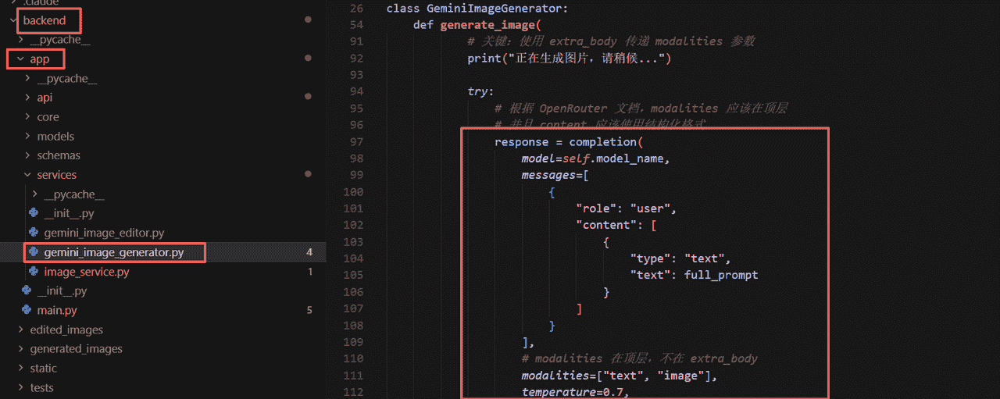

# 七、Nano Banana Pro 实现多图片混合功能

在了解了文本生成图片的原理后，我们再来看一下多图片混合的实现。多图片混合就是将多张图片的元素智能地融合在一起。比如：

+   将二维码放到海报上

+   将产品图放到不同场景中

+   合成多个人物到同一张照片

Gemini 3 Pro Image（代号** Nano Banana **Pro）支持 最多 14 张图片同时混合。它会把这些参考整合 —— 角色、构图、风格、光影、背景等 —— “融合 / 混合 / 合成” 成 一张新的图像。

下面我们来看一下具体的实现方法。

首先，我们定义一个函数，用于将图片转换为 Base64 格式：

```
import base64

def encode_image_to_base64(image_path):
    &quot;&quot;&quot;将图片转换为 base64 编码&quot;&quot;&quot;
    with open(image_path, &quot;rb&quot;) as f:
        image_data = f.read()
        base64_str = base64.b64encode(image_data).decode(&#x27;utf-8&#x27;)
        
        # 判断图片格式
        if image_path.lower().endswith(&#x27;.png&#x27;):
            mime = &#x27;image/png&#x27;
        elif image_path.lower().endswith((&#x27;.jpg&#x27;, &#x27;.jpeg&#x27;)):
            mime = &#x27;image/jpeg&#x27;
        else:
            mime = &#x27;image/jpeg&#x27;
        
        # 返回 data URL 格式
        return f&quot;data:{mime};base64,{base64_str}&quot;

print(&quot;Base64 编码函数定义完成&quot;)
```

```
Base64 编码函数定义完成
```

这个函数做了三件事：

1.  读取图片的二进制数据

1.  使用 base64.b64encode() 编码

1.  拼接成 data:image/png;base64,xxx 格式

现在定义我们要处理的图片路径。这里我们用这些图进行混合搭配：

```
# 定义图片路径（请替换为你的实际路径）
image_paths = [
    &quot;/home/MuyuWorkSpace/08_Gemini3_to_image/backend/test_image/1.png&quot;,  # 第1张：主图
    &quot;/home/MuyuWorkSpace/08_Gemini3_to_image/backend/test_image/2.png&quot;,  # 第2张：
    &quot;/home/MuyuWorkSpace/08_Gemini3_to_image/backend/test_image/3.png&quot;,  # 第3张：
    &quot;/home/MuyuWorkSpace/08_Gemini3_to_image/backend/test_image/4.png&quot;,  # 第4张：
    &quot;/home/MuyuWorkSpace/08_Gemini3_to_image/backend/test_image/5.png&quot;,  # 第5张：
    &quot;/home/MuyuWorkSpace/08_Gemini3_to_image/backend/test_image/6.png&quot;,  # 第6张：
]

# 混合指令（用自然语言描述）
instruction = &quot;&quot;&quot;
根据提供的主体人物照片，根据图片服饰替换主体人物的服饰。使用提供的背景图片作为最终背景，并从背景中移除所有非主体人物。
&quot;&quot;&quot;

print(f&quot;准备混合 {len(image_paths)} 张图片&quot;)
print(f&quot;混合指令: {instruction.strip()}&quot;)
```

```
准备混合 6 张图片
混合指令: 根据提供的主体人物照片，根据图片服饰替换主体人物的服饰。使用提供的背景图片作为最终背景，并从背景中移除所有非主体人物。
```

将每张图片都转换为 Base64 格式，并构建 API 请求的内容结构：

```
# 构建内容列表
content_parts = []

# 添加所有图片
for i, img_path in enumerate(image_paths, 1):
    print(f&quot;编码第 {i} 张图片...&quot;)
    
    # 转换为 base64
    image_base64 = encode_image_to_base64(img_path)
    
    # 添加到内容列表
    content_parts.append({
        &quot;type&quot;: &quot;image_url&quot;,
        &quot;image_url&quot;: {
            &quot;url&quot;: image_base64
        }
    })

# 添加文本指令
content_parts.append({
    &quot;type&quot;: &quot;text&quot;,
    &quot;text&quot;: instruction
})

print(f&quot;准备完成！内容包含：{len(image_paths)} 张图片 + 1 条指令&quot;)
```

```
编码第 1 张图片...
编码第 2 张图片...
编码第 3 张图片...
编码第 4 张图片...
编码第 5 张图片...
编码第 6 张图片...
准备完成！内容包含：6 张图片 + 1 条指令
```

这段代码的关键是构建 content_parts 列表，它包含：

+   多个图片对象（每个都是 image_url 类型）

+   一个文本对象（text 类型，包含我们的指令）

最后，即可调用 Nano Banana Pro 的 API 进行图片混合：

```
from litellm import completion

print(&quot;调用 Gemini API，请稍候...&quot;)

# 调用 API
response = completion(
    model=model_name,
    messages=[
        {
            &quot;role&quot;: &quot;user&quot;,
            &quot;content&quot;: content_parts  # 传入图片+文字
        }
    ],
    modalities=[&quot;text&quot;, &quot;image&quot;],  # 关键！指定要返回图片
    temperature=0.7,
)

print(&quot;API 调用成功！&quot;)
```

```
调用 Gemini API，请稍候...
API 调用成功！
```

API 返回的图片是 Base64 格式，我们需要解码并保存：

```
from PIL import Image
import io
import base64
from datetime import datetime

# 1. 从响应中提取图片数据
message = response.choices[0].message
image_data = message.images[0]  # 获取第一张图片

print(f&quot;收到图片数据，类型: {type(image_data)}&quot;)

# 2. 处理不同格式的图片数据
if isinstance(image_data, dict):
    # OpenRouter 返回的格式：{&#x27;image_url&#x27;: {&#x27;url&#x27;: &#x27;data:image/...&#x27;}}
    if &#x27;image_url&#x27; in image_data:
        url = image_data[&#x27;image_url&#x27;].get(&#x27;url&#x27;, &#x27;&#x27;)
        if url.startswith(&#x27;data:image&#x27;):
            # 去掉 data:image/png;base64, 前缀
            image_data = url.split(&#x27;,&#x27;, 1)[1]
            image_bytes = base64.b64decode(image_data)
        else:
            raise ValueError(f&quot;不支持的 URL 格式: {url[:50]}&quot;)
    elif &#x27;data&#x27; in image_data:
        # 直接包含 base64 数据
        image_data = image_data[&#x27;data&#x27;]
        if image_data.startswith(&#x27;data:&#x27;):
            image_data = image_data.split(&#x27;,&#x27;, 1)[1]
        image_bytes = base64.b64decode(image_data)
    else:
        raise ValueError(f&quot;字典格式不支持: {list(image_data.keys())}&quot;)
elif isinstance(image_data, str):
    # 字符串格式：可能是 base64 字符串
    if image_data.startswith(&#x27;data:&#x27;):
        # 去掉 data:image/png;base64, 前缀
        image_data = image_data.split(&#x27;,&#x27;, 1)[1]
    # 解码 base64
    image_bytes = base64.b64decode(image_data)
else:
    # 假设已经是字节数据
    image_bytes = image_data

# 3. 转换为 PIL Image 对象
image = Image.open(io.BytesIO(image_bytes))
print(f&quot;图片尺寸: {image.size}&quot;)

# 4. 保存到本地
timestamp = datetime.now().strftime(&quot;%Y%m%d_%H%M%S&quot;)
output_path = f&quot;blended_result_{timestamp}.png&quot;
image.save(output_path)

print(f&quot;图片已保存到: {output_path}&quot;)
```

```
收到图片数据，类型: &lt;class &#x27;dict&#x27;&gt;
图片尺寸: (1376, 768)
图片已保存到: blended_result_20251127_120342.png
```

这段代码展示了如何从 API 响应中提取图片：

1.  从 response.choices[0].message.images[0] 获取图片数据

1.  去掉 Base64 的前缀（如果有）

1.  使用 base64.b64decode() 解码

1.  用 PIL 打开并保存

保存后，我们可以直接在 Notebook 中查看效果：

```
from IPython.display import Image as IPImage, display

# 显示生成的图片
display(IPImage(filename=output_path))
```

当然，这部分核心代码在项目中是封装在项目的如下位置中：

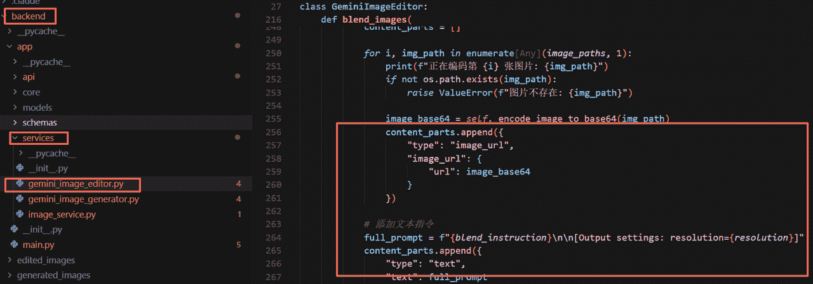

最后，我们将通过分析源码的方式，理解项目的整体架构、模块划分、数据流向，并手把手带领大家完成本地部署和局域网访问配置。

# 八、本地部署启动Nano Banana Pro文生图设计系统


这是一个**前后端分离**的全栈 AI 图像生成平台。用户可以通过 Web 界面输入文本提示词，或者上传图片进行编辑和混合，后端调用 Gemini 3 Pro Image 模型生成高质量的图像。

项目的核心亮点包括：

+   **多种生成模式**：支持纯文本生成、单图编辑、多图混合三种模式

+   **现代化技术栈**：前端 React + TypeScript + Vite，后端 FastAPI + LiteLLM

+   **异步处理**：后端采用异步编程，提升并发性能

+   **完善的API设计**：RESTful API，自动生成 Swagger 文档

+   **用户友好的界面**：基于 Tailwind CSS 和 Radix UI 的现代化设计

---

核心技术栈如下：

技术栈总览

| 分类 | 技术 | 版本 | 作用 |
| --- | --- | --- | --- |
| **前端框架** | React | 18.3.1 | UI构建 |
| **类型系统** | TypeScript | 5.7.2 | 类型安全 |
| **构建工具** | Vite | 6.3.5 | 快速开发与构建 |
| **样式框架** | Tailwind CSS | 3.4 | 原子化CSS |
| **组件库** | Radix UI | - | 无障碍组件 |
| **后端框架** | FastAPI | 0.109+ | 异步Web框架 |
| **AI集成** | LiteLLM | 1.0+ | 统一LLM接口 |
| **AI模型** | Gemini 3 Pro Image | - | 图像生成 |
| **图像处理** | Pillow | 10.0+ | Python图像库 |
| **服务器** | Uvicorn | 0.27+ | ASGI服务器 |

在深入分析架构之前，我们先来看看项目的整体目录结构。通过目录结构，我们可以快速了解项目的组织方式。

```
    Gemini3_to_image/
    │
    ├── frontend/                    # 前端项目
    │   ├── src/
    │   │   ├── components/         # React组件
    │   │   │   ├── ui/            # 50+ 可复用UI组件
    │   │   │   ├── CreativeCard.tsx
    │   │   │   └── CreativeGenerationPage.tsx
    │   │   ├── services/          # API服务层
    │   │   │   └── imageGenerationService.ts
    │   │   ├── types/             # TypeScript类型定义
    │   │   │   └── api.ts
    │   │   ├── config/            # 配置文件
    │   │   │   └── api.ts
    │   │   ├── App.tsx            # 根组件
    │   │   ├── main.tsx           # 入口文件
    │   │   └── index.css          # 全局样式
    │   ├── package.json           # 依赖管理
    │   ├── vite.config.ts         # Vite配置
    │   ├── tailwind.config.js     # Tailwind配置
    │   └── tsconfig.json          # TypeScript配置
    │
    ├── backend/                     # 后端项目
    │   ├── app/
    │   │   ├── api/v1/            # API路由
    │   │   │   ├── api.py         # 路由聚合
    │   │   │   └── endpoints/     # 具体端点
    │   │   │       └── generation.py
    │   │   ├── core/              # 核心配置
    │   │   │   └── config.py      # 全局配置
    │   │   ├── schemas/           # Pydantic数据模型
    │   │   │   └── image_generation.py
    │   │   ├── services/          # 业务逻辑层
    │   │   │   ├── gemini_image_generator.py  # 图像生成器
    │   │   │   ├── gemini_image_editor.py     # 图像编辑器
    │   │   │   └── image_service.py           # 服务编排
    │   │   ├── models/            # 数据库模型（可选）
    │   │   └── main.py            # FastAPI应用入口
    │   ├── static/
    │   │   ├── generated_images/  # 生成的图片存储
    │   │   └── uploads/           # 用户上传文件
    │   ├── .env                   # 环境变量
    │   ├── requirements.txt       # Python依赖
    │   └── run.py                 # 启动脚本
    │
    └── README.md                   # 项目文档
```

**  从这个目录**结构可以看出，项目采用了典型的前后端分离架构。前端和后端各自独立，通过 HTTP API 进行通信。接下来，我们将逐层剖析这个架构。

这个项目采用了经典的**前后端分离 + 微服务化**的架构设计。整体架构可以分为三个主要层次：

1.  表现层（Presentation Layer）：React 前端应用

1.  服务层（Service Layer）：FastAPI 后端服务

1.  **AI层（AI Layer）**：Gemini 3 Pro Image 模型

下面我们用一个架构图来直观地展示这三层之间的关系：

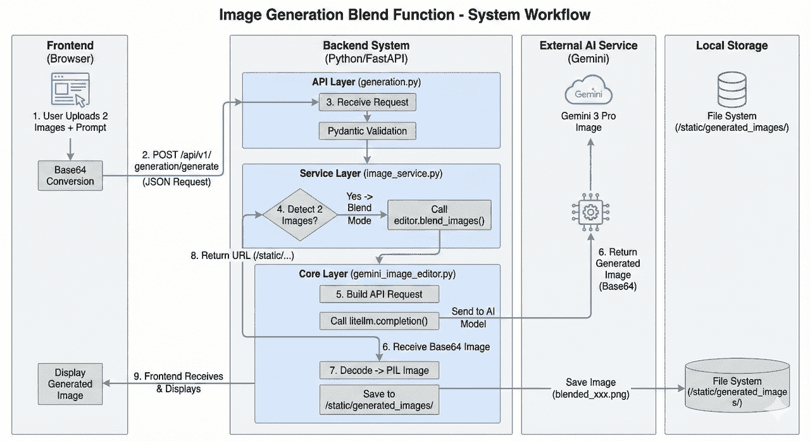

从架构图可以看到，用户通过浏览器访问前端应用，前端调用后端 API，后端再通过 LiteLLM 调用 Gemini 模型，最终将生成的图片返回给用户。更深入的教程也可以欢迎联系助教老师详询：

https://pan.baidu.com/s/12WvSF8G8vstJcKASvRJxOg?pwd=7cmq 提取码: 7cmq


在开始部署之前，我们需要确保本地环境满足以下要求：

环境要求

| 软件 | 最低版本 | 推荐版本 | 用途 |
| --- | --- | --- | --- |
| Node.js | 18.0+ | 20.0+ | 前端构建和运行 |
| npm | 8.0+ | 10.0+ | 前端包管理 |
| Python | 3.10+ | 3.11+ | 后端运行 |
| pip | 21.0+ | 23.0+ | Python包管理 |

接下来，我们一步步部署后端服务。

#### 步骤 1：下载项目源码并解压后，进入后端目录

```
  cd backend
```

#### 步骤 2：创建虚拟环境（强烈推荐）

使用虚拟环境可以隔离项目依赖，避免与系统Python环境冲突。

```
  # 创建虚拟环境
  python -m venv venv

  # 激活虚拟环境
  # Linux/Mac:
  source venv/bin/activate

  # Windows:
  venv\Scripts\activate
```

激活成功后，终端提示符前会出现 (venv) 标识。

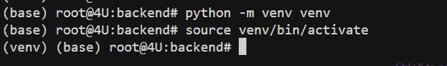

#### **步骤 3：安装依赖**

```
  pip install -r requirements.txt
```

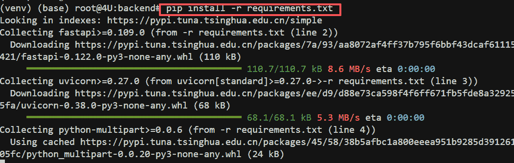

这条命令会安装所有必需的Python包，包括 fastapi、litellm、pillow 等。安装过程可能需要几分钟。

---

#### **步骤 4：配置 API Key**

创建 .env 文件并添加 OpenRouter API Key：

```
  # 创建 .env 文件
  echo &quot;OPENROUTER_API_KEY=your-api-key-here&quot; &gt; .env
```

请将 your-ap[i-key-here](https://openrouter.ai/) 替换为你在 OpenRouter 获取的实际 API Key。

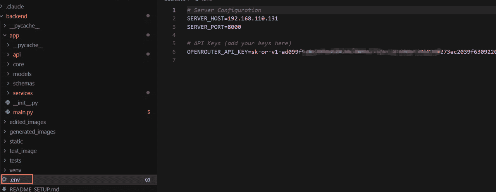

#### **步骤 5：启动后端服务**

```
  python run.py
```

启动成功后，你会看到类似以下的输出：

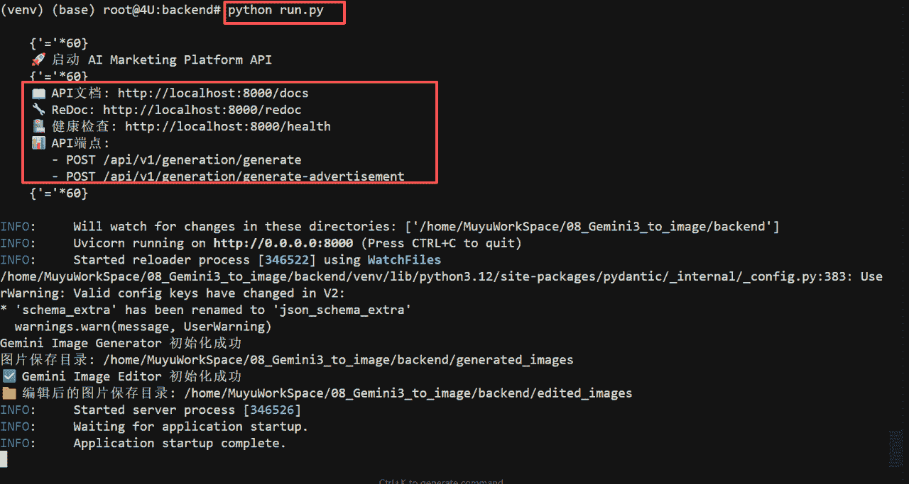

此时，后端服务已经在 http://localhost:8000 成功运行！可以在浏览器中访问 http://localhost:8000/docs 查看 API 文档。

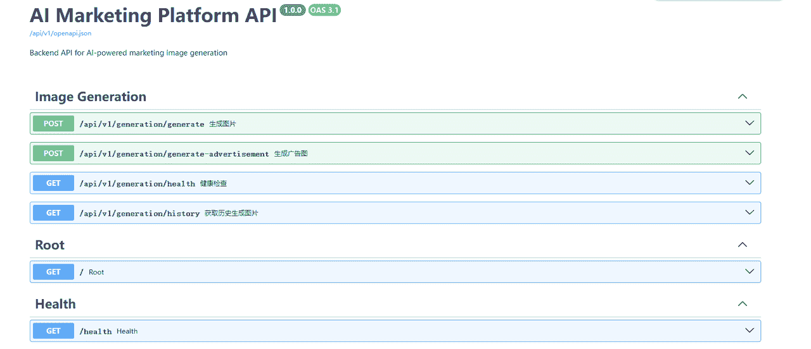

后端启动后，接下来部署前端应用。保持后端服务运行，打开一个新的终端窗口。进入前端目录并安装项目依赖：

```
  cd frontend
  npm install
```

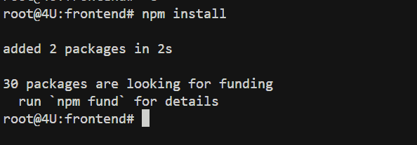

这条命令会安装所有前端依赖包，包括 react、vite、tailwindcss 等。首次安装可能需要几分钟。

启动开发服务器，执行如下命令：

```
  npm run dev
```

启动成功后，你会看到类似以下的输出：

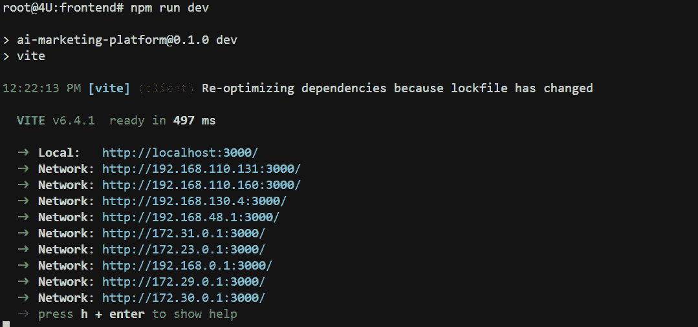

此时，前端应用已经在 http://localhost:3000 成功运行！打开浏览器，访问 http://localhost:3000，你应该能看到主页，显示 6 个创意选项卡片。

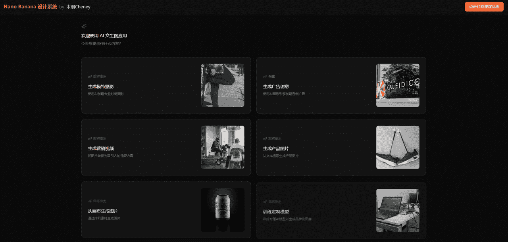

如果以上步骤都顺利完成，恭喜你！项目已经成功在本地部署运行了！

**我们下期公开课，再见！** 👋