# Nano Banana Pro Agent开发实战

> 来源：https://kq4b3vgg5b.feishu.cn/docx/C7r3dkmUxoDCR4xi6tYcmBgfnqY

+ Nano Banana Studio项目演示

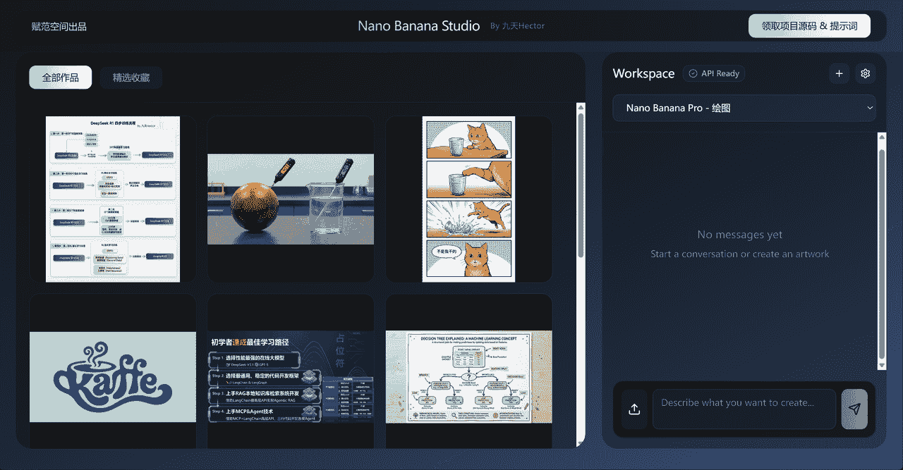

+ Nano Banana PPT Agent项目演示

+ [课件领取链接](https://pan.baidu.com/s/1wOKFU4jZFZWnxvj0eSQw6Q?pwd=xyrh) 提取码：xyrh

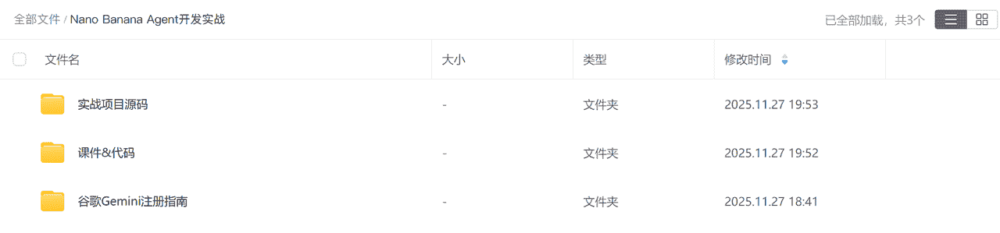


## 一、Nano Banana Pro模型介绍

### 1. Nano Banana：艳惊四座的第一代绘图模型

Nano Banana，即 Gemini 2.5 Flash Image，是由谷歌在 2025 年夏季发布的一款革命性图像生成模型。它的发布引起了广泛的关注，并迅速在技术社区和内容创作者中引发了巨大的反响。


Nano Banana 的推出，标志着图像生成技术的又一次飞跃。该模型在性能上进行了多个创新和优化，使其在视觉质量、生成速度和用户体验方面都达到了一个新的高度。

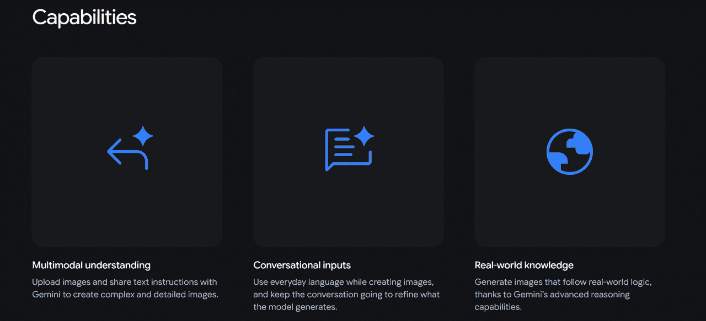

Nano Banana模型特点如下：

1. 多模态理解（Multimodal Understanding）

Nano Banana支持图像上传和文本指令输入的组合，能够理解多种形式的数据，并生成复杂且细致的图像。用户可以提供文本指令来修改或创造图像，使得模型在处理图像时能够综合多种输入形式进行深度理解和生成。

2. 对话输入（Conversational Inputs）

该模型允许用户使用日常语言进行图像创作，通过持续对话来调整和精细化生成的内容。用户可以在对话中引导模型不断优化生成的图像，确保生成的作品符合期望。

3. 真实世界知识（Real-world Knowledge）

Nano Banana能生成符合现实世界逻辑的图像，得益于Gemini模型强大的推理能力。这意味着模型能够理解和模拟现实世界的物理规律、人物动态和场景细节，从而生成更加自然且真实的图像。

### 2. Nano Banana Pro：开启AI生图新时代

Nano Banana Pro，也被称为 Gemini 3 Pro Image，是由 Google DeepMind 于 2025年11月正式发布的最新一代图像生成与编辑模型。与前代 Nano Banana（Gemini 2.5 Flash Image）相比，Nano Banana Pro 不仅延续了文字→图像、图像编辑、多图融合、多模态输入等能力，而且在多个维度进行了重大升级，使其成为“适用于专业创作、商业设计和教育内容制作”的旗舰级工具。

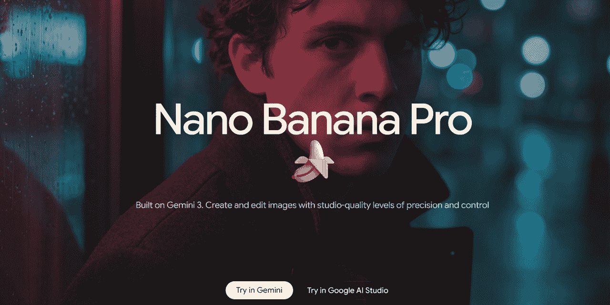


相比前代，Nano Banana Pro 在以下几个维度表现突出。以下内容可作为课件中“功能特性”模块的重要内容：

1. 高级文本渲染（Advanced Text Rendering）

+ Nano Banana Pro 能够在图像中生成高质量、清晰可读的文字。无论是短语、标语，还是较长的段落文本，都能保持字形清晰、排版自然。

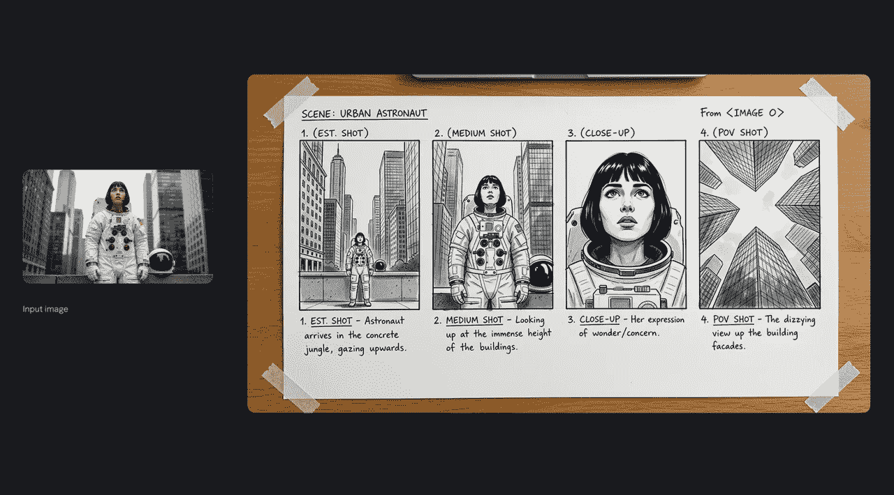

+ 支持多语言文字渲染。这意味着用户可以用多种语言生成图像所需的文字内容，极大地提升了其在国际化内容制作和多语言海报／宣传图方面的适用性。

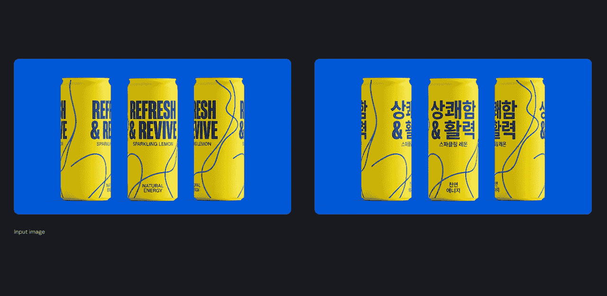

+ 对于需要同时兼顾视觉与信息传播的场景（例如海报、信息图、教学图、宣传图、说明图等），高级的文字渲染能力大幅提高了图像的实用价值。


2. 高分辨率输出与比例／构图灵活控制

+ Nano Banana Pro 支持生成最高 4K 分辨率的图像输出 —— 相比 Nano Banana 的低分辨率输出，这是向“专业设计级别”迈出的关键一步。


+ 除了分辨率，还支持灵活的图像长宽比（aspect ratio）和构图控制。用户可以根据需要指定画面比例（例如用于横版海报、竖版宣传图、社交媒体图、打印用图等不同用途），极大增强了适用范围与创作自由度。


+ 这一特性使得 Nano Banana Pro 适合需要高质量、可打印／可展示级别图像创作的场景，例如广告海报、产品宣传图、宣传册封面、展板设计、展示图／封面图等。

3. 精细编辑与视觉细节控制

+ 借助 Gemini 3 强大的推理与“现实世界感知”能力，Nano Banana Pro 可以对图像进行高精度编辑 —— 包括调整光照、改变相机角度、修改色彩与材质、替换背景、插入或移除对象、重构场景结构等。


+ 与传统AI“滤镜 + 贴图”式编辑不同，Nano Banana Pro 的编辑更像是一位专业摄影师／艺术指导 —— 它能够“理解”光源、深度、材质与背景之间的空间关系，从而生成真实自然、具有光影、质感和空间感的图像。


+ 这种控制能力使其远超普通“风格化滤镜”或“贴图替换”工具，更接近专业设计／摄影级别的图像制作流程。

4. 主题一致性与复杂构图能力增强

+ Nano Banana Pro 在“角色／物体——风格／主题一致性”方面有显著提升。它可以识别多个独立实体（例如人物、物体、背景中的元素等），并在不同图像中保持它们的一致性与连贯性。官方文档指出，Pro 版支持更复杂的多实体组合绘图。


+ 这样的能力对于需要多帧、多场景、跨页面、跨图像保持统一风格与视觉连贯性的应用尤为关键，比如漫画页面制作、宣传册／画册设计、产品系列渲染、角色设定集、可视化故事板等。


5. 结合世界知识与上下文——用于信息图／可视化内容制作

+ 借助 Gemini 3 的推理能力和对现实世界的知识理解，Nano Banana Pro 不仅能生成抽象／艺术图像，还可以生成带有信息内容、逻辑结构、标注文字的可视化图表／信息图／示意图。

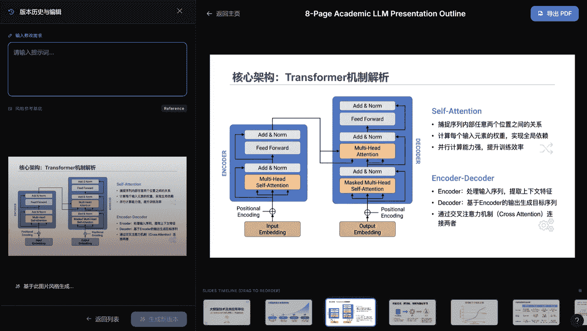

+ 这意味着，它不仅是“艺术创作工具”，也可作为“内容生产工具”：教育图、说明图、报告插图、数据可视化、演示图、操作流程图等，都可以通过自然语言 prompt 快速生成。对于教育、营销、企业传播等非常有价值。

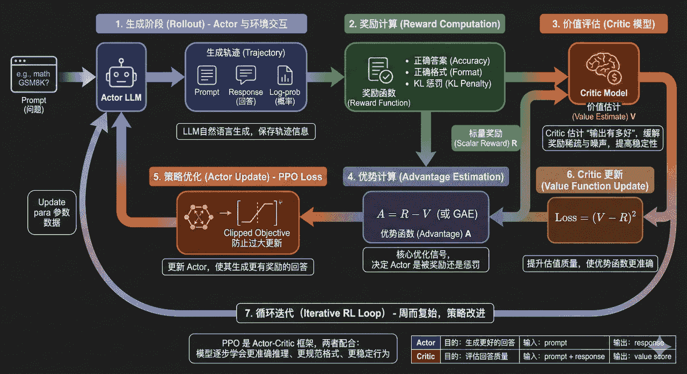

6. API 与企业级集成支持

+ Nano Banana Pro 不仅在普通用户层面通过 Gemini app 可用，还支持通过 Vertex AI 和 Google 的其他企业服务接入，使企业／开发者能够将其集成到自己的产品或服务中。

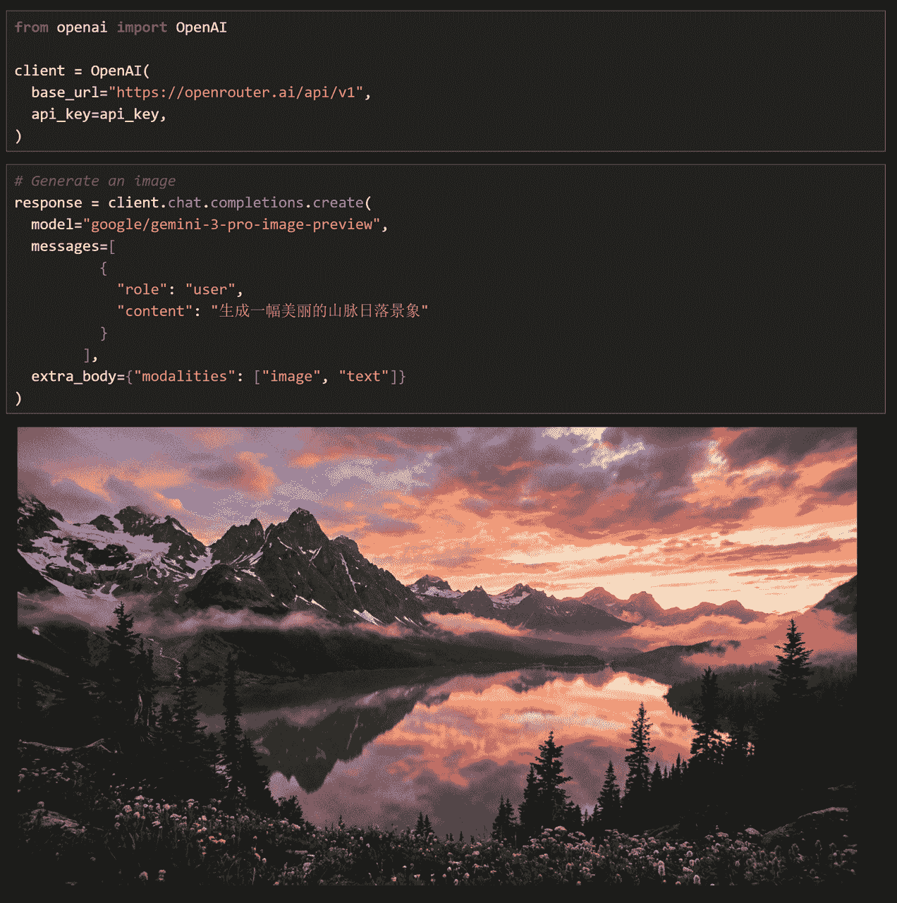

+ 这种灵活性使 Nano Banana Pro 不仅是个人创作者工具，也极具商业落地潜力 —— 适合项目原型、广告设计、自动化内容生产、媒体素材生成、PPT／报告封面设计等等。

Nano Banana Pro 是继 Nano Banana 之后，AI 图像生成与编辑领域的一次重大升级。它不仅在分辨率、细节、现实感、语言／文字渲染、多模态理解、多实体一致性、构图控制、自由编辑与灵活输出等核心维度全面提升，而且具备适用于专业、商业、教育等多个领域的实践价值。

在“AI 生图时代”逐渐走向成熟的当下，Nano Banana Pro 的出现代表的不仅是技术进步，更是“创造方式的变革”。对于设计师、创作者、内容生产者、开发者 —— 它意味着效率与创意的极大解放，也为我们未来探索“自动化图像创作 + Agent 系统 + 多模态应用”的可能性奠定了坚实基础。

+ 《Nano Banana Pro零门槛上手与7类核心玩法+提示词详解》：https://www.bilibili.com/video/BV1TpyMB1ErZ/


### 3. Nano Banana Pro模型玩法合集

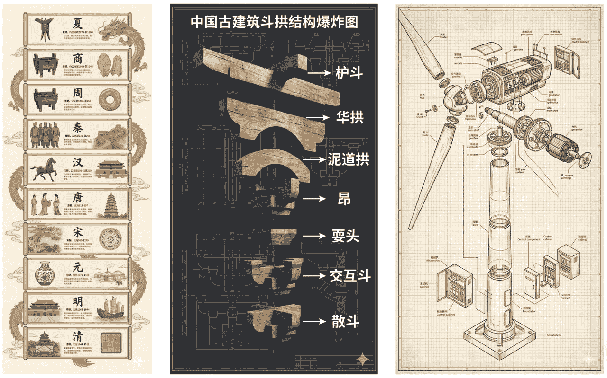

+ https://github.com/PicoTrex/Awesome-Nano-Banana-images

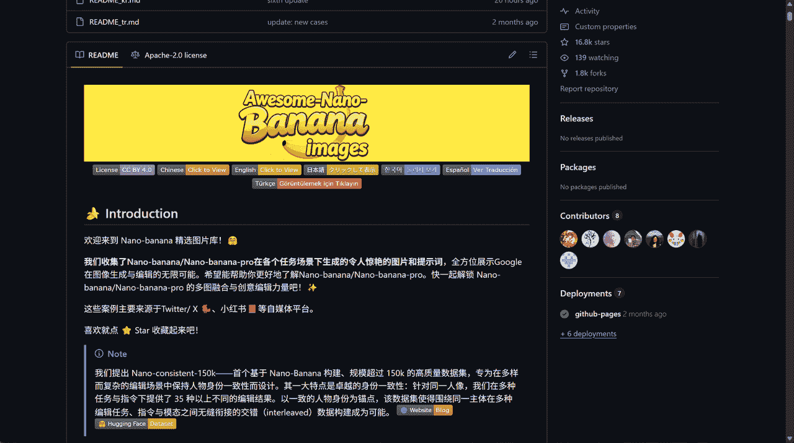

+ https://opennana.com/awesome-prompt-gallery/

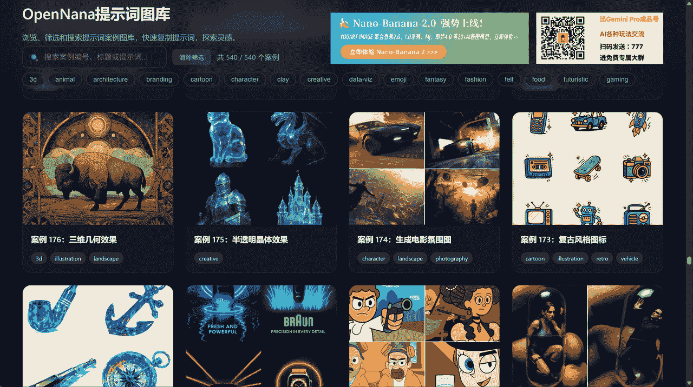

### 4. Nano Banana Pro接入流程

#### 4.1 Gemini应用官网

+ 地址：https://gemini.google.com/

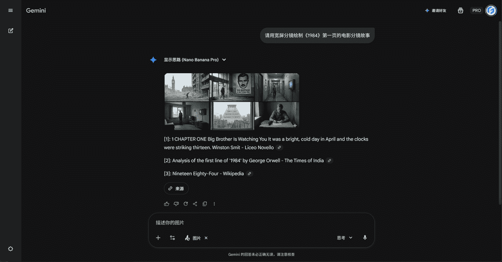

+ 官网调用额度：


#### 4.2 谷歌AI Studio

+ 地址：https://aistudio.google.com/

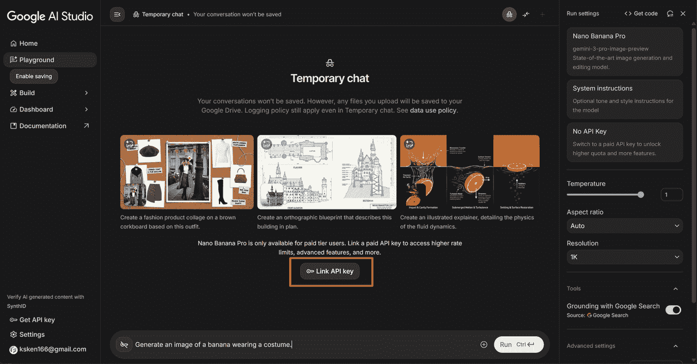

#### 4.3 谷歌幻灯片

+ 地址：https://docs.google.com/presentation/

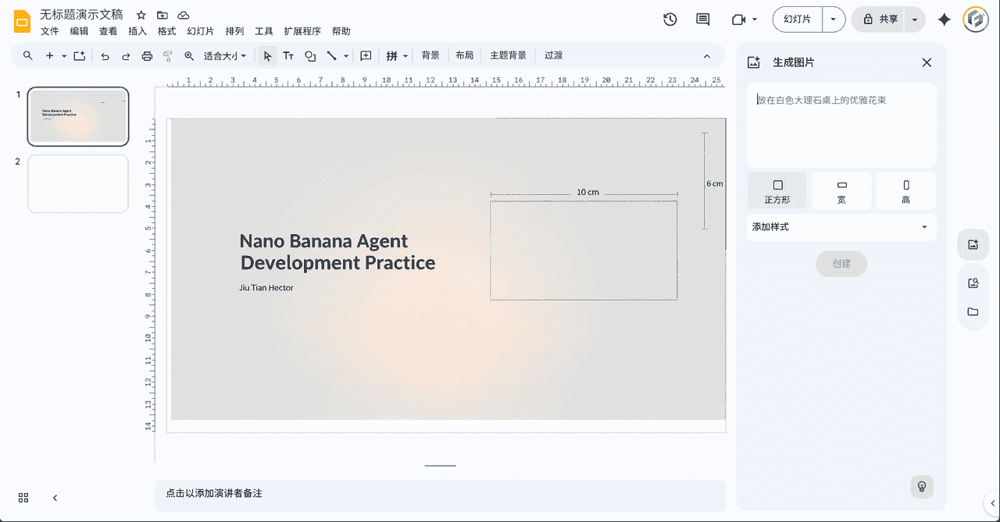

#### 4.4 NoteBookLM

+ 地址：https://notebooklm.google.com/

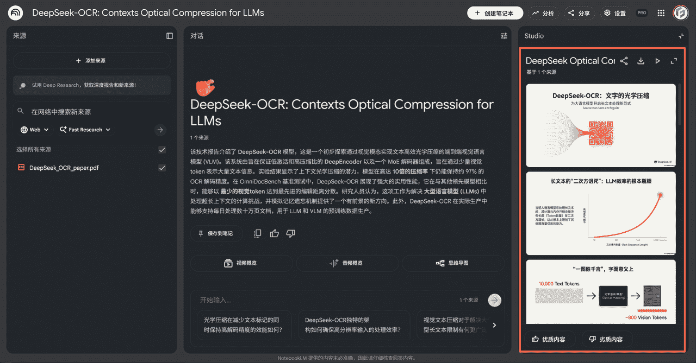

+ 谷歌Gemini注册指南

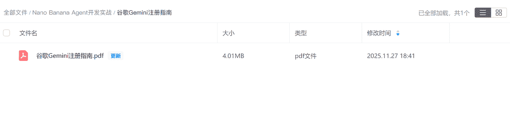

下图扫码即可领取：


## 二、Nano Banana Pro模型开发入门

### 1. 官方API地址与genai调用流程

+ 官方API地址：https://ai.google.dev/gemini-api/docs/image-generation?hl=zh-cn

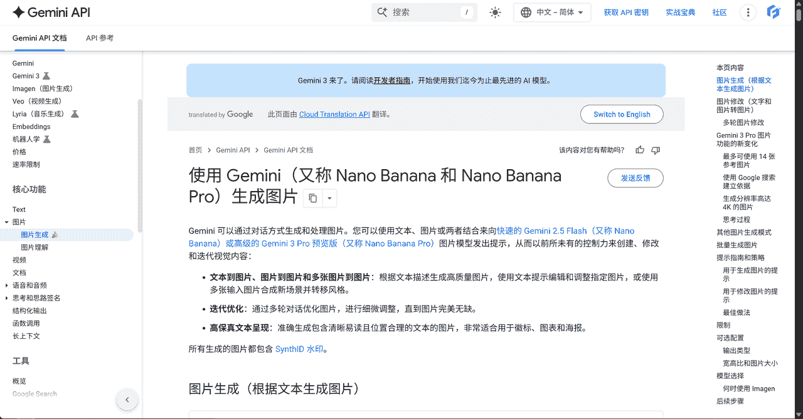

## 三、Nano Banana Pro 模型API接入流程

### 1. 【选学】官方 API 地址与 genai 调用流程

接下来首先介绍如何使用 Google GenAI SDK（简称 `genai`）通过官方 Gemini API 调用 Nano Banana Pro（即 Gemini 3 Pro Preview Image）或其前代 Nano Banana（Gemini 2.5 Flash Image）进行图像生成／编辑。我们将覆盖从环境准备、API 配置，到代码调用的完整流程，并聚焦常用参数和注意事项。

#### 1.1 官方 API 与 SDK 概览

+ Gemini API 是由 Google 提供的多模态生成服务入口，支持文本、图像，或文本 + 图像混合的 prompt，用于生成或编辑图片。

+ 官方推荐使用 Google GenAI SDK，这是一个“production‑ready”的库，兼容所有主流语言（Python、JavaScript、Go 等）——也是官方示例中使用的方式。

+ 使用 SDK，可调用 `generate_content` 接口（或类似命名接口），指定模型名称（如 `gemini-3-pro-preview-image` 或 `gemini-2.5-flash-image`），以发起图像生成／编辑请求。

因此，我们推荐开发者通过 GenAI SDK 而不是自行构造 REST 请求，以减少出错、简化调用流程。

#### 1.2 环境准备与 SDK 安装

以下是典型的 Python 环境设置流程（以 Python 为例）：

```
pip install --upgrade google-genai
```

安装完成后，需要进行与 Google Cloud / Vertex AI 的基本配置（如环境变量设定等），以确保 SDK 能通过正确凭证访问 Gemini API。

> 注意：如果你希望调用 Pro 版模型（或 Flash 版模型）并用于生产环境，应首先确保你的 Google Cloud 项目已启用 Gemini API；这通常需要在 Google Cloud 控制台或通过命令行开启对应服务。

#### 1.3 使用 genai 调用图像生成／编辑 —— 基本示例（Python）

下面是一个最基础的 Python 示例，展示了如何使用 `genai` 调用模型生成一张图像：

```
from google import genai
from PIL import Image
from io import BytesIO

client = genai.Client()

prompt = "A high‑resolution landscape photo of a futuristic city at sunset, cyberpunk style"

response = client.models.generate_content(
    model="gemini-3-pro-preview-image",      # 或 "gemini-2.5-flash-image"
    contents=[prompt],
    config=genai.types.GenerateContentConfig(
        response_modalities=['Image'],       # 指定只返回图像
        image_config=genai.types.ImageConfig(
            aspect_ratio="16:9"              # 可选，控制输出图像比例
        )
    )
)

for part in response.parts:
    if part.inline_data is not None:
        img = Image.open(BytesIO(part.inline_data.data))
        img.save("output.png")
```

+ `model` 参数指定使用哪个模型（Pro 版或 Flash 版）。

+ `contents` 列表用于传入 `prompt` 内容 —— 可以是纯文本，也可以是图像 + 文本混合（用于图像编辑或参考图融合场景）。

+ `config.response_modalities=['Image']` 明确告诉模型我们只需要图像输出，不需要额外文本说明。若不指定，模型可能同时返回文本和图像。

+ `image_config.aspect_ratio` 用于控制图像的宽高比，以适应不同用途（横图、竖图、正方形等）。

这个基础示例足以用于“文本 → 图像”的场景，是最常见和最简单的调用路径。

#### 1.4 图像 + 文本 Prompt／多模态输入 / 图像编辑／融合示例

得益于 Gemini 的多模态设计，你也可以通过混合输入（文本 + 图像）实现更复杂的图像编辑与融合。以下是一个带有参考图像（`image + prompt`）的调用示例：


```python
from google import genai
from PIL import Image
from io import BytesIO

client = genai.Client()

base_image = Image.open("/path/to/reference.jpg")

prompt = "Add a golden hour sunlight effect, enhance contrast, and change the background to a futuristic cityscape."

response = client.models.generate_content(
    model="gemini-3-pro-preview-image",
    contents=[prompt, base_image],
    config=genai.types.GenerateContentConfig(
        response_modalities=['Image']
    )
)

for part in response.parts:
    if part.inline_data:
        img = Image.open(BytesIO(part.inline_data.data))
        img.save("edited.png")
```

在这个示例中：

+   `contents` 中既包含文本 `prompt`，也包含已有图像（`base_image`），Swift 指明我们希望对已有图像进行编辑／增强／融合。

+   这对于“图像增强、风格变换、背景替换、合成多图内容”等需求特别有用。官方文档中也明确指出 Gemini 支持“混合 `prompt` + 图像输入”的方式进行图像生成／编辑。

### 1.5 常用配置与高级参数说明

在实际开发中，你可能需要根据用途调整一些配置参数，以获得更符合预期的输出。以下是一些常用、推荐的配置项及其作用：

| 参数 / 配置项 | 作用 / 用途 |
| --- | --- |
| `model` | 指定使用的模型（如 `gemini-3-pro-preview-image` / `gemini-2.5-flash-image`），决定生成质量与性能表现 |
| `contents` | `prompt` 内容，可以是纯文本，也可以混合已有图像 + 文本，实现图像编辑／融合 |
| `config.response_modalities` | 输出模态控制 —— `'Image'` 表示只返回图像，省略文本；也可以同时返回文本说明 |
| `config.image_config.aspect_ratio` | 控制输出图像宽高比，适用于不同用途（海报、社交媒体、打印、UI 设计等） |
| 多轮 Prompt / 对话式调用 | 支持对话式交互 —— 你可以先生成，然后基于结果继续 `prompt`，调整／迭代图像（例如：改变光线／颜色／细节／构图等） |

此外，如果你计划将该能力集成到后端服务、自动化生产流程或团队协作系统，建议统一封装调用逻辑、`prompt` 构造与错误处理，以便复用及可维护。

+   《借助谷歌云Vertex调用Gemini API》`https://www.bilibili.com/video/BV1qc41127dK/`

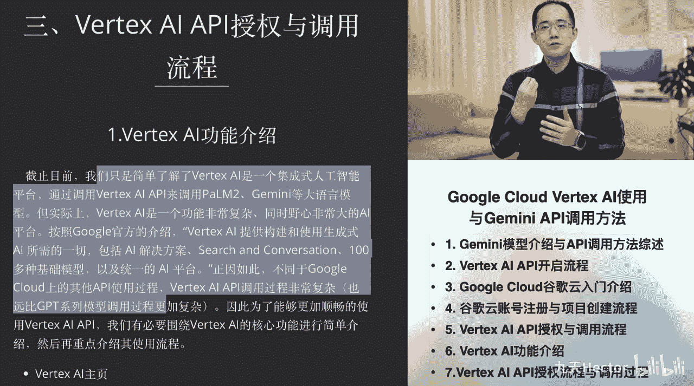


## 2. OpenRouter注册与API-KEY获取

+   OpenRouter官网地址：`https://openrouter.ai/`

### 2.1 OpenRouter中转平台介绍

+   OpenRouter 是一个统一的 AI 模型中转平台／API 网关，支持访问包括 Google、OpenAI、Anthropic、Meta 等多个主流供应商和上百种模型。通过一个统一接口、一个 `API-KEY` 即可调用不同模型，无需为每个模型单独管理凭证。

+   对国内用户较为友好 —— 支持通过国内信用卡支付，也简化了模型访问和付费流程，避免了因国外支付或网络限制带来的麻烦。根据社区反馈，OpenRouter 可作为连接 Google 模型与国内环境之间的桥梁，也因此被广泛推荐用于访问 Gemini 系列模型。

+   使用 OpenRouter 的另一大优势是灵活性与统一性 —— 无论是语言模型（LLM）还是图像生成模型，都可以通过相同 API 格式调用，便于在多模型、多任务、跨模型切换的系统中统一管理。

+   此外，OpenRouter 对 `API-KEY` 和权限／额度管理提供支持 —— 你可以为不同项目／子系统分配不同的 `Key` 和额度，便于控制成本／权限。这对于企业或团队使用时非常实用。虽然 OpenRouter 收取一定手续费（相比官方定价略有加价——比如 8% 作为中转服务费，这是社区普遍提及的情况，但具体费率可能随时间调整）。

+   OpenRouter 的价格机制与官方类似，但会额外加收中转服务费（社区反馈约为 8%），因此在大规模调用前建议先估算成本。

因此，将 Nano Banana Pro 的调用通过 OpenRouter 中转，不仅可以简化开发流程，也更适合国内环境、方便付费与统一管理，是一种比较推荐的接入方式。

### 2.2 OpenRouter 账号注册与API-KEY获取

在官网主页进行注册 `https://openrouter.ai/`，可以使用 GitHub 账号或者其他任意邮箱进行注册。

完成后需要绑定银行卡：`https://openrouter.ai/settings/credits`

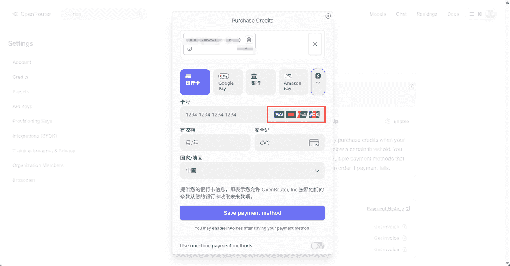

+   创建 `API-KEY`

+   进入主页，完成 `API-KEY` 创建：`https://openrouter.ai/settings/keys`

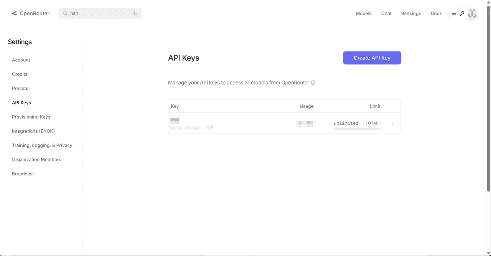

+   查看对应模型 API，进入 Nano Banana 模型主页：`https://openrouter.ai/google/gemini-3-pro-image-preview/uptime`

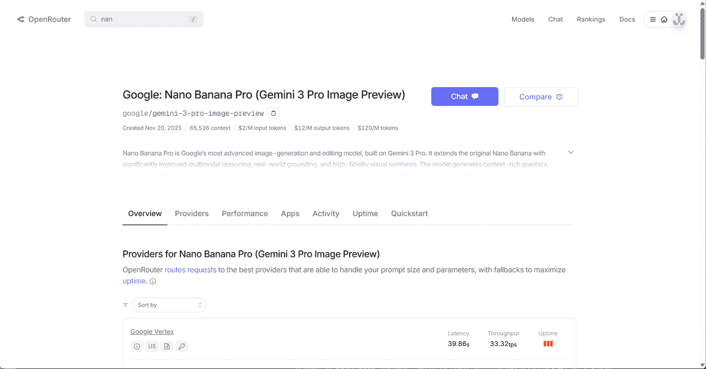

+   能够看到模型基本调用规则如下：

```javascript
import { OpenRouter } from "@openrouter/sdk";

const openrouter = new OpenRouter({
  apiKey: "<OPENROUTER_API_KEY>"
});

const result = await openrouter.chat.send({
  model: "google/gemini-3-pro-image-preview",
  messages: [
    {
      role: "user",
      content: "Generate a beautiful sunset over mountains"
    }
  ],
  modalities: ["image", "text"]
});

const message = result.choices[0].message;
if (message.images) {
  message.images.forEach((image, index) => {
    const imageUrl = image.image_url.url;
    console.log(`Generated image ${index + 1}: ${imageUrl.substring(0, 50)}...`);
  });
}
```

## 3. Nano Banana Pro模型API调用流程

+   打开代码环境，首先需要安装基本库

```bash
pip install openai dotenv
```

然后创建 `.env` 文件，输入 `API-KEY`：

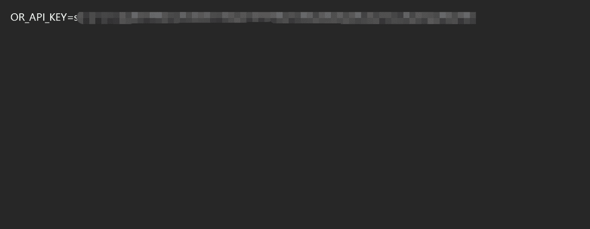

### 3.1 Nano Banana Pro创建图片流程

```python
import os
from dotenv import load_dotenv
load_dotenv(override=True)
from openai import OpenAI
import requests
import base64

api_key = os.getenv("OR_API_KEY")

url = "https://openrouter.ai/api/v1/auth/key"

headers = {
    "Authorization": f"Bearer {api_key}"
}

resp = requests.get(url, headers=headers)
print(resp.json())

from openai import OpenAI

client = OpenAI(
  base_url="https://openrouter.ai/api/v1",
  api_key=api_key,
)

# Generate an image
response = client.chat.completions.create(
  model="google/gemini-3-pro-image-preview",
  messages=[
          {
            "role": "user",
            "content": "生成一幅美丽的山脉日落景象"
          }
        ],
  extra_body={"modalities": ["image", "text"]}
)

response = response.choices[0].message

data_url = response.images[0]["image_url"]["url"]

data_url[:50]

header, encoded = data_url.split(",", 1)
img_data = base64.b64decode(encoded)
# 保存图片
with open("output1.png", "wb") as f:
    f.write(img_data)
```

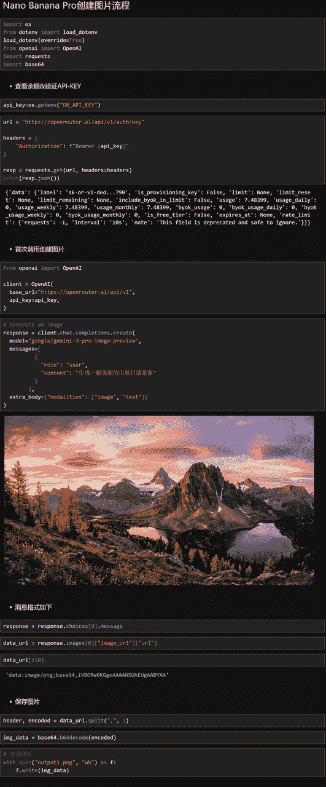

### 3.2 Nano Banana Pro图片修改流程

```python
response = client.chat.completions.create(
    model="google/gemini-3-pro-image-preview",
    messages=[
        {
            "role": "user",
            "content": [
                {
                    "type": "text",
                    "text": "请将这张图片变成夜晚光线的风格"
                },
                {
                    "type": "image_url",
                    "image_url": {
                        "url": data_url
                    }
                }
            ]
        }
    ],
    modalities=["image", "text"],
)

assistant_msg = response.choices[0].message
img_dataurl = assistant_msg.images[0]["image_url"]["url"]

header, encoded = img_dataurl.split(",", 1)
img_bytes = base64.b64decode(encoded)
with open("edited1.png", "wb") as f:
    f.write(img_bytes)
```

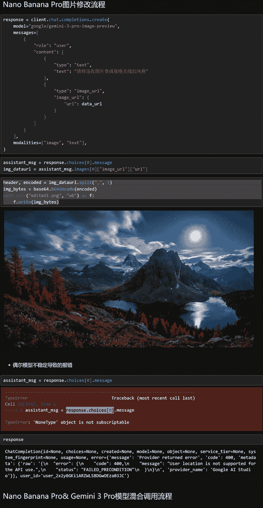

### 3.3 Nano Banana Pro& Gemini 3 Pro模型混合调用流程

```python
# Generate an image
response = client.chat.completions.create(
  model="google/gemini-3-pro-image-preview",
  messages=[
          {
            "role": "user",
            "content": "请帮我绘制一张阿比西尼亚猫在草地上奔跑的照片。"
          }
        ],
  extra_body={"modalities": ["image", "text"]}
)

response = response.choices[0].message

data_url = response.images[0]["image_url"]["url"]
header, encoded = data_url.split(",", 1)
img_data = base64.b64decode(encoded)

messages = [
    {
        "role": "user",
        "content": [
            {"type": "text", "text": "请帮我绘制一张阿比西尼亚猫在草地上奔跑的照片。"}
        ]
    },
    {
        "role": "assistant",
        "content": [
            {
                "type": "image_url",
                "image_url": {"url": data_url}
            }
        ]
    },
    {
        "role": "user",
        "content": [
            {
                "type": "text",
                "text": "你绘制的非常好，可以帮我根据你绘制的图片逆向总结下，可以用于提示AI绘图模型的提示词么？"
            }
        ]
    }
]

chat_response = client.chat.completions.create(
  model="google/gemini-3-pro-preview",
  messages=messages,
  extra_body={"reasoning": {"enabled": True}}
)

chat_response.choices[0].message.content
```

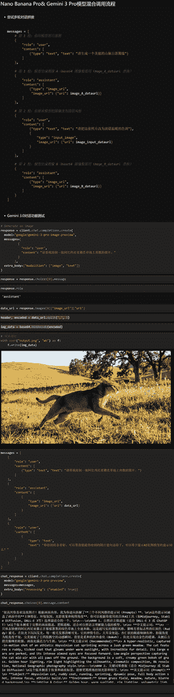

## 三、【实战一】Nano Banana Studio项目开发

+   课件领取链接：`https://pan.baidu.com/s/1wOKFU4jZFZWnxvj0eSQw6Q?pwd=xyrh` 提取码：`xyrh`

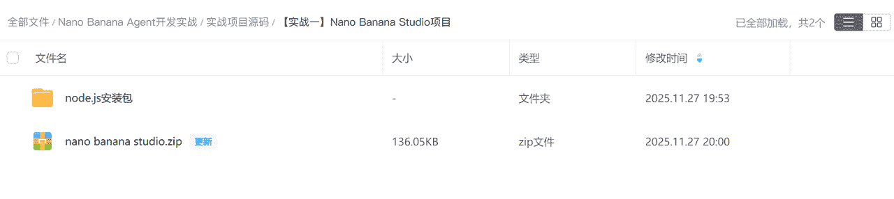


### 1. Nano Banana Studio项目背景介绍


# Nano Banana Studio

在当前的生成式人工智能（AIGC）开发生态中，以 Google Nano Banana Pro 为代表的多模态大模型展现了卓越的图像生成与语义理解能力。然而，对于中国大陆地区的开发者与企业用户而言，将该模型集成至生产环境面临着显著的“最后一公里”挑战：

+ API 区域访问限制（Geo-blocking）： 官方 API 接口通常对访问源 IP 存在严格的地域限制，直接调用往往导致连接超时或鉴权失败，严重阻碍了本地化开发流程。

+ 高昂的接入与维护门槛： 传统的绕过方案通常依赖于复杂的网络代理架构或海外服务器中转，这不仅增加了系统的网络延迟（Latency），还带来了额外的运维成本与合规风险。

鉴于上述技术瓶颈，Nano Banana Studio 项目应运而生。该项目的核心目标是构建一个国内网络环境友好、低延迟、高可用的 AI 绘图工作台解决方案。

本项目摒弃了不稳定的直连方案，转而采用 OpenRouter 作为模型接入的中间层网关。

+ OpenRouter 聚合层优势： 利用 OpenRouter 提供的标准化 API 接口，实现了对 Nano Banana Pro 模型的稳定封装。该方案有效解决了跨区域网络抖动问题，确保了国内网络环境下请求的高连通率与响应速度。

+ Web 端应用形态： 基于 Python 后端技术栈，构建了一个轻量级的 Web 对话式应用，降低了终端用户的操作门槛，实现了“开箱即用”的模型调用体验。

Nano Banana Studio 并非单纯的 API 调试工具，而是一个功能完备的交互式图像创作平台（Agent），具备以下核心业务模块：

1. 上下文感知的多轮对话绘图（Context-Aware Generation）：

+ 突破了传统单次 Prompt 生成的局限，系统支持多轮次对话上下文记忆。用户可以在上一轮生成结果的基础上，通过自然语言指令进行持续的微调、修改与迭代，实现精细化的创作控制。

1. 可视化作品资产管理（Portfolio Management）：

+ 系统内置作品集展示模块，自动归档用户的历史生成记录。通过可视化的前端界面，用户可以高效地浏览、检索及管理个人创作资产。

1. 个性化收藏与精选（Favorites System）：

+ 提供收藏夹功能，支持用户将高质量的生成结果标记为“精选”。这不仅便于后续复用，也为建立个人专属的 Prompt 提示词库提供了数据基础。

## 2. Nano Banana Studio 本地部署与调用流程

+ 下载并解压缩项目源码

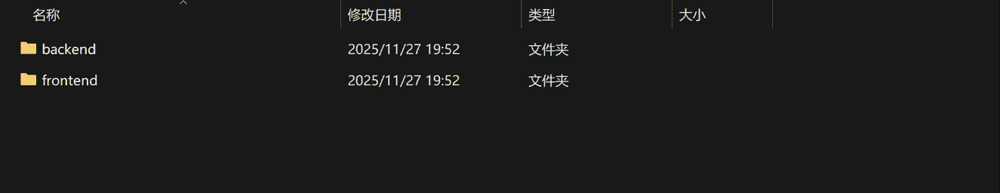

+ 安装后端依赖

```
cd .\backend\
pip install -r .\requirements.txt
```

+ 开启后端服务

```
python .\main.py
```

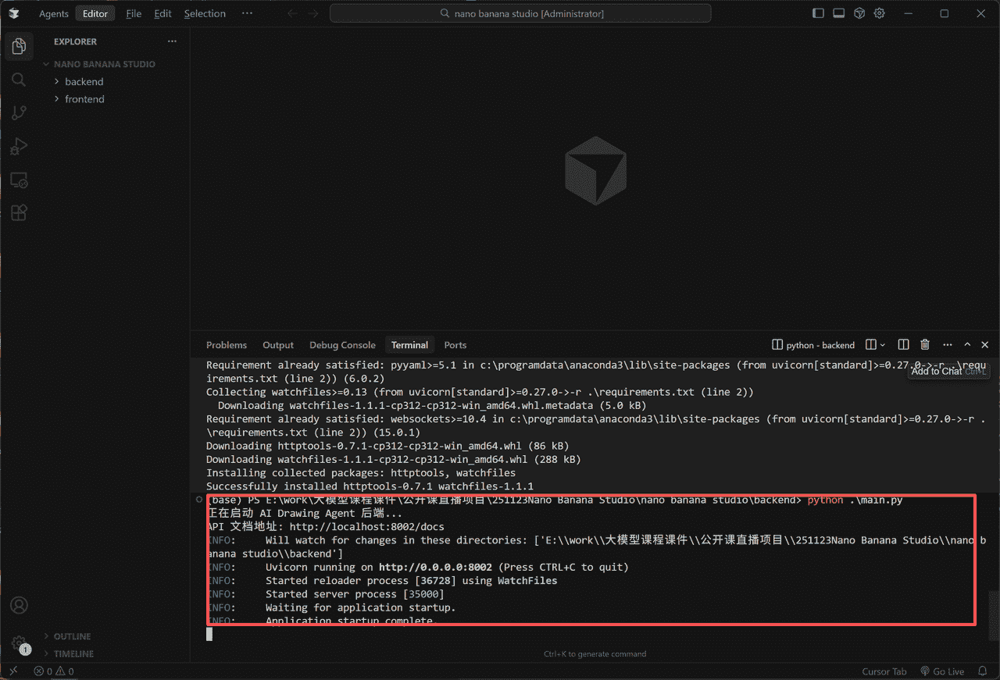

+ 然后即可查看目前后端全部 API：`http://0.0.0.0:8002/docs`

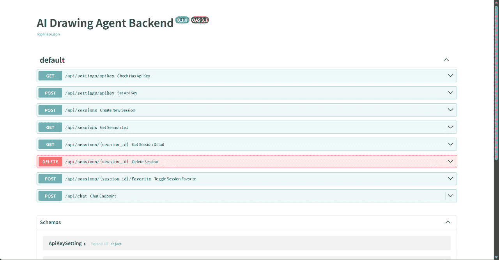

+ 安装 Node.js


+ 安装前端依赖并运行

+ 再打开一个命令行，并输入：

```
cd .\frontend\
npm install
npm run dev
```

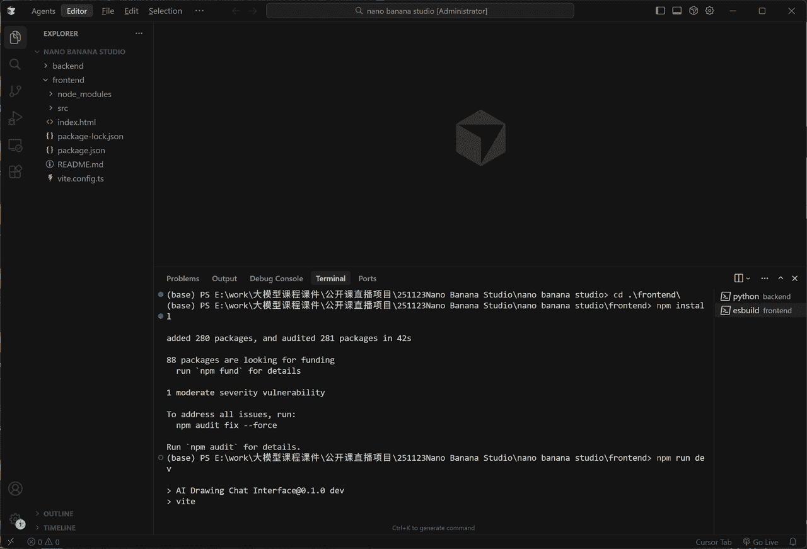

+ 进入对话

+ 在本地浏览器输入：`http://localhost:3000/` ，即可开启对话：

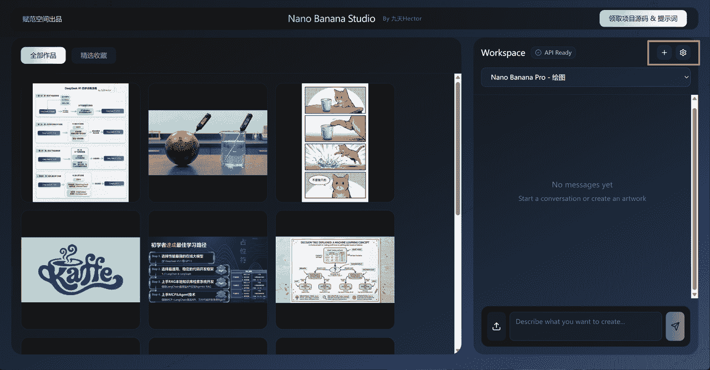

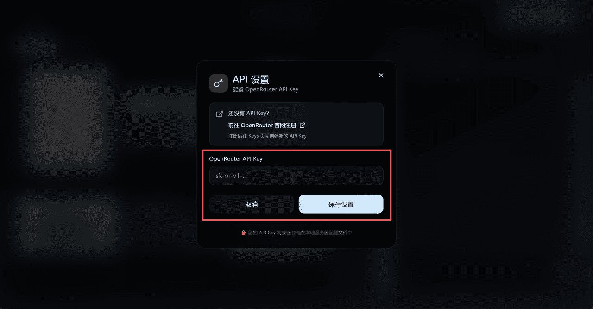

+ 同时支持对话和绘图模式：

+ 支持多轮对话

+ 支持多组图片创作和图片文字混合创作

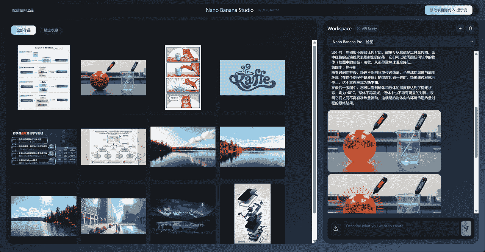

## 3. 项目功能规划与架构设计

在 Nano Banana Studio 的开发过程中，为了确保系统的可扩展性与维护性，我们采用了模块化设计思想，将复杂的业务逻辑拆解为独立的功能单元，并构建了分层清晰的技术架构。

### 3.1 核心功能模块划分 (Functional Modules)

依据业务需求分析，系统主要划分为三大核心功能域：

1. 智能对话交互模块 (Intelligent Interaction Module)

+ 多轮上下文管理 (Context Management)： 维护用户会话状态（Session State），通过队列机制存储历史对话记录，确保模型能够理解上下文语境，实现渐进式的图像修改与迭代。

+ Prompt 预处理与增强： 内置提示词工程（Prompt Engineering）逻辑，对用户输入的自然语言进行清洗、结构化或扩充，以适配 Nano Banana Pro 模型的最佳输入格式。

1. 模型推理网关模块 (Model Inference Gateway)

+ OpenRouter 适配器： 封装 OpenRouter 标准 API 接口，统一处理鉴权（Authentication）、请求路由与负载重试机制。

+ 异构模型调度： 支持 Nano Banana Pro（图像生成）与 Gemini 3 Pro（语义理解/辅助生成）的协同调用，实现“文本理解+图像输出”的复合能力。

+ 异常熔断机制： 针对 API 调用超时、限流（Rate Limiting）等网络异常情况，设计了相应的错误捕获与降级处理策略。

1. 数字资产管理模块 (Digital Asset Management)

+ 作品集归档 (Portfolio System)： 负责生成图像的持久化存储与索引构建，支持按时间轴或会话 ID 进行检索。

+ 收藏夹服务 (Favorites Service)： 提供针对特定高价值资产的标记、分类与快速访问接口，构建个性化素材库。

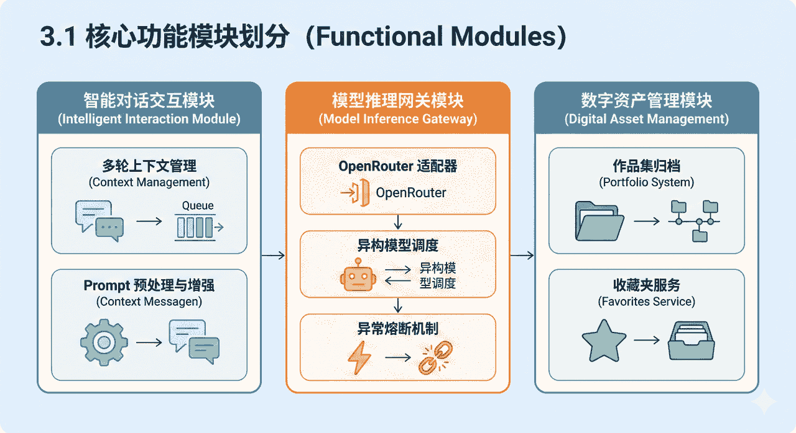

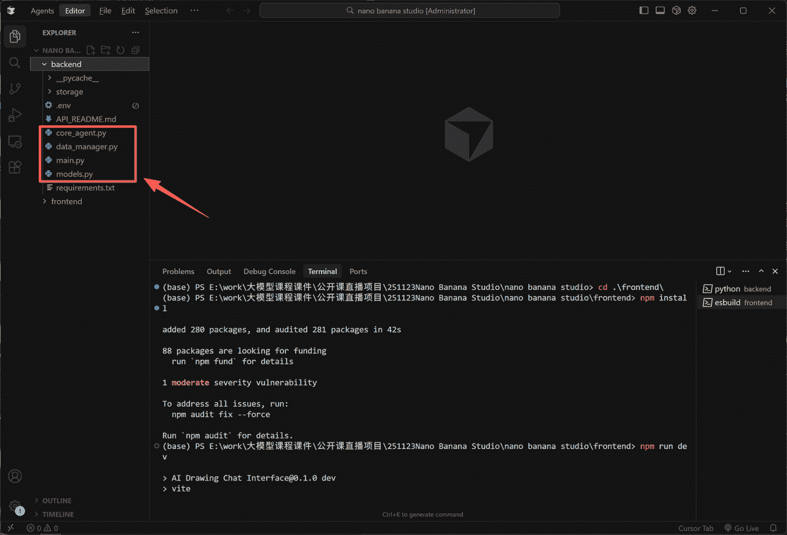

### 3.2 【选学】技术架构设计 (Technical Architecture)

本项目采用经典的 B/S (Browser/Server) 架构，后端遵循 分层架构模式 (Layered Architecture)，以确保业务逻辑与数据访问的解耦。

+ 表现层 (Presentation Layer):

+ 采用现代 Web 前端技术构建单页应用（SPA）或响应式界面。

+ 负责用户指令的采集、图像流的实时渲染以及交互状态的反馈（如 Loading 状态、错误提示）。

+ 业务逻辑层 (Business Logic Layer - Python Backend):

+ 作为系统的核心中枢，承载 Python 后端服务。

+ 负责解析前端请求，调用 Prompt 优化逻辑，并作为 HTTP 客户端向 OpenRouter 发起异步/同步请求。

+ 处理多轮对话的逻辑状态机，判断当前交互是“新生成”还是“基于旧图修改”。

+ 集成层 (Integration Layer):

+ External API: OpenRouter API 接口，作为通往 Nano Banana Pro 等大模型的桥梁。

+ Storage: 本地文件系统或对象存储（OSS）用于保存生成的图片文件；轻量级数据库（如 SQLite/JSON DB）用于存储元数据（Prompt、时间戳、收藏状态）。

### 3.3 【选学】数据流向设计 (Data Flow)

一个完整的绘图请求数据流向如下：

1. Request: 用户在 Web 端输入自然语言描述 -> 前端封装请求发送至 Python 后端。

1. Process: 后端提取会话上下文 -> 结合当前输入构建完整的 Prompt -> 注入系统级指令（System Prompt）。

1. Invoke: 后端通过 HTTPS 向 OpenRouter 发起 POST 请求 -> OpenRouter 路由至 Nano Banana Pro 模型。

1. Response: 模型返回图像数据（URL 或 Base64） -> 后端接收并解析 -> 触发资产存储逻辑。

1. Render: 后端将处理后的图像地址及元数据返回前端 -> 前端更新 UI 展示结果。

## 4. `core_agent`代码解释


# core_agent.py

## 导入依赖

```python
import os
import time
from dotenv import load_dotenv
from openai import OpenAI
from typing import List, Dict, Any
import base64
from pathlib import Path

# 导入本地模块
import data_manager
from models import ChatRequest, ChatResponse, Message, GeneratedImageInfo

load_dotenv()
```

## 模型配置

```python
MODEL_CONFIGS = {
    "google/gemini-3-pro-image-preview": {
        "extra_body": {"modalities": ["image", "text"]}
    },
    "google/gemini-3-pro-preview": {
        "extra_body": {"reasoning": {"enabled": True}}
    }
}
```

## 辅助函数

### `_local_image_to_data_url(file_path: str) -> str`

```python
def _local_image_to_data_url(file_path: str) -> str:
    """辅助函数：读取本地图片文件并转换为 Data URL"""
    try:
        # 路径转换逻辑：将 Web URL (/images/...) 转为本地路径
        if file_path.startswith("/images/"):
            file_path = f"storage/images/{file_path.replace('/images/', '', 1)}"
        
        full_path = Path(file_path)
        if not full_path.exists():
            full_path = data_manager.BASE_DIR.parent / file_path
            
        if full_path.exists():
            with open(full_path, "rb") as img_file:
                base64_data = base64.b64encode(img_file.read()).decode('utf-8')
                return f"data:image/png;base64,{base64_data}"
    except Exception as e:
        print(f"Error converting image to base64: {e}")
    return None
```

## 核心处理流程

### `process_chat(request: ChatRequest) -> ChatResponse`

```python
def process_chat(request: ChatRequest) -> ChatResponse:
    # --- 0. 动态获取 Key ---
    current_api_key = data_manager.get_api_key()
    if not current_api_key:
        return ChatResponse(assistant_message="❌ 错误：未配置 API Key。请在设置中输入您的 OpenRouter API Key。")

    client = OpenAI(base_url="https://openrouter.ai/api/v1", api_key=current_api_key)

    # --- A. 加载会话 ---
    session = data_manager.load_session(request.session_id)
    if not session:
        session = data_manager.create_session()

    # --- B. 寻找“上下文图片” ---
    context_image_url = None
    for msg in reversed(session.messages):
        # 1. 检查 Assistant 生成的
        if msg.role == "assistant" and msg.generated_images:
            last_img_info = msg.generated_images[-1]
            context_image_url = _local_image_to_data_url(last_img_info.file_path)
            if context_image_url: break 
        
        # 2. 检查 User 上传的
        if msg.role == "user" and msg.content:
            for part in msg.content:
                if part.get("type") == "image_url":
                    stored_url = part["image_url"]["url"]
                    if "storage/images" in stored_url or "/images/" in stored_url:
                        context_image_url = _local_image_to_data_url(stored_url)
                        if context_image_url: break
            if context_image_url: break

    # --- C. 构建当前用户消息 ---
    user_api_content: List[Dict[str, Any]] = [{"type": "text", "text": request.message}]
    user_storage_content: List[Dict[str, Any]] = [{"type": "text", "text": request.message}]

    # 1. User Uploads
    has_new_upload = False
    for img_b64 in request.user_images_base64:
        has_new_upload = True
        if not img_b64.startswith("data:"):
            full_b64 = f"data:image/png;base64,{img_b64}"
        else:
            full_b64 = img_b64
            
        user_api_content.append({"type": "image_url", "image_url": {"url": full_b64}})
        
        try:
            filename = data_manager.save_base64_image(full_b64)
            web_url = f"/images/{filename}"
            user_storage_content.append({"type": "image_url", "image_url": {"url": web_url}})
        except Exception as e:
            print(f"Error saving user upload: {e}")

    # 2. Context Injection
    if not has_new_upload and context_image_url:
        print("💡 [Context] 注入最近的历史图片")
        user_api_content.append({"type": "image_url", "image_url": {"url": context_image_url}})

    # --- D. 保存用户消息 ---
    user_msg = Message(role="user", content=user_storage_content)
    session.messages.append(user_msg)
    data_manager.save_session(session)

    # --- E. 准备 API 请求列表 ---
    recent_messages = session.messages[-20:]
    api_messages = []

    for msg in recent_messages:
        if msg.role == "user":
            text_content = ""
            if msg.content:
                for part in msg.content:
                    if part.get("text"): text_content += part.get("text")
            final_content = text_content if text_content else "..."
            api_messages.append({"role": "user", "content": final_content})

        elif msg.role == "assistant":
            text_content = ""
            if msg.content:
                for part in msg.content:
                    if part.get("text"): text_content += part.get("text")
            if not text_content:
                text_content = "[Image generated]" if msg.generated_images else "..."
            api_messages.append({"role": "assistant", "content": text_content})

    if api_messages and api_messages[-1]['role'] == 'user':
        api_messages.pop()

    api_messages.append({"role": "user", "content": user_api_content})

    # --- F. 调用 API (🟢 重试机制升级) ---
    model_id = request.model
    config = MODEL_CONFIGS.get(model_id, {})
    extra_body = config.get("extra_body", {})

    response = None
    max_retries = 5 # ⚡️ 设置最大尝试次数
    
    print(f"🔄 开始调用模型 {model_id}，最多重试 {max_retries} 次...")


    for attempt in range(max_retries):
        try:
            # 调用 API
            temp_response = client.chat.completions.create(
                model=model_id,
                messages=api_messages,
                extra_body=extra_body
            )

            # 🛑 验证响应有效性 (安检门)
            # 1. 检查是否为 None
            if not temp_response:
                raise ValueError("Response is None")
            
            # 2. 检查是否有 explicit error 字段
            if getattr(temp_response, 'error', None):
                raise ValueError(f"API returned error object: {temp_response.error}")

            # 3. 检查 choices 是否为空
            if not temp_response.choices:
                raise ValueError("Response choices are empty (Safety Filter or Network issue)")

            # 🎉 如果通过所有检查，说明成功了
            response = temp_response
            print(f"✅ 第 {attempt + 1} 次尝试成功！")
            break # 跳出循环
            
        except Exception as e:
            print(f"⚠️ 第 {attempt + 1}/{max_retries} 次尝试失败: {str(e)}")
            if attempt < max_retries - 1:
                time.sleep(1.5) # 休息 1.5 秒再试，避免请求过快被封
            else:
                print("❌ 重试次数耗尽。")
                # 此时 response 依然是 None 或上一次的无效值，将由 Step G 处理

    # --- G. 解析响应 (最终兜底) ---
    # 如果 5 次全挂了，response 就是 None，或者不符合格式，这里会拦截并报错
    
    # 1. 优先检查显式错误 (针对最后一次尝试的结果)
    if response:
        err_info = getattr(response, 'error', None)
        if err_info:
            err_msg = err_info.get('message', str(err_info)) if isinstance(err_info, dict) else str(err_info)
            return ChatResponse(assistant_message=f"⚠️ API 返回错误 (已重试{max_retries}次): {err_msg}")

    # 2. 检查空响应
    if not response or not response.choices:
        return ChatResponse(assistant_message=f"⚠️ 错误：模型在 {max_retries} 次尝试后仍未返回有效响应。请稍后再试。")

    api_msg_obj = response.choices[0].message
    content_text = api_msg_obj.content if api_msg_obj.content else ""
    
    generated_images_info = []
    frontend_image_urls = []
    
    raw_images = getattr(api_msg_obj, 'images', [])
    if raw_images is None: raw_images = []

    for img_item in raw_images:
        try:
            if not img_item: continue
            
            img_url_obj = None
            if isinstance(img_item, dict): img_url_obj = img_item.get('image_url')
            else: img_url_obj = getattr(img_item, 'image_url', None)
            
            if not img_url_obj: continue

            b64_url = None
            if isinstance(img_url_obj, dict): b64_url = img_url_obj.get('url')
            else: b64_url = getattr(img_url_obj, 'url', None)
            
            if not b64_url: continue

            filename = data_manager.save_base64_image(b64_url)
            file_path = f"storage/images/{filename}"
            file_url = f"/images/{filename}"
            
            img_info = GeneratedImageInfo(
                file_path=file_path,
                file_url=file_url,
                prompt=request.message
            )
            generated_images_info.append(img_info)
            frontend_image_urls.append(file_url)
            
        except Exception as e:
            print(f"Warning: Failed to process an image: {e}")
            continue

    # --- H. 最终结果处理 ---
    if "image-preview" in model_id and not generated_images_info:
        if not content_text:
            content_text = f"⚠️ 绘图失败：模型在 {max_retries} 次尝试后未返回图片。"
        else:
            content_text = f"⚠️ 未生成图片。模型回复：\n{content_text}"
            
    elif "image-preview" in model_id and generated_images_info and not content_text:
        content_text = "Here is your generated image. 🎨"

    assistant_msg = Message(
        role="assistant",
        content=[{"type": "text", "text": content_text}],
        generated_images=generated_images_info,
        model_used=model_id
    )
    
    session.messages.append(assistant_msg)
    data_manager.save_session(session)

    return ChatResponse(
        assistant_message=content_text,
        image_urls=frontend_image_urls
    )
```


## 1. 环境与模块初始化

```
import os
import time  
from dotenv import load_dotenv
from openai import OpenAI
from typing import List, Dict, Any
import base64
from pathlib import Path

# 导入本地模块
import data_manager
from models import ChatRequest, ChatResponse, Message, GeneratedImageInfo

load_dotenv()
```

`dotenv.load_dotenv()`

这行代码会加载 `.env` 文件中的环境变量，方便后续配置（如 API Key）。这是为了安全管理 API 密钥等敏感信息，避免硬编码到代码中。

`from openai import OpenAI`

引入 OpenAI SDK，用于与 OpenRouter API 进行交互。

`from typing import List, Dict, Any`

引入 Python 的类型注解模块，用于为函数参数和返回值指定类型，增加代码的可读性与可维护性。

`base64` 和 `Path`

`base64` 用于图像的编码与解码；`Path` 用于路径操作，便于处理文件存储。

`import data_manager` 和 `from models import ChatRequest, ChatResponse, Message, GeneratedImageInfo`

加载自定义模块：`data_manager` 用于处理本地数据的读取与保存，`models` 则定义了请求、响应的格式和相关数据模型。

## 2. 模型配置

```
MODEL_CONFIGS = {
    "google/gemini-3-pro-image-preview": {
        "extra_body": {"modalities": ["image", "text"]}
    },
    "google/gemini-3-pro-preview": {
        "extra_body": {"reasoning": {"enabled": True}}
    }
}
```

`MODEL_CONFIGS`

这是一个字典，用于存储不同模型的配置。在此代码中，主要配置了两个模型：

`google/gemini-3-pro-image-preview`：配置了 `modalities` 参数，告诉模型生成图像时同时处理文本与图像数据。

`google/gemini-3-pro-preview`：启用了推理功能，指定了 `reasoning` 为 `enabled`，该配置适用于需要进行推理的场景。

这些配置确保模型调用时根据需要启用特定的功能。

## 3. 本地图片转换为 Data URL

```
def _local_image_to_data_url(file_path: str) -> str:
    """辅助函数：读取本地图片文件并转换为 Data URL"""
    try:
        if file_path.startswith("/images/"):
            file_path = f"storage/images/{file_path.replace('/images/', '', 1)}"
        
        full_path = Path(file_path)
        if not full_path.exists():
            full_path = data_manager.BASE_DIR.parent / file_path
            
        if full_path.exists():
            with open(full_path, "rb") as img_file:
                base64_data = base64.b64encode(img_file.read()).decode("utf-8")
                return f"data:image/png;base64,{base64_data}"
    except Exception as e:
        print(f"Error converting image to base64: {e}")
    return None
```

`_local_image_to_data_url(file_path: str) -> str`

该辅助函数将本地的图片文件转换为 Base64 编码的 Data URL。Data URL 是一种通过字符串表示图片内容的方式，通常用于 Web 中嵌入图像文件。

`file_path` 是传入的本地图片路径，如果是 `/images/` 路径，它会转换为实际的存储路径（`storage/images/`）。

通过 `base64.b64encode(img_file.read()).decode("utf-8")` 将图片文件的二进制内容转换为 Base64 字符串。

该函数对于将本地图像传递给 OpenRouter API 作为图像上传（或作为上下文图片）非常有用。

## 4. 处理聊天请求

```
def process_chat(request: ChatRequest) -> ChatResponse:
    # --- 0. 动态获取 Key ---
    current_api_key = data_manager.get_api_key()
    if not current_api_key:
        return ChatResponse(assistant_message="❌ 错误：未配置 API Key。请在设置中输入您的 OpenRouter API Key。")
```

`process_chat(request: ChatRequest) -> ChatResponse`

这是核心的聊天处理函数，用于处理来自用户的请求并返回生成的响应。

通过 `data_manager.get_api_key()` 动态获取 API Key。如果未配置，则返回错误提示。

```
    client = OpenAI(base_url="https://openrouter.ai/api/v1", api_key=current_api_key)
```

`OpenAI(base_url="https://openrouter.ai/api/v1", api_key=current_api_key)`

使用 OpenAI SDK 初始化 API 客户端，配置了 OpenRouter 的基础 URL 和获取到的 API Key。

## 5. 加载会话与图片处理

```
    # --- A. 加载会话 ---
    session = data_manager.load_session(request.session_id)
    if not session:
        session = data_manager.create_session()
```

`session = data_manager.load_session(request.session_id)`

通过 `session_id` 加载之前保存的用户会话。如果没有找到，使用 `data_manager.create_session()` 创建一个新的会话。

```
    # --- B. 寻找“上下文图片” ---
    context_image_url = None
    for msg in reversed(session.messages):
        if msg.role == "assistant" and msg.generated_images:
            last_img_info = msg.generated_images[-1]
            context_image_url = _local_image_to_data_url(last_img_info.file_path)
            if context_image_url: break
```

`session.messages`、`msg.role`、`msg.generated_images`、`last_img_info.file_path` 和 `_local_image_to_data_url(last_img_info.file_path)`

该部分代码遍历会话中的消息，查找之前由模型生成的图像（即“上下文图片”），并将其转换为 Data URL 以供后续使用。如果未找到上下文图片，则继续后续步骤。

## 6. 用户消息处理与图像上传

```
    user_api_content: List[Dict[str, Any]] = [{"type": "text", "text": request.message}]
    user_storage_content: List[Dict[str, Any]] = [{"type": "text", "text": request.message}]
```

`user_api_content` 和 `user_storage_content`

这些列表保存了用户消息的内容，`user_api_content` 用于 API 请求，而 `user_storage_content` 用于本地存储消息内容。

```
    for img_b64 in request.user_images_base64:
        has_new_upload = True
        if not img_b64.startswith("data:"):
            full_b64 = f"data:image/png;base64,{img_b64}"
        else:
            full_b64 = img_b64
        user_api_content.append({"type": "image_url", "image_url": {"url": full_b64}})
```

`img_b64`、`request.user_images_base64`、`full_b64` 和 `user_api_content.append(...)`

如果用户上传了图片，将其转换为 Base64 编码并添加到 `user_api_content` 中。之后将图片保存在本地，并更新存储内容。

## 7. API 请求构建与重试机制

```
    response = None
    max_retries = 5  # 设置最大尝试次数
    
    for attempt in range(max_retries):
        try:
            temp_response = client.chat.completions.create(
                model=model_id,
                messages=api_messages,
                extra_body=extra_body
            )
```

`max_retries`、`for attempt in range(max_retries):` 和 `client.chat.completions.create(...)`

通过 `max_retries` 设置最大重试次数，确保在网络问题或偶发错误的情况下，能够继续尝试直到获得有效响应。

## 8. 解析响应与生成结果

```
    api_msg_obj = response.choices[0].message
    content_text = api_msg_obj.content if api_msg_obj.content else ""
```

`api_msg_obj = response.choices[0].message` 和 `content_text = api_msg_obj.content if api_msg_obj.content else ""`

提取模型生成的文本和图像信息。如果生成的图像信息存在，则进一步处理图像数据并存储在服务器上。

## 9. 最终结果与返回

```
    assistant_msg = Message(
        role="assistant",
        content=[{"type": "text", "text": content_text}],
        generated_images=generated_images_info,
        model_used=model_id
    )
```

`assistant_msg = Message(...)`、`Message`、`generated_images_info`、`model_used=model_id` 和 `ChatResponse`

将生成的图像与文本内容封装成 `Message` 对象，更新到会话中，并通过 `ChatResponse` 返回给用户。

### 5. Data Manager代码解释


# data_manager.py

```python
# data_manager.py
import os
import json
import uuid
import base64
import time
from typing import List, Optional
from pathlib import Path
from models import Session, Message, SessionSummary, GeneratedImageInfo

# 定义存储路径
BASE_DIR = Path(__file__).parent
STORAGE_DIR = BASE_DIR / "storage"
SESSIONS_DIR = STORAGE_DIR / "sessions"
IMAGES_DIR = STORAGE_DIR / "images"

def ensure_directories():
    """确保存储目录存在"""
    SESSIONS_DIR.mkdir(parents=True, exist_ok=True)
    IMAGES_DIR.mkdir(parents=True, exist_ok=True)


def save_base64_image(base64_str: str) -> str:
    """
    将 Base64 字符串解码并保存为本地 PNG 文件。
    返回: 文件名 (例如 'img_uuid.png')
    """
    # 有些 base64 串可能带有 header (data:image/png;base64,...)，需要去除
    if "," in base64_str:
        header, encoded = base64_str.split(",", 1)
    else:
        encoded = base64_str

    image_data = base64.b64decode(encoded)
    
    # 生成唯一文件名
    filename = f"img_{uuid.uuid4().hex}.png"
    file_path = IMAGES_DIR / filename
    
    with open(file_path, "wb") as f:
        f.write(image_data)
        
    return filename

def create_session() -> Session:
    """创建一个新的空白会话"""
    ensure_directories()
    new_session = Session(session_id=str(uuid.uuid4()))
    save_session(new_session)
    return new_session

def load_session(session_id: str) -> Optional[Session]:
    """读取指定 ID 的会话"""
    ensure_directories()
    file_path = SESSIONS_DIR / f"{session_id}.json"
    if not file_path.exists():
        return None
    
    try:
        with open(file_path, "r", encoding="utf-8") as f:
            data = json.load(f)
        return Session(**data)
    except Exception as e:
        print(f"Error loading session {session_id}: {e}")
        return None

def save_session(session: Session):
    """保存会话到 JSON 文件"""
    ensure_directories()
    session.last_updated = time.time()
    file_path = SESSIONS_DIR / f"{session.session_id}.json"
    
    with open(file_path, "w", encoding="utf-8") as f:
        # model_dump 是 Pydantic v2 的方法 (如果用 v1 请用 .dict())
        # indent=2 方便人工调试查看
        json.dump(session.model_dump(), f, ensure_ascii=False, indent=2)

def delete_session(session_id: str):
    """删除会话 JSON 以及该会话关联的所有图片文件"""
    session = load_session(session_id)
    if not session:
        return

    # 1. 删除该会话产生的所有图片
    for msg in session.messages:
        for img_info in msg.generated_images:
            # img_info.file_path 是相对路径 'storage/images/xxx.png'
            # 我们需要完整的系统路径来删除
            # 这里需要注意 path 拼接逻辑，简单起见我们只取文件名
            filename = Path(img_info.file_path).name
            full_path = IMAGES_DIR / filename
            if full_path.exists():
                try:
                    os.remove(full_path)
                except OSError:
                    pass # 忽略删除错误
    
    # 2. 删除 JSON 文件
    json_path = SESSIONS_DIR / f"{session_id}.json"
    if json_path.exists():
        os.remove(json_path)

def list_sessions(only_favorite: bool = False) -> List[SessionSummary]:
    """
    获取作品集列表（橱窗展示数据）。
    逻辑：遍历 JSON -> 提取最后一张生成的图作为封面。
    """
    ensure_directories()
    summaries = []
    
    # 遍历所有 json 文件
    for file_path in SESSIONS_DIR.glob("*.json"):
        try:
            with open(file_path, "r", encoding="utf-8") as f:
                data = json.load(f)
                sess = Session(**data)
                
            if only_favorite and not sess.is_favorite:
                continue
                
            # 寻找封面图：倒序遍历消息，找到第一个包含 generated_images 的消息
            cover_url = None
            cover_prompt = None
            
            for msg in reversed(sess.messages):
                if msg.role == "assistant" and msg.generated_images:
                    # 取该消息中的最后一张图
                    last_img = msg.generated_images[-1]
                    cover_url = last_img.file_url
                    cover_prompt = last_img.prompt
                    break # 找到最近的一张图后停止
            
            # 如果整个会话没有图，依然展示在列表中，但没有封面
            summary = SessionSummary(
                session_id=sess.session_id,
                last_updated=sess.last_updated,
                is_favorite=sess.is_favorite,
                cover_image_url=cover_url,
                cover_prompt=cover_prompt
            )
            summaries.append(summary)
            
        except Exception as e:
            print(f"Error parsing session file {file_path}: {e}")
            continue
            
    # 按更新时间倒序排列 (最近的在前面)
    summaries.sort(key=lambda x: x.last_updated, reverse=True)
    return summaries

def toggle_favorite(session_id: str) -> bool:
    """切换收藏状态，返回新的状态"""
    session = load_session(session_id)
    if session:
        session.is_favorite = not session.is_favorite
        save_session(session)
        return session.is_favorite
    return False

SETTINGS_FILE = STORAGE_DIR / "settings.json"

def save_api_key(api_key: str):
    """保存用户设置的 API Key 到 settings.json"""
    ensure_directories()
    settings = {}
    if SETTINGS_FILE.exists():
        try:
            with open(SETTINGS_FILE, "r", encoding="utf-8") as f:
                settings = json.load(f)
        except:
            pass
    
    settings["or_api_key"] = api_key
    
    with open(SETTINGS_FILE, "w", encoding="utf-8") as f:
        json.dump(settings, f, indent=2)

def get_api_key() -> str:
    """
    获取 API Key。
    优先级：settings.json > 环境变量 (.env)
    """
    # 1. 尝试从 settings.json 读取
    if SETTINGS_FILE.exists():
        try:
            with open(SETTINGS_FILE, "r", encoding="utf-8") as f:
                settings = json.load(f)
                key = settings.get("or_api_key")
                if key and key.strip():
                    return key.strip()
        except:
            pass
            
    # 2. 回退到环境变量
    env_key = os.getenv("OR_API_KEY")
    return env_key if env_key else ""
```

## 初始化与存储路径设置

```python
BASE_DIR = Path(__file__).parent
STORAGE_DIR = BASE_DIR / "storage"
SESSIONS_DIR = STORAGE_DIR / "sessions"
IMAGES_DIR = STORAGE_DIR / "images"
```

### `BASE_DIR`

获取当前文件的路径，即 `data_manager.py` 文件所在的目录。

### `STORAGE_DIR`

设置存储目录为 `storage` 文件夹，所有的数据（会话和图像）都保存在该文件夹内。

### `SESSIONS_DIR` 和 `IMAGES_DIR`

分别设置存储会话数据和图像文件的目录。会话文件保存在 `sessions` 文件夹中，生成的图像保存在 `images` 文件夹中。

## 确保存储目录存在

```python
def ensure_directories():
    """确保存储目录存在"""
    SESSIONS_DIR.mkdir(parents=True, exist_ok=True)
    IMAGES_DIR.mkdir(parents=True, exist_ok=True)
```

### `ensure_directories()`

这个函数用来确保存储目录（会话和图像存储文件夹）存在。如果不存在，它会自动创建这些目录。

`mkdir(parents=True, exist_ok=True)` 表示如果目录不存在，创建该目录及其父目录；如果目录已经存在，则不做任何操作。

## 保存 Base64 编码的图像

```python
def save_base64_image(base64_str: str) -> str:
    """
    将 Base64 字符串解码并保存为本地 PNG 文件。
    返回: 文件名 (例如 'img_uuid.png')
    """
    if "," in base64_str:
        header, encoded = base64_str.split(",", 1)
    else:
        encoded = base64_str

    image_data = base64.b64decode(encoded)
    
    # 生成唯一文件名
    filename = f"img_{uuid.uuid4().hex}.png"
    file_path = IMAGES_DIR / filename
    
    with open(file_path, "wb") as f:
        f.write(image_data)
        
    return filename
```

### `save_base64_image(base64_str: str) -> str`

这个函数接收一个 Base64 编码的图像字符串，将其解码并保存为本地的 PNG 图像文件。


## 图像 Base64 处理

+ 如果 `Base64` 字符串中包含 `data:image/png;base64,` 的头部信息，函数会将其去除，只保留编码的部分。
+ 使用 `base64.b64decode` 将编码数据解码为二进制图像数据。
+ 生成一个唯一的文件名（`img_{uuid.uuid4().hex}.png`），并将图像数据写入本地文件。
+ 最后返回生成的文件名，便于后续操作。

## 会话操作：创建与加载

```python
def create_session() -> Session:
    """创建一个新的空白会话"""
    ensure_directories()
    new_session = Session(session_id=str(uuid.uuid4()))
    save_session(new_session)
    return new_session

def load_session(session_id: str) -> Optional[Session]:
    """读取指定 ID 的会话"""
    ensure_directories()
    file_path = SESSIONS_DIR / f"{session_id}.json"
    if not file_path.exists():
        return None

    try:
        with open(file_path, "r", encoding="utf-8") as f:
            data = json.load(f)
        return Session(**data)
    except Exception as e:
        print(f"Error loading session {session_id}: {e}")
        return None
```

+ `create_session()`
该函数用于创建一个新的空白会话。它首先确保存储目录存在，然后创建一个 `Session` 对象，并为其分配唯一的 `session_id`。接着，调用 `save_session` 将新会话保存到文件中。

+ `load_session(session_id: str) -> Optional[Session]`
该函数根据 `session_id` 从磁盘加载对应的会话文件（`{session_id}.json`）。如果文件存在且有效，返回一个 `Session` 对象。如果文件不存在或加载过程中出错，则返回 `None`。

## 保存与删除会话

```python
def save_session(session: Session):
    """保存会话到 JSON 文件"""
    ensure_directories()
    session.last_updated = time.time()
    file_path = SESSIONS_DIR / f"{session.session_id}.json"

    with open(file_path, "w", encoding="utf-8") as f:
        json.dump(session.model_dump(), f, ensure_ascii=False, indent=2)

def delete_session(session_id: str):
    """删除会话 JSON 以及该会话关联的所有图片文件"""
    session = load_session(session_id)
    if not session:
        return
    ...
```

+ `save_session(session: Session)`
该函数将会话数据保存到 JSON 文件中，文件名为 `{session_id}.json`。在保存之前，函数会更新 `last_updated` 字段，表示会话的最后更新时间。通过 `session.model_dump()` 将会话数据转换为字典格式，并通过 `json.dump` 将其保存为 JSON 文件。

+ `delete_session(session_id: str)`
该函数删除指定 ID 的会话文件及其相关的所有图片文件。它首先加载会话，然后删除会话中生成的所有图像文件。

## 列出所有会话

```python
def list_sessions(only_favorite: bool = False) -> List[SessionSummary]:
    """
    获取作品集列表（橱窗展示数据）。
    逻辑：遍历 JSON -> 提取最后一张生成的图作为封面。
    """
    ensure_directories()
    summaries = []
    for file_path in SESSIONS_DIR.glob("*.json"):
        ...
    return summaries
```

+ `list_sessions(only_favorite: bool = False) -> List[SessionSummary]`
该函数列出所有会话的摘要信息。它遍历 `sessions` 目录中的所有 JSON 文件，提取每个会话的封面图（最后一张生成的图像）并返回会话摘要（包括会话 ID、封面图 URL、更新时间等）。如果设置 `only_favorite=True`，则只返回标记为收藏的会话。

## 收藏状态切换

```python
def toggle_favorite(session_id: str) -> bool:
    """切换收藏状态，返回新的状态"""
    session = load_session(session_id)
    if session:
        session.is_favorite = not session.is_favorite
        save_session(session)
        return session.is_favorite
    return False
```

+ `toggle_favorite(session_id: str) -> bool`
该函数切换指定会话的收藏状态。每次调用时，会将当前会话的 `is_favorite` 状态取反，并保存回会话文件。如果会话不存在，返回 `False`。

## 保存与获取 API Key

```python
def save_api_key(api_key: str):
    """保存用户设置的 API Key 到 settings.json"""
    ensure_directories()
    settings = {}
    if SETTINGS_FILE.exists():
        ...
    settings["or_api_key"] = api_key
    with open(SETTINGS_FILE, "w", encoding="utf-8") as f:
        json.dump(settings, f, indent=2)

def get_api_key() -> str:
    """
    获取 API Key。
    优先级：settings.json > 环境变量 (.env)
    """
    ...
```

+ `save_api_key(api_key: str)`
该函数将 API 密钥保存到 `settings.json` 文件中。首先检查该文件是否存在，如果存在则读取现有设置，然后更新或添加新的 API Key。

+ `get_api_key() -> str`
该函数从 `settings.json` 文件中获取 API Key，如果文件中没有，则尝试从环境变量（`.env`）中读取 API Key。它提供了一种多层次的 API 密钥读取方式，确保在没有设置的情况下自动回退到环境变量。

## models 代码解释

```python
# models.py
from pydantic import BaseModel, Field
from typing import List, Optional, Dict, Any, Literal
import time
import uuid

# --- 基础数据结构 (对应 JSON 存储) ---

class GeneratedImageInfo(BaseModel):
    """
    记录单张生成的图片信息
    """
    file_path: str = Field(..., description="本地存储的相对路径，例如 'storage/images/xxx.png'")
    file_url: str = Field(..., description="前端访问的静态URL，例如 '/images/xxx.png'")
    prompt: str = Field(..., description="生成该图片时对应的完整提示词")

class Message(BaseModel):
    """
    单条对话消息
    """
    role: Literal["system", "user", "assistant"]
    # content 结构遵循 OpenAI 多模态格式
    content: List[Dict[str, Any]] = Field(default_factory=list)

    # 额外字段：用于记录该条消息中涉及的图片
    # 如果是 user，这里存用户上传图片的本地路径
    # 如果是 assistant，这里存模型生成的图片的元数据
    generated_images: List[GeneratedImageInfo] = Field(default_factory=list)

    # 记录该条消息是由哪个模型生成的 (仅针对 assistant)
    model_used: Optional[str] = None
    timestamp: float = Field(default_factory=time.time)

class Session(BaseModel):
    """
    完整会话记录 (对应 session_id.json)
    """
    session_id: str
    created_at: float = Field(default_factory=time.time)
    last_updated: float = Field(default_factory=time.time)
    is_favorite: bool = False
    messages: List[Message] = Field(default_factory=list)

# --- API 请求/响应模型 (前端交互用) ---

class ChatRequest(BaseModel):
    session_id: str
    message: str  # 用户输入的文本
    model: str    # 用户选择的模型 ID
    # 用户上传的图片 Base64 列表 (可选)
    user_images_base64: List[str] = Field(default_factory=list)

class ChatResponse(BaseModel):
    assistant_message: str  # 助手的文本回复
    image_urls: List[str] = Field(default_factory=list) # 本轮生成的图片 URL 列表

class SessionSummary(BaseModel):
    """
    用于作品集/橱窗列表展示的简要信息
    """
    session_id: str
    last_updated: float
    is_favorite: bool
    # 橱窗展示用的封面图 (取最后一张生成的图)
    cover_image_url: Optional[str] = None
    # 封面图对应的提示词
    cover_prompt: Optional[str] = None
```

### GeneratedImageInfo

```python
class GeneratedImageInfo(BaseModel):
    """
    记录单张生成的图片信息
    """
    file_path: str = Field(..., description="本地存储的相对路径，例如 'storage/images/xxx.png'")
    file_url: str = Field(..., description="前端访问的静态URL，例如 '/images/xxx.png'")
    prompt: str = Field(..., description="生成该图片时对应的完整提示词")
```

+ `GeneratedImageInfo`
该类用于记录单张生成的图像的信息，包括以下字段：

+ `file_path`：存储图像的本地路径（相对路径）。例如 `storage/images/xxx.png`。这是图像文件的实际存储位置。

+ `file_url`：图像文件的静态 URL，供前端访问和展示。前端可以通过该 URL 显示图像，例如 `/images/xxx.png`。

+ `prompt`：生成该图像时所使用的完整文本提示词。该字段记录了图像生成的上下文，帮助理解图像的内容和创作背景。

该类是图像生成过程中的核心部分，用于存储每张图像的基本信息，并供后续操作（如展示、存储）使用。

### Message

```python
class Message(BaseModel):
    """
    单条对话消息
    """
    role: Literal["system", "user", "assistant"]
    content: List[Dict[str, Any]] = Field(default_factory=list)  # 内容结构，支持文本与图片
    generated_images: List[GeneratedImageInfo] = Field(default_factory=list)  # 生成的图片信息
    model_used: Optional[str] = None  # 记录使用的模型（仅助手角色）
    timestamp: float = Field(default_factory=time.time)  # 消息时间戳
```

+ `Message`
该类用于表示单条对话消息，包含用户、助手以及系统消息。主要字段如下：

+ `role`：消息的角色，可能的值为 `"system"`、`"user"` 或 `"assistant"`。这个字段用于标识消息的来源，例如用户输入、系统提示或助手生成的回复。

+ `content`：该字段包含消息的具体内容，支持文本和图像的多模态数据结构。通常是一个字典列表，其中每个字典可以包含不同类型的内容（如文本、图像等）。

+ `generated_images`：用于记录与该消息相关联的生成图像。每个图像的信息通过 `GeneratedImageInfo` 类存储，包括图像文件的路径、前端可访问的 URL 和对应的生成提示词。

+ `model_used`：记录生成该消息（尤其是助手消息）时所使用的模型。这对于追踪生成内容的来源非常重要，特别是当多个模型同时使用时。

+ `timestamp`：记录消息生成的时间戳，使用 `time.time()` 获取当前时间，以便后续对话的排序和处理。

该类是会话中每条消息的基础，帮助管理不同类型的消息及其关联的图像生成信息。

### Session


# 数据模型

## Session

```
class Session(BaseModel):
    """
    完整会话记录 (对应 session_id.json)
    """
    session_id: str
    created_at: float = Field(default_factory=time.time)  # 会话创建时间
    last_updated: float = Field(default_factory=time.time)  # 会话最后更新时间
    is_favorite: bool = False  # 标记是否为收藏的会话
    messages: List[Message] = Field(default_factory=list)  # 消息列表，存储所有对话消息
```

该类表示一个完整的对话会话记录。一个会话由多个消息（`Message`）组成，且包含以下字段：

+   `session_id`：唯一的会话 ID，通常由 UUID 生成，用于区分不同的会话。

+   `created_at`：会话的创建时间，使用 `time.time()` 获取当前时间戳。

+   `last_updated`：会话的最后更新时间，记录每次对话或状态更新的时间。

+   `is_favorite`：布尔值，表示该会话是否被标记为“收藏”。用户可以根据自己的需求标记某些会话为收藏。

+   `messages`：该会话的消息列表，包含该会话中的所有消息，每条消息都由 `Message` 类表示。

该类是会话的核心数据结构，帮助管理用户和助手之间的对话，以及会话的创建与更新。

## ChatRequest

```
class ChatRequest(BaseModel):
    session_id: str  # 会话 ID
    message: str  # 用户输入的文本消息
    model: str  # 用户选择的模型 ID
    user_images_base64: List[str] = Field(default_factory=list)  # 用户上传的图片 (Base64 格式)
```

该类用于表示发送给后端的聊天请求数据。字段包括：

+   `session_id`：当前会话的 ID，用于跟踪和关联消息。

+   `message`：用户输入的文本消息，后端将基于该消息生成回应。

+   `model`：用户选择的模型 ID，指定使用哪个模型生成回应。

+   `user_images_base64`：可选字段，包含用户上传的图像（以 Base64 编码的形式）。

## ChatResponse

```
class ChatResponse(BaseModel):
    assistant_message: str  # 助手的文本回复
    image_urls: List[str] = Field(default_factory=list)  # 本轮生成的图片 URL 列表
```

该类表示后端生成的聊天响应数据，字段包括：

+   `assistant_message`：助手生成的文本回复。

+   `image_urls`：生成图像的 URL 列表，通常是指向保存生成图像的路径或 URL。

## SessionSummary

```
class SessionSummary(BaseModel):
    """
    用于作品集/橱窗列表展示的简要信息
    """
    session_id: str  # 会话 ID
    last_updated: float  # 最后更新时间
    is_favorite: bool  # 是否为收藏
    cover_image_url: Optional[str] = None  # 橱窗展示用的封面图 (最后一张生成的图)
    cover_prompt: Optional[str] = None  # 封面图对应的提示词
```

该类用于生成会话摘要，通常用于作品集或橱窗展示。它包含以下字段：

+   `session_id`：会话的唯一 ID。

+   `last_updated`：最后一次更新时间。

+   `is_favorite`：是否为收藏的会话。

+   `cover_image_url`：用于展示的封面图 URL，通常是会话中最后生成的图像。

+   `cover_prompt`：生成封面图时使用的提示词。

# main.py 代码解释

让前端可以通过 `http://localhost:8002/images/xxx.png` 访问生成的图片

```
# main.py
import uvicorn
from fastapi import FastAPI, HTTPException, Query
from fastapi.middleware.cors import CORSMiddleware
from fastapi.staticfiles import StaticFiles
from typing import List, Optional

# 导入我们的本地模块
import models
import data_manager
import core_agent

# 1. 初始化 FastAPI 应用
app = FastAPI(title="AI Drawing Agent Backend")

# 2. 配置 CORS (允许跨域)
# 这对于前后端分离项目至关重要，允许前端 (通常在 3000/8080 端口) 访问后端 API
app.add_middleware(
    CORSMiddleware,
    allow_origins=["*"],  # 生产环境建议指定具体前端域名
    allow_credentials=True,
    allow_methods=["*"],
    allow_headers=["*"],
)

# 3. 挂载静态文件目录
# 确保存储目录存在
data_manager.ensure_directories()
app.mount("/images", StaticFiles(directory="storage/images"), name="images")

# --- API 接口定义 ---

from pydantic import BaseModel

class ApiKeySetting(BaseModel):
    api_key: str

@app.post("/api/settings/apikey")
def set_api_key(setting: ApiKeySetting):
    """设置用户的 OpenRouter API Key"""
    data_manager.save_api_key(setting.api_key)
    return {"status": "success", "message": "API Key 已保存"}

@app.get("/api/settings/apikey")
def check_has_api_key():
    """检查当前是否已配置 Key (出于安全，不返回明文 Key，只返回是否已设置)"""
    key = data_manager.get_api_key()
    return {"has_key": bool(key)}

@app.post("/api/sessions", response_model=models.Session)
def create_new_session():
    """创建一个新的空白会话"""
    return data_manager.create_session()

@app.get("/api/sessions", response_model=List[models.SessionSummary])
def get_session_list(filter: Optional[str] = Query(None, description="输入 'favorite' 只查看收藏")):
    """
    获取作品集/会话列表。
    支持 filter=favorite 参数。
    """
    only_favorite = (filter == "favorite")
    return data_manager.list_sessions(only_favorite=only_favorite)

@app.get("/api/sessions/{session_id}", response_model=models.Session)
def get_session_detail(session_id: str):
    """获取指定会话的完整历史记录"""
    session = data_manager.load_session(session_id)
    if not session:
        raise HTTPException(status_code=404, detail="Session not found")
    return session

@app.delete("/api/sessions/{session_id}")
def delete_session(session_id: str):
    """删除会话及其关联图片"""
    data_manager.delete_session(session_id)
    return {"status": "success", "message": f"Session {session_id} deleted"}

@app.post("/api/sessions/{session_id}/favorite")
def toggle_session_favorite(session_id: str):
    """切换会话的收藏状态"""
    new_status = data_manager.toggle_favorite(session_id)
    return {"session_id": session_id, "is_favorite": new_status}

@app.post("/api/chat", response_model=models.ChatResponse)
def chat_endpoint(request: models.ChatRequest):
    """
    核心对话/绘图接口。
    前端发送文本、模型选择、以及可选的参考图，后端返回文本和生成的图片URL。
    """
    # 简单的参数校验
    if not request.session_id:
        raise HTTPException(status_code=400, detail="Session ID is required")
    
    # 调用核心 Agent 逻辑
    try:
        response = core_agent.process_chat(request)
        return response
    except Exception as e:
        # 捕获未预料的错误，避免服务崩溃
        print(f"Server Error: {e}")
        raise HTTPException(status_code=500, detail=str(e))

# 4. 启动入口
if __name__ == "__main__":
    print("正在启动 AI Drawing Agent 后端...")
    print(f"API 文档地址: http://localhost:8002/docs")
    # host="0.0.0.0" 允许局域网访问，port=8002 符合要求
    uvicorn.run("main:app", host="0.0.0.0", port=8002, reload=True)
```

## FastAPI 应用初始化

```
app = FastAPI(title="AI Drawing Agent Backend")
```

`FastAPI` 初始化

`FastAPI` 用于创建一个 Web 应用实例。通过传递 `title="AI Drawing Agent Backend"`，为 API 文档设置了应用的标题。`FastAPI` 会自动生成一个交互式 API 文档，方便开发和调试。API 文档地址通常是 `http://localhost:8002/docs`。

## 配置 CORS（跨域资源共享）

```
app.add_middleware(
    CORSMiddleware,
    allow_origins=["*"],  # 生产环境建议指定具体前端域名
    allow_credentials=True,
    allow_methods=["*"],
    allow_headers=["*"],
)
```

`CORSMiddleware` 配置

`CORSMiddleware` 用于处理跨域请求（CORS），使得前端应用可以从不同域名或端口访问这个后端 API。对于前后端分离的应用程序来说，这是非常重要的。这里的配置说明：

+   `allow_origins=["*"]`：允许所有来源的请求。生产环境中建议替换为指定的前端域名，避免潜在的安全风险。

+   `allow_methods=["*"]`：允许所有 HTTP 方法（如 `GET`、`POST`、`DELETE` 等）。

+   `allow_headers=["*"]`：允许所有 HTTP 请求头。

## 挂载静态文件目录

```
data_manager.ensure_directories()
app.mount("/images", StaticFiles(directory="storage/images"), name="images")
```

`app.mount("/images", StaticFiles(directory="storage/images"), name="images")`

使用 FastAPI 的 `StaticFiles` 组件将本地存储的图像文件夹（`storage/images`）挂载为静态文件目录。前端可以通过访问 `http://localhost:8002/images/{image_name}` 来获取生成的图像。

+   `data_manager.ensure_directories()` 确保相关目录存在，避免文件操作时出现路径错误。

## API 路由定义

### 设置 API Key

```
class ApiKeySetting(BaseModel):
    api_key: str

@app.post("/api/settings/apikey")
def set_api_key(setting: ApiKeySetting):
    """设置用户的 OpenRouter API Key"""
    data_manager.save_api_key(setting.api_key)
    return {"status": "success", "message": "API Key 已保存"}

@app.get("/api/settings/apikey")
def check_has_api_key():
    """检查当前是否已配置 Key (出于安全，不返回明文 Key，只返回是否已设置)"""
    key = data_manager.get_api_key()
    return {"has_key": bool(key)}
```

`set_api_key`：

该接口允许用户通过 `POST` 请求设置 OpenRouter 的 API Key。收到请求后，API Key 会被保存到 `settings.json` 文件中，确保后续请求能够成功验证。


## 4.1 API Key 设置

+   `ApiKeySetting` 是请求体的数据模型，包含 `api_key` 字段，用于接收用户提交的 API 密钥。

+   `check_has_api_key`：

该 GET 请求检查是否已配置 API Key。如果配置了密钥，则返回 `has_key: true`，否则返回 `false`。为了安全起见，该接口不会返回实际的 API Key，仅返回是否存在 API Key 的信息。

## 4.2 会话管理

```
@app.post("/api/sessions", response_model=models.Session)
def create_new_session():
    """创建一个新的空白会话"""
    return data_manager.create_session()

@app.get("/api/sessions", response_model=List[models.SessionSummary])
def get_session_list(filter: Optional[str] = Query(None, description="输入 'favorite' 只查看收藏")):
    """
    获取作品集/会话列表。
    支持 filter=favorite 参数。
    """
    only_favorite = (filter == "favorite")
    return data_manager.list_sessions(only_favorite=only_favorite)

@app.get("/api/sessions/{session_id}", response_model=models.Session)
def get_session_detail(session_id: str):
    """获取指定会话的完整历史记录"""
    session = data_manager.load_session(session_id)
    if not session:
        raise HTTPException(status_code=404, detail="Session not found")
    return session

@app.delete("/api/sessions/{session_id}")
def delete_session(session_id: str):
    """删除会话及其关联图片"""
    data_manager.delete_session(session_id)
    return {"status": "success", "message": f"Session {session_id} deleted"}
```

+   `create_new_session`：

该接口通过 POST 请求创建一个新的空白会话，并返回创建的会话对象。会话对象包含唯一的 `session_id`，用以标识该会话。

+   `get_session_list`：

该 GET 请求获取所有会话的摘要信息。通过 `filter` 参数，可以选择只获取标记为“收藏”的会话。

+   `filter="favorite"` 时，只返回收藏的会话。

+   `get_session_detail`：

该 GET 请求获取指定会话的完整历史记录。如果会话存在，则返回该会话的详细信息；如果会话不存在，则返回 404 错误。

+   `delete_session`：

该 DELETE 请求删除指定会话及其相关的所有图像文件。调用 `data_manager.delete_session(session_id)` 删除本地存储的 JSON 文件和图像文件。

## 4.3 切换会话的收藏状态

```
@app.post("/api/sessions/{session_id}/favorite")
def toggle_session_favorite(session_id: str):
    """切换会话的收藏状态"""
    new_status = data_manager.toggle_favorite(session_id)
    return {"session_id": session_id, "is_favorite": new_status}
```

+   `toggle_session_favorite`：

该接口通过 POST 请求切换指定会话的收藏状态。调用 `data_manager.toggle_favorite(session_id)` 更新该会话的 `is_favorite` 标志，并返回新的收藏状态。

## 4.4 核心聊天接口：生成图像与文本回复

```
@app.post("/api/chat", response_model=models.ChatResponse)
def chat_endpoint(request: models.ChatRequest):
    """
    核心对话/绘图接口。
    前端发送文本、模型选择、以及可选的参考图，后端返回文本和生成的图片URL。
    """
    # 简单的参数校验
    if not request.session_id:
        raise HTTPException(status_code=400, detail="Session ID is required")
    
    # 调用核心 Agent 逻辑
    try:
        response = core_agent.process_chat(request)
        return response
    except Exception as e:
        # 捕获未预料的错误，避免服务崩溃
        print(f"Server Error: {e}")
        raise HTTPException(status_code=500, detail=str(e))
```

+   `chat_endpoint`：

该接口是前端与后端的核心交互点，负责处理用户的对话和绘图请求。接收用户输入的消息、模型选择和可选的参考图像，并返回助手的文本回复和生成的图像 URL。

+   在请求中，`session_id` 是必需的，用于识别当前会话。

+   通过调用 `core_agent.process_chat(request)` 处理聊天请求，生成文本和图像。如果发生错误，服务器将返回 500 错误，并打印错误信息。

### 1. 启动 FastAPI 应用

```
if __name__ == "__main__":
    print("正在启动 AI Drawing Agent 后端...")
    print(f"API 文档地址: http://localhost:8002/docs")
    uvicorn.run("main:app", host="0.0.0.0", port=8002, reload=True)
```

`uvicorn.run("main:app", host="0.0.0.0", port=8002, reload=True)`

启动 FastAPI 应用，并使用 uvicorn 作为 ASGI 服务器。

`host="0.0.0.0"` 允许局域网访问。

`port=8002` 设置服务器监听端口。

`reload=True` 启用热重载功能，便于开发时自动刷新代码变更。

# 四、【实战二】Nano Banana PPT Agent项目开发

## 1. Nano Banana PPT Agent项目背景介绍

### 1.1 模型能力与应用潜质

在自动化办公与内容生产领域，Nano Banana Pro 模型展现出了惊人的多模态理解与生成潜力。特别是在演示文稿（Presentation）的制作场景中，该模型不仅能够精准地提炼文本逻辑，还能将抽象的观点转化为具有视觉冲击力的版式设计。

理论上，利用该模型的能力，可以将传统需要数小时的 PPT 构思与排版过程缩短至分钟级，极大地提升了技术人员与职场人士的工作效能（Productivity）。

### 1.2 现有工具链的“痛点”分析

尽管模型能力强大，但目前市面上缺乏能够完美释放其潜力的成熟应用工具，开发者在实际使用中面临以下核心困境：

+   通用对话式交互（如 Gemini Web 端）的局限性：

+   任务拆解能力不足：通用 Chat 界面通常倾向于流式输出，难以处理“生成一套包含10页的完整 PPT”这类复杂任务。模型往往难以在一个 Context 中保持多页 PPT 的风格一致性与内容连贯性。

+   迭代修改成本高：一旦生成结果不满意，用户很难精准定位到“第三页”进行修改。通常需要重新生成整段内容，导致 Token 浪费且效率低下。

+   “黑盒”式生成工具（如 NotebookLM）的僵化：

+   缺乏颗粒度控制（Granularity）：NotebookLM 虽然能基于文档一键生成 Slide Deck，但其生成过程对用户是封闭的。用户无法指定确切的页数（Page Count），也无法自定义特定的视觉风格（如“科技感”、“SaaS 风”）。

+   不可编辑性：生成即定稿，用户无法介入生成的中间环节进行微调，无法满足专业场景下对细节的严苛要求。

### 1.3 本项目的解决方案

针对上述痛点，Nano Banana PPT Agent 项目构建了一套基于 Agent（智能体）工作流 的自动化解决方案：

1. 结构化任务编排：摒弃“一句话生成”的粗放模式，采用 Agent 思维将 PPT 制作拆解为“大纲生成 -> 页面内容规划 -> 视觉 prompt 优化 -> 批量图像生成”的标准流水线。

2. 细粒度的风格与页数控制：允许用户在生成前定义具体的页数、页面比例以及视觉风格（支持从古板学术风向现代互联网 Tech/SaaS 风格的定制）。

3. 支持“原子级”修改：能够针对特定的某一页 PPT 进行单独的再生与优化，实现了类似 canvas 的编辑体验，完美解决了“牵一发而动全身”的修改难题。

## 2. Nano Banana PPT Agent本地部署与调用流程

+   下载并解压缩项目源码

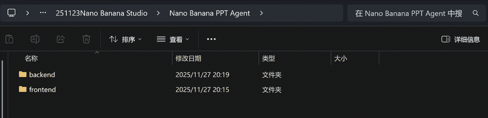

+   安装后端依赖

```
cd .\backend\
pip install -r .\requirements.txt
```

+   开启后端服务

```
python .\main.py
```

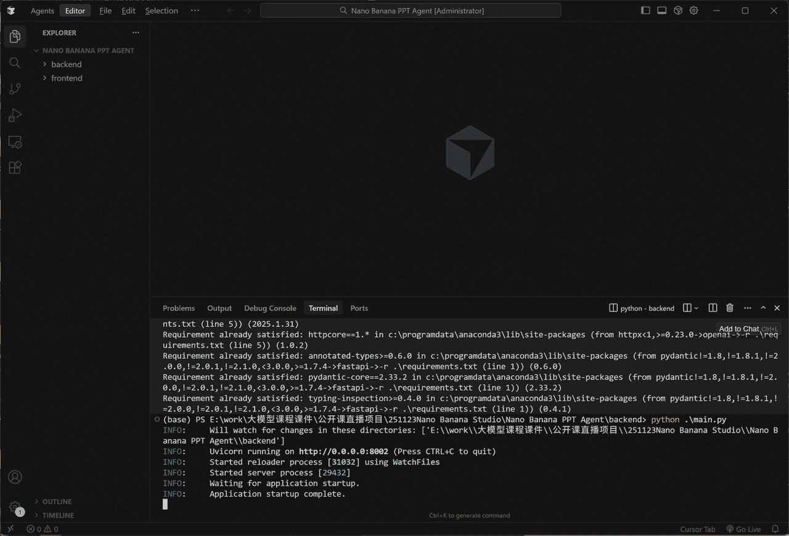

+   然后即可查看目前后端全部API：http://0.0.0.0:8002/docs

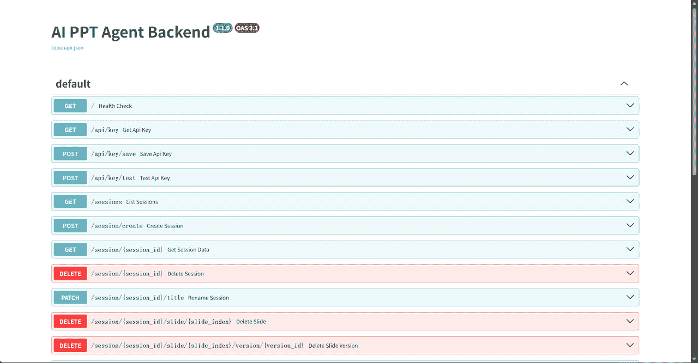

+   安装Node.js

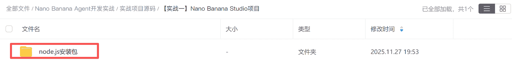

+   安装前端依赖并运行

+   再打开一个命令行，并输入：

```
cd .\frontend\
npm install
npm run dev
```

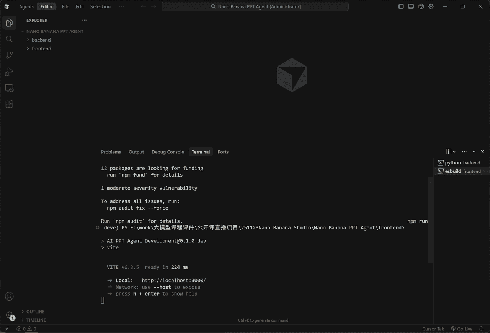

+   进入对话

+   在本地浏览器输入：http://localhost:3000/ ，即可开启对话：

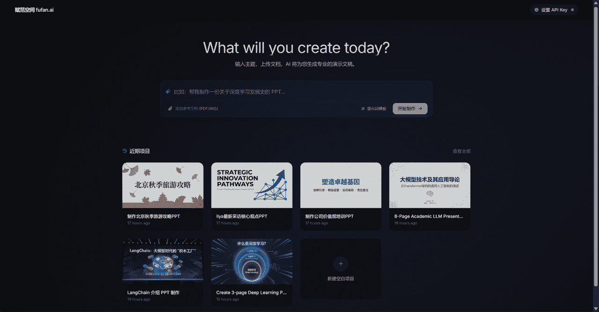

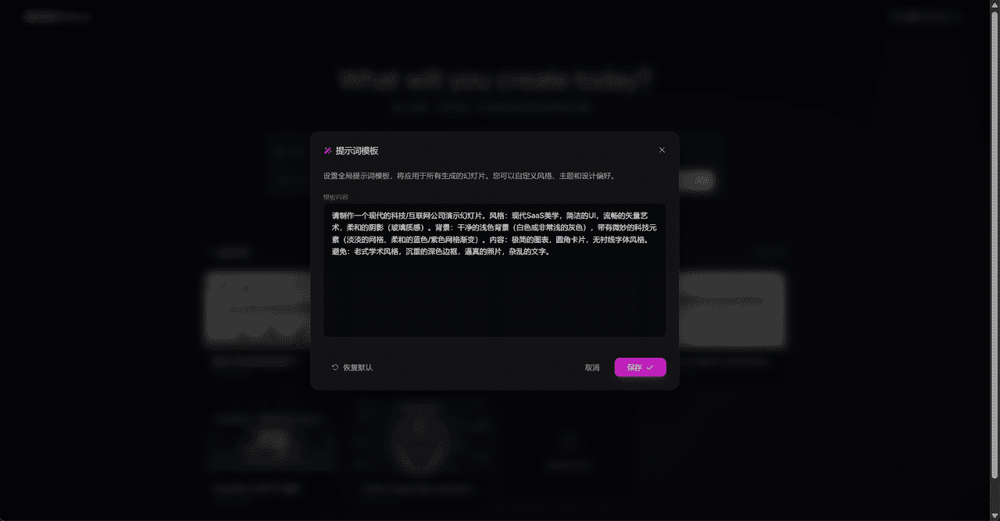

## 3. Nano Banana PPT Agent 项目核心架构介绍

本项目的核心不仅仅是调用 API 生成图片，而是构建了一个具备任务编排（Task Orchestration）能力的智能体。系统采用流水线（Pipeline）架构，将复杂的 PPT 制作任务解耦为内容策划、视觉设计与图像渲染三个独立的工序。

### 3.1 功能架构设计 (Functional Architecture)

整体架构遵循 "Plan-Design-Execute" (规划-设计-执行) 的 Agent 工作流模式：

1. **意图理解与大纲规划层 (Planning Layer)**:

+   功能：接收用户模糊的主题输入（如“帮我做一个关于 AI 营销的 PPT”），利用 LLM 的语义理解能力，自动规划 PPT 的整体结构，包括页面数量、每页的核心论点以及逻辑流向。

+   价值：确保生成的 PPT 具有清晰的叙事逻辑，而非零散的图片堆砌。

1. **视觉提示词工程层 (Visual Prompt Engineering Layer)**:

+   功能：这是本 Agent 的“设计总监”。它将规划层的文本大纲转化为 Nano Banana Pro 能够理解的高级视觉提示词。

+   风格控制：此处集成了风格配置系统，能够强制注入特定的视觉约束（如“SaaS 风格”、“玻璃拟态”、“矢量扁平插画”），从而避免生成结果偏向传统的“大学教授课件”风格，确保输出具备现代互联网科技感。

1. **并行渲染与迭代层 (Rendering & Iteration Layer)**:

+   功能：并发调用 OpenRouter API，批量生成 PPT 页面图像。同时，提供“单页重绘”接口，允许用户针对特定页面的内容或设计进行定向修改，而不影响其他页面。

### 3.2 核心代码模块解析 (Core Code Modules)

基于实际的项目工程结构，我们将 Agent 的复杂逻辑拆解为以下几个核心 Python 模块，每个模块负责 Agent 生命周期中的特定环节：

1. **`main.py` - 应用入口与路由分发 (Application Entry Point)**

+   职责：整个 Web 应用（Streamlit/FastAPI）的主入口。

+   核心逻辑：负责初始化前端界面，接收用户指令（如“生成 PPT”、“修改第三页”），并根据指令类型调度 `llm_planner` 或 `image_gen` 模块。它是连接用户 UI 与后端逻辑的桥梁。

2. **`llm_planner.py` - 语义规划引擎 (Semantic Planning Engine)**

+   职责：充当 Agent 的“大脑”。

+   核心逻辑：调用 Gemini 3 Pro 模型。它不负责画图，而是负责思考。

+   接收用户的主题（Topic）。

+   输出结构化的 PPT 大纲（JSON 格式），包含每一页的标题、正文内容以及专为 Nano Banana 优化的视觉提示词 (Visual Prompt)。

3. **`image_gen.py` - 视觉合成引擎 (Visual Synthesis Engine)**

+   职责：充当 Agent 的“画师”。

+   核心逻辑：封装 Nano Banana Pro 的 API 调用逻辑。

+   接收 `llm_planner` 生成的 Prompt。

+   处理图像生成的参数配置（如分辨率、风格强度）。

+   执行实际的 API 请求并返回图像数据。

4. **`session_manager.py` - 会话状态管理 (State Management)**

+   职责：维护 Agent 的上下文记忆。

+   核心逻辑：PPT 的制作通常不是一次性的，而是多轮交互。该模块负责存储当前的 PPT 结构数据、用户的修改历史以及当前的 `Session ID`。它确保了当用户说“修改这一页”时，系统知道具体指的是哪一页。

5. **`file_handler.py` - 资产持久化层 (Asset Persistence Layer)**

+   职责：负责文件系统的 I/O 操作。

+   核心逻辑：将生成的图片流保存到 `storage/` 目录，管理文件的命名规则（防止文件名冲突），并处理 PPT 最终的打包导出（如果支持导出功能）或元数据读取。

6. **`utils.py` & `.env` - 工具与配置 (Utilities & Config)**

+   职责：基础设施支持。

+   核心逻辑：`utils.py` 处理通用的辅助函数（如图片格式转换、Base64 编码解码）；`.env` 负责安全地管理 OpenRouter API Key 等敏感凭证。

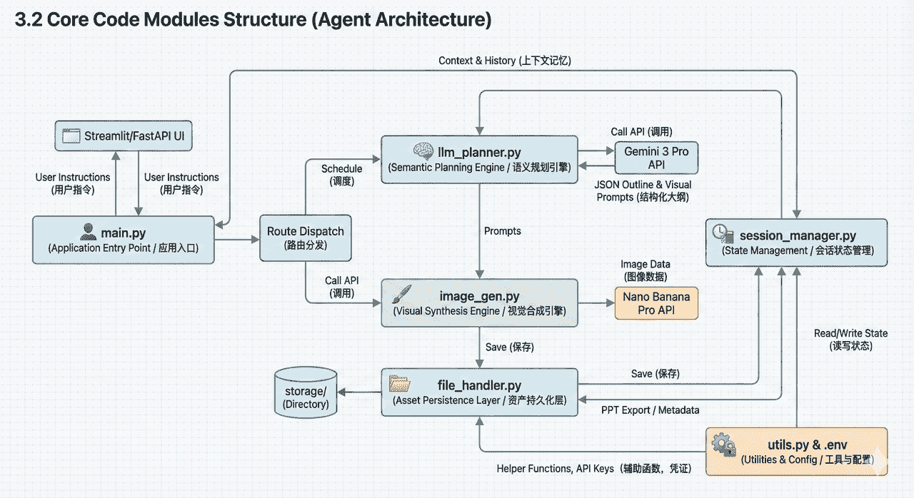

---

体验课内容节选自《2025大模型Agent智能体开发实战》(12月班)完整版付费课程

体验课时间有限，若想深度学习大模型技术，欢迎大家报名由我主讲的《2025大模型Agent智能体开发实战》(12月班)


# 《2025大模型Agent智能体开发实战》(12月班)

【100+小时】体系大课，总共20大模块精讲精析，零基础直达大模型企业级应用！

## 课程完整介绍


## 秋季班重磅新增14项实战案例


