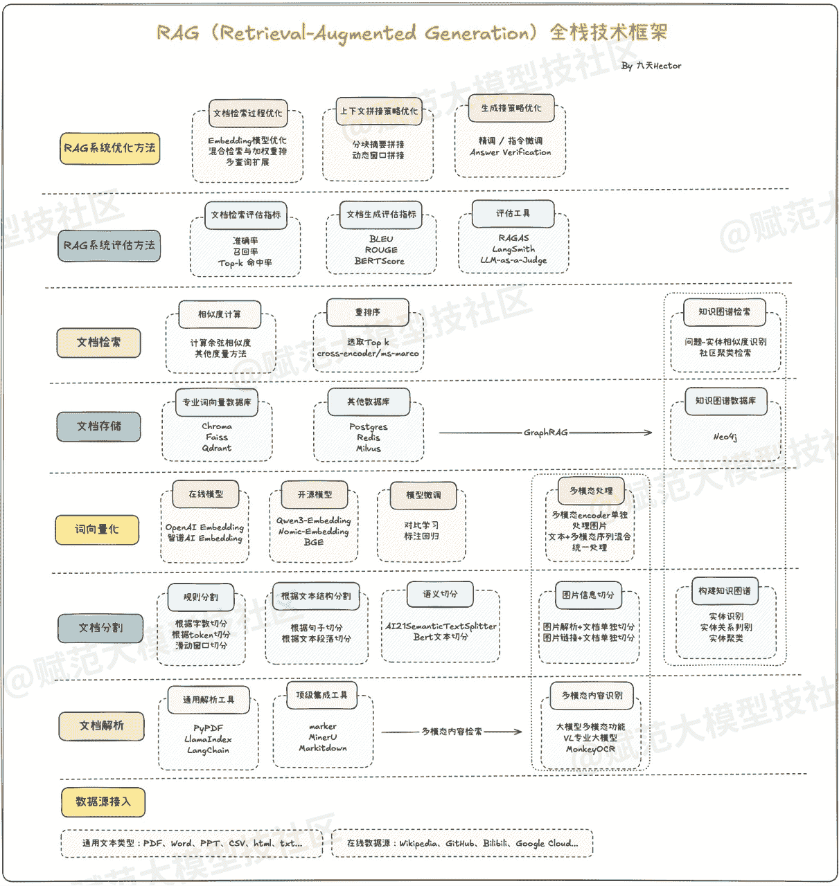

# 1.3 RAG全栈技术

> 来源：[https://kq4b3vgg5b.feishu.cn/docx/DNjxdpYK9ojeGYx9dMqcQrasnGb](https://kq4b3vgg5b.feishu.cn/docx/DNjxdpYK9ojeGYx9dMqcQrasnGb)

本项目是围绕RAG，包含RAG项目在开发到的前端落地全流程内容，包括：基座开&闭源大模型选择，API调用、Embedding向量化、利用Gradio完成前端等。除了系统的全流程，还有代码实操，最终产出一个企业级RAG系统！代码逐行讲解，代码打包带走，支持二次开发的优势，让更多的普通学生、研究者更好地使用提高检索准确度这一进阶技巧。

## 本项目的主要内容包括：

1.  开&闭源基座大模型选择优劣势分析；

1.  本地部署大模型的3个通用关键步骤，在线大模型API调用策略和技巧；

1.  使用Gradio与Python实现可交互的实时对话功能；

1.  项目完结：具备"Chat With PDF" 的RAG 智能问答系统全功能演示。