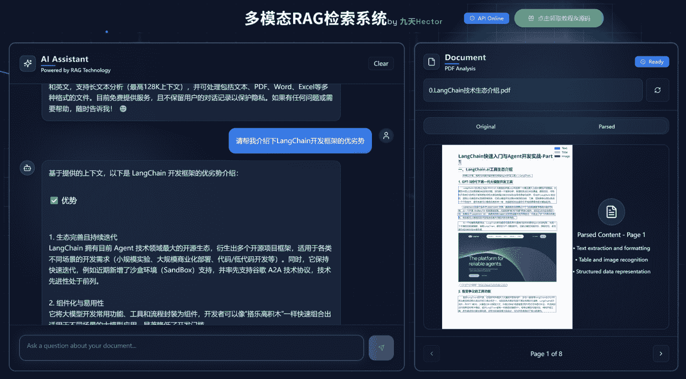

# 多模态RAG（README）

> 来源：[https://kq4b3vgg5b.feishu.cn/docx/HB5Hd4ejsowxUqxNA2mcDtNnnob](https://kq4b3vgg5b.feishu.cn/docx/HB5Hd4ejsowxUqxNA2mcDtNnnob)

# 技术介绍

在当今信息环境中，单一模态的检索已无法满足人们的需求。随着图像、视频、音频以及文本等多模态数据的高速增长与普及，知识的呈现方式不再局限于纯文本，更多地以丰富的多模态形式存在。从医学影像到工业监控，从视频课程到社交媒体，核心信息往往蕴含在多模态内容的交叉中。传统的文本检索无法充分利用这些异质信息，导致知识获取存在片面与缺失。多模态RAG（Retrieval-Augmented Generation）系统正是在这一背景下显得愈发重要。它能够跨模态整合信息，提升知识覆盖率与语义理解能力，为用户提供更准确、更全面的回答与洞察。这不仅是技术演进的趋势，更是应对现实复杂信息环境的必然选择。

流程图

产品前端图

> 本期内容是包含两种多模态技术形式，均由研发团队独家开发

>

> 1、OCR方向：🔥带大家从0搭建一个多模态Agentic RAG❗️详解专业OCR大模型do**ts.ocr与**olmOCR使用方法，深度集成OCR工具MinerU，实现一个「前后端分离架构」的多模态RAG检索系统～

> 2、VLM方向：基于VLM，系统掌握应用LangChain + Qwen3构建Agentic RAG 完整企业级应用链路，从零到一搭建企业级多模态 RAG 系统，实现高精度工程图纸毫秒级精准识别～

>

> 独家高价值内容免费提供给社区伙伴学习，原创研发不易，不支持以任何形式转载～

# 快速阅览

我们团队在文档不同的位置进行了详细的介绍，您可以点击进入并查看具体的技术文档。

### ☑️** 入门介绍**

+   [D](https://www.bilibili.com/video/BV1eJWUzTECU)eepSeek-OCR深度解读+上手指南！高精度表格、公式、CAD图字符&语义混合识别，多模态混合DeepSeek实战（视频）

🔗 D[e](https://github.com/fufankeji/DeepSeek-OCR-Web/tree/main)epSeek- OCR-Web Github开源地址🌟记得加个star哦～（🈚️网络，可找助教老师领取网盘）

+   [【团队自研】DeepSeek-OCR-Web项目开源！零门槛](https://www.bilibili.com/video/BV17ks5z7E3U)一键部署+网页端一键OCR应用！（视频）

### **☑️ **进阶之路

**1、olmOCR与MinerU**

⭐️ 多模态RAG技术体系介绍➕相关开源项目介绍（课件）

⭐️ [从零到一搭建基于多模态MarkDown文档](https://kq4b3vgg5b.feishu.cn/wiki/ZSUowLdl0izBQwkRPIicPvp7n2m?from=from_copylink)的Agentic RAG检索引擎（课件）

⭐️ 多模态RAG系统进阶：olmOCR与MinerU工具使用（课件）

**2、多模态RAG项目开发实战**

⭐️ [多](https://kq4b3vgg5b.feishu.cn/wiki/NaEOwY3jviGYLjkEBQBcbB30nTe?from=from_copylink)模态RAG项目开发实战：技术栈规划、后端功能思路规划与Mock功能实现、后端功能开发与测试-完整3个阶段覆盖开发全流程（课件）

⭐️ 多模态RAG系统前端部署指南（课件）

+   [多模态PDF检索+图文并茂回复，企业级多模态RAG系统开发实战！图片、表格、公式多元素精](https://www.bilibili.com/video/BV1CDHQzdEfg)准识别，OCR字符识别+VLM图片语义识别，搭建高性能多模态RAG系统！（视频）

**3、基于VLM构建多模态RAG**

⭐️ 基于VLM构建多模态RAG问答系统实战（课件）

+   [VLM实现复杂图像检索问答，企业级多模态RAG引擎开发实战！CAD图、架构图、工程图纸精](https://www.bilibili.com/video/BV1sCWEzuEqX)准识别，基于LangChain+Qwen3构建Agentic RAG链路（视频）

4、DeepSeek-OCR上手指南

⭐️ DeepSeek-OCR快速入门实战（课件）

+   [保姆级DeepSeek-OCR部署与调用指南！文字+图表+CAD图+手写体公式高精度](https://www.bilibili.com/video/BV1TPsBzaEdh)识别，PDF到MarkDown一键转化！最强开源OCR模型快速入门实战！（视频）

5、PaddleOCR-VL开发实战

⭐️ [基于PaddleOCR-VL+DeepSeek-](https://kq4b3vgg5b.feishu.cn/wiki/MhIjw4jqZi83rrk4irecZgL1ncd?from=from_copylink)ocr搭建企业级多模态RAG系统（课件）

+   [最强开源PaddleOCR-VL+DeepSeek-OCR从零搭建复杂PDF解析链路](https://www.bilibili.com/video/BV1GasBzVEej)，企业级多模态RAG系统开发实战！CAD图、架构图、图片、表格细粒度溯源（视频）

6、最新LangChain1.0搭建多模态RAG

⭐️ LangChain v1.0 最新版本快速入门（课件）

⭐️ 基于LangChain v1.0 搭建多模态RAG问答系统（课件）

+   [最新LangChain1.0搭建图文、音频、PDF多模态问答系统，企业级多模态RAG系](https://www.bilibili.com/video/BV1eUsUz3EKE)统开发实战！DeepSeek+Qwen3-VL接入，图像、音频实时解析 【视频】

---

# ❤️ 赋范社区交流群

海量硬核独家技术**干货内容**+无门槛**技术交流**~

上图**扫码**👆即刻入群！

📍 社群技术交**流氛围浓厚，**不定期开设硬**核干货&前沿技术公开课噢**~

---