# Part 2.从零到一快速搭建多模态RAG引擎

> 来源：[https://kq4b3vgg5b.feishu.cn/docx/G0TWd43zHosUe1x1ruicZjpsnUg](https://kq4b3vgg5b.feishu.cn/docx/G0TWd43zHosUe1x1ruicZjpsnUg)

## 课程说明：

+   体验课内容节选自《2025大模型Agent智能体开发实战》(秋招冲刺班)完整版付费课程

体验课时间有限，若想深度学习大模型技术，欢迎大家报名由我主讲的《2025大模型Agent智能体开发实战》(秋招冲刺班)

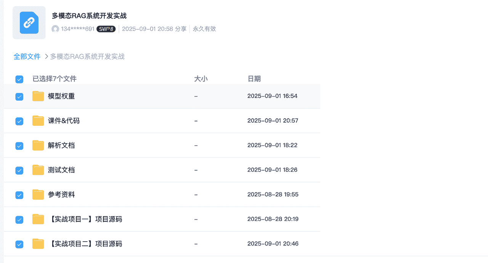


公开课全套学习资料，已上传至网盘（https://pan.baidu.com/s/1vV-8ew5tAfZOfwG3c4WAFw 提取码: i345）需要更系统深入学习大模型vx可扫码⬆️添加助教咨询喔～

---

# Part 2.从零到一快速搭建多模态RAG引擎

+   本期公开课四大模块内容

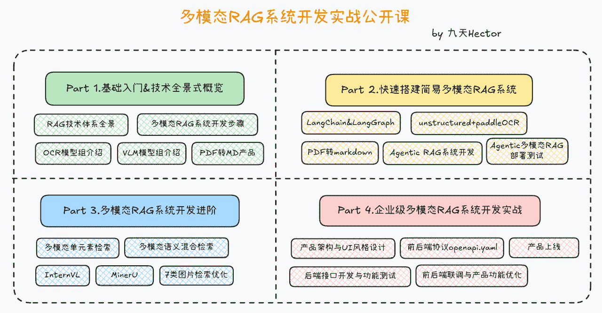

+   【演示】实操项目一：从零到一快速搭建多模态RAG系统

+   【演示】实操项目二：企业级多模态RAG系统开发实战

---

## 一、结构解析重建法多模态检索流程

### 1. 从零到一快速搭建多模态RAG系统基本思路

**       ** 接下来就让我们上手结构解析重建法来从零搭建多模态检索流程。在前面对多模态 PDF 检索的难点与主流开源项目的梳理之后，我们已经建立起一个清晰的认知框架：单纯依赖文本检索无法应对 PDF 文档中复杂的多模态内容，而仅仅依赖 OCR 也难以保留完整的结构信息。因此，真正可落地的解决方案往往需要结合文档解析与结构化重建。

**       ** 接下来就让我们上手 结构解析重建法 来从零搭建多模态检索流程。所谓“结构解析重建”，本质上是对原始 PDF 文档进行分层解析，将其中的 标题、段落、表格、图片、公式等元素逐一抽取，并依据其在文档中的位置和语义关系重新组织，再转化为一种更适合下游检索系统（如 RAG）的结构化表示形式。

在本节中，我们将以 **Unstructured **+ PaddleOCR 为核心工具链，演示如何从 PDF 文档中自动解析多模态内容，并将其重建为 Markdown 格式文档。这一过程不仅能保留段落的层次结构，还能提取并本地保存图片、表格等元素，最终得到一份既可读又可检索的中间产物，为后续的向量化与知识检索打下坚实基础。

+   最终效果演示：

+   多模态PDF文档文字、标题、图片、表格多模态识别

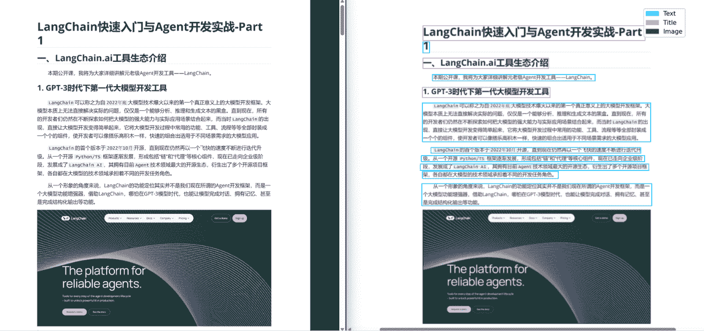

多模态PDF图片文字识别与表格内容识别

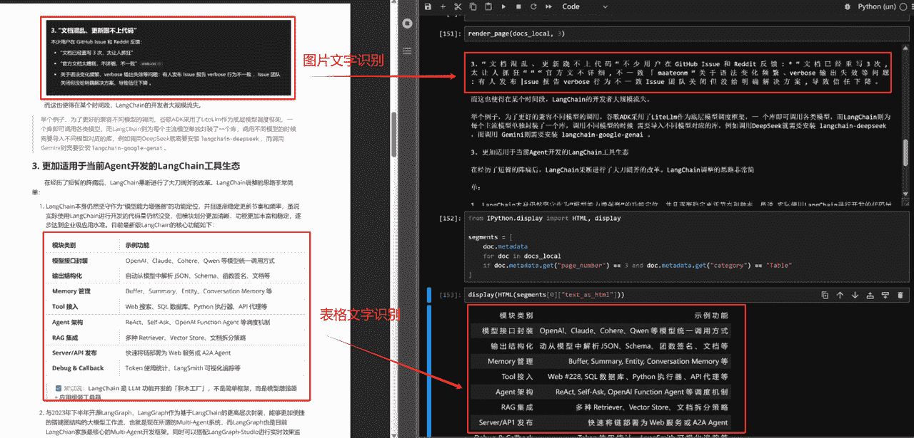

**多模态PDF逆向转化为**Markdown

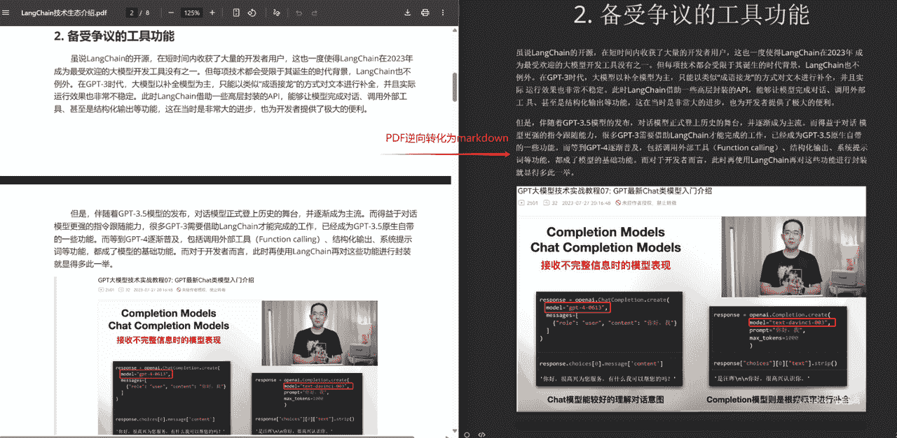

搭建Agentic RAG系统检索多模态PDF文档

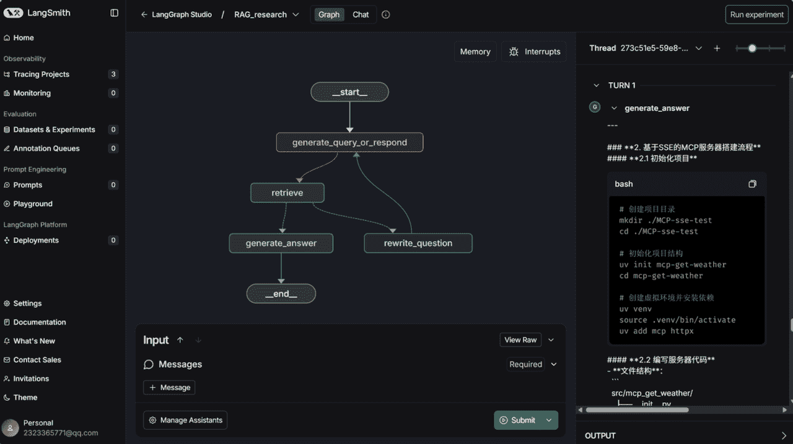

多模态PDF检索+图文并茂的检索结果生成

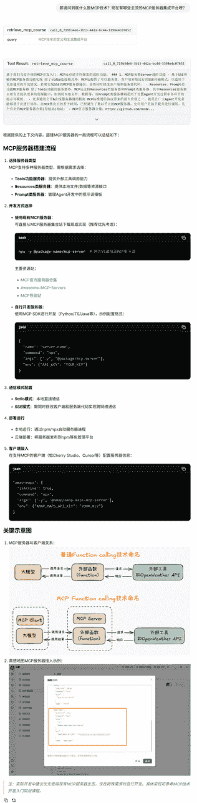

+   演示视频

+

### 2. Unstructured补充介绍

**Unstructured** 是目前业界最具影响力的 **文档解析与预处理框架之一**，由 Unstructured-IO 团队开源并持续维护。与 MarkItDown 偏**向轻量化的** Markdown 转换不同，Unstructured 更强调 多模态文档的细粒度分解（partitioning） 与 结构化输出。

**        该项目的核****心设计理念是：无论文档来源是 PDF、Word、PPT、HT**ML、E-mail，甚至是图像和扫描件，都能够被解析为一个个结构化的 Element（元素）对象。每个 Element 都带有完整的 类别信息（如 Title、Paragraph、Table、Image、List、Formula 等） 和 元数据（metadata，如页码、坐标、置信度等）。这种解析方式不仅能保留文本的层次逻辑，还能为下游任务提供定位信息，从而支持诸如 表格重建、图像 OCR、公式识别 等更复杂的多模态处理。

在 PDF 场景中，Unstructured 提供了多种解析策略：

+   **fast 模式**：仅利用 PDF 内置文本层，快速提取文字，适合机器生成的 PDF。

+   **hi_res 模式**：结合 OCR（支持 Tesseract、PaddleOCR 等）与版面分析，精确分割文本块、表格与图片，适合扫描件与版面复杂的 PDF。

+   **chunking**：可以将解析结果进一步切分为适合向量检索的语义片段。

与其他工具相比，U**nstru****ctured 的**一大优势在于 高度可扩展：它既能作为独立的 Python 库使用，也能以 API 服务形式 部署，甚至与 LangChain、Haystack、LlamaIndex 等主流 RAG 框架无缝集成。这种灵活性，使其在 企业知识管理、合规性文档解析、科研论文分析 等场景中广泛应用。

**        因此，U**nstructured 已经成为 多模态 PDF 文档检索 技术栈中的重要基石。它不仅能提供高精度的结构化解析结果，还能与后续的向量数据库、检索模型和大模型推理环节形成天然的衔接，是目前最接近“工业级标准”的开源解决方案之一。

+   项目地址：https://github.com/Unstructured-IO/unstructured

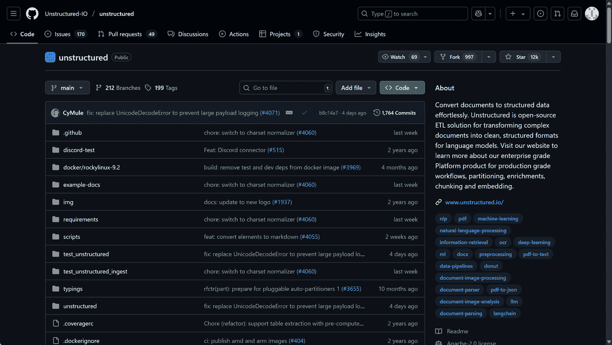

+   实验文档素材

+   这里我们先尝试使用一个Demo PDF文档进行检索尝试，在跑通流程之后，我们再将方法应用于更加复杂的文档检索。

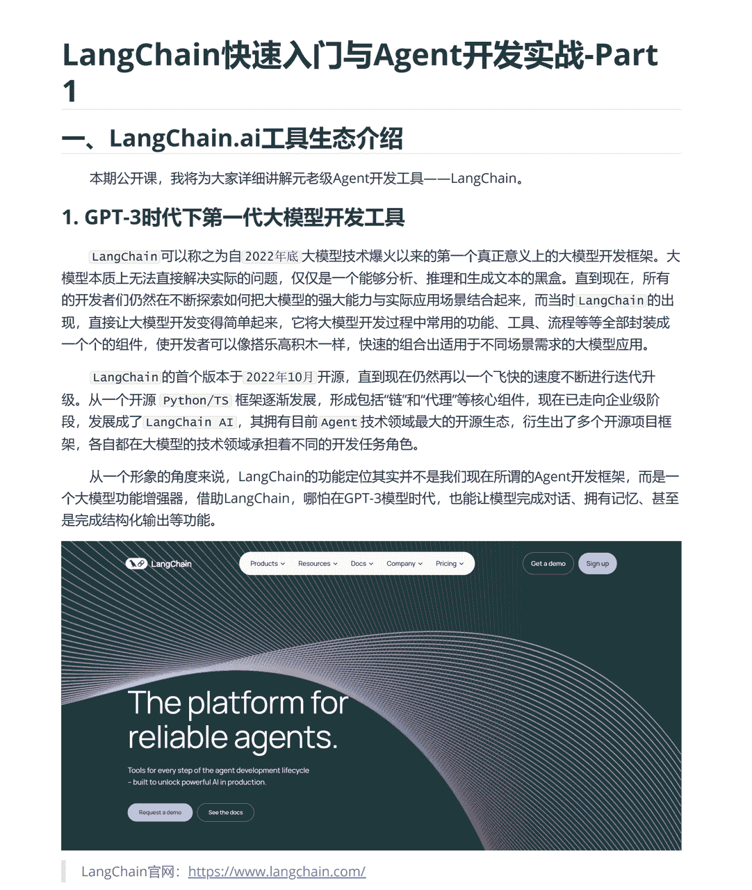

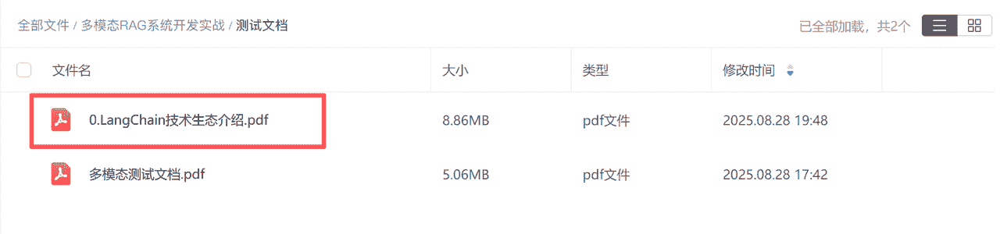

+   更多参考学习资料：

+   《工业级智能体开发实践，LangChain从零入门与智能体开发实战！》https://www.bilibili.com/video/BV1pYKgzAE5C/

+   《超越LangChain！LangGraph快速入门与智能体开发实战！》https://www.bilibili.com/video/BV1Kx3CzyE6Q/

+   相关课件：

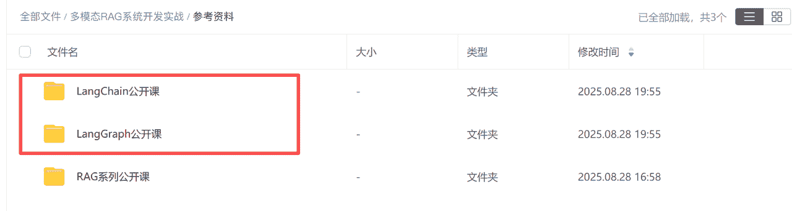


上图扫码即可领取：

---

## 二、多模态PDF文档解析流程

### 1. 基础环境准备

**       在正式****上**手 PDF → Markdown 的结构化解析之前，我们需要先准备好实验环境。由于本文的实验在 Windows 系统上进行，下面的步骤也以 Windows 为例。整体思路是：配置 Python 环境 → 安装基础依赖 → 安装 OCR 引擎（PaddleOCR） → 安装 PDF 处理与辅助库。

#### 1.1 创建 Python 环境

建议使用 **Python 3.9+**（推荐 3.10 或 3.11），以保证兼容性，同时推荐使用 conda 或 venv 来创建虚拟环境：

```
# 使用 conda 创建虚拟环境
conda create -n pdf_rag python=3.10 -y
conda activate pdf_rag

# 或使用 venv
python -m venv pdf_rag
pdf_rag\Scripts\activate
```

#### 1.2 安装基础库

本次项目需要依赖的核心依赖包括：

+   **PyMuPDF (fitz)**：负责读取 PDF 文件、提取页面和图片。

+   matplotlib / pillow：用于可视化和图像处理。

+   **unstructured**：微软 / LangChain 推荐的 PDF 文档解析库，支持结构化分块。

+   **paddleocr**：OCR 引擎，用于文本区域的识别。

安装命令如下：

```
pip install &quot;unstructured[all-docs]&quot;   # 支持 PDF / Word / PPT / HTML 等文档解析
pip install paddlenlp paddleocr        # OCR 引擎
pip install PyMuPDF pillow matplotlib  # PDF 和图片处理
pip install html2text                  # 用于 HTML 表格转 Markdown
```

⚠️ 注意：

+   unstructured[all-docs] 会自动安装 PDF 解析相关的依赖（如 pdfminer, PyMuPDF）。

+   paddleocr 在第一次运行时会自动下载模型（中英文模型）。如果网络不畅，可以提前下载后手动指定路径。

+   在 Windows 上安装 paddleocr 时，可能需要先装 **Visual C++ 运行库**，否则会遇到 paddlepaddle 的动态链接库错误。

+   此外，可以添加--index-url https://mirrors.huaweicloud.com/repository/pypi/simple华为镜像源来加速下载。

### 2.载入 PDF 并进行元素提取

有了依赖库之后，我们就可以使用 UnstructuredLoader 来解析 PDF 文档了，对于给定的文档，我们可以按照如下方式进行解析：

```
from langchain_unstructured import UnstructuredLoader

file_path = &quot;0.LangChain技术生态介绍.pdf&quot;

loader_local = UnstructuredLoader(
    file_path=file_path,
    strategy=&quot;hi_res&quot;,              # 高分辨率模式，支持复杂文档
    infer_table_structure=True,     # 自动解析表格结构
    ocr_languages=&quot;chi_sim+eng&quot;,    # 支持中英文 OCR
    ocr_engine=&quot;paddleocr&quot;          # 指定 PaddleOCR 作为 OCR 引擎
)

docs_local = []
for doc in loader_local.lazy_load():
    docs_local.append(doc)
    
docs_local
```

此时docs_local就包含了每个解析的元素，具体运行效果如下：

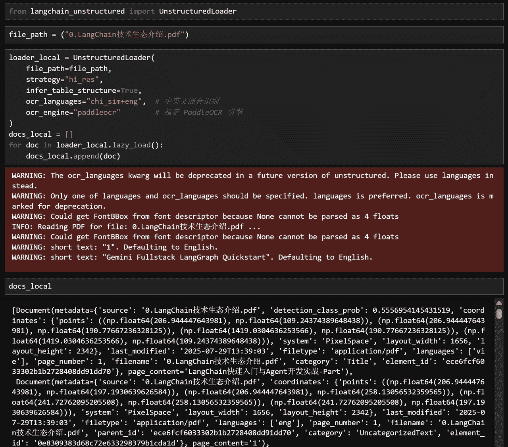

其中每个 doc 都包含 page_content（文本内容）以及 metadata（页码、坐标、类型等）。这就意味着**我们的 PDF **文档已经被拆解为一个个 可检索的基本单元，接下来便可以进一步做结构化处理。

以下是这段代码的详细解释：

这段代码的核心目标是**用** Unstructured + PaddleOCR 从 PDF 中提取结构化内容，并输出为文档对象列表。

```
from langchain_unstructured import UnstructuredLoader
```

+   导入 UnstructuredLoader，这是 LangChain 封装的一个接口，可以直接用来加载 PDF 等非结构化文档。

---

```
python复制编辑loader_local = UnstructuredLoader(
    file_path=file_path,
    strategy=&quot;hi_res&quot;,              # 高分辨率模式，支持复杂文档
    infer_table_structure=True,     # 自动解析表格结构
    ocr_languages=&quot;chi_sim+eng&quot;,    # 支持中英文 OCR
    ocr_engine=&quot;paddleocr&quot;          # 指定 PaddleOCR 作为 OCR 引擎
)
```

+   **file_path**：指定 PDF 路径。

+   strategy="hi_res"：高分辨率 OCR 模式，适合复杂表格和排版。

+   infer_table_structure=True：启用表格解析，把表格恢复为结构化数据。

+   ocr_languages="chi_sim+eng"：设置 OCR 支持简体中文 + 英文。

+   ocr_engine="paddleocr"：指定 OCR 引擎为 PaddleOCR（相比 Tesseract 更强）

---

```
python复制编辑docs_local = []
for doc in loader_local.lazy_load():
    docs_local.append(doc)
```

+   **lazy_load()** 会逐页加载 PDF 并调用 OCR/解析。

+   doc 是 LangChain 的 **Document** 对象，里面包含：

+   doc.page_content → 文本内容

+   doc.metadata → 额外信息（页码、坐标、分类、OCR 置信度等）

接下来为了验证实际元素提取效果，我们这里进一步把 PDF 页面渲染成图片，并在上面绘制出分块框（标题、表格、图片、文本等），实现可视化。

```
import fitz
import matplotlib.patches as patches
import matplotlib.pyplot as plt
from PIL import Image


def plot_pdf_with_boxes(pdf_page, segments):
    pix = pdf_page.get_pixmap()
    pil_image = Image.frombytes(&quot;RGB&quot;, [pix.width, pix.height], pix.samples)

    fig, ax = plt.subplots(1, figsize=(10, 10))
    ax.imshow(pil_image)
    categories = set()
    category_to_color = {
        &quot;Title&quot;: &quot;orchid&quot;,
        &quot;Image&quot;: &quot;forestgreen&quot;,
        &quot;Table&quot;: &quot;tomato&quot;,
    }
    for segment in segments:
        points = segment[&quot;coordinates&quot;][&quot;points&quot;]
        layout_width = segment[&quot;coordinates&quot;][&quot;layout_width&quot;]
        layout_height = segment[&quot;coordinates&quot;][&quot;layout_height&quot;]
        scaled_points = [
            (x * pix.width / layout_width, y * pix.height / layout_height)
            for x, y in points
        ]
        box_color = category_to_color.get(segment[&quot;category&quot;], &quot;deepskyblue&quot;)
        categories.add(segment[&quot;category&quot;])
        rect = patches.Polygon(
            scaled_points, linewidth=1, edgecolor=box_color, facecolor=&quot;none&quot;
        )
        ax.add_patch(rect)

    # Make legend
    legend_handles = [patches.Patch(color=&quot;deepskyblue&quot;, label=&quot;Text&quot;)]
    for category in [&quot;Title&quot;, &quot;Image&quot;, &quot;Table&quot;]:
        if category in categories:
            legend_handles.append(
                patches.Patch(color=category_to_color[category], label=category)
            )
    ax.axis(&quot;off&quot;)
    ax.legend(handles=legend_handles, loc=&quot;upper right&quot;)
    plt.tight_layout()
    plt.show()


def render_page(doc_list: list, page_number: int, print_text=True) -&gt; None:
    pdf_page = fitz.open(file_path).load_page(page_number - 1)
    page_docs = [
        doc for doc in doc_list if doc.metadata.get(&quot;page_number&quot;) == page_number
    ]
    segments = [doc.metadata for doc in page_docs]
    plot_pdf_with_boxes(pdf_page, segments)
    if print_text:
        for doc in page_docs:
            print(f&quot;{doc.page_content}\n&quot;)
```

此时我们就能看到每一个PDF页面里面提取的元素了：

```
render_page(docs_local, 1)
```

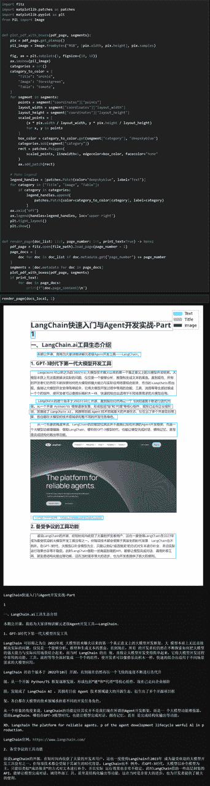

```
render_page(docs_local, 3)
```

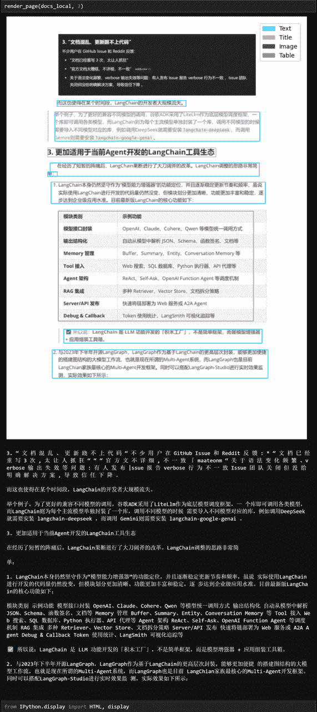

表格识别效果如下：

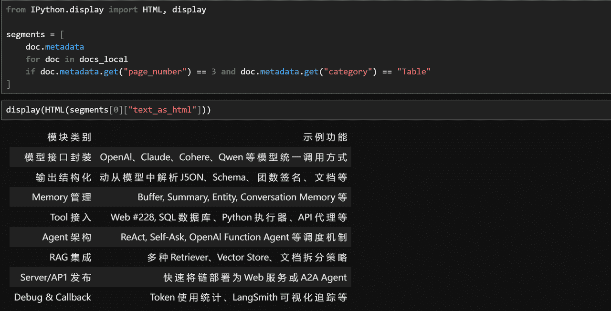

具体代码解释如下：

```
def plot_pdf_with_boxes(pdf_page, segments):
    pix = pdf_page.get_pixmap()
    pil_image = Image.frombytes(&quot;RGB&quot;, [pix.width, pix.height], pix.samples)
```

+   使用 **PyMuPDF (****fitz****)** 把一页 PDF 渲染为像素图（pixmap）。

+   转换为 PIL Image，方便后续可视化。

---

```
    fig, ax = plt.subplots(1, figsize=(10, 10))
    ax.imshow(pil_image)
```

+   用 matplotlib 显示 PDF 页的图像作为背景。

---

```
    category_to_color = {
        &quot;Title&quot;: &quot;orchid&quot;,
        &quot;Image&quot;: &quot;forestgreen&quot;,
        &quot;Table&quot;: &quot;tomato&quot;,
    }
```

+   定义不同类别（标题、图片、表格）对应的高亮颜色。

+   其他未定义类别（例如普通文本）默认用 deepskyblue。

---

```
    for segment in segments:
        points = segment[&quot;coordinates&quot;][&quot;points&quot;]
        layout_width = segment[&quot;coordinates&quot;][&quot;layout_width&quot;]
        layout_height = segment[&quot;coordinates&quot;][&quot;layout_height&quot;]
```

+   遍历所有 segments（这些是前面 Unstructured/OCR 输出的结果，每个 segment 对应一个识别块）。

+   拿到每个块的坐标（通常是 PDF 页面的相对坐标，单位化为 0~1 或文档尺寸）。

---

```
        scaled_points = [
            (x * pix.width / layout_width, y * pix.height / layout_height)
            for x, y in points
        ]
```

+   坐标缩放：把逻辑坐标映射到实际像素坐标。

+   这样矩形框才能精确覆盖到图像上的正确位置。

---

```
        rect = patches.Polygon(
            scaled_points, linewidth=1, edgecolor=box_color, facecolor=&quot;none&quot;
        )
        ax.add_patch(rect)
```

+   使用 matplotlib.patches.Polygon 绘制多边形框（通常是矩形）。

+   设置 edgecolor 表示不同类型的颜色。

---

```
    legend_handles = [patches.Patch(color=&quot;deepskyblue&quot;, label=&quot;Text&quot;)]
```

+   手动绘制图例，帮助区分不同类型的标注框。

render_page 函数

```
def render_page(doc_list: list, page_number: int, print_text=True) -&gt; None:
    pdf_page = fitz.open(file_path).load_page(page_number - 1)
```

+   打开 PDF，定位到第 page_number 页。

```
    page_docs = [
        doc for doc in doc_list if doc.metadata.get(&quot;page_number&quot;) == page_number
    ]
    segments = [doc.metadata for doc in page_docs]
```

+   从识别结果中过滤出属于该页的所有 doc（segment）。

+   提取它们的元数据（metadata，里面有 coordinates、category 等信息）。

```
    plot_pdf_with_boxes(pdf_page, segments)
```

+   调用上面的方法，把这一页绘制出来，并加上分块框。

```
    if print_text:
        for doc in page_docs:
            print(f&quot;{doc.page_content}\n&quot;)
```

+   如果需要，打印出 OCR/解析得到的实际文本。

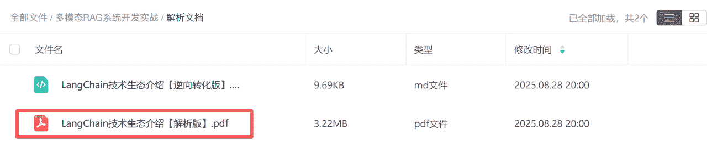


### 3. PDF逆向转化为md文档

而更进一步的，我们就能将其转化为markdown文档：

                md_lines.append(f&quot;\n&quot;)

```
import os
import fitz
from unstructured.partition.pdf import partition_pdf

pdf_path = &quot;0.LangChain技术生态介绍.pdf&quot;
output_dir = &quot;pdf_images&quot;
os.makedirs(output_dir, exist_ok=True)

# Step 1: 提取文本/结构化内容
elements = partition_pdf(
    filename=pdf_path,
    infer_table_structure=True,   # 开启表格结构检测
    strategy=&quot;hi_res&quot;,            # 高分辨率 OCR，适合复杂表格
    ocr_languages=&quot;chi_sim+eng&quot;,  # 中英文混合识别
    ocr_engine=&quot;paddleocr&quot;        # 指定 PaddleOCR 引擎
)

# Step 2: 提取图片并保存
doc = fitz.open(pdf_path)
image_map = {}  # 映射 page_num -&gt; list of image paths

for page_num, page in enumerate(doc, start=1):
    image_map[page_num] = []
    for img_index, img in enumerate(page.get_images(full=True), start=1):
        xref = img[0]
        pix = fitz.Pixmap(doc, xref)
        img_path = os.path.join(output_dir, f&quot;page{page_num}_img{img_index}.png&quot;)
        if pix.n &lt; 5:  # RGB / Gray
            pix.save(img_path)
        else:  # CMYK 转 RGB
            pix = fitz.Pixmap(fitz.csRGB, pix)
            pix.save(img_path)
        image_map[page_num].append(img_path)
        
# Step 3: 转换为 Markdown
md_lines = []
inserted_images = set()  # 用来记录已经插入过的图片，避免重复

for el in elements:
    cat = el.category
    text = el.text
    page_num = el.metadata.page_number

    if cat == &quot;Title&quot; and text.strip().startswith(&quot;- &quot;):
        md_lines.append(text + &quot;\n&quot;)
    elif cat == &quot;Title&quot;:
        md_lines.append(f&quot;# {text}\n&quot;)
    elif cat in [&quot;Header&quot;, &quot;Subheader&quot;]:
        md_lines.append(f&quot;## {text}\n&quot;)
    elif cat == &quot;Table&quot;:
        if hasattr(el.metadata, &quot;text_as_html&quot;) and el.metadata.text_as_html:
            from html2text import html2text
            md_lines.append(html2text(el.metadata.text_as_html) + &quot;\n&quot;)
        else:
            md_lines.append(el.text + &quot;\n&quot;)
    elif cat == &quot;Image&quot;:
        # 避免重复插入：只插入当前图片对应的文件
        for img_path in image_map.get(page_num, []):
            if img_path not in inserted_images:
                inserted_images.add(img_path)
    else:
        md_lines.append(text + &quot;\n&quot;)

# Step 4: 写入 Markdown 文件
output_md = &quot;output.md&quot;
with open(output_md, &quot;w&quot;, encoding=&quot;utf-8&quot;) as f:
    f.write(&quot;\n&quot;.join(md_lines))

print(f&quot;✅ 转换完成，已生成 {output_md} 和 {output_dir}/ 图片文件夹&quot;)
```

运行结束后即可看到创建的md文档：

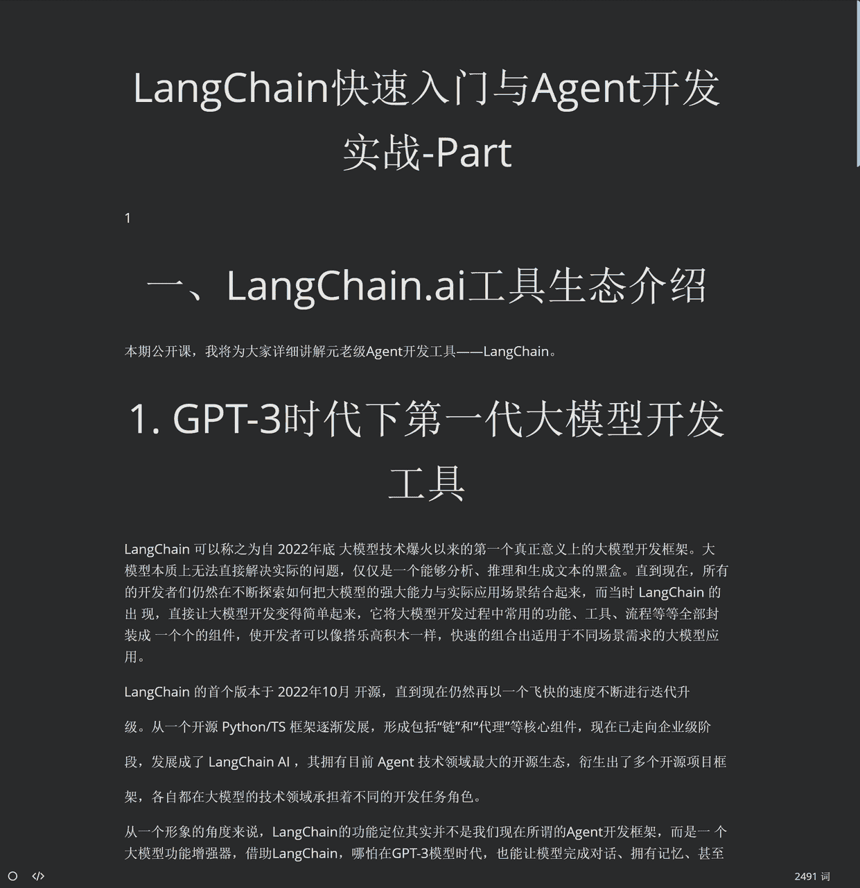

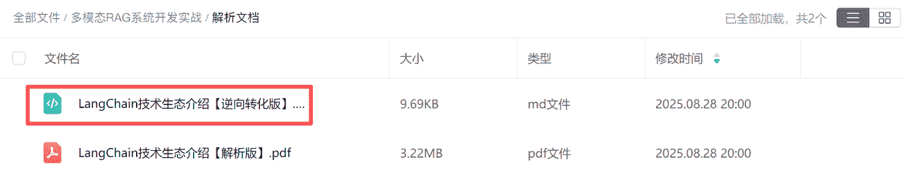


完整代码解释如下：

**1. 基础准备**

```
import os
import fitz
from unstructured.partition.pdf import partition_pdf

pdf_path = &quot;0.LangChain技术生态介绍.pdf&quot;
output_dir = &quot;pdf_images&quot;
os.makedirs(output_dir, exist_ok=True)
```

+   fitz → PyMuPDF 库，用来读取 PDF、提取图片。

+   partition_pdf → Unstructured 提供的 PDF 解析接口，可以自动调用 OCR。

+   设置 PDF 文件路径和输出目录 pdf_images，保存提取出的图片。

2. Step 1：提取文本与结构化内容

```
elements = partition_pdf(
    filename=pdf_path,
    infer_table_structure=True,   # 开启表格结构检测
    strategy=&quot;hi_res&quot;,            # 高分辨率 OCR，适合复杂表格
    ocr_languages=&quot;chi_sim+eng&quot;,  # 中英文混合识别
    ocr_engine=&quot;paddleocr&quot;        # 指定 PaddleOCR 引擎
)
```

+   **核心作用****：调用 Unstructur**ed 的分区解析，把 PDF 切分为 标题、正文、表格、图片等元素。

+   infer_table_structure=True → 表格会被解析成结构化数据。

+   strategy="hi_res" → 高分辨率 OCR，能更好地识别复杂排版（比如学术论文）。

+   ocr_languages="chi_sim+eng" → 同时支持中文简体和英文。

+   ocr_engine="paddleocr" → 使用 PaddleOCR 引擎（比默认 Tesseract 更强大）。

返回的 elements 是一个 **Element 列表**，每个元素有：

+   .category → 类型（Title、Paragraph、Table、Image …）

+   .text → 文本内容

+   .metadata → 页码、坐标、表格的 HTML 等信息

3. Step 2：提取图片并保存

```
doc = fitz.open(pdf_path)
image_map = {}  # 映射 page_num -&gt; list of image paths

for page_num, page in enumerate(doc, start=1):
    image_map[page_num] = []
    for img_index, img in enumerate(page.get_images(full=True), start=1):
        xref = img[0]
        pix = fitz.Pixmap(doc, xref)
        img_path = os.path.join(output_dir, f&quot;page{page_num}_img{img_index}.png&quot;)
        if pix.n &lt; 5:  # RGB / Gray
            pix.save(img_path)
        else:  # CMYK 转 RGB
            pix = fitz.Pixmap(fitz.csRGB, pix)
            pix.save(img_path)
        image_map[page_num].append(img_path)
```

+   使用 fitz 遍历 PDF 的每一页，提取图片。

+   每张图片保存为 page{页码}_img{索引}.png。

+   pix.n < 5 → 说明是 RGB 或灰度图，可以直接保存；

+   否则是 **CMYK 色彩空间**，需要转为 RGB 再保存。

+   最后存入 image_map，便于后续和 Markdown 内容对应。

4. Step 3：组装 Markdown 文档

```
md_lines = []
inserted_images = set()  # 避免重复插入相同图片

for el in elements:
    cat = el.category
    text = el.text
    page_num = el.metadata.page_number
```

+   遍历前面解析出的所有 elements，根据不同类型拼接 Markdown。

(1) 标题

```
    if cat == &quot;Title&quot; and text.strip().startswith(&quot;- &quot;):
        md_lines.append(text + &quot;\n&quot;)
    elif cat == &quot;Title&quot;:
        md_lines.append(f&quot;# {text}\n&quot;)
    elif cat in [&quot;Header&quot;, &quot;Subheader&quot;]:
        md_lines.append(f&quot;## {text}\n&quot;)
```

+   Title → 转换为 Markdown 一级标题 #。

+   Header / Subheader → 转换为二级标题 ##。

+   特殊情况：如果标题开头是 -，说明其实是列表项而不是标题，直接保持原样。

(2) 表格

```
    elif cat == &quot;Table&quot;:
        if hasattr(el.metadata, &quot;text_as_html&quot;) and el.metadata.text_as_html:
            from html2text import html2text
            md_lines.append(html2text(el.metadata.text_as_html) + &quot;\n&quot;)
        else:
            md_lines.append(el.text + &quot;\n&quot;)
```

+   如果表格有 HTML 格式（text_as_html），用 html2text 转换为 Markdown 表格。

+   否则直接写入文本。

(3) 图片

                md_lines.append(f&quot;\n&quot;)

```
    elif cat == &quot;Image&quot;:
        for img_path in image_map.get(page_num, []):
            if img_path not in inserted_images:
                inserted_images.add(img_path)
```

+   对 Image 元素，插入对应的图片路径。

+   使用 inserted_images 避免重复添加相同的图片。

(4) 普通文本

```
    else:
        md_lines.append(text + &quot;\n&quot;)
```

+   其余情况（正文段落等）直接作为普通文本写入。

5. Step 4：写入 Markdown 文件

```
output_md = &quot;output.md&quot;
with open(output_md, &quot;w&quot;, encoding=&quot;utf-8&quot;) as f:
    f.write(&quot;\n&quot;.join(md_lines))

print(f&quot;✅ 转换完成，已生成 {output_md} 和 {output_dir}/ 图片文件夹&quot;)
```

+   把拼接好的 Markdown 行写入 output.md。

+   所有图片保存在 pdf_images/ 文件夹中。

+   最终得到一个结构化良好的 Markdown 文件 + 图片资源目录，可直接用于 RAG。

## 三、搭建基于多模态MarkDown文档的Agentic RAG检索引擎

在跑通了多模态文档转化之后，接下来我们基于转化后的多模态MarkDown文档来创建一个Agentic RAG引擎。项目完整代码如下：

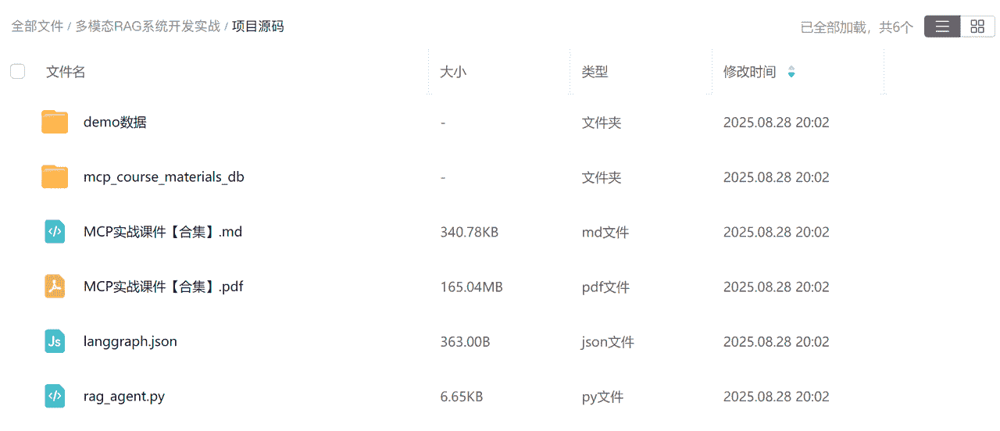


### 1. 基础环境搭建

+   创建项目主目录

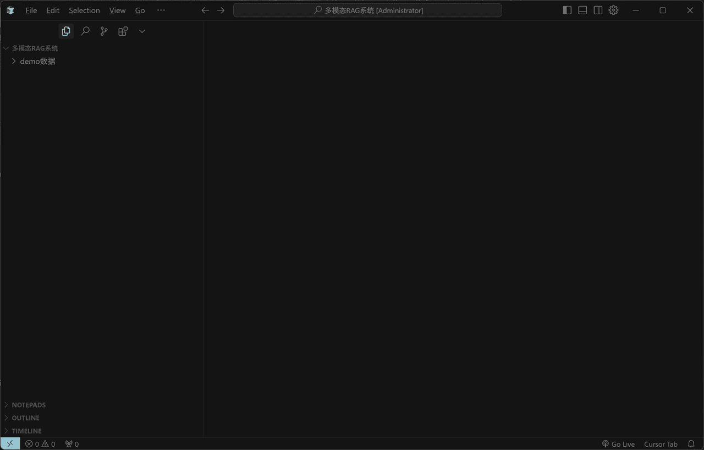

+   安装基础依赖

```
pydantic
python-dotenv
langgraph
langchain-core
langchain-deepseek
langchain-tavily
langsmith
langchain-openai
langchain-text-splitters
langchain-community
faiss-cpu
langgraph_supervisor
graphrag
```

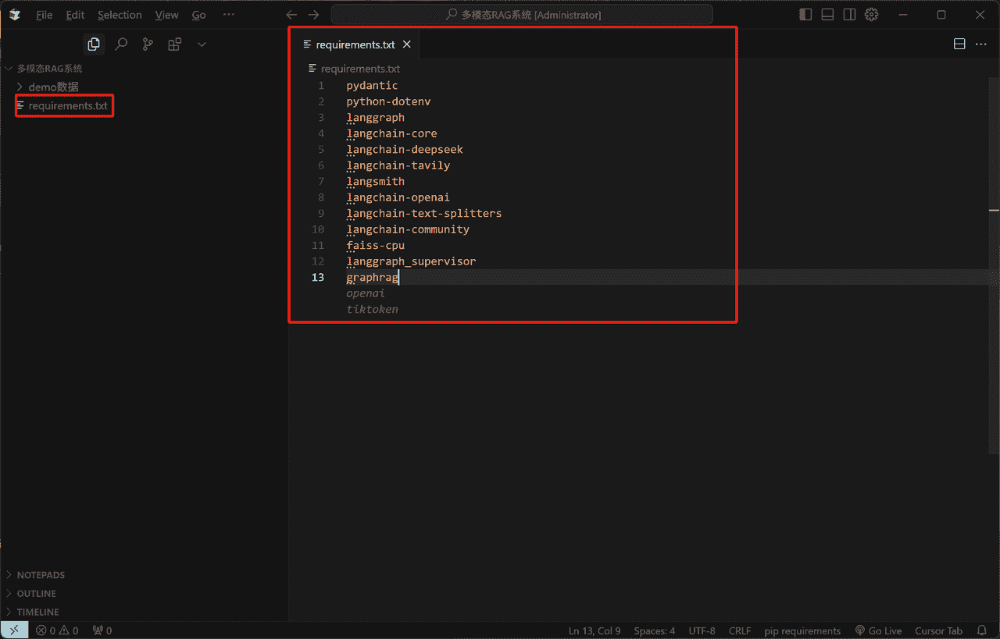

输入如下命令完成安装：

```
pip install -r requirements.txt
```

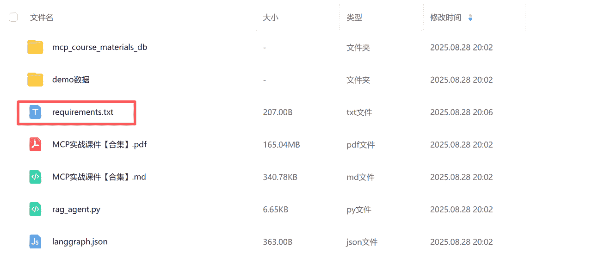

+   配置环境变量

+   创建.env文件，并输入如下API-KEY

```
DEEPSEEK_API_KEY=sk-c1a253**
OPENAI_API_KEY=sk-proj-gE**
LANGSMITH_TRACING=true
LANGSMITH_API_KEY=lsv2_pt_b44**
LANGSMITH_PROJECT=langraph_studio_chatbot
```

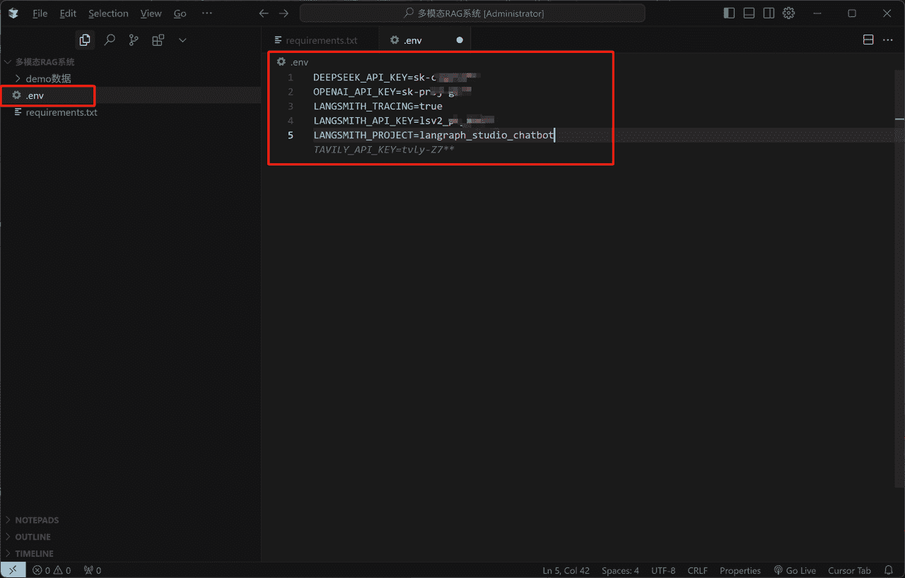

+   安装前端框架Agent Chat UI

```
# git config --global http.proxy http://127.0.0.1:10080
# git config --global https.proxy http://127.0.0.1:10080

git clone https://github.com/langchain-ai/agent-chat-ui.git

cd agent-chat-ui
```

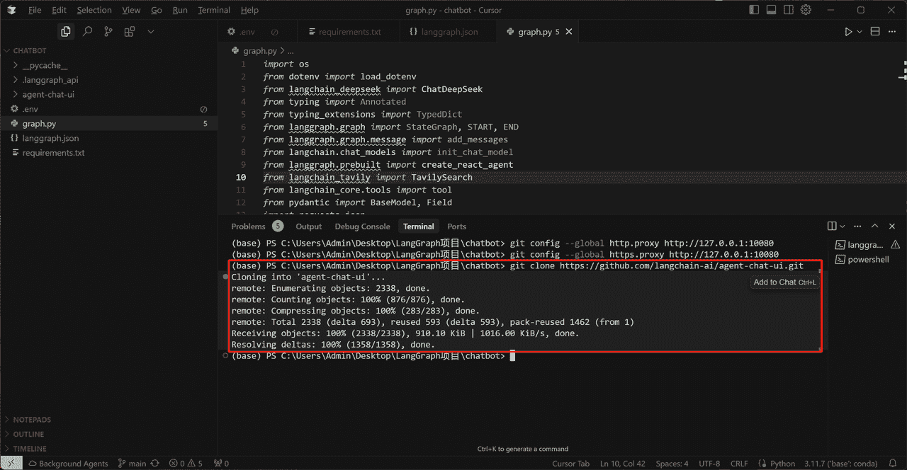

然后安装前端依赖：

```
pnpm install
```

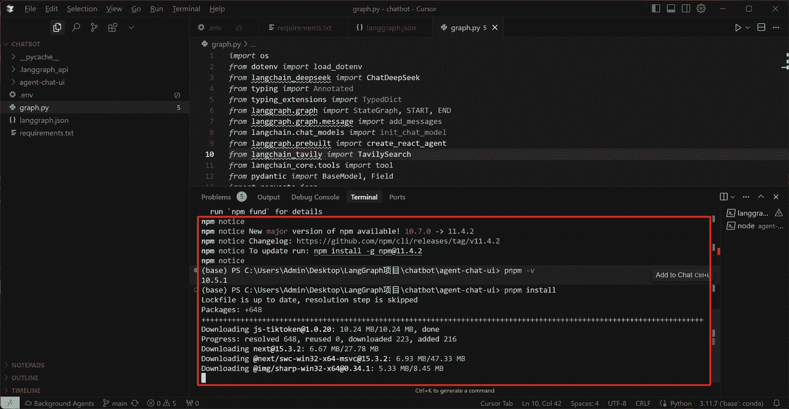

安装LangGraph项目部署工具：

```
pip install -U &quot;langgraph-cli[inmem]&quot;
```

### 2. 知识库检索数据集准备

接下来我们继续准备检索用的数据集，这里我们采用此前系列公开课《MCP技术实战》课件作为检索材料，课件总共约6万字，内容如下：

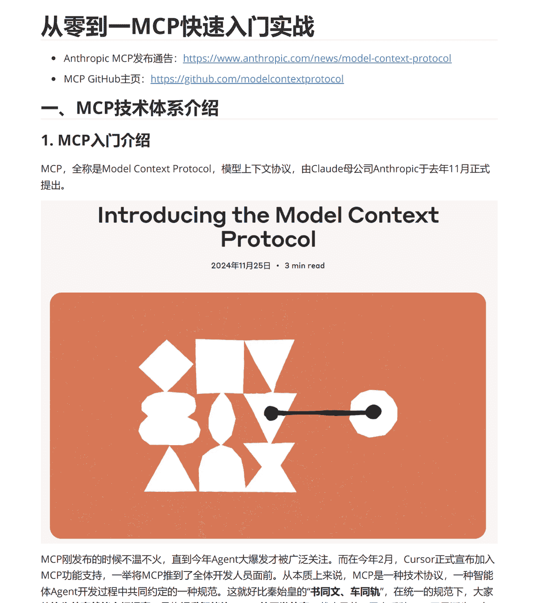

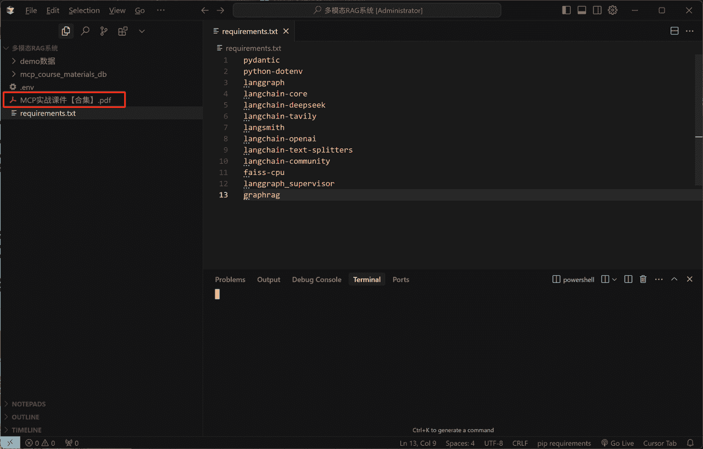

网盘对应地址如下：

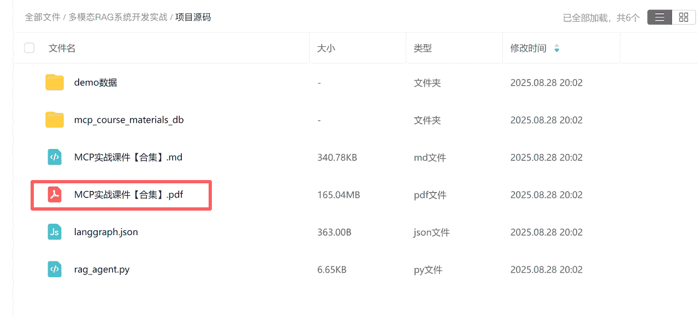

接下来我们需要先将其逆向转化为md文档：

                md_lines.append(f&quot;\n&quot;)

```
import os
import fitz
from unstructured.partition.pdf import partition_pdf

pdf_path = &quot;MCP实战课件【合集】.pdf&quot;
output_dir = &quot;pdf_images&quot;
os.makedirs(output_dir, exist_ok=True)

# Step 1: 提取文本/结构化内容
elements = partition_pdf(
    filename=pdf_path,
    infer_table_structure=True,   # 开启表格结构检测
    strategy=&quot;hi_res&quot;,            # 高分辨率 OCR，适合复杂表格
    ocr_languages=&quot;chi_sim+eng&quot;,  # 中英文混合识别
    ocr_engine=&quot;paddleocr&quot;        # 指定 PaddleOCR 引擎
)

# Step 2: 提取图片并保存
doc = fitz.open(pdf_path)
image_map = {}  # 映射 page_num -&gt; list of image paths

for page_num, page in enumerate(doc, start=1):
    image_map[page_num] = []
    for img_index, img in enumerate(page.get_images(full=True), start=1):
        xref = img[0]
        pix = fitz.Pixmap(doc, xref)
        img_path = os.path.join(output_dir, f&quot;page{page_num}_img{img_index}.png&quot;)
        if pix.n &lt; 5:  # RGB / Gray
            pix.save(img_path)
        else:  # CMYK 转 RGB
            pix = fitz.Pixmap(fitz.csRGB, pix)
            pix.save(img_path)
        image_map[page_num].append(img_path)
# Step 3: 转换为 Markdown
md_lines = []
inserted_images = set()  # 用来记录已经插入过的图片，避免重复

for el in elements:
    cat = el.category
    text = el.text
    page_num = el.metadata.page_number

    if cat == &quot;Title&quot; and text.strip().startswith(&quot;- &quot;):
        md_lines.append(text + &quot;\n&quot;)
    elif cat == &quot;Title&quot;:
        md_lines.append(f&quot;# {text}\n&quot;)
    elif cat in [&quot;Header&quot;, &quot;Subheader&quot;]:
        md_lines.append(f&quot;## {text}\n&quot;)
    elif cat == &quot;Table&quot;:
        if hasattr(el.metadata, &quot;text_as_html&quot;) and el.metadata.text_as_html:
            from html2text import html2text
            md_lines.append(html2text(el.metadata.text_as_html) + &quot;\n&quot;)
        else:
            md_lines.append(el.text + &quot;\n&quot;)
    elif cat == &quot;Image&quot;:
        # 避免重复插入：只插入当前图片对应的文件
        for img_path in image_map.get(page_num, []):
            if img_path not in inserted_images:
                inserted_images.add(img_path)
    else:
        md_lines.append(text + &quot;\n&quot;)

# Step 4: 写入 Markdown 文件
output_md = &quot;output.md&quot;
with open(output_md, &quot;w&quot;, encoding=&quot;utf-8&quot;) as f:
    f.write(&quot;\n&quot;.join(md_lines))

print(f&quot;✅ 转换完成，已生成 {output_md} 和 {output_dir}/ 图片文件夹&quot;)
```

生成md文档：

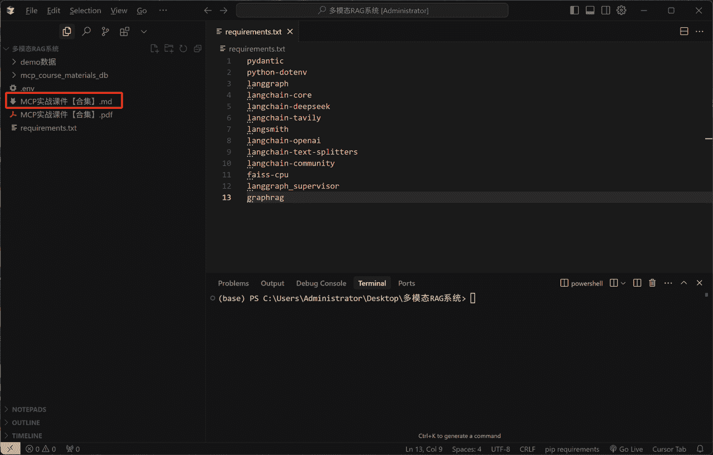

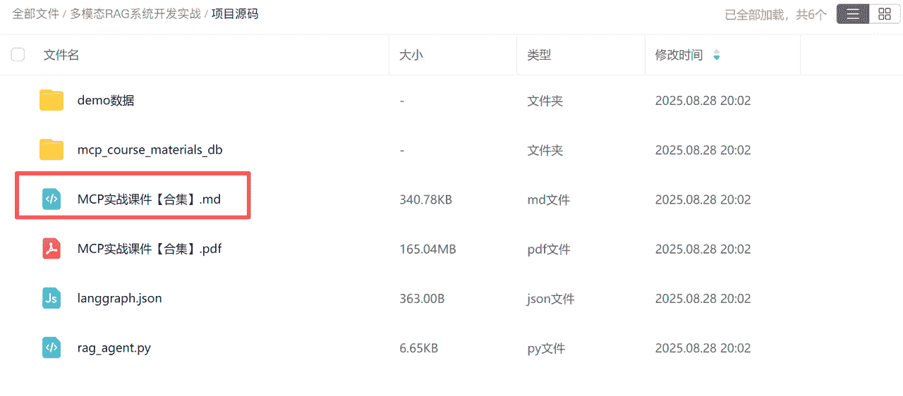

> 注，md版课件统一进行了图床上传，并且按照正则规则进行了数据清洗，整体文档结构更加规范。

然后，为了搭建RAG系统，我们还需要对原始文档进行处理，来创建词向量数据库：

```
OPENAI_EMBEDDING_API_KEY = os.getenv(&quot;OPENAI_API_KEY&quot;)
OPENAI_EMBEDDING_BASE_URL = &quot;https://ai.devtool.tech/proxy/v1&quot;

from langchain_openai import OpenAIEmbeddings

embed = OpenAIEmbeddings(
    api_key=OPENAI_EMBEDDING_API_KEY,
    base_url=OPENAI_EMBEDDING_BASE_URL,
    model=&quot;text-embedding-3-small&quot; 
)

# ! pip install langchain-text-splitters faiss-cpu --index-url https://pypi.tuna.tsinghua.edu.cn/simple

file_path = &quot;MCP实战课件【合集】.md&quot;

with open(file_path, &quot;r&quot;, encoding=&quot;utf-8&quot;) as f:
    md_content = f.read()
    
from langchain_text_splitters import MarkdownHeaderTextSplitter

headers_to_split_on = [
    (&quot;#&quot;, &quot;Header 1&quot;),
    (&quot;##&quot;, &quot;Header 2&quot;)
]

markdown_splitter = MarkdownHeaderTextSplitter(headers_to_split_on=headers_to_split_on)
md_header_splits = markdown_splitter.split_text(md_content)

vector_store = FAISS.from_documents(md_header_splits, embedding=embed)
vector_store.save_local(&quot;telco_customer_churn_analytics_handbook&quot;)
```

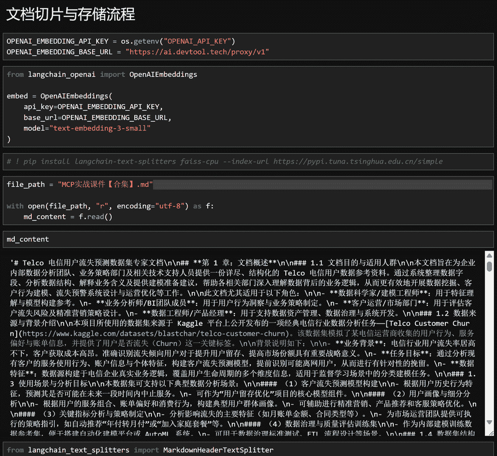

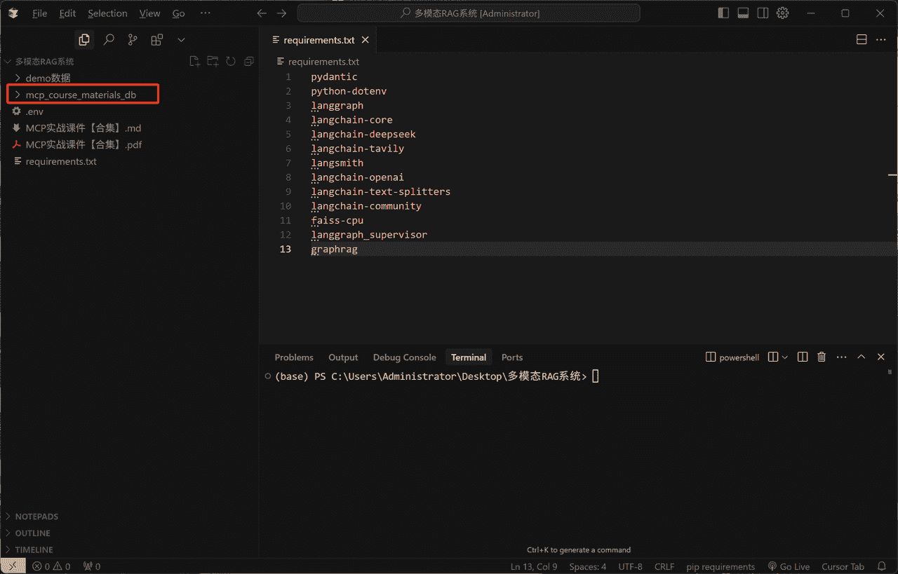

生成的词向量数据库如下：

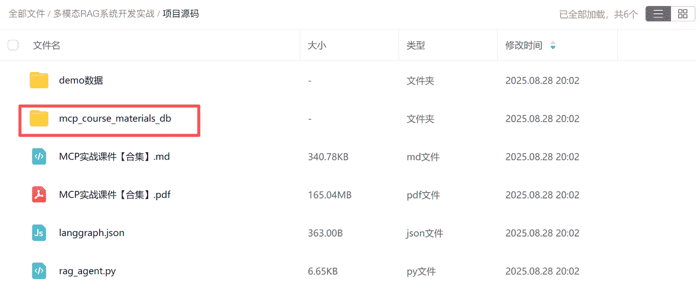

### 3. 多模态RAG系统开发

接下来编写多模态RAG系统代码：

    &quot;- If the context includes Markdown images (e.g. ), and the image is relevant, you may include it in the response.\n&quot;

```
from __future__ import annotations

import os
import asyncio
from typing import Literal
from dotenv import load_dotenv 
load_dotenv(override=True)
from langchain.chat_models import init_chat_model
from langchain_openai import OpenAIEmbeddings
from langchain_community.vectorstores import FAISS
from langchain.tools.retriever import create_retriever_tool
from langgraph.graph import MessagesState, StateGraph, START, END
from langgraph.prebuilt import ToolNode, tools_condition
from pydantic import BaseModel, Field

# ---------------------------------------------------------------------------
# LLM &amp; Embeddings
# ---------------------------------------------------------------------------
MODEL_NAME = &quot;deepseek-chat&quot;
model = init_chat_model(model=MODEL_NAME, model_provider=&quot;deepseek&quot;, temperature=0)
grader_model = init_chat_model(model=MODEL_NAME, model_provider=&quot;deepseek&quot;, temperature=0)

embed = OpenAIEmbeddings(
    api_key=os.getenv(&quot;OPENAI_API_KEY&quot;),
    base_url=&quot;https://ai.devtool.tech/proxy/v1&quot;,
    model=&quot;text-embedding-3-small&quot;,
)

# ---------------------------------------------------------------------------
# Vector store &amp; Retriever tool
# ---------------------------------------------------------------------------
VS_PATH = &quot;mcp_course_materials_db&quot;

vector_store = FAISS.load_local(
    folder_path=VS_PATH,
    embeddings=embed,
    allow_dangerous_deserialization=True,
)
retriever_tool = create_retriever_tool(
    vector_store.as_retriever(search_kwargs={&quot;k&quot;: 3}),
    name=&quot;retrieve_mcp_course&quot;,
    description=&quot;Search and return relevant sections from the mcp course materials.&quot;,
)

# ---------------------------------------------------------------------------
# Prompts
# ---------------------------------------------------------------------------
SYSTEM_INSTRUCTION = (
    &quot;You are an MCP technical training assistant. &#x27;MCP&#x27; refers to **Model Context Protocol**, &quot;
    &quot;an open framework for enabling LLMs to call external tools. Do NOT confuse it with Microsoft Certified Professional.\n&quot;
    &quot;Answer ONLY questions related to the MCP practical course content, including tool invocation, streaming, LangGraph, API design, etc. &quot;
    &quot;If the user question is NOT related to the course, reply: &#x27;我不能回答与 MCP 技术实战公开课无关的问题。&#x27; &quot;
    &quot;You may call the provided tool `retriever_tool` when additional context is required.&quot;
)

GRADE_PROMPT = (
    &quot;You are a grader assessing relevance of a retrieved document to a user question.\n&quot;
    &quot;Retrieved document:\n{context}\n\nUser question: {question}\n&quot;
    &quot;Return &#x27;yes&#x27; if relevant, otherwise &#x27;no&#x27;.&quot;
)

REWRITE_PROMPT = (
    &quot;You are rewriting user questions to make them more relevant to the MCP technical practical course.\n&quot;
    &quot;Note: In this context, **MCP stands for Model Context Protocol**, an open framework for enabling large language models to use external tools and structured APIs.\n&quot;
    &quot;Do NOT interpret MCP as Microsoft Certified Professional.\n&quot;
    &quot;Your job is to refine or clarify the user&#x27;s question to make it better aligned with key concepts from the Model Context Protocol course, such as tool invocation, tool registration, streaming APIs, LangGraph workflows, etc.\n\n&quot;
    &quot;Original question:\n{question}\nImproved question:&quot;
)

ANSWER_PROMPT = (
    &quot;You are an assistant for answering questions related to the MCP technical practical course. &quot;
    &quot;Use the provided context to answer the question as completely and accurately as possible. &quot;
    &quot;Whenever relevant, include examples, code blocks, or image references that appear in the source material. &quot;
    &quot;Use standard Markdown format for your output.\n\n&quot;
    
    &quot;Guidelines:\n&quot;
    &quot;- Prefer quoting code snippets using triple backticks (```) to preserve formatting.\n&quot;
    &quot;- Keep the response structured and easy to read with proper Markdown sections if needed.\n&quot;
    &quot;- If the answer is unknown or not present in the context, say: &#x27;我不知道。&#x27;\n\n&quot;

    &quot;Question: {question}\n&quot;
    &quot;Context: {context}&quot;
)

# ---------------------------------------------------------------------------
# LangGraph Nodes
# ---------------------------------------------------------------------------
async def generate_query_or_respond(state: MessagesState):
    &quot;&quot;&quot;LLM decides to answer directly or call retriever tool.&quot;&quot;&quot;
    response = await model.bind_tools([retriever_tool]).ainvoke(
        [
            {&quot;role&quot;: &quot;system&quot;, &quot;content&quot;: SYSTEM_INSTRUCTION},
            *state[&quot;messages&quot;],
        ]
    )
    return {&quot;messages&quot;: [response]}

class GradeDoc(BaseModel):
    binary_score: str = Field(description=&quot;Relevance score &#x27;yes&#x27; or &#x27;no&#x27;.&quot;)

async def grade_documents(state: MessagesState) -&gt; Literal[&quot;generate_answer&quot;, &quot;rewrite_question&quot;]:
    question = state[&quot;messages&quot;][0].content  # original user question
    ctx = state[&quot;messages&quot;][-1].content      # retriever output
    prompt = GRADE_PROMPT.format(question=question, context=ctx)
    result = await grader_model.with_structured_output(GradeDoc).ainvoke([
        {&quot;role&quot;: &quot;user&quot;, &quot;content&quot;: prompt}
    ])
    return &quot;generate_answer&quot; if result.binary_score.lower().startswith(&quot;y&quot;) else &quot;rewrite_question&quot;

async def rewrite_question(state: MessagesState):
    question = state[&quot;messages&quot;][0].content
    prompt = REWRITE_PROMPT.format(question=question)
    resp = await model.ainvoke([{&quot;role&quot;: &quot;user&quot;, &quot;content&quot;: prompt}])
    return {&quot;messages&quot;: [{&quot;role&quot;: &quot;user&quot;, &quot;content&quot;: resp.content}]}

async def generate_answer(state: MessagesState):
    question = state[&quot;messages&quot;][0].content
    ctx = state[&quot;messages&quot;][-1].content
    prompt = ANSWER_PROMPT.format(question=question, context=ctx)
    resp = await model.ainvoke([{&quot;role&quot;: &quot;user&quot;, &quot;content&quot;: prompt}])
    return {&quot;messages&quot;: [resp]}

# ---------------------------------------------------------------------------
# Build graph
# ---------------------------------------------------------------------------
workflow = StateGraph(MessagesState)
workflow.add_node(&quot;generate_query_or_respond&quot;, generate_query_or_respond)
workflow.add_node(&quot;retrieve&quot;, ToolNode([retriever_tool]))
workflow.add_node(&quot;rewrite_question&quot;, rewrite_question)
workflow.add_node(&quot;generate_answer&quot;, generate_answer)

workflow.add_edge(START, &quot;generate_query_or_respond&quot;)
workflow.add_edge(&quot;generate_query_or_respond&quot;, &quot;retrieve&quot;)
workflow.add_conditional_edges(&quot;retrieve&quot;, grade_documents)
workflow.add_edge(&quot;generate_answer&quot;, END)
workflow.add_edge(&quot;rewrite_question&quot;, &quot;generate_query_or_respond&quot;)

rag_agent = workflow.compile(name=&quot;rag_agent&quot;)
```

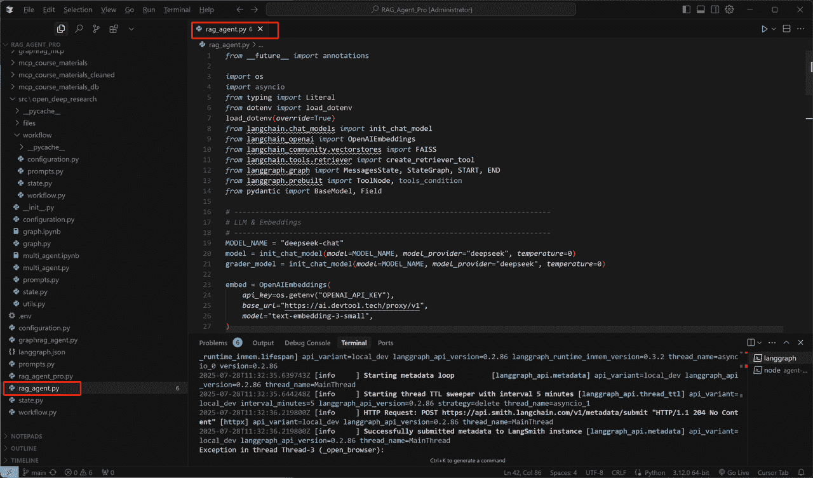

代码解释如下：

#### 1. 环境与依赖加载

```
from __future__ import annotations
import os
import asyncio
from typing import Literal
from dotenv import load_dotenv 
load_dotenv(override=True)
```

+   __future__.annotations: 使 Python 3.7+ 支持延迟注解解析（避免循环引用等问题）。

+   load_dotenv(override=True): 加载 .env 环境变量文件中的内容（如 API key），并允许覆盖已有变量。

#### 2. 初始化 LLM 模型与嵌入模型

```
from langchain.chat_models import init_chat_model
from langchain_openai import OpenAIEmbeddings
```

+   init_chat_model(...): 初始化 deepseek-chat 模型（来自 DeepSeek 的对话式大模型）。

+   OpenAIEmbeddings(...): 使用 OpenAI 的 text-embedding-3-small 嵌入模型，将文本转为向量用于向量检索。

```
MODEL_NAME = &quot;deepseek-chat&quot;
model = init_chat_model(model=MODEL_NAME, model_provider=&quot;deepseek&quot;, temperature=0)
grader_model = init_chat_model(model=MODEL_NAME, model_provider=&quot;deepseek&quot;, temperature=0)
```

+   model：主模型，用于用户对话处理。

+   grader_model：用于判断文档相关性的小助手模型。

#### 3. 向量数据库加载与检索工具构建

```
VS_PATH = &quot;mcp_course_materials_db&quot;
vector_store = FAISS.load_local(...)
retriever_tool = create_retriever_tool(...)
```

+   从本地加载一个名为 mcp_course_materials_db 的 FAISS 向量库；

+   使用 **create_retri**ever_tool 构造了一个可供 LangGraph 工具调用的 Retriever 工具（用于查找与问题相关的文本块）；

+   k=3 表示每次检索返回3条上下文。

#### 4. 提示词设计（Prompt Engineering）

这些提示词是对智能体行为的指令设计。

系统提示词

```
SYSTEM_INSTRUCTION = (...)
```

+   限定助手只能回答“Model Context Protocol (MCP)”技术实战相关问题；

+   如果不是相关问题，就回复：我不能回答与 MCP 技术实战公开课无关的问题。

评估 Prompt

```
GRADE_PROMPT = (...)
```

+   指导 grader_model 判断检索结果是否与用户提问相关，输出 yes 或 no。

重写 Prompt

```
REWRITE_PROMPT = (...)
```

+   如果用户问题偏离主题，让模型改写问题，使其更贴近“工具调用 / LangGraph / MCP”等关键概念。

回答 Prompt

```
ANSWER_PROMPT = (...)
```

+   给模型一个问题和上下文，引导它用 Markdown、代码块、图片等方式生成结构化答案。

#### 5. LangGraph 节点逻辑定义

LangGraph 是有状态多节点的图结构，这里定义了智能体对话的各个节点功能。

✅ generate_query_or_respond

```
async def generate_query_or_respond(state: MessagesState):
    ...
```

+   调用 LLM，根据当前消息决定是否要调用 retriever_tool；

+   本质上是一个具备工具调用能力的交互节点（如果上下文不足，模型会自动决定调用检索器）。

✅ grade_documents

```
async def grade_documents(state: MessagesState) -&gt; Literal[&quot;generate_answer&quot;, &quot;rewrite_question&quot;]:
    ...
```

+   使用 grader_model 判断：检索到的文档是否与提问有关；

+   如果是 → generate_answer；

+   如果不是 → rewrite_question。

✅ rewrite_question

```
async def rewrite_question(state: MessagesState):
    ...
```

+   调用 LLM 改写用户问题，使其更符合 MCP 课程范畴。

✅ generate_answer

```
async def generate_answer(state: MessagesState):
    ...
```

+   用 LLM + 上下文生成最终答复；

+   支持代码块与 Markdown 格式。

#### 🧭 6. 构建 LangGraph 工作流

```
workflow = StateGraph(MessagesState)
```

我们将所有逻辑节点通过图结构组合成一个完整智能体流程：

```
graph TD
    START --&gt; generate_query_or_respond
    generate_query_or_respond --&gt; retrieve
    retrieve --&gt; grade_documents
    grade_documents -- yes --&gt; generate_answer --&gt; END
    grade_documents -- no --&gt; rewrite_question --&gt; generate_query_or_respond
```

解释如下：

| 步骤 | 节点名称 | 功能 |
| --- | --- | --- |
| 1 | START | 起点 |
| 2 | generate_query_or_respond | 模型判断是否调用工具 |
| 3 | retrieve | 调用检索工具返回上下文 |
| 4 | grade_documents | 判断检索结果是否相关 |
| 5a | generate_answer | 生成回答 → 终点 |
| 5b | rewrite_question | 改写问题 → 回到第2步 |

#### 7. 编译智能体并生成入口

```
rag_agent = workflow.compile(name=&quot;rag_agent&quot;)
```

最终将整个 LangGraph 图编译为可调用的 rag_agent，你可以在主函数中这样调用：

```
await rag_agent.ainvoke({&quot;messages&quot;: [{&quot;role&quot;: &quot;user&quot;, &quot;content&quot;: &quot;MCP 是什么？&quot;}]})
```

实际测试效果如下：

---

+   体验课内容节选自《2025大模型Agent智能体开发实战》(秋招冲刺班)完整版付费课程

体验课时间有限，若想深度学习大模型技术，欢迎大家报名由我主讲的《2025大模型Agent智能体开发实战》(秋招冲刺班)


此外，若是对大模型底层原理感兴趣，也欢迎报名由我和菜菜老师共同主讲的《2025大模型原理与实战课程》(秋招冲刺班)

**大模型秋招冲刺班开班特惠进行中，直播间享五折特价+全套SVIP新班特定福利，合购还有更多**优惠哦~详细信息扫码添加助教，回复“大模型”，即可领取课程大纲&查看课程详情👇


**《2025大模型Agent智能体开发实战**》(秋招冲刺班)为【100+小时】体系大课，总共20大模块精讲精析，零基础直达大模型企业级应用！