# Part 3.多模态RAG系统进阶：olmOCR与MinerU工具使用

> 来源：`https://kq4b3vgg5b.feishu.cn/docx/Vb1Bd1JsXoGEHuxUFmjcoqy4nXb`

## 课程说明

体验课内容节选自《2025大模型Agent智能体开发实战》(秋招冲刺班)完整版付费课程

体验课时间有限，若想深度学习大模型技术，欢迎大家报名由我主讲的《2025大模型Agent智能体开发实战》(秋招冲刺班)

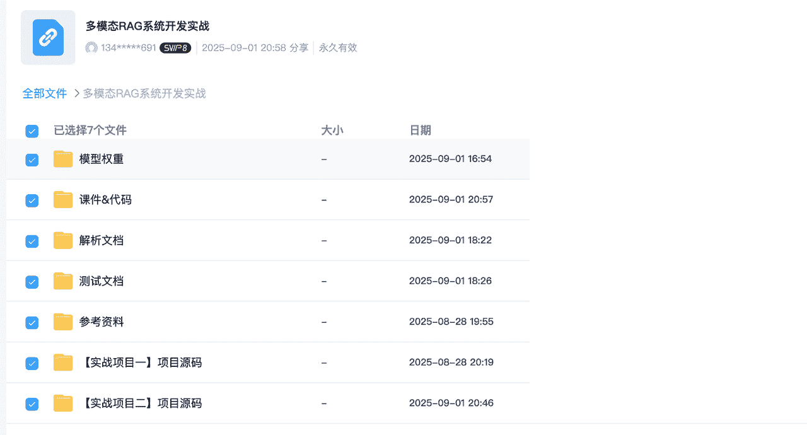


公开课全套学习资料，已上传至网盘（`https://pan.baidu.com/s/1vV-8ew5tAfZOfwG3c4WAFw` 提取码: i345）需要更系统深入学习大模型vx可扫码⬆️添加助教咨询喔～

## 公开课四大模块内容

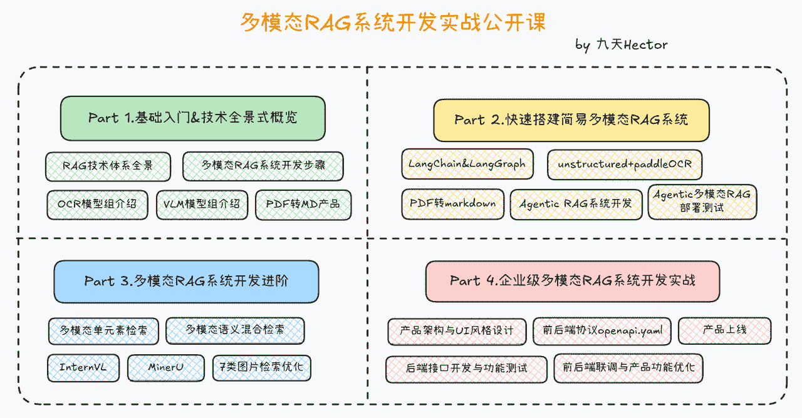

+ 【演示】实操项目一：从零到一快速搭建多模态RAG系统
+ 【演示】实操项目二：企业级多模态RAG系统开发实战

## 一、最强开源OCR模型：olmOCR部署与调用流程

### 1. PDF转MD功能重要性说明

在多模态 RAG 系统里，“PDF → Markdown（MD）”是整条链路最关键的入口：PDF 更偏“版面/坐标”，而检索需要的是可切块、可对齐语义与结构的文本。把 PDF 线性化成 MD 后，标题/段落/列表/表格/公式等要素被清晰暴露，既便于后续用 `partition_markdown` + `chunk_by_title` 做细粒度切分，又能与图片、表格截图等“资产轨”对齐做多模态索引（文本向量、关键词 BM25、图像向量），从而提升召回与答案可解释性。围绕“PDF→MD”，目前社区有两条代表性路径：`olmOCR` 与 `MinerU`。前者由 AI2 开源，基于视觉-语言模型进行高质量线性化，强调自然阅读顺序与对公式、表格、手写体等复杂版式的鲁棒支持，并提供面向大规模的推理/部署方案（兼容 `vLLM`/`SGLang` 等）；非常适合作为“文本轨”起点，配合你后续的结构化与检索流程使用。后者 `MinerU` 则主打一站式 PDF→Markdown/JSON 的开源工具链，在科研文献等场景中表现活跃，便于与下游的数据加工、结构抽取与标注流程衔接（需关注其开源许可）。两者都能把“难啃的 PDF”转成“检索友好”的语料，为多模态 RAG 的高精度检索与可追溯引用打下坚实基础。

### 2. olmOCR项目介绍

`olmOCR` 是 AI2（Allen Institute for AI）开源的 PDF 线性化工具包：把 PDF/PNG/JPEG 等基于图像的文档转成干净的 Markdown/纯文本，保留自然阅读顺序，并对公式、表格、手写体、多栏版式等复杂场景做了专项优化；还能自动去除页眉/页脚，面向大规模批处理提供高效推理与集群/云端处理能力。官方 README 概述的核心要点包括：功能特性、新闻版本记录（`v0.3.x` 修复自动旋转与空白页幻觉、`v0.2.x` 默认 `FP8` 更快等）、安装与用法、外接 `vLLM`、`Docker`、`S3`/多机并行、完整命令帮助等。

换而言之，`olmOCR` 本质上其实是一个经过特定功能微调的多模态大模型，能够实现明显好于其他普通 OCR 模型的光学字符识别效果，并且借助官方发布的各种脚本，能够非常便捷的实现 PDF 到 markdown 的一键转化。

+ 项目地址：`https://github.com/allenai/olmocr`

模型方面，官方已发布 `7B` 等级的 `VLM` 权重，微调自 `Qwen2.5-VL-7B-Instruct`，并提供了相应训练数据集 `olmOCR-mix-0225`（约 25 万页，保自然阅读顺序），其中还有 `FP8` 量化版本便于推理。

+ 项目模型：`https://huggingface.co/allenai/olmOCR-7B-0825-FP8`

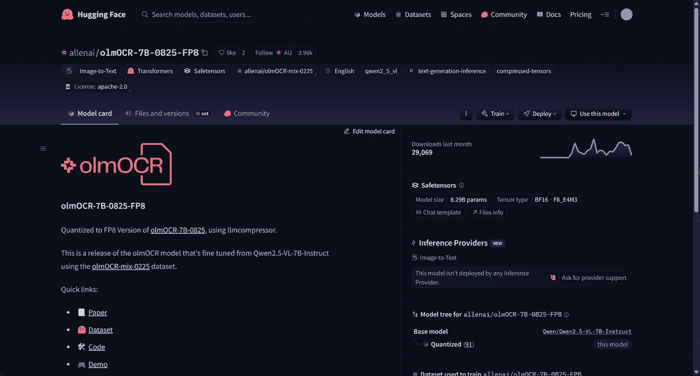

+ OCR准确率跑分：

+ `olmOCR` 更像是“面向 PDF→Markdown 的 VLM 型 OCR 系统”，在“自然阅读顺序、复杂版式（多栏/表格/公式/页眉页脚）、一键产出干净 Markdown”这些维度上，往往比传统 OCR 流水线（如 `PaddleOCR`）或单一识别模型更省事且更稳；而纯字符级识别的极致精度/低算力部署，传统 OCR 仍有优势。

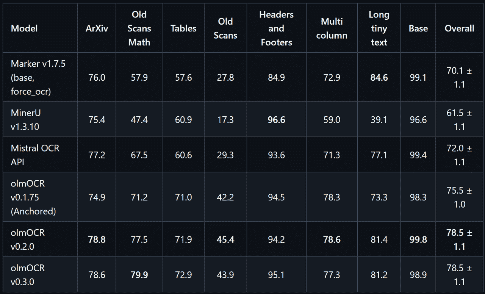

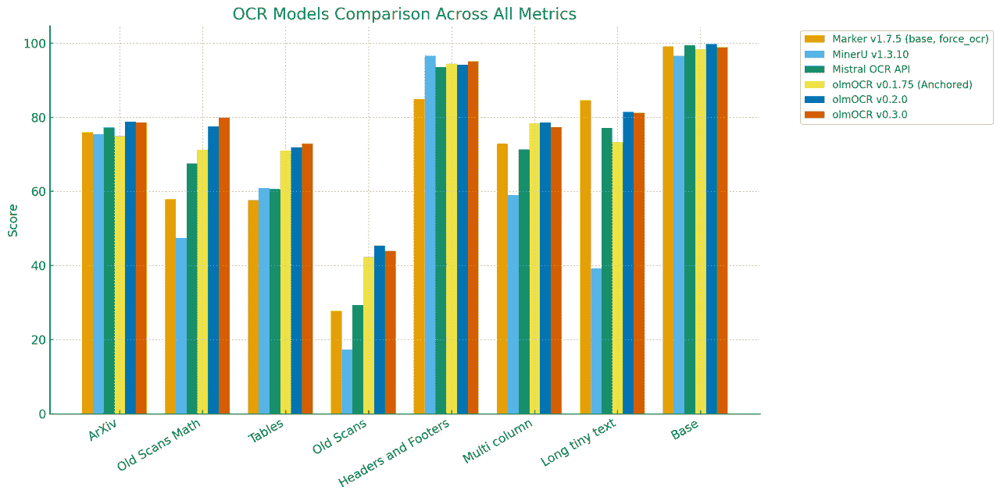

+ 模型在线测试：`https://olmocr.allenai.org/`

+ 测试文档：《GSPO原论文》

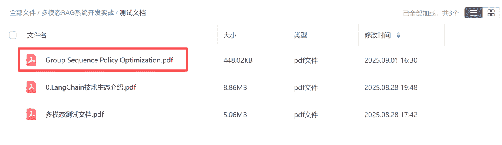


实测效果：

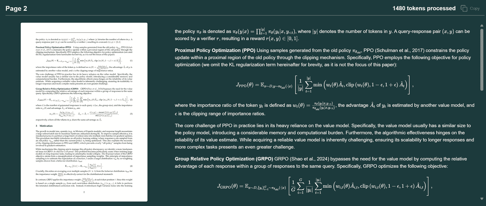

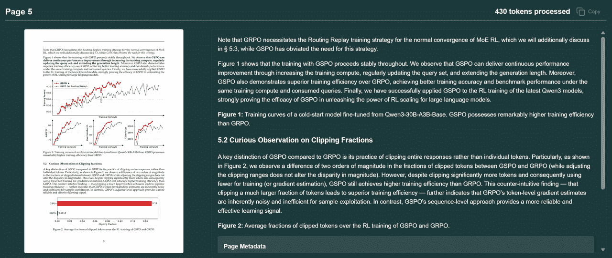

### 3. olmOCR部署与调用流程

#### 3.1 硬件与系统说明

目前 `olmOCR` 只支持本地部署，硬件条件如下（后续介绍的 `MinerU` 可以通过 API 进行部署）：

+ NVIDIA GPU，建议显存 ≥ 15 GB（官方测试过 RTX 4090、L40S、A100、H100；磁盘需约 30 GB）。

+ 操作系统：Linux。

#### 3.2 系统依赖（用于 PDF 渲染/字体）

然后则需要安装相关依赖：

```
sudo apt-get update
sudo apt-get install -y poppler-utils ttf-mscorefonts-installer msttcorefonts \
  fonts-crosextra-caladea fonts-crosextra-carlito gsfonts lcdf-typetools
```

> 以上为 README 推荐依赖，用于将 PDF 页渲染为图像、补齐字体

#### 3.3 创建虚拟环境

接下来继续创建虚拟环境：

```
conda create -n olmocr python=3.11 -y
conda activate olmocr
```

#### 3.4 安装olmOCR

```
# 可选，CPU 仅用于跑评测脚本（不能做 7B 模型推理）
# pip install "olmocr[bench]"         

# 可选，设置代理环境
# set http_proxy=http://127.0.0.1:10080
# set https_proxy=http://127.0.0.1:10080

# GPU 推理（推荐）
pip install "olmocr[gpu]" --extra-index-url https://download.pytorch.org/whl/cu128

# 可选：FlashInfer 加速（CUDA 12.8 + torch2.7 对应版本）
# pip install https://download.pytorch.org/whl/cu128/flashinfer/flashinfer_python-0.2.5%2Bcu128torch2.7-cp38-abi3-linux_x86_64.whl
```

> 需要注意的是，CPU 只能跑 bench 相关（打分/统计），真正的 OCR/VLM 推理必须用 GPU。

这条安装命令的核心是安装带 GPU 支持的 `olmOCR` 依赖，并确保 `pip` 能从 PyTorch 官方 CUDA 12.8 仓库抓到正确的 CUDA 版 torch，从而让后续的 VLM 推理真正跑在 GPU 上。

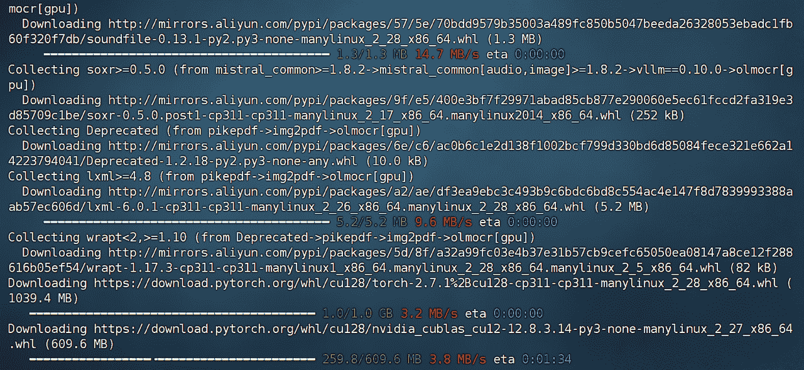

此外，需要注意的是，本条安装命令包含自动安装推理工具 `vLLM`，如果当前环境已经安装了 `vLLM`，则可以直接使用 `pip install "olmocr[gpu]"` 进行安装，然后使用下一小节介绍的命令借助 `vLLM` 服务来调用脚本。

安装完成后即可查看实际安装结果：

```
pip show olmocr
```

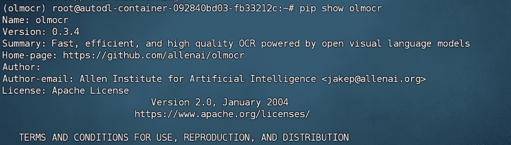

同时安装过程还会附带安装 `vllm` 作为推理引擎：

```
pip show vllm
```

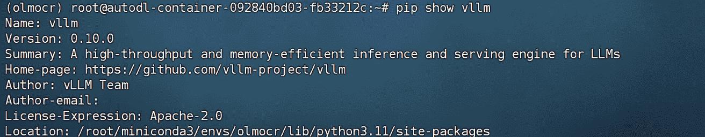

#### 3.5 下载olmOCR模型权重

需要先安装魔搭社区：

```
pip install modelscope
```

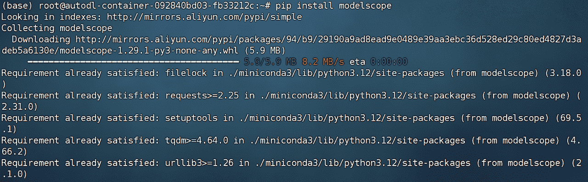

然后尝试下载 `olmOCR` 模型：`https://www.modelscope.cn/models/allenai/olmOCR-7B-0825-FP8/`

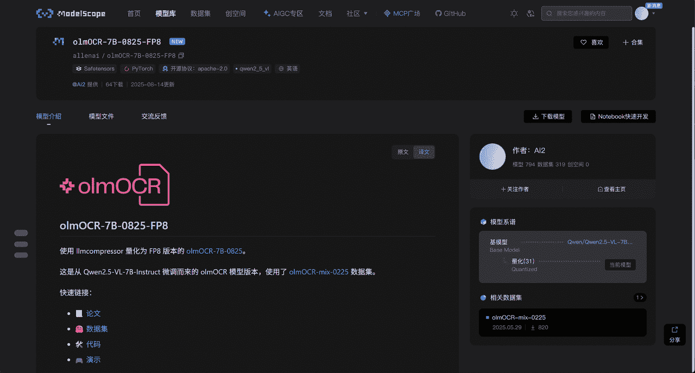

使用如下命令即可开始下载：

```
# mkdir ./olmOCR-7B-0825-FP8
modelscope download --model allenai/olmOCR-7B-0825-FP8 --local_dir ./olmOCR-7B-0825-FP8
```

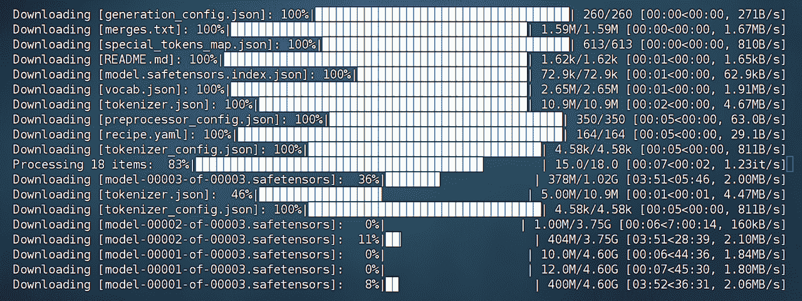

下载完后完整项目结构如图所示：

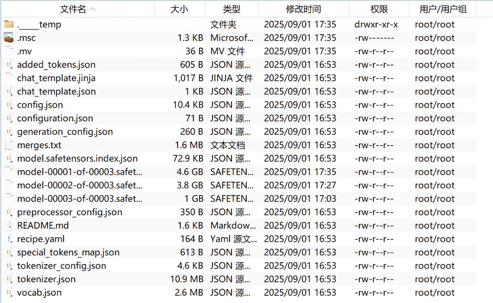

此外，模型权重也可以从网盘中直接进行下载：

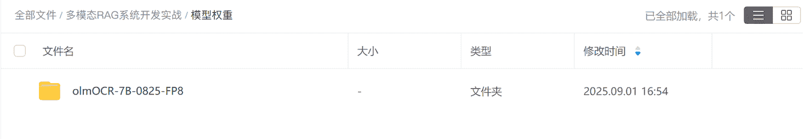

#### 3.6 olmOCR模型调用流程

然后即可尝试调用 `olmOCR` 模型。需要注意的是，`olmOCR` 模型本质上是 `Qwen2.5-VL` 模型经过微调后的模型，我们仍然可以采用大模型基本调用流程来调用 `olmOCR` 模型。同时，由于微调改变了模型的输入、输出格式，我们需要简单查看 `olmOCR` 模型微调数据集，来最终确认微调模型可以接受的输入和输出。

+ `olmOCR` 模型微调数据集：`https://huggingface.co/datasets/allenai/olmOCR-mix-0225`

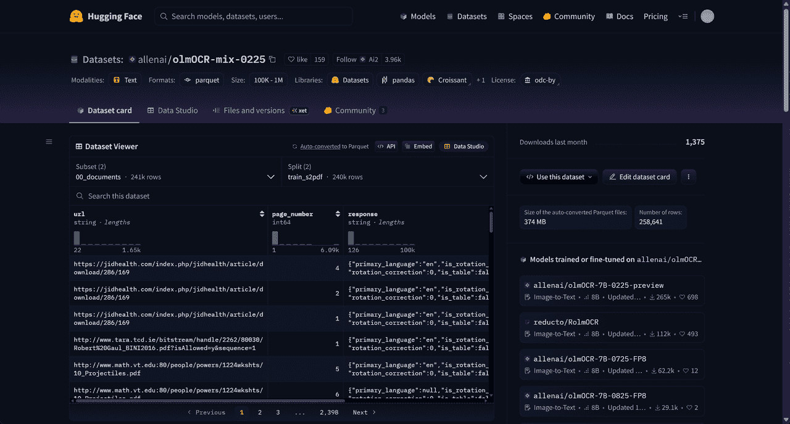

其中每条数据集格式如下：

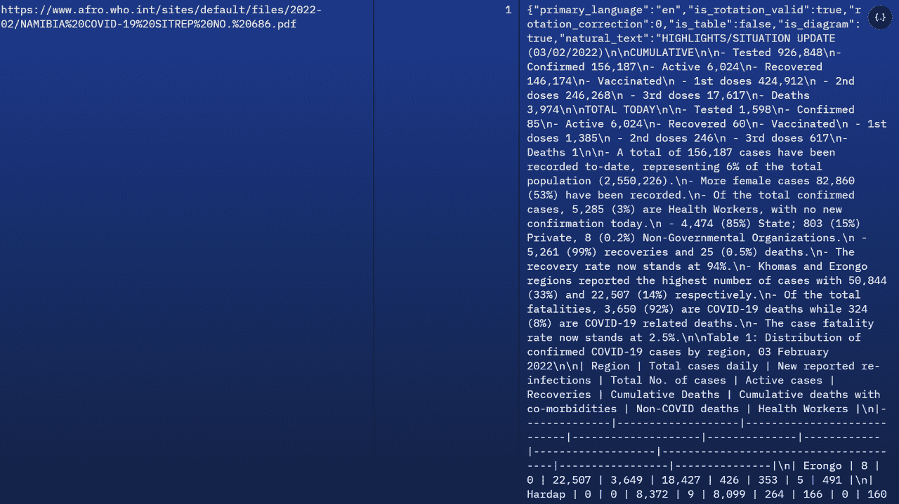

模型输入为 PDF 中的一页，例如：

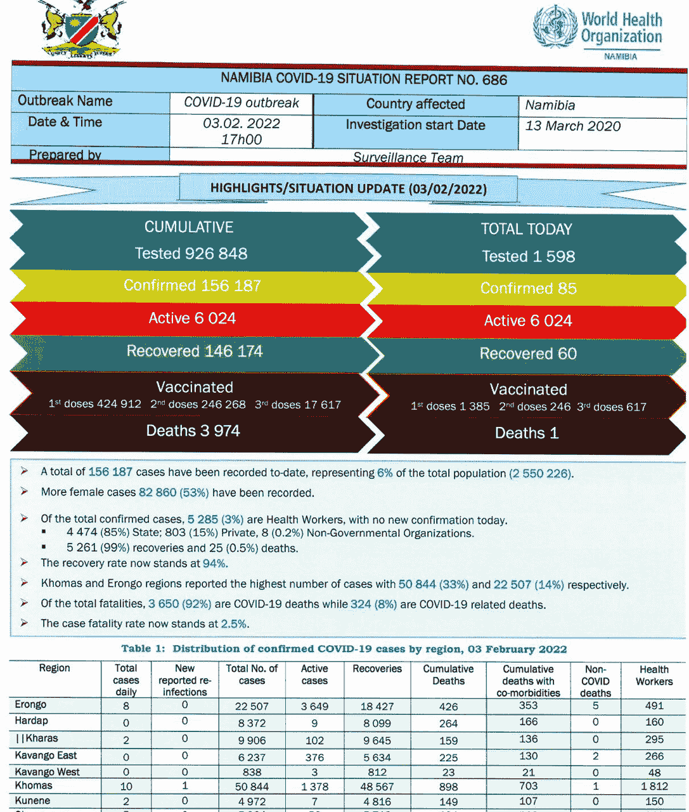

而输出则是结构化文本解析，例如：

```
{"primary_language":"en","is_rotation_valid":true,"rotation_correction":0,"is_table":false,"is_diagram":true,"natural_text":"HIGHLIGHTS/SITUATION UPDATE (03/02/2022)\n\nCUMULATIVE\n\n- Tested 926,848\n- Confirmed 156,187\n- Active 6,024\n- Recovered 146,174\n- Vaccinated\n - 1st doses 424,912\n - 2nd doses 246,268\n - 3rd doses 17,617\n- Deaths 3,974\n\nTOTAL TODAY\n\n- Tested 1,598\n- Confirmed 85\n- Active 6,024\n- Recovered 60\n- Vaccinated\n - 1st doses 1,385\n - 2nd doses 246\n - 3rd doses 617\n- Deaths 1\n\n- A total of 156,187 cases have been recorded to-date, representing 6% of the total population (2,550,226).\n- More female cases 82,860 (53%) have been recorded.\n- Of the total confirmed cases, 5,285 (3%) are Health Workers, with no new confirmation today.\n - 4,474 (85%) State; 803 (15%) Private, 8 (0.2%) Non-Governmental Organizations.\n - 5,261 (99%) recoveries and 25 (0.5%) deaths.\n- The recovery rate now stands at 94%.\n- Khomas and Erongo regions reported the highest number of cases with 50,844 (33%) and 22,507 (14%) respectively.\n- Of the total fatalities, 3,650 (92%) are COVID-19 deaths while 324 (8%) are COVID-19 related deaths.\n- The case fatality rate now stands at 2.5%.\n\nTable 1: Distribution of confirmed COVID-19 cases by region, 03 February 2022\n\n| Region | Total cases daily | New reported re-infections | Total No. of cases | Active cases | Recoveries | Cumulative Deaths | Cumulative deaths with co-morbidities | Non-COVID deaths | Health Workers |\n|--------------|-------------------|----------------------------|--------------------|--------------|------------|-------------------|---------------------------------------|-----------------|---------------|\n| Erongo | 8 | 0 | 22,507 | 3,649 | 18,427 | 426 | 353 | 5 | 491 |\n| Hardap | 0 | 0 | 8,372 | 9 | 8,099 | 264 | 166 | 0 | 160 |\n| ||Khomas | 10 | 0 | 50,844 | 1,378 | 48,567 | 899 | 703 | 1 | 1,812 |\n| Kunene | 2 | 0 | 4,972 | 7 | 4,816 | 149 | 107 | 0 | 150 |\n| Ohangwena | 5 | 0 | 5,964 | 88 | 5,710 | 194 | 118 | 2 | 220 |\n| Omaheke | 40 | 0 | 4,961 | 81 | 4,590 | 289 | 204 | 1 | 142 |\n| Omusati | 7 | 0 | 7,524 | 66 | 7,125 | 333 | 221 | 0 | 265 |\n| Oshana | 2 | 0 | 10,579 | 55 | 10,132 | 391 | 249 | 0 | 607 |\n| Oshikoto | 0 | 0 | 7,852 | 0 | 7,632 | 220 | 150 | 2 | 365 |\n| Otjozondjupa | 5 | 0 | 12,109 | 88 | 11,736 | 284 | 184 | 1 | 339 |\n| Zambezi | 1 | 0 | 3,522 | 147 | 3,243 | 132 | 94 | 0 | 125 |\n\nTotal: 85 cases, 156,187 total cases, 6,024 active cases, 146,174 recoveries, 3,974 deaths, 2,810 cumulative deaths with co-morbidities, 15 non-COVID deaths, 5,285 health workers."}
```

翻译如下：


# olmOCR 使用指南

## JSON 响应示例

```json
{
  "primary_language": "zh",
  "is_rotation_valid": true,
  "rotation_correction": 0,
  "is_table": false,
  "is_diagram": true,
  "natural_text": "重要内容/情况更新 (2022年2月3日)\n\n累计数据\n\n- 检测 926,848例\n- 确诊 156,187例\n- 现有病例 6,024例\n- 康复 146,174例\n- 接种疫苗\n - 第1剂 424,912例\n - 第2剂 246,268例\n - 第3剂 17,617例\n- 死亡 3,974例\n\n今日总计\n\n- 检测 1,598例\n- 确诊 85例\n- 现有病例 6,024例\n- 康复 60例\n- 接种疫苗\n - 第1剂 1,385例\n - 第2剂 246例\n - 第3剂 617例\n- 死亡 1例\n\n- 迄今为止，共记录156,187例病例，占总人口（2,550,226）的6%。\n- 记录了更多的女性病例，共82,860例（53%）。\n- 在所有确诊病例中，有5,285例（3%）是医护人员，今天没有新增确诊病例。\n - 4,474例（85%）为国家公立医院医护人员；803例（15%）为私人医院医护人员；8例（0.2%）为非政府组织医护人员。\n - 5,261例（99%）康复，25例（0.5%）死亡。\n- 康复率目前为94%。\n- 赫马斯（Khomas）和埃龙戈（Erongo）地区报告的病例数最多，分别为50,844例（33%）和22,507例（14%）。\n- 在所有死亡病例中，3,650例（92%）是因新冠病毒死亡，而324例（8%）是与新冠病毒相关的死亡。\n- 病死率目前为2.5%。\n\n表1：按地区划分的COVID-19确诊病例分布，2022年2月3日\n\n| 地区 | 每日总病例数 | 新报告的重复感染病例 | 病例总数 | 现有病例 | 康复病例 | 累计死亡人数 | 累计伴有基础疾病的死亡人数 | 非新冠病毒死亡人数 | 医护人员病例数 |\n|--------------|-------------------|----------------------------|--------------------|--------------|------------|-------------------|---------------------------------------|-----------------|---------------|\n| 埃龙戈（Erongo） | 8 | 0 | 22,507 | 3,649 | 18,427 | 426 | 353 | 5 | 491 |\n| 哈达普（Hardap） | 0 | 0 | 8,372 | 9 | 8,099 | 264 | 166 | 0 | 160 |\n| 赫马斯（Khomas） | 10 | 0 | 50,844 | 1,378 | 48,567 | 899 | 703 | 1 | 1,812 |\n| 库内内（Kunene） | 2 | 0 | 4,972 | 7 | 4,816 | 149 | 107 | 0 | 150 |\n| 奥汉圭纳（Ohangwena） | 5 | 0 | 5,964 | 88 | 5,710 | 194 | 118 | 2 | 220 |\n| 奥马赫克（Omaheke） | 40 | 0 | 4,961 | 81 | 4,590 | 289 | 204 | 1 | 142 |\n| 奥穆萨蒂（Omusati） | 7 | 0 | 7,524 | 66 | 7,125 | 333 | 221 | 0 | 265 |\n| 奥沙纳（Oshana） | 2 | 0 | 10,579 | 55 | 10,132 | 391 | 249 | 0 | 607 |\n| 奥希科托（Oshikoto） | 0 | 0 | 7,852 | 0 | 7,632 | 220 | 150 | 2 | 365 |\n| 奥特乔宗杜帕（Otjozondjupa） | 5 | 0 | 12,109 | 88 | 11,736 | 284 | 184 | 1 | 339 |\n| 赞比西（Zambezi） | 1 | 0 | 3,522 | 147 | 3,243 | 132 | 94 | 0 | 125 |\n\n总计：85例病例，累计156,187例病例，6,024例现有病例，146,174例康复病例，3,974例死亡病例，2,810例累计伴有基础疾病的死亡病例，15例非新冠病毒死亡病例，5,285名医护人员病例。"
}
```

因此，后续我们也需要据此对模型进行提问。

## 开启 vLLM 模型服务

这里首先我们需要开启 `vLLM` 模型服务：

```bash
vllm serve ./olmOCR-7B-0825-FP8 \
  --served-model-name olmocr \
  --max-model-len 16384
```

顺利启动后如下所示：

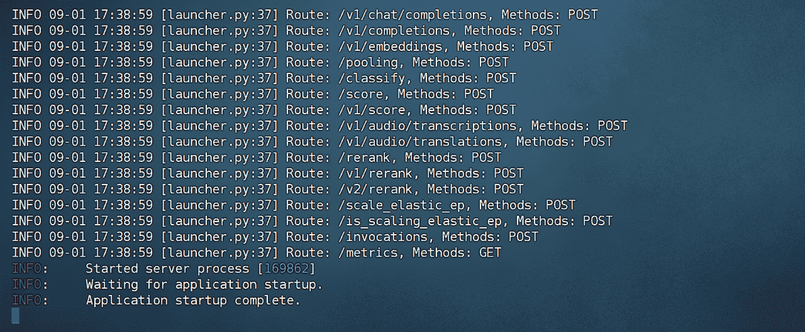

## 配置 Jupyter Kernel

然后在命令行中将当前虚拟环境添加到 Jupyter kernel 中：

```bash
conda install jupyterlab
conda install ipykernel
python -m ipykernel install --user --name olmocr --display-name "Python (olmocr)"
```

然后下载 olm 官方提供的测试文档：`https://olmocr.allenai.org/papers/olmocr_3pg_sample.pdf`

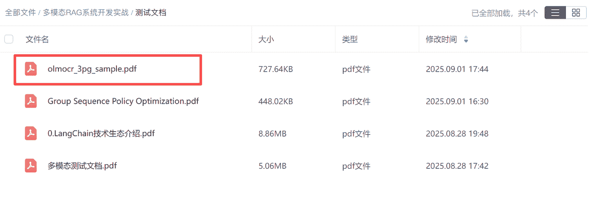


内容如下：

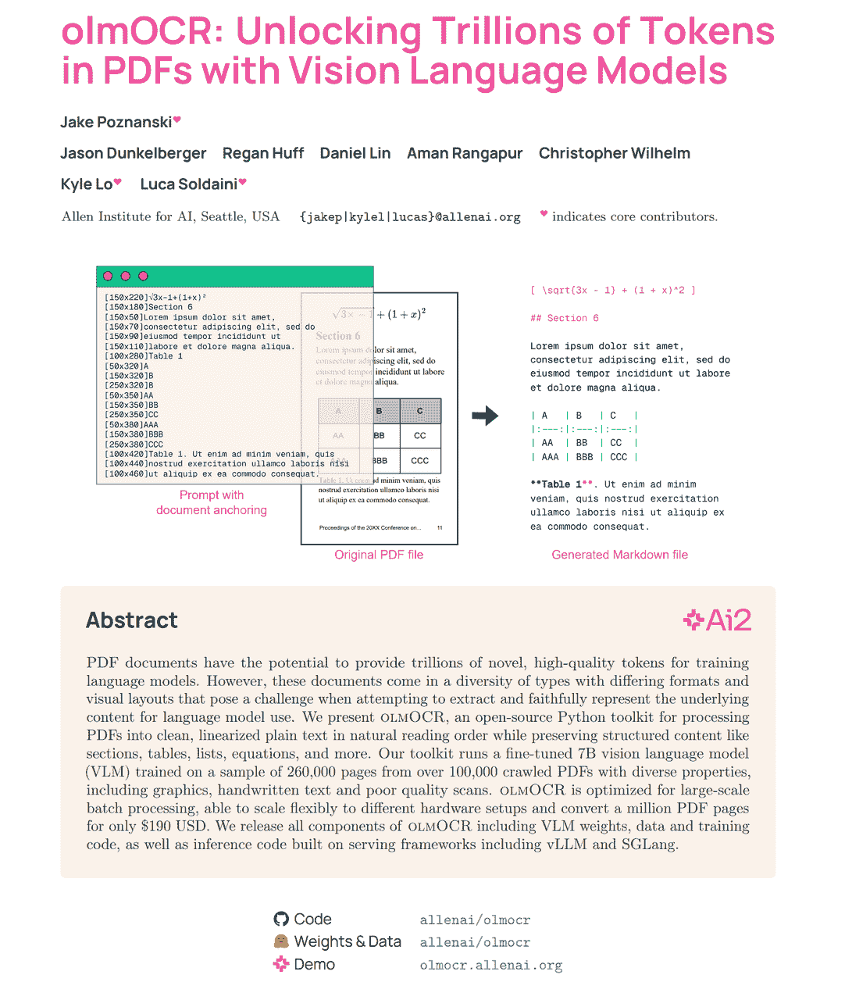

## PDF 转 Markdown 调用测试

然后打开 `Jupyter`，输入如下内容进行调用测试：

```python
# Jupyter最小可复现实验：PDF -> (pdf2image) -> vLLM(olmocr) -> Markdown
# 需要安装!pip install pdf2image pillow requests tqdm
import os, base64, requests, textwrap
from pdf2image import convert_from_path
from PIL import Image

VLLM_ENDPOINT = "http://localhost:8000/v1/chat/completions"  # 改成你的host
MODEL_NAME    = "olmocr"   # 必须与 vLLM 的 --served-model-name 一致
PDF_PATH      = "olmocr_3pg_sample.pdf";
OUT_MD        = "out.md";
MAX_PAGES     = 5          # 只测前N页，长文档避免一次性太大

# 1) PDF -> images（可按需调 dpi 或对最长边做resize以控显存/上下文）
pages = convert_from_path(PDF_PATH, dpi=200)   # 200~300 dpi 常用
images = []
for i, img in enumerate(pages[:MAX_PAGES], start=1):
    # 可选：限制最长边（例：最长边不超过 1600px，减少上下文占用）
    max_side = max(img.size)
    if max_side > 1600:
        scale = 1600 / max_side
        img = img.resize((int(img.width*scale), int(img.height*scale)), Image.LANCZOS)
    buf_path = f"__page_{i}.png";
    img.save(buf_path, "PNG");
    images.append(buf_path)

def to_data_uri(img_path: str) -> str:
    with open(img_path, "rb") as f:
        b64 = base64.b64encode(f.read()).decode("utf-8")
    return f"data:image/png;base64,{b64}";

# 2) 构造每页的聊天消息并调用 vLLM（OpenAI兼容协议）
def ocr_page(img_path: str) -> str:
    content = [
        {
            "type": "text",
            "text": (
                "Convert this page into clean Markdown in natural reading order. "
                "Remove headers/footers. Keep tables as Markdown tables. "
                "Represent math as LaTeX ($...$ or $$...$$). "
                "Do not invent missing content."
            ),
        },
        {
            "type": "image_url",
            "image_url": {
                "url": to_data_uri(img_path),  # 注意这里是 dict 里放 url
                "detail": "auto"               # 可选: "low" | "high" | "auto"
            },
        },
    ]

    payload = {
        "model": "olmocr",     # 要与 vLLM --served-model-name 一致
        "messages": [{"role": "user", "content": content}],
        "temperature": 0.2,
        "max_tokens": 4096,
    }

    r = requests.post("http://localhost:8000/v1/chat/completions", json=payload, timeout=120)
    r.raise_for_status()
    return r.json()["choices"][0]["message"]["content"]

# 3) 逐页解析并合并
md_pages = []
for p in images:
    try:
        md_pages.append(ocr_page(p))
    except Exception as e:
        md_pages.append(f"\n\n<!-- ERROR on {p}: {e} -->\n\n")

full_md = "\n\n\\pagebreak\n\n".join(md_pages)
with open(OUT_MD, "w", encoding="utf-8") as f:
    f.write(full_md)

print(f"Done. Saved Markdown to: {OUT_MD}")
```

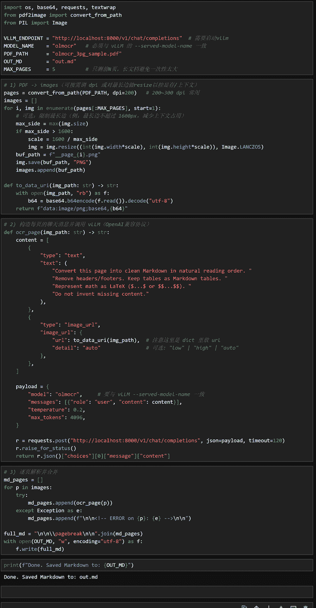

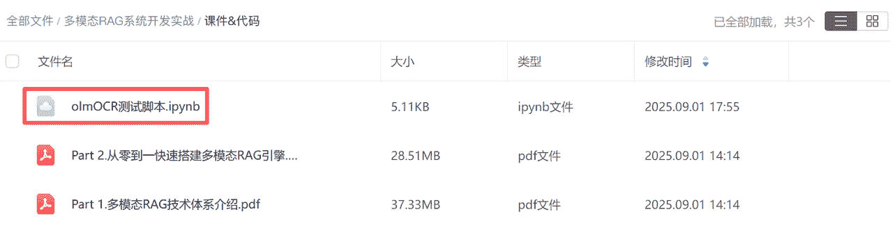

其中运行过程中后台输出结果如下：

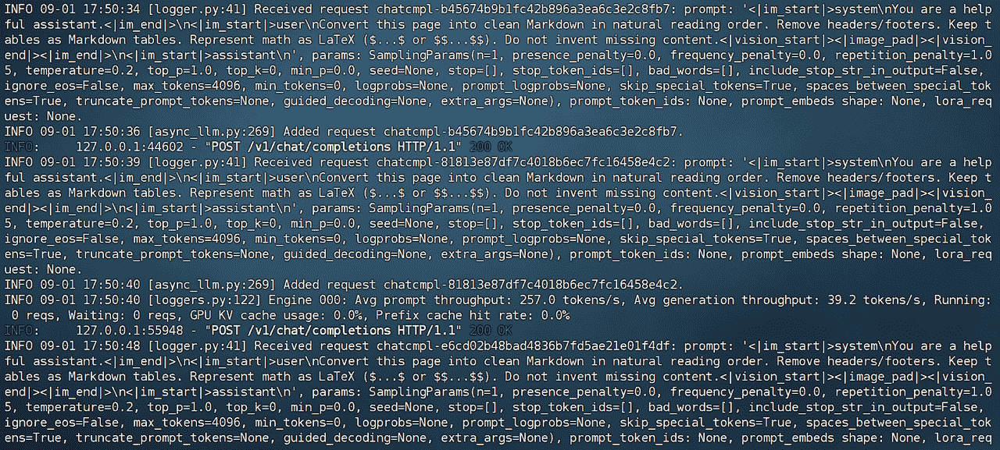

最终创建的 `out.md` 文档解析内容如下：

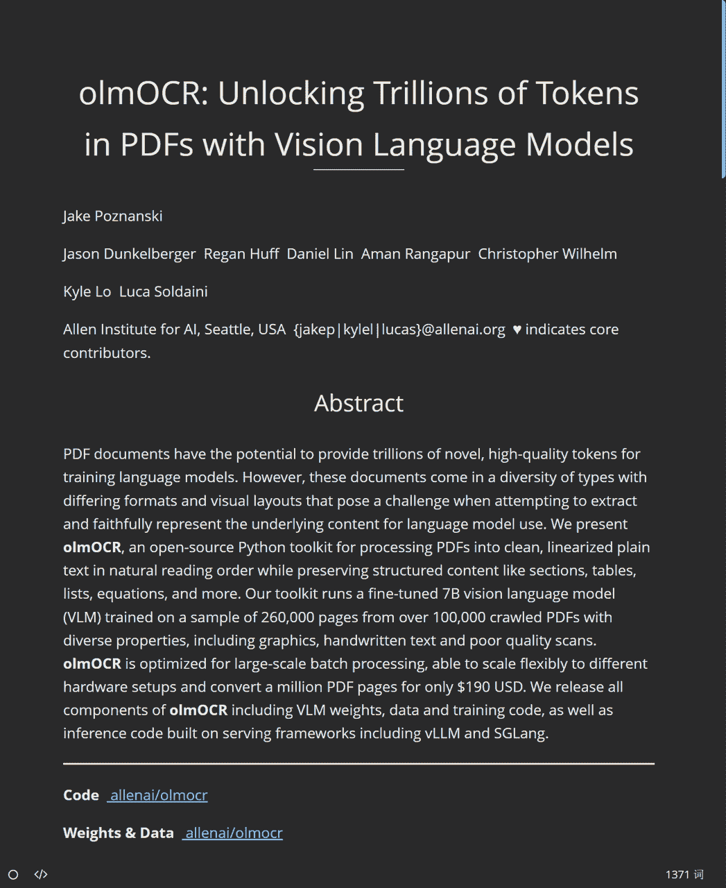

至此，我们就完成了一次简单的 OCR 解析流程。需要注意的是，由于 `olmOCR` 微调过程并未带入 VLM 图片语义解析的训练数据集，因此 `olmOCR` 本身并不具备 VLM 功能，而是一个单纯的性能更强的 OCR 模型。

### 3.7 借助 `olmOCR` 脚本高效转化 PDF 文档

除了可以使用最底层的 OpenAI 风格 API 来调用模型完成解析外，`olmOCR` 还提供了更加便捷的脚本，可以直接将 PDF 转化为 MD。并且，官方 `olmocr.pipeline` 还做了自动旋转检测、页眉页脚清理、重试策略、采样温度选择、阅读顺序增强等一揽子工程优化，质量通常更好。

```bash
# vLLM启动时：
python -m olmocr.pipeline ./workspace \
  --server http://localhost:8000 \
  --markdown \
  --pdfs ./olmocr_3pg_sample.pdf

# vLLM未启动时
# python -m olmocr.pipeline ./workspace --markdown --pdfs olmocr_3pg_sample.pdf
```

> 输出会写到 `./workspace/markdown/`；

解析过程如下：

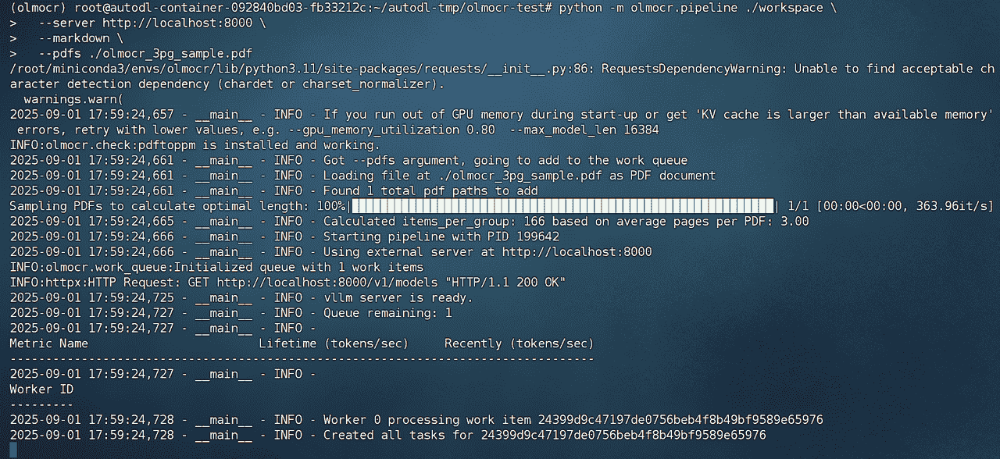

解析后生成内容如下：

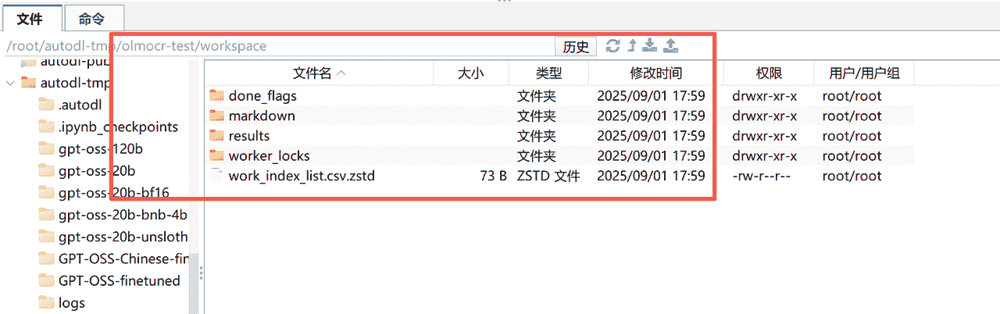

大家可以直接从网盘中下载查看：

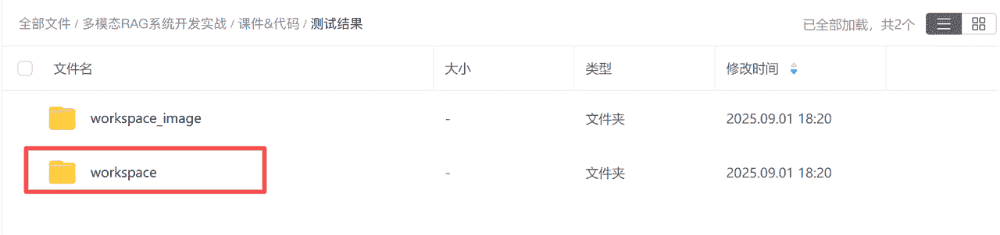

其中 `results` 是模型的直接输出结果：

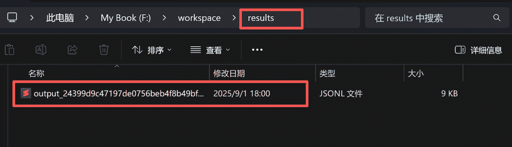

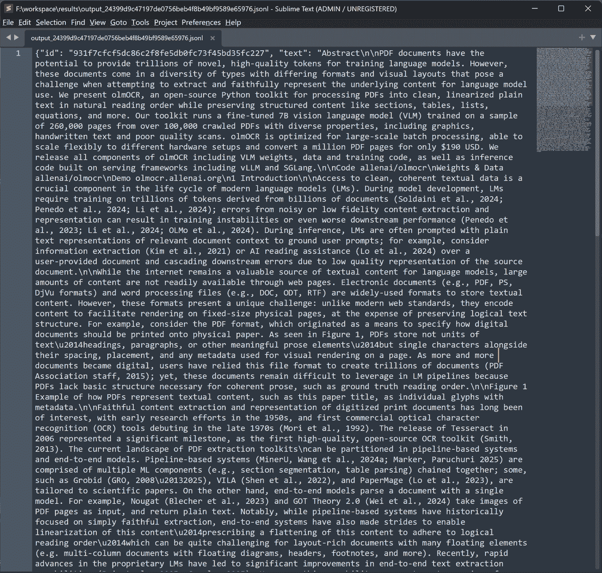

而 `md` 中则是 `PDF` 中纯文字提取结果：

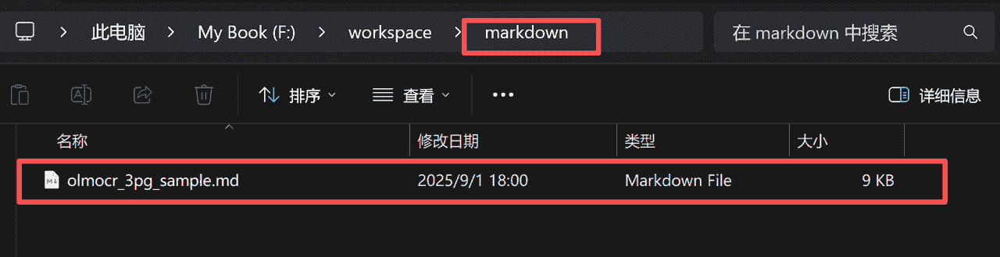

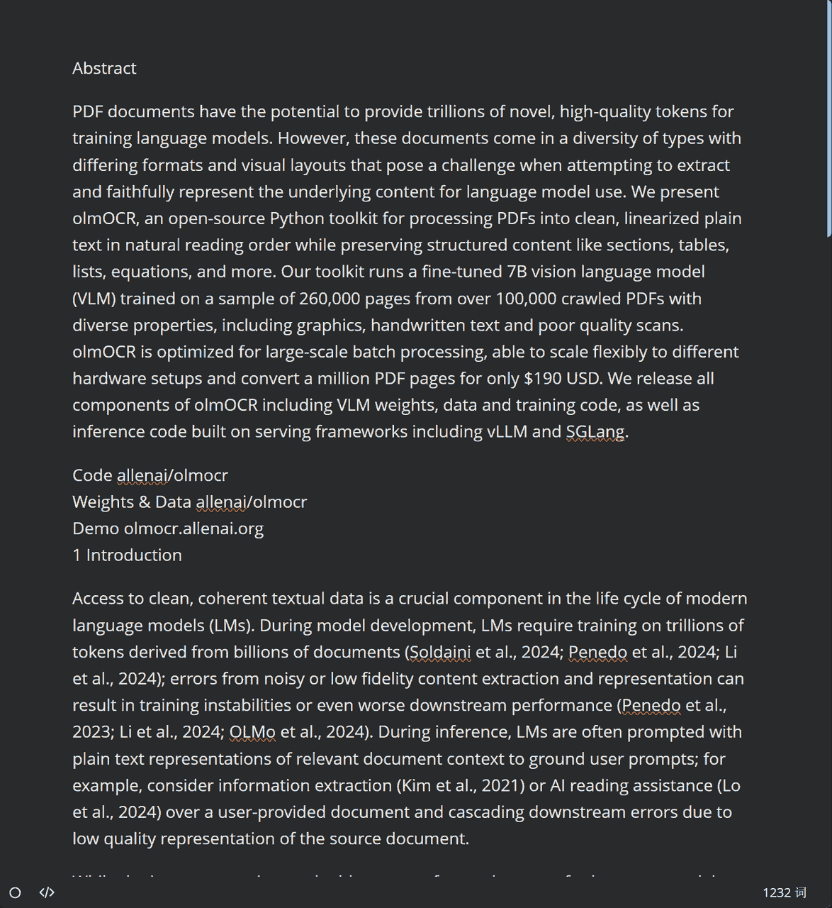

而此外，我们还可以将图片单独提取，并带入到 `olmOCR` 模型中进行解析：

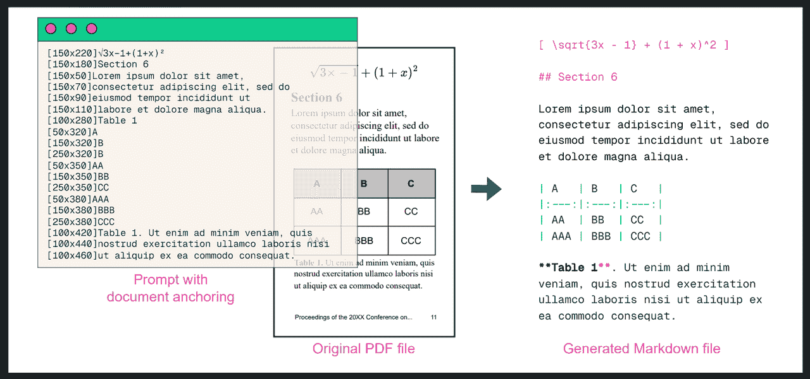

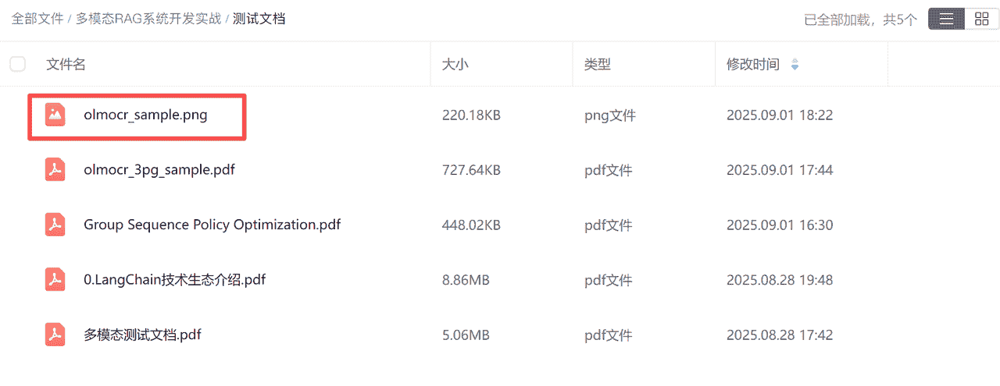


解析过程如下：

```bash
# vLLM启动时：
python -m olmocr.pipeline ./workspace_image \
  --server http://localhost:8000 \
  --markdown \
  --pdfs ./olmocr_sample.png
```

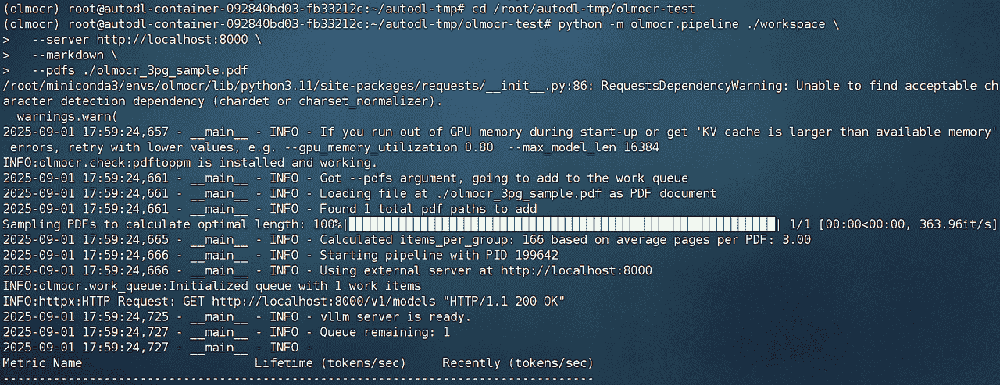

结束后同样会创建一个文件夹：

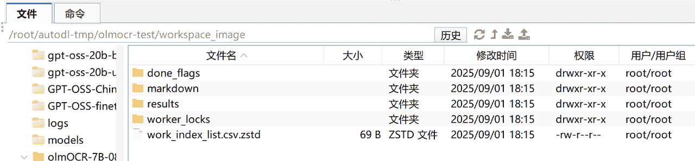

模型回复结果如下：


markdown 解析结果如下：

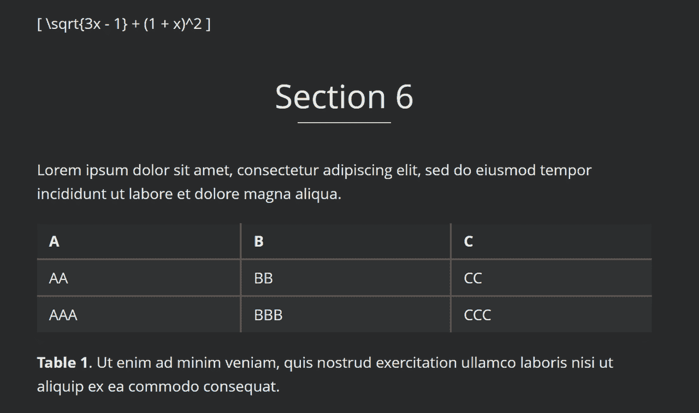

### 2.8 olmOCR 模型 `olmocr.pipeline` 启动参数列表

| 类别 | 参数 | 含义 / 作用 | 典型取值 / 示例 | 备注 / 建议 |
| --- | --- | --- | --- | --- |
| 位置参数 | `workspace` | 工作区路径（保存中间产物与结果）。支持本地目录或 S3 路径。 | `./ws`，`s3://bucket/prefix/` | 多机协同时建议用 S3。 |
| 输入/模型 | `--pdfs [PDFS ...]` | 向工作区添加要处理的 PDF 列表；可传通配符或“路径清单文件”。 | `./a.pdf ./b.pdf`，`s3://bucket/x/*.pdf`，或 `list.txt` | `list.txt` 一行一个 PDF 路径。 |
| 输入/模型 | `--model MODEL` | 模型位置或名称。默认 `allenai/olmOCR-7B-0725-FP8`。可本地目录、S3、或 HF 仓库名。 | `/models/olmocr-7b`，`allenai/olmOCR-7B-0825-FP8` | 首次用仓库名会自动下载到缓存。 |


| 分类 | 参数 | 说明 | 默认值/示例 | 备注 |
| --- | --- | --- | --- | --- |
| S3 访问 | `--workspace_profile` | 访问 workspace（S3） 的配置档（profile）。 | `default` | 仅当 workspace 在 S3 时需要。 |
| S3 访问 | `--pdf_profile` | 访问 原始 PDF（S3） 的配置档。 | `pdf-profile` | 仅当 PDF 在 S3 时需要。 |
| 任务切分/容错 | `--pages_per_group` | 每个“工作项分组”包含的页数（控制批大小/显存峰值）。 | `4`、`8` | 显存紧张时调小，更稳。 |
| 任务切分/容错 | `--max_page_retries` | 单页渲染/推理的最大重试次数。 | `2`、`3` | 异常页可自动重试。 |
| 任务切分/容错 | `--max_page_error_rate` | 文档允许失败页比例；超出则判定该文档失败。默认 1/250。 | `0.004`（≈1/250） | 脏数据多时适当放宽。 |
| 并行/统计 | `--workers` | 本机并发 worker 数量。 | `1`、`2`、`4` | 结合 CPU/IO 能力调整。 |
| 并行/统计 | `--stats` | 仅输出工作区统计信息，不执行任务。 | (开关) | 巡检/观测用。 |
| 质量过滤 | `--apply_filter` | 开启基础过滤：英文、非表单、非 SEO 垃圾。 | (开关) | 提升语料质量（非必需）。 |
| 输出/渲染 | `--markdown` | 产出 Markdown 文件（保留输入目录结构）。 | (开关) | 结果在 `workspace/markdown/`。 |
| 输出/渲染 | `--target_longest_image_dim` | PDF 渲染为图片时的“最长边像素”。 | `1400`、`1600`、`1800` | 调大可改善结构判别（标题/表格），但更耗显存。 |
| 输出/渲染 | `--target_anchor_text_len` | 锚点文本最大长度（字符）。新模型已不使用。 | `0` 或省略 | 通常忽略。 |
| 输出/渲染 | `--guided_decoding` | 启用引导式解码（YAML 类输出时）。 | (开关) | OCR→MD 场景下一般不用。 |
| 推理（vLLM 本地） | `--gpu-memory-utilization` | vLLM 可用显存比例（0~1）。 | `0.85`、`0.6` | 防 OOM；与其他任务共存时下调。 |
| 推理（vLLM 本地） | `--max_model_len` | 最大上下文长度（tokens）。 | `16384` | 受模型/引擎限制，过大可能报错。 |
| 推理（vLLM 本地） | `--tensor-parallel-size` | 张量并行份数（多 GPU 切分同一模型）。 | `1`、`2` | 多卡推理设为 `>1`。 |
| 推理（vLLM 本地） | `--data-parallel-size` | 数据并行副本数（同模型多份并行）。 | `1`、`2` | 提高吞吐用，需更多 GPU。 |
| 推理（服务端） | `--server` | 连接外部 vLLM OpenAI 兼容服务地址。 | `http://host:8000` | 指定后不再使用本地 vLLM。 |
| 推理（服务端） | `--port` | 本地服务监听端口（需要本地起服务时）。 | `8000` 等 | 一般无需改；避让端口冲突时用。 |
| 集群（Beaker） | `--beaker` | 启用 Beaker 集群模式。 | (开关) | 非 Beaker 用户可忽略。 |
| 集群（Beaker） | `--beaker_workspace` | Beaker 工作空间名。 | `ai2/xyz` | 与组织环境对应。 |
| 集群（Beaker） | `--beaker_cluster` | 目标集群名。 | `ai2/general-gpu` | 选择可用 GPU 集群。 |
| 集群（Beaker） | `--beaker_gpus` | 每个作业申请的 GPU 数。 | `1`、`2`、`4` | 结合模型/吞吐需求。 |
| 集群（Beaker） | `--beaker_priority` | 作业优先级。 | `normal`、`preemptible` | 队列/成本策略相关。 |

### 4. 借助olmOCR实现元素感知OCR

```
pip install "unstructured[all-docs]"   # 支持 PDF / Word / PPT / HTML 等文档解析
pip install paddlenlp paddleocr        # OCR 引擎
pip install PyMuPDF pillow matplotlib  # PDF 和图片处理
pip install html2text                  # 用于 HTML 表格转 Markdown
```

- 上一小节PDF转化MD流程回顾

`md_lines.append(f"\n")`

```python
import os
import fitz
from unstructured.partition.pdf import partition_pdf

pdf_path = "0.LangChain技术生态介绍.pdf"
output_dir = "pdf_images"
os.makedirs(output_dir, exist_ok=True)

# Step 1: 提取文本/结构化内容
elements = partition_pdf(
    filename=pdf_path,
    infer_table_structure=True,   # 开启表格结构检测
    strategy="hi_res",            # 高分辨率 OCR，适合复杂表格
    ocr_languages="chi_sim+eng",  # 中英文混合识别
    ocr_engine="paddleocr"        # 指定 PaddleOCR 引擎
)

# Step 2: 提取图片并保存
doc = fitz.open(pdf_path)
image_map = {}  # 映射 page_num -> list of image paths

for page_num, page in enumerate(doc, start=1):
    image_map[page_num] = []
    for img_index, img in enumerate(page.get_images(full=True), start=1):
        xref = img[0]
        pix = fitz.Pixmap(doc, xref)
        img_path = os.path.join(output_dir, f"page{page_num}_img{img_index}.png")
        if pix.n < 5:  # RGB / Gray
            pix.save(img_path)
        else:  # CMYK 转 RGB
            pix = fitz.Pixmap(fitz.csRGB, pix)
            pix.save(img_path)
        image_map[page_num].append(img_path)
        
# Step 3: 转换为 Markdown
md_lines = []
inserted_images = set()  # 用来记录已经插入过的图片，避免重复

for el in elements:
    cat = el.category
    text = el.text
    page_num = el.metadata.page_number

    if cat == "Title" and text.strip().startswith("- "):
        md_lines.append(text + "\n")
    elif cat == "Title":
        md_lines.append(f"# {text}\n")
    elif cat in ["Header", "Subheader"]:
        md_lines.append(f"## {text}\n")
    elif cat == "Table":
        if hasattr(el.metadata, "text_as_html") and el.metadata.text_as_html:
            from html2text import html2text
            md_lines.append(html2text(el.metadata.text_as_html) + "\n")
        else:
            md_lines.append(el.text + "\n")
    elif cat == "Image":
        # 避免重复插入：只插入当前图片对应的文件
        for img_path in image_map.get(page_num, []):
            if img_path not in inserted_images:
                inserted_images.add(img_path)
    else:
        md_lines.append(text + "\n")

# Step 4: 写入 Markdown 文件
output_md = "output.md"
with open(output_md, "w", encoding="utf-8") as f:
    f.write("\n".join(md_lines))

print(f"✅ 转换完成，已生成 {output_md} 和 {output_dir}/ 图片文件夹")
```

然后再借助olmOCR实现图片解析：


```
import os, re, io, base64, requests, json
from PIL import Image

DEFAULT_PROMPT = (
    "You are an OCR & document understanding assistant.\n"
    "Analyze this image region and produce:\n"
    "1) ALT: a very short alt text (<=12 words).\n"
    "2) CAPTION: a 1-2 sentence concise caption.\n"
    "3) CONTENT_MD: if the image contains a table, output a clean Markdown table;"
    "   if it contains a formula, output LaTeX ($...$ or $$...$$);"
    "   otherwise provide 3-6 bullet points summarizing key content, in Markdown.\n"
    "Return strictly in the following format:\n"
    "ALT: <short alt>\n"
    "CAPTION: <one or two sentences>\n"
    "CONTENT_MD:\n"
    "<markdown content here>\n"
)

IMG_PATTERN = re.compile(r'!\[[^\]]*\]\(([^)]+)\)')

def call_olmocr_image(vllm_url, model, img_path,
                      temperature=0.2, max_tokens=2048,
                      prompt=DEFAULT_PROMPT):
    """调用 vLLM(olmOCR) 进行图片解析，返回 {alt, caption, content_md}"""
    with Image.open(img_path) as im:
        bio = io.BytesIO()
        im.save(bio, format="PNG")
        img_bytes = bio.getvalue()

    payload = {
        "model": model,
        "messages": [{
            "role": "user",
            "content": [
                {"type": "text", "text": prompt},
                {"type": "image_url",
                 "image_url": {"url": f"data:image/png;base64,{base64.b64encode(img_bytes).decode()}", "detail": "auto"}}
            ]
        }],
        "temperature": temperature,
        "max_tokens": max_tokens,
    }
    r = requests.post(vllm_url, json=payload, timeout=180)
    r.raise_for_status()
    text = r.json()["choices"][0]["message"]["content"].strip()

    # 解析返回
    alt, caption, content_md_lines = "", "", []
    mode = None
    for line in text.splitlines():
        l = line.strip()
        if l.upper().startswith("ALT:"):
            alt = l.split(":", 1)[1].strip()
            mode = None
        elif l.upper().startswith("CAPTION:"):
            caption = l.split(":", 1)[1].strip()
            mode = None
        elif l.upper().startswith("CONTENT_MD:"):
            mode = "content"
        else:
            if mode == "content":
                content_md_lines.append(line.rstrip())

    return {
        "alt": alt or "Figure",
        "caption": caption or alt or "",
        "content_md": "\n".join(content_md_lines).strip()
    }

def augment_markdown(md_path, out_path,
                     vllm_url="http://localhost:8001/v1/chat/completions",
                     model="olmocr",
                     temperature=0.2, max_tokens=2048,
                     image_root=".",
                     cache_json=None):
    with open(md_path, "r", encoding="utf-8") as f:
        md_lines = f.read().splitlines()

    cache = {}
    if cache_json and os.path.exists(cache_json):
        try:
            cache = json.load(open(cache_json, "r", encoding="utf-8"))
        except Exception:
            cache = {}

    out_lines = []
    for line in md_lines:
        out_lines.append(line)
        m = IMG_PATTERN.search(line)
        if not m:
            continue

        img_rel = m.group(1).strip().split("?")[0]
        img_path = img_rel if os.path.isabs(img_rel) else os.path.join(image_root, img_rel)

        if not os.path.exists(img_path):
            out_lines.append(f"<!-- WARN: image not found: {img_rel} -->")
            continue

        if cache_json and img_path in cache:
            result = cache[img_path]
        else:
            result = call_olmocr_image(vllm_url, model, img_path,
                                       temperature, max_tokens)
            if cache_json:
                cache[img_path] = result

        alt, cap, body = result["alt"], result["caption"], result["content_md"]

        if cap:
            out_lines.append(f"*{cap}*")
        if body:
            out_lines.append("<details><summary>解析</summary>\n")
            out_lines.append(body)
            out_lines.append("\n</details>")

    with open(out_path, "w", encoding="utf-8") as f:
        f.write("\n".join(out_lines))

    if cache_json:
        with open(cache_json, "w", encoding="utf-8") as f:
            json.dump(cache, f, ensure_ascii=False, indent=2)

    print(f"✅ 已写入增强后的 Markdown：{out_path}")
    
augment_markdown(
    md_path="output.md",                     # 第一步生成的 md
    out_path="output_augmented.md",          # 增强后的 md
    vllm_url="http://localhost:8001/v1/chat/completions",  # 你的 vLLM 服务
    model="olmocr",
    image_root=".",                          # 图片路径相对根目录
    cache_json="image_cache.json"            # 可选，缓存文件
)
```

## 实现效果对比：

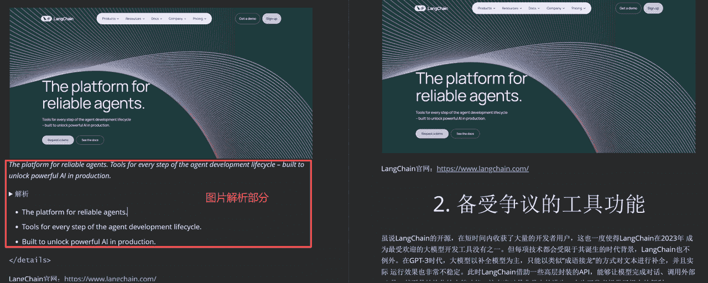

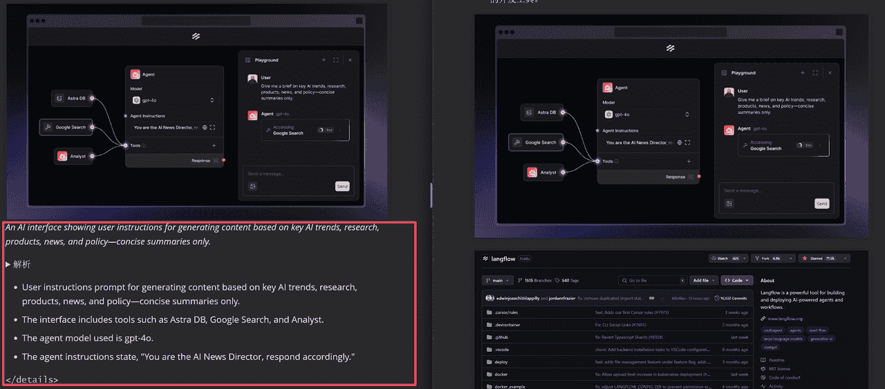

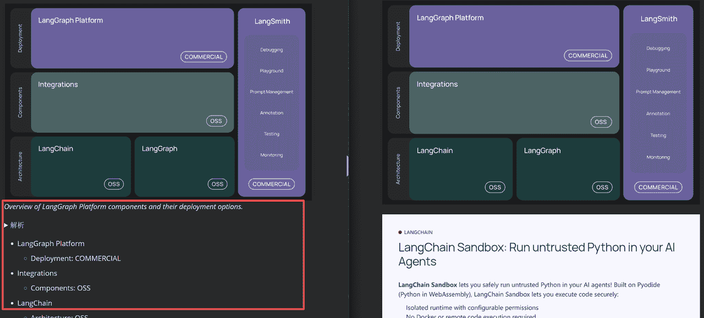

由此，便可实现更高精度的视觉检索。

## 二、【补充介绍】MinerU项目介绍与快速使用指南

+ MinerU在线解析过程

```
import os
from dotenv import load_dotenv 

# 加载环境变量
load_dotenv(override=True)

import requests

token = os.getenv("MINERU_API_KEY")
url = "https://mineru.net/api/v4/extract/task"
header = {
    "Content-Type": "application/json",
    "Authorization": f"Bearer {token}"
}

data = {
    "url": "https://olmocr.allenai.org/papers/olmocr_3pg_sample.pdf",
    "is_ocr": True,
    "enable_formula": False,
}

res = requests.post(url, headers=header, json=data)
print(res.status_code)
print(res.json())
print(res.json()["data"])
```

+ 获取MinerU在线解析结果

```
task_id = '55b7a823-cb6c-426f-a04b-2700830a4d03'

url = f"https://mineru.net/api/v4/extract/task/{task_id}"
header = {
    "Content-Type": "application/json",
    "Authorization": f"Bearer {token}"
}

res = requests.get(url, headers=header)
print(res.status_code)
print(res.json())
print(res.json()["data"])
```

+ 实际运行效果如下所示：

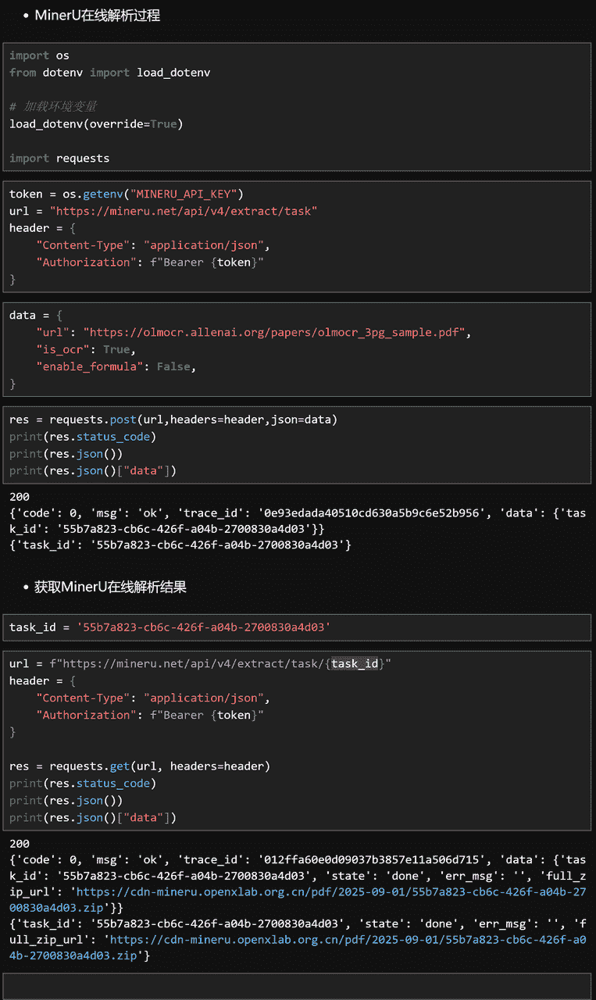

然后即可在网址中下载解析后的文件包：

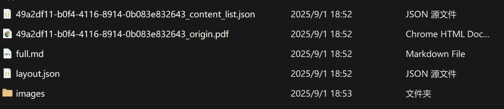

解析结果在`full.md`中，内容如下：

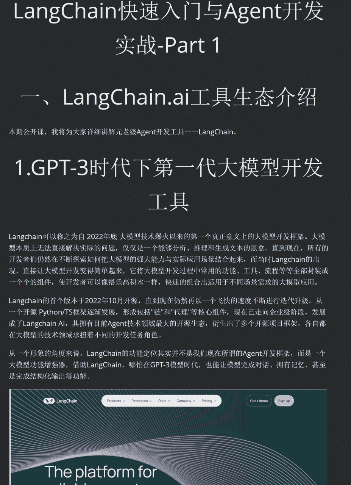

而其中`images`则包含了原始文档的图像：

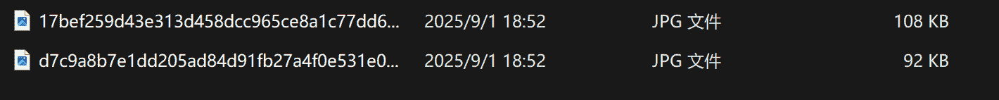

而`layout.json`则包含了对原始PDF文档的结构解析相关参数：

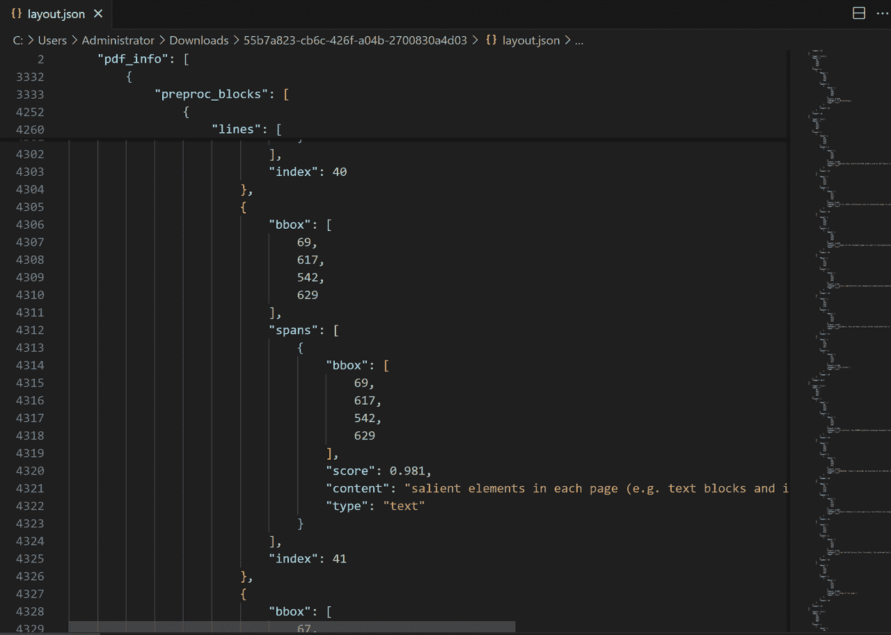

---

+ 体验课内容节选自《2025大模型Agent智能体开发实战》(秋招冲刺班)完整版付费课程

体验课时间有限，若想深度学习大模型技术，欢迎大家报名由我主讲的《2025大模型Agent智能体开发实战》(秋招冲刺班)


此外，若是对大模型底层原理感兴趣，也欢迎报名由我和菜菜老师共同主讲的《2025大模型原理与实战课程》(秋招冲刺班)

**大模型秋招冲刺班开班特惠进行中，直播间享五折特价+全套SVIP新班特定福利，合购还有更多**优惠哦~详细信息扫码添加助教，回复“大模型”，即可领取课程大纲&查看课程详情👇


**《2025大模型Agent智能体开发实战**》(秋招冲刺班)为【100+小时】体系大课，总共20大模块精讲精析，零基础直达大模型企业级应用！
