# Part 4.多模态RAG项目开发实战

> 来源：[https://kq4b3vgg5b.feishu.cn/docx/Vg6ndBDyBoTZ5CxG5c4ci6ZrnVc](https://kq4b3vgg5b.feishu.cn/docx/Vg6ndBDyBoTZ5CxG5c4ci6ZrnVc)

**课程说明：**

+   体验课内容节选自《2025大模型Agent智能体开发实战》(秋招冲刺班)完整版付费课程

体验课时间有限，若想深度学习大模型技术，欢迎大家报名由我主讲的《2025大模型Agent智能体开发实战》(秋招冲刺班)

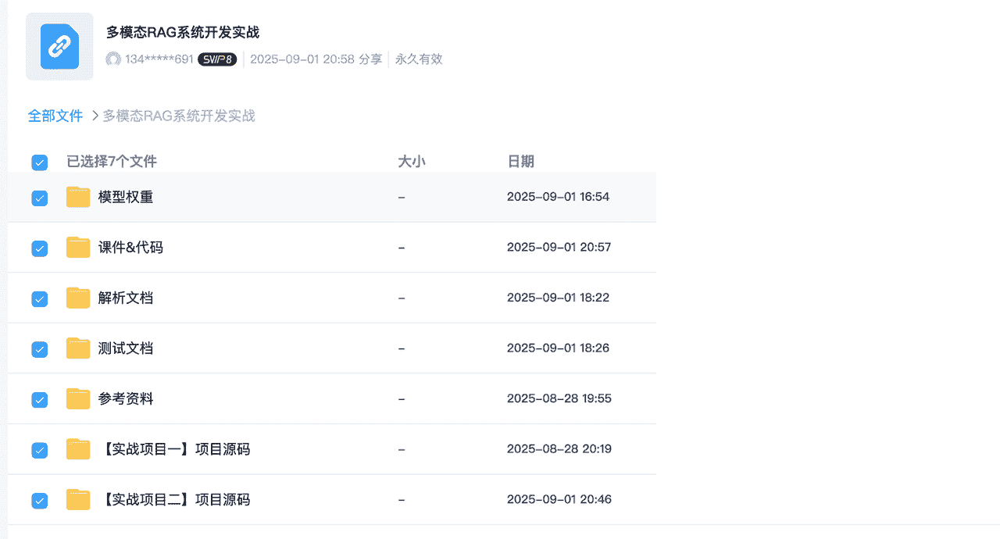


公开课全套学习资料，已上传至网盘（https://pan.baidu.com/s/1vV-8ew5tAfZOfwG3c4WAFw 提取码: i345）需要更系统深入学习大模型vx可扫码⬆️添加助教咨询喔～

---

# Part 4.多模态RAG项目开发实战

+   本期公开课四大模块内容

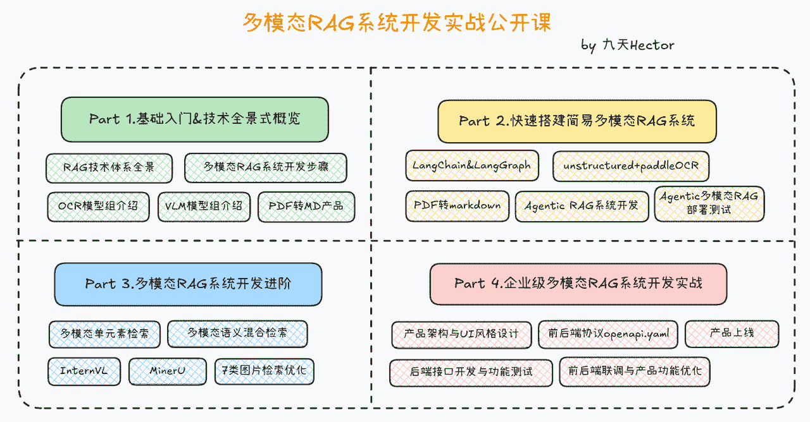

+   【演示】实操项目一：从零到一快速搭建多模态RAG系统

+   【演示】实操项目二：企业级多模态RAG系统开发实战

---

## 阶段一：多模态RAG项目需求描述、技术栈规划与接口设计

### 1. 项目背景与需求

本项目是一个**教学型多模态 RAG（Retrieval-Augmented **Generation，检索增强生成）系统，目标是帮助学习者理解 RAG 系统的完整开发流程。

我们希望实现以下功能：

1.  **PDF 文档处理**

+   用户上传 PDF 文件；

+   后端完成 OCR、版面解析、Markdown 转换；

+   提供文档解析状态查询与预览。

1.  **索引构建**

+   **将解析得到的 Markd**own 文档进行切分（chunking）；

+   使用 Embedding 模型（OpenAI Embeddings）将片段向量化；

+   保存至 **FAISS 向量数据库**，用于后续检索。

1.  **对话问答（RAG）**

+   用户输入问题，系统先在向量数据库中检索相关片段；

+   将检索结果与用户问题一起交给 LLM 生成答案；

+   答案中附带引用（citations），方便追溯来源。

+   支持**流式输出（SSE）**，提升交互体验。

+   支持**历史对话记忆**（基于 InMemorySaver），并提供清空功能。

1.  **健壮性需求**

+   系统在没有上传文档时也能正常回答（走模型自带知识）；

+   所有接口有**清晰的 API 约定**，方便前端对接。

+   效果展示

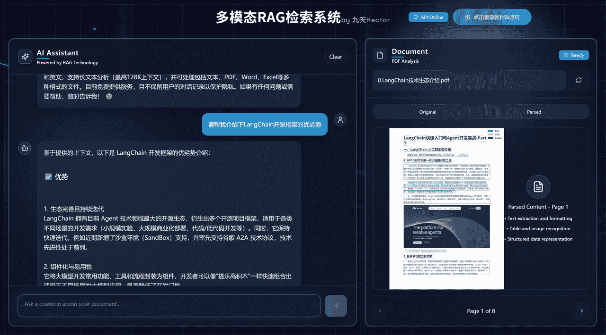

+   完整源码领取：

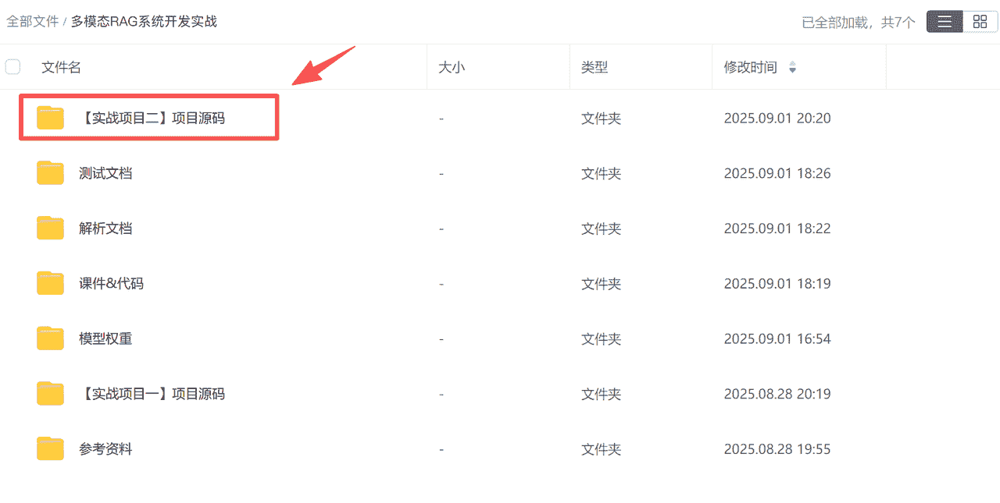

### 2. 技术栈规划

#### 2.1 **后端技术**

+   **FastAPI**：高性能 Python Web 框架，自动生成 Swagger UI。

+   **Uvicorn**：ASGI 服务器，支持异步处理。

+   LangChain / LangGraph：RAG 框架，管理对话状态与检索逻辑。

+   Unstructured / fitz (PyMuPDF)：PDF 解析、OCR、图片处理。

+   **FAISS**：Facebook 开源的向量数据库，用于相似检索。

#### 2.2 **前端技术**

+   **Figma**：快速完成 UI 原型设计；

+   **React / Next.js**：实现流式 SSE 接口调用、前端展示。

### 2.3 **AI 模型与 API**

+   OpenAI Embeddings：用于向量化（text-embedding-3-small / large）；

+   **对话模型（LLM）**：支持通用对话（如 DeepSeek-Chat / OpenAI GPT-4）。

#### 2.4 **环境与依赖**

+   Python >= 3.9

+   主要依赖：fastapi、uvicorn、python-multipart、langchain、faiss-cpu、unstructured、pymupdf、paddleocr

### 3. 接口规划

我们采用 **RESTful API** 风格，分为 4 大模块：

1.  **健康检查（Health）**

+   /health：确认服务正常运行。

1.  PDF 处理（PDF Service）

+   /pdf/upload：上传 PDF 文件；

+   /pdf/parse：触发解析任务；

+   /pdf/status：查询解析进度；

+   /pdf/page：获取 PDF 页图（原始/解析）；

+   /pdf/chunk：根据 citationId 获取片段。

1.  索引构建（Index Service）

+   /index/build：构建向量索引；

+   /index/search：检索相似片段。

1.  对话（Chat Service）

+   /chat：RAG 聊天（SSE 流式输出，包含 citations）；

+   /chat/clear：清空当前会话历史。

### 4. OpenAPI 文件编写

基于以上规划，我们使用 **OpenAPI 3.1.0** 来定义后端接口。

> OpenAPI 的作用：

+   是前后端沟通的“契约”；

+   能被 FastAPI 自动识别并生成交互式文档；

+   可生成前端 SDK / TS 类型，避免手写错误。

下面是一份完整的 **openapi.yaml**（已简化描述，完整版本可参考项目仓库）：

```
openapi: 3.1.0
info:
  title: RAG Demo API
  version: 1.0.0
servers:
  - url: http://localhost:8001/api/v1

paths:
  /health:
    get:
      summary: 健康检查
      responses:
        &quot;200&quot;:
          description: OK

  /pdf/upload:
    post:
      summary: 上传 PDF
      requestBody:
        required: true
        content:
          multipart/form-data:
            schema:
              type: object
              required: [file]
              properties:
                file: { type: string, format: binary }
      responses:
        &quot;200&quot;:
          description: 上传成功

  /pdf/parse:
    post:
      summary: 触发解析
      requestBody:
        content:
          application/json:
            schema:
              type: object
              properties:
                fileId: { type: string }
      responses:
        &quot;202&quot;: { description: 已接受 }

  /pdf/status:
    get:
      summary: 查询解析状态
      parameters:
        - in: query
          name: fileId
          required: true
          schema: { type: string }
      responses:
        &quot;200&quot;: { description: 状态返回 }

  /index/build:
    post:
      summary: 构建索引
      requestBody:
        content:
          application/json:
            schema:
              type: object
              properties:
                fileId: { type: string }
      responses:
        &quot;200&quot;: { description: 构建完成 }

  /chat:
    post:
      summary: 聊天接口（SSE）
      description: 返回流式回答 + 引用
      requestBody:
        content:
          application/json:
            schema:
              type: object
              properties:
                message: { type: string }
                fileId: { type: string }
      responses:
        &quot;200&quot;: { description: text/event-stream }

  /chat/clear:
    post:
      summary: 清空会话
      responses:
        &quot;200&quot;: { description: 会话已清空 }
```

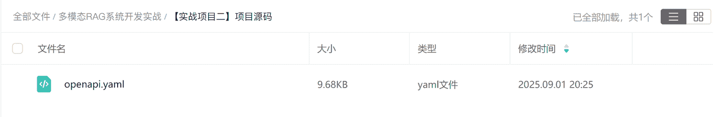

在开发的第一部分，我们完成了：

1.  明确了系统需求：PDF → 索引 → RAG 问答；

1.  规划了技术栈：FastAPI + LangChain + FAISS + 前端 React；

1.  梳理了接口模块：PDF、索引、聊天；

1.  编写了 openapi.yaml，形成前后端开发的“契约”。

**下一步（Part 2）**：我们将基于 OpenAPI 文档，逐步实现 后端服务（FastAPI + Mock + 真正逻辑），并在 Swagger UI 中进行测试。

## 阶段二：后端功能思路规划与Mock功能实现

### 1. 项目结构与职责边界

**目标**：前后端“用接口说话”；后端内部“用服务分层说话”。

```
backend/
├─ app.py                        # 入口与路由（FastAPI）
├─ services/
│  ├─ pdf_service.py             # 上传/解析/页图/可视化
│  ├─ index_service.py           # 切分/向量化/索引/检索
│  └─ rag_service.py             # RAG 检索+生成流（SSE）与会话历史
├─ data/                         # 解析与索引产物（按 fileId 分目录）
│  └─ f_xxx/
│     ├─ original.pdf
│     ├─ output.md
│     ├─ pages/{original|parsed}/page-0001.png
│     └─ index_faiss/{index.faiss,index.pkl}
├─ .env
└─ requirements.txt
```

**为什么这么拆？**

+   app.py** 专注“路由**+协议”（HTTP/SSE），不掺业务细节。

+   services/* 可单独测试、复用、替换（比如换别的向量库/LLM）。

+   data/<fileId>/… 是**教学友好**的本地可观测产物（便于课堂讲解与排错）。

### 2. 从 Mock 到真实现：增量替换的策略

**先 Mock****：接口**通、前端能调、边界清晰；

再替换：把 Mock 的“假数据/睡眠”替换成真实调用与产物。

> 这能最大化减少“前后端互相等待”的时间，也让你每步都有可验证成果。

#### 2.1 PDF 管线（/pdf/*）

**Mock 版思路**

+   /pdf/upload 返回一个临时 fileId（UUID），把文件暂存；

+   /pdf/parse 启动一个**后台任务**（不要阻塞 HTTP 响应），假装解析，写个“进度文件”；

+   /pdf/status 根据进度文件返回 parsing/ready;

+   /pdf/page 返回占位图/原图。

**逐步替换为真实现**

+   解析任务里接入 Unstructured + PaddleOCR + PyMuPDF：

+   导出 output.md、每页 original.png、parsed.png、抽取图片 images/；

+   把 **页号、bbox、类别**等结构写入中间文件（便于 /pdf/chunk/可视化叠框）；

+   进度更新：**按阶段写入**（20/50/80/100），让 /status 有“在动”的感觉；

+   页图加载：/pdf/page 用 FileResponse 或 StreamingResponse 回图。

**关键示意**：

```
# app.py
@app.post(&quot;/api/v1/pdf/parse&quot;)
def start_parse(req: ParseBody, bg: BackgroundTasks):
    bg.add_task(run_full_parse_pipeline, req.fileId)
    return {&quot;jobId&quot;: f&quot;j_{shortid()}&quot;}

# services/pdf_service.py
def run_full_parse_pipeline(file_id: str):
    write_status(file_id, &quot;parsing&quot;, 10)
    # 1) OCR/结构解析 -&gt; elements
    # 2) 导出 output.md、images/
    # 3) 渲染 original/parsed/page-*.png
    write_status(file_id, &quot;ready&quot;, 100)
```

#### 2.2 索引管线（/index/*）

**Mock 版思路**

+   /index/build 直接 time.sleep(1) 返回 "chunks": 42；

+   /index/search 返回固定三条占位片段。

**真实现替换**

+   构建阶段读取 data**/**<fileId>/output.md，做 “按标题切分（Header1/2）→ 清洗 → 向量化（OpenAI Embeddings）→ FAISS”；

+   检索阶段加载本地 FAISS，similarity_search_with_score(query, k)。

**关键示意**：

```
# services/index_service.py
def build_faiss_index(file_id: str):
    md = load_markdown(file_id)
    docs = header_split(md)               # MarkdownHeaderTextSplitter
    vs = FAISS.from_documents(docs, embedding=load_embeddings())
    vs.save_local(index_dir(file_id))
    return {&quot;ok&quot;: True, &quot;chunks&quot;: len(docs)}

def search_faiss(file_id: str, query: str, k=5):
    vs = FAISS.load_local(index_dir(file_id), load_embeddings(), allow_dangerous_deserialization=True)
    return vs.similarity_search_with_score(query, k=k)
```

**为什么先做“标题切分”？**

+   讲解性强（学生容易理解“结构化”切分）；

+   对课程 PPT/讲义类文档命中率高；

+   之后再引入“递归字符切分”作对照，讨论召回/粒度权衡。

#### 2.3 RAG 聊天（/chat SSE）

**Mock 版思路**

+   原来 /chat 返回“伪流”：sleep + 逐句 token 事件；

+   先不发 citation，只发 token/done。

**真实现替换**

+   收到 message + pdfFileId + sessionId：

+   如果有 pdfFileId 且索引存在：先 retrieve → 生成 citations；

+   **先发若干 ****event: citation**（前端角标立刻出现）；

+   组装历史 + 上下文 → 调 LLM 流式生成 → event: token 连发；

+   结尾 event: done 带 {"used_retrieval": true|false}。

+   **无文档也能聊**：当索引缺失或 pdfFileId 为空，直接走“通识回答”。

**关键示意**：

```
# app.py
@app.post(&quot;/api/v1/chat&quot;)
def chat_sse(req: ChatReq):
    async def gen():
        citations, context = [], &quot;&quot;
        if req.pdfFileId:
            citations, context = await retrieve(req.message, req.pdfFileId)
            for c in citations:
                yield &quot;event: citation\ndata: &quot; + json.dumps(c) + &quot;\n\n&quot;

        async for ev in answer_stream(
            question=req.message,
            citations=citations,
            context_text=context,
            branch=&quot;with_context&quot; if context else &quot;no_context&quot;,
            session_id=req.sessionId or &quot;default&quot;
        ):
            # token / done
            ...
    return StreamingResponse(gen(), media_type=&quot;text/event-stream&quot;)
```

#### 2.4 多轮对话（/chat/clear）

**思路**

+   教学场景只需**进程内内存**保存历史（sessionId → [messages]）；

+   /chat/clear 清空该 sessionId；

+   重启后自然丢失（即是你要的效果）。

**关键示意**：

```
# services/rag_service.py
_sessions = defaultdict(list)

def get_history(sid): return _sessions.get(sid, [])
def append_history(sid, role, content): _sessions[sid].append({&quot;role&quot;:role,&quot;content&quot;:content})
def clear_history(sid): _sessions.pop(sid, None)
```

**为什么不立刻引入数据库？**

+   教学项目**先证明闭环**；

+   学生先理解“多轮上下文对生成的影响”；

+   需要持久化时，再引入 Redis / SQLite 讲“状态存储”。

### 3. 错误处理与返回规范

**目标**：**前端可预测**、**便于排查**。

+   统一错误体：

```
{ &quot;error&quot;: &quot;CODE&quot;, &quot;message&quot;: &quot;人类可读描述&quot; }
```

+   常见错误码建议：

+   FILE_NOT_FOUND（fileId 不存在）

+   NEED_PARSE_FIRST（没 output.md 就建索引）

+   INDEX_NOT_FOUND（索引没建）

+   PAGE_NOT_FOUND（页码越界）

+   OCR_FAILED / PARSE_FAILED / INDEX_BUILD_ERROR

**示意**：

```
return JSONResponse({&quot;error&quot;:&quot;INDEX_NOT_FOUND&quot;,&quot;message&quot;:&quot;请先构建索引&quot;}, status_code=400)
```

### 4. 性能、可观测性与稳定性

+   **进度可见**：解析阶段分阶段更新 /status；

+   **日志可读**：关键里程碑打印（上传成功、开始 OCR、导出 MD、渲染页图、完成）；

+   **幂等**：/index/build 再次调用可复用已有索引（返回 {"ok":true,"reused":true}）；

+   **资源控制**：解析时限制并发，避免 OCR 占满 CPU；

+   **超时与回退**：LLM 流式异常时，回退为整段生成 + 手动切片；

+   **Windows 兼容**：路径用 pathlib；端口冲突换 8001；中文文件名注意编码。

## 阶段三：多模态RAG系统后端功能开发与测试

+   后端目录与角色回顾

```
backend/
├─ app.py                    # FastAPI 入口 &amp; 路由（HTTP/SSE 协议层）
├─ services/
│  ├─ pdf_service.py         # PDF 上传/解析/OCR/可视化导出
│  ├─ index_service.py       # Markdown切分、向量化、FAISS索引/检索
│  └─ rag_service.py         # RAG检索+生成、SSE流式输出、多轮会话
├─ data/
│  └─ &lt;fileId&gt;/
│     ├─ original.pdf
│     ├─ output.md
│     ├─ images/                 # Markdown内引用的图片
│     ├─ pages/original/page-*.png
│     ├─ pages/parsed/page-*.png # 叠框可视化
│     └─ index_faiss/{index.faiss,index.pkl}
├─ .env
└─ requirements.txt
```

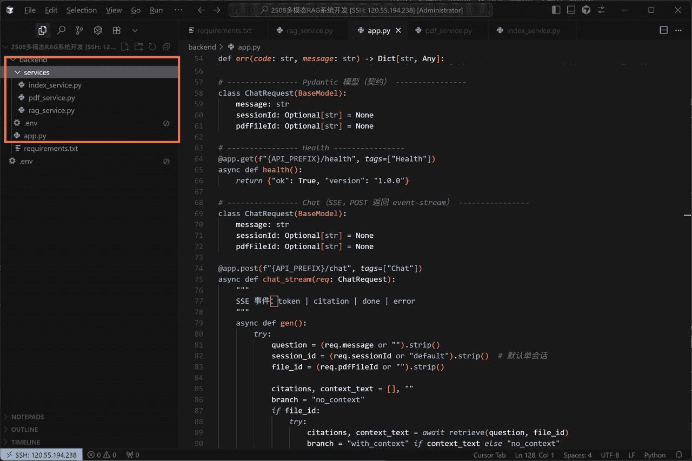

### 1. app.py 路由与协议层功能开发

+   **定位**：只负责“HTTP/SSE 协议 + **入参校验 + 调**用 services”，不直接写业务细节。这样方便单测与替换实现。

核心路由

+   GET /api/v1/health：可用性探针。

+   POST /api/v1/pdf/upload：保存文件，返回 fileId/name/pages。

+   POS**T /a**pi/v1/pdf/parse：启动后台任务（BackgroundTasks），马上返回 202 风格的结果（我们用 200/JSON 也行），解析过程在后台跑。

+   GET /api/v1/pdf/status?fileId=：轮询解析状态（idle/parsing/ready/error + 进度）。

+   GET /api/v1/pdf/page?fileId=&page=&type=：回传 PNG（原始页/叠框页）。

+   GET /api/v1/pdf/chunk?citationId=：按角标ID回查片段（你若实现了 citation→chunk 的落地）。

+   POST /api/v1/index/build：对 data/<fileId>/output.md 切分→向量化→FAISS 存盘；返回 chunks。

+   POST /api/v1/index/search：Top-K 相似检索，返回 text/score/metadata。

+   POST /api/v1/chat（SSE）：按 RAG 流生成事件：citation→token→done（错误时 error）。

+   POST /api/v1/chat/clear：清空指定 sessionId 的内存会话。

设计要点

+   **后台任务**：/pdf/parse 解析耗时，必须放 BackgroundTasks，避免阻塞请求。

+   **错误体统一**：用 JSONResponse({"error":"CODE","message":"..."} , status_code=xxx)。

+   **SSE**：StreamingResponse(gen(), media_type="text/event-stream")，事件格式严格：

```
event: token
data: {&quot;text&quot;:&quot;...&quot;}

event: done
data: {&quot;used_retrieval&quot;: true}
```

+   **跨域**：本地联调需要 CORSMiddleware（允许前端端口）。

完整代码：

```
from fastapi import FastAPI, UploadFile, File, Query, Body
from fastapi.responses import StreamingResponse, JSONResponse, FileResponse
from fastapi.middleware.cors import CORSMiddleware
from pydantic import BaseModel
import asyncio, time, os, random, string
from typing import Optional, Dict, Any, List
from fastapi import HTTPException
from pydantic import BaseModel
from typing import Optional

from fastapi import BackgroundTasks
from services.pdf_service import (
    save_upload, run_full_parse_pipeline,
    original_pdf_path, dir_original_pages, dir_parsed_pages, markdown_output
)
from services.index_service import build_faiss_index, search_faiss
from fastapi.responses import StreamingResponse, JSONResponse
from services.rag_service import retrieve, answer_stream, clear_history

app = FastAPI(
    title=&quot;九天老师公开课：多模态RAG系统API&quot;,
    version=&quot;1.0.0&quot;,
    description=&quot;九天老师公开课《多模态RAG系统开发实战》后端API。&quot;
)

# 允许前端本地联调
app.add_middleware(
    CORSMiddleware,
    allow_origins=[&quot;*&quot;],   # 课堂演示方便，生产请收紧
    allow_credentials=True,
    allow_methods=[&quot;*&quot;],
    allow_headers=[&quot;*&quot;],
)

API_PREFIX = &quot;/api/v1&quot;

# ---------------- 内存态存储（教学Mock） ----------------
current_pdf: Dict[str, Any] = {
    &quot;fileId&quot;: None,
    &quot;name&quot;: None,
    &quot;pages&quot;: 0,
    &quot;status&quot;: &quot;idle&quot;,      # idle | parsing | ready | error
    &quot;progress&quot;: 0
}
citations: Dict[str, Dict[str, Any]] = {}   # citationId -&gt; { fileId, page, snippet, bbox, previewUrl }

# ---------------- 工具函数 ----------------
def rid(prefix: str) -&gt; str:
    return f&quot;{prefix}_&quot; + &quot;&quot;.join(random.choices(string.ascii_lowercase + string.digits, k=8))

def now_ts() -&gt; int:
    return int(time.time())

def err(code: str, message: str) -&gt; Dict[str, Any]:
    return {&quot;error&quot;: {&quot;code&quot;: code, &quot;message&quot;: message}, &quot;requestId&quot;: rid(&quot;req&quot;), &quot;ts&quot;: now_ts()}

# ---------------- Pydantic 模型（契约） ----------------
class ChatRequest(BaseModel):
    message: str
    sessionId: Optional[str] = None
    pdfFileId: Optional[str] = None

# ---------------- Health ----------------
@app.get(f&quot;{API_PREFIX}/health&quot;, tags=[&quot;Health&quot;])
async def health():
    return {&quot;ok&quot;: True, &quot;version&quot;: &quot;1.0.0&quot;}

# ---------------- Chat（SSE，POST 返回 event-stream） ----------------
class ChatRequest(BaseModel):
    message: str
    sessionId: Optional[str] = None
    pdfFileId: Optional[str] = None

@app.post(f&quot;{API_PREFIX}/chat&quot;, tags=[&quot;Chat&quot;])
async def chat_stream(req: ChatRequest):
    &quot;&quot;&quot;
    SSE 事件：token | citation | done | error
    &quot;&quot;&quot;
    async def gen():
        try:
            question = (req.message or &quot;&quot;).strip()
            session_id = (req.sessionId or &quot;default&quot;).strip()  # 默认单会话
            file_id = (req.pdfFileId or &quot;&quot;).strip()

            citations, context_text = [], &quot;&quot;
            branch = &quot;no_context&quot;
            if file_id:
                try:
                    citations, context_text = await retrieve(question, file_id)
                    branch = &quot;with_context&quot; if context_text else &quot;no_context&quot;
                except FileNotFoundError:
                    branch = &quot;no_context&quot;

            # 先推送引用（若有）
            if branch == &quot;with_context&quot; and citations:
                for c in citations:
                    yield &quot;event: citation\n&quot;
                    yield f&quot;data: {c}\n\n&quot;

            # 再推送 token 流（内部会写入历史）
            async for evt in answer_stream(
                question=question,
                citations=citations,
                context_text=context_text,
                branch=branch,
                session_id=session_id
            ):
                if evt[&quot;type&quot;] == &quot;token&quot;:
                    yield &quot;event: token\n&quot;
                    # 注意：这里确保 data 是合法 JSON 字符串
                    text = evt[&quot;data&quot;].replace(&quot;\\&quot;, &quot;\\\\&quot;).replace(&quot;\n&quot;, &quot;\\n&quot;).replace(&#x27;&quot;&#x27;, &#x27;\\&quot;&#x27;)
                    yield f&#x27;data: {{&quot;text&quot;:&quot;{text}&quot;}}\n\n&#x27;
                elif evt[&quot;type&quot;] == &quot;citation&quot;:
                    yield &quot;event: citation\n&quot;
                    yield f&quot;data: {evt[&#x27;data&#x27;]}\n\n&quot;
                elif evt[&quot;type&quot;] == &quot;done&quot;:
                    used = &quot;true&quot; if evt[&quot;data&quot;].get(&quot;used_retrieval&quot;) else &quot;false&quot;
                    yield &quot;event: done\n&quot;
                    yield f&quot;data: {{\&quot;used_retrieval\&quot;: {used}}}\n\n&quot;

        except Exception as e:
            yield &quot;event: error\n&quot;
            esc = str(e).replace(&quot;\\&quot;, &quot;\\\\&quot;).replace(&quot;\n&quot;, &quot;\\n&quot;).replace(&#x27;&quot;&#x27;, &#x27;\\&quot;&#x27;)
            yield f&#x27;data: {{&quot;message&quot;:&quot;{esc}&quot;}}\n\n&#x27;

    headers = {&quot;Cache-Control&quot;: &quot;no-cache, no-transform&quot;, &quot;Connection&quot;: &quot;keep-alive&quot;}
    return StreamingResponse(gen(), media_type=&quot;text/event-stream&quot;, headers=headers)

# ---------------- Chat: 清除对话 ----------------
class ClearChatRequest(BaseModel):
    sessionId: Optional[str] = None

@app.post(f&quot;{API_PREFIX}/chat/clear&quot;, tags=[&quot;Chat&quot;])
async def chat_clear(req: ClearChatRequest):
    sid = (req.sessionId or &quot;default&quot;).strip()
    clear_history(sid)
    return {&quot;ok&quot;: True, &quot;sessionId&quot;: sid, &quot;cleared&quot;: True}


# ---------------- PDF: 上传（仅单文件，直接替换） ----------------

current_pdf = {&quot;fileId&quot;: None, &quot;name&quot;: None, &quot;pages&quot;: 0, &quot;status&quot;: &quot;idle&quot;, &quot;progress&quot;: 0}

@app.post(f&quot;{API_PREFIX}/pdf/upload&quot;, tags=[&quot;PDF&quot;])
async def pdf_upload(file: UploadFile = File(...), replace: Optional[bool] = True):
    if not file:
        return JSONResponse(err(&quot;NO_FILE&quot;, &quot;缺少文件&quot;), status_code=400)
    # 生成新的 fileId（替换策略：上传即替换）
    fid = rid(&quot;f&quot;)
    saved = save_upload(fid, await file.read(), file.filename)
    current_pdf.update({**saved, &quot;status&quot;: &quot;idle&quot;, &quot;progress&quot;: 0})
    citations.clear()
    return saved

# ---------------- PDF: 触发解析 ----------------
@app.post(f&quot;{API_PREFIX}/pdf/parse&quot;, tags=[&quot;PDF&quot;])
async def pdf_parse(payload: Dict[str, Any] = Body(...), bg: BackgroundTasks = None):
    file_id = payload.get(&quot;fileId&quot;)
    if not current_pdf[&quot;fileId&quot;] or current_pdf[&quot;fileId&quot;] != file_id:
        return JSONResponse(err(&quot;FILE_NOT_FOUND&quot;, &quot;未找到该文件&quot;), status_code=400)

    current_pdf[&quot;status&quot;] = &quot;parsing&quot;
    current_pdf[&quot;progress&quot;] = 5

    def _job():
        try:
            # 20 → 60 → 100 三阶段进度示意
            current_pdf[&quot;progress&quot;] = 20
            run_full_parse_pipeline(file_id)   # 真解析
            current_pdf[&quot;progress&quot;] = 100
            current_pdf[&quot;status&quot;] = &quot;ready&quot;
        except Exception as e:
            current_pdf[&quot;status&quot;] = &quot;error&quot;
            current_pdf[&quot;progress&quot;] = 0
            print(&quot;Parse error:&quot;, e)

    if bg is not None:
        bg.add_task(_job)
    else:
        _job()

    return {&quot;jobId&quot;: rid(&quot;j&quot;)}

# ---------------- PDF: 状态 ----------------
@app.get(f&quot;{API_PREFIX}/pdf/status&quot;, tags=[&quot;PDF&quot;])
async def pdf_status(fileId: str = Query(...)):
    if not current_pdf[&quot;fileId&quot;] or current_pdf[&quot;fileId&quot;] != fileId:
        return {&quot;status&quot;: &quot;idle&quot;, &quot;progress&quot;: 0}
    resp = {&quot;status&quot;: current_pdf[&quot;status&quot;], &quot;progress&quot;: current_pdf[&quot;progress&quot;]}
    if current_pdf[&quot;status&quot;] == &quot;error&quot;:
        resp[&quot;errorMsg&quot;] = &quot;解析失败&quot;
    return resp

# ---------------- PDF: 页面图 ----------------
@app.get(f&quot;{API_PREFIX}/pdf/page&quot;, tags=[&quot;PDF&quot;])
async def pdf_page(
    fileId: str = Query(...),
    page: int = Query(..., ge=1),
    type: str = Query(..., regex=&quot;^(original|parsed)$&quot;)
):
    if not current_pdf[&quot;fileId&quot;] or current_pdf[&quot;fileId&quot;] != fileId:
        return JSONResponse(status_code=404, content=None)

    if current_pdf[&quot;status&quot;] != &quot;ready&quot; and type == &quot;parsed&quot;:
        # 未解析就请求 parsed 页，按你的契约可以给 400/403；这里保持 204 更温和
        return JSONResponse(status_code=204, content=None)

    base = dir_original_pages(fileId) if type == &quot;original&quot; else dir_parsed_pages(fileId)
    img = base / f&quot;page-{page:04d}.png&quot;
    if not img.exists():
        return JSONResponse(err(&quot;PAGE_NOT_FOUND&quot;, &quot;页面不存在或未渲染&quot;), status_code=404)
    return FileResponse(str(img), media_type=&quot;image/png&quot;)

# ---------------- PDF: 图片文件 ----------------
@app.get(f&quot;{API_PREFIX}/pdf/images&quot;, tags=[&quot;PDF&quot;])
async def pdf_images(
    fileId: str = Query(...),
    imagePath: str = Query(...)
):
    &quot;&quot;&quot;获取PDF解析后的图片文件&quot;&quot;&quot;
    if not current_pdf[&quot;fileId&quot;] or current_pdf[&quot;fileId&quot;] != fileId:
        return JSONResponse(status_code=404, content=None)

    # 构建图片文件的完整路径
    from services.pdf_service import images_dir
    image_file = images_dir(fileId) / imagePath
    
    if not image_file.exists():
        return JSONResponse(err(&quot;IMAGE_NOT_FOUND&quot;, &quot;图片文件不存在&quot;), status_code=404)
    
    # 检查文件是否在images目录内（安全考虑）
    try:
        image_file.resolve().relative_to(images_dir(fileId).resolve())
    except ValueError:
        return JSONResponse(err(&quot;INVALID_PATH&quot;, &quot;无效的图片路径&quot;), status_code=400)
    
    return FileResponse(str(image_file), media_type=&quot;image/png&quot;)

# ---------------- PDF: 引用片段 ----------------
@app.get(f&quot;{API_PREFIX}/pdf/chunk&quot;, tags=[&quot;PDF&quot;])
async def pdf_chunk(citationId: str = Query(...)):
    ref = citations.get(citationId)
    if not ref:
        return JSONResponse(err(&quot;NOT_FOUND&quot;, &quot;无该引用&quot;), status_code=404)
    return ref

class BuildIndexRequest(BaseModel):
    fileId: str

class SearchRequest(BaseModel):
    fileId: str
    query: str
    k: Optional[int] = 5

@app.post(f&quot;{API_PREFIX}/index/build&quot;, tags=[&quot;Index&quot;])
async def index_build(req: BuildIndexRequest):
    # 可校验：current_pdf[&quot;status&quot;] 应为 ready
    if not current_pdf[&quot;fileId&quot;] or current_pdf[&quot;fileId&quot;] != req.fileId:
        raise HTTPException(status_code=400, detail=&quot;FILE_NOT_FOUND_OR_NOT_CURRENT&quot;)
    if current_pdf[&quot;status&quot;] != &quot;ready&quot;:
        raise HTTPException(status_code=409, detail=&quot;NEED_PARSE_FIRST&quot;)

    out = build_faiss_index(req.fileId)
    if not out.get(&quot;ok&quot;):
        return JSONResponse(err(out.get(&quot;error&quot;, &quot;INDEX_BUILD_ERROR&quot;), &quot;索引构建失败&quot;), status_code=500)
    return {&quot;ok&quot;: True, &quot;chunks&quot;: out[&quot;chunks&quot;]}

@app.post(f&quot;{API_PREFIX}/index/search&quot;, tags=[&quot;Index&quot;])
async def index_search(req: SearchRequest):
    out = search_faiss(req.fileId, req.query, req.k or 5)
    if not out.get(&quot;ok&quot;):
        code = out.get(&quot;error&quot;, &quot;INDEX_NOT_FOUND&quot;)
        return JSONResponse(err(code, &quot;请先构建索引&quot;), status_code=400)
    return out
```

代码解释如下：

1.  导入和基本设置

+   **导入模块**: 代码首先导入了大量所需的库，这包括：

+   fastapi: FastAPI 框架的核心。

+   fastapi.responses: 用于返回不同类型的响应，如流式响应 (StreamingResponse)、JSON 响应 (JSONResponse) 和文件响应 (FileResponse)。

+   fastapi.middleware.cors: 用于处理跨域请求，允许前端在不同域名下访问后端。

+   pydantic: 用于数据验证和模型定义 (BaseModel)，确保请求数据的格式正确。

+   asyncio, time, os, random, string: Python 的内置库，用于异步编程、时间处理、文件路径操作和字符串生成等。

+   typing: 提供类型提示，让代码更易读和健壮。

+   fastapi.BackgroundTasks: 用于在不阻塞主线程的情况下运行后台任务，比如 PDF 解析。

+   **导入自定义服务**: services 目录下的模块包含了核心业务逻辑：

+   pdf_service: 处理 PDF 文件的上传、保存和解析（如将页面转换为图片）。

+   index_service: 负责构建和搜索 **FAISS 索引**。FAISS 是一个用于高效相似性搜索的库，这里用来检索与用户问题最相关的文档片段。

+   rag_service: 包含了 RAG 系统的核心逻辑，如retrieve（检索文档片段）和answer_stream（流式生成回答）。

+   **初始化 FastAPI 应用**:

+   app = FastAPI(...): 创建一个 FastAPI 应用实例。title、version 和 description 用于生成 API 文档（通过 /docs 或 /redoc 路径访问）。

+   **CORS 中间件**:

+   app.add_middleware(CORSMiddleware, ...): 启用 CORS（跨源资源共享），允许来自任何域名的前端访问此 API。allow_origins=["*"] 是一个宽泛的设置，在生产环境中通常会收紧以提高安全性。

+   **全局变量和工具函数**:

+   current_pdf: 一个字典，用于在内存中存储当前正在处理的 PDF 文件的状态信息，包括文件 ID、名称、页数、处理状态 (idle, parsing, ready, error) 和进度。这是一个教学示例，实际生产环境会使用数据库。

+   citations: 另一个字典，用于存储检索到的文档引用信息。

+   rid(prefix: str): 生成一个带前缀的随机 ID。

+   now_ts(): 返回当前 Unix 时间戳。

+   err(...): 一个辅助函数，用于快速创建包含错误码和错误信息的 JSON 响应。

1.  API 路由讲解

代码中的每个 @app.get 或 @app.post 装饰器都定义了一个 API 接口。

**Health 检查 (****/health****)**

+   这是一个简单的 GET 请求，用于检查服务是否正常运行，常用于部署后的健康监控。

**聊天功能 (****/chat****)**

+   ChatRequest(BaseModel): 定义了请求体的数据模型，包括用户消息 (message)、会话 ID (sessionId) 和 PDF 文件 ID (pdfFileId)。

+   **@app.post(f"{API_PREFIX}/c**hat", tags=["Chat"]):

+   这个 API 接口以 **POST** 方式接收聊天请求。

+   它返回一个 **SSE** (Server-Sent Events，服务器发送事件) 的流式响应。这意味着后端会逐步将数据推送到前端，而不需要等待整个响应生成完毕。

+   **核心逻辑**:

1.  从请求中获取 question（用户问题）、session_id 和 file_id。

1.  如果提供了 file_id，调用 retrieve** 服务从 PDF **文档中检索与问题相关的片段（即 RAG 的检索步骤）。

1.  根据是否成功检索到上下文 (branch)，选择性地执行下一步。

1.  通过 answer_stream 服务，利用检索到的上下文（或直接回答）来生成答案。answer_stream 返回一个异步生成器，逐步产生 token、citation 或 done 等不同类型的事件。

1.  代码将这些事件封装成 SSE 格式 (event: ... 和 data: ...)，然后通过 StreamingResponse 返回给前端。

1.  try...except 块确保在发生错误时也能返回一个 error 事件，通知前端。

**清除聊天历史 (****/chat/clear****)**

+   这个 POST 接口允许用户清除特定会话的聊天历史，通过调用 services.rag_service.clear_history 函数来实现。

1.  PDF 文件处理 API

+   **pdf/upload**:

+   一个 POST 接口，用于接收用户上传的 PDF 文件。

+   使用 UploadFile 类型来处理文件上传。

+   调用 save_upload 函数将文件保存到本地，并更新 current_pdf 状态，将旧文件替换。

+   **pdf/parse**:

+   一个 POST 接口，用于触发 PDF 解析流程。

+   **关键点**: 使用 BackgroundTasks 来运行解析任务 (_job)。这意味着 API 会立即返回响应，而解析任务会在后台异步执行，不会阻塞用户的请求。

+   在 _job 函数中，run_full_parse_pipeline 会执行实际的解析工作，并模拟了进度更新。

+   **pdf/status**:

+   一个 GET 接口，用于查询当前 PDF 的解析状态和进度。

+   **pdf/page**:

+   一个 GET 接口，用于获取 PDF 某一页的图片。

+   根据 type 参数 (original 或 parsed) 返回不同版本的页面图像。

+   **pdf/images**:

+   一个 GET 接口，用于获取 PDF 解析后产生的嵌入图片文件。

+   **安全注意**: 代码中包含了一个重要的安全检查** image**_file.resolve().relative_to(...)，它确保请求的文件路径不会超出指定的图片目录，防止路径遍历攻击。

+   **pdf/chunk**:

+   一个 GET 接口，用于根据 citationId 获取具体的引用片段信息。

1.  索引构建和搜索 API

+   **index/build**:

+   **一个 POST 接口，**用于触发 FAISS 索引的构建。

+   它首先检查 PDF 文件是否已经解析完毕 (current_pdf["status"] == "ready")，如果不是则返回错误。

+   调用 build_faiss_index 函数来创建索引，这个过程会将 PDF 内容分块并向量化。

+   **index/search**:

+   一个 POST 接口，用于对已构建的索引进行搜索。

+   接收一个 SearchRequest 模型，包含 query（查询文本）和 k（要返回的最相关结果数）。

+   调用 search_faiss 函数来执行实际的向量相似性搜索，并返回匹配的文档片段。

### 2. services/pdf_service.pyPDF解析功能开发

**定位**：把 PDF 变成 RAG 友好的产物：output.md + 页图 + 可视化叠框 + 图片资源。

关键步骤

1.  **保存上传文件**

+   命名为 data/<fileId>/original.pdf（fileId 由 upload 生成）

+   读取页数用于返回给前端（PyMuPDF fitz.open）。

1.  **异步解析（后台任务）**

+   进度管理：write_status(fileId, "parsing", 10/30/60/100)

+   Unstructured.partition_pdf(...)：

+   strategy="hi_res"、ocr_engine="paddleocr"、ocr_languages="chi_sim+eng"

+   得到 elements（含文本、表格、图片、标题等类别）

+   **导出 Markdown**：

+   标题转 # / ##，表格优先 text_as_html→html2text；

+   图片导出到 images/ 并在 MD 里用相对路径引用。

+   **页图渲染**：

+   pages/original/page-0001.png：用 fitz 渲染页面；

+   pages/parsed/page-0001.png：把 elements 的 bbox 按类别上色叠加（matplotlib / PIL）。

1.  **状态持久**（可选）

+   教学场景可以只用内存 current_pdf；若想重启恢复，写 manifest.json（status/progress/pages/name）。

**完整代码如下**

```
# services/pdf_service.py
from __future__ import annotations
import os, io, math, json
from pathlib import Path
from typing import Dict, Any, List
import fitz
from PIL import Image
import matplotlib
matplotlib.use(&quot;Agg&quot;)  # 服务器无头
import matplotlib.pyplot as plt
import matplotlib.patches as patches

from langchain_unstructured import UnstructuredLoader
from unstructured.partition.pdf import partition_pdf
from html2text import html2text

from dotenv import load_dotenv
load_dotenv(override=True)

# 统一的根目录：每个 fileId 一个子目录
DATA_ROOT = Path(&quot;data&quot;)

def workdir(file_id: str) -&gt; Path:
    d = DATA_ROOT / file_id
    d.mkdir(parents=True, exist_ok=True)
    return d

def dir_original_pages(file_id: str) -&gt; Path:
    p = workdir(file_id) / &quot;pages&quot; / &quot;original&quot;
    p.mkdir(parents=True, exist_ok=True); return p

def dir_parsed_pages(file_id: str) -&gt; Path:
    p = workdir(file_id) / &quot;pages&quot; / &quot;parsed&quot;
    p.mkdir(parents=True, exist_ok=True); return p

def original_pdf_path(file_id: str) -&gt; Path:
    return workdir(file_id) / &quot;original.pdf&quot;

def markdown_output(file_id: str) -&gt; Path:
    return workdir(file_id) / &quot;output.md&quot;

def images_dir(file_id: str) -&gt; Path:
    p = workdir(file_id) / &quot;images&quot;
    p.mkdir(parents=True, exist_ok=True); return p

def save_upload(file_id: str, upload_bytes: bytes, filename: str) -&gt; Dict[str, Any]:
    &quot;&quot;&quot;保存上传的 PDF，并返回页数&quot;&quot;&quot;
    pdf_path = original_pdf_path(file_id)
    pdf_path.write_bytes(upload_bytes)
    with fitz.open(pdf_path) as doc:
        pages = doc.page_count
    return {&quot;fileId&quot;: file_id, &quot;name&quot;: filename, &quot;pages&quot;: pages}

def render_original_pages(file_id: str, dpi: int = 144):
    &quot;&quot;&quot;把原始 PDF 渲染为 PNG，存到 pages/original/&quot;&quot;&quot;
    pdf_path = original_pdf_path(file_id)
    out_dir = dir_original_pages(file_id)
    with fitz.open(pdf_path) as doc:
        for idx, page in enumerate(doc, start=1):
            mat = fitz.Matrix(dpi/72, dpi/72)
            pix = page.get_pixmap(matrix=mat)
            (out_dir / f&quot;page-{idx:04d}.png&quot;).write_bytes(pix.tobytes(&quot;png&quot;))

def _plot_boxes_to_ax(ax, pix, segments):
    category_to_color = {
        &quot;Title&quot;: &quot;orchid&quot;,
        &quot;Image&quot;: &quot;forestgreen&quot;,
        &quot;Table&quot;: &quot;tomato&quot;,
    }
    categories = set()
    for seg in segments:
        points = seg[&quot;coordinates&quot;][&quot;points&quot;]
        lw = seg[&quot;coordinates&quot;][&quot;layout_width&quot;]
        lh = seg[&quot;coordinates&quot;][&quot;layout_height&quot;]
        scaled = [(x * pix.width / lw, y * pix.height / lh) for x, y in points]
        color = category_to_color.get(seg.get(&quot;category&quot;), &quot;deepskyblue&quot;)
        categories.add(seg.get(&quot;category&quot;, &quot;Text&quot;))
        poly = patches.Polygon(scaled, linewidth=1, edgecolor=color, facecolor=&quot;none&quot;)
        ax.add_patch(poly)

    legend_handles = [patches.Patch(color=&quot;deepskyblue&quot;, label=&quot;Text&quot;)]
    for cat, color in category_to_color.items():
        if cat in categories:
            legend_handles.append(patches.Patch(color=color, label=cat))
    ax.legend(handles=legend_handles, loc=&quot;upper right&quot;)

def render_parsed_pages_with_boxes(file_id: str, docs_local: List[Dict[str, Any]], dpi: int = 144):
    &quot;&quot;&quot;
    根据 UnstructuredLoader 的 metadata（含坐标）在原图上叠框，输出到 pages/parsed/
    &quot;&quot;&quot;
    pdf_path = original_pdf_path(file_id)
    out_dir = dir_parsed_pages(file_id)
    with fitz.open(pdf_path) as doc:
        # 预聚合：按 page_number 分组 segments
        segments_by_page: Dict[int, List[Dict[str, Any]]] = {}
        for d in docs_local:
            meta = d.metadata if hasattr(d, &quot;metadata&quot;) else d[&quot;metadata&quot;]
            pno = meta.get(&quot;page_number&quot;)
            if pno is None: continue
            segments_by_page.setdefault(pno, []).append(meta)

        for page_number in range(1, doc.page_count + 1):
            page = doc.load_page(page_number - 1)
            mat = fitz.Matrix(dpi/72, dpi/72)
            pix = page.get_pixmap(matrix=mat)
            pil = Image.frombytes(&quot;RGB&quot;, [pix.width, pix.height], pix.samples)
            fig, ax = plt.subplots(1, figsize=(10, 10))
            ax.imshow(pil)
            ax.axis(&quot;off&quot;)
            _plot_boxes_to_ax(ax, pix, segments_by_page.get(page_number, []))
            fig.tight_layout()
            fig.savefig(out_dir / f&quot;page-{page_number:04d}.png&quot;, bbox_inches=&quot;tight&quot;, pad_inches=0)
            plt.close(fig)

def unstructured_segments(file_id: str) -&gt; List[Any]:
    &quot;&quot;&quot;用 UnstructuredLoader 产生高分辨率布局段&quot;&quot;&quot;
    pdf_path = str(original_pdf_path(file_id))
    loader = UnstructuredLoader(
        file_path=pdf_path,
        strategy=&quot;hi_res&quot;,
        infer_table_structure=True,
        ocr_languages=&quot;chi_sim+eng&quot;,
        ocr_engine=&quot;paddleocr&quot;,  # 如果装不上可换成 &#x27;auto&#x27; 或注释掉
    )
    out = []
    for d in loader.lazy_load():
        out.append(d)
    return out

def pdf_to_markdown(file_id: str):
    pdf_path = str(original_pdf_path(file_id))
    out_md = markdown_output(file_id)
    img_dir = images_dir(file_id)

    elements = partition_pdf(
        filename=pdf_path,
        infer_table_structure=True,
        strategy=&quot;hi_res&quot;,
        ocr_languages=&quot;chi_sim+eng&quot;,
        ocr_engine=&quot;paddleocr&quot;  # 同上
    )

    # 提取图片
    image_map = {}
    with fitz.open(pdf_path) as doc:
        for page_num, page in enumerate(doc, start=1):
            image_map[page_num] = []
            for img_index, img in enumerate(page.get_images(full=True), start=1):
                xref = img[0]
                pix = fitz.Pixmap(doc, xref)
                img_path = img_dir / f&quot;page{page_num}_img{img_index}.png&quot;
                if pix.n &lt; 5:
                    pix.save(str(img_path))
                else:
                    pix = fitz.Pixmap(fitz.csRGB, pix)
                    pix.save(str(img_path))
                image_map[page_num].append(img_path.name)  # 只保存文件名

    md_lines: List[str] = []
    inserted_images = set()
    for el in elements:
        cat = getattr(el, &quot;category&quot;, None)
        text = (getattr(el, &quot;text&quot;, &quot;&quot;) or &quot;&quot;).strip()
        meta = getattr(el, &quot;metadata&quot;, None)
        page_num = getattr(meta, &quot;page_number&quot;, None) if meta else None

        if not text and cat != &quot;Image&quot;:
            continue

        if cat == &quot;Title&quot; and text.startswith(&quot;- &quot;):
            md_lines.append(text + &quot;\n&quot;)
        elif cat == &quot;Title&quot;:
            md_lines.append(f&quot;# {text}\n&quot;)
        elif cat in [&quot;Header&quot;, &quot;Subheader&quot;]:
            md_lines.append(f&quot;## {text}\n&quot;)
        elif cat == &quot;Table&quot;:
            html = getattr(meta, &quot;text_as_html&quot;, None) if meta else None
            if html:
                md_lines.append(html2text(html) + &quot;\n&quot;)
            else:
                md_lines.append((text or &quot;&quot;) + &quot;\n&quot;)
        elif cat == &quot;Image&quot; and page_num:
            for name in image_map.get(page_num, []):
                if (page_num, name) not in inserted_images:
                    md_lines.append(f&quot;\n&quot;)
                    inserted_images.add((page_num, name))
        else:
            md_lines.append(text + &quot;\n&quot;)

    out_md.write_text(&quot;\n&quot;.join(md_lines), encoding=&quot;utf-8&quot;)
    return {&quot;markdown&quot;: out_md.name, &quot;images_dir&quot;: &quot;images&quot;}

def run_full_parse_pipeline(file_id: str) -&gt; Dict[str, Any]:
    &quot;&quot;&quot;
    完整流程：原始页图渲染 → Unstructured 布局段 → 叠框图 → 输出 Markdown
    返回用于 /status 的统计或元信息
    &quot;&quot;&quot;
    render_original_pages(file_id)
    docs = unstructured_segments(file_id)
    render_parsed_pages_with_boxes(file_id, docs)
    md_info = pdf_to_markdown(file_id)
    return {&quot;md&quot;: md_info[&quot;markdown&quot;]}
```

代码解释如下：

1.  核心依赖和配置

+   **导入库**:

+   fitz (PyMuPDF): 用于处理 PDF 文档的核心库，可以提取文本、图片，并渲染页面为图像。

+   PIL (Pillow): 用于图像处理，这里用于将 PyMuPDF 的图像数据转换为 PIL 格式，以便用 Matplotlib 处理。

+   matplotlib: 强大的绘图库，在这里主要用来在 PDF 页面渲染图上绘制 bounding box（边界框），以展示解析出的内容区域。

+   langchain_unstruc**ture**d 和 unstructured: 核心组件。这些库负责执行 PDF 的复杂解析，包括布局分析、表格识别、OCR（光学字符识别）以及将内容分段。

+   html2text: 将 HTML 表格转换为 Markdown 格式。

+   dotenv: 用于从 .env 文件加载环境变量。

+   **文件系统路径**:

+   DATA_ROOT = Path("data"): 定义了所有处理过的数据的根目录。

+   workdir(file_id): 为每个上传的 PDF 文件创建一个独立的子目录，这是管理不同文档数据的好方法。

+   dir_original_pages, dir_parsed_pages, original_pdf_path, markdown_output, images_dir: 一系列辅助函数，用于生成 PDF 文档在本地文件系统中的特定存储路径。

1.  PDF 文件处理函数

+   save_upload(file_id, upload_bytes, filename):

+   这是 API 中 **/pdf/upload** 路由调用的函数。

+   它将上传的二进制文件内容写入到 data/{file_id}/original.pdf。

+   使用 fitz.open() 打开文件以快速获取页数，然后返回一个包含文件元信息（ID、名称、页数）的字典。

+   render_original_pages(file_id, dpi):

+   将原始 PDF 的每一页渲染成 PNG 图片。

+   使用 fitz.get_pixmap() 方法将 PDF 页面转换为像素图，并保存到 pages/original 文件夹。dpi（每英寸点数）参数决定了输出图片的清晰度。

+   _plot_boxes_to_ax(ax, pix, segments):

+   一个辅助函数，用于在 Matplotlib 的绘图轴上绘制边界框。

+   它根据解析出的段落（segments）的坐标信息，在图片上用不同颜色绘制矩形框，来区分标题、图像、表格和普通文本。

+   这个函数展示了如何利用 matplotlib.patches.Polygon 在图像上叠加矢量图形。

+   render_parsed_pages_with_boxes(file_id, docs_local, dpi):

+   这是 render_original_pages 的增强版。

+   它首先将 unstructured_segments 函数解析出的数据按页分组。

+   然后，它遍历每一页，先加载原始页面图片，再使用 _plot_boxes_to_ax 函数在图片上叠加绘制解析出的 内容类型（如文本、表格、图像）的边界框。

+   最终将带有这些标记框的图片保存到 pages/parsed 文件夹。这些图片对于前端展示解析结果非常有价值。

1.  PDF 内容解析函数

+   unstructured_segments(file_id):

+   使用 langchain_unstructured.UnstructuredLoader 来加载 PDF。

+   strategy="hi_res": 告诉解析器使用高分辨率策略，这会调用更高级的布局分析模型。

+   infer_table_structure=True: 尝试识别 PDF 中的表格结构。

+   ocr_languages 和 ocr_engine: 指定 OCR 引擎和语言，这里配置了中英文，以支持包含扫描件或图片文本的 PDF。

+   此函数返回一个包含多个文档片段（Document 对象）的列表，每个片段都带有其内容、元数据（包括坐标）和类型信息。

+   pdf_to_markdown(file_id):

+   这是**多模态 RAG** 系统中将非结构化 PDF 内容转换为结构化文本的关键步骤。

+   它使用 unstructured.partitio**n.pdf 来**解析 PDF，这与 UnstructuredLoader 类似，但更侧重于提取结构化元素。

+   **提取图片**: 它遍历 PDF 页面，提取所有图片并保存到 images 目录。

+   **转换为 Markdown**: 它遍历 partition_pdf 返回的元素列表，根据元素的 category（如 Title, Header, Table 等）将其转换为相应的 Markdown 格式。

+   例如，Title 转换为 # 标题，Table 转换为 Markdown 表格。

+   html2text 被用来将表格的 HTML 表示转换为更易读的 Markdown 格式。

+   它还将提取出的图片作为 Ma**rkd**own 链接 () 插入到文档中，从而实现了多模态信息的整合。

+   最终，将所有 Markdown 行连接成一个字符串，并保存到 output.md 文件中。

### 3. services/index_service.py 切分/向量化/FAISS 索引

**定位**：把 output.md 变成“可检索的 chunks + 向量索引”。

核心流程

1.  **加载 ****.env**** & Embeddings**

+   OpenAIEmbeddings(model="text-embedding-3-small|large", base_url/key from .env)

+   你加了 load_dotenv(override=True)，确保环境稳定。

1.  **Markdown 切分**

+   用 MarkdownHeaderTextSplitter 按 # / ## 切段，保留 metadata（最好带上 page_number）。

+   **二次切分**（可选）：对超长段用字符长度递归切分（更平衡召回）。

1.  **构建 & 保存索引**

+   FAISS.from_documents(docs, embeddings) → save_local("data/<fileId>/index_faiss")。

+   幂等：若目录已存在，返回 reused:true（可选）。

1.  **检索**

+   load_local(..., allow_dangerous_deserialization=True)

+   similarity_search_with_score(query, k) → 返回 (Document, score)。

**完整代码如下**

```
# services/index_service.py
from __future__ import annotations
from pathlib import Path
from typing import List, Dict, Any, Optional
import os
from langchain_openai import OpenAIEmbeddings
from langchain_text_splitters import MarkdownHeaderTextSplitter
from langchain.docstore.document import Document
from langchain_community.vectorstores import FAISS

from dotenv import load_dotenv
load_dotenv(override=True)

# 复用你已有的数据目录结构
DATA_ROOT = Path(&quot;data&quot;)

def workdir(file_id: str) -&gt; Path:
    p = DATA_ROOT / file_id
    p.mkdir(parents=True, exist_ok=True)
    return p

def markdown_path(file_id: str) -&gt; Path:
    return workdir(file_id) / &quot;output.md&quot;

def index_dir(file_id: str) -&gt; Path:
    p = workdir(file_id) / &quot;index_faiss&quot;
    p.mkdir(parents=True, exist_ok=True)
    return p

def load_embeddings() -&gt; OpenAIEmbeddings:
    # 读取环境变量；支持你的代理 base_url
    api_key = os.getenv(&quot;OPENAI_API_KEY&quot;) or os.getenv(&quot;OPENAI_EMBEDDING_API_KEY&quot;)
    base_url = os.getenv(&quot;OPENAI_BASE_URL&quot;) or os.getenv(&quot;OPENAI_EMBEDDING_BASE_URL&quot;)
    kwargs = {&quot;api_key&quot;: api_key}
    if base_url:
        kwargs[&quot;base_url&quot;] = base_url
    return OpenAIEmbeddings(model=&quot;text-embedding-3-small&quot;, **kwargs)

def split_markdown(md_text: str) -&gt; List[Document]:
    headers_to_split_on = [
        (&quot;#&quot;, &quot;Header 1&quot;),
        (&quot;##&quot;, &quot;Header 2&quot;),
        # 需要更细可以加 (&quot;###&quot;, &quot;Header 3&quot;)
    ]
    splitter = MarkdownHeaderTextSplitter(headers_to_split_on=headers_to_split_on)
    docs = splitter.split_text(md_text)
    # 可加一点清洗
    cleaned: List[Document] = []
    for d in docs:
        txt = (d.page_content or &quot;&quot;).strip()
        if not txt:
            continue
        # 限制太长的段落，避免向量化出错
        if len(txt) &gt; 8000:
            txt = txt[:8000]
        cleaned.append(Document(page_content=txt, metadata=d.metadata))
    return cleaned

def build_faiss_index(file_id: str) -&gt; Dict[str, Any]:
    md_file = markdown_path(file_id)
    if not md_file.exists():
        return {&quot;ok&quot;: False, &quot;error&quot;: &quot;MARKDOWN_NOT_FOUND&quot;}
    md_text = md_file.read_text(encoding=&quot;utf-8&quot;)

    docs = split_markdown(md_text)
    if not docs:
        return {&quot;ok&quot;: False, &quot;error&quot;: &quot;EMPTY_MD&quot;}

    embeddings = load_embeddings()
    vs = FAISS.from_documents(docs, embedding=embeddings)
    vs.save_local(str(index_dir(file_id)))
    return {&quot;ok&quot;: True, &quot;chunks&quot;: len(docs)}

def search_faiss(file_id: str, query: str, k: int = 5) -&gt; Dict[str, Any]:
    idx = index_dir(file_id)
    if not (idx / &quot;index.faiss&quot;).exists():
        return {&quot;ok&quot;: False, &quot;error&quot;: &quot;INDEX_NOT_FOUND&quot;}

    embeddings = load_embeddings()
    vs = FAISS.load_local(str(idx), embeddings, allow_dangerous_deserialization=True)
    hits = vs.similarity_search_with_score(query, k=k)
    results = []
    for doc, score in hits:
        results.append({
            &quot;text&quot;: doc.page_content,
            &quot;score&quot;: float(score),
            &quot;metadata&quot;: doc.metadata,
        })
    return {&quot;ok&quot;: True, &quot;results&quot;: results}
```

代码解释如下：

1.  核心依赖和配置

+   **导入库**:

+   langchain_openai: 用于调用 OpenAI 的 API，特别是向量化模型（embedding model）。

+   langchain_text_splitters: 用于将长文档分割成小块，便于检索。这里用的是 MarkdownHeaderTextSplitter，可以根据 Markdown 的标题来切分文档。

+   langchain.docstore.document: 定义了 Document 对象，这是 LangChain 中用于表示文档块的标准格式。

+   langchain_community.vectorstores.FAISS: 核心库，实现了高效的相似性搜索和向量存储功能。FAISS（Facebook AI Similarity Search）是一个用于快速、高效地在大规模数据中进行相似性搜索的库。

+   dotenv: 从 .env 文件加载环境变量，用于配置 OpenAI API 密钥和代理地址。

+   **文件路径**:

+   这部分代码复用了 pdf_service.py 中定义的统一数据目录结构。

+   markdown_path: 指向由 pdf_service 生成的 output.md 文件。

+   index_dir: 为每个文件创建一个独立的目录，用于存储构建好的 FAISS 索引。

+   load_embeddings():

+   这个函数的作用是加载并配置 OpenAI 的向量化模型。

+   它从环境变量中读取 API 密钥和可选的 base_url（用于代理），然后初始化 OpenAIEmbeddings 对象。

+   model="text-embedding-3-small" 指定了使用的具体模型，这是一个性价比很高的向量化模型。

1.  文档分割和向量化

+   split_markdown(md_text):

+   这个函数是 RAG 系统中**分块（chunking）**步骤的关键。

+   它使用 MarkdownHeaderTextSplitter，根据 Markdown 的一级和二级标题（# 和 ##）来分割文档。这样做可以确保每个文档块都保留其上下文结构，例如，一个段落会与它所属的子标题关联在一起。

+   此外，它还包含了一个简单的清洗逻辑：

+   移除空的内容块。

+   **限制过长的内容块**（例如，超过 8000 个字符）。这是因为过长的输入可能会导致向量化模型处理失败或效率低下。

+   最终返回一个 Document 对象的列表，每个对象都代表一个可用于检索的文档块。

+   build_faiss_index(file_id):

+   这是**索引构建**的核心函数，对应于 API 中的 /index/build 路由。

+   它执行以下步骤：

1.  **读取 Markdown 文件**: 从 data/{file_id}/output.md 读取文本内容。

1.  **文档分割**: 调用 split_markdown 将文本分割成文档块。

1.  **向量化和索引构建**:

+   调用 load_embeddings() 获取向量化模型。

+   使用 FAISS.from_documents(docs, embedding=embeddings**) 将所**有文档块转换为向量，并构建 FAISS 索引。这个过程会计算每个文档块的嵌入向量（embedding vector），并将其存储在 FAISS 数据库中。

1.  **保存索引**: vs.save_local() 将构建好的索引和文档数据保存到 index_faiss 目录下，以便后续使用。

1.  索引搜索

+   search_faiss(file_id, query, k):

+   这是**检索**步骤的核心函数，对应于 API 中的 /index/search 路由。

+   它执行以下步骤：

1.  **加载索引**: 从 index_dir 目录加载之前保存的 FAISS 索引。allow_dangerous_deserialization=True 是一个安全警告，因为加载的索引可能包含任意 Python 对象，但在这个特定的上下文（本地文件）中是安全的。

1.  **向量化查询**: 调用 vs.similarity_search_with_score(query, k=k)。在内部，FAISS 会首先将用户输入的 query（查询文本）通过 load_embeddings() 函数进行向量化，得到一个查询向量。

1.  **相似性搜索****: FAISS** 然后会在其数据库中，使用高效的算法（如 LSH、PQ 等）来寻找与查询向量最相似的 k 个文档向量。

1.  **返回结果**: 返回一个包含文档内容、相似度分数和元数据（如原始 PDF 的页码）的列表，这些结果将作为上下文传递给语言模型以生成回答。

### 4. services/rag_service.py RAG 检索+生成（SSE）与会话历史功能开发

**定位**：提供**一次问答的完整闭环**：

检索 → 判断是否相关 → 先发 citation → 带历史与上下文生成流式回答 → done。

关键组成

1.  **可配置项**

+   LLM：init_chat_model("deepseek-chat")（或其他提供商）。

+   Embedding：与 index_service 保持一致。

+   阈值：SCORE_TAU_TOP1/MEAN3（FAISS L2：越小越相似）。

+   K 值：top-k 片段数量（默认 3~5）。

1.  **检索与相关性判定**

+   先做向量检索，得到 (doc, score) 列表；

+   构造 citations：{citation_id, fileId, rank, page?, snippet, score, previewUrl}；

+   **双信号判定**：

+   规则：分数阈值（top-1/前3均值）

+   LLM 复核：GRADE_PROMPT 让模型判断“检索上下文是否能回答该问”

+   只要一个为真→用检索上下文；否则走“无上下文回答”。

1.  **SSE 输出顺序**

+   **如**果走 with_context：先 event: citation n 条；

+   **再** 通过 astream 流式生成 event: token；

+   结尾 event: done，包含 {"used_retrieval": true|false}。

+   若 astream 不可用 → 回退整段生成 + 手工切片。

1.  **多轮会话（内存态）**

+   _sessions: Dict[sessionId, List[{"role","content"}]]

+   每次 /chat：把历史 + 本轮用户拼进消息列表；

+   生成后把本轮问答追加进历史；

+   /chat/clear 清空 sessionId；重启即丢失（满足教学目标）。

**完整代码如下**

```
# services/rag_service.py
from __future__ import annotations
import os, asyncio, textwrap
from typing import List, Dict, Any, Tuple, AsyncGenerator
from typing_extensions import TypedDict

from dotenv import load_dotenv
load_dotenv(override=True)

from langchain.chat_models import init_chat_model
from langchain_openai import OpenAIEmbeddings
from langchain_community.vectorstores import FAISS

# ---------------- 配置 ----------------
MODEL_NAME = &quot;deepseek-chat&quot;
MODEL_PROVIDER = &quot;deepseek&quot;
TEMPERATURE = 0

EMBED_MODEL = &quot;text-embedding-3-large&quot;
K = 3
# FAISS L2：越小越相似；按你的数据可微调
SCORE_TAU_TOP1 = 0.45
SCORE_TAU_MEAN3 = 0.60

SYSTEM_INSTRUCTION = (
    &quot;You are an MCP technical training assistant. &#x27;MCP&#x27; means Model Context Protocol.\n&quot;
    &quot;Prefer using retrieved course materials to answer. If no relevant context is found, &quot;
    &quot;answer from your general knowledge and explicitly mention that no matching course content was found.&quot;
)
GRADE_PROMPT = (
    &quot;You are a grader assessing relevance of retrieved context to the user&#x27;s question.\n&quot;
    &quot;Context snippets:\n{context}\n\nQuestion: {question}\n&quot;
    &quot;Return exactly &#x27;yes&#x27; if the context is helpful to answer the question, otherwise &#x27;no&#x27;.&quot;
)
ANSWER_WITH_CONTEXT = (
    &quot;Answer the user&#x27;s question using the provided context.\n\n&quot;
    &quot;Question:\n{question}\n\nContext:\n{context}\n\n&quot;
    &quot;Write in Markdown. Be concise but complete. If code is relevant, use fenced code blocks.\n&quot;
    &quot;Do not fabricate information not present or entailed by the context.&quot;
)
ANSWER_NO_CONTEXT = (
    &quot;No relevant course context was found for the question.\n&quot;
    &quot;Answer from your general knowledge. Be clear and accurate.\n&quot;
    &quot;Question:\n{question}&quot;
)

# ---------------- 模型/向量函数 ----------------
def _get_llm():
    return init_chat_model(model=MODEL_NAME, model_provider=MODEL_PROVIDER, temperature=TEMPERATURE)

def _get_grader():
    return init_chat_model(model=MODEL_NAME, model_provider=MODEL_PROVIDER, temperature=0)

def _get_embeddings():
    return OpenAIEmbeddings(
        api_key=os.getenv(&quot;OPENAI_API_KEY&quot;),
        base_url=os.getenv(&quot;OPENAI_BASE_URL&quot;) or os.getenv(&quot;OPENAI_EMBEDDING_BASE_URL&quot;) or &quot;https://ai.devtool.tech/proxy/v1&quot;,
        model=EMBED_MODEL,
    )

def _vs_dir(file_id: str) -&gt; str:
    return os.path.join(&quot;data&quot;, file_id, &quot;index_faiss&quot;)

def _load_vs(file_id: str) -&gt; FAISS:
    vs_path = _vs_dir(file_id)
    idx_file = os.path.join(vs_path, &quot;index.faiss&quot;)
    if not os.path.exists(idx_file):
        raise FileNotFoundError(f&quot;FAISS index not found at {vs_path}; build index first.&quot;)
    return FAISS.load_local(vs_path, _get_embeddings(), allow_dangerous_deserialization=True)

def _score_ok(scores: List[float]) -&gt; bool:
    if not scores:
        return False
    top1 = scores[0]
    mean3 = sum(scores[:3]) / min(3, len(scores))
    return (top1 &lt;= SCORE_TAU_TOP1) or (mean3 &lt;= SCORE_TAU_MEAN3)

# ---------------- 主流程：检索 + 判定 + 生成 ----------------
async def retrieve(question: str, file_id: str) -&gt; tuple[list[dict], str]:
    &quot;&quot;&quot;
    返回 (citations, context_text)
    citations: [{citation_id, fileId, rank, page, snippet, score, previewUrl}]
    context_text: 供 LLM 使用的拼接上下文
    &quot;&quot;&quot;
    vs = _load_vs(file_id)
    hits = vs.similarity_search_with_score(question, k=K)
    citations = []
    ctx_snippets = []
    scores = []
    for i, (doc, score) in enumerate(hits, start=1):
        snippet_short = (doc.page_content or &quot;&quot;).strip()
        if len(snippet_short) &gt; 500:
            snippet_short = snippet_short[:500] + &quot;...&quot;
        page = doc.metadata.get(&quot;page&quot;) or doc.metadata.get(&quot;page_number&quot;)
        citations.append({
            &quot;citation_id&quot;: f&quot;{file_id}-c{i}&quot;,
            &quot;fileId&quot;: file_id,
            &quot;rank&quot;: i,
            &quot;page&quot;: page,
            &quot;snippet&quot;: (doc.page_content or &quot;&quot;)[:4000],
            &quot;score&quot;: float(score),
            &quot;previewUrl&quot;: f&quot;/api/v1/pdf/page?fileId={file_id}&amp;page={(page or 1)}&amp;type=original&quot;,
        })
        ctx_snippets.append(f&quot;[{i}] {snippet_short}&quot;)
        scores.append(float(score))
    context_text = &quot;\n\n&quot;.join(ctx_snippets) if ctx_snippets else &quot;(no hits)&quot;

    # 规则 + LLM 复核
    ok_by_score = _score_ok(scores)
    if not ok_by_score:
        grader = _get_grader()
        grade_prompt = GRADE_PROMPT.format(context=context_text, question=question)
        decision = await grader.ainvoke([{&quot;role&quot;: &quot;user&quot;, &quot;content&quot;: grade_prompt}])
        ok_by_llm = &quot;yes&quot; in (decision.content or &quot;&quot;).lower()
    else:
        ok_by_llm = True

    branch = &quot;with_context&quot; if ok_by_llm else &quot;no_context&quot;
    return citations, context_text if branch == &quot;with_context&quot; else &quot;&quot;

async def answer_stream(
    question: str,
    citations: list[dict],
    context_text: str,
    branch: str
) -&gt; AsyncGenerator[dict, None]:
    &quot;&quot;&quot;
    以增量事件的形式产出：
      {&quot;type&quot;:&quot;citation&quot;, &quot;data&quot;: citation_dict}
      {&quot;type&quot;:&quot;token&quot;, &quot;data&quot;: &quot;text chunk&quot;}
      {&quot;type&quot;:&quot;done&quot;}
    &quot;&quot;&quot;
    # 先把 citations 全部发给前端（便于角标立即出现）
    if branch == &quot;with_context&quot; and citations:
        for c in citations:
            yield {&quot;type&quot;: &quot;citation&quot;, &quot;data&quot;: c}

    llm = _get_llm()
    if branch == &quot;with_context&quot; and context_text:
        prompt = ANSWER_WITH_CONTEXT.format(question=question, context=context_text)
    else:
        prompt = ANSWER_NO_CONTEXT.format(question=question)

    # 优先尝试流式（如果模型/提供方不支持，就回退整段再切片）
    try:
        async for chunk in llm.astream([
            {&quot;role&quot;: &quot;system&quot;, &quot;content&quot;: SYSTEM_INSTRUCTION},
            {&quot;role&quot;: &quot;user&quot;, &quot;content&quot;: prompt},
        ]):
            # chunk 是 ChatGenerationChunk；取文本增量
            delta = getattr(chunk, &quot;content&quot;, None)
            if delta:
                yield {&quot;type&quot;: &quot;token&quot;, &quot;data&quot;: delta}
    except Exception:
        # 回退：一次性生成，再手动切片 token
        resp = await llm.ainvoke([
            {&quot;role&quot;: &quot;system&quot;, &quot;content&quot;: SYSTEM_INSTRUCTION},
            {&quot;role&quot;: &quot;user&quot;, &quot;content&quot;: prompt},
        ])
        text = resp.content or &quot;&quot;
        for i in range(0, len(text), 20):
            yield {&quot;type&quot;: &quot;token&quot;, &quot;data&quot;: text[i:i+20]}
            await asyncio.sleep(0.01)

    yield {&quot;type&quot;: &quot;done&quot;, &quot;data&quot;: {&quot;used_retrieval&quot;: branch == &quot;with_context&quot;}}
```

代码解释如下：

1.  配置与辅助函数

+   **模型与参数配置**:

+   MODEL_NAME, MODEL_PROVIDER, TEMPERATURE: 定义了用于生成答案的大语言模型（LLM）和其参数。这里使用 deepseek-chat，并设置 TEMPERATURE 为 0，这意味着模型会给出更确定、更少变化的答案。

+   EMBED_MODEL: 指定用于向量化的模型。

+   K: 指定检索时返回的最相关的文档片段数量（默认为3）。

+   SCORE_TAU_TOP1, SCORE_TAU_MEAN3**: **设定了用于判断检索结果是否相关的阈值。L2 距离越小，相似度越高。如果最相关的文档得分低于 0.45，或者前三名的平均得分低于 0.60，则认为检索结果是相关的。

+   **Prompt 模板**:

+   SYSTEM_INSTRUCTION: 给 LLM 的系统指令，定义了其角色和行为（例如，作为技术助手，优先使用提供的材料回答）。

+   GRADE_PROMPT: 用于**评估**检索到的上下文是否对回答问题有用的 Pro**mpt。这是一个**关键的 RAG 步骤，即检索结果的自评估。

+   ANSWER_WITH_CONTEXT: 如果检索到了相关的上下文，使用此 Prompt 引导 LLM 基于上下文来回答。

+   ANSWER_NO_CONTEXT: 如果没有找到相关上下文，使用此 Prompt 告诉 LLM 从其通用知识来回答，并明确说明这一点。

+   **辅助函数**:

+   _get_llm(), _get_grader(), _get_embeddings(): 初始化并返回不同目的的 LLM 和嵌入模型实例。

+   _vs_dir(file_id), _load_vs(file_id): 封装了加载 FAISS 向量数据库的逻辑。

+   _score**_ok(scores)**: 这是一个基于规则的检索结果评估函数。它检查检索到的文档块的相似度得分是否达到了预设的阈值。

1.  检索与评估 (retrieve)

retrieve** 函**数是整个 RAG 流程的起点，它负责从向量数据库中检索最相关的文档片段。

1.  **加载向量数据库**: _load_vs(file_id) 加载指定文件的 FAISS 索引。

1.  **执行相似性搜索**: vs.similarity_search_with_score(question, k=K) 根据用户问题，在索引中找到最相似的 k 个文档块，并返回每个文档块及其相似度得分。

1.  **格式化引用****: 遍历检****索结果，为每个文档****块**创建引用对象（citations）。这些对象包含了文档内容片段 (snippet)、分数 (score)、页码 (page) 和一个用于前端展示的预览 URL (previewUrl)。

1.  **拼接上下文**: 将检索到的文档块内容拼接成一个单一的字符串 (context_text)，供 LLM 使用。

1.  **评估检索结果**:

+   **规则评估**: 首先，通过 _score_ok(scores) 函数，基于简单的相似度得分阈值来判断检索结果是否相关。

+   **LLM 评估**: 如果规则评估失败（即得分太高，表示不相似），代码会引入一个额外的 LLM（即 Grader） 来进行二次评估。它会给 Grader LLM 发送一个 Prompt，让其判断检索到的上下文对回答问题是否有用。这是一种更灵活、更智能的评估方法，可以弥补单纯依赖数值阈值的不足。

+   **决定分支**: 根据规则和 LLM 的评估结果，最终决定是进入 with_context 分支（使用检索到的上下文）还是 no_context 分支（不使用）。

1.  流式生成答案 (answer_stream)

answer_stream 函数是 RAG 流程的**生成**部分，它负责将最终的答案以流式（Streaming）形式返回给用户。

1.  **确定 Prompt**: 根据 retrieve 函数决定的 branch（with_context 或 no_context），选择相应的 Prompt 模板 (ANSWER_WITH_CONTEXT 或 ANSWER_NO_CONTEXT)。

1.  **流式生成**:

+   代码使用 llm.astream() 方法来**异步地、增量地**获取 LLM 的生成内容。

+   它将系统指令和用户 Prompt 发送给 LLM。

+   随着 LLM 逐步生成答案，astream() 会返回一个一个的 chunk。

+   代码会提取每个 chunk 的内容增量（delta），并将其封装成一个 {"type": "token", "data": "..."} 的事件，通过 yield 返回给调用者（即 FastAPI）。

1.  **回退机制**:

+   如果 astream()** 因**任何原因失败（例如，模型提供商不支持流式传输），代码会优雅地回退到一次性生成完整答案，然后手动将答案分割成小块，并模拟流式返回。

1.  **发送引用**: 在开始生成答案之前，它会先将所有有效的 citations（引用）以流事件的形式发送出去，这样前端就可以立即显示文档来源。

1.  **完成事件**: 在所有内容都发送完毕后，它会发送一个 {"type": "done", "data": ...} 事件，告知前端问答流程已结束，并包含是否使用了检索结果的信息。

功能小结

+   app.py：**协议层**，把请求分发给业务服务，并负责 SSE/错误/跨域。

+   pdf_service.py：**解析工厂**，从 PDF 到 Markdown + 页图 + 可视化，异步可观测。

+   i**ndex**_service.py：索引工厂，切分→向量化→FAISS；提供 Top-K 检索。

+   rag_service.py：**对话大脑**，“检索→相关性判定→ citations→流式生成→写历史”。

## 阶段四：后端功能验证与前后端功能联调

然后即可开启后端接口并进行基本功能测试：

```
cd backend
uvicorn app:app --reload --port 8001
```

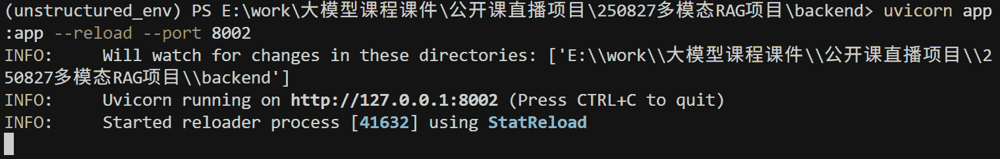

然后即可在网址：http://127.0.0.1:8002/docs 中进行功能测试：

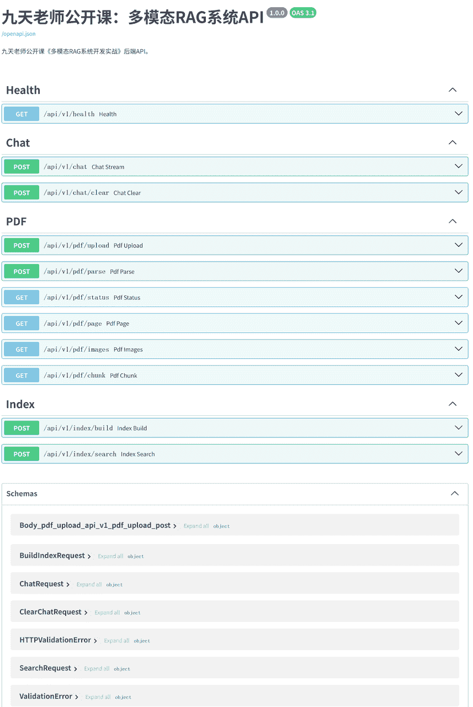

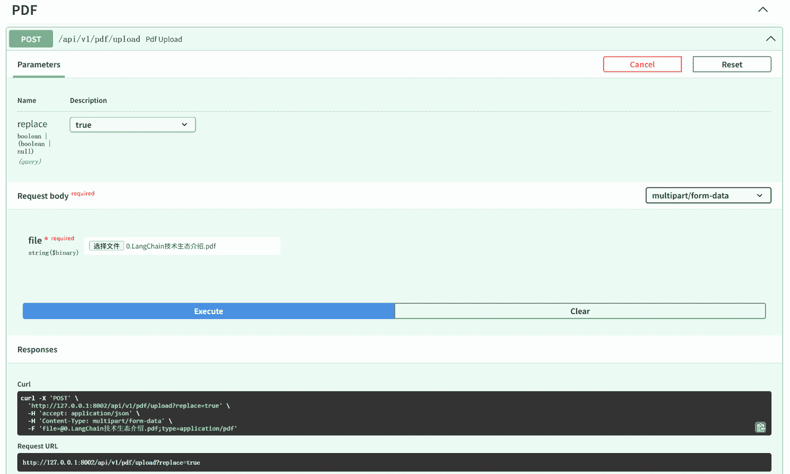

+   前端功能说明

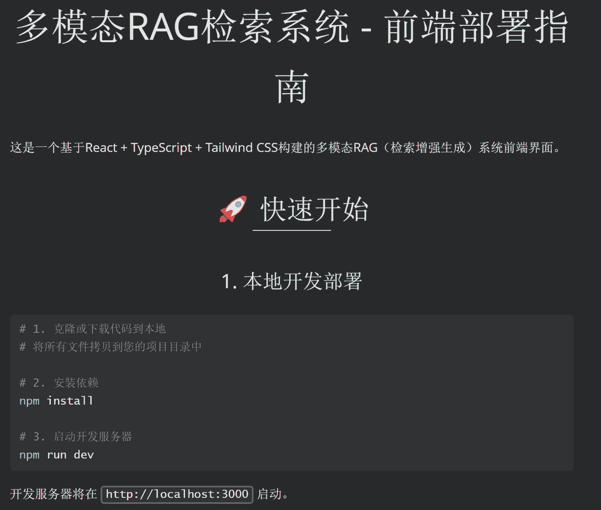

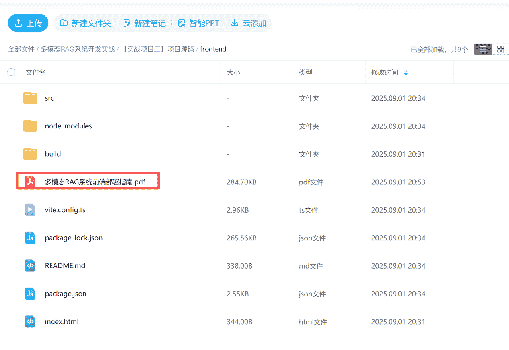

## 多模态RAG系统完整运行流程

+   完整项目源码领取

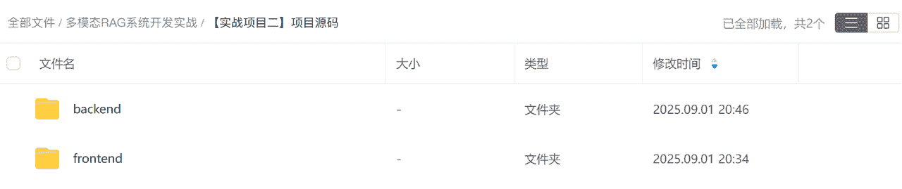


+   安装依赖

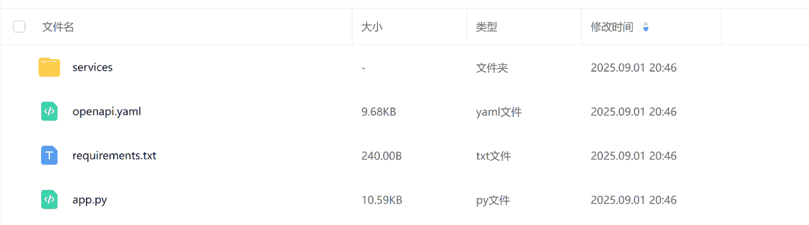

```
pip install -r requirements.txt
```

+   创建环境变量

+   需要手动创建.env文件，并输入OpenAI的API-KEY和DeepSeek API-KEY

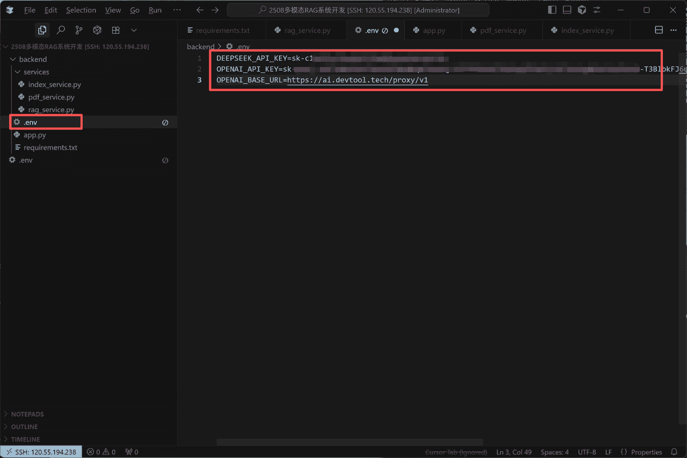

```
DEEPSEEK_API_KEY=sk-...
OPENAI_API_KEY=sk-...
OPENAI_BASE_URL=https://ai.devtool.tech/proxy/v1
```

+   开启后端

```
cd backend
uvicorn app:app --reload --port 8001
```

+   开启前端

+   然后再打开一个命令行，开启前端：

```
# 1. 安装依赖
npm install

# 2. 启动开发服务器
npm run dev
```

+   进行对话

---

+   体验课内容节选自《2025大模型Agent智能体开发实战》(秋招冲刺班)完整版付费课程

体验课时间有限，若想深度学习大模型技术，欢迎大家报名由我主讲的《2025大模型Agent智能体开发实战》(秋招冲刺班)


此外，若是对大模型底层原理感兴趣，也欢迎报名由我和菜菜老师共同主讲的《2025大模型原理与实战课程》(秋招冲刺班)

**大模型秋招冲刺班开班特惠进行中，直播间享五折特价+全套SVIP新班特定福利，合购还有更多**优惠哦~详细信息扫码添加助教，回复“大模型”，即可领取课程大纲&查看课程详情👇


**《2025大模型Agent智能体开发实战**》(秋招冲刺班)为【100+小时】体系大课，总共20大模块精讲精析，零基础直达大模型企业级应用！