# 基于VLM构建多模态RAG问答系统实战

> 来源：[https://kq4b3vgg5b.feishu.cn/docx/E1KBdF6OKooG4PxnhaicD7hGnwc](https://kq4b3vgg5b.feishu.cn/docx/E1KBdF6OKooG4PxnhaicD7hGnwc)

**课程说明：**

+   体验课内容节选自《2025大模型Agent智能体开发实战》(秋季班)完整版付费课程

体验课时间有限，若想深度学习大模型技术，欢迎大家报名由我主讲的《2025大模型Agent智能体开发实战》(秋季班)

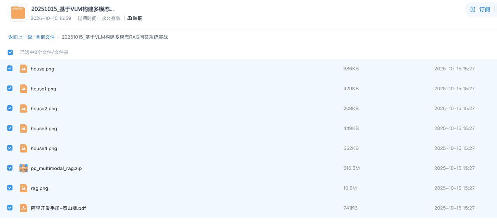


此外，公开课训练项目代码、数据，已上传至课件网盘，**联系⬆️助教回复“vlm”****，即可领取****（**目前咨询人数较多，助教老师在加急一一回**复**啦，小伙伴们发送后耐心等待一下哦🌹～）。

---

+   **本期公开课案例功能介绍**

核心功能一：支持在线上传并自动解析多模态PDF及CAD、工程图纸和复杂架构原型图；

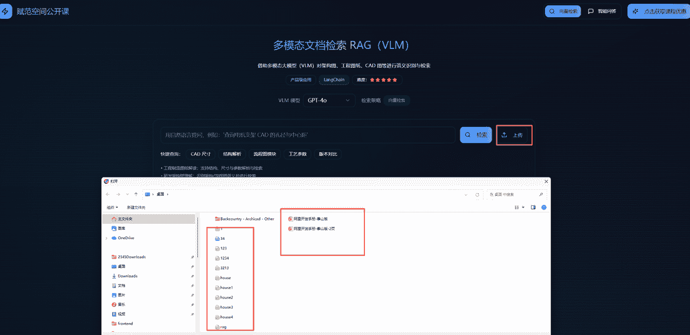

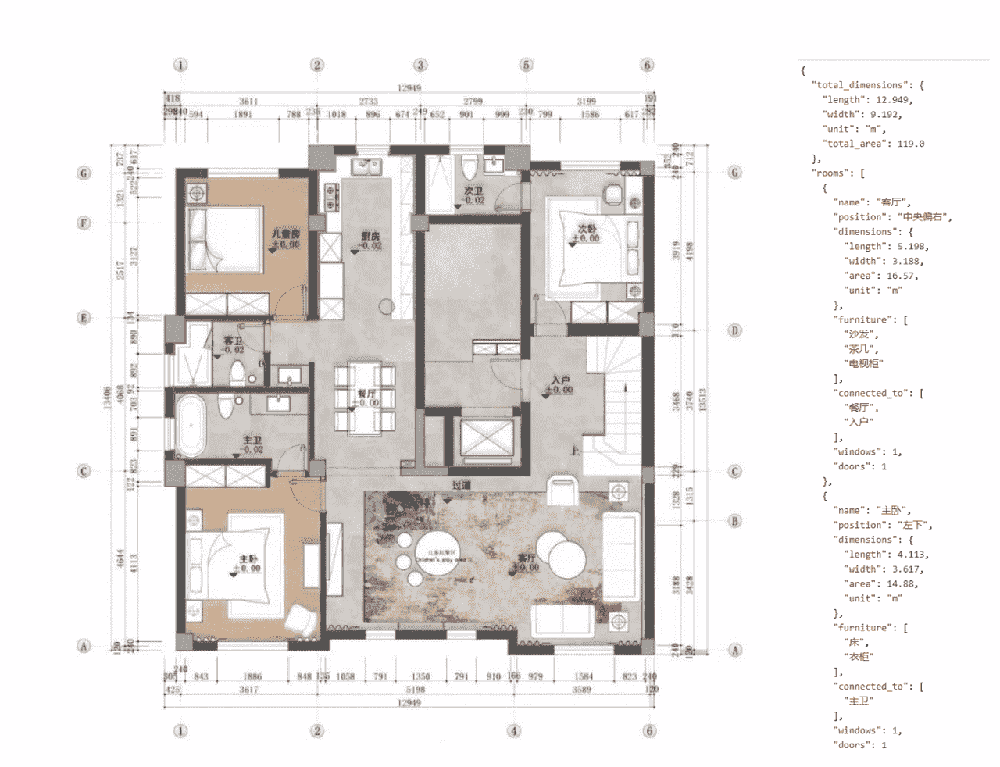

核心功能二：通过自然语言问答，直接检索图片原型及文档原件，并支持溯源和在线预览，实现“以文搜图”、“以图搜图”；

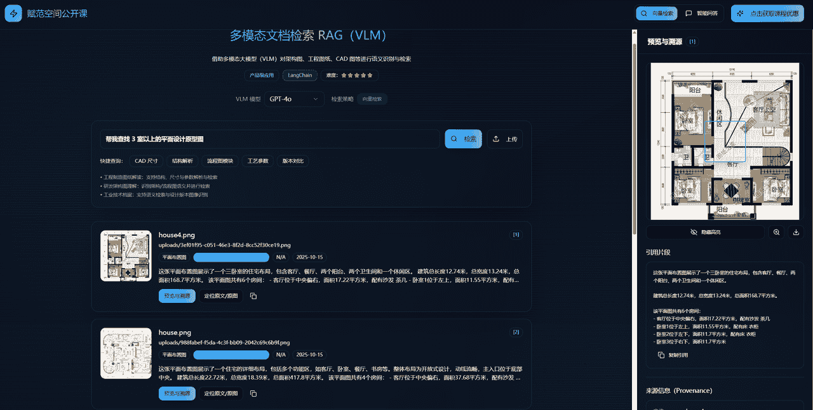

核心功能三：支持实时上传多模态PDF及CAD、工程图纸和复杂架构原型图，并直接对文件内容进行提问，实现“以文搜文”；

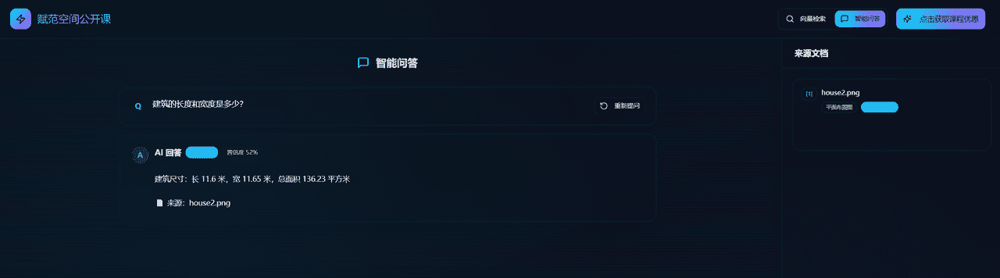

本期公开课，我们要探讨的是目前大模型技术领域**非常前沿且具有实**际应用落地的技术领域——多模态RAG系统。

在开始之前，大家可以先思考下在实际的开发需求是否存在类似这样的问题：当你拿到一份包含复杂图表、公式和文字说明的学术论文时，如果想快速找到某个实验结果对应的图表说明，你会怎么做？传统方法可能需要逐页翻阅、人工对照，这无疑是个耗时的过程。而今天我们要学习的多模态RAG技术，让AI不仅能"读懂"文字，还能"看懂"图像、理解表格、识别公式，甚至处理音视频内容。设想一下，你只需上传文档，然后用自然语言提问："第5页的实验结果图表说明了什么？"，AI就能准确定位图表并给出专业解答。这就是多模态RAG带来的变革。

因此在本期公开课中，我将带领大家从RAG的基础概念出发，深入理解多模态扩展的技术原理，掌握主流的实现方案，并了解当前的落地应用。相信通过本节课程，大家能够建立起对这一前沿技术的系统性认知。

# 一、多模态RAG的产品落地形式剖析

+   从真实需求出发，看见“多模态”的价值

过去我们用文本RAG解决“从海量文档中找准依据”的问题，如今业务资料已高度多媒体化：投研报告的图表、医学影像与病历、客服录音、培训视频、设计图纸与源代码等。如果仍然只索引文本，就像只看“一个维度”的世界，关键信息（版式、图形、音频语义、视频时序）会被丢失。因此在目前的真实业务里，我们很少只面对纯文本：图片里的表格与图表、视频中的镜头与字幕、会议里的语音、工程里的代码与文档，这些信息共同构成了知识的全貌。传统仅靠文本的RAG（Retrieval-Augmented Generation）在此时往往力不从心：它无法“看图”、不会“听音”、也难以“看视频”。


下表中展示了多模态RAG的主流形态与典型场景：

**多模态RAG典型形态与场景对照**

| 类型 | 典型输入 | 核心输出 | 适用场景 |
| --- | --- | --- | --- |
| 视觉问答型 | 图片、文档页面截图 | 基于图像的问答与解释 | 智能客服、报表/图表理解 |
| 多模态搜索型 | 文本/图像/音频/视频混合 | 跨模态检索结果与证据 | 企业知识库、媒体库检索 |
| 视频理解型 | 视频帧+字幕/音频 | 片段定位与内容问答 | 课程/直播/培训视频问答 |
| 语音/音频处理型 | 会议录音、通话音频 | 转写+基于内容的问答 | 会议纪要检索、客服质检 |
| 代码+文档检索型 | 源代码+技术文档 | 代码片段定位与说明 | 工程知识库、研发助手 |

这类应用的直观感受是：你不再需要关心“文件格式”，而是用自然语言直接提问，系统跨模态检索到相关证据，再组织出可核验的回答。这正是多模态RAG的“可用之处”。

+   如何判断你的需求是不是多模态RAG？

多模态RAG的通用链路可以概括为：数据采集 → 解析与预处理（如OCR、切帧、转写） → 跨模态向量化与对齐（如CLIP/Whisper） → 统一向量索引与存储 → 检索重排与证据拼接 → 大模型生成与来源标注 → 反馈闭环与评估迭代。实践中我们会因场景（如医疗、法律、金融）而替换具体组件，但链路形态不变。

场景 → 多模态RAG形态映射表

| 需求场景（你遇到的情况） | 推荐形态 | 关键做法/理由 | 是否多模态RAG |
| --- | --- | --- | --- |
| 报表/论文/说明书解析，需要“看图说话” | 视觉问答型/文档按图像检索 | 保留版式、公式、表格结构，不丢关键信息 | 是 |
| 希望“以文搜图/以图搜图/跨模态检索”，资料库含文本+图像/音视频 | 多模态搜索型 | 不同模态向量化进同一空间，统一索引，无需区分格式 | 是 |
| 大量课程视频/培训录像，想问“某段视频发生了什么” | 视频理解型 | 切帧、抽字幕/音频，构建时间感知索引再问答 | 是 |
| 以会议录音/客服通话为主，希望先转文字再问答且可回溯原音 | 语音/音频处理型 | Whisper转写 + 检索 + 生成，效率与可追踪兼顾 | 是 |
| 知识主要在代码+文档里，想同时定位API实现与设计说明 | 代码与文档混合检索 | 源代码与文档统一索引，一次问清代码与说明 | 是 |

# 二、多模态RAG的基础：传统RAG

**检索增强生成（Retrieval-Augmen**ted Generation, RAG） 的核心思想非常直观：在大模型生成回答之前，先从外部知识库中检索相关信息供模型参考。这就像我们在回答问题前先查阅资料一样。

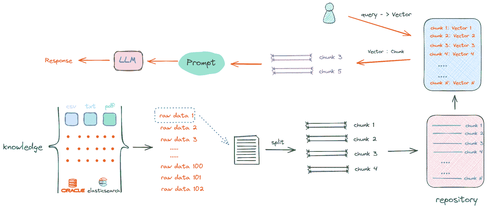

传统的RAG系统存在一个明显的短板——它们主要面向纯文本场景。想象这样的场景：

+   一份技术文档中包含架构示意图，但OCR只能提取"图1：系统架构"这样的标注文字，图中的模块关系、数据流向等关键信息完全丢失

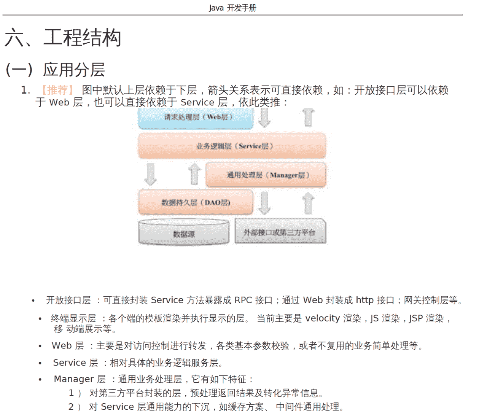

+   一张财务报表的复杂表格结构，转成纯文本后行列关系混乱，很难准确回答"第二季度销售额"这类问题

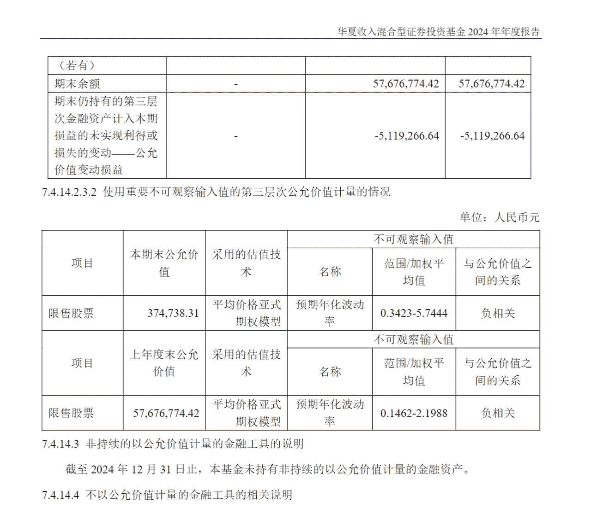

+   学术论文中的数学公式，即使识别成文本也难以理解其含义

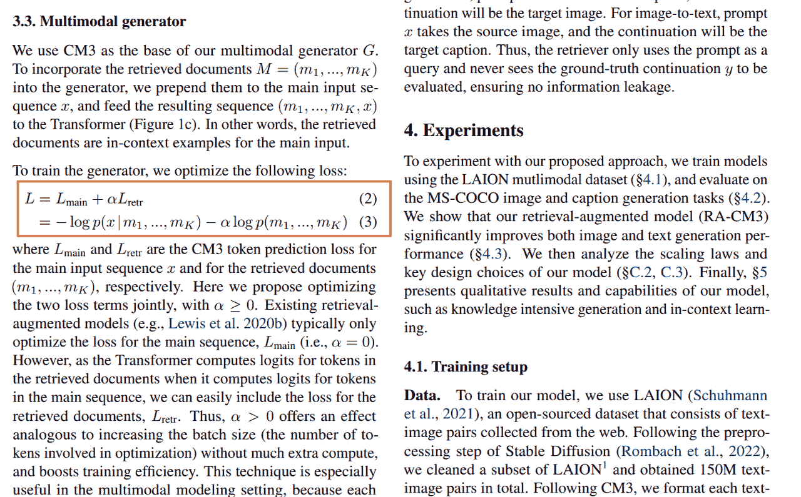

这些场景暴露出一个根本问题：现实世界的知识不仅以文字形式存在，图像、图表、公式、音视频都承载着丰富的信息。比如用户先上传一些图片、音频，然后提出一个关于这些内容的问题，传统的RAG系统是根本无法处理的。

正是基于这样的需求，多模态RAG应运而生。它将RAG的思想拓展到图像、音频、视频等多种数据形式。我们可以把多模态RAG理解为让AI具备了"眼睛"和"耳朵"的检索增强系统。这涵盖了多种应用场景，例如：给定一张图片或截图，让系统回答其中内容的问题；或者提供包含文字、图表、公式的 PDF 文档，让系统整合文中图文信息进行问答。

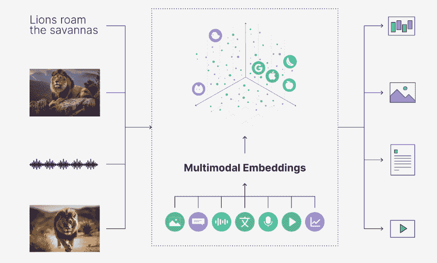

当前，大模型（如 GPT-4o、Claude 3.5 Sonnet、Qwen-VL）已经展现出基础的多模态能力，能够将图像与文本混合作为输入并生成回答

。例如 GPT-4 的视觉版允许用户上传图像并就其提问，实现视觉问答。谷歌的 Bard 也增加了图像输入的支持，能够分析用户插入的图片内容进行对话。同样地，在文档分析领域，一些应用可以处理 PDF 中的表格、图片甚至公式，实现对复杂报告的问答理解。可以说，多模态 RAG 正在将 AI 应用从纯文本扩大到“所见即所得”的更广阔信息空间。

多模态RAG的目标非常明确：在查询和知识库两端都支持多模态——既能理解多模态形式的问题，又能检索和利用文本以外的丰富信息来源。用一句话概括，就是实现"Ask in Any Modality"——用任意模态提问并得到专业答案。

# 三、多模态RAG的核心概念

接下来我们深入理解多模态RAG的具体含义。简单来说，多模态RAG是将检索增强技术应用于多模态数据的系统。它可以处理不同模态的查询和知识，包括图像、语音、文本、视频等。根据目前的技术发展及落地实践经验，多模态RAG主要涵盖两个维度：

+   **维度一：富媒体文档问答**

这是最常见的应用形态。给定包含文字、图片、表格、公式的PDF文档，系统需要：

1.  **解析阶段**：将文档中的视觉和文本信息分别提取

1.  **索引阶段**：建立跨模态的知识检索源

1.  **查询阶段**：用户用自然语言提问

1.  **生成阶段**：系统结合文本与图片内容作答

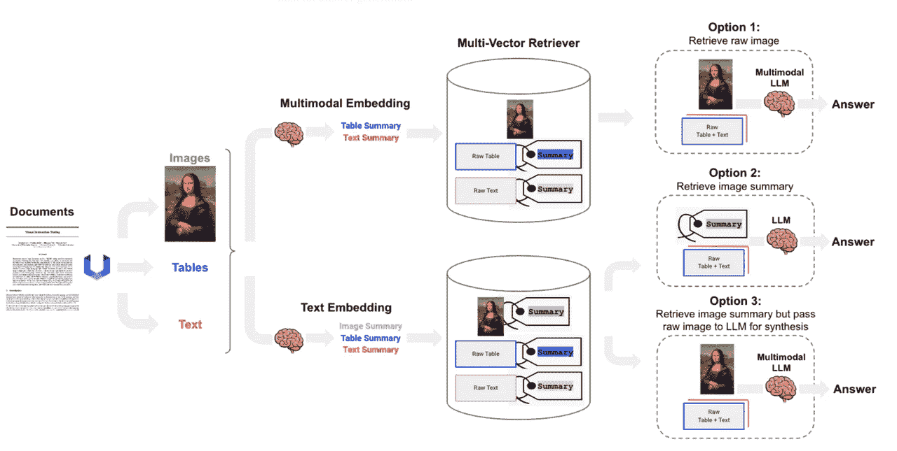

这要求系统能够理解图中的结构、表格数据，并将其与文本一起作为知识检索源。而完整的流程是：系统先解析出其中的视觉和文本信息，然后用户可以通过自然语言提问，让系统结合文本与图片内容作答。这需要系统理解图中的结构或表格数据，并将其与文本一起作为知识检索源。从技术的角度上来看，我们需要做到这样：

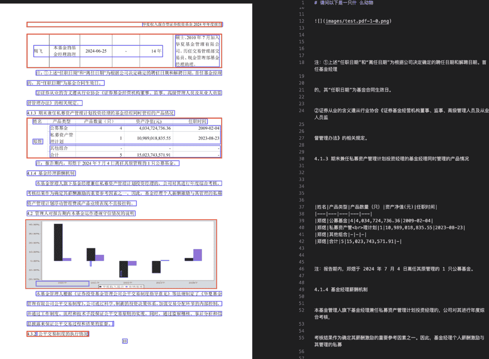

+   **维度二：非文本输入问答**

这个维度更进一步——查询本身就是图像或音频等模态。比如：

+   直接上传一张产品故障图片，让AI诊断问题

+   提供一段音频，让系统分析其中讨论的主题

+   给出视频片段，询问其中的关键信息

这种情况下，系统需要先将非文本输入转化为可处理的信息（通过图像理解模型或语音识别），然后从多模态索引的知识库中检索相关信息。从技术的角度我们需要做到这样：

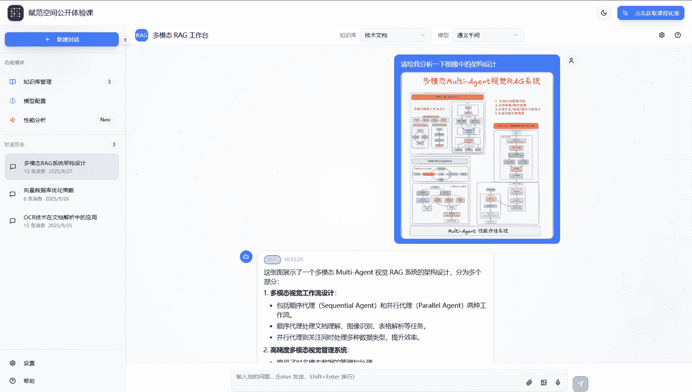

但实际上，多模态RAG并不只是简单地把图片和文字混在一起处理？在落地应用中远比这复杂。它涉及检索管线和生成模型两方面的多模态处理：

多模态RAG的关键技术环节

| 技术环节 | 核心挑战 | 解决方案 |
| --- | --- | --- |
| 数据预处理 | 如何从复杂文档中提取结构化信息 | OCR、表格识别、公式解析 |
| 向量表示 | 如何将不同模态映射到统一语义空间 | 多模态嵌入模型（CLIP等） |
| 检索匹配 | 如何实现跨模态的相似度计算 | 统一向量空间或多管线检索 |
| 答案生成 | 如何融合多模态信息生成回答 | 视觉语言模型（VLM） |

这张表格展示了多模态RAG的核心技术链条。并且值得注意的是，多模态 RAG 涉及检索管线和生成模型两方面的多模态处理。检索阶段需要能理解图像、音频等内容的索引和搜索算法；生成阶段则可能需要具备视觉、语言混合理解能力的模型（例如视觉语言模型，Vision-Language Model）来综合检索结果回答问题。因此，多模态 RAG 通常被视为对传统文本RAG能力的扩展和增强，使系统能够Ask in Any Modality（用任意模态提问并得到答案），每个环节都需要专门的技术模块支撑，这也是为什么多模态RAG被视为对传统文本RAG能力的重大扩展和增强。

至此，相信大家已经非常清晰地明白了多模态RAG的核心理念。接下来我们需要重点来看实际工程中如何构建这样的系统。

# 四、多模态技术实现路线深度剖析

根据目前的技术发展及实践经验，当前主要有三种技术路线，每种都有其适用场景和权衡考量。接下来我将逐一介绍每种路线的核心思想、典型代表、优势与局限。

## 4.1 技术路线一：统一向量空间检索

这种方法的理念非常优雅：使用多模态嵌入模型将不同模态的信息投影到同一向量空间。就像把不同语言翻译成"世界语"一样，无论是图像还是文本，都用同一种向量表示方式。

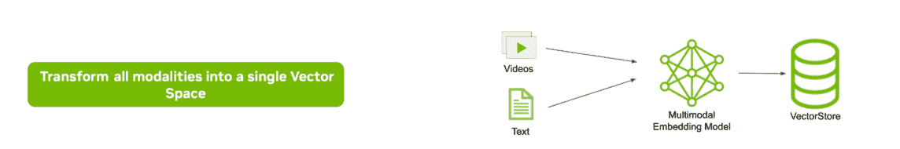

典型代表就是**CLIP模型**，其中OpenAI的CLIP模型是这一路线的标杆。它可以将图像和文本编码到同一语义向量空间中，实现：

+   文本查询可以直接检索到相关图像

+   图像查询可以匹配到描述文本

+   跨模态的相似度计算变得简单直接

如果大家还不太理解CLIP的话，可以简单将其想象成一个“翻译器”，把图像翻译成一种向量语言（表示语义的向量），也把文本翻译成相同 “语言”的向量。然后在这个向量“语言”里做比较：图像向量 vs 文本向量 — 看它们在向量空间里的距离 /相似性。所以CLIP能对图像和文本都进行编码，如下所示：

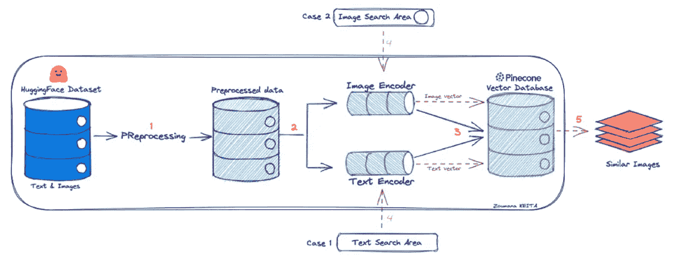

目前有很多诸如 OpenAI / Qwen（或其生态）提供在线／API 模型或服务，可以支持如上图所示的检索＋融合 / 多模态输入的能力。比如：OpenAI 的官方Cookbook 提供了一个示例，先对图像做 CLIP 类 embedding（或类似方法）来做检索，然后把检索出的上下文 + 图像内容组合起来给 GPT 模型做多模态 reasoning。这就是 embedding 图像 (用 CLIP) 来做相似性检索，然后把结果与 prompt 一起输入模型回答的非常经典的技术实现过程。

> https://cookbook.openai.com/examples/custom_image_embedding_search

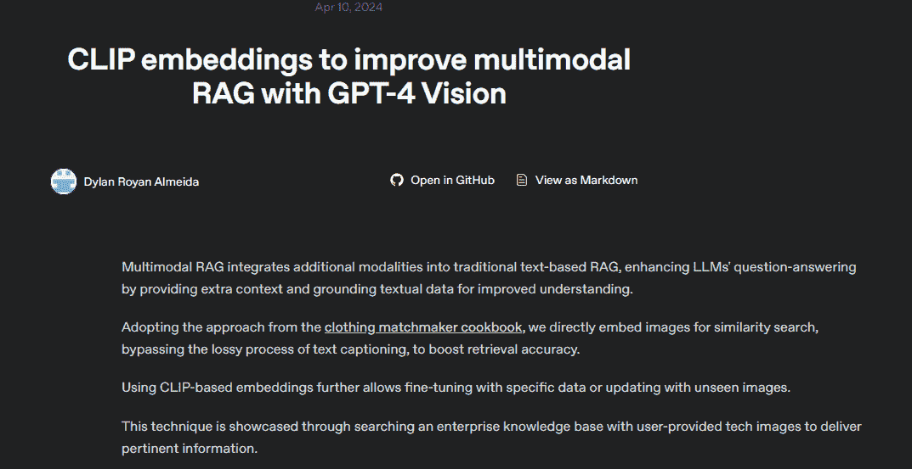

其中最小可运行的核心代码如下所示：

```
    import torch
    import clip  # 可以用 openai 的 clip 包，或者用 open_clip 等替代
    from PIL import Image

    device = &quot;cuda&quot; if torch.cuda.is_available() else &quot;cpu&quot;

    # 加载模型 + 图像预处理器
    model, preprocess = clip.load(&quot;ViT-B/32&quot;, device=device)

    # 准备图片列表
    image_paths = [&quot;dog.jpg&quot;, &quot;cat.jpg&quot;, &quot;car.jpg&quot;]
    images = [preprocess(Image.open(p).convert(&quot;RGB&quot;)).unsqueeze(0) for p in image_paths]
    images = torch.cat(images, dim=0).to(device)  # shape (N, 3, H, W)

    # 准备文本查询（可以多个描述）
    texts = [&quot;a photo of a dog&quot;, &quot;a photo of a cat&quot;, &quot;a photo of a vehicle&quot;]
    tokens = clip.tokenize(texts).to(device)

    # 计算图像和文本的嵌入
    with torch.no_grad():
        image_embeddings = model.encode_image(images)  # 形状 (N, D)
        text_embeddings = model.encode_text(tokens)    # 形状 (M, D)

    # 通常会做归一化，这样内积就等价于余弦相似度
    image_embeddings = image_embeddings / image_embeddings.norm(dim=1, keepdim=True)
    text_embeddings = text_embeddings / text_embeddings.norm(dim=1, keepdim=True)

    # 计算相似度矩阵：每个文本与每张图像的相似度
    similarity = text_embeddings @ image_embeddings.T  # (M, N)

    # 输出最匹配的图片 index
    for i, txt in enumerate(texts):
        scores = similarity[i]  # 对应每张图片的分数
        best_idx = scores.argmax().item()
        print(f&quot;文本 ‘{txt}’ 最匹配图片：{image_paths[best_idx]} (分数 {scores[best_idx].item():.4f})&quot;)
```

上述代码示例可以做“文本 → 图像检索”。同理，如果你有图片查询，也可以把图片的 embedding 与所有文本 embedding 做相似度比对，就可以做“图像 → 文本检索”。其核心流程为：

+   用 clip.load(...) 加载预训练模型

+   用 model.encode_image() 和 model.encode_text() 分别对图像和文本编码

+   对两个嵌入向量做归一化

+   计算内积（或余弦相似度）来评估文本与图像之间的匹配性

同时，这个基本流程就是用 CLIP 做跨模态检索的核心。目前超90%的落地项目都是在这个基础上再加上索引（例如用 FAISS、Milvus、Pinecone 等），以及批处理、缓存、加速等优化。

** 该技术路线实现过程还是比较复杂的，公开课时间有限，这里就不再展开介绍。如若想深入学**习的小伙伴，可以报名我们的正式课程。大模型秋季班封班特惠进行时，直播间享五折特价+全套SVIP新班特定福利，合购还有更多优惠哦~详细信息扫码添加助教，回复“大模型”，即可领取课程大纲&查看课程详情👇


这种技术路线的优势是架构简洁，检索阶段不区分模态，只需查询一个向量数据库，但是局限越狠明显，训练统一模型非常困难，当前多模态嵌入模型往往只针对两两模态（如图文）效果较好，对于更多模态或复杂格式（自然图像 vs. 扫描文档 vs. 图表）泛化能力不足。

因此，在实际应用中，这种方案需要大量训练数据和精调，而且对于包含特殊结构的信息（如公式、合成图表）效果可能不理想。

这里要注意的是：在多模态 RAG（Multimodal RAG）里，有一条重要的区别／设计抉择，就是“用多模态模型直接解析 + 问答”与“用检索 + 生成（RAG）”这两条路径的关系和优劣：

解析问答 vs 检索 + 生成

| 路径 | 核心流程 /机制 | 输入／输出特征 | 优点 | 缺点 /挑战 |
| --- | --- | --- | --- | --- |
| **直接多模态解析 /问答** | 给定图像 + 文本 prompt → 多模态模型（例如 Qwen-Omni、VL 模型）内部理解 + 推理 → 直接输出答案 | 输入可能是图像 + 文本，输出是文本（或语音） | 简洁，不需要检索模块、向量数据库、索引、召回等流程；适合实时交互 | 模型容量 /知识覆盖受限；容易 “忘记”长尾知识或外部知识；当问题涉及知识库内容或历史文档，模型可能石沉大海（hallucination 风险高） |
| **检索增强（RAG）路线** | 先把知识库里的图文 / 多模态内容编码成向量、做索引 /检索；给定用户 query（可能包含图 + 文本信息），检索最相关资料；把这些检索结果 + query 一起交给多模态 / 混合模型生成答案 | 有检索模块 + 向量数据库 + 编码器 + 生成模型 | 能显著扩展知识覆盖范围、增强外部知识支持、减少模型的“记忆负担”、提升答案可验证性 | 检索质量、向量表示对齐、模态差异对齐、查询-检索-融合策略设计复杂；若检索结果无关或噪声，会误导生成模型 |

+   直接多模态模型解析

                        &quot;url&quot;: &quot;https://help-static-aliyun-doc.aliyuncs.com/file-manage-files/zh-CN/20241022/emyrja/dog_and_girl.jpeg&quot;

```
import os
from openai import OpenAI
from dotenv import load_dotenv
load_dotenv(override=True)

client = OpenAI(
    # 若没有配置环境变量，请用阿里云百炼API Key将下行替换为：api_key=&quot;sk-xxx&quot;,
    # 新加坡和北京地域的API Key不同。获取API Key：https://help.aliyun.com/zh/model-studio/get-api-key
    api_key=os.getenv(&quot;DASHSCOPE_API_KEY&quot;),
    # 以下是北京地域base_url，如果使用新加坡地域的模型，需要将base_url替换为：https://dashscope-intl.aliyuncs.com/compatible-mode/v1
    base_url=&quot;https://dashscope.aliyuncs.com/compatible-mode/v1&quot;,
)

completion = client.chat.completions.create(
    model=&quot;qwen3-omni-flash&quot;, # 模型为Qwen3-Omni-Flash时，请在非思考模式下运行
    messages=[
        {
            &quot;role&quot;: &quot;user&quot;,
            &quot;content&quot;: [
                {
                    &quot;type&quot;: &quot;image_url&quot;,
                    &quot;image_url&quot;: {
                    },
                },
                {&quot;type&quot;: &quot;text&quot;, &quot;text&quot;: &quot;图中描绘的是什么景象？&quot;},
            ],
        },
    ],
    # 设置输出数据的模态，当前支持两种：[&quot;text&quot;,&quot;audio&quot;]、[&quot;text&quot;]
    modalities=[&quot;text&quot;, &quot;audio&quot;],
    audio={&quot;voice&quot;: &quot;Cherry&quot;, &quot;format&quot;: &quot;wav&quot;},
    # stream 必须设置为 True，否则会报错
    stream=True,
    stream_options={
        &quot;include_usage&quot;: True
    }
)

for chunk in completion:
    if chunk.choices:
        print(chunk.choices[0].delta)
    else:
        print(chunk.usage)
```

     23                         &quot;url&quot;: &quot;https://help-static-aliyun-doc.aliyuncs.com/file-manage-files/zh-CN/20241022/emyrja/dog_and_girl.jpeg&quot;

```
---------------------------------------------------------------------------

AuthenticationError                       Traceback (most recent call last)

Cell In[1], line 14
      4 load_dotenv(override=True)
      6 client = OpenAI(
      7     # 若没有配置环境变量，请用阿里云百炼API Key将下行替换为：api_key=&quot;sk-xxx&quot;,
      8     # 新加坡和北京地域的API Key不同。获取API Key：https://help.aliyun.com/zh/model-studio/get-api-key
   (...)
     11     base_url=&quot;https://dashscope.aliyuncs.com/compatible-mode/v1&quot;,
     12 )
---&gt; 14 completion = client.chat.completions.create(
     15     model=&quot;qwen3-omni-flash&quot;, # 模型为Qwen3-Omni-Flash时，请在非思考模式下运行
     16     messages=[
     17         {
     18             &quot;role&quot;: &quot;user&quot;,
     19             &quot;content&quot;: [
     20                 {
     21                     &quot;type&quot;: &quot;image_url&quot;,
     22                     &quot;image_url&quot;: {
     24                     },
     25                 },
     26                 {&quot;type&quot;: &quot;text&quot;, &quot;text&quot;: &quot;图中描绘的是什么景象？&quot;},
     27             ],
     28         },
     29     ],
     30     # 设置输出数据的模态，当前支持两种：[&quot;text&quot;,&quot;audio&quot;]、[&quot;text&quot;]
     31     modalities=[&quot;text&quot;, &quot;audio&quot;],
     32     audio={&quot;voice&quot;: &quot;Cherry&quot;, &quot;format&quot;: &quot;wav&quot;},
     33     # stream 必须设置为 True，否则会报错
     34     stream=True,
     35     stream_options={
     36         &quot;include_usage&quot;: True
     37     }
     38 )
     40 for chunk in completion:
     41     if chunk.choices:

File C:\ProgramData\anaconda3\Lib\site-packages\openai\_utils\_utils.py:287, in required_args.&lt;locals&gt;.inner.&lt;locals&gt;.wrapper(*args, **kwargs)
    285             msg = f&quot;Missing required argument: {quote(missing[0])}&quot;
    286     raise TypeError(msg)
--&gt; 287 return func(*args, **kwargs)

File C:\ProgramData\anaconda3\Lib\site-packages\openai\resources\chat\completions\completions.py:1135, in Completions.create(self, messages, model, audio, frequency_penalty, function_call, functions, logit_bias, logprobs, max_completion_tokens, max_tokens, metadata, modalities, n, parallel_tool_calls, prediction, presence_penalty, prompt_cache_key, reasoning_effort, response_format, safety_identifier, seed, service_tier, stop, store, stream, stream_options, temperature, tool_choice, tools, top_logprobs, top_p, user, web_search_options, extra_headers, extra_query, extra_body, timeout)
   1090 @required_args([&quot;messages&quot;, &quot;model&quot;], [&quot;messages&quot;, &quot;model&quot;, &quot;stream&quot;])
   1091 def create(
   1092     self,
   (...)
   1132     timeout: float | httpx.Timeout | None | NotGiven = NOT_GIVEN,
   1133 ) -&gt; ChatCompletion | Stream[ChatCompletionChunk]:
   1134     validate_response_format(response_format)
-&gt; 1135     return self._post(
   1136         &quot;/chat/completions&quot;,
   1137         body=maybe_transform(
   1138             {
   1139                 &quot;messages&quot;: messages,
   1140                 &quot;model&quot;: model,
   1141                 &quot;audio&quot;: audio,
   1142                 &quot;frequency_penalty&quot;: frequency_penalty,
   1143                 &quot;function_call&quot;: function_call,
   1144                 &quot;functions&quot;: functions,
   1145                 &quot;logit_bias&quot;: logit_bias,
   1146                 &quot;logprobs&quot;: logprobs,
   1147                 &quot;max_completion_tokens&quot;: max_completion_tokens,
   1148                 &quot;max_tokens&quot;: max_tokens,
   1149                 &quot;metadata&quot;: metadata,
   1150                 &quot;modalities&quot;: modalities,
   1151                 &quot;n&quot;: n,
   1152                 &quot;parallel_tool_calls&quot;: parallel_tool_calls,
   1153                 &quot;prediction&quot;: prediction,
   1154                 &quot;presence_penalty&quot;: presence_penalty,
   1155                 &quot;prompt_cache_key&quot;: prompt_cache_key,
   1156                 &quot;reasoning_effort&quot;: reasoning_effort,
   1157                 &quot;response_format&quot;: response_format,
   1158                 &quot;safety_identifier&quot;: safety_identifier,
   1159                 &quot;seed&quot;: seed,
   1160                 &quot;service_tier&quot;: service_tier,
   1161                 &quot;stop&quot;: stop,
   1162                 &quot;store&quot;: store,
   1163                 &quot;stream&quot;: stream,
   1164                 &quot;stream_options&quot;: stream_options,
   1165                 &quot;temperature&quot;: temperature,
   1166                 &quot;tool_choice&quot;: tool_choice,
   1167                 &quot;tools&quot;: tools,
   1168                 &quot;top_logprobs&quot;: top_logprobs,
   1169                 &quot;top_p&quot;: top_p,
   1170                 &quot;user&quot;: user,
   1171                 &quot;web_search_options&quot;: web_search_options,
   1172             },
   1173             completion_create_params.CompletionCreateParamsStreaming
   1174             if stream
   1175             else completion_create_params.CompletionCreateParamsNonStreaming,
   1176         ),
   1177         options=make_request_options(
   1178             extra_headers=extra_headers, extra_query=extra_query, extra_body=extra_body, timeout=timeout
   1179         ),
   1180         cast_to=ChatCompletion,
   1181         stream=stream or False,
   1182         stream_cls=Stream[ChatCompletionChunk],
   1183     )

File C:\ProgramData\anaconda3\Lib\site-packages\openai\_base_client.py:1259, in SyncAPIClient.post(self, path, cast_to, body, options, files, stream, stream_cls)
   1245 def post(
   1246     self,
   1247     path: str,
   (...)
   1254     stream_cls: type[_StreamT] | None = None,
   1255 ) -&gt; ResponseT | _StreamT:
   1256     opts = FinalRequestOptions.construct(
   1257         method=&quot;post&quot;, url=path, json_data=body, files=to_httpx_files(files), **options
   1258     )
-&gt; 1259     return cast(ResponseT, self.request(cast_to, opts, stream=stream, stream_cls=stream_cls))

File C:\ProgramData\anaconda3\Lib\site-packages\openai\_base_client.py:1047, in SyncAPIClient.request(self, cast_to, options, stream, stream_cls)
   1044             err.response.read()
   1046         log.debug(&quot;Re-raising status error&quot;)
-&gt; 1047         raise self._make_status_error_from_response(err.response) from None
   1049     break
   1051 assert response is not None, &quot;could not resolve response (should never happen)&quot;

AuthenticationError: Error code: 401 - {&#x27;error&#x27;: {&#x27;message&#x27;: &#x27;Incorrect API key provided. &#x27;, &#x27;type&#x27;: &#x27;invalid_request_error&#x27;, &#x27;param&#x27;: None, &#x27;code&#x27;: &#x27;invalid_api_key&#x27;}, &#x27;request_id&#x27;: &#x27;aa56a0c2-4b5e-45d0-87ad-42369b0c78d8&#x27;}
```

## 4.2 技术路线二：多路并行检索

既然统一空间很难，那就针对每种模态各自建立独立的检索管线和索引.针对每种模态各自建立独立的检索管线和索引。例如文本用文本向量索引，图像用图像向量索引，音频用音频索引。当收到查询时，让它并行地查询多个检索器，各自取 Top K 结果，然后汇总所有模态的结果提供给生成模型。

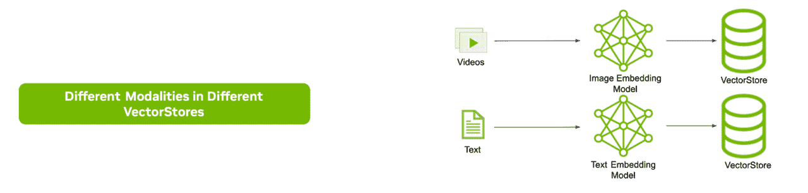

这样做的好处是保持了每种模态检索的专业性，不需要一个模型通吃所有模态。然而缺点也很明显：第一，返回的候选片段数量会成倍增加，最终可能需要在生成阶段处理海量跨模态信息；第二，生成模型本身必须能同时理解多模态输入，否则无法把不同来源的信息融合起来。因此，多路并行方案实际是将问题从检索阶段转移到了生成阶段，并带来了更高的计算开销。在工程中，这种方案一般用于小规模实验或配合强多模态模型时采用，但并非主流。

## 4.3 技术方案三：转化为统一模态（文本）处理

这是目前应用最广泛也最务实的方案，即将所有非文本信息在预处理阶段转成文本表示。“统一以文本为基础”也被称作模态归一化（grounding），例如对图像运行OCR提取文字说明，对表格转成CSV/文本，对音频跑语音识别得到文本，对视频提取字幕或说明性文字。通过这一过程，把多模态内容全部变成可索引的文本块，再用常规文本向量检索技术构建索引。查询时同样将问题转成文本向量检索相关片段，然后提供给语言模型生成答案。这种方法的优点在于架构简单、复用成熟的文本RAG技术，避免了训练复杂多模态模型。

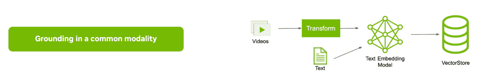

比如很多文档问答产品直接对PDF进行文字抽取和OCR，把图文混排的内容转成纯文本索引，让大模型基于提取的文字回答问题。

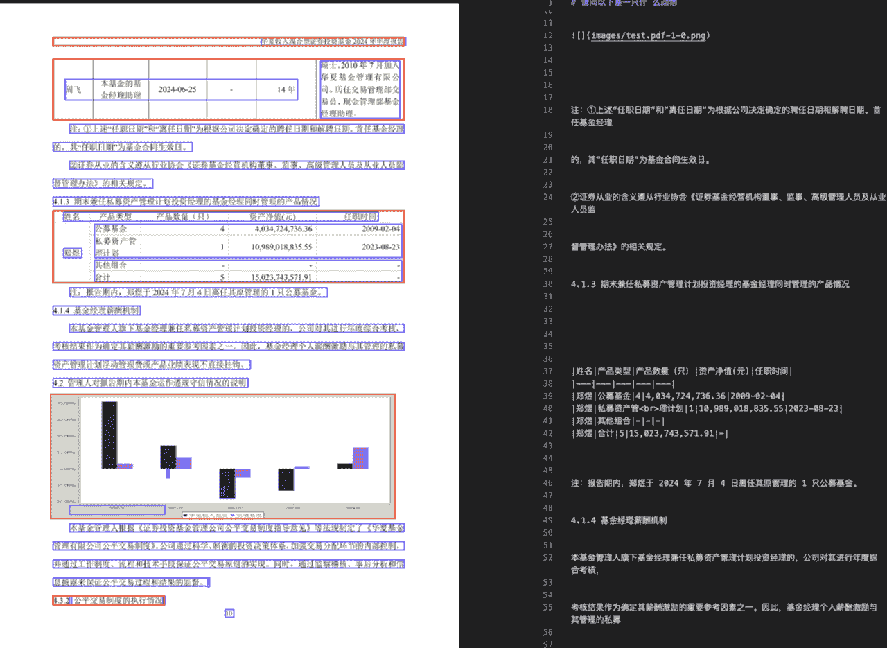

对于含有大量文字的图像（如扫描文档、截图）和结构化数据（如表格，提取成文本表述）而言，这种方案相对有效。但缺点是可能损失模态专有的信息和细节。例如OCR无法捕获图片中的视觉图形含义，表格纯文本可能丢失单元格对应关系，公式转成文本往往不可读。尽管如此，在多模态大模型尚未普及前，这是工业界落地最稳妥快捷的路线，也常与大模型结合使用（如让大模型先读OCR文字，再回答）。

# 5. 【实战】多模态RAG系统架构设计与实现

在了解了多模态RAG的核心概念和实现路线后，接下来我们先通过一个实战项目，为大家展示如何从零开始构建一个完整的多模态RAG系统。

接下来，我们就深入探索如何构建一个基于多模态RAG的CAD图纸智能问答链路。相信大家在工业制造、建筑设计等领域中，都会遇到大量的技术图纸需要管理和查询。传统的方式是打开图纸逐个查看，效率低下且容易遗漏关键信息。

接下来我们就从零开始，逐步实现一个能够"读懂"CAD图纸、自动提取关键信息、并智能回答用户问题的系统，其核心实现思路如下：

```
    第一步：接入VLM模型
                ↓
    第二步：解析本地CAD图片
                ↓
    第三步：提取结构化元数据
                ↓
    第四步：存入向量数据库
                ↓
    第五步：智能问答（直接问答 + 图像检索）
```

+   **处理图片示例**

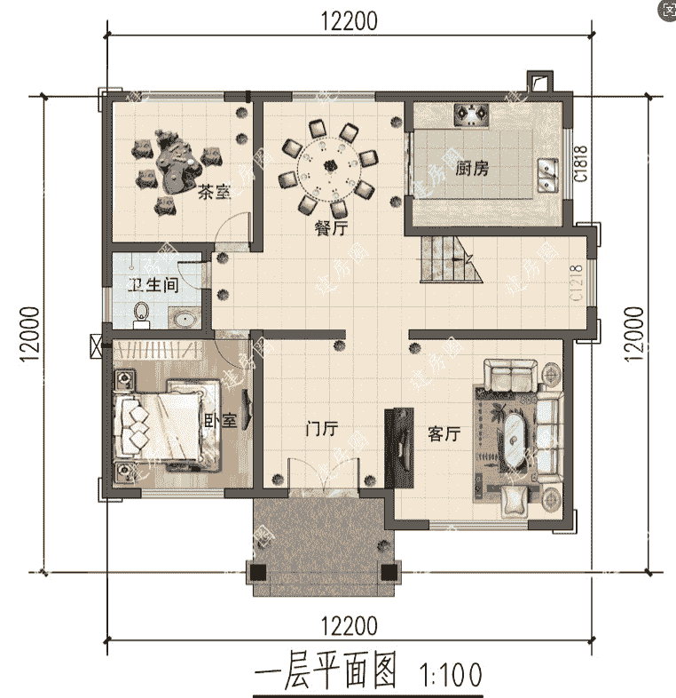

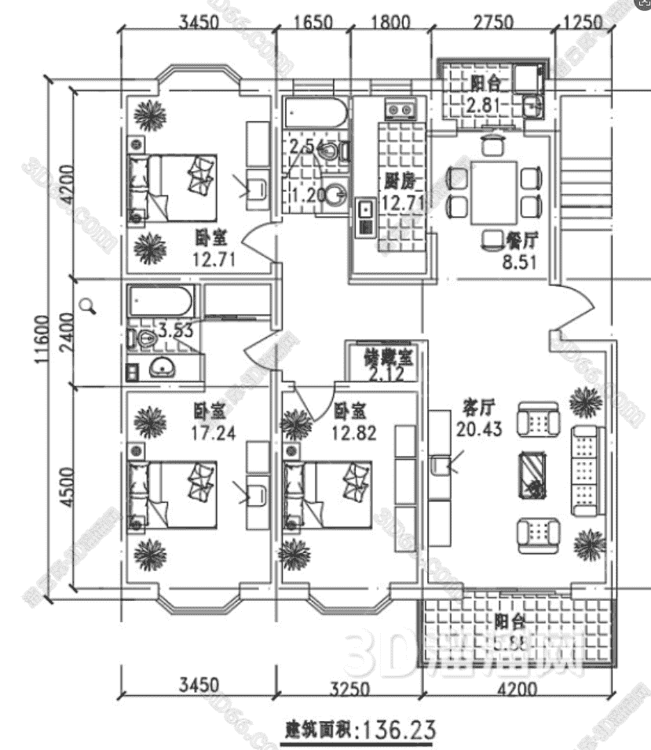

这套系统可以直接应用于：

+   **房地产销售**：快速回答客户关于户型的问题（"有几个卧室？"、"主卧面积多大？"）

+   **室内设计**：分析户型优缺点，提供设计建议

+   **智能选房**：根据用户需求（如"3室2厅，面积100平以上"）自动筛选户型

+   **户型对比**：智能对比多个户型的优劣

同时，只要针对性的修改提示词，即可快速迁移到其他的图像分析场景。

## 5.1 环境准备与依赖安装

首先，我们需要安装必要的Python包。这个系统的核心依赖包括：

+   openai：用于调用多模态大模型API

+   chromadb：向量数据库，用于存储和检索

+   langchain：RAG框架的核心组件

+   Pillow：图像处理库

```
# 安装依赖（如果需要）
# !pip install openai chromadb langchain langchain-community langchain-openai Pillow python-dotenv -q

# 导入必要的库
import os
import json
import base64
import io
from pathlib import Path
from typing import Dict, Any, List
from PIL import Image
from dataclasses import dataclass
import sys
# 添加项目路径（使用绝对路径）
project_root = Path(__file__).parent if &#x27;__file__&#x27; in globals() else Path.cwd()
backend_path = project_root / &quot;backend&quot;
if str(backend_path) not in sys.path:
    sys.path.insert(0, str(backend_path))

# OpenAI SDK
from openai import OpenAI

# LangChain 组件
from langchain.text_splitter import RecursiveCharacterTextSplitter
from qwen_embeddings import QwenEmbeddings
from langchain_community.vectorstores import Chroma
from langchain.docstore.document import Document
from langchain_openai import ChatOpenAI
```

上述代码中，导入了构建多模态RAG系统所需的所有核心库：

+   **openai**：提供了与 gpt-4o 等视觉语言模型交互的接口

+   **chromadb**** 相关**：通过 langchain_community.vectorstores.Chroma 实现向量存储

+   HuggingFaceEmbeddings：用于将文本转换为向量表示

+   **PIL.Image**：处理图像文件的加载和转换

至此，我们的环境已经准备完毕，接下来就开始真正的系统构建。

## 5.2 接入视觉语言模型（VLM）

多模态RAG的核心能力来自于视觉语言模型（Vision-Language Model, VLM）。这类模型能够同时理解图像和文本，对于CAD图纸这种技术图像来说，VLM可以识别其中的结构、尺寸标注、技术参数等关键信息。

本课程中，我们使用 gpt-4o 作为VLM模型。首先，我们需要配置API密钥和模型接入点。需要配置三个关键参数：

+   **API_KEY**：你的OpenAI API密钥（或兼容的API服务密钥）

+   **BASE_URL**：API服务的基础URL

+   **MODEL_NAME**：使用的模型名称（这里是 gpt-4o）

> **提示**：如果你使用的是OpenAI官方API，BASE_URL 设置为 https://api.openai.com/v1 即可。

```
from dotenv import load_dotenv

# ========== VLM 模型配置 ==========
MODEL_NAME = &quot;gpt-4o&quot;

load_dotenv(override=True)

# 初始化 OpenAI 客户端
vlm_client = OpenAI(
    api_key=os.getenv(&quot;OPENAI_API_KEY&quot;),
    base_url=os.getenv(&quot;OPENAI_BASE_URL&quot;)
)
```

这段代码创建了一个 OpenAI 客户端实例，这是我们与视觉语言模型交互的桥梁。通过这个客户端，我们后续可以发送图像和问题给模型，并接收模型的分析结果。

接下来，我们需要构建一个CAD图纸分析器，它能够将图像转换为模型可以理解的格式，并调用VLM进行智能分析。

## 5.3 **构建CAD图纸分析器**

多模态RAG的核心能力来自于视觉语言模型（VLM）。对于室内平面图来说，VLM需要能够识别：

+   房间布局和功能区划分

+   尺寸标注和面积计算

+   门窗位置和开启方向

+   家具布置和空间利用

+   动线设计和连通关系

在实际应用中，针对不同类型的图纸（CAD、平面图、架构图等），我们需要设计不同的提示词模板，以获得最佳的分析效果。

```
@dataclass
class AnalysisResult:
    &quot;&quot;&quot;图像分析结果数据类&quot;&quot;&quot;
    answer: str  # VLM的回答
    extracted_info: Dict[str, Any]  # 提取的结构化信息
    raw_response: str  # 原始响应内容


class FloorPlanAnalyzer:
    &quot;&quot;&quot;室内平面图分析器&quot;&quot;&quot;
    
    # 平面图专业提示词模板
    FLOOR_PLAN_PROMPT = &quot;&quot;&quot;你是一位专业的建筑/室内平面图分析专家。请仔细分析这张室内平面布置图。

**用户问题：**
{question}

**重要说明：**
- 这是一张室内平面布置图，包含房间、尺寸标注、家具布置、动线等信息
- 图中尺寸单位通常为毫米(mm)或米(m)，请根据数值大小推断
- 请仔细识别所有可见的房间、标注、符号和空间关系

**分析维度（根据用户问题选择性回答）：**

1. **房间/功能区识别**：
   - 识别所有房间名称（客厅、卧室、厨房、卫生间、阳台等）
   - 标注每个房间的位置（左上/右下/中央等方位）
   - 识别特殊功能区（储藏室、玄关、衣帽间等）

2. **尺寸与面积**：
   - 提取图中所有可见尺寸标注
   - 推断单位并统一换算为米(m)
   - 计算房间的长、宽、面积
   - 标注整体平面外墙尺寸

3. **符号与标注**：
   - 解释符号含义（虚线、箭头、红点/红线、轴线等）
   - 识别文字标注（房间编号、面积、备注）
   - 说明墙体类型、门窗位置和开启方向

4. **家具布局**：
   - 列出所有可见家具及其位置
   - 判断空间利用率（拥挤/适中/空旷）
   - 识别家具尺寸

5. **动线与连通性**：
   - 标出主入口、次入口位置
   - 描述主要动线路径（如：&quot;入口→玄关→客厅→...&quot;）
   - 列出房间连通关系（哪些房间相连）
   - 判断布局类型（开放式/分隔式）

6. **设计评估**（如果问题涉及）：
   - 动线合理性、是否有绕行或死角
   - 采光/朝向分析
   - 空间优化建议

**回答方式：**
- 首先直接、简洁地回答用户的具体问题
- 然后提供相关的详细信息（如果用户问某个房间，重点描述该房间）
- 如果用户问整体布局，提供全局分析
- 如果涉及尺寸计算，请说明推理过程（如：&quot;标注22720mm = 22.72m&quot;）

**输出格式（JSON）：**
{{
    &quot;answer&quot;: &quot;直接回答用户问题的核心内容（简洁明了）&quot;,
    &quot;extracted_info&quot;: {{
        &quot;total_dimensions&quot;: {{
            &quot;length&quot;: 22.72,
            &quot;width&quot;: 12.5,
            &quot;unit&quot;: &quot;m&quot;,
            &quot;total_area&quot;: 284.0
        }},
        &quot;rooms&quot;: [
            {{
                &quot;name&quot;: &quot;客厅&quot;,
                &quot;position&quot;: &quot;中央偏右&quot;,
                &quot;dimensions&quot;: {{&quot;length&quot;: 5.79, &quot;width&quot;: 4.2, &quot;area&quot;: 24.3, &quot;unit&quot;: &quot;m&quot;}},
                &quot;furniture&quot;: [&quot;沙发&quot;, &quot;茶几&quot;],
                &quot;connected_to&quot;: [&quot;餐厅&quot;, &quot;卧室1&quot;],
                &quot;windows&quot;: 2,
                &quot;doors&quot;: 1
            }}
        ],
        &quot;annotations&quot;: [
            {{&quot;type&quot;: &quot;dimension&quot;, &quot;value&quot;: &quot;22720&quot;, &quot;parsed_value&quot;: 22.72, &quot;unit&quot;: &quot;m&quot;, &quot;description&quot;: &quot;外墙总长&quot;}}
        ],
        &quot;symbols&quot;: [
            {{&quot;type&quot;: &quot;door&quot;, &quot;count&quot;: 5, &quot;positions&quot;: [&quot;客厅-餐厅&quot;, &quot;卧室1入口&quot;]}}
        ],
        &quot;circulation&quot;: {{
            &quot;main_entrance&quot;: &quot;底部中央&quot;,
            &quot;main_path&quot;: &quot;主入口 → 玄关 → 客厅 → 餐厅&quot;,
            &quot;layout_type&quot;: &quot;开放式客餐厅&quot;
        }},
        &quot;design_notes&quot;: [&quot;主卧带独立卫生间&quot;, &quot;动线流畅&quot;]
    }}
}}

**注意事项：**
- 如果标注不清晰，标注为&quot;不可读&quot;或给出估算值并说明
- 优先回答用户的具体问题，不要罗列所有信息
- 如果用户问&quot;有几个卧室&quot;，就重点回答卧室数量和位置
- 如果用户问&quot;客厅面积&quot;，就重点回答客厅的尺寸和面积
- 保持答案简洁、针对性强&quot;&quot;&quot;
    
    def __init__(self, client: OpenAI, model_name: str):
        &quot;&quot;&quot;初始化分析器&quot;&quot;&quot;
        self.client = client
        self.model_name = model_name
    
    def load_image(self, image_path: str) -&gt; Image.Image:
        &quot;&quot;&quot;加载本地图片&quot;&quot;&quot;
        image_path = Path(image_path)
        if not image_path.exists():
            raise FileNotFoundError(f&quot;图片文件不存在: {image_path}&quot;)
        
        image = Image.open(image_path)
        print(f&quot;图片加载成功: {image.size}&quot;)
        return image
    
    def image_to_base64(self, image: Image.Image, max_size: int = 2000) -&gt; str:
        &quot;&quot;&quot;将PIL Image转换为base64字符串&quot;&quot;&quot;
        # 如果图片过大，进行压缩
        if image.width &gt; max_size or image.height &gt; max_size:
            image = image.copy()
            image.thumbnail((max_size, max_size), Image.Resampling.LANCZOS)
            print(f&quot;图片已压缩到: {image.size}&quot;)
        
        # 转换为JPEG格式的base64
        buffer = io.BytesIO()
        if image.mode == &#x27;RGBA&#x27;:
            image = image.convert(&#x27;RGB&#x27;)
        image.save(buffer, format=&#x27;JPEG&#x27;, quality=85)
        buffer.seek(0)
        
        base64_str = base64.b64encode(buffer.read()).decode(&#x27;utf-8&#x27;)
        print(f&quot;图片转换为base64: {len(base64_str) / 1024:.1f} KB&quot;)
        return base64_str
    
    def analyze(self, image_path: str, question: str) -&gt; AnalysisResult:
        &quot;&quot;&quot;
        分析平面图
        
        Args:
            image_path: 图片路径
            question: 用户问题
            
        Returns:
            AnalysisResult对象
        &quot;&quot;&quot;
        
        # 1. 加载图片
        image = self.load_image(image_path)
        
        # 2. 转换为base64
        image_base64 = self.image_to_base64(image)
        
        # 3. 构建提示词
        prompt = self.FLOOR_PLAN_PROMPT.format(question=question)
        
        # 4. 调用VLM API
        print(&quot;正在调用VLM模型...&quot;)
        messages = [
            {
                &quot;role&quot;: &quot;system&quot;,
                &quot;content&quot;: &quot;你是一位专业的建筑平面图分析专家。请仔细分析图像并按照要求的JSON格式返回结果。&quot;
            },
            {
                &quot;role&quot;: &quot;user&quot;,
                &quot;content&quot;: [
                    {
                        &quot;type&quot;: &quot;image_url&quot;,
                        &quot;image_url&quot;: {
                            &quot;url&quot;: f&quot;data:image/jpeg;base64,{image_base64}&quot;
                        }
                    },
                    {
                        &quot;type&quot;: &quot;text&quot;,
                        &quot;text&quot;: prompt
                    }
                ]
            }
        ]
        
        response = self.client.chat.completions.create(
            model=self.model_name,
            messages=messages,
            max_tokens=4096,
            temperature=0.1,
            response_format={&quot;type&quot;: &quot;json_object&quot;}
        )
        
        # 5. 解析响应
        content = response.choices[0].message.content
        parsed = self._parse_json_response(content)
        
        print(f&quot;分析完成！Token使用: {response.usage.total_tokens}&quot;)
        print(&quot;=&quot;*60 + &quot;\n&quot;)
        
        return AnalysisResult(
            answer=parsed.get(&#x27;answer&#x27;, &#x27;&#x27;),
            extracted_info=parsed.get(&#x27;extracted_info&#x27;, {}),
            raw_response=content
        )
    
    def _parse_json_response(self, content: str) -&gt; Dict[str, Any]:
        &quot;&quot;&quot;解析JSON响应&quot;&quot;&quot;
        try:
            # 清理可能的markdown代码块标记
            content = content.strip()
            if content.startswith(&#x27;```json&#x27;):
                content = content[7:]
            elif content.startswith(&#x27;```&#x27;):
                content = content[3:]
            if content.endswith(&#x27;```&#x27;):
                content = content[:-3]
            content = content.strip()
            
            return json.loads(content)
        except json.JSONDecodeError as e:
            print(f&quot;JSON解析失败: {e}&quot;)
            return {
                &#x27;answer&#x27;: content,
                &#x27;extracted_info&#x27;: {}
            }

# 创建平面图分析器
analyzer = FloorPlanAnalyzer(vlm_client, MODEL_NAME)
```

这段代码是平面图分析系统的核心。让我们理解几个关键点：

**1. 提示词针对平面图优化**

平面图的提示词更加注重：

+   **房间识别**：客厅、卧室、厨房等功能区

+   **尺寸推断**：自动判断单位是mm还是m（如22720mm→22.72m）

+   **动线分析**：入口→玄关→客厅的流动路径

+   **空间关系**：房间之间的连通性和位置关系

**2. 结构化输出的重要性**

输出的JSON结构包含了完整的户型元数据：

+   total_dimensions：整体尺寸和总面积

+   rooms：每个房间的详细信息（名称、位置、面积、家具）

+   circulation：动线设计和布局类型

+   design_notes：设计特点和建议

这些结构化信息将成为后续智能问答的核心数据源！

## 5.4 测试平面图分析

接下来让我们测试分析器的功能。

> **提示**：请准备一张平面图（户型图），替换下面的路径后运行。

```
# ========== 测试平面图分析 ==========

# 指定平面图路径（请替换为你的平面图路径）
FLOOR_PLAN_PATH = &quot;./test_data/house1.png&quot;  # 示例路径

# 用户问题
USER_QUESTION = &quot;请详细分析这张平面图，包括房间布局、尺寸面积、动线设计等信息。&quot;

# 执行分析
result = analyzer.analyze(FLOOR_PLAN_PATH, USER_QUESTION)

# 显示分析结果
print(result.answer)
print(&quot;\n【提取的结构化元数据】&quot;)
print(json.dumps(result.extracted_info, ensure_ascii=False, indent=2))
```

```
✓图片加载成功: (900, 781)
图片转换为base64: 130.5 KB
正在调用VLM模型...
分析完成！Token使用: 2492
============================================================

这张平面图展示了一套三居室的住宅布局，包含客厅、主卧、次卧、儿童房、厨房、主卫、次卫、餐厅和入户玄关等功能区。整体布局紧凑，动线合理，适合家庭居住。

【提取的结构化元数据】
{
  &quot;total_dimensions&quot;: {
    &quot;length&quot;: 12.949,
    &quot;width&quot;: 9.192,
    &quot;unit&quot;: &quot;m&quot;,
    &quot;total_area&quot;: 119.0
  },
  &quot;rooms&quot;: [
    {
      &quot;name&quot;: &quot;客厅&quot;,
      &quot;position&quot;: &quot;中央偏右&quot;,
      &quot;dimensions&quot;: {
        &quot;length&quot;: 5.198,
        &quot;width&quot;: 3.188,
        &quot;area&quot;: 16.57,
        &quot;unit&quot;: &quot;m&quot;
      },
      &quot;furniture&quot;: [
        &quot;沙发&quot;,
        &quot;茶几&quot;,
        &quot;电视柜&quot;
      ],
      &quot;connected_to&quot;: [
        &quot;餐厅&quot;,
        &quot;入户&quot;
      ],
      &quot;windows&quot;: 1,
      &quot;doors&quot;: 1
    },
    {
      &quot;name&quot;: &quot;主卧&quot;,
      &quot;position&quot;: &quot;左下&quot;,
      &quot;dimensions&quot;: {
        &quot;length&quot;: 4.113,
        &quot;width&quot;: 3.617,
        &quot;area&quot;: 14.88,
        &quot;unit&quot;: &quot;m&quot;
      },
      &quot;furniture&quot;: [
        &quot;床&quot;,
        &quot;衣柜&quot;
      ],
      &quot;connected_to&quot;: [
        &quot;主卫&quot;
      ],
      &quot;windows&quot;: 1,
      &quot;doors&quot;: 1
    },
    {
      &quot;name&quot;: &quot;次卧&quot;,
      &quot;position&quot;: &quot;右上&quot;,
      &quot;dimensions&quot;: {
        &quot;length&quot;: 3.409,
        &quot;width&quot;: 3.198,
        &quot;area&quot;: 10.89,
        &quot;unit&quot;: &quot;m&quot;
      },
      &quot;furniture&quot;: [
        &quot;床&quot;,
        &quot;衣柜&quot;
      ],
      &quot;connected_to&quot;: [
        &quot;次卫&quot;
      ],
      &quot;windows&quot;: 1,
      &quot;doors&quot;: 1
    },
    {
      &quot;name&quot;: &quot;儿童房&quot;,
      &quot;position&quot;: &quot;左上&quot;,
      &quot;dimensions&quot;: {
        &quot;length&quot;: 3.327,
        &quot;width&quot;: 3.611,
        &quot;area&quot;: 12.0,
        &quot;unit&quot;: &quot;m&quot;
      },
      &quot;furniture&quot;: [
        &quot;床&quot;,
        &quot;衣柜&quot;
      ],
      &quot;connected_to&quot;: [
        &quot;厨房&quot;
      ],
      &quot;windows&quot;: 1,
      &quot;doors&quot;: 1
    },
    {
      &quot;name&quot;: &quot;厨房&quot;,
      &quot;position&quot;: &quot;上方中央&quot;,
      &quot;dimensions&quot;: {
        &quot;length&quot;: 2.733,
        &quot;width&quot;: 2.49,
        &quot;area&quot;: 6.8,
        &quot;unit&quot;: &quot;m&quot;
      },
      &quot;furniture&quot;: [
        &quot;橱柜&quot;,
        &quot;灶台&quot;
      ],
      &quot;connected_to&quot;: [
        &quot;儿童房&quot;,
        &quot;次卫&quot;
      ],
      &quot;windows&quot;: 1,
      &quot;doors&quot;: 1
    }
  ],
  &quot;annotations&quot;: [
    {
      &quot;type&quot;: &quot;dimension&quot;,
      &quot;value&quot;: &quot;12949&quot;,
      &quot;parsed_value&quot;: 12.949,
      &quot;unit&quot;: &quot;m&quot;,
      &quot;description&quot;: &quot;外墙总长&quot;
    },
    {
      &quot;type&quot;: &quot;dimension&quot;,
      &quot;value&quot;: &quot;9192&quot;,
      &quot;parsed_value&quot;: 9.192,
      &quot;unit&quot;: &quot;m&quot;,
      &quot;description&quot;: &quot;外墙总宽&quot;
    }
  ],
  &quot;symbols&quot;: [
    {
      &quot;type&quot;: &quot;door&quot;,
      &quot;count&quot;: 6,
      &quot;positions&quot;: [
        &quot;客厅-餐厅&quot;,
        &quot;主卧-主卫&quot;,
        &quot;次卧-次卫&quot;,
        &quot;儿童房-厨房&quot;
      ]
    }
  ],
  &quot;circulation&quot;: {
    &quot;main_entrance&quot;: &quot;右下&quot;,
    &quot;main_path&quot;: &quot;入户 → 客厅 → 餐厅 → 各房间&quot;,
    &quot;layout_type&quot;: &quot;分隔式&quot;
  },
  &quot;design_notes&quot;: [
    &quot;主卧带独立卫生间&quot;,
    &quot;动线流畅&quot;,
    &quot;采光良好&quot;
  ]
}
```

接下来，我们需要将这些分析结果存储到向量数据库中，以支持高效的检索和问答。

## 5.5 构建向量数据库存储系统

在多模态RAG系统中，向量数据库扮演着至关重要的角色。它不仅存储了图纸的文本描述，还保存了提取的结构化元数据，使得我们可以：

1.  **语义检索**：根据用户问题的语义，而非关键词匹配，找到相关图纸

1.  **元数据过滤**：基于结构化信息（如尺寸、材料等）进行精确筛选

1.  **高效索引**：即使有成千上万张图纸，也能毫秒级返回结果

向量数据库的核心思想是将文本转换为高维向量（Embedding），相似的文本在向量空间中距离较近。当用户提问时，问题也被转换为向量，然后通过计算距离找到最相关的文档。

```
    文本内容 → Embedding模型 → 向量表示 → 存储到ChromaDB
    用户问题 → Embedding模型 → 问题向量 → 相似度检索 → 返回Top-K结果
```

接下来，我们就来实现这个向量存储系统。

```
class VectorStoreManager:
    &quot;&quot;&quot;向量数据库管理器 - 基于ChromaDB&quot;&quot;&quot;
    
    def __init__(self, persist_directory: str = &quot;./chroma_db_floor_plan&quot;):
        &quot;&quot;&quot;初始化向量数据库&quot;&quot;&quot;
        self.persist_directory = persist_directory
        os.makedirs(persist_directory, exist_ok=True)
        
        # 初始化 Embedding 模型
        print(&quot;正在初始化 Qwen Embedding 模型...&quot;)
        self.embeddings = QwenEmbeddings(
            model=&quot;text-embedding-v4&quot;,
            api_key=os.getenv(&quot;DASHSCOPE_API_KEY&quot;)  # 从环境变量读取
        )
        
        # 初始化 ChromaDB
        self.vector_store = Chroma(
            persist_directory=persist_directory,
            embedding_function=self.embeddings,
            collection_name=&quot;floor_plans&quot;
        )
        
        # 文本分割器
        self.text_splitter = RecursiveCharacterTextSplitter(
            chunk_size=500,
            chunk_overlap=100,
            separators=[&quot;\n\n&quot;, &quot;\n&quot;, &quot;。&quot;, &quot;.&quot;, &quot; &quot;, &quot;&quot;]
        )
        
        print(f&quot;向量数据库初始化完成&quot;)
    
    def add_document(
        self,
        file_id: str,
        file_name: str,
        content: str,
        extracted_info: Dict[str, Any]
    ) -&gt; int:
        &quot;&quot;&quot;添加户型文档到向量库&quot;&quot;&quot;
        print(f&quot;\n添加文档到向量库: {file_name}&quot;)
        
        # 1. 分割文本
        chunks = self.text_splitter.split_text(content)
        print(f&quot;  文本分割为 {len(chunks)} 个块&quot;)
        
        # 2. 创建Document对象
        documents = []
        for i, chunk in enumerate(chunks):
            metadata = {
                &quot;file_id&quot;: file_id,
                &quot;file_name&quot;: file_name,
                &quot;chunk_id&quot;: i,
                &quot;total_chunks&quot;: len(chunks),
                &quot;extracted_info_json&quot;: json.dumps(extracted_info, ensure_ascii=False)
            }
            
            # 提取关键字段到元数据顶层（便于过滤和问答）
            if &quot;total_dimensions&quot; in extracted_info:
                dims = extracted_info[&quot;total_dimensions&quot;]
                metadata[&quot;total_area&quot;] = float(dims.get(&quot;total_area&quot;, 0))
                metadata[&quot;total_length&quot;] = float(dims.get(&quot;length&quot;, 0))
                metadata[&quot;total_width&quot;] = float(dims.get(&quot;width&quot;, 0))
            
            if &quot;rooms&quot; in extracted_info:
                rooms = extracted_info[&quot;rooms&quot;]
                metadata[&quot;room_count&quot;] = len(rooms)
                # 统计卧室数量
                bedrooms = [r for r in rooms if &quot;卧&quot; in r.get(&quot;name&quot;, &quot;&quot;)]
                metadata[&quot;bedroom_count&quot;] = len(bedrooms)
            
            if &quot;circulation&quot; in extracted_info:
                circ = extracted_info[&quot;circulation&quot;]
                metadata[&quot;layout_type&quot;] = circ.get(&quot;layout_type&quot;, &quot;&quot;)
            
            documents.append(Document(
                page_content=chunk,
                metadata=metadata
            ))
        
        # 3. 添加到向量库
        ids = [f&quot;{file_id}_chunk_{i}&quot; for i in range(len(documents))]
        self.vector_store.add_documents(documents, ids=ids)
        
        print(f&quot;文档已添加，共 {len(documents)} 个文本块&quot;)
        return len(documents)
    
    def search(
        self,
        query: str,
        top_k: int = 5
    ) -&gt; List[Dict[str, Any]]:
        &quot;&quot;&quot;向量检索&quot;&quot;&quot;
        print(f&quot;\n执行向量检索: {query[:50]}...&quot;)
        
        # 执行相似度检索
        results = self.vector_store.similarity_search_with_score(
            query,
            k=top_k
        )
        
        # 格式化结果
        formatted_results = []
        for doc, score in results:
            formatted_results.append({
                &quot;content&quot;: doc.page_content,
                &quot;metadata&quot;: doc.metadata,
                &quot;similarity&quot;: float(1 - score)
            })
        
        print(f&quot;✓ 找到 {len(formatted_results)} 个相关结果&quot;)
        return formatted_results


# 创建向量数据库管理器
vector_manager = VectorStoreManager()
print(&quot;✓ 向量数据库管理器已就绪！&quot;)
```

```
正在初始化 Qwen Embedding 模型...
✓ 初始化通义千问 Embedding
  模型: text-embedding-v4
  维度: 1024


Failed to send telemetry event ClientStartEvent: capture() takes 1 positional argument but 3 were given
Failed to send telemetry event ClientCreateCollectionEvent: capture() takes 1 positional argument but 3 were given


向量数据库初始化完成
✓ 向量数据库管理器已就绪！
```

## 5.6 智能问答功能

这里我们将实现两种问答模式：

1.  **直接问答**：从元数据直接提取答案（如"有几个卧室？"、"客厅多大？"）

1.  **图像检索**：返回相关户型列表（如"找3室2厅的户型"）

```
class IntelligentQA:
    &quot;&quot;&quot;智能问答系统 - LLM驱动版本&quot;&quot;&quot;
    
    def __init__(self, vector_manager: VectorStoreManager, llm_client: OpenAI, model_name: str):
        self.vector_manager = vector_manager
        self.llm_client = llm_client
        self.model_name = model_name
    
    def direct_answer(self, question: str, top_k: int = 3) -&gt; Dict[str, Any]:
        &quot;&quot;&quot;使用LLM基于元数据生成答案&quot;&quot;&quot;
        print(f&quot;\n{&#x27;=&#x27;*60}&quot;)
        print(&quot;LLM智能问答模式&quot;)
        print(f&quot;   问题: {question}&quot;)
        print(&quot;=&quot;*60)
        
        # 1. 向量检索
        results = self.vector_manager.search(question, top_k=top_k)
        
        if not results:
            return {
                &quot;answer&quot;: &quot;抱歉，没有找到相关户型信息。&quot;,
                &quot;sources&quot;: [],
                &quot;mode&quot;: &quot;direct_answer&quot;
            }
        
        # 2. 收集所有相关的元数据
        context_parts = []
        for i, result in enumerate(results):
            metadata = result[&quot;metadata&quot;]
            
            # 解析结构化信息
            extracted_info = {}
            if &quot;extracted_info_json&quot; in metadata:
                try:
                    extracted_info = json.loads(metadata[&quot;extracted_info_json&quot;])
                except:
                    pass
            
            context_parts.append(f&quot;&quot;&quot;
文档 {i+1}：{metadata.get(&#x27;file_name&#x27;, &#x27;未知文件&#x27;)}
VLM描述：{result[&#x27;content&#x27;]}
结构化数据：{json.dumps(extracted_info, ensure_ascii=False, indent=2)}
相似度：{result[&#x27;similarity&#x27;]:.2f}
&quot;&quot;&quot;)
        
        # 3. 构建LLM提示词
        context = &quot;\n&quot;.join(context_parts)
        
        prompt = f&quot;&quot;&quot;你是一个专业的房产顾问，请根据提供的户型信息回答用户问题。

用户问题：{question}

可用的户型信息：
{context}

请根据以上信息回答用户问题，要求：
1. 直接、准确地回答问题
2. 如果涉及具体数据（面积、尺寸等），请引用准确数值
3. 如果问题涉及多个户型，请进行对比
4. 保持回答简洁明了
5. 在回答末尾注明信息来源

回答：&quot;&quot;&quot;

        # 4. 调用LLM生成答案
        print(&quot;正在调用LLM生成智能答案...&quot;)
        response = self.llm_client.chat.completions.create(
            model=self.model_name,
            messages=[
                {&quot;role&quot;: &quot;system&quot;, &quot;content&quot;: &quot;你是一个专业的房产顾问，擅长分析户型信息并回答客户问题。&quot;},
                {&quot;role&quot;: &quot;user&quot;, &quot;content&quot;: prompt}
            ],
            max_tokens=1000,
            temperature=0.1
        )
        
        answer = response.choices[0].message.content
        
        print(f&quot;LLM答案生成完成！&quot;)
        print(&quot;=&quot;*60)
        
        return {
            &quot;answer&quot;: answer,
            &quot;sources&quot;: [{
                &quot;file_id&quot;: result[&quot;metadata&quot;].get(&quot;file_id&quot;),
                &quot;file_name&quot;: result[&quot;metadata&quot;].get(&quot;file_name&quot;),
                &quot;similarity&quot;: result[&quot;similarity&quot;]
            } for result in results],
            &quot;mode&quot;: &quot;direct_answer&quot;
        }
    
    def search_images(self, query: str, top_k: int = 5) -&gt; Dict[str, Any]:
        &quot;&quot;&quot;
        图像检索模式 - 也用LLM来生成更智能的检索结果描述
        &quot;&quot;&quot;
        print(f&quot;\n{&#x27;=&#x27;*60}&quot;)
        print(&quot;LLM智能检索模式&quot;)
        print(f&quot;   查询: {query}&quot;)
        print(&quot;=&quot;*60)
        
        # 1. 向量检索
        results = self.vector_manager.search(query, top_k=top_k * 2)
        
        if not results:
            return {
                &quot;message&quot;: f&quot;没有找到与 &#x27;{query}&#x27; 相关的户型。&quot;,
                &quot;images&quot;: [],
                &quot;mode&quot;: &quot;search_images&quot;
            }
        
        # 2. 按文件聚合（去重）
        file_map = {}
        for result in results:
            file_id = result[&quot;metadata&quot;].get(&quot;file_id&quot;)
            if file_id not in file_map:
                # 解析结构化信息
                extracted_info = {}
                if &quot;extracted_info_json&quot; in result[&quot;metadata&quot;]:
                    try:
                        extracted_info = json.loads(result[&quot;metadata&quot;][&quot;extracted_info_json&quot;])
                    except:
                        pass
                
                file_map[file_id] = {
                    &quot;file_id&quot;: file_id,
                    &quot;file_name&quot;: result[&quot;metadata&quot;].get(&quot;file_name&quot;),
                    &quot;similarity&quot;: result[&quot;similarity&quot;],
                    &quot;content&quot;: result[&quot;content&quot;],
                    &quot;extracted_info&quot;: extracted_info,
                    &quot;metadata&quot;: result[&quot;metadata&quot;]
                }
            else:
                # 更新最高相似度
                if result[&quot;similarity&quot;] &gt; file_map[file_id][&quot;similarity&quot;]:
                    file_map[file_id][&quot;similarity&quot;] = result[&quot;similarity&quot;]
        
        # 3. 按相似度排序
        sorted_files = sorted(
            file_map.values(),
            key=lambda x: x[&quot;similarity&quot;],
            reverse=True
        )[:top_k]
        
        # 4. 用LLM生成智能的检索结果描述
        files_info = []
        for file_info in sorted_files:
            files_info.append({
                &quot;file_name&quot;: file_info[&quot;file_name&quot;],
                &quot;similarity&quot;: file_info[&quot;similarity&quot;],
                &quot;description&quot;: file_info[&quot;content&quot;],
                &quot;details&quot;: file_info[&quot;extracted_info&quot;]
            })
        
        search_prompt = f&quot;&quot;&quot;作为房产顾问，请根据检索到的户型信息，回答用户的查询需求。

用户查询：{query}

检索到的户型：
{json.dumps(files_info, ensure_ascii=False, indent=2)}

请：
1. 总结找到了几个相关户型
2. 对每个户型进行简要介绍（户型、面积、特点等）
3. 根据用户查询给出推荐意见
4. 保持专业和友好的语调

回答：&quot;&quot;&quot;

        print(&quot;正在生成智能检索结果...&quot;)
        response = self.llm_client.chat.completions.create(
            model=self.model_name,
            messages=[
                {&quot;role&quot;: &quot;system&quot;, &quot;content&quot;: &quot;你是专业的房产顾问，擅长根据客户需求推荐合适的户型。&quot;},
                {&quot;role&quot;: &quot;user&quot;, &quot;content&quot;: search_prompt}
            ],
            max_tokens=1000,
            temperature=0.3
        )
        
        message = response.choices[0].message.content
        
        print(f&quot;✓ 找到 {len(sorted_files)} 个相关户型&quot;)
        print(&quot;=&quot;*60)
        
        return {
            &quot;message&quot;: message,
            &quot;images&quot;: [{
                &quot;file_id&quot;: f[&quot;file_id&quot;],
                &quot;file_name&quot;: f[&quot;file_name&quot;], 
                &quot;similarity&quot;: f[&quot;similarity&quot;]
            } for f in sorted_files],
            &quot;mode&quot;: &quot;search_images&quot;
        }

    def ask(self, question: str, mode: str = &quot;auto&quot;) -&gt; Dict[str, Any]:
        &quot;&quot;&quot;统一问答接口&quot;&quot;&quot;
        # 智能判断模式
        if mode == &quot;auto&quot;:
            search_keywords = [&quot;找&quot;, &quot;有没有&quot;, &quot;哪些&quot;, &quot;查找&quot;, &quot;搜索&quot;, &quot;推荐&quot;, &quot;比较&quot;]
            if any(kw in question for kw in search_keywords):
                return self.search_images(question)
            else:
                return self.direct_answer(question)
        
        if mode == &quot;direct_answer&quot;:
            return self.direct_answer(question)
        elif mode == &quot;search_images&quot;:
            return self.search_images(question)
        else:
            raise ValueError(f&quot;不支持的模式: {mode}&quot;)


# 重新创建问答系统
qa_system = IntelligentQA(vector_manager, vlm_client, MODEL_NAME)
print(&quot;LLM智能问答系统已就绪！&quot;)
```

```
LLM智能问答系统已就绪！
```

```
# 1. 分析平面图
image_path = &quot;./test_data/house1.png&quot;
question = &quot;请详细分析这张平面图，包括房间布局、尺寸、动线等信息。&quot;
result = analyzer.analyze(image_path, question)
```

```
✓图片加载成功: (900, 781)
图片转换为base64: 130.5 KB
正在调用VLM模型...
分析完成！Token使用: 2762
============================================================
```

```
print(&quot;【分析结果】&quot;)
print(result.answer)
print(&quot;\n【提取的元数据】&quot;)
print(json.dumps(result.extracted_info, ensure_ascii=False, indent=2))
```

```
【分析结果】
这张平面图展示了一套三居室的住宅布局，包含客厅、主卧、次卧、儿童房、厨房、主卫、次卫和阳台等功能区。整体布局紧凑，动线合理。

【提取的元数据】
{
  &quot;total_dimensions&quot;: {
    &quot;length&quot;: 12.949,
    &quot;width&quot;: 9.192,
    &quot;unit&quot;: &quot;m&quot;,
    &quot;total_area&quot;: 119.0
  },
  &quot;rooms&quot;: [
    {
      &quot;name&quot;: &quot;客厅&quot;,
      &quot;position&quot;: &quot;中央偏左&quot;,
      &quot;dimensions&quot;: {
        &quot;length&quot;: 5.198,
        &quot;width&quot;: 3.188,
        &quot;area&quot;: 16.58,
        &quot;unit&quot;: &quot;m&quot;
      },
      &quot;furniture&quot;: [
        &quot;沙发&quot;,
        &quot;茶几&quot;,
        &quot;电视柜&quot;
      ],
      &quot;connected_to&quot;: [
        &quot;餐厅&quot;,
        &quot;阳台&quot;
      ],
      &quot;windows&quot;: 1,
      &quot;doors&quot;: 1
    },
    {
      &quot;name&quot;: &quot;主卧&quot;,
      &quot;position&quot;: &quot;左下角&quot;,
      &quot;dimensions&quot;: {
        &quot;length&quot;: 3.617,
        &quot;width&quot;: 4.113,
        &quot;area&quot;: 14.88,
        &quot;unit&quot;: &quot;m&quot;
      },
      &quot;furniture&quot;: [
        &quot;床&quot;,
        &quot;衣柜&quot;
      ],
      &quot;connected_to&quot;: [
        &quot;主卫&quot;
      ],
      &quot;windows&quot;: 1,
      &quot;doors&quot;: 1
    },
    {
      &quot;name&quot;: &quot;次卧&quot;,
      &quot;position&quot;: &quot;右上角&quot;,
      &quot;dimensions&quot;: {
        &quot;length&quot;: 3.499,
        &quot;width&quot;: 3.188,
        &quot;area&quot;: 11.15,
        &quot;unit&quot;: &quot;m&quot;
      },
      &quot;furniture&quot;: [
        &quot;床&quot;,
        &quot;衣柜&quot;
      ],
      &quot;connected_to&quot;: [
        &quot;次卫&quot;
      ],
      &quot;windows&quot;: 1,
      &quot;doors&quot;: 1
    },
    {
      &quot;name&quot;: &quot;儿童房&quot;,
      &quot;position&quot;: &quot;左上角&quot;,
      &quot;dimensions&quot;: {
        &quot;length&quot;: 3.617,
        &quot;width&quot;: 3.127,
        &quot;area&quot;: 11.31,
        &quot;unit&quot;: &quot;m&quot;
      },
      &quot;furniture&quot;: [
        &quot;床&quot;,
        &quot;衣柜&quot;
      ],
      &quot;connected_to&quot;: [
        &quot;厨房&quot;
      ],
      &quot;windows&quot;: 1,
      &quot;doors&quot;: 1
    },
    {
      &quot;name&quot;: &quot;厨房&quot;,
      &quot;position&quot;: &quot;中央偏上&quot;,
      &quot;dimensions&quot;: {
        &quot;length&quot;: 2.733,
        &quot;width&quot;: 2.49,
        &quot;area&quot;: 6.8,
        &quot;unit&quot;: &quot;m&quot;
      },
      &quot;furniture&quot;: [
        &quot;橱柜&quot;,
        &quot;灶台&quot;
      ],
      &quot;connected_to&quot;: [
        &quot;儿童房&quot;,
        &quot;次卫&quot;
      ],
      &quot;windows&quot;: 1,
      &quot;doors&quot;: 1
    },
    {
      &quot;name&quot;: &quot;主卫&quot;,
      &quot;position&quot;: &quot;左下角&quot;,
      &quot;dimensions&quot;: {
        &quot;length&quot;: 2.22,
        &quot;width&quot;: 1.8,
        &quot;area&quot;: 3.996,
        &quot;unit&quot;: &quot;m&quot;
      },
      &quot;furniture&quot;: [
        &quot;浴缸&quot;,
        &quot;洗手台&quot;
      ],
      &quot;connected_to&quot;: [
        &quot;主卧&quot;
      ],
      &quot;windows&quot;: 0,
      &quot;doors&quot;: 1
    },
    {
      &quot;name&quot;: &quot;次卫&quot;,
      &quot;position&quot;: &quot;右上角&quot;,
      &quot;dimensions&quot;: {
        &quot;length&quot;: 2.49,
        &quot;width&quot;: 1.5,
        &quot;area&quot;: 3.735,
        &quot;unit&quot;: &quot;m&quot;
      },
      &quot;furniture&quot;: [
        &quot;淋浴&quot;,
        &quot;洗手台&quot;
      ],
      &quot;connected_to&quot;: [
        &quot;次卧&quot;,
        &quot;厨房&quot;
      ],
      &quot;windows&quot;: 0,
      &quot;doors&quot;: 1
    }
  ],
  &quot;annotations&quot;: [
    {
      &quot;type&quot;: &quot;dimension&quot;,
      &quot;value&quot;: &quot;12949&quot;,
      &quot;parsed_value&quot;: 12.949,
      &quot;unit&quot;: &quot;m&quot;,
      &quot;description&quot;: &quot;外墙总长&quot;
    },
    {
      &quot;type&quot;: &quot;dimension&quot;,
      &quot;value&quot;: &quot;9192&quot;,
      &quot;parsed_value&quot;: 9.192,
      &quot;unit&quot;: &quot;m&quot;,
      &quot;description&quot;: &quot;外墙总宽&quot;
    }
  ],
  &quot;symbols&quot;: [
    {
      &quot;type&quot;: &quot;door&quot;,
      &quot;count&quot;: 7,
      &quot;positions&quot;: [
        &quot;客厅-餐厅&quot;,
        &quot;主卧-主卫&quot;,
        &quot;次卧-次卫&quot;,
        &quot;儿童房-厨房&quot;
      ]
    }
  ],
  &quot;circulation&quot;: {
    &quot;main_entrance&quot;: &quot;右下角&quot;,
    &quot;main_path&quot;: &quot;主入口 → 玄关 → 客厅 → 各房间&quot;,
    &quot;layout_type&quot;: &quot;分隔式&quot;
  },
  &quot;design_notes&quot;: [
    &quot;主卧带独立卫生间&quot;,
    &quot;动线流畅&quot;,
    &quot;客厅与餐厅相连&quot;
  ]
}
```

```
import uuid
# 2. 存储到向量数据库
file_id = str(uuid.uuid4())
file_name = &quot;house1.png&quot;
chunk_count = vector_manager.add_document(
    file_id=file_id,
    file_name=file_name,
    content=result.answer,  # 将VLM的回答作为文本内容
    extracted_info=result.extracted_info  # 结构化的元数据
)
```

```
添加文档到向量库: house1.png
  文本分割为 1 个块
文档已添加，共 1 个文本块
```

```
print(f&quot;\n户型已成功存入向量数据库！&quot;)
print(f&quot;  文件ID: {file_id}&quot;)
print(f&quot;  文本块数: {chunk_count}&quot;)
```

```
户型已成功存入向量数据库！
  文件ID: d7ea1633-51f4-433c-8b9a-0cc1ba813e21
  文本块数: 1
```

```
# 示例1：直接问答
result1 = qa_system.ask(&quot;这个户型有几个卧室？&quot;)

print(f&quot;回答：{result1[&#x27;answer&#x27;]}&quot;)
```

```
Failed to send telemetry event CollectionQueryEvent: capture() takes 1 positional argument but 3 were given


============================================================
LLM智能问答模式
   问题: 这个户型有几个卧室？
============================================================

执行向量检索: 这个户型有几个卧室？...
✓ 找到 3 个相关结果
正在调用LLM生成智能答案...
LLM答案生成完成！
============================================================
回答：这个户型有三个卧室，分别是主卧、次卧和儿童房。

信息来源：文档 1、文档 2、文档 3。
```

```
result2 = qa_system.ask(&quot;找一下有没有3室2厅的户型？&quot;)
print(f&quot;\n问题：找一下有没有3室2厅的户型？&quot;)
print(f&quot;回答：{result2[&#x27;message&#x27;]}&quot;)
```

```
============================================================
LLM智能检索模式
   查询: 找一下有没有3室2厅的户型？
============================================================

执行向量检索: 找一下有没有3室2厅的户型？...


Number of requested results 10 is greater than number of elements in index 3, updating n_results = 3


✓ 找到 3 个相关结果
正在生成智能检索结果...
✓ 找到 3 个相关户型
============================================================

问题：找一下有没有3室2厅的户型？
回答：感谢您的查询！根据您的需求，我们找到了三个符合条件的3室2厅的户型。以下是每个户型的简要介绍：

1. **户型一**
   - **面积**: 总面积为119平方米。
   - **特点**: 该户型布局紧凑，动线合理，包含客厅、主卧、次卧、儿童房、厨房、主卫、次卫和阳台等功能区。主卧带有独立卫生间，客厅与餐厅相连，采光良好。

2. **户型二**
   - **面积**: 总面积为119平方米。
   - **特点**: 该户型设计为分隔式布局，包含客厅、主卧、次卧、儿童房、厨房、主卫、次卫、餐厅和入户玄关。主卧同样带有独立卫生间，客餐厅一体化设计，动线流畅。

3. **户型三**
   - **面积**: 总面积为119平方米。
   - **特点**: 该户型为开放式布局，客厅和餐厅连通，动线流畅。包含客厅、主卧、次卧、儿童房、厨房、主卫、次卫和入户玄关。主卧带有独立卫生间，采光良好。

**推荐意见**:
根据您的需求，这三个户型都符合3室2厅的标准，并且每个户型都有其独特的设计特点。若您偏好动线流畅且采光良好的设计，户型三可能是一个不错的选择。若您更注重客餐厅一体化设计，户型二则可能更适合您。希望这些信息能帮助您做出更好的选择！

如需进一步了解或预约看房，请随时与我们联系。我们很乐意为您提供更多帮助！
```

根据实际的应用场景，我们实现了两种互补的问答模式：

+   **直接问答**：适合需要快速获取精确信息的场景（如查询材料、尺寸等）

+   **图像检索**：适合需要浏览和对比多个图纸的场景

# 六、企业项目实战：多模态RAG项目本地部署


本节内容，我们将详细介绍如何部署和运行这个基于VLM的多模态RAG智能问答系统。该系统支持CAD图纸、平面图、架构图、PDF文档等多种格式的智能分析和问答。

## 6.1 项目结构详解

项目采用模块化设计，核心结构如下：

```
    pc_multimodal_rag/                    # 项目根目录
    ├── 📁 backend/                       # 后端服务层
    │   ├── main_service.py              # FastAPI主服务 - 多模态RAG API
    │   ├── simple_vlm_analyzer.py       # VLM图像分析器 (支持CAD/平面图/架构图)
    │   ├── qwen_embeddings.py           # 通义千问Embedding模型封装
    │   ├── simple_logger.py             # 日志记录模块
    │   ├── 📁 unified/                   # 统一PDF处理模块
    │   │   └── unified_pdf_extraction_service.py  # PDF解析服务
    │   ├── 📁 Information-Extraction/    # 信息提取模块
    │   ├── 📁 image_analysis/            # 图像分析模块
    │   └── 📁 chroma_db/                 # ChromaDB向量数据库存储
    │
    ├── 📁 frontend/                      # 前端界面 (可选)
    ├── 📁 uploads/                       # 上传文件存储目录
    ├── 📁 previews/                      # 文件预览/缩略图存储
    ├── 📁 test_data/                     # 测试数据
    └── .env                              # 环境配置文件
```

核心组件功能说明

| 层级 | 技术栈 | 主要功能 | 关键文件 |
| --- | --- | --- | --- |
| **API服务层** | FastAPI + Pydantic | RESTful API、文件上传、智能问答 | main_service.py |
| **VLM分析层** | 多模态大模型 + 自定义提示词 | 多模态理解、图像分析、结构化提取 | simple_vlm_analyzer.py |
| **向量检索层** | ChromaDB + Qwen/HuggingFace Embeddings | 语义检索、相似度计算 | qwen_embeddings.py + ChromaDB |
| **文档处理层** | PyMuPDF + PIL + 自定义解析器 | PDF解析、图像预处理、格式转换 | unified_pdf_extraction_service.py |
| **数据存储层** | 文件系统 + 向量数据库 | 原文件存储、向量索引、元数据管理 | uploads/ + chroma_db/ |

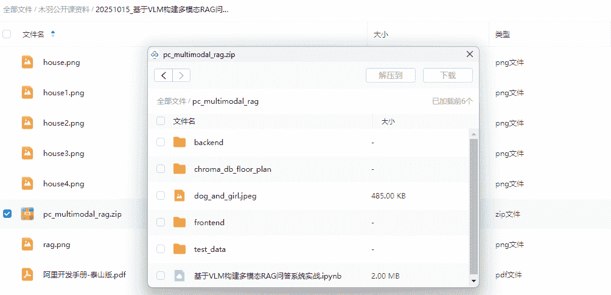


## 6.2 环境要求与依赖安装

系统基于Python 3.11+开发，需要确保环境满足以下要求：

环境要求

| 组件 | 版本要求 | 安装方式 | 验证命令 |
| --- | --- | --- | --- |
| **Python** | ≥ 3.10 | 官网下载或conda | python --version |
| **pip** | 最新版 | 随Python安装 | pip --version |

首先需要创建Python虚拟环境

```
# 使用conda创建环境（推荐）
conda create -n multimodal_rag python=3.11
conda activate multimodal_rag

# 或使用venv创建环境
python -m venv multimodal_rag
source multimodal_rag/bin/activate  # Linux/Mac
# multimodal_rag\\Scripts\\activate     # Windows
```

接下来一键安装核心依赖

```
# 进入项目目录
cd pc_multimodal_rag/backend

# 安装核心依赖包
pip install -r requirements_service.txt
```

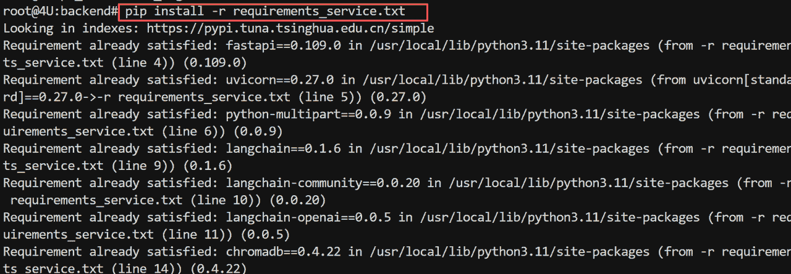

## 6.3 后端服务配置与启动

完成依赖安装后，需要配置API密钥和启动后端服务。

创建 .env 文件，配置必要的API密钥：

```
# 在项目根目录创建 .env 文件
touch .env
```

在 .env 文件中添加以下配置：

```
    # 多模态 RAG 服务配置

    # VLM 模型配置
    VLM_MODEL_URL=https:/
    VLM_API_KEY=sk-Y4o8DF6Iq2l8nFT
    VLM_MODEL_NAME=gpt-4o

    # 服务配置
    SERVICE_HOST=0.0.0.0
    SERVICE_PORT=8000

    # 存储配置
    UPLOAD_DIR=./uploads
    PREVIEW_DIR=./previews
    VECTOR_DB_DIR=./chroma_db

    # Embedding 模型配置
    EMBEDDING_TYPE=qwen  # qwen 或 huggingface
    EMBEDDING_MODEL=text-embedding-v4
    EMBEDDING_DIMENSIONS=1024
    DASHSCOPE_API_KEY=sk-bdccf7277a5
    DASHSCOPE_BASE_URL=https://dashscope.aliyuncs.com/compatible-mode/v1

    # 文本分割配置
    CHUNK_SIZE=800
    CHUNK_OVERLAP=100
```

重要提示：

+   OPENAI_API_KEY：必须配置，用于调用gpt-4o模型进行图像分析

+   DASHSCOPE_API_KEY：必须配置，用于调用Qwen embedding模型

+   如果使用HuggingFace模型，可以不配置DASHSCOPE_API_KEY

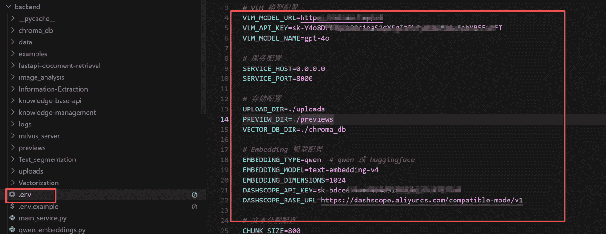

核心组件功能说明

| 接口路径 | 方法 | 功能 | 说明 |
| --- | --- | --- | --- |
| /upload/ | POST | 文件上传 | 支持图片、PDF等多种格式 |
| /search/ | POST | 智能搜索 | 基于向量检索的语义搜索 |
| /intelligent_qa/ | POST | 智能问答 | 多模态问答，支持直接回答和图像检索 |
| /files/ | GET | 文件列表 | 获取已上传的文件列表 |

接下来启动后端服务

```
# 启动FastAPI后端服务
python backend/main_service.py
```

启动成功后，终端会显示如下信息：

```
INFO:     Started server process [12345]  
INFO:     Waiting for application startup.
INFO:     Application startup complete.
INFO:     Uvicorn running on http://0.0.0.0:8000 (Press CTRL+C to quit)
```

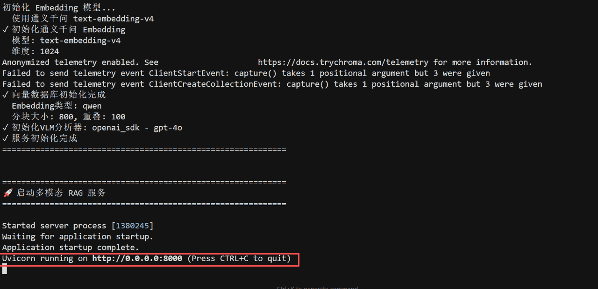

## 6.4 前端服务配置与启动

最后，启动前端服务，进入前端目录，安装Node.js依赖，启动开发服务器：

```
    cd frontend
    npm install
```

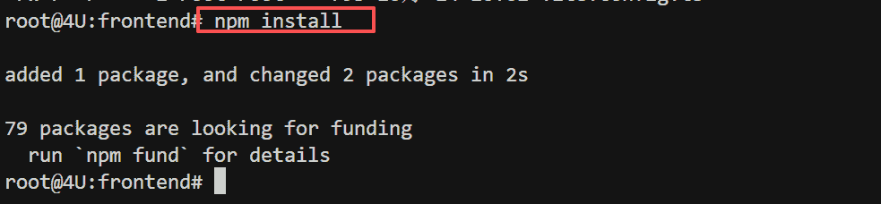

```
    npm run dev
```

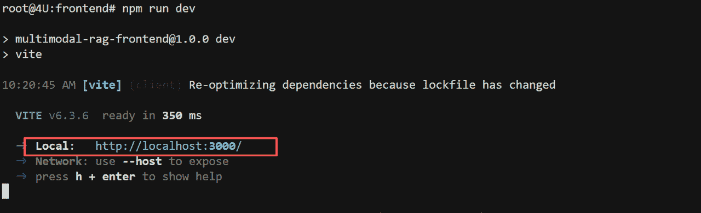

打开浏览器访问 http://localhost:5173，就可以看到"赋范空间公开体验课"的界面。

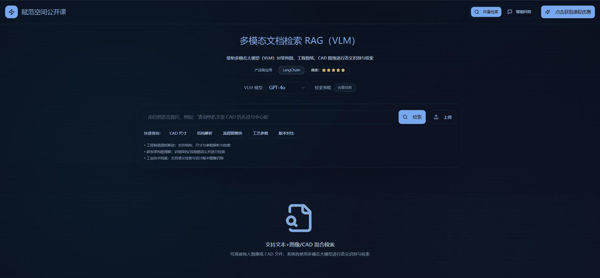

至此，多模态RAG系统部署完成！系统支持CAD图纸、平面图、PDF文档的智能分析和问答，可根据实际需求进行功能扩展和定制开发。

我们下期公开课，再见！