# 《大模型Agent开发实战》（体验课）

> 来源：[https://kq4b3vgg5b.feishu.cn/docx/CdtSdjvOOo0cIrxHzvEcDesanIb](https://kq4b3vgg5b.feishu.cn/docx/CdtSdjvOOo0cIrxHzvEcDesanIb)

## Part 1. LangChain v1.0 最新版本快速入门

### 课程说明

+ 体验课内容节选自《2025大模型Agent智能体开发实战》(秋季班)完整版付费课程

体验课时间有限，若想深度学习大模型技术，欢迎大家报名由我主讲的《2025大模型Agent智能体开发实战》(秋季班)

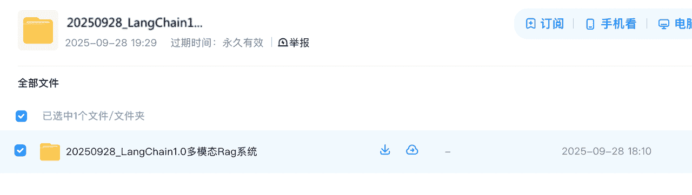


公开课全套学习资料，已上传至网盘（链接: https://pan.baidu.com/s/1hPa43LFZDhvb9uEIzBQGGw?pwd=sj2n ）需要更系统深入学习大模型可扫码⬆️添加助教咨询喔～

### 课程介绍

本期公开课，我将带着大家从零开始学习`LangChain`开发框架，并从零到一实现一个具备企业应用落地的多模态本地知识库问答系统。

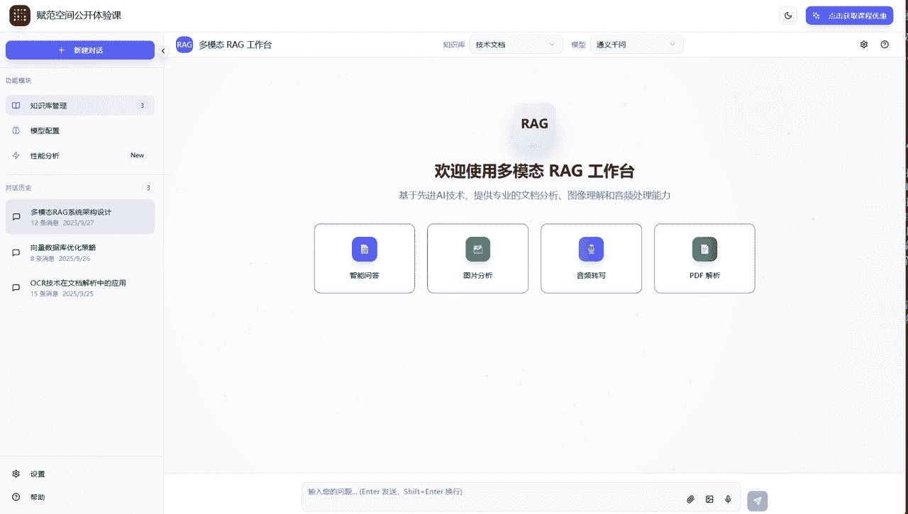

+ `LangChain` 已成为国内大模型求职市场的敲门砖

在开始今天的`LangChain`技术分享之前，我先为大家展示一组数据。根据我们团队对北京、上海、广州、深圳等13个核心城市对大模型技术岗位招聘数据分析，有一个非常有趣的现象：

+ **技术栈分布**：Python语言出现在90%的岗位需求中，这不是偶然

+ **框架要求**：在明确提及开源框架的岗位中，`LangChain`以近乎90%以上的出现频率高居榜首

+ **薪资水平**：掌握`LangChain`的开发者平均薪资比普通大模型开发者高出15-25%

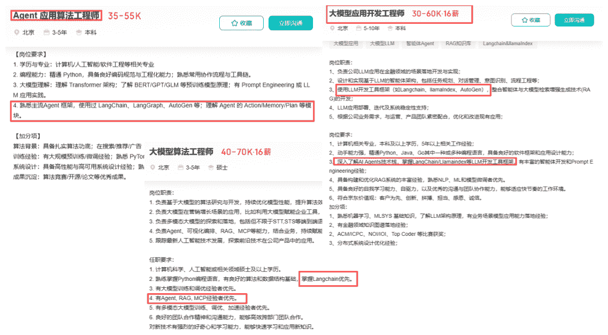

同时也深刻地感受到了一个事实：`LangChain`已经从一个开源框架，变成了国内企业大模型应用开发的"必修课"。

虽然`langchain` 存在非常大的争议，很多人认为不好用，过渡封装等问题，但真实的招聘数据背后反映的是市场对`LangChain`技能的渴求，是企业对这项技术价值的认可！

`LangChain`相关岗位企业类型分布

| 企业类型 | 占比 | 典型企业 | 技术要求特点 |

| --- | --- | --- | --- |

| 互联网大厂 | 38.6% | 字节跳动、腾讯、阿里、美团 | 注重规模化部署，商业化思维 |

| 科技公司 | 44.2% | AI独角兽、中小科技公司 | 快速迭代，技术创新能力 |

| AI独角兽 | 8.6% | 商汤、旷视、第四范式等 | 深度技术理解，算法优化 |

| 传统企业转型 | 8.6% | 银行、制造业、零售等 | 业务结合，稳定可靠 |

从这个表格中，可以发现一个重要趋势：不仅仅是AI公司在招`LangChain`开发者，传统企业也在大量需求这类人才。这说明`LangChain`已经从"实验室技术"变成了"生产力工具"。

此外，除了外部的数据资料，官方权威背书的权威客户案例。作为技术选型的关键参考，我们不能只看招聘数据，更要看真正的企业实践。全球知名企业的生产级应用如：金融科技巨头Klarna，拥有8500万活跃用户，日处理250万笔交易。他们使用`LangGraph`和`LangSmith`构建的AI助手，已进行250万次对话，相当于700名全职员工的工作量。2023年11月，`LangChain`宣布加入Microsoft for Startups Pegasus计划，深度集成Azure OpenAI服务、Azure AI搜索等微软生态。提供企业级部署选项，满足数据安全需求

`LangChain`官方客户案例概览

| 企业名称 | 行业领域 | 应用场景 | 核心成果 |

| --- | --- | --- | --- |

| Klarna | 金融科技 | AI客服助手 | 700人工作量，80%效率提升 |

| Ally Financial | 银行 | PII屏蔽系统 | 合规保障，85%免编辑 |

| Rakuten | 电商 | 智能助理 | 业务流程优化 |

| Replit | 开发工具 | 代码生成 | 开发效率提升 |

| Elastic | 企业软件 | 对话检索 | 知识管理优化 |

> https://langchain.ac.cn/customers

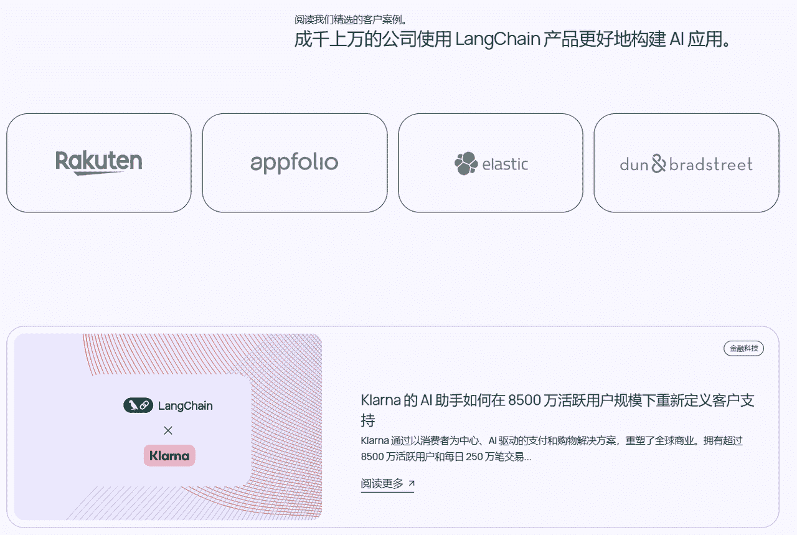

### 1. LangChain的优势是什么？

企业为什么选择`LangChain`？它究竟能做什么？初学者可能都会有这样的疑问：既然`LangChain`如此重要，那么它到底解决了什么问题？为什么企业都在用它？接下来让我从技术架构师的角度，为大家深入剖析`LangChain`的核心价值。

在我看来，`LangChain`最大的价值不是它自己能做什么，而是它能让各种技术组件无缝连接，协同工作。我喜欢把它比作"乐高积木的连接器"：

+ **模型接入**：支持OpenAI、DeepSeek、百度文心、阿里通义等主流大模型

+ **数据连接**：整合向量数据库、传统数据库、文档系统等数据源

+ **工具集成**：连接搜索引擎、API接口、计算器等外部工具

+ **部署运维**：提供监控、调试、评估等全生命周期支持

+ **五大核心能力深度解析**

+ **能力一：智能代理（`Agent`）开发**

`LangChain`最受欢迎的功能 - 智能代理。传统的AI应用只是"问答机器人"，而`LangChain`的`Agent`能够主动思考、制定计划、调用工具、解决复杂问题。

想象一下这样的场景：用户问"帮我分析一下苹果公司最近的股价走势，并给出投资建议"。传统模型可能只能给出一般性回答，而`LangChain Agent`会：

1. 分析问题：需要股价数据 + 财务分析

1. 调用工具：访问股票API获取实时数据

1. 数据处理：计算技术指标，分析趋势

1. 综合判断：结合多方信息给出建议

一个完整的`Agent`系统包含四个核心模块：

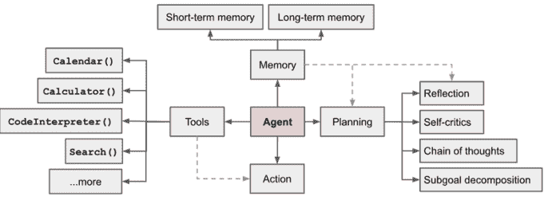

这四个模块分别是：**记忆（`Memory`）**、**规划（`Planner`）**、工具（`Tools`）和反思（`Reflection`）。它们共同构成了`Agent`的"大脑"和"手脚"。

> 图片来源：https://lilianweng.github.io/posts/2023-06-23-agent/ ， 强烈建议大家通篇阅读。

这套智能代理架构是指自主代理的结构化设计，自主代理是能够独立感知环境、做出决策并采取行动以实现特定目标的系统或实体。该架构描述了代理的各个组件如何交互以促进智能行为。该架构包含四个关键组件：

+ 规划（`Planning`）：该组件将代理置于动态环境中，使其能够根据其目标和收集的信息制定策略并规划未来的行动。

+ 记忆（`Memory`）：该组件使智能体能够回忆过去的行为、经历和结果，这对于学习和适应至关重要。

+ 行动（`Action`）：该组件将智能体的决策转化为具体的行动，执行计划的任务以达到预期的结果。

+ 工具（`Tools`）：拥有一名仅拥有`LLM`的代理人就像使用一台没有任何额外设备的计算机一样。工具让代理能够使用互联网、获取特殊知识或与擅长特定事物的几种不同的人工智能模型一起工作，从而使代理变得更加有用。

这就是`Agent`的强大之处！它不是简单的对话，而是具备推理、规划、执行能力的智能系统。

+ **能力二：检索增强生成（RAG）**

根据我的实践经验，企业最头疼的问题是什么？大模型的"幻觉"问题。`LangChain`的RAG技术完美解决了这个痛点：

1. **知识库构建**：将企业文档、手册、政策等转化为向量数据库

1. **智能检索**：根据用户问题，精准找到相关知识片段

1. **增强生成**：结合检索到的真实信息生成准确答案

而`LangChain`中有非常庞大且完善的RAG工具库，可以满足企业级应用需求。

+ **能力三：链式处理（`Chain`）**

复杂的业务逻辑怎么办？`LangChain`的`Chain`机制让我们可以将复杂任务拆解为多个步骤，串联执行：

```
用户输入 → 意图识别 → 信息检索 → 内容生成 → 结果验证 → 最终输出
```

每一个步骤都可以使用不同的模型、不同的策略，这种模块化设计大大提高了系统的可控性和可维护性。

+ **能力四：记忆机制（`Memory`）**

如何让AI记住用户的偏好和历史对话？`LangChain`提供了多种记忆类型：

`LangChain`记忆机制对比

| 记忆类型 | 适用场景 | 优势 | 局限性 |

| --- | --- | --- | --- |

| 缓冲记忆 | 短期对话 | 简单直接，响应快 | 容易超出上下文限制 |

| 摘要记忆 | 长期对话 | 节省token，保持关键信息 | 可能丢失细节 |

| 向量记忆 | 企业级应用 | 语义检索，海量存储 | 实现复杂度较高 |

+ **能力五：工具生态系统**

这是我认为`LangChain`最具商业价值的特性。它不是一个封闭系统，而是一个开放的工具平台：

1. **预置工具**：搜索引擎、计算器、天气查询、股票信息等

1. **API集成**：企业内部系统、第三方服务等

1. **自定义工具**：根据业务需求开发专属工具

1. **工具链组合**：多个工具协同解决复杂问题

### 2. 如何短时高效掌握`LangChain`？

初学者都会比较迷茫，`LangChain`这么强大，到底应该怎么学？我讲解了三个版本的`LangChain`系列课程，发现很多同学在学习`LangChain`时走了弯路。今天也分享一条科学、高效、实用的学习路径。首先在开始学习之前，我需要纠正大家的几个误区：

+ **错误认知**：`LangChain`是一个大模型

+ **正确理解**：`LangChain`是大模型的"编排工具"

+ **错误认知**：学会`LangChain`就能开发所有AI应用

+ **正确理解**：`LangChain`是工程框架，需要结合业务逻辑

+ **错误认知**：`LangChain`很复杂，需要很深的AI背景

+ **正确理解**：`LangChain`注重工程实践，Python基础就能上手

这里推荐大家一个四阶段学习法：

+ **第一阶段：基础认知（1~3天）**

在这个阶段，重点去理解`LangChain`的设计理念和基本概念，比如`LangChain`的架构设计思想，它的核心组件概览：`LLM`、`Prompt`、`Chain`、`Agent`。然后去搭建开发环境，运行第一个`LangChain`程序，体验不同大模型的接入方式。这个阶段重点是"体感"，不要纠结于细节。先让代码跑起来，建立成就感！

> https://python.langchain.com/docs/how_to/

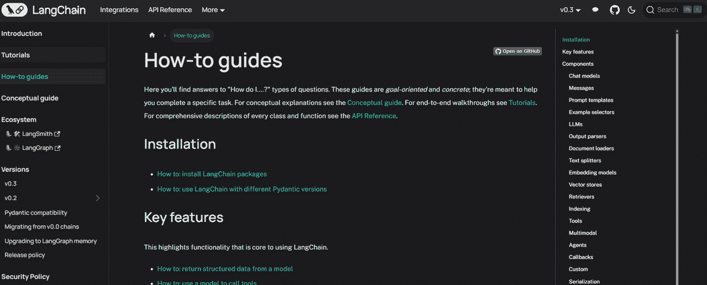

+ **第二阶段：组件掌握（1周）**

在这个阶段，重点去理解`LangChain`的一些核心组件的应用，比如提示工程：`PromptTemplate`的设计和优化，链式操作：`SimpleSequentialChain`、`LLMChain`等，记忆系统：不同`Memory`类型的选择和使用，数据接入：文档加载、文本分割、向量化。并且能够开始去搭建一些简单的问答系统、带记忆的聊天机器人、基础的RAG知识库。

> https://python.langchain.com/docs/how_to/#qa-with-rag

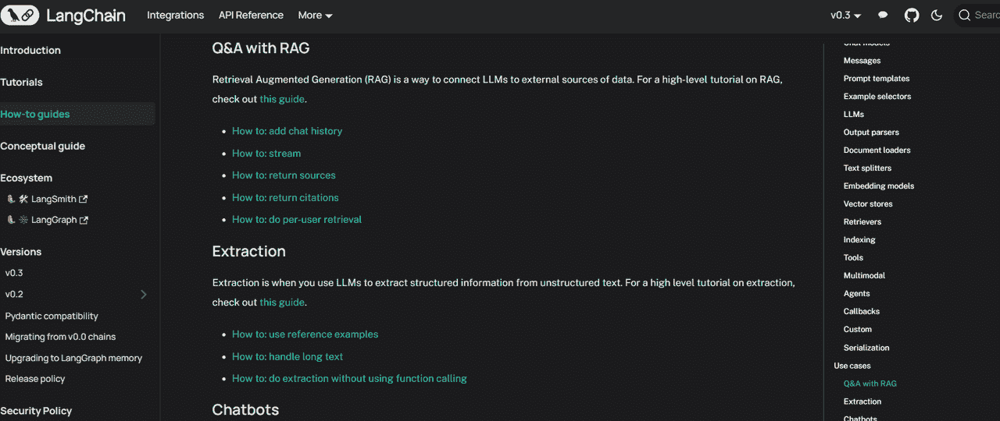

第二阶段学习重点

| 组件类型 | 重要程度 | 学习顺序 | 实践建议 |

| --- | --- | --- | --- |

| `PromptTemplate` | ⭐⭐⭐⭐⭐ | 1 | 多练习不同场景的提示设计 |

| `LLMChain` | ⭐⭐⭐⭐ | 2 | 理解链式思维的设计模式 |

| `Memory` | ⭐⭐⭐⭐ | 3 | 对比不同记忆类型的效果 |

| `Document Loaders` | ⭐⭐⭐ | 4 | 尝试加载各种格式的文档 |

+ **第三阶段：尝试做一些高级应用（持续）**

这个阶段的关键是理解`Agent`的思维模式。`Agent`不是简单的`if-else`逻辑，而是基于语言模型的"推理-行动-观察"循环。

`LangChain` 中`Agents`模块的整体架构设计。如下所示：

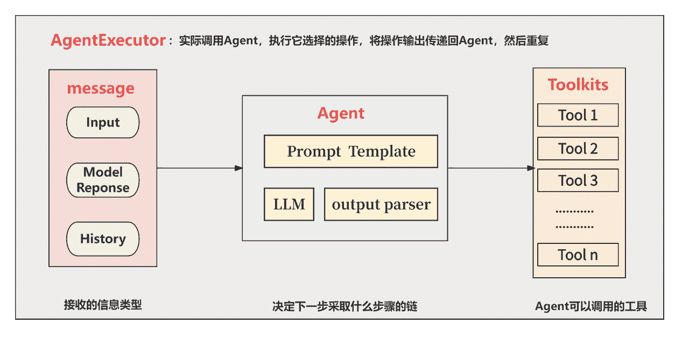

在`Agents`的内部结构。每个`Agent`组件一般会由语言模型 + 提示 + 输出解析器构成，它会作为`Agents`的大脑去处理用户的输入。`Agent`能够处理的输入主要来源于三个方面：`input`代表用户的原始输入，`Model Response`指的是模型对某一个子任务的响应输出，而`History`则能携带上下文的信息。其输出部分，则链接到实际的工具库，需要调用哪些工具，将由经过`Agent`模块后拆分的子任务来决定。

而我们知道，大模型调用外部函数会分为两个过程：识别工具和实际执行。在`Message` -> `Agent` -> `Toolkits` 这个流程中，负责的是将子任务拆解，然后根据这些子任务在工具库中找到相应的工具，提取工具名称及所需参数，这个过程可以视作一种“静态”的执行流程。而将这些决策转化为实际行动的工作，则会交给`AgentExecutor`。

所以综上需要理解的是：在`LangChain`的`Agents`实际架构中，`Agent`的角色是接收输入并决定采取的操作，但它本身并不直接执行这些操作。这一任务是由`AgentExecutor`来完成的。将`Agent`（决策大脑）与`AgentExecutor`（执行操作的Runtime）结合使用，才构成了完整的`Agents`（智能体），其中`AgentExecutor`负责调用代理并执行指定的工具，以此来实现整个智能体的功能。

当然，在这种模式下，`AgentExecutor`的内部已经自动处理好了关于我们工具调用的所有逻辑，其中包含串行和并行工具调用的两种常用模式。

所以这个阶段的侧重点就是理解`Agent`的工作机制，能够自定义工具的开发和集成，并且掌握RAG的索引、检索优化，以及向量数据库的选型。

+ **第四阶段：生产实战（持续）**

开始了解和尝试部署和优化生产级`LangChain`应用，这包括`LangChain`自家生态的`LangGraph`、`LangSmith`、`Langfuse`等，以及通过A2A协议去和其他的`Agent`工作流做集成交互。

所以，如果你能摆脱以下误区，那么你就能快速掌握`LangChain`，并且具备极强的工程能力。

+ **误区一**：追求完美，不敢动手

+ **解决方案**：先跑通基础示例，再逐步优化

+ **误区二**：只看不练，理论脱离实际

+ **解决方案**：每学一个概念，就写一个小demo

+ **误区三**：贪多求快，基础不扎实

+ **解决方案**：按照学习路径循序渐进，不要跳跃式学习

+ **误区四**：忽视调试技能，遇到问题就放弃

+ **解决方案**：学会使用`LangSmith`等调试工具，培养问题分析能力

### 3. `LangChain` v1.0 快速入门

`LangChain` 可以称的上是大模型自2022年底爆火以来第一个真正意义上的大模型开发框架，大模型本质上无法直接解决实际的问题，仅仅是一个能够分析、推理和生成文本的黑盒。我们一直都在探索如何把大模型的强大能力与实际应用场景结合起来，而`LangChain` 的出现，其本质的作用就是让大模型开发变得简单起来。它将大模型的能力封装成一个个的组件，使开发者可以像搭积木一样，组合出自己的大模型应用。

`LangChain`的首个版本开源自2022年10月,从一个开源 Python/TS 框架逐渐发展，形成包括“链”和“代理”等核心组件，现在已走向企业级阶段，发展成了`LangChain AI`，其拥有目前`Agent`技术领域最大的开源生态，衍生出了多个开源项目框架，各自都在大模型的技术领域承担着不同的开发任务角色。 其官方Github地址为：https://github.com/langchain-ai

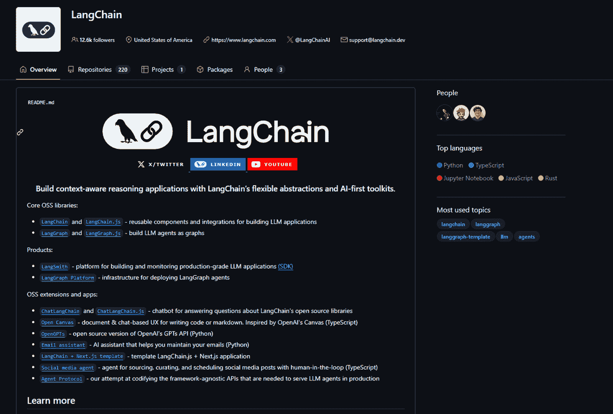

这里我们可以梳理出在`LangChain AI`中最受关注的项目发展态势，如下图所示：

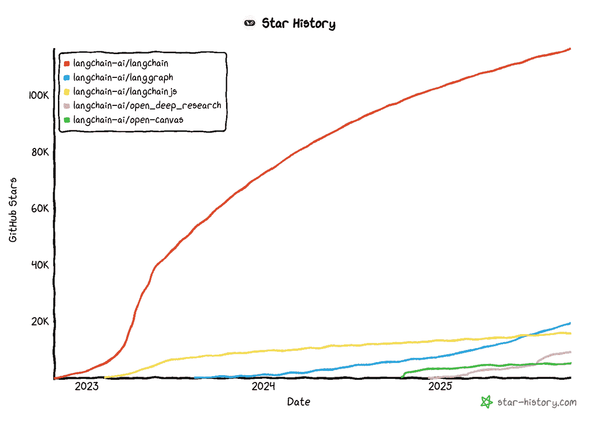


# LangChain 1.0 核心改动与多模态知识库解决方案

其中最活跃的项目当属`langchain`，排在前二的分别是`langChain`的Python版本和JavaScript版本。作为LangChain AI发展的基石，`langchain`主要用来支持构建大模型应用的一切，包括链式编排、检索增强生成 (RAG)、嵌入、文档处理、对话系统、代码分析等。而随着业务需求的越来越复杂，LangChain AI也推出了`langgraph`，作为一个基于图结构的 Agent 编排框架，可构建有状态、多步骤、多 Agent 的工作流，从而进一步扩展了LangChain AI的适用范围。而至于`local-deep-researcher`和`opengpts`，则完全是给开发者提供了基于LangChain定制开发出的特定热门应用，也一定程度上能印证LangChain AI的生态繁荣和可实现应用场景的广度。

## LangChain AI 热门开源项目

| 项目 | 技术栈 | 核心用途 |

| --- | --- | --- |

| `langchain` | Python/TS | 构建 LLM 应用基础组件 |

| `langchainjs` | JS/TS | 前端/Node 环境中构造 LLM 应用 |

| `langgraph` | Python | 用图编排复杂 agent 流程 |

| `local-deep-researcher` | Python | 自动化、多轮本地 Web 研究工具 |

| `opengpts` | Python + Go + 前端 | 可定制化 GPT 平台，支持 RAG 和 agent 开发 |

因此这里大家可以感受到，`langChain` AI生态的学习，其实最最核心的就是`LangChain`这个项目。今天我们要深入探讨 LangChain 1.0 这个重磅更新。LangChain v1.0 的 Alpha 版本于 2025 年 9 月 2 日正式发布。官方计划在 10 月底发布正式版，以进一步整合用户反馈并完善功能

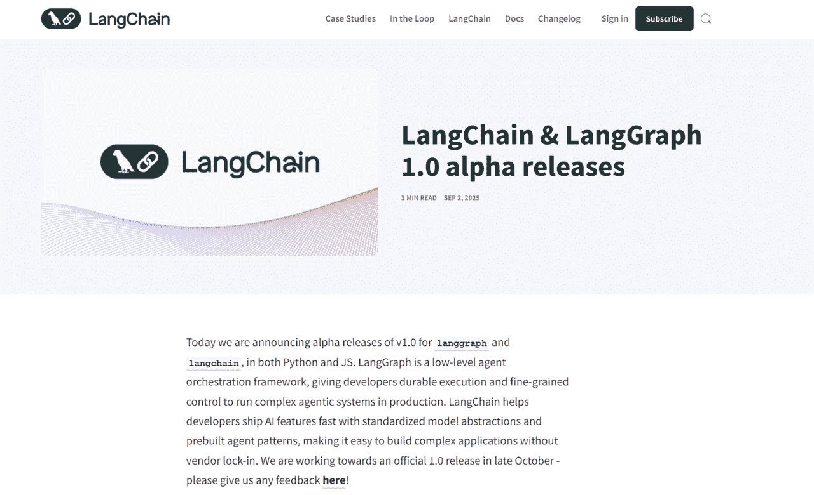

  我们将从两个维度来全面解析：核心改动与优势及多模态知识库解决方案展开讲解。相信通过今天的学习，大家不仅能理解 LangChain 1.0 的设计理念，更能掌握构建企业级多模态应用的完整方法论。

> https://docs.langchain.com/oss/python/langchain/overview

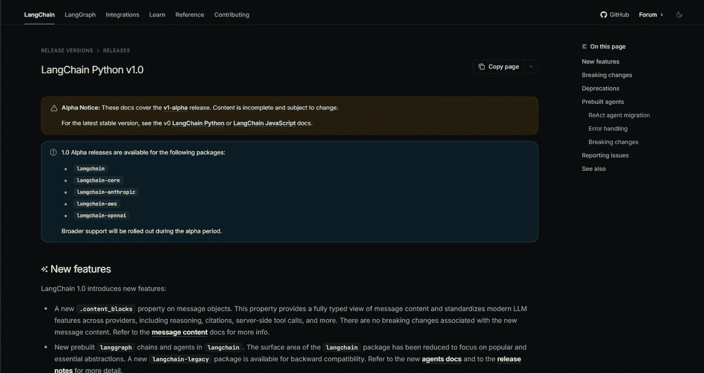

LangChain 1.0 的发布标志着框架进入了全新的发展阶段。与 0.x 版本相比，1.0 版本的设计目标非常明确：让框架变得更加稳定、简洁，并强化在企业级场景中的可维护性和可观察性。

我们来逐一分析这些重要改动，看看它们如何影响我们的开发实践。

### 核心改动一：消息模型采用标准化内容块

在 0.x 版本中，支持把多模态内容按各厂商原生格式放到 `content`（例如 `list of dicts`，OpenAI/Anthropic 的格式），只是没有统一的标准类型，这在多模态应用场景下使用很不方便。1.0 版本引入了全新的 `content_blocks` 属性，这是一个革命性的改进。

具体来看，新的消息对象增加了 `.content_blocks` 属性，用于以结构化方式传递文本、图片、文件等内容。标准化内容块有 `text` 类型（代码与工具函数都以 `type: "text"` 处理），并提供数据类块来承载（`image` / `audio` / `file`（支持 `URL` / `base64` / `id` 等来源））。覆盖多模态（图片、PDF、音频等）数据源。

Content Block 类型对比

| Block类型 | 数据格式 | 应用场景 | 编码要求 |

| --- | --- | --- | --- |

| `text` | 纯文本字符串 | 文本对话、指令传递 | 无需编码 |

| `image` | `base64`或`URL` | 图像理解、视觉问答 | base64编码 |

| `file` | 文件内容+元数据 | 文档分析、表格处理 | 结构化封装 |

以下代码展示了如何在 LangChain 1.0 中构建多模态消息：

```
# ! pip install --pre -U langchain
```

```
! pip show langchain
```

```
Name: langchain
Version: 1.0.0a9
Summary: Building applications with LLMs through composability
Home-page: 
Author: 
Author-email: 
License: MIT
Location: C:\ProgramData\anaconda3\envs\langchian_v1\Lib\site-packages
Requires: langchain-core, langchain-text-splitters, langgraph, pydantic
Required-by: 
```

```
# ! pip install -U langchain-openai
```

```
! pip install python-dotenv
```

```
Collecting python-dotenv
  Using cached python_dotenv-1.1.1-py3-none-any.whl.metadata (24 kB)
Using cached python_dotenv-1.1.1-py3-none-any.whl (20 kB)
Installing collected packages: python-dotenv
Successfully installed python-dotenv-1.1.1
```

```
import os
# LangChain 1.0 统一模型初始化
from langchain.chat_models import init_chat_model
from langchain_core.messages import HumanMessage, AIMessage, SystemMessage

from dotenv import load_dotenv
load_dotenv(override=True)

def get_chat_model(model_name: str = "gpt-4o"):
    try:
        # 使用新的统一初始化接口
        model = init_chat_model(
            f"openai:{model_name}",          # 统一的模型标识符
            api_key=os.getenv("OPENAI_API_KEY"),          # API密钥
            base_url="https://api.openai.com/v1",  # 自定义API端点
            temperature=0.7,                 # 温度参数
            max_tokens=2048,                 # 最大令牌数
        )
        return model
    except Exception as e:
        print(f"模型初始化失败: {e}")
        return None

# 演示模型初始化
model = get_chat_model()
print("LangChain 1.0 模型初始化成功")
print(f"模型类型: {type(model)}")
```

```
LangChain 1.0 模型初始化成功
模型类型: <class 'langchain_openai.chat_models.base.ChatOpenAI'>
```

### 处理多模态-图像消息

先来测试本地图像识别，代码如下：

```
# LangChain 1.0 多模态消息构建示例 
from langchain_core.messages import HumanMessage 
import base64 

# 1. 读取并编码图像 
def encode_image(image_path): 
    """将图像文件编码为base64格式""" 
    with open(image_path, "rb") as image_file:
         return base64.b64encode(image_file.read()).decode('utf-8') 
    
# 2. 构建包含文本和图像的多模态消息 
image_data = encode_image("./rag.png") 

message = HumanMessage(
     content=[
           { 
                "type": "text", "text": "请分析这张图片中的技术架构图，并解释各个组件之间的关系。" 
            }, 
           { 
                "type": "image_url", 
                "image_url": {
                    "url": f"data:image/jpeg;base64,{image_data}"
                }
            }
        ]
    )

response = model.invoke([message]) 

print("模型回复：", response.content)
```

```
模型回复： 这张图片展示了一个“多模态Multi-Agent视觉RAG系统”的技术架构图，分为几个主要部分，每个部分都描述了不同的功能和流程。

### 1. 高精度多模态视觉管理系统
- **多模态视觉工作流设计**：包括顺序代理（Sequential Agent）和并行代理（Parallel Agent）。文本识别、图像分析和表格处理等任务通过代理协同工作，最终输出分析结果。

### 2. 高精度多模态RAG管理系统
- **多模态RAG设计模式**：从文本和多模态数据输入，通过多模态特征提取，生成RAG（Retrieval-Augmented Generation）结果。
- **多智能体工作流结构**：包括数据管理、文本和图像特征提取，以及问答生成等功能。不同功能由特定的代理（如data_cleaning_agent、image_classifier等）来完成。

### 3. Multi-Agent高精度数据问答系统工作流
- **图像/表格识别**：OCR文本提取、表格检测等功能，由特定代理实现。
- **问答检索**：通过生成代理和检索代理协同工作，处理用户问题并生成答案。

### 4. 性能评估系统
- **多模态RAG系统的问答**：通过特定数据库（如FAISS向量数据库）进行检索和存储，优化问答性能。

### 总结
整个系统依托多智能体结构，支持OCR识别、布局检测、文本/表格/图像索引等功能，旨在提高视觉数据的处理和问答性能。各组件通过代理进行协作，确保不同任务的高效执行。
```

这里需要说明的一个点是：很多同学都会疑惑：`content_blocks` 到底在哪里起作用？为什么上面的代码还要用传统的 `image_url` 格式？

`content_blocks` 是 LangChain 1.0 的核心设计之一，它的作用是在 LangChain 层面统一不同模型厂商的多模态输入格式。

+   **OpenAI** 使用：`{"type": "image_url", "image_url": {...}}`

+   **Anthropic** 使用：`{"type": "image", "source": {...}}`

+   **Google** 使用：`{"type": "inline_data", "inline_data": {...}}`

每家都有自己的格式标准，开发者需要为不同的模型写不同的代码，非常麻烦。所以LangChain 新版本`content_blocks` 提供了统一的标准化接口，开发者只需要学会一套格式，LangChain 会自动转换成各个厂商的格式。只是现在还在测试阶段未完成完全兼容。

LangChain 1.0 Alpha 版本问题汇总

| 问题类型 | 官方文档 | 实际情况 | 解决方案 |

| --- | --- | --- | --- |

| 图像格式 | `"type": "image"` | 不支持，报错 | 用 `"type": "image_url"` |

| `content_blocks` | 完全支持 | 部分支持或不稳定 | 降级使用传统格式 |

| 模型适配 | 统一接口 | 各厂商还是要用原生格式 | 手动适配不同厂商 |

| 稳定性 | 生产可用 | 明确说不建议生产使用 | 等正式版或用 0.x |

`online_image_url` = `"https://dashscope.oss-cn-beijing.aliyuncs.com/images/dog_and_girl.jpeg"`

```
# 在线图片处理 - 简单示例
from langchain_core.messages import HumanMessage

# 方式1：直接使用在线图片URL（最简单）
message = HumanMessage(
    content=[
        {
            "type": "text", 
            "text": "请分析这张在线图片"
        },
        {
            "type": "image_url",
            "image_url": {"url": online_image_url}  # 直接传URL，不需要下载
        }
    ]
)

response = model.invoke([message])
print("模型回复：", response.content)
```

```
模型回复： 这张图片展示了一位坐在沙滩上的人和一只大狗互动的场景。人和狗面对面坐着，狗伸出一只爪子与人握手。背景是海洋和天空，阳光从画面的右侧照射进来，给场景增添了温暖和愉快的氛围。这幅图传达了一种人与动物之间温馨友好的关系。
```

在线图片处理方式对比

| 处理方式 | 适用场景 | 优势 | 劣势 | 推荐度 |

| --- | --- | --- | --- | --- |

| 直接URL | 公开可访问的图片 | 速度快，省带宽，减少延迟 | 需要图片长期可访问 | ⭐⭐⭐⭐⭐ |

| 下载编码 | 需要认证或特殊处理 | 适用性强，可添加认证 | 增加下载时间和流量 | ⭐⭐⭐ |

| 混合策略 | 企业级应用 | 兼顾效率和可靠性 | 代码复杂度稍高 | ⭐⭐⭐⭐ |

不过**核心要点**：在线图片处理要在性能、可靠性和成本之间找到平衡。直接`URL`是最优选择，下载编码是可靠备用。

### 核心改动二：全新的 Agent 框架构建在 LangGraph 上

在 0.x 版本中，构建复杂的 Agent 往往需要编写大量的循环逻辑和状态管理代码。1.0 版本彻底重构了 Agent 架构，基于 LangGraph 提供了更强大和灵活的解决方案。LangGraph 采用图结构组织 Agent 的执行流程，每个节点可以是模型调用、工具执行或判断逻辑。这种设计带来了以下核心优势：

+   **可持久化执行**：支持长时间运行的任务，即使中断也能恢复

+   **并发处理**：多个节点可以并行执行，提高效率

+   **容错机制**：内置错误处理和重试机制

+   **可视化调试**：图结构让执行流程一目了然

1.0 版本提出了统一的 Agent 抽象，通过 `create_agent` 函数即可构建功能完整的 Agent。`create_agent()` 是基于论文 《ReAct：语言模型中的协同推理和行动》 提供了可用于生产的 `ReAct`（推理 + 行动）代理实现。

> https://arxiv.org/pdf/2210.03629

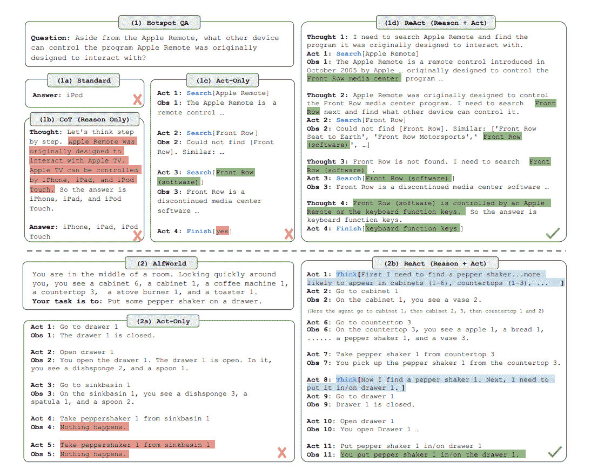

```
! pip install --pre U langchain_community ddgs wikipedia
```


```
Requirement already satisfied: U in c:\programdata\anaconda3\envs\langchian_v1\lib\site-packages (1.0.4)
Requirement already satisfied: langchain_community in c:\programdata\anaconda3\envs\langchian_v1\lib\site-packages (0.3.30)
Requirement already satisfied: ddgs in c:\programdata\anaconda3\envs\langchian_v1\lib\site-packages (9.6.0)
Collecting wikipedia
  Using cached wikipedia-1.4.0-py3-none-any.whl
Requirement already satisfied: typing-extensions in c:\programdata\anaconda3\envs\langchian_v1\lib\site-packages (from U) (4.15.0)
Requirement already satisfied: langchain-core<2.0.0,>=0.3.75 in c:\programdata\anaconda3\envs\langchian_v1\lib\site-packages (from langchain_community) (0.3.76)
Requirement already satisfied: langchain<2.0.0,>=0.3.27 in c:\programdata\anaconda3\envs\langchian_v1\lib\site-packages (from langchain_community) (1.0.0a9)
Requirement already satisfied: SQLAlchemy<3.0.0,>=1.4.0 in c:\programdata\anaconda3\envs\langchian_v1\lib\site-packages (from langchain_community) (2.0.43)
Requirement already satisfied: requests<3.0.0,>=2.32.5 in c:\programdata\anaconda3\envs\langchian_v1\lib\site-packages (from langchain_community) (2.32.5)
Requirement already satisfied: PyYAML<7.0.0,>=5.3.0 in c:\programdata\anaconda3\envs\langchian_v1\lib\site-packages (from langchain_community) (6.0.3)
Requirement already satisfied: aiohttp<4.0.0,>=3.8.3 in c:\programdata\anaconda3\envs\langchian_v1\lib\site-packages (from langchain_community) (3.12.15)
Requirement already satisfied: tenacity!=8.4.0,<10.0.0,>=8.1.0 in c:\programdata\anaconda3\envs\langchian_v1\lib\site-packages (from langchain_community) (9.1.2)
Requirement already satisfied: dataclasses-json<0.7.0,>=0.6.7 in c:\programdata\anaconda3\envs\langchian_v1\lib\site-packages (from langchain_community) (0.6.7)
Requirement already satisfied: pydantic-settings<3.0.0,>=2.10.1 in c:\programdata\anaconda3\envs\langchian_v1\lib\site-packages (from langchain_community) (2.11.0)
Requirement already satisfied: langsmith<1.0.0,>=0.1.125 in c:\programdata\anaconda3\envs\langchian_v1\lib\site-packages (from langchain_community) (0.4.32rc0)
Requirement already satisfied: httpx-sse<1.0.0,>=0.4.0 in c:\programdata\anaconda3\envs\langchian_v1\lib\site-packages (from langchain_community) (0.4.1)
Requirement already satisfied: numpy>=1.26.2 in c:\programdata\anaconda3\envs\langchian_v1\lib\site-packages (from langchain_community) (2.3.3)
Requirement already satisfied: aiohappyeyeballs>=2.5.0 in c:\programdata\anaconda3\envs\langchian_v1\lib\site-packages (from aiohttp<4.0.0,>=3.8.3->langchain_community) (2.6.1)
Requirement already satisfied: aiosignal>=1.4.0 in c:\programdata\anaconda3\envs\langchian_v1\lib\site-packages (from aiohttp<4.0.0,>=3.8.3->langchain_community) (1.4.0)
Requirement already satisfied: attrs>=17.3.0 in c:\programdata\anaconda3\envs\langchian_v1\lib\site-packages (from aiohttp<4.0.0,>=3.8.3->langchain_community) (25.3.0)
Requirement already satisfied: frozenlist>=1.1.1 in c:\programdata\anaconda3\envs\langchian_v1\lib\site-packages (from aiohttp<4.0.0,>=3.8.3->langchain_community) (1.7.0)
Requirement already satisfied: multidict<7.0,>=4.5 in c:\programdata\anaconda3\envs\langchian_v1\lib\site-packages (from aiohttp<4.0.0,>=3.8.3->langchain_community) (6.6.4)
Requirement already satisfied: propcache>=0.2.0 in c:\programdata\anaconda3\envs\langchian_v1\lib\site-packages (from aiohttp<4.0.0,>=3.8.3->langchain_community) (0.3.2)
Requirement already satisfied: yarl<2.0,>=1.17.0 in c:\programdata\anaconda3\envs\langchian_v1\lib\site-packages (from aiohttp<4.0.0,>=3.8.3->langchain_community) (1.20.1)
Requirement already satisfied: marshmallow<4.0.0,>=3.18.0 in c:\programdata\anaconda3\envs\langchian_v1\lib\site-packages (from dataclasses-json<0.7.0,>=0.6.7->langchain_community) (3.26.1)
Requirement already satisfied: typing-inspect<1,>=0.4.0 in c:\programdata\anaconda3\envs\langchian_v1\lib\site-packages (from dataclasses-json<0.7.0,>=0.6.7->langchain_community) (0.9.0)
Requirement already satisfied: langchain-text-splitters<2.0.0,>=0.3.11 in c:\programdata\anaconda3\envs\langchian_v1\lib\site-packages (from langchain<2.0.0,>=0.3.27->langchain_community) (0.3.11)
Requirement already satisfied: langgraph<2.0.0,>=0.6.7 in c:\programdata\anaconda3\envs\langchian_v1\lib\site-packages (from langchain<2.0.0,>=0.3.27->langchain_community) (1.0.0a3)
Requirement already satisfied: pydantic<3.0.0,>=2.7.4 in c:\programdata\anaconda3\envs\langchian_v1\lib\site-packages (from langchain<2.0.0,>=0.3.27->langchain_community) (2.12.0a1)
Requirement already satisfied: jsonpatch<2.0,>=1.33 in c:\programdata\anaconda3\envs\langchian_v1\lib\site-packages (from langchain-core<2.0.0,>=0.3.75->langchain_community) (1.33)
Requirement already satisfied: packaging>=23.2 in c:\programdata\anaconda3\envs\langchian_v1\lib\site-packages (from langchain-core<2.0.0,>=0.3.75->langchain_community) (25.0)
Requirement already satisfied: jsonpointer>=1.9 in c:\programdata\anaconda3\envs\langchian_v1\lib\site-packages (from jsonpatch<2.0,>=1.33->langchain-core<2.0.0,>=0.3.75->langchain_community) (3.0.0)
Requirement already satisfied: langgraph-checkpoint<3.0.0,>=2.1.0 in c:\programdata\anaconda3\envs\langchian_v1\lib\site-packages (from langgraph<2.0.0,>=0.6.7->langchain<2.0.0,>=0.3.27->langchain_community) (2.1.1)
Requirement already satisfied: langgraph-prebuilt==0.7.0a2 in c:\programdata\anaconda3\envs\langchian_v1\lib\site-packages (from langgraph<2.0.0,>=0.6.7->langchain<2.0.0,>=0.3.27->langchain_community) (0.7.0a2)
Requirement already satisfied: langgraph-sdk<0.3.0,>=0.2.2 in c:\programdata\anaconda3\envs\langchian_v1\lib\site-packages (from langgraph<2.0.0,>=0.6.7->langchain<2.0.0,>=0.3.27->langchain_community) (0.2.9)
Requirement already satisfied: xxhash>=3.5.0 in c:\programdata\anaconda3\envs\langchian_v1\lib\site-packages (from langgraph<2.0.0,>=0.6.7->langchain<2.0.0,>=0.3.27->langchain_community) (3.5.0)
Requirement already satisfied: ormsgpack>=1.10.0 in c:\programdata\anaconda3\envs\langchian_v1\lib\site-packages (from langgraph-checkpoint<3.0.0,>=2.1.0->langgraph<2.0.0,>=0.6.7->langchain<2.0.0,>=0.3.27->langchain_community) (1.10.0)
Requirement already satisfied: httpx>=0.25.2 in c:\programdata\anaconda3\envs\langchian_v1\lib\site-packages (from langgraph-sdk<0.3.0,>=0.2.2->langgraph<2.0.0,>=0.6.7->langchain<2.0.0,>=0.3.27->langchain_community) (0.28.1)
Requirement already satisfied: orjson>=3.10.1 in c:\programdata\anaconda3\envs\langchian_v1\lib\site-packages (from langgraph-sdk<0.3.0,>=0.2.2->langgraph<2.0.0,>=0.6.7->langchain<2.0.0,>=0.3.27->langchain_community) (3.11.3)
Requirement already satisfied: requests-toolbelt>=1.0.0 in c:\programdata\anaconda3\envs\langchian_v1\lib\site-packages (from langsmith<1.0.0,>=0.1.125->langchain_community) (1.0.0)
Requirement already satisfied: zstandard>=0.23.0 in c:\programdata\anaconda3\envs\langchian_v1\lib\site-packages (from langsmith<1.0.0,>=0.1.125->langchain_community) (0.25.0)
Requirement already satisfied: anyio in c:\programdata\anaconda3\envs\langchian_v1\lib\site-packages (from httpx>=0.25.2->langgraph-sdk<0.3.0,>=0.2.2->langgraph<2.0.0,>=0.6.7->langchain<2.0.0,>=0.3.27->langchain_community) (4.11.0)
Requirement already satisfied: certifi in c:\programdata\anaconda3\envs\langchian_v1\lib\site-packages (from httpx>=0.25.2->langgraph-sdk<0.3.0,>=0.2.2->langgraph<2.0.0,>=0.6.7->langchain<2.0.0,>=0.3.27->langchain_community) (2025.8.3)
Requirement already satisfied: httpcore==1.* in c:\programdata\anaconda3\envs\langchian_v1\lib\site-packages (from httpx>=0.25.2->langgraph-sdk<0.3.0,>=0.2.2->langgraph<2.0.0,>=0.6.7->langchain<2.0.0,>=0.3.27->langchain_community) (1.0.9)
Requirement already satisfied: idna in c:\programdata\anaconda3\envs\langchian_v1\lib\site-packages (from httpx>=0.25.2->langgraph-sdk<0.3.0,>=0.2.2->langgraph<2.0.0,>=0.6.7->langchain<2.0.0,>=0.3.27->langchain_community) (3.10)
Requirement already satisfied: h11>=0.16 in c:\programdata\anaconda3\envs\langchian_v1\lib\site-packages (from httpcore==1.*->httpx>=0.25.2->langgraph-sdk<0.3.0,>=0.2.2->langgraph<2.0.0,>=0.6.7->langchain<2.0.0,>=0.3.27->langchain_community) (0.16.0)
Requirement already satisfied: annotated-types>=0.6.0 in c:\programdata\anaconda3\envs\langchian_v1\lib\site-packages (from pydantic<3.0.0,>=2.7.4->langchain<2.0.0,>=0.3.27->langchain_community) (0.7.0)
Requirement already satisfied: pydantic-core==2.37.2 in c:\programdata\anaconda3\envs\langchian_v1\lib\site-packages (from pydantic<3.0.0,>=2.7.4->langchain<2.0.0,>=0.3.27->langchain_community) (2.37.2)
Requirement already satisfied: typing-inspection>=0.4.0 in c:\programdata\anaconda3\envs\langchian_v1\lib\site-packages (from pydantic<3.0.0,>=2.7.4->langchain<2.0.0,>=0.3.27->langchain_community) (0.4.1)
Requirement already satisfied: python-dotenv>=0.21.0 in c:\programdata\anaconda3\envs\langchian_v1\lib\site-packages (from pydantic-settings<3.0.0,>=2.10.1->langchain_community) (1.1.1)
Requirement already satisfied: charset_normalizer<4,>=2 in c:\programdata\anaconda3\envs\langchian_v1\lib\site-packages (from requests<3.0.0,>=2.32.5->langchain_community) (3.4.3)
Requirement already satisfied: urllib3<3,>=1.21.1 in c:\programdata\anaconda3\envs\langchian_v1\lib\site-packages (from requests<3.0.0,>=2.32.5->langchain_community) (2.5.0)
Requirement already satisfied: greenlet>=1 in c:\programdata\anaconda3\envs\langchian_v1\lib\site-packages (from SQLAlchemy<3.0.0,>=1.4.0->langchain_community) (3.2.4)
Requirement already satisfied: mypy-extensions>=0.3.0 in c:\programdata\anaconda3\envs\langchian_v1\lib\site-packages (from typing-inspect<1,>=0.4.0->dataclasses-json<0.7.0,>=0.6.7->langchain_community) (1.1.0)
Requirement already satisfied: click>=8.1.8 in c:\programdata\anaconda3\envs\langchian_v1\lib\site-packages (from ddgs) (8.3.0)
Requirement already satisfied: primp>=0.15.0 in c:\programdata\anaconda3\envs\langchian_v1\lib\site-packages (from ddgs) (0.15.0)
Requirement already satisfied: lxml>=6.0.0 in c:\programdata\anaconda3\envs\langchian_v1\lib\site-packages (from ddgs) (6.0.2)
Collecting beautifulsoup4 (from wikipedia)
  Downloading beautifulsoup4-4.14.0-py3-none-any.whl.metadata (3.8 kB)
Requirement already satisfied: colorama in c:\programdata\anaconda3\envs\langchian_v1\lib\site-packages (from click>=8.1.8->ddgs) (0.4.6)
Requirement already satisfied: brotli in c:\programdata\anaconda3\envs\langchian_v1\lib\site-packages (from httpx[brotli,http2,socks]>=0.28.1->ddgs) (1.1.0)
Requirement already satisfied: h2<5,>=3 in c:\programdata\anaconda3\envs\langchian_v1\lib\site-packages (from httpx[brotli,http2,socks]>=0.28.1->ddgs) (4.3.0)
Requirement already satisfied: socksio==1.* in c:\programdata\anaconda3\envs\langchian_v1\lib\site-packages (from httpx[brotli,http2,socks]>=0.28.1->ddgs) (1.0.0)
Requirement already satisfied: hyperframe<7,>=6.1 in c:\programdata\anaconda3\envs\langchian_v1\lib\site-packages (from h2<5,>=3->httpx[brotli,http2,socks]>=0.28.1->ddgs) (6.1.0)
Requirement already satisfied: hpack<5,>=4.1 in c:\programdata\anaconda3\envs\langchian_v1\lib\site-packages (from h2<5,>=3->httpx[brotli,http2,socks]>=0.28.1->ddgs) (4.1.0)
Requirement already satisfied: sniffio>=1.1 in c:\programdata\anaconda3\envs\langchian_v1\lib\site-packages (from anyio->httpx>=0.25.2->langgraph-sdk<0.3.0,>=0.2.2->langgraph<2.0.0,>=0.6.7->langchain<2.0.0,>=0.3.27->langchain_community) (1.3.1)
Collecting soupsieve>1.2 (from beautifulsoup4->wikipedia)
  Using cached soupsieve-2.8-py3-none-any.whl.metadata (4.6 kB)
Downloading beautifulsoup4-4.14.0-py3-none-any.whl (106 kB)
Using cached soupsieve-2.8-py3-none-any.whl (36 kB)
Installing collected packages: soupsieve, beautifulsoup4, wikipedia

   ---------------------------------------- 3/3 [wikipedia]

Successfully installed beautifulsoup4-4.14.0 soupsieve-2.8 wikipedia-1.4.0
```


# LangChain 1.0 Agent 构建示例

```
from langchain.agents import create_agent
from langchain_community.tools import DuckDuckGoSearchRun, WikipediaQueryRun
from langchain_community.utilities import WikipediaAPIWrapper
from langchain_openai import ChatOpenAI

# 1. 准备工具集
search_tool = DuckDuckGoSearchRun()
# wikipedia = WikipediaQueryRun(api_wrapper=WikipediaAPIWrapper())

tools = [search_tool]

model = get_chat_model()

# 3. 创建基于LangGraph的Agent
agent = create_agent(
    model=model,
    tools=tools,
)

# 4. 使用Agent处理复杂查询
def run_research_query(query):
    """运行研究查询"""
    print(f"开始研究: {query}")
    
    # Agent会自动进行推理、工具调用和结果整合
    result = agent.invoke({"messages": [{"role": "user", "content": query}]})
    
    print(f"研究结果:\n{result.content}")
    return result

# 示例查询
query = "LangChain 1.0与LangGraph的关系是什么？请提供最新信息。"
research_result = run_research_query(query)
```

```
开始研究: LangChain 1.0与LangGraph的关系是什么？请提供最新信息。
研究结果:
{'messages': [HumanMessage(content='LangChain 1.0与LangGraph的关系是什么？请提供最新信息。', additional_kwargs={}, response_metadata={}, id='4f3e1dd9-8e73-4555-97d9-47e5c02dcfd5'), AIMessage(content='', additional_kwargs={'tool_calls': [{'id': 'call_WEaWnmYC1oqs8Ev2ll0a56AX', 'function': {'arguments': '{"query": "LangChain 1.0 and LangGraph relationship"}', 'name': 'duckduckgo_search'}, 'type': 'function'}, {'id': 'call_815uB2cYIRDr4OMxi2iasW6h', 'function': {'arguments': '{"query": "LangChain 1.0 LangGraph 最新信息"}', 'name': 'duckduckgo_search'}, 'type': 'function'}], 'refusal': None}, response_metadata={'token_usage': {'completion_tokens': 68, 'prompt_tokens': 91, 'total_tokens': 159, 'completion_tokens_details': {'accepted_prediction_tokens': 0, 'audio_tokens': 0, 'reasoning_tokens': 0, 'rejected_prediction_tokens': 0}, 'prompt_tokens_details': {'audio': 0, 'cached_tokens': 0}}, 'model_name': 'gpt-4o-2024-08-06', 'system_fingerprint': 'fp_1827dd0c55', 'id': 'chatcmpl-CKhNUJgudAItOgziDUvGU82RUOCjl', 'service_tier': 'default', 'finish_reason': 'tool_calls', 'logprobs': None}, id='run--7c58240a-181d-4b25-b555-9bfab2338833-0', tool_calls=[{'name': 'duckduckgo_search', 'args': {'query': 'LangChain 1.0 and LangGraph relationship'}, 'id': 'call_WEaWnmYC1oqs8Ev2ll0a56AX', 'type': 'tool_call'}, {'name': 'duckduckgo_search', 'args': {'query': 'LangChain 1.0 LangGraph 最新信息'}, 'id': 'call_815uB2cYIRDr4OMxi2iasW6h', 'type': 'tool_call'}], usage_metadata={'input_tokens': 91, 'output_tokens': 68, 'total_tokens': 159, 'input_token_details': {'audio': 0, 'cache_read': 0}, 'output_token_details': {'audio': 0, 'reasoning': 0}}), ToolMessage(content="LangChain is mostly for a single agent, single purpose. LangGraph is mostly for multi agent (graph relationship ). It's not really one or the other, you're gonna ... Here's the gist. LangChain is still great for quick experiments and stitching tools together. LangGraph feels like the natural step up for multi-agent systems. LangChain 有可能這陣子就會上 1.0 版囉，官方的目標是在十月下旬正式發佈穩定版本的 LangChain 1.0 。 LangGraph 也是會一起上 1.0 版哦！ 我會再密切關注，官方已經說了可能 ... # ** LangChain 1.0 引入統一代理設計，提升代理開發一致性** 人工智慧代理開發框架 LangChain 釋出 1.0 Alpha測試版，採用全新代理架構，底層整合 LangGraph 執行與管理狀態 ... 2025年9月2日 — LangGraph v1.0.0a2 is out ! We've released v1 alpha versions for langgraph, langchain, langchain-core, and some key integrations packages like ...", name='duckduckgo_search', id='9e1cf1f9-3ecb-4531-89aa-7425524c6c1f', tool_call_id='call_WEaWnmYC1oqs8Ev2ll0a56AX'), ToolMessage(content='Sep 20, 2025 · LangChain 主体分为 6 个模块，分别是对（大语言）模型输入输出的管理、外部数据接入、链的概念、（上下文记忆）存储管理、智能代理以及回调系统，通过文档的组织结构，你可以清 … 这算得上是一个非常惊艳的功能。 主要优点是，你用自然语言提出问题，LangChain把这个问题丢给LLMs，LLMs返回SQL脚本，然后LangChain会自动执行查询语句得到结果后，再丢给LLMs生成一 … LangGraph 作为 LangChain 的专业化演进分支，官方投入持续加大（当前已到 v1.0.0-alpha）。 困难点 很多入门资料直接从一个“LLM Graph”大例子切入，容易让初学者一上来就被复杂度淹没。 为降低 … 1、LangChain 是什么 LangChain 是一个框架，用于开发由 LLM 驱动的应用程序。可以简单认为是 LLM 领域的 Spring，以及开源版的 ChatGPT 插件系统。核心的 2 个功能为： 1）可以将 LLM 模型与外 … 若对接海外服务和工具生态，n8n 拥有更广泛的集成能力，适合自动化场景；不过在国内生态支持方面相对较弱。 对于有开发经验、希望从底层进行定制或二次开发的用户来说，LlamaIndex 和 LangChain …', name='duckduckgo_search', id='8d4845ad-faa6-47e0-a012-2458d61a9eef', tool_call_id='call_815uB2cYIRDr4OMxi2iasW6h'), AIMessage(content='LangChain 1.0和LangGraph之间的关系主要体现在它们的用途和集成方面：\n\n1. **用途区别**：LangChain主要针对单一代理和单一目的的应用开发，而LangGraph则更适合多代理系统，通过图形关系来实现复杂的多任务处理。\n\n2. **集成发展**：LangChain 1.0引入了统一代理设计，提升了代理开发的一致性，同时集成了LangGraph以便在底层执行和管理状态。这意味着LangChain在进行快速实验和工具整合时仍然表现优异，而LangGraph则是下一步发展的自然选择，尤其适用于多代理系统。\n\n3. **版本发展**：LangChain 1.0和LangGraph 1.0都已经进入了alpha版本的测试阶段，预计会在2023年10月发布正式的稳定版本。这显示了两者在发展路径上的紧密关系。\n\n4. **功能扩展**：通过LangGraph的专业化演进，LangChain可以更好地处理复杂的多代理任务。这种整合使得开发者能够更灵活地利用自然语言来提出问题，并让系统自动完成任务。\n\nLangChain和LangGraph在系统复杂性管理方面的结合，使得两者在人工智能驱动的应用程序开发中各自发挥重要作用。', additional_kwargs={'refusal': None}, response_metadata={'token_usage': {'completion_tokens': 291, 'prompt_tokens': 2073, 'total_tokens': 2364, 'completion_tokens_details': {'accepted_prediction_tokens': 0, 'audio_tokens': 0, 'reasoning_tokens': 0, 'rejected_prediction_tokens': 0}, 'prompt_tokens_details': {'audio': 0, 'cached_tokens': 0}}, 'model_name': 'gpt-4o-2024-08-06', 'system_fingerprint': 'fp_1827dd0c55', 'id': 'chatcmpl-CKhNYTPClTvVCpc4su7Ed2VzCutD6', 'service_tier': 'default', 'finish_reason': 'stop', 'logprobs': None}, id='run--da0e7ecf-8a04-45df-82c9-d74d595184c7-0', usage_metadata={'input_tokens': 2073, 'output_tokens': 291, 'total_tokens': 2364, 'input_token_details': {'audio': 0, 'cache_read': 0}, 'output_token_details': {'audio': 0, 'reasoning': 0}})]
```

`research_result`


# LangChain 1.0 与 LangGraph 关系分析

## 对话消息历史

```
{&#x27;messages&#x27;: [HumanMessage(content=&#x27;LangChain 1.0与LangGraph的关系是什么？请提供最新信息。&#x27;, additional_kwargs={}, response_metadata={}, id=&#x27;4f3e1dd9-8e73-4555-97d9-47e5c02dcfd5&#x27;),
  AIMessage(content=&#x27;&#x27;, additional_kwargs={&#x27;tool_calls&#x27;: [{&#x27;id&#x27;: &#x27;call_WEaWnmYC1oqs8Ev2ll0a56AX&#x27;, &#x27;function&#x27;: {&#x27;arguments&#x27;: &#x27;{&quot;query&quot;: &quot;LangChain 1.0 and LangGraph relationship&quot;}&#x27;, &#x27;name&#x27;: &#x27;duckduckgo_search&#x27;}, &#x27;type&#x27;: &#x27;function&#x27;}, {&#x27;id&#x27;: &#x27;call_815uB2cYIRDr4OMxi2iasW6h&#x27;, &#x27;function&#x27;: {&#x27;arguments&#x27;: &#x27;{&quot;query&quot;: &quot;LangChain 1.0 LangGraph 最新信息&quot;}&#x27;, &#x27;name&#x27;: &#x27;duckduckgo_search&#x27;}, &#x27;type&#x27;: &#x27;function&#x27;}], &#x27;refusal&#x27;: None}, response_metadata={&#x27;token_usage&#x27;: {&#x27;completion_tokens&#x27;: 68, &#x27;prompt_tokens&#x27;: 91, &#x27;total_tokens&#x27;: 159, &#x27;completion_tokens_details&#x27;: {&#x27;accepted_prediction_tokens&#x27;: 0, &#x27;audio_tokens&#x27;: 0, &#x27;reasoning_tokens&#x27;: 0, &#x27;rejected_prediction_tokens&#x27;: 0}, &#x27;prompt_tokens_details&#x27;: {&#x27;audio_tokens&#x27;: 0, &#x27;cached_tokens&#x27;: 0}}, &#x27;model_name&#x27;: &#x27;gpt-4o-2024-08-06&#x27;, &#x27;system_fingerprint&#x27;: &#x27;fp_1827dd0c55&#x27;, &#x27;id&#x27;: &#x27;chatcmpl-CKhNUJgudAItOgziDUvGU82RUOCjl&#x27;, &#x27;service_tier&#x27;: &#x27;default&#x27;, &#x27;finish_reason&#x27;: &#x27;tool_calls&#x27;, &#x27;logprobs&#x27;: None}, id=&#x27;run--7c58240a-181d-4b25-b555-9bfab2338833-0&#x27;, tool_calls=[{&#x27;name&#x27;: &#x27;duckduckgo_search&#x27;, &#x27;args&#x27;: {&#x27;query&#x27;: &#x27;LangChain 1.0 and LangGraph relationship&#x27;}, &#x27;id&#x27;: &#x27;call_WEaWnmYC1oqs8Ev2ll0a56AX&#x27;, &#x27;type&#x27;: &#x27;tool_call&#x27;}, {&#x27;name&#x27;: &#x27;duckduckgo_search&#x27;, &#x27;args&#x27;: {&#x27;query&#x27;: &#x27;LangChain 1.0 LangGraph 最新信息&#x27;}, &#x27;id&#x27;: &#x27;call_815uB2cYIRDr4OMxi2iasW6h&#x27;, &#x27;type&#x27;: &#x27;tool_call&#x27;}], usage_metadata={&#x27;input_tokens&#x27;: 91, &#x27;output_tokens&#x27;: 68, &#x27;total_tokens&#x27;: 159, &#x27;input_token_details&#x27;: {&#x27;audio&#x27;: 0, &#x27;cache_read&#x27;: 0}, &#x27;output_token_details&#x27;: {&#x27;audio&#x27;: 0, &#x27;reasoning&#x27;: 0}}),
  ToolMessage(content=&quot;LangChain is mostly for a single agent, single purpose. LangGraph is mostly for multi agent (graph relationship ). It&#x27;s not really one or the other, you&#x27;re gonna ... Here&#x27;s the gist. LangChain is still great for quick experiments and stitching tools together. LangGraph feels like the natural step up for multi-agent systems. LangChain 有可能這陣子就會上 1.0 版囉，官方的目標是在十月下旬正式發佈穩定版本的 LangChain 1.0 。 LangGraph 也是會一起上 1.0 版哦！ 我會再密切關注，官方已經說了可能 ... # ** LangChain 1.0 引入統一代理設計，提升代理開發一致性** 人工智慧代理開發框架 LangChain 釋出 1.0 Alpha測試版，採用全新代理架構，底層整合 LangGraph 執行與管理狀態 ... 2025年9月2日 — LangGraph v1.0.0a2 is out ! We&#x27;ve released v1 alpha versions for langgraph, langchain, langchain-core, and some key integrations packages like ...&quot;, name=&#x27;duckduckgo_search&#x27;, id=&#x27;9e1cf1f9-3ecb-4531-89aa-7425524c6c1f&#x27;, tool_call_id=&#x27;call_WEaWnmYC1oqs8Ev2ll0a56AX&#x27;),
  ToolMessage(content=&#x27;Sep 20, 2025 · LangChain 主体分为 6 个模块，分别是对（大语言）模型输入输出的管理、外部数据接入、链的概念、（上下文记忆）存储管理、智能代理以及回调系统，通过文档的组织结构，你可以清 … 这算得上是一个非常惊艳的功能。 主要优点是，你用自然语言提出问题，LangChain把这个问题丢给LLMs，LLMs返回SQL脚本，然后LangChain会自动执行查询语句得到结果后，再丢给LLMs生成一 … LangGraph 作为 LangChain 的专业化演进分支，官方投入持续加大（当前已到 v1.0.0-alpha）。 困难点 很多入门资料直接从一个“LLM Graph”大例子切入，容易让初学者一上来就被复杂度淹没。 为降低 … 1、LangChain 是什么 LangChain 是一个框架，用于开发由 LLM 驱动的应用程序。可以简单认为是 LLM 领域的 Spring，以及开源版的 ChatGPT 插件系统。核心的 2 个功能为： 1）可以将 LLM 模型与外 … 若对接海外服务和工具生态，n8n 拥有更广泛的集成能力，适合自动化场景；不过在国内生态支持方面相对较弱。 对于有开发经验、希望从底层进行定制或二次开发的用户来说，LlamaIndex 和 LangChain …&#x27;, name=&#x27;duckduckgo_search&#x27;, id=&#x27;8d4845ad-faa6-47e0-a012-2458d61a9eef&#x27;, tool_call_id=&#x27;call_815uB2cYIRDr4OMxi2iasW6h&#x27;),
  AIMessage(content=&#x27;LangChain 1.0和LangGraph之间的关系主要体现在它们的用途和集成方面：\n\n1. **用途区别**：LangChain主要针对单一代理和单一目的的应用开发，而LangGraph则更适合多代理系统，通过图形关系来实现复杂的多任务处理。\n\n2. **集成发展**：LangChain 1.0引入了统一代理设计，提升了代理开发的一致性，同时集成了LangGraph以便在底层执行和管理状态。这意味着LangChain在进行快速实验和工具整合时仍然表现优异，而LangGraph则是下一步发展的自然选择，尤其适用于多代理系统。\n\n3. **版本发展**：LangChain 1.0和LangGraph 1.0都已经进入了alpha版本的测试阶段，预计会在2023年10月发布正式的稳定版本。这显示了两者在发展路径上的紧密关系。\n\n4. **功能扩展**：通过LangGraph的专业化演进，LangChain可以更好地处理复杂的多代理任务。这种整合使得开发者能够更灵活地利用自然语言来提出问题，并让系统自动完成任务。\n\nLangChain和LangGraph在系统复杂性管理方面的结合，使得两者在人工智能驱动的应用程序开发中各自发挥重要作用。&#x27;, additional_kwargs={&#x27;refusal&#x27;: None}, response_metadata={&#x27;token_usage&#x27;: {&#x27;completion_tokens&#x27;: 291, &#x27;prompt_tokens&#x27;: 2073, &#x27;total_tokens&#x27;: 2364, &#x27;completion_tokens_details&#x27;: {&#x27;accepted_prediction_tokens&#x27;: 0, &#x27;audio_tokens&#x27;: 0, &#x27;reasoning_tokens&#x27;: 0, &#x27;rejected_prediction_tokens&#x27;: 0}, &#x27;prompt_tokens_details&#x27;: {&#x27;audio&#x27;: 0, &#x27;cached_tokens&#x27;: 0}}, &#x27;model_name&#x27;: &#x27;gpt-4o-2024-08-06&#x27;, &#x27;system_fingerprint&#x27;: &#x27;fp_1827dd0c55&#x27;, &#x27;id&#x27;: &#x27;chatcmpl-CKhNYTPClTvVCpc4su7Ed2VzCutD6&#x27;, &#x27;service_tier&#x27;: &#x27;default&#x27;, &#x27;finish_reason&#x27;: &#x27;stop&#x27;, &#x27;logprobs&#x27;: None}, id=&#x27;run--da0e7ecf-8a04-45df-82c9-d74d595184c7-0&#x27;, usage_metadata={&#x27;input_tokens&#x27;: 2073, &#x27;output_tokens&#x27;: 291, &#x27;total_tokens&#x27;: 2364, &#x27;input_token_details&#x27;: {&#x27;audio&#x27;: 0, &#x27;cache_read&#x27;: 0}, &#x27;output_token_details&#x27;: {&#x27;audio&#x27;: 0, &#x27;reasoning&#x27;: 0}})]
```

## 工具调用结果提取与配对

```
from langchain_core.messages import AIMessage, ToolMessage
msgs = research_result[&quot;messages&quot;]

# 1) 收集所有工具调用
tool_calls = []
for m in msgs:
    if isinstance(m, AIMessage) and m.tool_calls:
        for tc in m.tool_calls:
            # LangChain 统一把工具调用放在 AIMessage.tool_calls
            tool_calls.append({&quot;id&quot;: tc[&quot;id&quot;], &quot;name&quot;: tc[&quot;name&quot;], &quot;args&quot;: tc[&quot;args&quot;]})

# 2) 收集工具结果（ToolMessage，content 里是结果；tool_call_id 与调用 id 对应）
tool_results = []
for m in msgs:
    if isinstance(m, ToolMessage):
        tool_results.append({
            &quot;id&quot;: m.tool_call_id,  # 用这个与上面的调用 id 对上
            &quot;name&quot;: getattr(m, &quot;name&quot;, None),
            &quot;content&quot;: m.content,
            &quot;artifact&quot;: getattr(m, &quot;artifact&quot;, None),  # 若工具返回结构化数据，可放这
        })

# 3) 关联“调用 → 结果”
by_id = {r[&quot;id&quot;]: r for r in tool_results}
paired = [
    {&quot;tool&quot;: c[&quot;name&quot;], &quot;args&quot;: c[&quot;args&quot;], &quot;result&quot;: (by_id.get(c[&quot;id&quot;]) or {}).get(&quot;content&quot;)}
    for c in tool_calls
]

import json
print(json.dumps(paired, ensure_ascii=False, indent=2))
```


# LangChain 1.0 与 LangGraph 概述

## 搜索结果示例

```
[
  {
    &quot;tool&quot;: &quot;duckduckgo_search&quot;,
    &quot;args&quot;: {
      &quot;query&quot;: &quot;LangChain 1.0 and LangGraph relationship&quot;
    },
    &quot;result&quot;: &quot;LangChain is mostly for a single agent, single purpose. LangGraph is mostly for multi agent (graph relationship ). It&#x27;s not really one or the other, you&#x27;re gonna ... Here&#x27;s the gist. LangChain is still great for quick experiments and stitching tools together. LangGraph feels like the natural step up for multi-agent systems. LangChain 有可能這陣子就會上 1.0 版囉，官方的目標是在十月下旬正式發佈穩定版本的 LangChain 1.0 。 LangGraph 也是會一起上 1.0 版哦！ 我會再密切關注，官方已經說了可能 ... # ** LangChain 1.0 引入統一代理設計，提升代理開發一致性** 人工智慧代理開發框架 LangChain 釋出 1.0 Alpha測試版，採用全新代理架構，底層整合 LangGraph 執行與管理狀態 ... 2025年9月2日 — LangGraph v1.0.0a2 is out ! We&#x27;ve released v1 alpha versions for langgraph, langchain, langchain-core, and some key integrations packages like ...&quot;
  },
  {
    &quot;tool&quot;: &quot;duckduckgo_search&quot;,
    &quot;args&quot;: {
      &quot;query&quot;: &quot;LangChain 1.0 LangGraph 最新信息&quot;
    },
    &quot;result&quot;: &quot;Sep 20, 2025 · LangChain 主体分为 6 个模块，分别是对（大语言）模型输入输出的管理、外部数据接入、链的概念、（上下文记忆）存储管理、智能代理以及回调系统，通过文档的组织结构，你可以清 … 这算得上是一个非常惊艳的功能。 主要优点是，你用自然语言提出问题，LangChain把这个问题丢给LLMs，LLMs返回SQL脚本，然后LangChain会自动执行查询语句得到结果后，再丢给LLMs生成一 … LangGraph 作为 LangChain 的专业化演进分支，官方投入持续加大（当前已到 v1.0.0-alpha）。 困难点 很多入门资料直接从一个“LLM Graph”大例子切入，容易让初学者一上来就被复杂度淹没。 为降低 … 1、LangChain 是什么 LangChain 是一个框架，用于开发由 LLM 驱动的应用程序。可以简单认为是 LLM 领域的 Spring，以及开源版的 ChatGPT 插件系统。核心的 2 个功能为： 1）可以将 LLM 模型与外 … 若对接海外服务和工具生态，n8n 拥有更广泛的集成能力，适合自动化场景；不过在国内生态支持方面相对较弱。 对于有开发经验、希望从底层进行定制或二次开发的用户来说，LlamaIndex 和 LangChain …&quot;
  }
]
```

## create_agent 简化 Agent 构建

通过上面的示例，我们可以看到 `create_agent` 大大简化了 `Agent` 的构建过程。`Agent` 会自动进行推理循环，调用合适的工具，直到完成任务，开发者无需编写复杂的状态管理逻辑。

## Middleware 机制

此外，版本还引入了强大的 `middleware` 机制，可以在模型调用的不同阶段插入自定义逻辑

+   `before_model`：模型调用前的预处理
+   `modify_model_request`：动态修改模型请求参数
+   `after_model`：模型调用后的后处理

这为实现细粒度控制提供了可能，比如动态调整提示词、实现自定义缓存、添加安全过滤等。

## 核心改动与市场地位

`LangChain` 的核心改动其实是更加兼容了`LangGraph`的设计理念，以及进一步降低各个模型和服务的兼容问题，做到更好的大一统服务环境处理，该举动也必将在`Agent`开发市场中占有越来越高的地位。
