# part2.基于LangChain v1.0 搭建多模态RAG问答系统

> 来源：[https://kq4b3vgg5b.feishu.cn/docx/OBogd7yEIoHYnxxKznFcyuY7n3e](https://kq4b3vgg5b.feishu.cn/docx/OBogd7yEIoHYnxxKznFcyuY7n3e)

**课程说明：**

+   体验课内容节选自《2025大模型Agent智能体开发实战》(秋季班)完整版付费课程

体验课时间有限，若想深度学习大模型技术，欢迎大家报名由我主讲的《2025大模型Agent智能体开发实战》(秋季班)

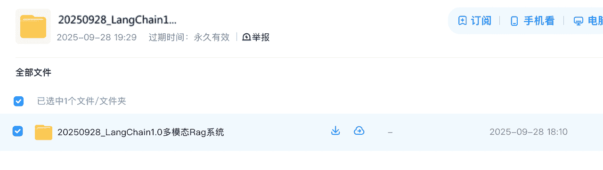


公开课全套学习资料，已上传至网盘（链接:  https://pan.baidu.com/s/1hPa43LFZDhvb9uEIzBQGGw?pwd=sj2n ）需要更系统深入学习大模型可扫码⬆️添加助教咨询喔～

---

# 《大模型Agent开发实战》（体验课）

## Part 2. 基于LangChain v1.0 搭建多模态RAG问答系统

本期公开课，我将带着大家从零开始学习LangChain 开发框架，并从零到一实现一个具备企业应用落地的多模态本地知识库问答系统。

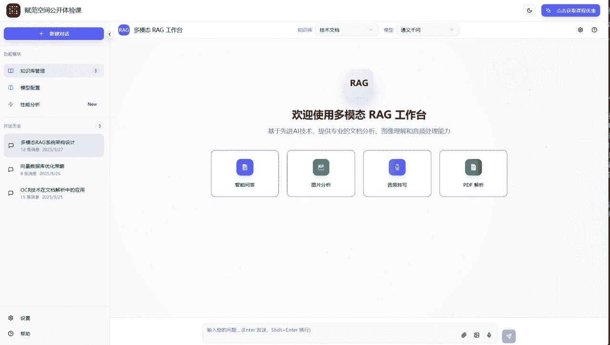

这个项目展示了如何构建一个生产级的智能对话系统，支持文本、图像、音频、PDF等多种模态的输入和处理。同时本期公开课，我也将围绕项目的整体设计与思路、LangChain 1.0 新特性解析、多模态功能实现详解、RAG 流程与企业级优化、项目架构与部署指南这五个部分进行详细讲解。

通过今天的学习，我们将从零开始构建一个完整的多模态智能对话系统，掌握 LangChain 1.0 的核心特性，理解RAG技术在企业场景中的实际应用。

# 1. 项目整体设计与架构分析

首先，我们先全面解析这个项目的设计理念。这个多模态RAG工作台是基于真实企业需求设计的一个初阶版本，它解决了传统单模态对话系统的局限性。这个系统具备以下核心能力：

+   **多模态输入处理**：支持文本、图像、PDF文档、音频四种输入方式

+   **智能内容理解**：基于 LangChain 1.0 框架实现统一的内容处理管道

+   **流式交互体验**：实时响应用户输入，提供流畅的对话体验

+   **企业级扩展性**：模块化设计，支持快速集成和定制化开发

这种设计让系统能够处理企业日常工作中的各种信息输入场景，真正实现了"所见即可问"的智能交互。同时这个系统采用了前后端分离的现代化架构：

项目技术架构

| 分类 | 技术/工具 | 用途描述 |
| --- | --- | --- |
| **前端技术栈** | React + TypeScript | 提供类型安全的组件化开发 |
|  | Tailwind CSS + Radix UI | 现代化的样式框架和组件库 |
|  | Framer Motion | 丰富的动画效果提升用户体验 |
|  | Vite | 快速的开发构建工具 |
| **后端技术栈** | FastAPI | 高性能的Python异步Web框架 |
|  | LangChain 1.0 | 最新版本的AI应用开发框架 |
|  | Pydantic | 数据验证和设置管理 |

核心特性说明

| 模态类型 | 处理方式 | 技术实现 | 优势 |
| --- | --- | --- | --- |
| **文本** | 直接LLM处理 | GPT-5 原生能力 | 强大的语言理解与生成 |
| **图像** | 多模态LLM理解 | base64编码直传GPT-5 | 语义级图像理解，无需预处理 |
| **音频** | 语音转文字 | OpenAI Whisper API | 高精度多语言转录 |
| **PDF** | 向量化检索 | UnstructuredPDFLoader + Chroma | 精确的文档问答与引用 |

+   **图像**

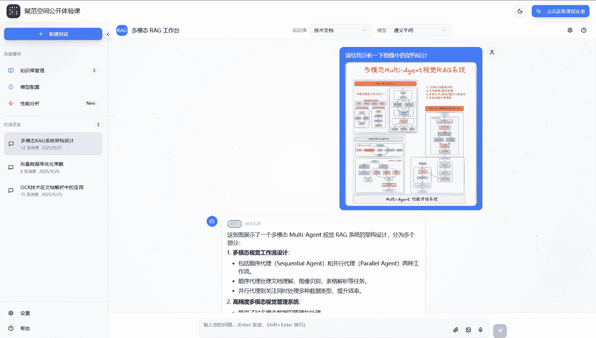

+   **音频**

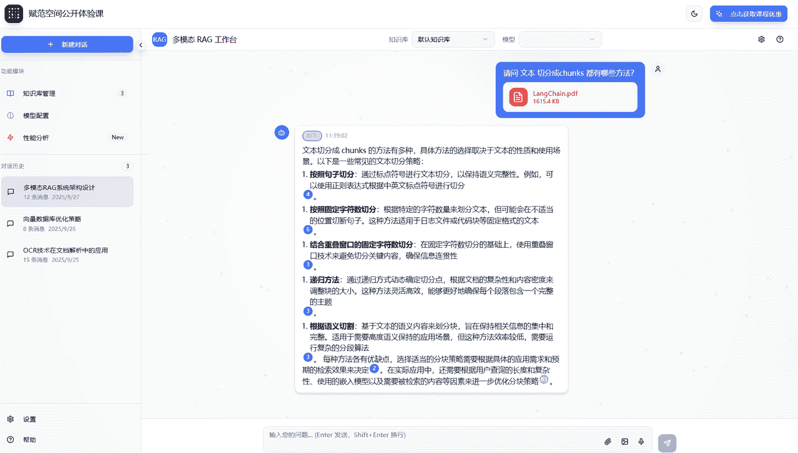

+   **RAG**

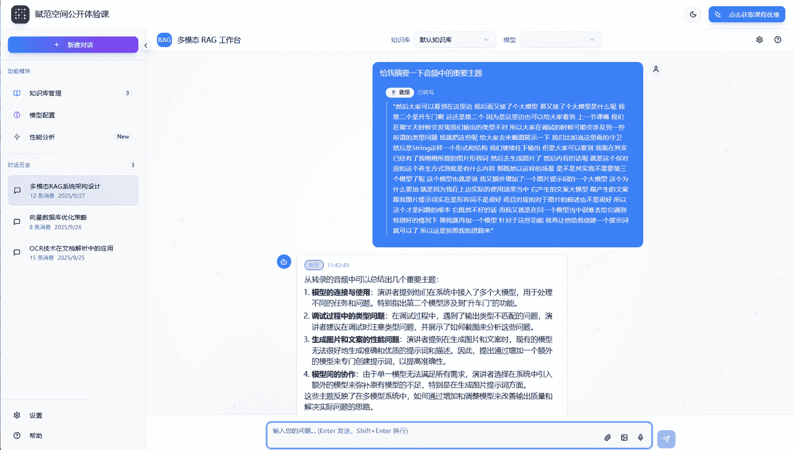

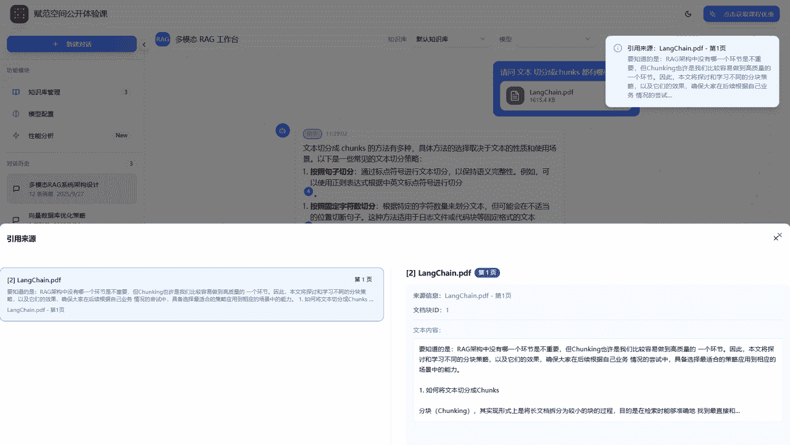

这个系统特别适合以下企业应用场景：

多模态RAG系统企业级应用场景对比

| 应用场景 | 具体应用 | 目标用户 | 核心价值 | 处理内容类型 |
| --- | --- | --- | --- | --- |
| **知识管理场景** | 文档智能问答 | 全体员工 | 快速获取关键信息 | PDF、Word、PPT、图片 |
|  | 技术文档查询 | 开发团队 | 快速查找API文档、技术规范 | 代码文档、架构图、流程图 |
|  | 培训材料解读 | 新员工 | 快速理解培训内容 | 培训视频、手册、图表 |
| **业务支持场景** | 合同条款分析 | 法务部门 | 快速分析合同关键条款 | 合同文本、法律文档 |
|  | 财务报表解读 | 财务团队 | 快速提取报表关键数据 | 财务报表、图表、数据表 |
|  | 市场调研分析 | 市场部门 | 分析调研报告和数据 | 调研报告、统计图表、数据 |
| **客户服务场景** | 产品说明书智能问答 | 客服团队 | 快速为客户解答产品问题 | 产品手册、说明书、图片 |
|  | 售后服务支持 | 技术支持 | 快速定位问题解决方案 | 故障手册、维修图解、视频 |
|  | 用户反馈分析 | 产品团队 | 分析用户反馈和建议 | 用户评价、反馈表单、截图 |

同时，此类多模态交互方式能够显著提升工作效率，平均可以减少60%的信息查找时间。

# 2. 为什么选择 LangChain 1.0

在这个项目中，我特意选择了 LangChain 1.0 版本。相比于早期版本，LangChain 1.0 带来了革命性的改进，特别是在企业级应用开发方面。在我的使用过程中，我发现这个版本解决了许多之前版本存在的痛点问题。

版本特性对比分析

| 特性 | LangChain 0.x | LangChain 1.0 | 改进说明 |
| --- | --- | --- | --- |
| 模型初始化 | 复杂的手动配置 | init_chat_model() 统一接口 | 简化90%的配置代码 |
| 流式处理 | 实现复杂，性能差 | 原生异步流式支持 | 性能提升3-5倍 |
| 错误处理 | 错误信息模糊 | 详细的错误追踪 | 调试效率提升80% |
| 多模态支持 | 需要额外封装 | 原生多模态消息 | 开发时间减少50% |
| 文档处理 | 分散的加载器 | 统一的文档处理器 | API数量减少60% |

```
    # LangChain 1.0 统一模型初始化演示
    from langchain.chat_models import init_chat_model
    from langchain_core.messages import HumanMessage, AIMessage, SystemMessage

    def get_chat_model(model_name: str = &quot;gpt-4o&quot;):
        &quot;&quot;&quot;
        LangChain 1.0 的统一模型初始化方式
        &quot;&quot;&quot;
        try:
            # 使用新的统一初始化接口
            model = init_chat_model(
                f&quot;openai:{model_name}&quot;,          # 统一的模型标识符
                api_key=&quot;your_api_key&quot;,          # API密钥
                base_url=&quot;https://api.openai.com/v1&quot;,  # 自定义API端点
                temperature=0.7,                 # 温度参数
                max_tokens=2048,                 # 最大令牌数
                streaming=True                   # 启用流式处理
            )
            return model
        except Exception as e:
            print(f&quot;模型初始化失败: {e}&quot;)
            return None

    # 演示模型初始化
    model = get_chat_model(&quot;gpt-4o&quot;)
```

这段代码展示了 LangChain 1.0 最重要的改进之一。这种统一的初始化方式让模型切换变得非常简单，只需要修改模型标识符即可。

+   **2. 原生多模态消息支持**

LangChain 1.0 原生支持多模态消息，并提供了统一的文档处理接口，具体可看：https://docs.langchain.com/oss/python/langchain/messages#multimodal

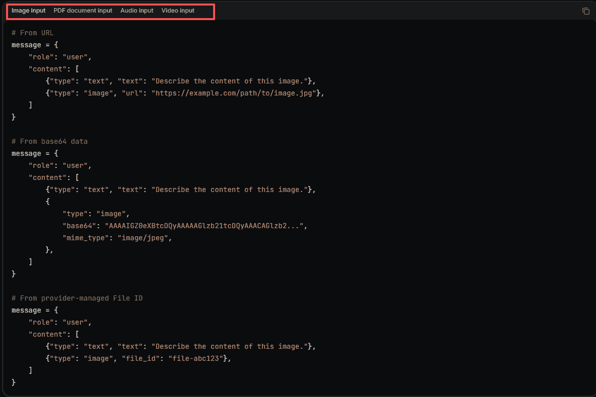

1.  更高效的流式处理

LangChain 1.0 在多模态处理方面的优势。可以轻松地在同一个消息中混合文本和图片，这为构建应用提供非常强大的灵活性。

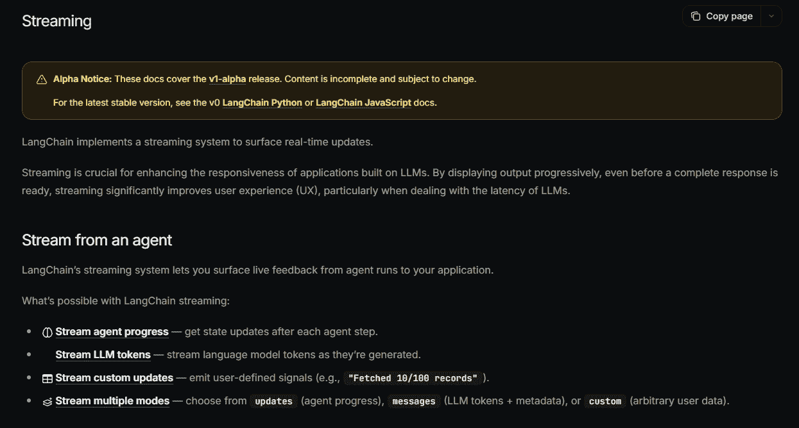

这个流式处理实现是我在 LangChain 1.0 中最满意的部分。它不仅性能出色，而且提供了细粒度的控制能力，能够实现真正的实时交互体验。通过以上对比分析，我们可以看出 LangChain 1.0 在企业级应用开发方面的巨大优势。选择这个版本能够显著提升开发效率，减少代码复杂度，同时获得更好的性能表现。

# 3. 核心功能详细拆解与最小运行示例

接下来，我将逐一拆解项目中的四个核心功能，帮助大家快速理解核心原理。

+   **功能一：文本对话系统**

文本对话是整个系统的基础功能。在该系统的设计中，这个功能不仅要处理简单的问答，还要支持上下文记忆、角色扮演等高级特性。

```
# 功能一：文本对话系统最小运行示例
import os
from langchain_openai import ChatOpenAI
from langchain_core.messages import HumanMessage, AIMessage, SystemMessage

class TextChatSystem:
    &quot;&quot;&quot;
    简单文本对话系统
    这是一个可以独立运行的最小示例
    &quot;&quot;&quot;
    
    def __init__(self, api_key: str, base_url: str = &quot;https://api.openai.com/v1&quot;):
        &quot;&quot;&quot;
        初始化对话系统
        
        Args:
            api_key: OpenAI API密钥
            base_url: API端点（支持自定义）
        &quot;&quot;&quot;
        self.model = ChatOpenAI(
            model=&quot;gpt-4o&quot;,
            api_key=api_key,
            base_url=base_url,
            temperature=0.7,
            max_tokens=2048
        )
        
        # 对话历史
        self.conversation_history = []
        
        # 系统提示词
        self.system_prompt = &quot;&quot;&quot;你是一个专业的AI助手，具备以下特点：
1. 回答准确、详细且有帮助
2. 语言风格友好、专业
3. 能够理解上下文并保持对话连贯性
4. 遇到不确定的问题会主动说明

请根据用户问题提供高质量的回答。&quot;&quot;&quot;
    
    def add_system_message(self):
        &quot;&quot;&quot;添加系统消息&quot;&quot;&quot;
        if not self.conversation_history:
            self.conversation_history.append(
                SystemMessage(content=self.system_prompt)
            )
    
    def chat(self, user_input: str) -&gt; str:
        &quot;&quot;&quot;
        同步聊天方法
        
        Args:
            user_input: 用户输入
            
        Returns:
            AI回复内容
        &quot;&quot;&quot;
        try:
            # 确保有系统消息
            self.add_system_message()
            
            # 添加用户消息
            self.conversation_history.append(
                HumanMessage(content=user_input)
            )
            
            # 获取AI回复
            response = self.model.invoke(self.conversation_history)
            
            # 添加AI回复到历史
            self.conversation_history.append(
                AIMessage(content=response.content)
            )
            
            return response.content
            
        except Exception as e:
            return f&quot;对话出错: {str(e)}&quot;
    
    async def chat_stream(self, user_input: str):
        &quot;&quot;&quot;
        异步流式聊天方法
        
        Args:
            user_input: 用户输入
            
        Yields:
            AI回复的文本块
        &quot;&quot;&quot;
        try:
            # 确保有系统消息
            self.add_system_message()
            
            # 添加用户消息
            self.conversation_history.append(
                HumanMessage(content=user_input)
            )
            
            # 流式获取AI回复
            full_response = &quot;&quot;
            async for chunk in self.model.astream(self.conversation_history):
                if chunk.content:
                    full_response += chunk.content
                    yield chunk.content
            
            # 添加完整回复到历史
            self.conversation_history.append(
                AIMessage(content=full_response)
            )
            
        except Exception as e:
            yield f&quot;流式对话出错: {str(e)}&quot;
    
    def clear_history(self):
        &quot;&quot;&quot;清空对话历史&quot;&quot;&quot;
        self.conversation_history = []
    
    def get_history_count(self) -&gt; int:
        &quot;&quot;&quot;获取对话轮数&quot;&quot;&quot;
        # 不包含系统消息
        return len([msg for msg in self.conversation_history 
                   if not isinstance(msg, SystemMessage)]) // 2
```

这个文本对话示例展示了最核心的对话功能实现。在问答系统中，对话历史管理和错误处理是确保系统稳定运行的关键。

+   **功能二：图像对话系统**

图像对话是多模态系统的重要组成部分。在该项目中，这个功能能够理解图片内容、回答相关问题，甚至进行图片分析和比较。

```
# 功能二：图像对话系统最小运行示例
import base64
import io
from PIL import Image
from langchain_openai import ChatOpenAI
from langchain_core.messages import HumanMessage, AIMessage, SystemMessage

class ImageChatSystem:
    &quot;&quot;&quot;图像对话系统 - 支持图片理解与智能问答&quot;&quot;&quot;
    
    def __init__(self, api_key: str):
        self.model = ChatOpenAI(
            model=&quot;gpt-4o&quot;,  # GPT-4o 支持图像理解
            api_key=api_key,
            temperature=0.3,  # 图像分析时使用较低温度
            max_tokens=1500
        )
        self.conversation_history = []
    
    def image_to_base64(self, image_path: str) -&gt; str:
        &quot;&quot;&quot;将图片转换为base64编码&quot;&quot;&quot;
        with Image.open(image_path) as img:
            # 优化图片尺寸
            max_size = (1024, 1024)
            img.thumbnail(max_size, Image.Resampling.LANCZOS)
            
            if img.mode != &#x27;RGB&#x27;:
                img = img.convert(&#x27;RGB&#x27;)
            
            buffer = io.BytesIO()
            img.save(buffer, format=&#x27;JPEG&#x27;, quality=85)
            return base64.b64encode(buffer.getvalue()).decode(&#x27;utf-8&#x27;)
    
    def chat_with_image(self, question: str, image_base64: str) -&gt; str:
        &quot;&quot;&quot;带图片的对话&quot;&quot;&quot;
        message_content = [
            {&quot;type&quot;: &quot;text&quot;, &quot;text&quot;: question},
            {
                &quot;type&quot;: &quot;image_url&quot;,
                &quot;image_url&quot;: {
                    &quot;url&quot;: f&quot;data:image/jpeg;base64,{image_base64}&quot;,
                    &quot;detail&quot;: &quot;high&quot;
                }
            }
        ]
        
        # 添加用户消息
        self.conversation_history.append(HumanMessage(content=message_content))
        
        # 获取AI回复
        response = self.model.invoke(self.conversation_history)
        self.conversation_history.append(AIMessage(content=response.content))
        
        return response.content
```

+   **功能三：PDF文档解析与问答**

PDF文档处理是企业应用中最重要的功能之一。在该系统中，这个功能需要处理复杂的文档布局、表格、图片等多种元素。

假设现在我们有一个偌大的知识库，当想从该知识库中去检索最相关的内容时，最简单的方法是：接收到一个查询（Query），就直接在知识库中进行搜索。这种做法其实是可行的，但存在两个关键的问题：

1.  假设提问的Query的答案出现在一篇文章中，去知识库中找到一篇与用户输入相关的文章是很容易的，但是我们将检索到的这整篇文章直接放入Prompt中并不是最优的选择，因为其中一定会包含非常多无关的信息，而无效信息越多，对大模型后续的推理影响越大。

1.  任何一个大模型都存在最大输入的Token限制，一个流程中可能涉及多次检索，每次检索都会产生相应的上下文，无法容纳如此多的信息。

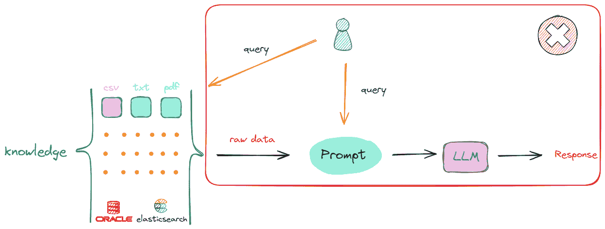

解决上述两个问题的方式是：把存放着原始数据的知识库（Knowledge）中的每一个raw data，切分成一个一个的小块，这些小块可以是一个段落，也可以是数据库中某个索引对应的值。这个切分过程被称为“分块”（chunking），如下述流程所示：

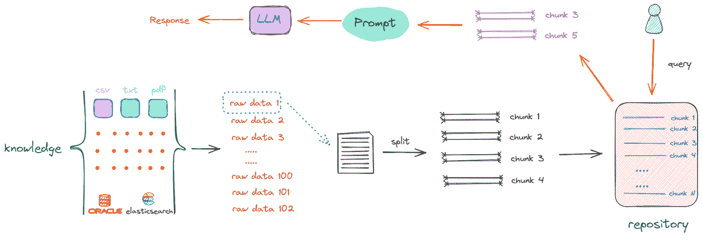

以第一个原始数据为例（raw data 1），通过一些特定的方法进行切分，一个完整的内容会被分割成 chunk1 ~ chunk4。采取相同的方法，继续对raw data 2、raw data 3直至raw data n进行切分。完成这一过程后，我们最终得到的是一个充满分块数据（chunks）的新的知识库（repository），其中每一项都是一个单独的chunk。例如，如果原始文档共有10个，那么经过切分，可能会产生出100个chunks。

完成这一转化后，当再次接收到一个查询（Query）时，就会在更新后的知识库（repository）中进行搜索，这时检索的范围就不再是某个完整的文档，而是其中的某一个部分，返回的是一个或多个特定的chunk，这样返回的信息量就会更小且更精确。随后，这些被检索到的chunk会被加入到Prompt中，作为上下文信息与用户原始的Query共同输入到大模型进行处理，以生成最终的回答。

在上述将原始数据（raw data）转化为chunk的过程中，就会包含构建RAG的第一部分开发工作：这包括如果做数据清洗，如去除停用词、标点符号等。此外，还涉及如何选择合适的split方法来进行数据切分的一系列技术。

接下来面临的问题是，尽管所有数据已经被切割成一个个chunk，其存储形式还是以字符串形式存在，如果想从repository中匹配到与输入的query相关的chunks，比较两句话是否相似，看一句话中相同字有几个，这显然是行不通的。我们需要获取的是句子所蕴含的深层含义，而非仅仅是表面的字面相似度。因此，大家也能想到，在NLP中去计算文本相似度的有效的方法就是Embedding，即将这些chunks转换成向量（vector）形式。所以流程会丰富如下：

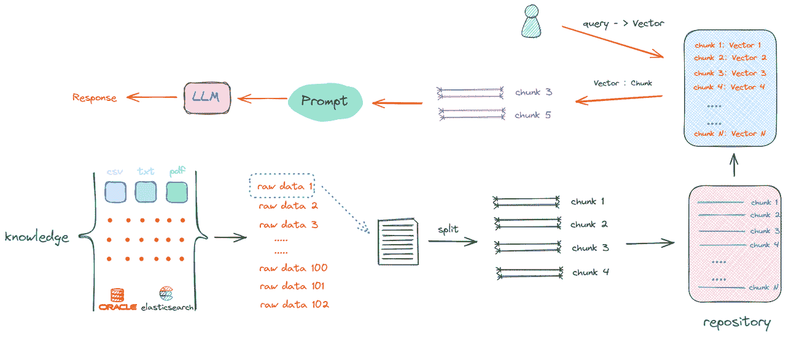

如上所示，解决搜索效率和计算相似度优化算法的答案就是：向量数据库。同时也产生了构建RAG的第三部分工作：我们要去了解和学习如何选择、使用向量数据库。

最终整体流程就如上图所示，一个基础的RAG架构会只要包含以下几方面的开发工作：

1.  如何将原始数据转化成chunks；

1.  如何将chunks转化成Vector；

1.  如何选择计算向量相似度的算法；

1.  如何利用向量数据库提升搜索效率；

1.  如何把找到的chunks与原始query拼接在一起，产生最终的Prompt；

而上述流程，其实更像是一个自由拼接的结果，比如不同的文档类型可以选择不同的文档解析器，也可以选择不同的Vector数据库，甚至可以自由选择Embedding模型和Vector数据库的组合。其自由程度非常高，如下图所示：

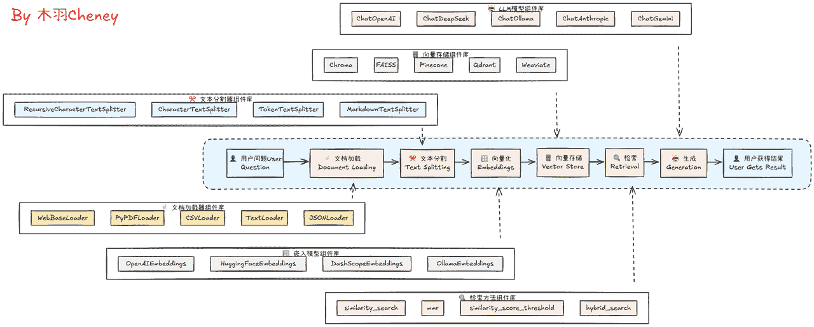


>

> https://python.langchain.com/docs/integrations/providers/unstructured/#unstructuredpdfloader

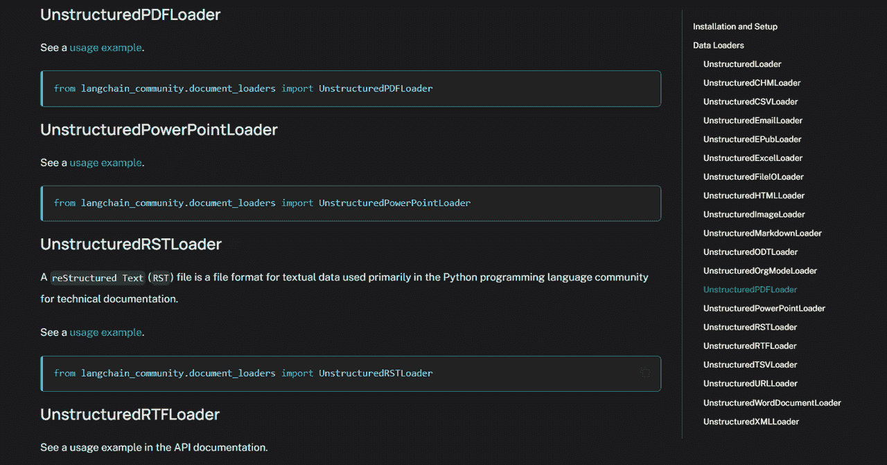

```
# 功能三：PDF文档解析与问答最小运行示例
import tempfile
import os
from typing import List, Dict, Any
from langchain_unstructured import UnstructuredLoader
from langchain_text_splitters import RecursiveCharacterTextSplitter
from langchain_openai import ChatOpenAI
from langchain_core.messages import HumanMessage, SystemMessage

class PDFChatSystem:
    &quot;&quot;&quot;PDF文档问答系统&quot;&quot;&quot;
    
    def __init__(self, api_key: str):
        self.model = ChatOpenAI(
            model=&quot;gpt-4o&quot;,
            api_key=api_key,
            temperature=0.3,
            max_tokens=2048
        )
        
        # 文本分块器
        self.text_splitter = RecursiveCharacterTextSplitter(
            chunk_size=1000,
            chunk_overlap=200,
            separators=[&quot;\n\n&quot;, &quot;\n&quot;, &quot; &quot;, &quot;&quot;]
        )
        
        # 存储解析后的文档块
        self.document_chunks = []
    
    def process_pdf(self, file_content: bytes, filename: str) -&gt; List[Dict[str, Any]]:
        &quot;&quot;&quot;处理PDF文档&quot;&quot;&quot;
        # 创建临时文件
        with tempfile.NamedTemporaryFile(delete=False, suffix=&#x27;.pdf&#x27;) as tmp_file:
            tmp_file.write(file_content)
            tmp_file_path = tmp_file.name
        
        try:
            # 使用UnstructuredLoader加载PDF
            loader = UnstructuredLoader(
                file_path=tmp_file_path,
                strategy=&quot;hi_res&quot;,  # 高分辨率策略
                extract_images_in_pdf=True,  # 提取图像
                infer_table_structure=True,  # 推断表格结构
            )
            
            # 加载文档
            documents = list(loader.lazy_load())
            
            # 合并文档内容
            full_text = &quot;\n\n&quot;.join([doc.page_content for doc in documents])
            
            # 文本分块
            text_chunks = self.text_splitter.split_text(full_text)
            
            # 构建文档块信息
            chunks = []
            for i, chunk_text in enumerate(text_chunks):
                chunk_info = {
                    &quot;id&quot;: f&quot;chunk_{i}&quot;,
                    &quot;content&quot;: chunk_text,
                    &quot;metadata&quot;: {
                        &quot;filename&quot;: filename,
                        &quot;chunk_index&quot;: i,
                        &quot;total_chunks&quot;: len(text_chunks)
                    }
                }
                chunks.append(chunk_info)
            
            self.document_chunks = chunks
            return chunks
            
        finally:
            # 清理临时文件
            os.unlink(tmp_file_path)
    
    def find_relevant_chunks(self, question: str, top_k: int = 3) -&gt; List[Dict[str, Any]]:
        &quot;&quot;&quot;简单的相关性搜索&quot;&quot;&quot;
        if not self.document_chunks:
            return []
        
        # 简单的关键词匹配（实际应用中应使用向量搜索）
        question_lower = question.lower()
        scored_chunks = []
        
        for chunk in self.document_chunks:
            content_lower = chunk[&quot;content&quot;].lower()
            # 计算关键词匹配分数
            score = sum(1 for word in question_lower.split() 
                       if word in content_lower)
            scored_chunks.append((score, chunk))
        
        # 按分数排序并返回top_k
        scored_chunks.sort(reverse=True, key=lambda x: x[0])
        return [chunk for _, chunk in scored_chunks[:top_k]]
    
    def chat_with_pdf(self, question: str) -&gt; str:
        &quot;&quot;&quot;基于PDF内容回答问题&quot;&quot;&quot;
        if not self.document_chunks:
            return &quot;请先上传并处理PDF文档。&quot;
        
        # 查找相关文档块
        relevant_chunks = self.find_relevant_chunks(question)
        
        # 构建上下文
        context = &quot;\n\n&quot;.join([
            f&quot;文档片段 {i+1}:\n{chunk[&#x27;content&#x27;]}&quot; 
            for i, chunk in enumerate(relevant_chunks)
        ])
        
        # 构建提示词
        system_prompt = &quot;&quot;&quot;你是一个专业的文档分析助手。请基于提供的文档内容回答用户问题。

回答要求：
1. 仅基于提供的文档内容回答
2. 如果文档中没有相关信息，请明确说明
3. 引用具体的文档片段支持你的回答
4. 保持回答的准确性和客观性

请仔细分析文档内容并提供准确的回答。&quot;&quot;&quot;
        
        user_prompt = f&quot;&quot;&quot;文档内容：
{context}

用户问题：{question}

请基于以上文档内容回答问题。&quot;&quot;&quot;
        
        # 发送请求
        messages = [
            SystemMessage(content=system_prompt),
            HumanMessage(content=user_prompt)
        ]
        
        response = self.model.invoke(messages)
        return response.content
    
    def get_document_summary(self) -&gt; str:
        &quot;&quot;&quot;获取文档摘要&quot;&quot;&quot;
        if not self.document_chunks:
            return &quot;没有可用的文档内容。&quot;
        
        # 使用前几个块生成摘要
        first_chunks = self.document_chunks[:3]
        content = &quot;\n\n&quot;.join([chunk[&quot;content&quot;] for chunk in first_chunks])
        
        summary_prompt = f&quot;&quot;&quot;请为以下文档内容生成一个简洁的摘要：

{content}

摘要要求：
1. 包含文档的主要内容和关键信息
2. 长度控制在200字以内
3. 突出重点和核心观点&quot;&quot;&quot;
        
        messages = [
            SystemMessage(content=&quot;你是一个专业的文档摘要助手。&quot;),
            HumanMessage(content=summary_prompt)
        ]
        
        response = self.model.invoke(messages)
        return response.content
```

+   **功能四：音频对话系统**

音频处理是多模态系统的重要补充。在该系统的设计中，这个功能不仅能够转写音频内容，还能基于转写结果进行智能问答。

```
# 功能四：音频对话系统最小运行示例
import tempfile
import os
from pathlib import Path
from openai import OpenAI
from pydub import AudioSegment
from moviepy.editor import VideoFileClip
from langchain_openai import ChatOpenAI
from langchain_core.messages import HumanMessage, SystemMessage

class AudioChatSystem:
    &quot;&quot;&quot;简单音频对话系统 - 支持音频转写与智能问答&quot;&quot;&quot;
    
    def __init__(self, api_key: str, base_url: str = &quot;https://api.openai.com/v1&quot;):
        # OpenAI客户端用于Whisper转写
        self.openai_client = OpenAI(
            api_key=api_key,
            base_url=base_url
        )
        
        # LangChain模型用于智能问答
        self.chat_model = ChatOpenAI(
            model=&quot;gpt-4o&quot;,
            api_key=api_key,
            base_url=base_url,
            temperature=0.7,
            max_tokens=2048
        )
        
        # 存储音频转写结果
        self.transcriptions = []
    
    def convert_to_audio(self, file_path: str, file_ext: str) -&gt; str:
        &quot;&quot;&quot;将视频文件转换为音频文件&quot;&quot;&quot;
        if file_ext.lower() in [&#x27;.mp4&#x27;, &#x27;.avi&#x27;, &#x27;.mov&#x27;, &#x27;.mkv&#x27;, &#x27;.webm&#x27;]:
            # 视频文件，提取音频
            with tempfile.NamedTemporaryFile(suffix=&#x27;.wav&#x27;, delete=False) as temp_file:
                temp_audio_path = temp_file.name
            
            # 使用moviepy提取音频
            video = VideoFileClip(file_path)
            video.audio.write_audiofile(temp_audio_path, verbose=False, logger=None)
            video.close()
            
            return temp_audio_path
        else:
            # 已经是音频文件，直接返回
            return file_path
    
    def optimize_audio_for_whisper(self, audio_path: str) -&gt; str:
        &quot;&quot;&quot;优化音频文件以适配Whisper&quot;&quot;&quot;
        # 加载音频
        audio = AudioSegment.from_file(audio_path)
        
        # 转换为适合Whisper的格式
        # - 采样率: 16kHz
        # - 声道: 单声道
        # - 格式: WAV
        audio = audio.set_frame_rate(16000).set_channels(1)
        
        # 保存优化后的音频
        with tempfile.NamedTemporaryFile(suffix=&#x27;.wav&#x27;, delete=False) as temp_file:
            optimized_path = temp_file.name
        
        audio.export(optimized_path, format=&quot;wav&quot;)
        return optimized_path
    
    def transcribe_audio(self, file_path: str, filename: str) -&gt; dict:
        &quot;&quot;&quot;转写音频文件&quot;&quot;&quot;
        try:
            # 检测文件类型
            file_ext = Path(filename).suffix.lower()
            
            # 转换为音频（如果是视频）
            audio_path = self.convert_to_audio(file_path, file_ext)
            
            # 优化音频格式
            optimized_path = self.optimize_audio_for_whisper(audio_path)
            
            try:
                # 使用Whisper进行转写
                with open(optimized_path, &quot;rb&quot;) as audio_file:
                    transcript = self.openai_client.audio.transcriptions.create(
                        model=&quot;whisper-1&quot;,
                        file=audio_file,
                        response_format=&quot;text&quot;
                    )
                
                # 获取音频时长
                audio = AudioSegment.from_file(optimized_path)
                duration = len(audio) / 1000.0  # 转换为秒
                
                result = {
                    &quot;filename&quot;: filename,
                    &quot;transcription&quot;: transcript,
                    &quot;duration&quot;: duration,
                    &quot;format&quot;: file_ext,
                    &quot;status&quot;: &quot;success&quot;
                }
                
                # 保存转写结果
                self.transcriptions.append(result)
                
                return result
                
            finally:
                # 清理临时文件
                if optimized_path != audio_path:
                    os.unlink(optimized_path)
                if audio_path != file_path:
                    os.unlink(audio_path)
                    
        except Exception as e:
            return {
                &quot;filename&quot;: filename,
                &quot;transcription&quot;: &quot;&quot;,
                &quot;duration&quot;: 0,
                &quot;format&quot;: file_ext,
                &quot;status&quot;: &quot;error&quot;,
                &quot;error&quot;: str(e)
            }
    
    def chat_with_audio_content(self, question: str, transcription_text: str) -&gt; str:
        &quot;&quot;&quot;基于音频转写内容回答问题&quot;&quot;&quot;
        system_prompt = &quot;&quot;&quot;你是一个专业的音频内容分析助手。请基于提供的音频转写内容回答用户问题。

回答要求：
1. 仅基于提供的转写内容进行回答
2. 如果转写内容中没有相关信息，请明确说明
3. 可以对音频内容进行分析、总结、提取关键信息
4. 保持回答的准确性和客观性

请仔细分析转写内容并提供有价值的回答。&quot;&quot;&quot;
        
        user_prompt = f&quot;&quot;&quot;音频转写内容：
{transcription_text}

用户问题：{question}

请基于以上音频转写内容回答问题。&quot;&quot;&quot;
        
        messages = [
            SystemMessage(content=system_prompt),
            HumanMessage(content=user_prompt)
        ]
        
        response = self.chat_model.invoke(messages)
        return response.content
    
    def summarize_audio_content(self, transcription_text: str) -&gt; str:
        &quot;&quot;&quot;生成音频内容摘要&quot;&quot;&quot;
        summary_prompt = f&quot;&quot;&quot;请为以下音频转写内容生成一个详细的摘要：

{transcription_text}

摘要要求：
1. 提取主要内容和关键信息
2. 识别重要的观点和结论
3. 保持逻辑结构清晰
4. 长度控制在300字以内

请提供专业的内容摘要。&quot;&quot;&quot;
        
        messages = [
            SystemMessage(content=&quot;你是一个专业的内容摘要助手。&quot;),
            HumanMessage(content=summary_prompt)
        ]
        
        response = self.chat_model.invoke(messages)
        return response.content
    
    def extract_key_points(self, transcription_text: str) -&gt; str:
        &quot;&quot;&quot;提取音频内容的关键要点&quot;&quot;&quot;
        extract_prompt = f&quot;&quot;&quot;请从以下音频转写内容中提取关键要点：

{transcription_text}

提取要求：
1. 识别并列出主要观点（最多10个）
2. 每个要点用简洁的语言描述
3. 按重要性排序
4. 包含具体的数据或例子（如果有）

请以清晰的列表形式呈现关键要点。&quot;&quot;&quot;
        
        messages = [
            SystemMessage(content=&quot;你是一个专业的内容分析助手。&quot;),
            HumanMessage(content=extract_prompt)
        ]
        
        response = self.chat_model.invoke(messages)
        return response.content
```

# 4. 项目结构详解与完整部署指南

最后，我来为大家详细介绍整个项目的组织结构和完整的部署流程。一个清晰的目录结构是项目成功的基础。采用了分层分模块的组织方式：

```
    ocr_rag/                          # 项目根目录
    ├── 📁 backend/                            # 后端服务层 (FastAPI + LangChain)
    │   ├── main.py                            # FastAPI应用主入口 + 多模态API
    │   ├── config.py                          # 配置文件 (OpenAI、模型参数等)
    │   ├── audio_processor.py                 # 音频处理模块 (Whisper集成)
    │   ├── pdf_processor.py                   # PDF解析模块 (文本提取+OCR)
    │   ├── env_config.py                      # 环境变量配置
    │   ├── test_client.py                     # API测试客户端
    │   ├── start.py                           # 服务启动脚本
    │   ├── requirements.txt                   # Python后端依赖
    │   ├── 📁 logs/                           # 运行日志目录
    │   ├── 📁 figures/                        # 处理过程图表存储
    │   └── README.md                          # 后端服务说明文档
    │
    ├── 📁 src/                               # 前端React应用源码
    │   ├── App.tsx                           # 主应用组件 (聊天界面)
    │   ├── main.tsx                          # React应用入口
    │   ├── index.css                         # 全局样式定义
    │   ├── 📁 components/                    # React组件库
    │   │   ├── 📁 ui/                         # 基础UI组件库
    │   │   └── 📁 figma/                      # Figma设计资源
    │   ├── 📁 types/                          # TypeScript类型定义
    │   ├── 📁 api/                            # API接口封装
    │   ├── 📁 lib/                            # 工具函数库
    │   ├── 📁 assets/                         # 静态资源文件
    │   └── 📁 styles/                         # 样式文件目录
    │
    ├── 📁 logs/                              # 系统运行日志
    ├── 📁 node_modules/                      # Node.js依赖包
    ├── 📁 __pycache__/                       # Python缓存文件
    ├── 📁 guidelines/                        # 开发规范文档
```

其中重点介绍几个核心文件的设计思路和功能：

LangChain记忆机制对比

| 层级 | 技术栈 | 主要功能 | 关键文件 |
| --- | --- | --- | --- |
| **前端层** | React 18 + TypeScript + Vite | 多模态聊天界面、文件上传、实时交互 | src/App.tsx、组件库 |
| **API层** | FastAPI + Pydantic | RESTful API、流式响应、文件处理 | backend/main.py |
| **AI层** | LangChain 1.0 + OpenAI | 多模态理解、对话生成、智能问答 | backend/main.py |
| **处理层** | PDF解析 + 音频转写 + 图像OCR | 文档解析、语音识别、图像理解 | 各processor模块 |
| **数据层** | 文件存储 + 日志记录 | 上传文件管理、系统日志、缓存 | logs/、临时存储 |

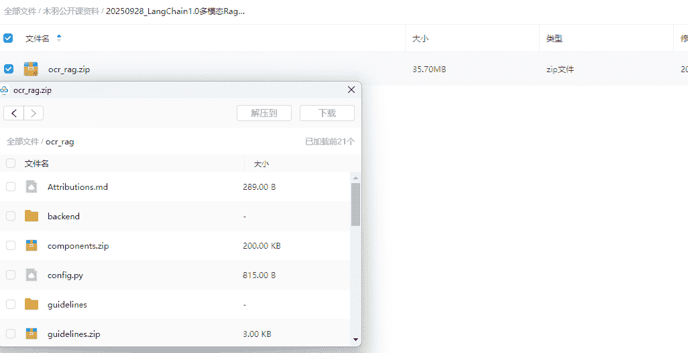


接下来我们介绍详细的部署指南。我会按照从环境准备到服务启动的完整流程来讲解。

首先确保系统满足以下基础要求：

环境要求清单

| 组件 | 版本要求 | 安装方式 | 验证命令 |
| --- | --- | --- | --- |
| **Python** | ≥ 3.10 | 官网下载或包管理器 | python --version |
| **Node.js** | ≥ 16.0 | 官网下载或nvm | node --version |
| **npm** | ≥ 8.0 | 随Node.js安装 | npm --version |

该系统使用的是GPT-5模型[，所以需要获取O](https://platform.openai.com/)penAI的API密钥：OpenAI官网， 然后配置到.env文件中。

首先启动后端服务部署。

```
    cd backend
    conda create -n ocr_rag python=3.10
    conda activate ocr_rag
    pip install -r requirements.txt
```

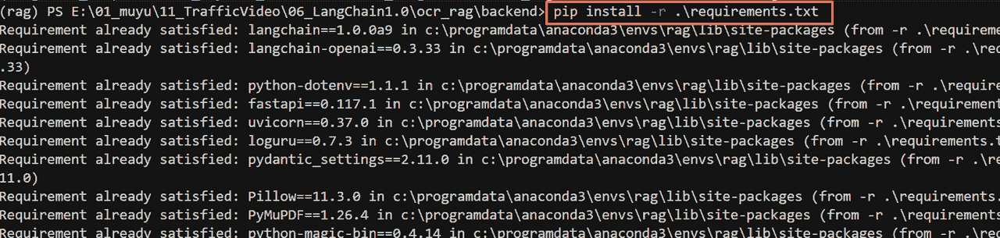

接下来进行项目目录，启动项目：

```
    cd backend
    python start.py
```

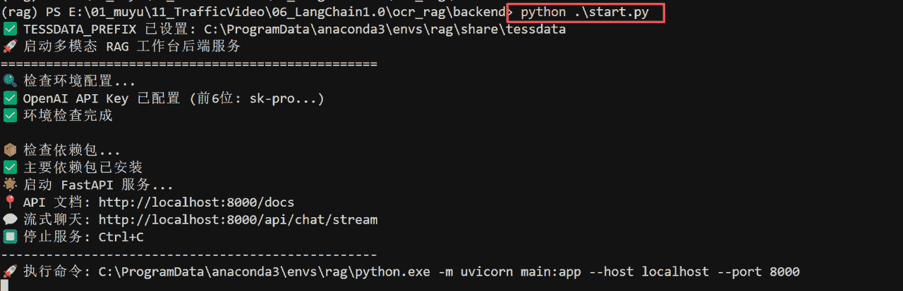

最后，启动前端服务，进入前端目录，安装Node.js依赖，启动开发服务器：

```
    npm install
```

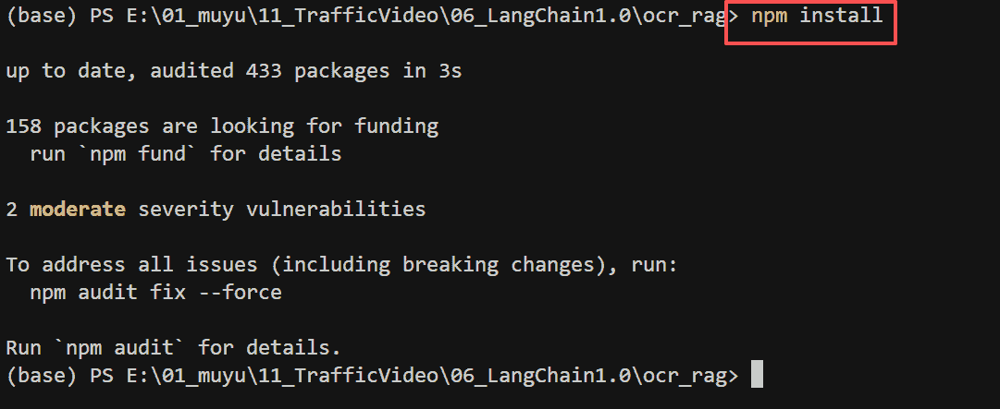

```
    npm run dev
```

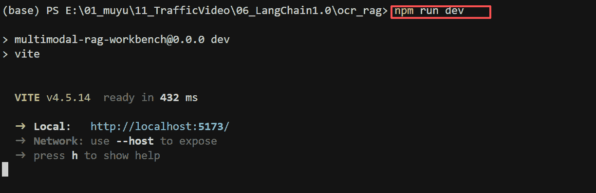

打开浏览器访问 http://localhost:5173，应该看到"赋范空间公开体验课"的界面。

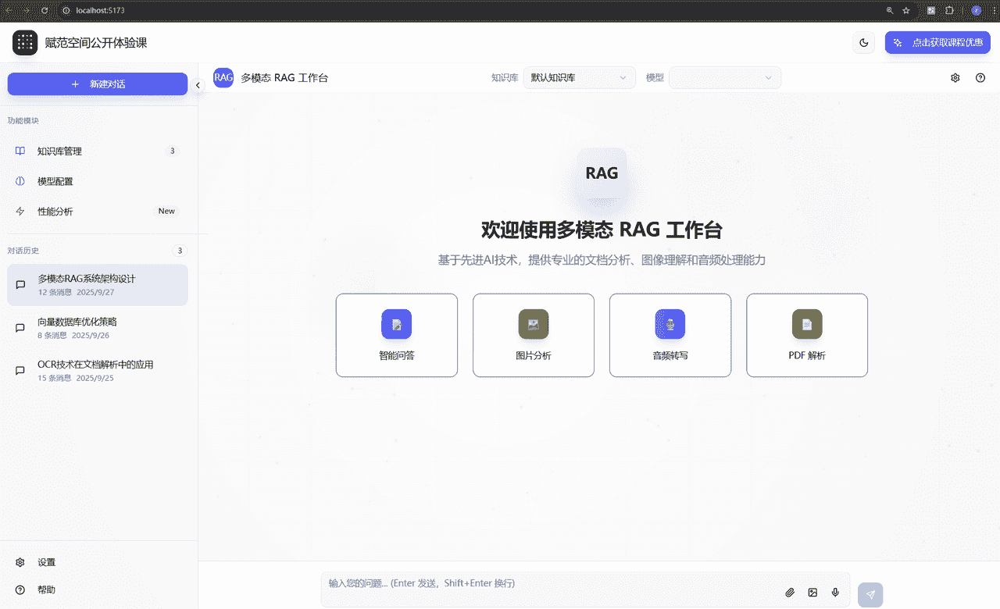

启动后，大家便可以开始上传文件进行对话测试了。比如

1.  **文本对话测试**: 在前端输入简单问题，验证AI回复

1.  **文件上传测试**: 上传PDF文件，测试解析功能

1.  **图像对话测试**: 上传图片，测试图像理解功能

1.  **音频对话测试**: 录制或上传音频，测试语音转换

同时在学习的过程中，建议大家先运行基础的多模态功能示例，理解核心流程，然后再深入学习RAG处理机制和优化策略，参考企业级规范，设计生产系统架构，最后实际部署运行，积累实战经验。后续可以扩展支持更多模态（视频、3D模型等），集成更多LLM提供商，增强安全和隐私保护机制，优化性能和用户体验。

希望通过这个项目能帮助大家快速入门基于大模型搭建多模态本地知识库问答项目，我们下期公开课再见~