# 2.基于LangChain的RAG系统开发

> 来源：[https://kq4b3vgg5b.feishu.cn/docx/XgYwdWRVDoVzu4xznJscH8Menah](https://kq4b3vgg5b.feishu.cn/docx/XgYwdWRVDoVzu4xznJscH8Menah)

## 课程说明：

+   体验课内容节选自《2025大模型Agent智能体开发实战》(7月班)完整版付费课程

体验课时间有限，若想深度学习大模型技术，欢迎大家报名由我主讲的《2025大模型Agent智能体开发实战》(7月班

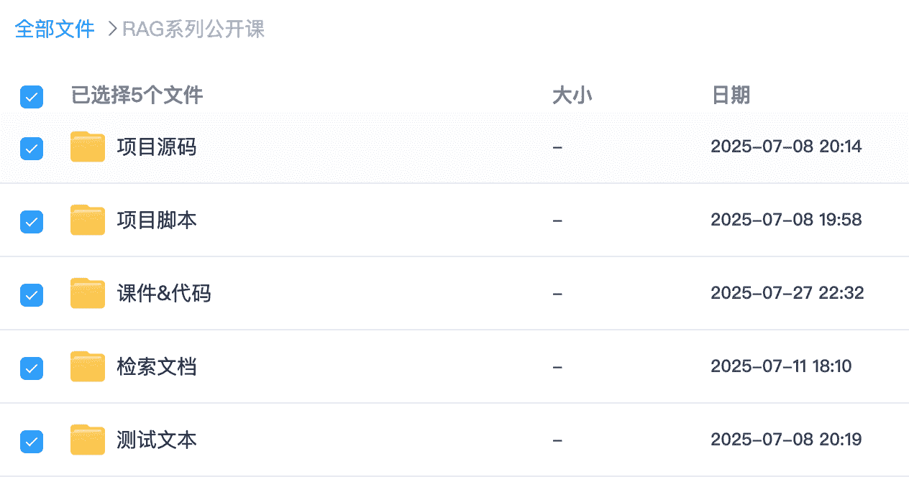


此外，公开课全套学习资料，已上传至网盘（ https://pan.baidu.com/s/1oPW2MgV3xLSo9BLv-_7XLg 提取码: u24p ）！需要更系统深入学习大模型可扫码⬆️添加助教咨询喔～

---

# RAG技术实战公开课

# Part 2.基于LangChain的RAG系统开发

## 一、回顾 Naive RAG 基础架构

目前企业的主要需求是希望大模型能够结合私有的数据进行问答、工作流构建、智能数据分析等等一系列的智能化应用。当企业有一个偌大的知识库，当想从该知识库中去检索最相关的内容时，最简单的方法是：接收到一个查询（Query），就直接在知识库中进行搜索。这种做法其实是可行的，但存在两个关键的问题：

1.  假设提问的Query的答案出现在一篇文章中，去知识库中找到一篇与用户输入相关的文章是很容易的，但是我们将检索到的这整篇文章直接放入Prompt中并不是最优的选择，因为其中一定会包含非常多无关的信息，而无效信息越多，对大模型后续的推理影响越大。

1.  任何一个大模型都存在最大输入的Token限制，一个流程中可能涉及多次检索，每次检索都会产生相应的上下文，无法容纳如此多的信息。

因此，我们需要一种方法，能够从知识库中检索出最相关的信息，并将其作为上下文输入到Prompt中，从而提高大模型回答的准确性和相关性。

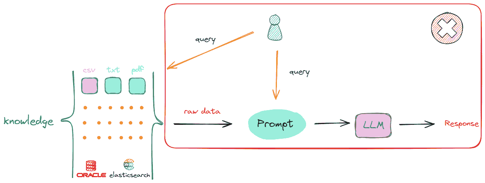

解决上述两个问题的方式是：把存放着原始数据的知识库（Knowledge）中的每一个raw data，切分成一个一个的小块，这些小块可以是一个段落，也可以是数据库中某个索引对应的值。这个切分过程被称为“分块”（chunking），如下述流程所示：

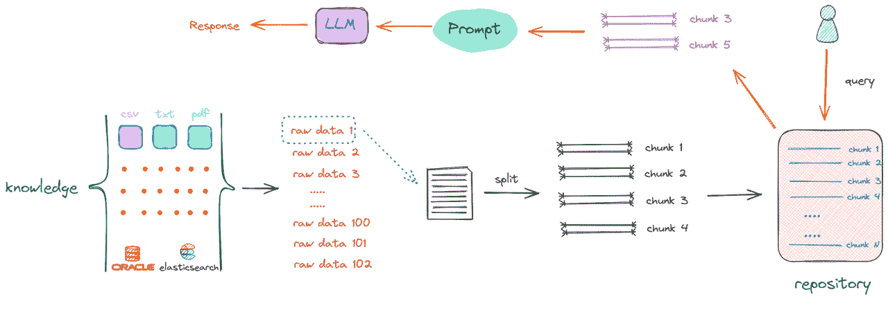

以第一个原始数据为例（raw data 1），通过一些特定的方法进行切分，一个完整的内容会被分割成 chunk1 ~ chunk4。采取相同的方法，继续对raw data 2、raw data 3直至raw data n进行切分。完成这一过程后，我们最终得到的是一个充满分块数据（chunks）的新的知识库（repository），其中每一项都是一个单独的chunk。例如，如果原始文档共有10个，那么经过切分，可能会产生出100个chunks。

完成这一转化后，当再次接收到一个查询（Query）时，就会在更新后的知识库（repository）中进行搜索，这时检索的范围就不再是某个完整的文档，而是其中的某一个部分，返回的是一个或多个特定的chunk，这样返回的信息量就会更小且更精确。随后，这些被检索到的chunk会被加入到Prompt中，作为上下文信息与用户原始的Query共同输入到大模型进行处理，以生成最终的回答。

在上述将原始数据（raw data）转化为chunk的过程中，就会包含构建RAG的第一部分开发工作：这包括如果做数据清洗，如去除停用词、标点符号等。此外，还涉及如何选择合适的split方法来进行数据切分的一系列技术。

接下来面临的问题是，尽管所有数据已经被切割成一个个chunk，其存储形式还是以字符串形式存在，如果想从repository中匹配到与输入的query相关的chunks，比较两句话是否相似，看一句话中相同字有几个，这显然是行不通的。我们需要获取的是句子所蕴含的深层含义，而非仅仅是表面的字面相似度。因此，大家也能想到，在NLP中去计算文本相似度的有效的方法就是Embedding，即将这些chunks转换成向量（vector）形式。

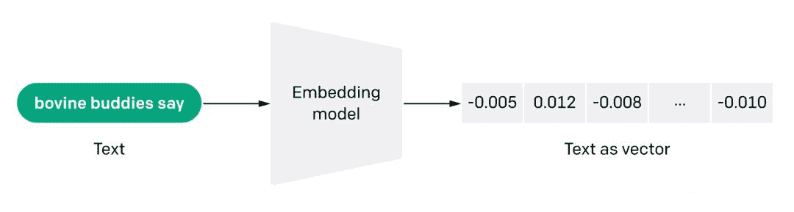

最终这个流程如下所示：

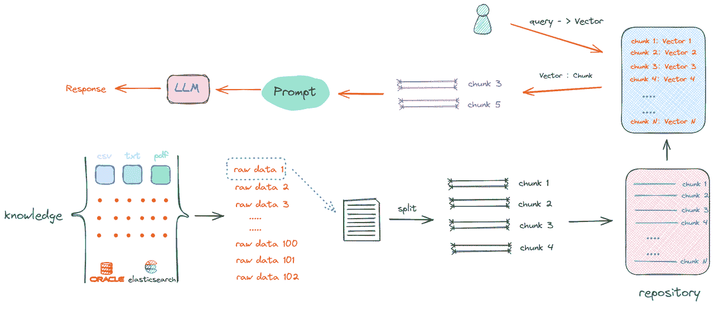

在这个流程中，会先将用户输入的 Query 转化成 Vector，然后再去与知识库中的向量进行相似度比较，检索出相似的Vector，最终返回其对应的Chunk（字符串形式的文本），再执行后续的流程。所以在这个过程中，就会产生构建RAG的第二部分的开发工作：如果将chunk转化成Vector及以何种形式进行存储。同时，我们要考虑的是：如何去计算向量之间的相似度？如果去和知识库中的向量一个一个比较，这个时间复杂度是非常高的，那么其解决办法又是什么呢？我们继续看下述流程：

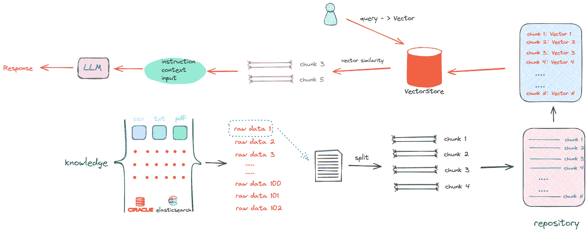

如上所示，解决搜索效率和计算相似度优化算法的答案就是：向量数据库。同时也产生了构建RAG的第三部分工作：我们要去了解和学习如何选择、使用向量数据库。因此，一个基础的RAG架构会只要包含以下几方面的开发工作：

1.  如何将原始数据转化成chunks；

1.  如何将chunks转化成Vector；

1.  如何选择计算向量相似度的算法；

1.  如何利用向量数据库提升搜索效率；

1.  如何把找到的chunks与原始query拼接在一起，产生最终的Prompt；

## 二、LangChain RAG API详解

在LangChain框架中，RAG作为一个非常重要且关键的模块独立存在，如下图所示：https://python.langchain.com/docs/integrations/retrievers/

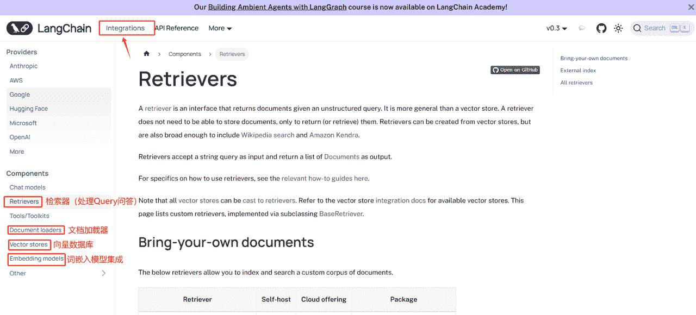

针对我们在上一小节分析的RAG流程，每一个子流程中，LangChain都提供了多种较为通用的实现方法，这包括如何将不同来源、不同形式的数据切分成一个个小块，如何使用Embedding模型做向量化，如何将向量存储进向量数据库中，以及提供了快速检索的优化算法。每一环节设计的基础技术，都作为一个独立的抽象模块存在，而将各个环节像Chains一样串流起来进行数据交换，形成一个完整的RAG系统，LangChain抽象了一个所谓的data connection数据处理流，如下图所示：

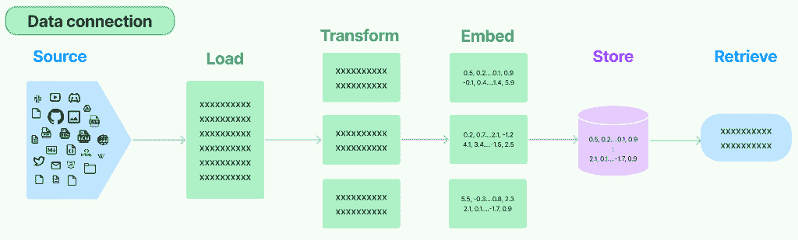

data connecting 是Langchain框架原生的数据处理流，RAG是涉及多个处理环节的一个架构，它不是个体，而是一个整体，所以虽然不同环节、不同模块间所做的事情是不一样的，但它们之间是需要链接的，需要进行数据的交换，那这一部分工作，就是交给data connection来统一管理。例如，在上述流程中，"Source"阶段指的是附加的数据库，它能够整合来自不同数据源的信息。通过"Load"组件，这些数据可以被统一管理。"Transform"组件则负责进行数据切分等一系列前文提到的构建RAG所需的开发任务，提供了各种不同的解决方案。

因此，学习LangChain中RAG的构建过程我们更建议：第一步学流程，第二步学关键点，第三步学每一环节的具体技术，第四步不断地扩展优化，从基础RAG到进阶RAG。所以接下来，我们就按照LangChain的data conncetiong流程，逐步拆解每一模块的关键技术点进行讲解和实践，最终跑通这个RAG流程。

+   LangChain接入OpenAI、DeepSeek、DashScope流程

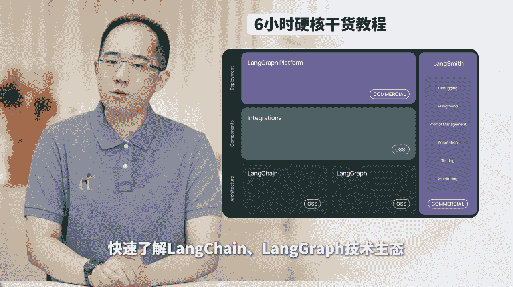

下图扫码即可领取相关资料：

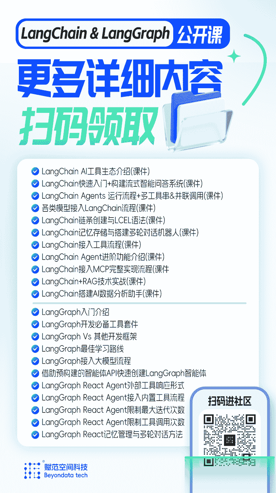

+   创建.env文件并写入配置：

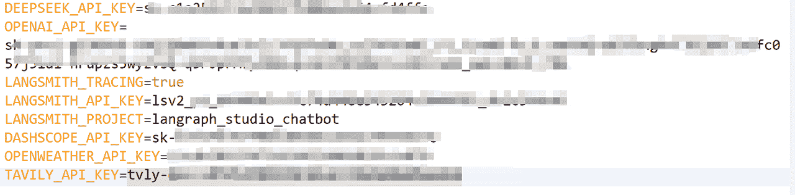

+   安装相关的依赖库：

```
! pip install langchain python-dotenv langchain-deepseek langchain-openai
```

```
Requirement already satisfied: langchain in /root/anaconda3/lib/python3.12/site-packages (0.3.26)
Requirement already satisfied: python-dotenv in /root/anaconda3/lib/python3.12/site-packages (1.0.1)
Requirement already satisfied: langchain-deepseek in /root/anaconda3/lib/python3.12/site-packages (0.1.3)
Requirement already satisfied: langchain-openai in /root/anaconda3/lib/python3.12/site-packages (0.3.21)
Requirement already satisfied: langchain-core&lt;1.0.0,&gt;=0.3.66 in /root/anaconda3/lib/python3.12/site-packages (from langchain) (0.3.68)
Requirement already satisfied: langchain-text-splitters&lt;1.0.0,&gt;=0.3.8 in /root/anaconda3/lib/python3.12/site-packages (from langchain) (0.3.8)
Requirement already satisfied: langsmith&gt;=0.1.17 in /root/anaconda3/lib/python3.12/site-packages (from langchain) (0.3.45)
Requirement already satisfied: pydantic&lt;3.0.0,&gt;=2.7.4 in /root/anaconda3/lib/python3.12/site-packages (from langchain) (2.11.4)
Requirement already satisfied: SQLAlchemy&lt;3,&gt;=1.4 in /root/anaconda3/lib/python3.12/site-packages (from langchain) (2.0.32)
Requirement already satisfied: requests&lt;3,&gt;=2 in /root/anaconda3/lib/python3.12/site-packages (from langchain) (2.32.3)
Requirement already satisfied: PyYAML&gt;=5.3 in /root/anaconda3/lib/python3.12/site-packages (from langchain) (6.0.1)
Requirement already satisfied: openai&lt;2.0.0,&gt;=1.68.2 in /root/anaconda3/lib/python3.12/site-packages (from langchain-openai) (1.78.1)
Requirement already satisfied: tiktoken&lt;1,&gt;=0.7 in /root/anaconda3/lib/python3.12/site-packages (from langchain-openai) (0.8.0)
Requirement already satisfied: tenacity!=8.4.0,&lt;10.0.0,&gt;=8.1.0 in /root/anaconda3/lib/python3.12/site-packages (from langchain-core&lt;1.0.0,&gt;=0.3.66-&gt;langchain) (8.5.0)
Requirement already satisfied: jsonpatch&lt;2.0,&gt;=1.33 in /root/anaconda3/lib/python3.12/site-packages (from langchain-core&lt;1.0.0,&gt;=0.3.66-&gt;langchain) (1.33)
Requirement already satisfied: packaging&lt;25,&gt;=23.2 in /root/anaconda3/lib/python3.12/site-packages (from langchain-core&lt;1.0.0,&gt;=0.3.66-&gt;langchain) (24.1)
Requirement already satisfied: typing-extensions&gt;=4.7 in /root/anaconda3/lib/python3.12/site-packages (from langchain-core&lt;1.0.0,&gt;=0.3.66-&gt;langchain) (4.13.2)
Requirement already satisfied: httpx&lt;1,&gt;=0.23.0 in /root/anaconda3/lib/python3.12/site-packages (from langsmith&gt;=0.1.17-&gt;langchain) (0.28.1)
Requirement already satisfied: orjson&lt;4.0.0,&gt;=3.9.14 in /root/anaconda3/lib/python3.12/site-packages (from langsmith&gt;=0.1.17-&gt;langchain) (3.10.13)
Requirement already satisfied: requests-toolbelt&lt;2.0.0,&gt;=1.0.0 in /root/anaconda3/lib/python3.12/site-packages (from langsmith&gt;=0.1.17-&gt;langchain) (1.0.0)
Requirement already satisfied: zstandard&lt;0.24.0,&gt;=0.23.0 in /root/anaconda3/lib/python3.12/site-packages (from langsmith&gt;=0.1.17-&gt;langchain) (0.23.0)
Requirement already satisfied: anyio&lt;5,&gt;=3.5.0 in /root/anaconda3/lib/python3.12/site-packages (from openai&lt;2.0.0,&gt;=1.68.2-&gt;langchain-openai) (4.8.0)
Requirement already satisfied: distro&lt;2,&gt;=1.7.0 in /root/anaconda3/lib/python3.12/site-packages (from openai&lt;2.0.0,&gt;=1.68.2-&gt;langchain-openai) (1.9.0)
Requirement already satisfied: jiter&lt;1,&gt;=0.4.0 in /root/anaconda3/lib/python3.12/site-packages (from openai&lt;2.0.0,&gt;=1.68.2-&gt;langchain-openai) (0.8.2)
Requirement already satisfied: sniffio in /root/anaconda3/lib/python3.12/site-packages (from openai&lt;2.0.0,&gt;=1.68.2-&gt;langchain-openai) (1.3.0)
Requirement already satisfied: tqdm&gt;4 in /root/anaconda3/lib/python3.12/site-packages (from openai&lt;2.0.0,&gt;=1.68.2-&gt;langchain-openai) (4.66.4)
Requirement already satisfied: annotated-types&gt;=0.6.0 in /root/anaconda3/lib/python3.12/site-packages (from pydantic&lt;3.0.0,&gt;=2.7.4-&gt;langchain) (0.6.0)
Requirement already satisfied: pydantic-core==2.33.2 in /root/anaconda3/lib/python3.12/site-packages (from pydantic&lt;3.0.0,&gt;=2.7.4-&gt;langchain) (2.33.2)
Requirement already satisfied: typing-inspection&gt;=0.4.0 in /root/anaconda3/lib/python3.12/site-packages (from pydantic&lt;3.0.0,&gt;=2.7.4-&gt;langchain) (0.4.0)
Requirement already satisfied: charset-normalizer&lt;4,&gt;=2 in /root/anaconda3/lib/python3.12/site-packages (from requests&lt;3,&gt;=2-&gt;langchain) (2.0.4)
Requirement already satisfied: idna&lt;4,&gt;=2.5 in /root/anaconda3/lib/python3.12/site-packages (from requests&lt;3,&gt;=2-&gt;langchain) (3.7)
Requirement already satisfied: urllib3&lt;3,&gt;=1.21.1 in /root/anaconda3/lib/python3.12/site-packages (from requests&lt;3,&gt;=2-&gt;langchain) (1.26.20)
Requirement already satisfied: certifi&gt;=2017.4.17 in /root/anaconda3/lib/python3.12/site-packages (from requests&lt;3,&gt;=2-&gt;langchain) (2024.2.2)
Requirement already satisfied: greenlet!=0.4.17 in /root/anaconda3/lib/python3.12/site-packages (from SQLAlchemy&lt;3,&gt;=1.4-&gt;langchain) (3.0.1)
Requirement already satisfied: regex&gt;=2022.1.18 in /root/anaconda3/lib/python3.12/site-packages (from tiktoken&lt;1,&gt;=0.7-&gt;langchain-openai) (2023.10.3)
Requirement already satisfied: httpcore==1.* in /root/anaconda3/lib/python3.12/site-packages (from httpx&lt;1,&gt;=0.23.0-&gt;langsmith&gt;=0.1.17-&gt;langchain) (1.0.7)
Requirement already satisfied: h11&lt;0.15,&gt;=0.13 in /root/anaconda3/lib/python3.12/site-packages (from httpcore==1.*-&gt;httpx&lt;1,&gt;=0.23.0-&gt;langsmith&gt;=0.1.17-&gt;langchain) (0.14.0)
Requirement already satisfied: jsonpointer&gt;=1.9 in /root/anaconda3/lib/python3.12/site-packages (from jsonpatch&lt;2.0,&gt;=1.33-&gt;langchain-core&lt;1.0.0,&gt;=0.3.66-&gt;langchain) (2.1)
WARNING: Running pip as the &#x27;root&#x27; user can result in broken permissions and conflicting behaviour with the system package manager. It is recommended to use a virtual environment instead: https://pip.pypa.io/warnings/venv

```

+   测试调用：

```
import os
from dotenv import load_dotenv 
load_dotenv(override=True)
```

```
True
```

```
from langchain_openai import ChatOpenAI

model = ChatOpenAI(
    model=&quot;gpt-4o&quot;,      
    base_url=&quot;https://ai.devtool.tech/proxy/v1&quot;, 
)
```

```
question = &quot;你好，请你介绍一下你自己。&quot;

result = model.invoke(question)
print(result.content)
```

```
你好！我是一个大型语言模型助手，由OpenAI开发，旨在为用户提供各种信息和帮助。我可以回答问题、提供建议、进行语言翻译、撰写文本和代码等等。我会不断学习和更新，以便更好地满足用户的需求。请随时告诉我你需要什么帮助！
```

```
from langchain_deepseek import ChatDeepSeek

model = ChatDeepSeek(model=&quot;deepseek-chat&quot;)
```

```
question = &quot;你好，请你介绍一下你自己。&quot;

result = model.invoke(question)
print(result.content)
```

```
你好！我是 **DeepSeek Chat**，由深度求索（DeepSeek）公司开发的智能 AI 助手。我可以帮助你解答各种问题，包括学习、工作、编程、写作、生活建议等多个领域。  

### **我的特点：**  
✅ **免费使用**：目前无需付费，你可以随时向我提问！  
✅ **知识丰富**：我的知识截止到 **2024 年 7 月**，可以为你提供最新的信息。  
✅ **超长上下文**：支持 **128K** 上下文记忆，可以处理超长文档或复杂对话。  
✅ **文件阅读**：支持上传 **PDF、Word、Excel、PPT、TXT** 等文件，并能从中提取信息进行分析。  
✅ **多语言能力**：可以用 **中文、英文** 等多种语言交流。  
✅ **逻辑与创造力**：无论是数学计算、编程调试，还是写作创意，我都能帮上忙！  

你可以问我任何问题，比如：  
- **学习**：如何高效学习 Python？  
- **工作**：怎样写一份优秀的简历？  
- **生活**：推荐几本好书？  
- **娱乐**：最近有什么好看的电影？  

很高兴认识你！有什么我可以帮你的吗？😊
```

### 1. Source 与 data loaders功能实现

Source概念指的是RAG架构中所外挂的知识库。正如我们之前所讨论的，因为大模型的原生能力很强，所以它可以识别多种不同的类型的原始数据而不用做额外的处理，而且在实际场景中，私有数据通常也并不是单一的，可以来自多种不同的形式，可以是上百个.csv文件，可以是上千个.json文件，也可以是上万个.pdf文件，同时如果对接到具体的业务，可以是某一个业务流程外放的API，可以是某个网站的实时数据等多种情况。

所以LangChain首先做的就是：将常见的数据格式和数据来源使用LangChain的规范，抽象出一个一个的单独的集成模块，称为文档加载器（Document loaders），用于快速加载某种形式下的文本数据。如下图所示：

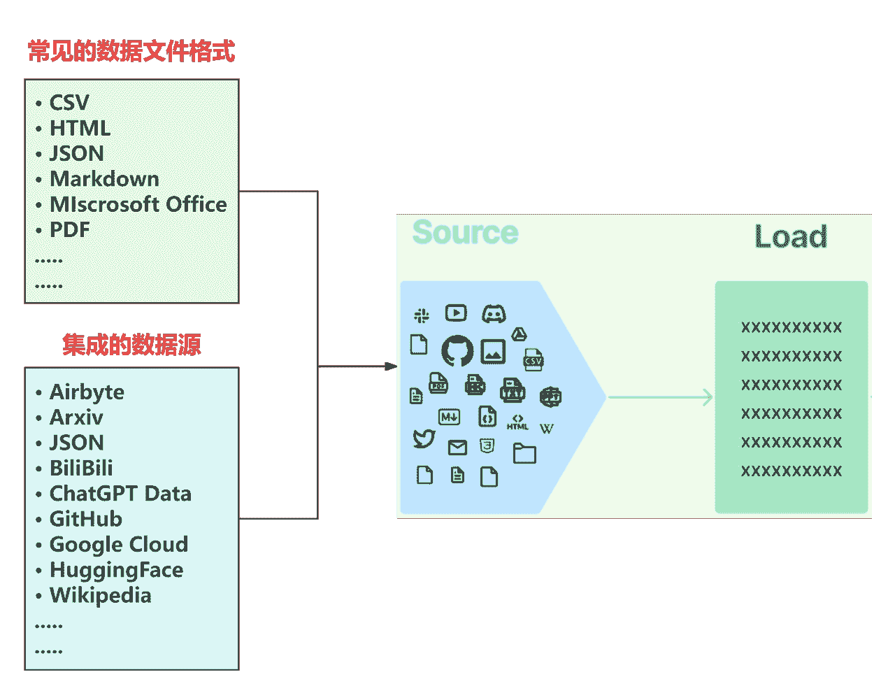

这意味着，我们可以通过调用LangChain抽象好的方法直接处理私有数据，无需手动编写中间的处理流程，并且每一种文档的加载器，在LangChain官方文档中都有基本的调用示例供我们快速上手使用，具体位置如下：https://python.langchain.com/docs/integrations/document_loaders/

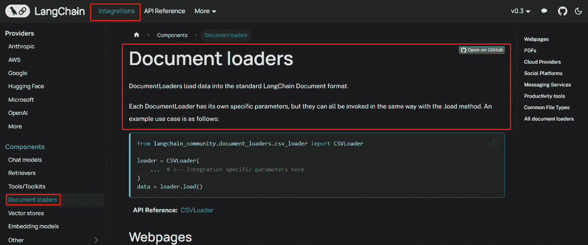

各个不同类型的文档加载器经过langChain的高度封装后使用起来并不会很复杂，可以直接调用load_documents方法，传入文件路径，就可以加载出对应的文档。这里我们进行几种不同类型的文档加载，并查看加载后的文档内容。

**  **在LangChain技术生态中，文档加载（Document Loaders）**是支撑检索增强生成（RAG）流程的核心组件之一。LangChain已原生集成了丰富的加载器模块，覆盖**本地文件、在线网页、数据库、云存储、第三方应用及多媒体资源等多样化数据来源，极大降低了异构知识接入的开发成本。

总**体来看，这些加载器可**分为七大类：本地文件加载、网页抓取、API集成、数据库连接、云端存储、特定格式解析以及自定义扩展。每类加载器均封装了数据读取、文档分块、元数据生成等常用操作，开发者只需在配置中指定路径或凭据，即可将不同来源的内容标准化为LangChain可处理的Document对象，为后续Embedding、检索和问答链条提供高质量的输入。

**这一体系不仅支持通用场景（如**PDF阅读、网页爬取），也覆盖了Notion、Slack、Confluence、Google Drive等现代企业常用的云应用，使LangChain成为目前RAG系统中文档接入能力最丰富的开源框架之一。

**  下表列举了**LangChain已集成的部分典型加载器，按类别分类展示（并非穷尽所有）：

| 分类 | 加载器名称（部分示例） |
| --- | --- |
| 本地文件加载器 | TextLoader, CSVLoader, PDFLoader, UnstructuredLoader, JSONLoader, Docx2txtLoader |
| 网页加载器 | WebBaseLoader, SitemapLoader, TrafilaturaLoader, RecursiveUrlLoader |
| API/第三方数据加载器 | NotionDBLoader, SlackLoader, ConfluenceLoader, GitHubIssuesLoader, GoogleDriveLoader |
| 数据库加载器 | SQLDatabaseLoader, PandasDataFrameLoader, FAISSLoader, MilvusLoader |
| 云存储加载器 | S3DirectoryLoader, GCSDirectoryLoader, AzureBlobStorageLoader |
| 多媒体/特定格式加载器 | YouTubeLoader, AudioLoader, EPubLoader, EverNoteLoader |
| 自定义/通用加载器 | DirectoryLoader, BSHTMLLoader, iFixitLoader |

#### 1.1 在线文档加载流程

我们以Wikipedia为示例，维基百科大家都比较熟悉，是一个多语言免费在线百科全书，当LangChain集成了以后，就可以按照文档说明直接调用。https://python.langchain.com/docs/integrations/document_loaders/wikipedia/

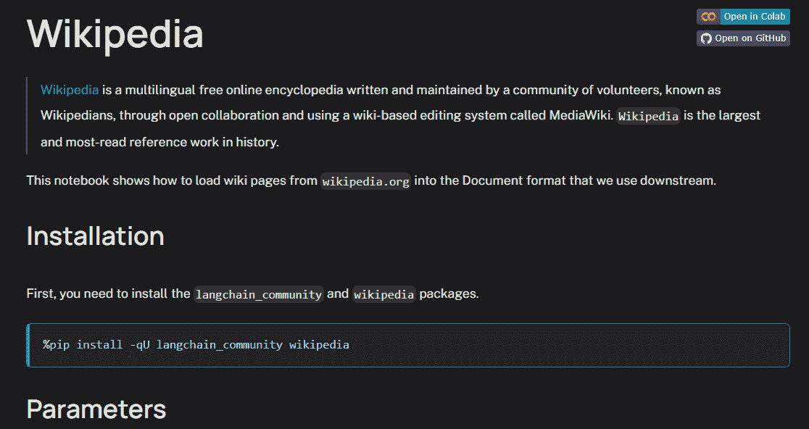

按要求安装项目依赖。

```
# ! pip install -U langchain_community wikipedia
```

在构造方法中能非常明确的看到可以在调用时支持自定义的参数，再结合官方的说明文档，可整理出如下有效信息：

+   **query** ：用于在维基百科中查找文档的自由文本

+   **可选 lang** ：默认=“en”。用它来搜索维基百科的特定语言部分

+   可选 load_max_docs ：默认=100。用它来限制下载文档的数量。下载所有 100 个文档需要时间，因此请使用少量进行实验。目前硬性限制为 300。

+   可选 load_all_available_meta ：默认=False。

默认情况下，仅下载最重要的字段： Published （文档发布/上次更新的日期）、 title 、 Summary 。如果为 True，则还会下载其他字段。

```
from langchain_community.document_loaders import WikipediaLoader
```

```
docs = WikipediaLoader(query=&quot;LangChain&quot;, 
                       lang=&quot;zh&quot;,
                       load_max_docs=2).load()
len(docs)
```

```
2
```

```
docs[0].metadata
```

```
{&#x27;title&#x27;: &#x27;LangChain&#x27;,
 &#x27;summary&#x27;: &#x27;LangChain 是一个应用框架，旨在简化使用大型语言模型的应用程序。作为一个语言模型集成框架，LangChain 的用例与一般语言模型的用例有很大的重叠。 重叠范围包括文档分析和总结摘要, 代码分析和聊天机器人。  \nLangChain提供了一个标准接口，用于将不同的语言模型（LLM）连接在一起，以及与其他工具和数据源的集成。LangChain还为常见应用程序提供端到端链，如聊天机器人、文档分析和代码生成。 LangChain是由Harrison Chase于2022年10月推出的开源软件项目。它已成为LLM开发中最受欢迎的框架之一。LangChain支持Python和JavaScript语言，并与各种LLM一起使用，如GPT-4、BERT和T5。&#x27;,
 &#x27;source&#x27;: &#x27;https://zh.wikipedia.org/wiki/LangChain&#x27;}
```

```
docs[0].page_content[:800]  
```

```
&#x27;LangChain 是一个应用框架，旨在简化使用大型语言模型的应用程序。作为一个语言模型集成框架，LangChain 的用例与一般语言模型的用例有很大的重叠。 重叠范围包括文档分析和总结摘要, 代码分析和聊天机器人。  \nLangChain提供了一个标准接口，用于将不同的语言模型（LLM）连接在一起，以及与其他工具和数据源的集成。LangChain还为常见应用程序提供端到端链，如聊天机器人、文档分析和代码生成。 LangChain是由Harrison Chase于2022年10月推出的开源软件项目。它已成为LLM开发中最受欢迎的框架之一。LangChain支持Python和JavaScript语言，并与各种LLM一起使用，如GPT-4、BERT和T5。\n\n\n== 历史 ==\nLangChain由Harrison Chase于2022年10月作为开源软件项目推出，当时他在机器学习初创公司Robust Intelligence工作。\n\n\n== 外部链接 ==\n官网 （页面存档备份，存于互联网档案馆）\nlangchain at github （页面存档备份，存于互联网档案馆）\n\n\n== 参见 ==\n\n\n== 參考資料 ==&#x27;
```

#### 1.2 txt文档加载器

将文件作为文本读入，并将其全部放入一个文档中，这是最简单的一个文档加载程序，使用方式如下：

```
from langchain.document_loaders import TextLoader

docs = TextLoader(&#x27;LangChain.txt&#x27;, encoding=&quot;utf-8&quot;).load()  # 注意，要替换成实际的文件路径
```

这里我们需要关注一下其加载后数据的类型，查看方法如下所示：

```
docs
```

```
[Document(metadata={&#x27;source&#x27;: &#x27;LangChain.txt&#x27;}, page_content=&#x27;LangChain 是一个用于开发由大型语言模型 (LLMs) 驱动的应用程序的框架。\n\nLangChain简化了LLM应用程序生命周期的每个阶段：\n\n\t- 开发：使用LangChain的开源构建块和组件构建您的应用程序。使用第三方集成和模板开始运行。\n\t- 生产化：使用 LangSmith 检查、监控和评估您的链，以便您可以充满信心地持续优化和部署。\n\t- 部署：使用 LangServe 将任何链转变为 API。\n\t\n具体来说，该框架由以下开源库组成：\n\n\t- langchain-core ：基础抽象和LangChain表达式语言。\n\t- langchain-community ：第三方集成。\n\t\t- 合作伙伴包（例如 langchain-openai 、 langchain-anthropic 等）：一些集成已进一步拆分为自己的轻量级包，仅依赖于 langchain-core 。\n\t- langchain ：构成应用程序认知架构的链、代理和检索策略。\n\t- langgraph：通过将步骤建模为图中的边和节点，使用 LLMs 构建健壮且有状态的多角色应用程序。\n\t- langserve：将 LangChain 链部署为 REST API。\n\t\n更广泛的生态系统包括：\n\t- LangSmith：一个开发者平台，可让您调试、测试、评估和监控LLM应用程序，并与LangChain无缝集成。\n\nLLM 擅长在常规上下文下对提示做出响应，但在未接受过训练的特定领域却很吃力。提示是人们寻求 LLM 回复时所用的查询。例如，LLM 可以通过提供估算值来回答计算机成本问题。但是，它无法列出贵公司销售的特定计算机型号的价格。 \n\n为此，机器学习工程师必须将 LLM 与组织内部数据来源整合，并应用提示工程，即数据科学家根据特定的结构和上下文对生成模型的输入进行细化的实践。 \n\nLangChain 简化了开发此类数据响应式应用程序的中间步骤，提高了提示工程的效率。它旨在更轻松地开发由语言模型提供支持的各种应用程序，包括聊天机器人、问答、内容生成、摘要器等。\n\n以下部分介绍了 LangChain 的好处。\n\n重新利用语言模型\n借助 LangChain，组织可以重新将 LLM 用于特定领域的应用程序，而无需重新训练或微调。开发团队可以构建引用专有信息的复杂应用程序，以增强模型响应。例如，您可以使用 LangChain 来构建应用程序，从存储的内部文档中读取数据并将其汇总为对话式响应。您可以创建检索增强生成（RAG）工作流程，在提示时向语言模型引入新信息。实施 RAG 等上下文感知工作流程可减少模型幻觉并提高响应精度。 \n\n简化人工智能开发\nLangChain 通过对数据来源集成和提示细化的复杂性进行抽象，来简化人工智能（AI）的开发。开发人员可以自定义序列，以快速构建复杂的应用程序。软件团队无需编程业务逻辑，即可修改 LangChain 提供的模板和库，从而缩短开发时间。 \n\n开发人员支持\nLangChain 为人工智能开发人员提供将语言模型与外部数据来源相连接的工具。LangChain 是开源的，由活跃社区提供支持。组织可以免费使用 LangChain，并获得其他精通该框架的开发人员提供的支持。\n\nLangChain 如何运作？\n借助 LangChain，开发人员可以通过指定产生预期结果所需的步骤，灵活调整语言模型以适应特定的业务环境。 \n\n链\n链是在 LangChain 中容纳各种人工智能组件以提供上下文感知响应的基本原则。链是从用户查询到模型输出的一系列自动化操作。例如，开发人员可以将链用于：\n\n连接到不同的数据来源。\n生成独特的内容。\n翻译多种语言。\n答复用户查询。 \n链接\n链由链接组成。开发人员串联在一起形成链式序列的每个操作都称为链接。通过链接，开发人员可以将复杂的任务分成多个较小的任务。链接示例包括：\n\n调整用户输入格式。 \n向 LLM 发送查询。 \n从云存储中检索数据。\n从一种语言翻译成另一种语言。\n在 LangChain 框架中，链接接受来自用户的输入并将其传递给 LangChain 库进行处理。LangChain 还允许对链接重新排序，创建不同的人工智能工作流程。 \n\n概述\n要使用 LangChain，开发人员需要使用以下命令在 Python 中安装框架：\n\npip install langchain\n\n然后，开发人员使用链构建块或 LangChain 表达式语言（LCEL）通过简单编程命令组成链。chain() 函数将链接的参数传递给库。execute() 命令会检索结果。开发人员可以将当前链接结果传递到以下链接，也可以将其作为最终输出返回。 \n\nLangChain 的核心组件是什么？\n使用 LangChain，软件团队可以通过以下模块构建上下文感知语言模型系统。 \n\nLLM 接口\nLangChain 提供 API，开发人员可以利用这些接口通过其代码连接和查询 LLM。开发人员可以利用 LangChain，通过进行简单的 API 调用，与 GPT、Bard 和 PaLM 等公共模型和专有模型交互，无需编写复杂代码。\n\n提示模板\n提示模板是预构建结构，开发人员使用该结构来一致且精确地编排 AI 模型的查询格式。开发人员可以为聊天机器人应用程序、小样本学习创建提示模板，也可以向语言模型提供特定指令。此外，他们还可以在不同的应用程序和语言模型中重复使用这些模板。 \n\n代理\n开发人员使用 LangChain 提供的工具和库来为复杂的应用程序编写和自定义现有的链。代理是一种特殊的链，提示语言模型决定响应查询的最佳顺序。使用代理时，开发人员会提供用户输入、可用工具和可能的中间步骤，以实现预期的结果。然后，语言模型会返回应用程序可以采取的可行操作顺序。  \n\n检索模块\nLangChain 支持使用大量工具来构建 RAG 系统，从而转换、存储、搜索和检索信息，优化语言模型响应。开发人员可以使用单词嵌入创建信息的语义表示，并将其存储在本地或云向量数据库中。 \n\n内存\n一些对话语言模型应用程序使用从过去的交互中召回的信息来完善其响应。LangChain 让开发人员可以在其系统中包含内存功能。它支持：\n\n简单的内存系统，可召回最近的对话。 \n复杂的内存结构，可分析历史消息以返回最相关的结果。 \n回拨\n回调是开发人员在其应用程序中使用的代码，用于记录、监控和流式传输 LangChain 操作中的特定事件。例如，开发人员可以跟踪链首&#x27;)]
```

从输出上，使用LangChain定义的加载器加载得到的数据类型是Document对象，这和使用WikipediaLoader加载器得到的对象类型是一致的。

```
type(docs[0])
```

```
langchain_core.documents.base.Document
```

```
docs[0].page_content
```

```
&#x27;LangChain 是一个用于开发由大型语言模型 (LLMs) 驱动的应用程序的框架。\n\nLangChain简化了LLM应用程序生命周期的每个阶段：\n\n\t- 开发：使用LangChain的开源构建块和组件构建您的应用程序。使用第三方集成和模板开始运行。\n\t- 生产化：使用 LangSmith 检查、监控和评估您的链，以便您可以充满信心地持续优化和部署。\n\t- 部署：使用 LangServe 将任何链转变为 API。\n\t\n具体来说，该框架由以下开源库组成：\n\n\t- langchain-core ：基础抽象和LangChain表达式语言。\n\t- langchain-community ：第三方集成。\n\t\t- 合作伙伴包（例如 langchain-openai 、 langchain-anthropic 等）：一些集成已进一步拆分为自己的轻量级包，仅依赖于 langchain-core 。\n\t- langchain ：构成应用程序认知架构的链、代理和检索策略。\n\t- langgraph：通过将步骤建模为图中的边和节点，使用 LLMs 构建健壮且有状态的多角色应用程序。\n\t- langserve：将 LangChain 链部署为 REST API。\n\t\n更广泛的生态系统包括：\n\t- LangSmith：一个开发者平台，可让您调试、测试、评估和监控LLM应用程序，并与LangChain无缝集成。\n\nLLM 擅长在常规上下文下对提示做出响应，但在未接受过训练的特定领域却很吃力。提示是人们寻求 LLM 回复时所用的查询。例如，LLM 可以通过提供估算值来回答计算机成本问题。但是，它无法列出贵公司销售的特定计算机型号的价格。 \n\n为此，机器学习工程师必须将 LLM 与组织内部数据来源整合，并应用提示工程，即数据科学家根据特定的结构和上下文对生成模型的输入进行细化的实践。 \n\nLangChain 简化了开发此类数据响应式应用程序的中间步骤，提高了提示工程的效率。它旨在更轻松地开发由语言模型提供支持的各种应用程序，包括聊天机器人、问答、内容生成、摘要器等。\n\n以下部分介绍了 LangChain 的好处。\n\n重新利用语言模型\n借助 LangChain，组织可以重新将 LLM 用于特定领域的应用程序，而无需重新训练或微调。开发团队可以构建引用专有信息的复杂应用程序，以增强模型响应。例如，您可以使用 LangChain 来构建应用程序，从存储的内部文档中读取数据并将其汇总为对话式响应。您可以创建检索增强生成（RAG）工作流程，在提示时向语言模型引入新信息。实施 RAG 等上下文感知工作流程可减少模型幻觉并提高响应精度。 \n\n简化人工智能开发\nLangChain 通过对数据来源集成和提示细化的复杂性进行抽象，来简化人工智能（AI）的开发。开发人员可以自定义序列，以快速构建复杂的应用程序。软件团队无需编程业务逻辑，即可修改 LangChain 提供的模板和库，从而缩短开发时间。 \n\n开发人员支持\nLangChain 为人工智能开发人员提供将语言模型与外部数据来源相连接的工具。LangChain 是开源的，由活跃社区提供支持。组织可以免费使用 LangChain，并获得其他精通该框架的开发人员提供的支持。\n\nLangChain 如何运作？\n借助 LangChain，开发人员可以通过指定产生预期结果所需的步骤，灵活调整语言模型以适应特定的业务环境。 \n\n链\n链是在 LangChain 中容纳各种人工智能组件以提供上下文感知响应的基本原则。链是从用户查询到模型输出的一系列自动化操作。例如，开发人员可以将链用于：\n\n连接到不同的数据来源。\n生成独特的内容。\n翻译多种语言。\n答复用户查询。 \n链接\n链由链接组成。开发人员串联在一起形成链式序列的每个操作都称为链接。通过链接，开发人员可以将复杂的任务分成多个较小的任务。链接示例包括：\n\n调整用户输入格式。 \n向 LLM 发送查询。 \n从云存储中检索数据。\n从一种语言翻译成另一种语言。\n在 LangChain 框架中，链接接受来自用户的输入并将其传递给 LangChain 库进行处理。LangChain 还允许对链接重新排序，创建不同的人工智能工作流程。 \n\n概述\n要使用 LangChain，开发人员需要使用以下命令在 Python 中安装框架：\n\npip install langchain\n\n然后，开发人员使用链构建块或 LangChain 表达式语言（LCEL）通过简单编程命令组成链。chain() 函数将链接的参数传递给库。execute() 命令会检索结果。开发人员可以将当前链接结果传递到以下链接，也可以将其作为最终输出返回。 \n\nLangChain 的核心组件是什么？\n使用 LangChain，软件团队可以通过以下模块构建上下文感知语言模型系统。 \n\nLLM 接口\nLangChain 提供 API，开发人员可以利用这些接口通过其代码连接和查询 LLM。开发人员可以利用 LangChain，通过进行简单的 API 调用，与 GPT、Bard 和 PaLM 等公共模型和专有模型交互，无需编写复杂代码。\n\n提示模板\n提示模板是预构建结构，开发人员使用该结构来一致且精确地编排 AI 模型的查询格式。开发人员可以为聊天机器人应用程序、小样本学习创建提示模板，也可以向语言模型提供特定指令。此外，他们还可以在不同的应用程序和语言模型中重复使用这些模板。 \n\n代理\n开发人员使用 LangChain 提供的工具和库来为复杂的应用程序编写和自定义现有的链。代理是一种特殊的链，提示语言模型决定响应查询的最佳顺序。使用代理时，开发人员会提供用户输入、可用工具和可能的中间步骤，以实现预期的结果。然后，语言模型会返回应用程序可以采取的可行操作顺序。  \n\n检索模块\nLangChain 支持使用大量工具来构建 RAG 系统，从而转换、存储、搜索和检索信息，优化语言模型响应。开发人员可以使用单词嵌入创建信息的语义表示，并将其存储在本地或云向量数据库中。 \n\n内存\n一些对话语言模型应用程序使用从过去的交互中召回的信息来完善其响应。LangChain 让开发人员可以在其系统中包含内存功能。它支持：\n\n简单的内存系统，可召回最近的对话。 \n复杂的内存结构，可分析历史消息以返回最相关的结果。 \n回拨\n回调是开发人员在其应用程序中使用的代码，用于记录、监控和流式传输 LangChain 操作中的特定事件。例如，开发人员可以跟踪链首&#x27;
```

```
docs[0].page_content[:200]
```

```
&#x27;LangChain 是一个用于开发由大型语言模型 (LLMs) 驱动的应用程序的框架。\n\nLangChain简化了LLM应用程序生命周期的每个阶段：\n\n\t- 开发：使用LangChain的开源构建块和组件构建您的应用程序。使用第三方集成和模板开始运行。\n\t- 生产化：使用 LangSmith 检查、监控和评估您的链，以便您可以充满信心地持续优化和部署。\n\t- 部署：使用 LangServe 将任何&#x27;
```

```
docs[0].metadata
```

```
{&#x27;source&#x27;: &#x27;LangChain.txt&#x27;}
```

同样，对于TextLoader，依然是使用.page_content和.metadata去访问数据，也就是说，每一个文档加载器虽然代码逻辑不同，应用需求不同，但使用方式是相同的。这就需要我们去理解为什么要这样做。这其实很容易想到，对于Sourch中多种不同的数据源，要想能在接下来的流程中可以用一种统一的形式检索、调用，至少要保证的是：把它们以一种相对统一的方式读取出来。所以LangChain的设计就是对于每一个在LangChain中集成的文档加载器，都要继承自BaseLoader and Document Class基类，当不同来源的数据通过load方法加载进来后，全部转化成Documents对象。实现逻辑如下所示：

+   **BaseLoader**

BaseLoader 类定义了如何从不同的数据源加载文档，每个基于不同数据源实现的loader，都需要集成BaseLoader。Baseloader要求不对，对于任何具体实现的loader，最少都要实现 load方法。

```
class BaseLoader(ABC):
    &quot;&quot;&quot;文档加载器接口。

    实现应当使用生成器实现延迟加载方法，以避免一次性将所有文档加载进内存。

    `load` 方法仅供用户方便使用，不应被重写。
    &quot;&quot;&quot;

    # 子类不应直接实现此方法。而应实现延迟加载方法。
    def load(self) -&gt; List[Document]:
        &quot;&quot;&quot;将数据加载为 Document 对象。&quot;&quot;&quot;
        return list(self.lazy_load())

    def load_and_split(
        self, text_splitter: Optional[TextSplitter] = None
    ) -&gt; List[Document]:
        &quot;&quot;&quot;加载文档并将其分割成块。块以 Document 形式返回。

        不要重写此方法。它应被视为已弃用！

        参数:
            text_splitter: 用于分割文档的 TextSplitter 实例。默认为 RecursiveCharacterTextSplitter。

        返回:
            文档列表。
        &quot;&quot;&quot;
                .....
                .....
            _text_splitter: TextSplitter = RecursiveCharacterTextSplitter()
        else:
            _text_splitter = text_splitter
        docs = self.load()
        return _text_splitter.split_documents(docs)
```

BaseLoader把数据加载成Documents object，存到 Documents类中的page_content中。

+   **Document**

Document允许用户与文档的内容进行交互，可以查看文档内容。

```
class Document(Serializable):
    &quot;&quot;&quot;用于存储文本及其关联元数据的类。&quot;&quot;&quot;

    page_content: str
    &quot;&quot;&quot;字符串文本。&quot;&quot;&quot;
    metadata: dict = Field(default_factory=dict)
    &quot;&quot;&quot;关于页面内容的任意元数据（例如，来源、与其他文档的关系等）。&quot;&quot;&quot;
    type: Literal[&quot;Document&quot;] = &quot;Document&quot;

    def __init__(self, page_content: str, **kwargs: Any) -&gt; None:
        &quot;&quot;&quot;将 page_content 作为位置参数或命名参数传入。&quot;&quot;&quot;
        super().__init__(page_content=page_content, **kwargs)

    @classmethod
    def is_lc_serializable(cls) -&gt; bool:
        &quot;&quot;&quot;返回此类是否可序列化。&quot;&quot;&quot;
        return True

    @classmethod
    def get_lc_namespace(cls) -&gt; List[str]:
        &quot;&quot;&quot;获取 langchain 对象的命名空间。&quot;&quot;&quot;
        return [&quot;langchain&quot;, &quot;schema&quot;, &quot;document&quot;]
```

通过 存 + 读的两个基类的抽象，满足不同类型加载器在数据形式上的统一。除此之外，其中的metadata会根据loader实现的不同写入不同的数据，同样是一个必要的基础属性。而不论任何基于LangChain实现的loader，搞明白这几点内容，再去理解和使用不同的文档加载器就会轻松很多，至此，大家也就能够理解为什么WikipediaLoader和TextLoader都使用load去加载，且都使用.page_content和.metadata读取数据。

最后，我们需要特别关注JSON数据格式以及自定义JSON格式文档加载器的方法。在实际应用场景中，JSON格式的数据占有很大比例，而且其JSON的形式也是多样的，LangChain已经实现的JSON文档加载器并无法适用于所有数据形式，所以掌握如何自定义文档解析器，是重要且必要的。

#### 1.3 加载JSON数据格式

LangChain提供的JSON格式的文档加载器是JSONLoader，根据其说明，JSONLoader 使用指定的 jq 架构来解析 JSON 文件。所谓的jq，它是一个轻量级的命令行 JSON 处理器，可以通过特定的语法在命令行中对 JSON 格式的数据进行各种复杂的处理，包括数据过滤、映射、减少和转换。jq 的语法设计得非常灵活和强大，使其成为处理 JSON 数据的首选工具之一。它的主要特点包括：

1.  **灵活的过滤器**：通过简单的过滤器表达式，可以轻松提取数据、修改数据结构或筛选出满足特定条件的数据项。

1.  **无需循环**：与编写复杂的脚本或程序不同，jq 允许你直接应用表达式来处理数据，无需编写循环语句。

1.  **多样的函数**：jq 提供了大量的内置函数，用于字符串处理、数值计算、数组/对象操作等，也支持自定义函数。

1.  **管道操作**：jq 支持管道操作（类似于 UNIX/Linux 中的管道），可以将一个表达式的输出作为另一个表达式的输入，实现复杂的数据处理流程。

JsonLoader 的官方文档地址：https://python.langchain.com/docs/integrations/document_loaders/json/

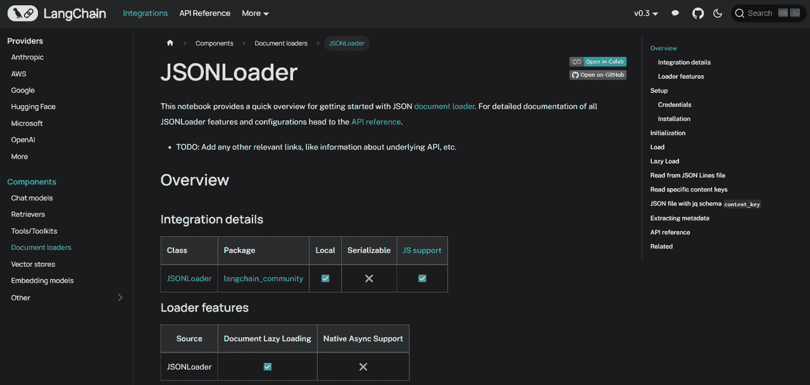

比如jq 的一个基本示例是，我们可以使用它来提取 JSON 数据中的特定字段。假设有一个 JSON 文件 example.json，内容如下：

```
  {
    &quot;employees&quot;: [
      {&quot;name&quot;: &quot;John&quot;, &quot;age&quot;: 30, &quot;city&quot;: &quot;New York&quot;},
      {&quot;name&quot;: &quot;Jane&quot;, &quot;age&quot;: 25, &quot;city&quot;: &quot;Los Angeles&quot;},
      {&quot;name&quot;: &quot;Doe&quot;, &quot;age&quot;: 28, &quot;city&quot;: &quot;Chicago&quot;}
    ]
  }
```

可以使用 jq 的命令行工具来提取所有员工的名字，命令如下：

```
  jq &#x27;.employees[].name&#x27; example.json
```

这条命令会输出：

```
  &quot;John&quot;
  &quot;Jane&quot;
  &quot;Doe&quot;
```

jq 的这些能力使其在数据处理和分析中非常有用，尤其是当处理复杂或大量的 JSON 数据时。更多的jq使用技巧，可以查阅：https://en.wikipedia.org/wiki/Jq_(programming_language)

既然JSONLoader是使用jq来解析JSON文件，所以在使用前，就必须进行jq库的安装。

```
# ! pip install jq
```

JSON有很多种存储的形式，当然对于提取信息的结构也会有很大的差别，LangChain实现的JSONLoader支持的JSON解析结构如下：

```
    class JSONLoader(BaseLoader):
        &quot;&quot;&quot;Load a `JSON` file using a `jq` schema.

        Example:
            [{&quot;text&quot;: ...}, {&quot;text&quot;: ...}, {&quot;text&quot;: ...}] -&gt; schema = .[].text
            {&quot;key&quot;: [{&quot;text&quot;: ...}, {&quot;text&quot;: ...}, {&quot;text&quot;: ...}]} -&gt; schema = .key[].text
            [&quot;&quot;, &quot;&quot;, &quot;&quot;] -&gt; schema = .[]
    &quot;&quot;&quot;
```

所以，只有当我们的JSON数据符合上述需求时，才能够正常的加载和使用JSONLoader。这里我们准备了一份K-SportsSum体育赛事摘要数据集用于测试，包含了7854个中文体育在线评论文档与对应的新闻报道，除此之外还提供了一个包含球员与球队信息的知识库。我们可以使用如下代码直接加载：

```
import json
from pathlib import Path
from pprint import pprint


file_path=&#x27;./test.json&#x27;
data = json.loads(Path(file_path).read_text(encoding=&quot;utf-8&quot;))
```

```
pprint(data[:50])
```