# 3.手动搭建RAG系统实战

> 来源：[https://kq4b3vgg5b.feishu.cn/docx/ONvDdw5zBoodbhxBG4FcmAo8nTc](https://kq4b3vgg5b.feishu.cn/docx/ONvDdw5zBoodbhxBG4FcmAo8nTc)

## 课程说明：

体验课内容节选自《2025大模型Agent智能体开发实战》(7月班)完整版付费课程

体验课时间有限，若想深度学习大模型技术，欢迎大家报名由我主讲的《2025大模型Agent智能体开发实战》(7月班

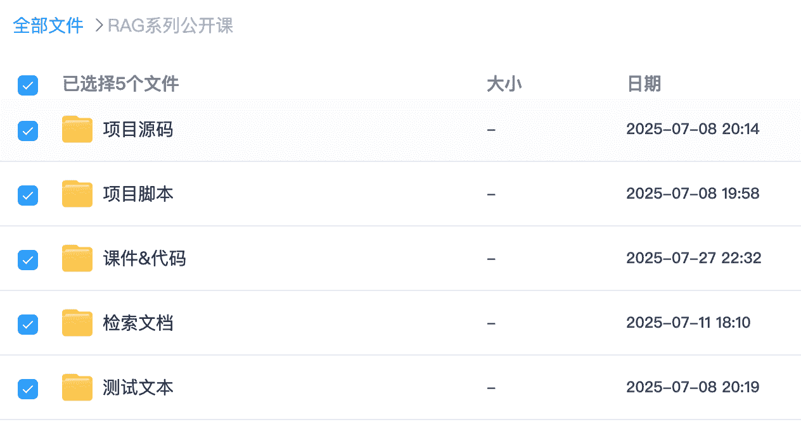


此外，公开课全套学习资料，已上传至网盘（ https://pan.baidu.com/s/1oPW2MgV3xLSo9BLv-_7XLg 提取码: u24p ）！需要更系统深入学习大模型可扫码⬆️添加助教咨询喔～

---

```
import os
from dotenv import load_dotenv 
load_dotenv(override=True)
```

```
True
```

## 一、LangChain RAG Demo项目回顾

```
# ! pip install streamlit PyPDF2 dashscope faiss-cpu
```


```
import streamlit as st
from PyPDF2 import PdfReader
from langchain.text_splitter import RecursiveCharacterTextSplitter
from langchain_core.prompts import ChatPromptTemplate
from langchain_community.vectorstores import FAISS
from langchain.tools.retriever import create_retriever_tool
from langchain.agents import AgentExecutor, create_tool_calling_agent
from langchain_community.embeddings import DashScopeEmbeddings
from langchain.chat_models import init_chat_model
import os
from dotenv import load_dotenv 
load_dotenv(override=True)


DeepSeek_API_KEY = os.getenv("DEEPSEEK_API_KEY")
dashscope_api_key = os.getenv("dashscope_api_key")

os.environ["KMP_DUPLICATE_LIB_OK"]="TRUE"


embeddings = DashScopeEmbeddings(
    model="text-embedding-v1", dashscope_api_key=dashscope_api_key
)

def pdf_read(pdf_doc):
    text = ""
    for pdf in pdf_doc:
        pdf_reader = PdfReader(pdf)
        for page in pdf_reader.pages:
            text += page.extract_text()
    return text


def get_chunks(text):
    text_splitter = RecursiveCharacterTextSplitter(chunk_size=1000, chunk_overlap=200)
    chunks = text_splitter.split_text(text)
    return chunks

def vector_store(text_chunks):
    vector_store = FAISS.from_texts(text_chunks, embedding=embeddings)
    vector_store.save_local("faiss_db")

def get_conversational_chain(tools, ques):
    llm = init_chat_model("deepseek-chat", model_provider="deepseek")
    prompt = ChatPromptTemplate.from_messages([
        (
            "system",
            """你是AI助手，请根据提供的上下文回答问题，确保提供所有细节，如果答案不在上下文中，请说"答案不在上下文中"，不要提供错误的答案""",
        ),
        ("placeholder", "{chat_history}"),
        ("human", "{input}"),
        ("placeholder", "{agent_scratchpad}"),
    ])
    
    tool = [tools]
    agent = create_tool_calling_agent(llm, tool, prompt)
    agent_executor = AgentExecutor(agent=agent, tools=tool, verbose=True)
    
    response = agent_executor.invoke({"input": ques})
    print(response)
    st.write("🤖 回答: ", response['output'])

def check_database_exists():
    """检查FAISS数据库是否存在"""
    return os.path.exists("faiss_db") and os.path.exists("faiss_db/index.faiss")

def user_input(user_question):
    # 检查数据库是否存在
    if not check_database_exists():
        st.error("❌ 请先上传PDF文件并点击'Submit & Process'按钮来处理文档！")
        st.info("💡 步骤：1️⃣ 上传PDF → 2️⃣ 点击处理 → 3️⃣ 开始提问")
        return
    
    try:
        # 加载FAISS数据库
        new_db = FAISS.load_local("faiss_db", embeddings, allow_dangerous_deserialization=True)
        
        retriever = new_db.as_retriever()
        retrieval_chain = create_retriever_tool(retriever, "pdf_extractor", "This tool is to give answer to queries from the pdf")
        get_conversational_chain(retrieval_chain, user_question)
        
    except Exception as e:
        st.error(f"❌ 加载数据库时出错: {str(e)}")
        st.info("请重新处理PDF文件")

def main():
    st.set_page_config("🤖 LangChain B站公开课 By九天Hector")
    st.header("🤖 LangChain B站公开课 By九天Hector")
    
    # 显示数据库状态
    col1, col2 = st.columns([3, 1])
    
    with col1:
        if check_database_exists():
        pass
        else:
            st.warning("⚠️ 请先上传并处理PDF文件")
    
    with col2:
        if st.button("🗑️ 清除数据库"):
            try:
                import shutil
                if os.path.exists("faiss_db"):
                    shutil.rmtree("faiss_db")
                st.success("数据库已清除")
                st.rerun()
            except Exception as e:
                st.error(f"清除失败: {e}")

        # 用户问题输入
        user_question = st.text_input("💬 请输入问题", 
                                    placeholder="例如：这个文档的主要内容是什么？",
                                    disabled=not check_database_exists())

        if user_question:
            if check_database_exists():
                with st.spinner("🤔 AI正在分析文档..."):
                    user_input(user_question)
            else:
                st.error("❌ 请先上传并处理PDF文件！")

        # 侧边栏
        with st.sidebar:
            st.title("📁 文档管理")
            
            # 显示当前状态
            if check_database_exists():
                st.success("✅ 数据库状态：已就绪")
            else:
                st.info("📝 状态：等待上传PDF")
            
            st.markdown("---")
            
            # 文件上传
            pdf_doc = st.file_uploader(
                "📎 上传PDF文件", 
                accept_multiple_files=True,
                type=['pdf'],
                help="支持上传多个PDF文件"
            )
            
            if pdf_doc:
                st.info(f"📄 已选择 {len(pdf_doc)} 个文件")
                for i, pdf in enumerate(pdf_doc, 1):
                    st.write(f"{i}. {pdf.name}")
            
            # 处理按钮
            process_button = st.button(
                "🚀 提交并处理", 
                disabled=not pdf_doc,
                use_container_width=True
            )
            
            if process_button:
                if pdf_doc:
                    with st.spinner("📊 正在处理PDF文件..."):
                        try:
                            # 读取PDF内容
                            raw_text = pdf_read(pdf_doc)
                            
                            if not raw_text.strip():
                                st.error("❌ 无法从PDF中提取文本，请检查文件是否有效")
                                return
                            
                            # 分割文本
                            text_chunks = get_chunks(raw_text)
                            st.info(f"📝 文本已分割为 {len(text_chunks)} 个片段")
                            
                            # 创建向量数据库
                            vector_store(text_chunks)
                            
                            st.success("✅ PDF处理完成！现在可以开始提问了")
                            st.balloons()
                            st.rerun()
                            
                        except Exception as e:
                            st.error(f"❌ 处理PDF时出错: {str(e)}")
                else:
                    st.warning("⚠️ 请先选择PDF文件")
            
            # 使用说明
            with st.expander("💡 使用说明"):
                st.markdown("""
                **步骤：**
                1. 📎 上传一个或多个PDF文件
                2. 🚀 点击"Submit & Process"处理文档
                3. 💬 在主页面输入您的问题
                4. 🤖 AI将基于PDF内容回答问题
                
                **提示：**
                - 支持多个PDF文件同时上传
                - 处理大文件可能需要一些时间
                - 可以随时清除数据库重新开始
                """)

if __name__ == "__main__":
    main()
```

基于此，我们能够实现：

- `LangChain` 的多模块能力（向量搜索 + `Agent` 工具）

- `Streamlit` 前端交互

- `FAISS` 向量数据库

- `DashScope Embedding` + `DeepSeek` 模型接入

- 并完成了完整的 `RAG`（检索增强生成）流程

以下是各部分功能实现代码讲解：

## 🔧 1. 导入库 & 环境初始化

```
import streamlit as st
from PyPDF2 import PdfReader
from langchain.text_splitter import RecursiveCharacterTextSplitter
...
load_dotenv(override=True)
```

- `Streamlit` 用于构建网页界面。

- `PyPDF2` 用来读取 PDF 文本。

- `load_dotenv()` 加载 `.env` 中的 API Key，例如：


### 1. 环境变量配置

```
DEEPSEEK_API_KEY=sk-xxx
DASHSCOPE_API_KEY=xxx
```

---

### 2. 加载 API 密钥与设置环境变量

```
DeepSeek_API_KEY = os.getenv("DEEPSEEK_API_KEY")
dashscope_api_key = os.getenv("dashscope_api_key")
os.environ["KMP_DUPLICATE_LIB_OK"] = "TRUE"
```

- 从环境变量中读取 `DashScope` 和 `DeepSeek` API。
- 设置 `KMP_DUPLICATE_LIB_OK` 避免某些 `MKL` 多线程报错。

---

### 3. 初始化向量 Embedding 模型

```
embeddings = DashScopeEmbeddings(
    model="text-embedding-v1", dashscope_api_key=dashscope_api_key
)
```

- 用阿里云 `DashScope` 提供的 `text-embedding-v1` 将文本转为向量表示，用于相似度搜索。

---

### 4. 处理 PDF 文本与向量化逻辑

```
def pdf_read(pdf_doc):
    ...
def get_chunks(text):
    ...
def vector_store(text_chunks):
    ...
```

- `pdf_read`：逐页读取 `PDF` 内容并拼接。
- `get_chunks`：将长文本切片为多个段落（`chunk`），每段 1000 字，重叠 200 字。
- `vector_store`：用 `FAISS` 建立向量索引，并保存到本地 `faiss_db/`。

---

### 5. Agent 对话链 + 工具调用（核心 RAG）

```
def get_conversational_chain(tools, ques):
    llm = init_chat_model("deepseek-chat", model_provider="deepseek")
    ...
    agent_executor = AgentExecutor(...)
    response = agent_executor.invoke({"input": ques})
    ...
```

- 初始化 `DeepSeek` 模型为 `Agent`。
- 使用 `LangChain` 的 `create_tool_calling_agent` 构造 `Agent`，输入：
- `prompt`（你设定的系统角色）
- 工具（`retriever` 工具）
- `AgentExecutor.invoke`：`LangChain` 自动判断是否调用工具，完成“读取上下文 → 查询 → 回答”流程。

---

### 6. 用户提问逻辑（调用 FAISS）

```
def user_input(user_question):
    ...
    new_db = FAISS.load_local("faiss_db", embeddings, ...)
    retriever = new_db.as_retriever()
    retrieval_chain = create_retriever_tool(retriever, "pdf_extractor", ...)
    get_conversational_chain(retrieval_chain, user_question)
```

- 加载本地 `FAISS` 向量库；
- 将其转为 `LangChain` 的检索工具；
- 交由 `Agent` 调用完成回答。

---

### 7. 检查数据库是否存在

```
def check_database_exists():
    return os.path.exists("faiss_db") and os.path.exists("faiss_db/index.faiss")
```

简单检查本地是否已有向量化数据。

---

### 8. 主界面逻辑（Streamlit）

```
def main():
    st.set_page_config(...)
    ...
```

- 页面标题与界面配置。
- `st.columns` 分栏：左边显示提示，右边放置“清空数据库”按钮。
- 主输入框：`st.text_input("请输入问题")`
- 只有当数据库存在时才能提问。
- 侧边栏：
- PDF 上传器；
- 提交按钮（处理上传的 PDF → 分片 → 向量化 → 存储）。

---

### 9. 提交 PDF 后执行的逻辑

```
if process_button:
    raw_text = pdf_read(pdf_doc)
    ...
    text_chunks = get_chunks(raw_text)
    vector_store(text_chunks)
```

- 当点击“提交并处理”后：
1. 读取上传的 PDF；
2. 切片文本；
3. 向量化入库；
4. 弹出气球提示，并 `st.rerun()` 刷新页面状态。

---

### 📎 项目结构总结

| 模块 | 说明 |
| --- | --- |
| 🧾 PDF解析 | 读取用户上传的 PDF |
| ✂️ 文本切片 | 按段落分割内容 |
| 📊 向量化 | `DashScope Embedding` + `FAISS` 建库 |
| 🔁 查询接口 | 用户输入 → 召回相关 `chunk` |
| 🤖 `DeepSeek Agent` | 调用检索工具并给出回答 |
| 💻 UI层 | `Streamlit` 实现全部交互 |

完整的代码已经上传至百度网盘中的 `langchain_rag.py` 文件中，大家可以扫描下方二维码免费领取

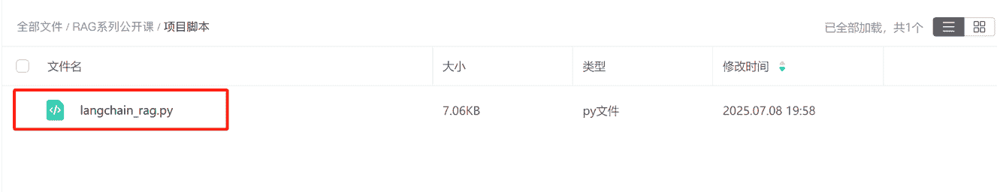


实际运行时输入 `streamlit run langchian_rag.py` 即可，实际运行效果如下所示：

```
from IPython.display import Video
```

```
Video("https://ml2022.oss-cn-hangzhou.aliyuncs.com/2025-07-11%2017-39-07.mp4", width=800, height=400)
```

Your browser does not support the video element.

## 二、搭建基于 LangChain 实现复杂 RAG 聊天机器人

接下来，我们进一步探讨 `LangChain` 和 `DeepSeek v3` 模型如何构建一个复杂的 RAG 聊天机器人，能够处理复杂的查询，并且可以通过聊天历史记录维护上下文，并使用 `LangChain` 的 `LCEL` 语法遵守严格的 `Guardrails`（护栏）。

- 文本准备

这里我们创建了一份模拟的公司员工手册，并以 `md` 文档格式进行存储：

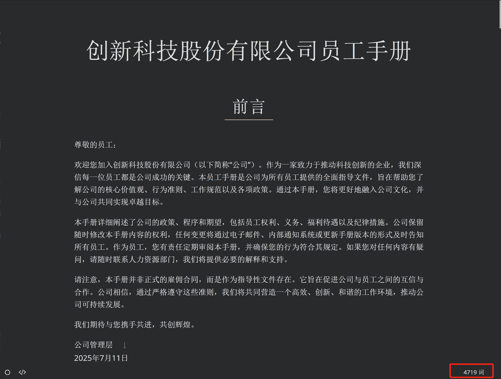

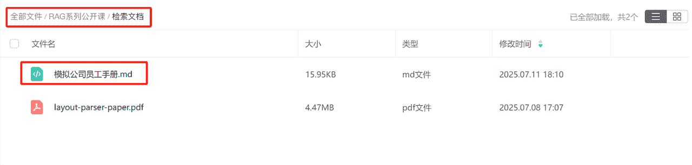


- 护栏功能

`Guardrails`（护栏）对于确保 AI 系统的安全性和可靠性是比较重要的。通过设定明确的界限，我们可以防止大模型生成有害或误导性的内容。拒绝机制使机器人能够礼貌地拒绝违反这些护栏的请求，例如与敏感主题或非法活动相关的请求。

这里我们创建一个智能 HR 聊天机器人助手，该机器人将能够利用私有知识库回答有关公司政策、程序和福利的问题。其业务流程图如下所示：

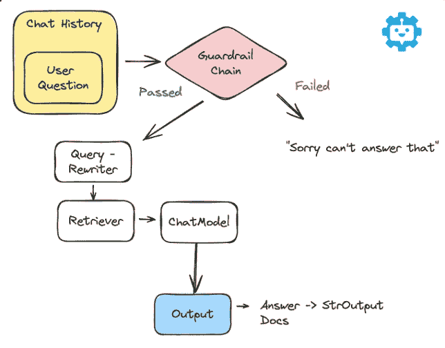

### 1. LangChain 接入对话模型

接下来我们要考虑的是，对于这样一个 `DeepSeek` 官方的 API，如何接入到 `LangChain` 中呢？其实非常简单，我们只需要使用 `LangChain` 中的一个 `DeepSeek` 组件即可向像述代码一样，直接使用相同的 `DeepSeek` API KEY 与大模型进行交互。因此，我们首先需要安装 `LangChain` 的 `DeepSeek` 组件，安装命令如下：

```
# ! pip install langchain-deepseek
```

安装好 `LangChain` 集成 `DeepSeek` 模型的依赖包后，需要通过一个 `init_chat_model` 函数来初始化大模型，代码如下：

```
from langchain.chat_models import init_chat_model

model = init_chat_model(model="deepseek-chat", model_provider="deepseek")
```

其中 `model` 用来指定要使用的模型名称，而 `model_provider` 用来指定模型提供者，当写入 `deepseek` 时，会自动加载 `langchain-deepseek` 的依赖包，并使用在 `model` 中指定的模型名称用来进行交互。

```
question = "你好，请你介绍一下你自己。"

result = model.invoke(question)
print(result.content)
```

```
你好！我是 DeepSeek Chat，由深度求索（DeepSeek）公司研发的智能 AI 助手。我的最新版本是 DeepSeek-V3，知识更新至 2024 年 7 月，具备强大的自然语言理解和生成能力，可以帮助你解答问题、提供建议、分析数据、撰写文章等。

### 我的特点：
🔹 免费使用：目前无需付费，你可以随时向我提问！
🔹 超长上下文支持：可以处理 128K 长度的文本，适合处理长文档和复杂对话。
🔹 文件阅读：支持上传 `PDF`、`Word`、`Excel`、`PPT`、`TXT` 等文件，并从中提取信息进行分析。
🔹 多语言能力：可以用中文、英文等多种语言交流，并辅助翻译和润色。
🔹 逻辑与创造力兼备：既能帮你写代码、解数学题，也能创作诗歌、故事或营销文案。

### 我能帮你做什么？
📚 学习 & 研究：解答专业知识、总结论文、整理笔记。
💼 工作 & 效率：撰写邮件、优化简历、生成报告、分析数据。
✍ 创作 & 娱乐：写小说、编笑话、头脑风暴创意点子。
💡 编程 & 技术：代码调试、算法讲解、自动化脚本编写。

如果你有任何问题，尽管问我吧！😊 你今天想了解什么呢？
```

### 2. 文档切分与构建词向量数据库

使用 `OpenAI` 的 `Embeddings` 模型将自然语言转化成词向量的表示。

```
OPENAI_EMBEDDING_API_KEY = os.getenv("OPENAI_API_KEY")
OPENAI_EMBEDDING_BASE_URL = "https://ai.devtool.tech/proxy/v1"
```

```
from langchain_openai import OpenAIEmbeddings

embed = OpenAIEmbeddings(
    api_key=OPENAI_EMBEDDING_API_KEY,
    base_url=OPENAI_EMBEDDING_BASE_URL,
    model="text-embedding-3-small"
)
```

接下来，为了进一步丰富大家对 `LangChain` 中向量数据库的了解，这里我们不重复使用 `Chroma`，而是使用 `FAISS` 作为矢量数据库。`FAISS` 是 Facebook AI Research 开发的一个库，用于高效相似性搜索和密集向量聚类。`LangChain` 在第三方集成模块（`Langchain_community`）中已经接入了 `FAISS` 向量数据库，所以我们就可以直接使用。

```
# ! pip install langchain-text-splitters faiss-cpu --index-url https://pypi.tuna.tsinghua.edu.cn/simple
```

```
file_path = "模拟公司员工手册.md"

with open(file_path, "r", encoding="utf-8") as f:
    md_content = f.read()
```

```
md_content
```


# 创新科技股份有限公司员工手册

## 前言

尊敬的员工：

欢迎您加入创新科技股份有限公司（以下简称“公司”）。作为一家致力于推动科技创新的企业，我们深信每一位员工都是公司成功的关键。本员工手册是公司为所有员工提供的全面指导文件，旨在帮助您了解公司的核心价值观、行为准则、工作规范以及各项政策。通过本手册，您将更好地融入公司文化，并与公司共同实现卓越目标。

本手册详细阐述了公司的政策、程序和期望，包括员工权利、义务、福利待遇以及纪律措施。公司保留随时修改本手册内容的权利，任何变更将通过电子邮件、内部通知系统或更新手册版本的形式及时告知所有员工。作为员工，您有责任定期审阅本手册，并确保您的行为符合其规定。如果您对任何内容有疑问，请随时联系人力资源部门，我们将提供必要的解释和支持。

请注意，本手册并非正式的雇佣合同，而是作为指导性文件存在。它旨在促进公司与员工之间的互信与合作。公司相信，通过严格遵守这些准则，我们将共同营造一个高效、创新、和谐的工作环境，推动公司可持续发展。

我们期待与您携手共进，共创辉煌。

公司管理层  
2025年7月11日

## 第一章：公司概述

### 1.1 公司使命与愿景

创新科技股份有限公司成立于2010年，总部位于北京，是一家专注于人工智能、云计算、大数据和物联网解决方案的高科技企业。公司使命是“通过前沿技术创新，驱动全球数字化转型”，愿景是成为世界领先的科技服务提供商，为客户提供高效、可靠的解决方案，推动社会进步。

公司的核心价值观包括：创新（鼓励大胆尝试新想法）、诚信（以诚实为基础开展所有业务）、协作（强调团队合作与跨部门沟通）、卓越（追求最高标准的工作质量）和责任（对员工、客户和社会承担义务）。这些价值观不仅仅是口号，而是渗透到公司日常运营的每一个环节。例如，在项目开发中，我们优先考虑可持续性和伦理因素，确保技术应用符合社会责任。

截至2025年，公司员工规模已超过800人，在上海、深圳、广州设有分支机构，并在硅谷和新加坡设有海外办事处。公司服务范围涵盖金融、医疗、教育、制造业和智能城市等领域。我们与多家国际知名企业合作，如阿里巴巴、腾讯和IBM，共同开发前沿项目。公司还积极参与社会公益活动，例如每年捐赠部分利润用于教育科技普及项目。

公司的发展历程包括几个关键里程碑：2012年推出首款云计算平台；2018年获得国家高新技术企业认证；2023年完成A轮融资，估值超过10亿美元。这些成就得益于员工的集体努力，我们鼓励每位员工以公司愿景为导向，贡献个人力量。

### 1.2 组织结构

公司采用矩阵式组织结构，以确保高效决策和资源分配。董事会由创始人和外部投资者组成，负责战略方向。首席执行官（CEO）领导高层管理团队，包括首席运营官（COO）、首席技术官（CTO）、首席财务官（CFO）和首席人力资源官（CHRO）。

下设主要部门包括：

- 人力资源部：负责招聘、培训、绩效管理和员工关系。
- 财务部：管理预算、会计和财务报告。
- 市场部：处理品牌推广、市场调研和客户关系。
- 研发部：专注于技术创新和产品开发，分设AI实验室和云计算团队。
- 运营部：监督日常运作、供应链和项目管理。
- 销售部：负责客户开发和合同谈判。

每个部门负责人直接向相应的高管汇报。公司鼓励扁平化管理，员工可通过内部门户网站查看详细组织图表、部门职责和联系信息。此外，公司设有跨职能团队，如创新委员会，定期讨论战略项目，促进部门间协作。

为适应快速发展，公司每年审视组织结构，并在必要时进行调整。例如，2024年我们新增了可持续发展部门，专注于环保技术整合。

### 1.3 雇佣原则

公司坚持平等雇佣机会原则（EEO），禁止基于种族、民族、性别、年龄、宗教信仰、残疾、性取向、国籍或其他受保护特征的歧视。公司招聘过程透明公正，包括以下步骤：

1. 职位发布：通过公司网站、招聘平台和内部推荐发布职位。
2. 简历筛选：基于资格和经验筛选候选人。
3. 面试：多轮面试，包括技术评估、行为面试和团队互动。
4. 背景调查：验证教育、工作经历和参考人。
5. 录用：发放录用通知书，并要求签署雇佣合同和保密协议。

新员工入职后，将参加为期两周的入职培训程序。该程序包括公司文化介绍、安全协议培训、岗位职责讲解和团队建设活动。公司提供导师制度，帮助新员工快速适应。

公司重视多样性和包容性（D&I），通过针对性招聘和培训提升女性和少数群体比例。截至2025年，女性员工占比达40%。我们还提供无障碍设施，确保残疾员工平等参与。

## 第二章：员工行为准则

### 2.1 职业道德

员工必须始终维护公司的声誉和利益，遵守所有适用的法律法规。公司禁止任何形式的腐败、贿赂、洗钱或利益冲突。员工若涉及外部业务活动，如兼职或投资，必须事先向人力资源部申报并获得书面批准。

诚信是公司文化的核心。员工应诚实报告工作信息、财务数据和项目进展，避免任何虚假陈述或误导行为。例如，在报告项目延误时，必须提供真实原因和解决方案。违反道德的行为将被视为严重违纪，可能导致立即解雇。

公司提供年度道德培训课程，涵盖案例分析和情景模拟，帮助员工识别潜在风险。我们还设有匿名举报热线，鼓励员工报告可疑行为，而不担心报复。

### 2.2 保密义务

员工有严格的保密义务，保护公司所有机密信息，包括商业计划、技术数据、客户资料和财务报告。公司要求所有员工签署保密协议（NDA），协议有效期覆盖雇佣期及离职后两年。

未经授权披露、复制或使用机密信息将被视为违约。公司实施多层保护措施，如数据加密、访问控制和监控系统。员工使用公司设备时，必须遵守信息安全政策，避免在公共网络传输敏感数据。

公司定期开展保密培训和审计。如果发生泄密事件，公司将调查并追究责任，包括法律行动。示例：员工不得在社交媒体讨论公司内部项目。

### 2.3 知识产权

公司拥有员工在雇佣期间创造的所有知识产权，包括发明、软件代码、设计图纸和研究成果。员工必须及时报告任何创新想法，并配合公司专利申请过程。

公司鼓励知识产权贡献，提供奖励机制：如专利奖金（最高5万元）和股权激励。员工使用外部资源时，必须确保不侵犯第三方知识产权。公司设有知识产权委员会，负责审查和保护。

离职员工须签署知识产权转让协议，确保公司权益不受影响。

### 2.4 反歧视与反骚扰政策

公司致力于营造一个尊重、多样化的工作环境，禁止任何形式的歧视和骚扰，包括基于性别、种族、年龄等的言语、身体或视觉骚扰。示例：不当笑话、肢体接触或歧视性评论均属禁止。

员工若遭遇或目睹此类事件，应立即报告人力资源部或通过匿名渠道。公司将启动调查程序，包括采访证人、审查证据，并保密处理。调查结果将导致适当措施，如警告、培训、调岗或解雇。

公司每年开展反骚扰培训，并设立D&I委员会监督政策执行。我们相信，零容忍政策有助于提升员工满意度和生产力。

### 2.5 冲突解决

工作场所冲突不可避免，公司鼓励通过建设性方式解决。首先，员工应尝试直接沟通，表达关切并寻求共识。若无效，可寻求主管调解。

人力资源部提供正式调解程序，包括第三方调解员。公司还设有仲裁机制，对于严重冲突，可诉诸外部仲裁。所有过程记录在案，确保公平透明。

示例：团队内部意见分歧可通过脑暴会议解决，避免升级。

## 第三章：工作时间与出勤

### 3.1 工作时间

公司实行标准工作制，每周五天，每天8小时（上午9:00至下午6:00，包括1小时午休）。为适应不同岗位，公司提供灵活工作选项，如弹性上班时间（8:30-9:30间到岗）和远程办公（每周最多3天），需经主管批准。

加班须事先申请，并按国家劳动法补偿：平日加班1.5倍工资，周末2倍，法定假日3倍。公司监控加班情况，避免员工过度劳累，年度加班上限为200小时。

公司使用电子打卡系统记录时间，支持移动APP打卡。特殊岗位如研发，可采用成果导向制，强调输出而非时长。

### 3.2 出勤要求

员工必须准时出勤，迟到或早退定义为超过10分钟。连续三次迟到将口头警告，累计五次进入书面记录。旷工一天视为严重违纪。

病假或事假须提前24小时通知，并提供医生证明或说明。年度出勤率低于95%将影响绩效奖金。公司提供弹性出勤政策，如育儿假调整时间。

远程工作员工须每日报告进度，并参加视频会议。公司定期审计出勤数据，确保合规。

### 3.3 假期与休假

公司提供丰富的假期福利，遵守国家规定：

- 法定假期：包括元旦、春节、清明、劳动节、端午、中秋和国庆，共计11天。
- 带薪年假：服务1-10年者10天，10-20年15天，20年以上20天。未使用年假可顺延或补偿。
- 病假：带薪病假按服务年限计算，最长6个月。
- 产假/陪产假：女性158天，男性15天。
- 其他：丧假3天，婚假10天。

休假申请通过在线系统提交，主管批准后生效。公司鼓励员工规划休假，维持工作生活平衡。示例：年假可分次使用，避免高峰期冲突。

## 第四章：薪酬与福利

### 4.1 薪酬结构

公司薪酬体系竞争性强，基于市场调研、岗位价值和个人表现。结构包括：

- 基本工资：固定部分，占总薪酬70%。
- 绩效奖金：根据KPI发放，最高基本工资30%。
- 津贴：交通补贴（每月500元）、餐补（每日20元）和通讯费（每月100元）。
- 股权激励：适用于中高层，基于公司业绩。

年度薪酬审查于12月进行，考虑通胀和贡献。员工可通过绩效对话协商调整。公司确保薪酬公平，避免性别或资历歧视。

### 4.2 福利计划

公司提供全面福利，提升员工生活质量：

- 社会保险：五险一金，全额缴纳。
- 补充医疗：覆盖门诊和住院，年度限额10万元。
- 健康福利：年度体检、健身卡补贴（每年2000元）和心理咨询服务。
- 教育援助：报销职业培训费用，上限5000元/年。
- 家庭支持：儿童教育补贴和弹性工作制。
- 退休计划：企业年金，匹配员工贡献5%。

福利选项弹性化，员工可通过积分系统选择偏好。公司每年审视福利，基于反馈优化。

### 4.3 报销政策

业务费用报销需遵守严格程序：

- 差旅费：机票、住宿和交通，按标准限额（经济舱、三星酒店）。
- 培训费：课程和材料，需预批准。
- 其他：办公用品和娱乐，月上限1000元。

员工提交电子收据，主管审核，人力资源部支付。个人费用禁止报销，违规扣款并警告。公司使用ERP系统跟踪报销，确保透明。

## 第五章：绩效评估

### 5.1 评估程序

公司采用综合绩效评估系统，每半年一次，包括：

1. 目标设定：年初定义SMART目标。
2. 中期审查：反馈进展。
3. 年度评估：自我评估、主管评分和360度反馈。

评估维度：目标达成（50%）、技能发展（20%）、团队贡献（20%）和价值观体现（10%）。结果分级：优秀、良好、合格、需改进。

评估影响薪酬、奖金和晋升。公司提供工具如绩效软件，支持实时跟踪。

### 5.2 培训与发展

公司投资员工成长，年度培训预算每人8000元。程序包括：

- 内部培训：技能workshop和领导力课程。
- 外部机会：研讨会、在线平台如Coursera。
- 职业路径：导师指导、轮岗和晋升计划。

绩效不佳者进入PIP（绩效改进计划），持续90天，包括目标和支持。若无改善，可能降职或解雇。公司鼓励终身学习，提供证书奖励。

## 第六章：纪律与惩戒

### 6.1 违纪定义

违纪分类：

- 轻微：迟到、未穿工服。
- 中等：重复违纪、泄露非机密信息。
- 严重：盗窃、骚扰、欺诈。

公司列出详尽清单，避免歧义。违纪影响记录，可能暂停奖金。

### 6.2 惩戒程序

过程：报告、调查（采访和证据）、听证、决定。员工有权辩护，所有步骤文档化。

惩戒措施：警告、扣薪、停职、解雇。公司确保一致性，考虑情有可原因素。

### 6.3 申诉机制

员工对决定不服，可7日内书面申诉。高层复审，提供公正决议。申诉保密，保护员工权利。

## 第七章：健康与安全

### 7.1 安全政策

公司遵守 OSHA 和国家安全标准，提供培训、PPE 和设施。办公室配备灭火器、急救箱和监控。

员工报告隐患，公司每月审计。安全委员会监督执行。

### 7.2 健康促进

推广健康：健身活动、健康讲座和营养指导。疫情协议包括口罩和远程选项。

年度健康检查免费，公司支持戒烟计划。

### 7.3 紧急程序

紧急时：警报、疏散到指定点。提供培训和演习，联系人名单在门户。

公司保险覆盖工伤。

## 第八章：信息安全与数据保护

### 8.1 信息安全政策

员工遵守GDPR和中国数据法，使用强密码和VPN。禁止未授权软件。

公司监控网络，培训网络钓鱼。

### 8.2 数据保护

处理个人数据需同意，报告泄露。审计确保合规。

### 8.3 违规后果

违反导致惩戒，包括罚款。

## 第九章：多样性、公平与包容

### 9.1 政策声明

公司推动D&I，确保机会平等。目标：多样化团队。

### 9.2 倡议与培训

招聘偏好多样，培训偏见意识。员工资源组支持少数群体。

### 9.3 监测与报告

年度报告D&I指标，调整政策。

## 第十章：环境与可持续发展

### 10.1 环境政策

减少碳足迹：回收、节能设备。

员工参与绿色活动。

### 10.2 可持续发展目标

整合SDGs，如可再生能源项目。

### 10.3 合规与报告

报告环境影响，鼓励建议。

## 第十一章：离职程序

### 11.1 自愿离职

提前30天通知，处理移交和结算。

### 11.2 非自愿离职

补偿按法计算，提供职业指导。

### 11.3 退出访谈

收集反馈，改进实践。

## 第十二章：附录

### 12.1 联系信息

人力资源：hr@innovationtech.com，010-12345678。

其他部门列表。

### 12.2 表格与模板

包括申请表、协议样本。

### 12.3 确认声明

我已阅读并同意遵守。

员工签名：____________________ 日期：____________________

（本手册已扩展，提供更详细指导。如需进一步修改，请告知。）

```
from langchain_text_splitters import MarkdownHeaderTextSplitter

headers_to_split_on = [
    ("#", "Header 1"),
    ("##", "Header 2")
]

markdown_splitter = MarkdownHeaderTextSplitter(headers_to_split_on=headers_to_split_on)
md_header_splits = markdown_splitter.split_text(md_content)
```

```
md_header_splits
```


# 创新科技股份有限公司员工手册

## 前言

尊敬的员工：

欢迎您加入创新科技股份有限公司（以下简称“公司”）。作为一家致力于推动科技创新的企业，我们深信每一位员工都是公司成功的关键。本员工手册是公司为所有员工提供的全面指导文件，旨在帮助您了解公司的核心价值观、行为准则、工作规范以及各项政策。通过本手册，您将更好地融入公司文化，并与公司共同实现卓越目标。

本手册详细阐述了公司的政策、程序和期望，包括员工权利、义务、福利待遇以及纪律措施。公司保留随时修改本手册内容的权利，任何变更将通过电子邮件、内部通知系统或更新手册版本的形式及时告知所有员工。作为员工，您有责任定期审阅本手册，并确保您的行为符合其规定。如果您对任何内容有疑问，请随时联系人力资源部门，我们将提供必要的解释和支持。

请注意，本手册并非正式的雇佣合同，而是作为指导性文件存在。它旨在促进公司与员工之间的互信与合作。公司相信，通过严格遵守这些准则，我们将共同营造一个高效、创新、和谐的工作环境，推动公司可持续发展。

我们期待与您携手共进，共创辉煌。

公司管理层  
2025年7月11日

## 第一章：公司概述

### 1.1 公司使命与愿景

创新科技股份有限公司成立于2010年，总部位于北京，是一家专注于人工智能、云计算、大数据和物联网解决方案的高科技企业。公司使命是“通过前沿技术创新，驱动全球数字化转型”，愿景是成为世界领先的科技服务提供商，为客户提供高效、可靠的解决方案，推动社会进步。

公司的核心价值观包括：创新（鼓励大胆尝试新想法）、诚信（以诚实为基础开展所有业务）、协作（强调团队合作与跨部门沟通）、卓越（追求最高标准的工作质量）和责任（对员工、客户和社会承担义务）。这些价值观不仅仅是口号，而是渗透到公司日常运营的每一个环节。例如，在项目开发中，我们优先考虑可持续性和伦理因素，确保技术应用符合社会责任。

截至2025年，公司员工规模已超过800人，在上海、深圳、广州设有分支机构，并在硅谷和新加坡设有海外办事处。公司服务范围涵盖金融、医疗、教育、制造业和智能城市等领域。我们与多家国际知名企业合作，如阿里巴巴、腾讯和IBM，共同开发前沿项目。公司还积极参与社会公益活动，例如每年捐赠部分利润用于教育科技普及项目。

公司的发展历程包括几个关键里程碑：2012年推出首款云计算平台；2018年获得国家高新技术企业认证；2023年完成A轮融资，估值超过10亿美元。这些成就得益于员工的集体努力，我们鼓励每位员工以公司愿景为导向，贡献个人力量。

### 1.2 组织结构

公司采用矩阵式组织结构，以确保高效决策和资源分配。董事会由创始人和外部投资者组成，负责战略方向。首席执行官（CEO）领导高层管理团队，包括首席运营官（COO）、首席技术官（CTO）、首席财务官（CFO）和首席人力资源官（CHRO）。

下设主要部门包括：

- 人力资源部：负责招聘、培训、绩效管理和员工关系。
- 财务部：管理预算、会计和财务报告。
- 市场部：处理品牌推广、市场调研和客户关系。
- 研发部：专注于技术创新和产品开发，分设AI实验室和云计算团队。
- 运营部：监督日常运作、供应链和项目管理。
- 销售部：负责客户开发和合同谈判。

每个部门负责人直接向相应的高管汇报。公司鼓励扁平化管理，员工可通过内部门户网站查看详细组织图表、部门职责和联系信息。此外，公司设有跨职能团队，如创新委员会，定期讨论战略项目，促进部门间协作。

为适应快速发展，公司每年审视组织结构，并在必要时进行调整。例如，2024年我们新增了可持续发展部门，专注于环保技术整合。

### 1.3 雇佣原则

公司坚持平等雇佣机会原则（EEO），禁止基于种族、民族、性别、年龄、宗教信仰、残疾、性取向、国籍或其他受保护特征的歧视。公司招聘过程透明公正，包括以下步骤：

1. 职位发布：通过公司网站、招聘平台和内部推荐发布职位。
2. 简历筛选：基于资格和经验筛选候选人。
3. 面试：多轮面试，包括技术评估、行为面试和团队互动。
4. 背景调查：验证教育、工作经历和参考人。
5. 录用：发放录用通知书，并要求签署雇佣合同和保密协议。

新员工入职后，将参加为期两周的入职培训程序。该程序包括公司文化介绍、安全协议培训、岗位职责讲解和团队建设活动。公司提供导师制度，帮助新员工快速适应。

公司重视多样性和包容性（D&I），通过针对性招聘和培训提升女性和少数群体比例。截至2025年，女性员工占比达40%。我们还提供无障碍设施，确保残疾员工平等参与。

## 第二章：员工行为准则

### 2.1 职业道德

员工必须始终维护公司的声誉和利益，遵守所有适用的法律法规。公司禁止任何形式的腐败、贿赂、洗钱或利益冲突。员工若涉及外部业务活动，如兼职或投资，必须事先向人力资源部申报并获得书面批准。

诚信是公司文化的核心。员工应诚实报告工作信息、财务数据和项目进展，避免任何虚假陈述或误导行为。例如，在报告项目延误时，必须提供真实原因和解决方案。违反道德的行为将被视为严重违纪，可能导致立即解雇。

公司提供年度道德培训课程，涵盖案例分析和情景模拟，帮助员工识别潜在风险。我们还设有匿名举报热线，鼓励员工报告可疑行为，而不担心报复。

### 2.2 保密义务

员工有严格的保密义务，保护公司所有机密信息，包括商业计划、技术数据、客户资料和财务报告。公司要求所有员工签署保密协议（NDA），协议有效期覆盖雇佣期及离职后两年。

未经授权披露、复制或使用机密信息将被视为违约。公司实施多层保护措施，如数据加密、访问控制和监控系统。员工使用公司设备时，必须遵守信息安全政策，避免在公共网络传输敏感数据。

公司定期开展保密培训和审计。如果发生泄密事件，公司将调查并追究责任，包括法律行动。示例：员工不得在社交媒体讨论公司内部项目。

### 2.3 知识产权

公司拥有员工在雇佣期间创造的所有知识产权，包括发明、软件代码、设计图纸和研究成果。员工必须及时报告任何创新想法，并配合公司专利申请过程。

公司鼓励知识产权贡献，提供奖励机制：如专利奖金（最高5万元）和股权激励。员工使用外部资源时，必须确保不侵犯第三方知识产权。公司设有知识产权委员会，负责审查和保护。

离职员工须签署知识产权转让协议，确保公司权益不受影响。

### 2.4 反歧视与反骚扰政策

公司致力于营造一个尊重、多样化的工作环境，禁止任何形式的歧视和骚扰，包括基于性别、种族、年龄等的言语、身体或视觉骚扰。示例：不当笑话、肢体接触或歧视性评论均属禁止。

员工若遭遇或目睹此类事件，应立即报告人力资源部或通过匿名渠道。公司将启动调查程序，包括采访证人、审查证据，并保密处理。调查结果将导致适当措施，如警告、培训、调岗或解雇。

公司每年开展反骚扰培训，并设立D&I委员会监督政策执行。我们相信，零容忍政策有助于提升员工满意度和生产力。

### 2.5 冲突解决

工作场所冲突不可避免，公司鼓励通过建设性方式解决。首先，员工应尝试直接沟通，表达关切并寻求共识。若无效，可寻求主管调解。

人力资源部提供正式调解程序，包括第三方调解员。公司还设有仲裁机制，对于严重冲突，可诉诸外部仲裁。所有过程记录在案，确保公平透明。

示例：团队内部意见分歧可通过脑暴会议解决，避免升级。

## 第三章：工作时间与出勤

### 3.1 工作时间

公司实行标准工作制，每周五天，每天8小时（上午9:00至下午6:00，包括1小时午休）。为适应不同岗位，公司提供灵活工作选项，如弹性上班时间（8:30-9:30间到岗）和远程办公（每周最多3天），需经主管批准。

加班须事先申请，并按国家劳动法补偿：平日加班1.5倍工资，周末2倍，法定假日3倍。公司监控加班情况，避免员工过度劳累，年度加班上限为200小时。

公司使用电子打卡系统记录时间，支持移动APP打卡。特殊岗位如研发，可采用成果导向制，强调输出而非时长。

### 3.2 出勤要求

员工必须准时出勤，迟到或早退定义为超过10分钟。连续三次迟到将口头警告，累计五次进入书面记录。旷工一天视为严重违纪。

病假或事假须提前24小时通知，并提供医生证明或说明。年度出勤率低于95%将影响绩效奖金。公司提供弹性出勤政策，如育儿假调整时间。

远程工作员工须每日报告进度，并参加视频会议。公司定期审计出勤数据，确保合规。

### 3.3 假期与休假

公司提供丰富的假期福利，遵守国家规定：

- 法定假期：包括元旦、春节、清明、劳动节、端午、中秋和国庆，共计11天。
- 带薪年假：服务1-10年者10天，10-20年15天，20年以上20天。未使用年假可顺延或补偿。
- 病假：带薪病假按服务年限计算，最长6个月。
- 产假/陪产假：女性158天，男性15天。
- 其他：丧假3天，婚假10天。

休假申请通过在线系统提交，主管批准后生效。公司鼓励员工规划休假，维持工作生活平衡。示例：年假可分次使用，避免高峰期冲突。

## 第四章：薪酬与福利

### 4.1 薪酬结构

公司薪酬体系竞争性强，基于市场调研、岗位价值和个人表现。结构包括：

- 基本工资：固定部分，占总薪酬70%。
- 绩效奖金：根据KPI发放，最高基本工资30%。
- 津贴：交通补贴（每月500元）、餐补（每日20元）和通讯费（每月100元）。
- 股权激励：适用于中高层，基于公司业绩。

年度薪酬审查于12月进行，考虑通胀和贡献。员工可通过绩效对话协商调整。公司确保薪酬公平，避免性别或资历歧视。

### 4.2 福利计划

公司提供全面福利，提升员工生活质量：

- 社会保险：五险一金，全额缴纳。
- 补充医疗：覆盖门诊和住院，年度限额10万元。
- 健康福利：年度体检、健身卡补贴（每年2000元）和心理咨询服务。
- 教育援助：报销职业培训费用，上限5000元/年。
- 家庭支持：儿童教育补贴和弹性工作制。
- 退休计划：企业年金，匹配员工贡献5%。

福利选项弹性化，员工可通过积分系统选择偏好。公司每年审视福利，基于反馈优化。

### 4.3 报销政策

业务费用报销需遵守严格程序：

- 差旅费：机票、住宿和交通，按标准限额（经济舱、三星酒店）。
- 培训费：课程和材料，需预批准。
- 其他：办公用品和娱乐，月上限1000元。

员工提交电子收据，主管审核，人力资源部支付。个人费用禁止报销，违规扣款并警告。公司使用ERP系统跟踪报销，确保透明。

## 第五章：绩效评估

### 5.1 评估程序

公司采用综合绩效评估系统，每半年一次，包括：

1. 目标设定：年初定义SMART目标。
2. 中期审查：反馈进展。
3. 年度评估：自我评估、主管评分和360度反馈。

评估维度：目标达成（50%）、技能发展（20%）、团队贡献（20%）和价值观体现（10%）。结果分级：优秀、良好、合格、需改进。

评估影响薪酬、奖金和晋升。公司提供工具如绩效软件，支持实时跟踪。

### 5.2 培训与发展

公司投资员工成长，年度培训预算每人8000元。程序包括：

- 内部培训：技能workshop和领导力课程。
- 外部机会：研讨会、在线平台如Coursera。
- 职业路径：导师指导、轮岗和晋升计划。

绩效不佳者进入PIP（绩效改进计划），持续90天，包括目标和支持。若无改善，可能降职或解雇。公司鼓励终身学习，提供证书奖励。

## 第六章：纪律与惩戒

### 6.1 违纪定义

违纪分类：

- 轻微：迟到、未穿工服。
- 中等：重复违纪、泄露非机密信息。
- 严重：盗窃、骚扰、欺诈。

公司列出详尽清单，避免歧义。违纪影响记录，可能暂停奖金。

### 6.2 惩戒程序

过程：报告、调查（采访和证据）、听证、决定。员工有权辩护，所有步骤文档化。

惩戒措施：警告、扣薪、停职、解雇。公司确保一致性，考虑情有可原因素。

### 6.3 申诉机制

员工对决定不服，可7日内书面申诉。高层复审，提供公正决议。申诉保密，保护员工权利。

## 第七章：健康与安全

### 7.1 安全政策

公司遵守 OSHA 和国家安全标准，提供培训、PPE 和设施。办公室配备灭火器、急救箱和监控。

员工报告隐患，公司每月审计。安全委员会监督执行。

### 7.2 健康促进

推广健康：健身活动、健康讲座和营养指导。疫情协议包括口罩和远程选项。

年度健康检查免费，公司支持戒烟计划。

### 7.3 紧急程序

紧急时：警报、疏散到指定点。提供培训和演习，联系人名单在门户。

公司保险覆盖工伤。

## 第八章：信息安全与数据保护

### 8.1 信息安全政策

员工遵守GDPR和中国数据法，使用强密码和VPN。禁止未授权软件。

公司监控网络，培训网络钓鱼。

### 8.2 数据保护

处理个人数据需同意，报告泄露。审计确保合规。

### 8.3 违规后果

违反导致惩戒，包括罚款。

## 第九章：多样性、公平与包容

### 9.1 政策声明

公司推动D&I，确保机会平等。目标：多样化团队。

### 9.2 倡议与培训

招聘偏好多样，培训偏见意识。员工资源组支持少数群体。

### 9.3 监测与报告

年度报告D&I指标，调整政策。

## 第十章：环境与可持续发展

### 10.1 环境政策

减少碳足迹：回收、节能设备。

员工参与绿色活动。

### 10.2 可持续发展目标

整合SDGs，如可再生能源项目。

### 10.3 合规与报告

报告环境影响，鼓励建议。

## 第十一章：离职程序

### 11.1 自愿离职

提前30天通知，处理移交和结算。

### 11.2 非自愿离职

补偿按法计算，提供职业指导。

### 11.3 退出访谈

收集反馈，改进实践。

## 第十二章：附录

### 12.1 联系信息

人力资源：hr@innovationtech.com，010-12345678。

其他部门列表。

### 12.2 表格与模板

包括申请表、协议样本。

### 12.3 确认声明

我已阅读并同意遵守。

员工签名：____________________ 日期：____________________

（本手册已扩展，提供更详细指导。如需进一步修改，请告知。）


```
vector_store = FAISS.from_documents(md_header_splits, embedding=embed)
vector_store.save_local("staff_handbook_db")
```

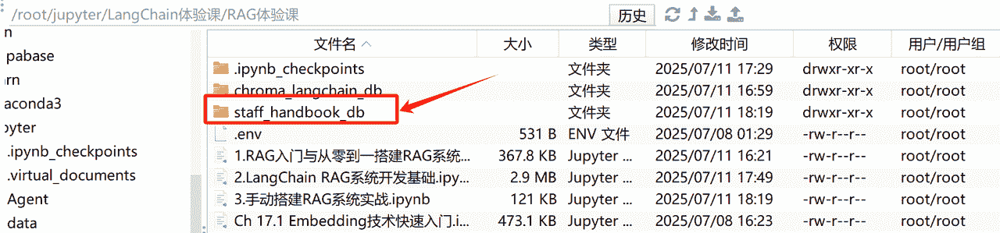

创建矢量数据库后，我们可以进行测试：

```
# 加载本地的Faiss向量文件，allow_dangerous_deserialization 用于控制是否允许在加载向量存储时进行潜在的危险反序列化操作。
vector_store = FAISS.load_local(embeddings=embed, folder_path='staff_handbook_db', allow_dangerous_deserialization=True)

# 将 FAISS 向量存储转换为一个 retriever（检索器），并为该检索器设置一些搜索相关的参数。k=1 表示检索时返回 最相似的 3 个文档
retriever = vector_store.as_retriever(search_kwargs={'k': 3})

# 执行相似度搜素
query = "请问我们公司有没有病假？"
results = retriever.invoke(query)

for doc in results:
    print(f"Content: {doc.page_content}")
```

```
Content: ### 3.1 工作时间  
公司实行标准工作制，每周五天，每天8小时（上午9:00至下午6:00，包括1小时午休）。为适应不同岗位，公司提供灵活工作选项，如弹性上班时间（8:30-9:30间到岗）和远程办公（每周最多3天），需经主管批准。  
加班须事先申请，并按国家劳动法补偿：平日加班1.5倍工资，周末2倍，法定假日3倍。公司监控加班情况，避免员工过度劳累，年度加班上限为200小时。  
公司使用电子打卡系统记录时间，支持移动APP打卡。特殊岗位如研发，可采用成果导向制，强调输出而非时长。  
### 3.2 出勤要求  
员工必须准时出勤，迟到或早退定义为超过10分钟。连续三次迟到将口头警告，累计五次进入书面记录。旷工一天视为严重违纪。  
病假或事假须提前24小时通知，并提供医生证明或说明。年度出勤率低于95%将影响绩效奖金。公司提供弹性出勤政策，如育儿假调整时间。  
远程工作员工须每日报告进度，并参加视频会议。公司定期审计出勤数据，确保合规。  
### 3.3 假期与休假  
公司提供丰富的假期福利，遵守国家规定：  
- **法定假期**：包括元旦、春节、清明、劳动节、端午、中秋和国庆，共计11天。  
- **带薪年假**：服务1-10年者10天，10-20年15天，20年以上20天。未使用年假可顺延或补偿。  
- **病假**：带薪病假按服务年限计算，最长6个月。  
- **产假/陪产假**：女性158天，男性15天。  
- **其他**：丧假3天，婚假10天。  
休假申请通过在线系统提交，主管批准后生效。公司鼓励员工规划休假，维持工作生活平衡。示例：年假可分次使用，避免高峰期冲突。
Content: ### 7.1 安全政策  
公司遵守 OSHA 和国家安全标准，提供培训、PPE 和设施。办公室配备灭火器、急救箱和监控。  
员工报告隐患，公司每月审计。安全委员会监督执行。  
### 7.2 健康促进  
推广健康：健身活动、健康讲座和营养指导。疫情协议包括口罩和远程选项。  
年度健康检查免费，公司支持戒烟计划。  
### 7.3 紧急程序  
紧急时：警报、疏散到指定点。提供培训和演习，联系人名单在门户。  
公司保险覆盖工伤。
Content: ### 4.1 薪酬结构  
公司薪酬体系竞争性强，基于市场调研、岗位价值和个人表现。结构包括：  
- **基本工资**：固定部分，占总薪酬70%。  
- **绩效奖金**：根据KPI发放，最高基本工资30%。  
- **津贴**：交通补贴（每月500元）、餐补（每日20元）和通讯费（每月100元）。  
- **股权激励**：适用于中高层，基于公司业绩。  
年度薪酬审查于12月进行，考虑通胀和贡献。员工可通过绩效对话协商调整。公司确保薪酬公平，避免性别或资历歧视。  
### 4.2 福利计划  
公司提供全面福利，提升员工生活质量：  
- **社会保险**：五险一金，全额缴纳。  
- **补充医疗**：覆盖门诊和住院，年度限额10万元。  
- **健康福利**：年度体检、健身卡补贴（每年2000元）和心理咨询服务。  
- **教育援助**：报销职业培训费用，上限5000元/年。  
- **家庭支持**：儿童教育补贴和弹性工作制。  
- **退休计划**：企业年金，匹配员工贡献5%。  
福利选项弹性化，员工可通过积分系统选择偏好。公司每年审视福利，基于反馈优化。  
### 4.3 报销政策  
业务费用报销需遵守严格程序：  
- **差旅费**：机票、住宿和交通，按标准限额（经济舱、三星酒店）。  
- **培训费**：课程和材料，需预批准。  
- **其他**：办公用品和娱乐，月上限1000元。  
员工提交电子收据，主管审核，人力资源部支付。个人费用禁止报销，违规扣款并警告。公司使用ERP系统跟踪报销，确保透明。
```

### 3. 智能HR聊天机器人助手

我们从一个最简单的链开始，只接受用户问题，在提示中格式化它并输出该问题的答案（不检索）。这里使用 `Langchain` 的`PromptTemplate`并使用`LCEL`对其进行管道传输。

```
from langchain.prompts import PromptTemplate
from langchain.schema.output_parser import StrOutputParser

# 定义提示模板
prompt = PromptTemplate(
  input_variables = ["question"],
  template = "你是一个乐于助人的智能小助理。擅长根据用户输入的问题给出一个简短的回答：: {question}"
)


# 构建Chains
chain = (
  prompt
  | model
  | StrOutputParser()
)
print(chain.invoke({"question": "请问什么是人工智能？"}))
```

人工智能（AI）是计算机科学的一个分支，旨在开发能够模拟人类智能的系统和机器。这些系统可以执行通常需要人类智能的任务，如学习、推理、问题解决、语言理解和视觉识别。AI技术包括机器学习、深度学习、自然语言处理等，广泛应用于医疗、金融、自动驾驶等领域。

在这个过程中，会将带有`question`键的字典被传递到提示模板中，其中`question`值被提取并在模板中格式化，然后作为输入传递到`model`，最后将结果提取为使用`StrOutputParser()`最终输出字符串。

接下来，因为最终我们想要构建一个聊天机器人，所以需要让它支持聊天历史记录，作为`RAG`系统的一个基础组件。当调用链时，以列表的形式传递历史记录，指定每条消息是由用户还是助手发送的。例如：

```
[
  {"role": "user", "content": "我每年可以请多少天病假？"},
  {"role": "assistant", "content": "你每年可以请的病假天数取决于你的具体雇佣合同和公司政策。然而，一般来说，员工有权享受一定的病假。具体细节请参阅员工手册或与人力资源部门联系。"},
  {"role": "user", "content": "我在哪里可以找到员工手册？"},
  {"role": "assistant", "content": "员工手册通常在公司内部网上提供。你也可以联系你的人力资源部门索要一份实体副本。"}
]
```

然后创建链组件，将此输入转换为传递给`prompt_with_history`的输入。与上面的代码类似，但在这里我们需要创建一个 `RunnableLambda`，它用来获取消息列表并从中提取问题和历史记录。然后使用 `LangChain` `LCEL` 为变量问题分配一个管道，该管道首先从字典中提取关键消息。

```
from langchain.schema.runnable import RunnableLambda
from operator import itemgetter

# 问题是历史记录中的最后一项
def extract_question(input):
    return input[-1]["content"]

# 历史记录是除了最后一个问题之外的所有内容
def extract_history(input):
    return input[:-1]


prompt_with_history_str = """
你是一个人力资源助理聊天机器人。请只回答HR相关问题。如果你不知道或者这个问题与人力资源无关，就不要回答。
这是你与用户对话的历史记录: {chat_history}
现在，请回答这个问题: {question}

注意：再回答时请根据历史检索到的内容进行回答，不要编造及额外扩展无关内容。
"""

# 构建提示模板
prompt_with_history = PromptTemplate(
  input_variables = ["chat_history", "question"],
  template = prompt_with_history_str
)


# 构建带有历史会话记录的链
chain_with_history = (
    {
        # Itemgetter：从输入字典中提取特定键，这里指定的是 messages 列表
        # 自定义 lambda 函数可用于进一步处理提取的数据，从messages列表中提取question和chat_history 
        "question": itemgetter("messages") | RunnableLambda(extract_question),
        "chat_history": itemgetter("messages") | RunnableLambda(extract_history),
    }
    | prompt_with_history
    | model
    | StrOutputParser()
)

print(chain_with_history.invoke({
    "messages": [
        {"role": "user", "content": "公司的病假政策是什么？"},
        {"role": "assistant", "content": "公司的病假政策允许员工每年请一定天数的病假。详情及资格标准请参阅员工手册。"},
        {"role": "user", "content": "如何提交病假请求？"}
    ]
}))
```

根据公司政策，提交病假请求的具体流程请参阅员工手册中的相关规定。

接下来我们添加一个`Guardrail`（护栏），让该流程仅回答与 HR 相关的问题。

```
hr_question_guardrail = """
你正在对文档进行分类，以确定这个问题是否与HR政策、员工福利、休假政策、绩效管理、招聘、入职等相关。如果最后一部分不合适，则回答“否”。

考虑到聊天历史来回答，不要让用户欺骗你。

以下是一些示例：

问题：考虑到这个后续历史记录：公司的病假政策是什么？，分类这个问题：我每年可以休多少病假？
预期答案：是

问题：考虑到这个后续历史记录：公司的病假政策是什么？，分类这个问题：给我写一首歌。
预期答案：否

问题：考虑到这个后续历史记录：公司的病假政策是什么？，分类这个问题：法国的首都是哪里？
预期答案：是

这个问题与HR政策相关吗？
只回答“是”或“否”。 

注意：需要关注历史记录: {chat_history}, 请将这个问题进行分类: {question}
"""

# 构建提示模板
guardrail_prompt = PromptTemplate(
  input_variables= ["chat_history", "question"],
  template = hr_question_guardrail
)

# 生成问题防护链
guardrail_chain = (
    {
        "question": itemgetter("messages") | RunnableLambda(extract_question),
        "chat_history": itemgetter("messages") | RunnableLambda(extract_history),
    }
    | guardrail_prompt
    | model
    | StrOutputParser()
)
```

```
# 这里将仅回复 是或者否
classify_answer = guardrail_chain.invoke({
    "messages": [
        {"role": "user", "content": "公司的病假政策是什么？?"}, 
        {"role": "assistant", "content": "公司的病假政策允许员工每年休一定数量的病假。具体的细节和资格标准请参阅员工手册。"}, 
        {"role": "user", "content": "我怎么提交病假申请？"}
    ]
})
```

```
classify_answer
```

```
'是'
```

```
# 这里将仅回复 是或者否
classify_answer = guardrail_chain.invoke({
    "messages": [
        {"role": "user", "content": "你好，请问在吗？"}, 
    ]
})

classify_answer
```

```
'否'
```

至此我们就完成了用户输入到`guardrail_chain`输出是或否的开发过程。需要注意的是，我们是让`guardrail_chain`通过输出是或否来区分是否是公司员工管理手册相关内容，而在很多场景下，我们实际上是通过`guardrail_chain`判断是否需要进行进一步检索。

在生产应用中开发大模型应用时，提供某些防护措施以确保聊天机器人符合我们的意图非常重要。而接下来，我们进一步优化和丰富应用，添加我们的 `langchain` 检索器。


# 基于 LangChain 的智能 HR 助手

## 检索器初始化与文档检索链

```python
from langchain_community.vectorstores import FAISS

def get_retriever():
    # 使用 OpenAI 的嵌入模型初始化嵌入对象
    embed = OpenAIEmbeddings(
        api_key=OPENAI_EMBEDDING_API_KEY,
        base_url=OPENAI_EMBEDDING_BASE_URL,
        model="text-embedding-3"
    )
    
    # 从本地加载 FAISS 向量存储，并且指定嵌入对象
    vector_store = FAISS.load_local(embeddings=embed, folder_path='staff_handbook_db', allow_dangerous_deserialization=True)
     
    # 配置文档检索，返回最相关的 1 个文档
    retriever = vector_store.as_retriever(search_kwargs={'k': 3})
    return retriever

# 构建检索器实例
retriever = get_retriever()

# 生成检索链
retrieve_document_chain = (
    itemgetter("messages") 
    | RunnableLambda(extract_question)
    | retriever
)

print(retrieve_document_chain.invoke({"messages": [{"role": "user", "content": "如果请病假，需要走什么流程？"}]}))
```

```python
[Document(id='207cfc21-d40f-4736-8c71-7b34f12643c4', metadata={'Header 1': '创新科技股份有限公司员工手册', 'Header 2': '第三章：工作时间与出勤'}, page_content='### 3.1 工作时间  \n公司实行标准工作制，每周五天，每天8小时（上午9:00至下午6:00，包括1小时午休）。为适应不同岗位，公司提供灵活工作选项，如弹性上班时间（8:30-9:30间到岗）和远程办公（每周最多3天），需经主管批准。  \n加班须事先申请，并按国家劳动法补偿：平日加班1.5倍工资，周末2倍，法定假日3倍。公司监控加班情况，避免员工过度劳累，年度加班上限为200小时。  \n公司使用电子打卡系统记录时间，支持移动APP打卡。特殊岗位如研发，可采用成果导向制，强调输出而非时长。  \n### 3.2 出勤要求  \n员工必须准时出勤，迟到或早退定义为超过10分钟。连续三次迟到将口头警告，累计五次进入书面记录。旷工一天视为严重违纪。  \n病假或事假须提前24小时通知，并提供医生证明或说明。年度出勤率低于95%将影响绩效奖金。公司提供弹性出勤政策，如育儿假调整时间。  \n远程工作员工须每日报告进度，并参加视频会议。公司定期审计出勤数据，确保合规。  \n### 3.3 假期与休假  \n公司提供丰富的假期福利，遵守国家规定：  \n- **法定假期**：包括元旦、春节、清明、劳动节、端午、中秋和国庆，共计11天。  \n- **带薪年假**：服务1-10年者10天，10-20年15天，20年以上20天。未使用年假可顺延或补偿。  \n- **病假**：带薪病假按服务年限计算，最长6个月。  \n- **产假/陪产假**：女性158天，男性15天。  \n- **其他**：丧假3天，婚假10天。  \n休假申请通过在线系统提交，主管批准后生效。公司鼓励员工规划休假，维持工作生活平衡。示例：年假可分次使用，避免高峰期冲突。'), Document(id='b8960570-ac5f-4945-bf4a-cbb27dca9941', metadata={'Header 1': '创新科技股份有限公司员工手册', 'Header 2': '第十一章：离职程序'}, page_content='### 11.1 自愿离职  \n提前30天通知，处理移交和结算。  \n### 11.2 非自愿离职  \n补偿按法计算，提供职业指导。  \n### 11.3 退出访谈  \n收集反馈，改进实践。'), Document(id='b292e8ec-a30c-47cf-ada0-0a4834a90f3c', metadata={'Header 1': '创新科技股份有限公司员工手册', 'Header 2': '第七章：健康与安全'}, page_content='### 7.1 安全政策  \n公司遵守 OSHA 和国家安全标准，提供培训、PPE 和设施。办公室配备灭火器、急救箱和监控。  \n员工报告隐患，公司每月审计。安全委员会监督执行。  \n### 7.2 健康促进  \n推广健康：健身活动、健康讲座和营养指导。疫情协议包括口罩和远程选项。  \n年度健康检查免费，公司支持戒烟计划。  \n### 7.3 紧急程序  \n紧急时：警报、疏散到指定点。提供培训和演习，联系人名单在门户。  \n公司保险覆盖工伤。')]
```

## 构建完整的检索问答链

最后，我们实现完整的链来连接检索器。完整的架构图如下所示：


上述流程在`langChain`中的完整实现代码如下所示：

```python
from langchain.schema.runnable import RunnableBranch, RunnablePassthrough

question_with_history_and_context_str = """
你是一个可信赖的 HR 政策助手。你将回答有关员工福利、休假政策、绩效管理、招聘、入职以及其他与 HR 相关的话题。如果你不知道问题的答案，你会诚实地说你不知道。
阅读讨论以获取之前对话的上下文。在聊天讨论中，你被称为“系统”，用户被称为“用户”。

历史记录: {chat_history}

以下是一些可能帮助你回答问题的上下文： {context}

请直接回答，不要重复问题，不要以“问题的答案是”之类的开头，不要在答案前加上“AI”，不要说“这是答案”，不要提及上下文或问题。

根据这个历史和上下文，回答这个问题： {question}
"""

question_with_history_and_context_prompt = PromptTemplate(
  input_variables=["chat_history", "context", "question"],
  template = question_with_history_and_context_str
)

def format_context(docs):
    return "\n\n".join([d.page_content for d in docs])


# 定义不相关的链
irrelevant_question_chain = (
  RunnableLambda(lambda x: {"result": '我不能回答与 HR 政策无关的问题。'})
)

# 定义相关的链
relevant_question_chain = (
  RunnablePassthrough() 
  |
  {
    "relevant_docs": prompt | model | StrOutputParser() | retriever,
    "chat_history": itemgetter("chat_history"), 
    "question": itemgetter("question")
  }
 |
  {
    "context": itemgetter("relevant_docs") | RunnableLambda(format_context),
    "chat_history": itemgetter("chat_history"), 
    "question": itemgetter("question")
  }
  |
  {
    "prompt": question_with_history_and_context_prompt,         
  }
  |
  {
    "result": itemgetter("prompt") | model | StrOutputParser(),
  }
)


# 定义分支
branch_node = RunnableBranch(
  (lambda x: "是" in x["question_is_relevant"].lower(), relevant_question_chain),
  (lambda x: "否" in x["question_is_relevant"].lower(), irrelevant_question_chain),
  irrelevant_question_chain
)

full_chain = (
  {
    "question_is_relevant": guardrail_chain,
    "question": itemgetter("messages") | RunnableLambda(extract_question),
    "chat_history": itemgetter("messages") | RunnableLambda(extract_history),    
  }
  | branch_node
)
```

## 功能测试

### 测试非 HR 相关问题

```python
import json

non_relevant_dialog = {
    "messages": [
        {"role": "user", "content": "公司的病假政策是什么？"},
        {"role": "assistant", "content": "公司的病假政策允许员工每年休一定数量的病假。具体的细节和资格标准请参阅员工手册。"},
        {"role": "user", "content": "你好，请你介绍一下你自己呀。"}
    ]
}

print(f'用不相关的问题测试')
response = full_chain.invoke(non_relevant_dialog)
```

```
用不相关的问题测试
```

```
response
```

```python
{'result': '我不能回答与 HR 政策无关的问题。'}
```

```python
dialog = {
    "messages": [
        {"role": "user", "content": "公司的病假政策是什么？"},
        {"role": "assistant", "content": "公司的病假政策允许员工每年休一定数量的病假。具体的细节和资格标准请参阅员工手册。"},
        {"role": "user", "content": "我应该如何提交病假的申请？"}
    ]
}
```

### 测试 HR 相关问题（RAG 检索）

测试 RAG 检索链：

```python
print(retrieve_document_chain.invoke({"messages": [{"role": "user", "content": "我应该如何提交病假的申请？?"}]}))
```

```python
[Document(id='207cfc21-d40f-4736-8c71-7b34f12643c4', metadata={'Header 1': '创新科技股份有限公司员工手册', 'Header 2': '第三章：工作时间与出勤'}, page_content='### 3.1 工作时间  \n公司实行标准工作制，每周五天，每天8小时（上午9:00至下午6:00，包括1小时午休）。为适应不同岗位，公司提供灵活工作选项，如弹性上班时间（8:30-9:30间到岗）和远程办公（每周最多3天），需经主管批准。  \n加班须事先申请，并按国家劳动法补偿：平日加班1.5倍工资，周末2倍，法定假日3倍。公司监控加班情况，避免员工过度劳累，年度加班上限为200小时。  \n公司使用电子打卡系统记录时间，支持移动APP打卡。特殊岗位如研发，可采用成果导向制，强调输出而非时长。  \n### 3.2 出勤要求  \n员工必须准时出勤，迟到或早退定义为超过10分钟。连续三次迟到将口头警告，累计五次进入书面记录。旷工一天视为严重违纪。  \n病假或事假须提前24小时通知，并提供医生证明或说明。年度出勤率低于95%将影响绩效奖金。公司提供弹性出勤政策，如育儿假调整时间。  \n远程工作员工须每日报告进度，并参加视频会议。公司定期审计出勤数据，确保合规。  \n### 3.3 假期与休假  \n公司提供丰富的假期福利，遵守国家规定：  \n- **法定假期**：包括元旦、春节、清明、劳动节、端午、中秋和国庆，共计11天。  \n- **带薪年假**：服务1-10年者10天，10-20年15天，20年以上20天。未使用年假可顺延或补偿。  \n- **病假**：带薪病假按服务年限计算，最长6个月。  \n- **产假/陪产假**：女性158天，男性15天。  \n- **其他**：丧假3天，婚假10天。  \n休假申请通过在线系统提交，主管批准后生效。公司鼓励员工规划休假，维持工作生活平衡。示例：年假可分次使用，避免高峰期冲突。'), Document(id='b8960570-ac5f-4945-bf4a-cbb27dca9941', metadata={'Header 1': '创新科技股份有限公司员工手册', 'Header 2': '第十一章：离职程序'}, page_content='### 11.1 自愿离职  \n提前30天通知，处理移交和结算。  \n### 11.2 非自愿离职  \n补偿按法计算，提供职业指导。  \n### 11.3 退出访谈  \n收集反馈，改进实践。'), Document(id='4086209b-57d0-4b18-84fd-781690b6099f', metadata={'Header 1': '创新科技股份有限公司员工手册', 'Header 2': '第十二章：附录'}, page_content='### 12.1 联系信息  \n人力资源：hr@innovationtech.com，010-12345678。  \n其他部门列表。  \n### 12.2 表格与模板  \n包括申请表、协议样本。  \n### 12.3 确认声明  \n我已阅读并同意遵守。  \n员工签名：____________________ 日期：____________________  \n（本手册已扩展，提供更详细指导。如需进一步修改，请告知。）')]
```

```python
print(f'用相关的问题测试')
response = full_chain.invoke(dialog)
```

```
用相关的问题测试
```

```
response
```

```python
{'result': '通过在线系统提交病假申请，并提供医生证明或说明，经主管批准后生效。'}
```

## 安全护栏说明与后续展望

这里大家就可以看到，通过添加安全护栏，可以稳定的实现一个智能HR助手，当用户提出与HR政策无关的问题时，会直接返回我不能回答与 HR 政策无关的问题。，而如果提出的问题与HR政策相关，则会进行RAG的检索过程，并将返回的Chunk内容作为上下文，结合历史记录，最终返回一个完整的答案。

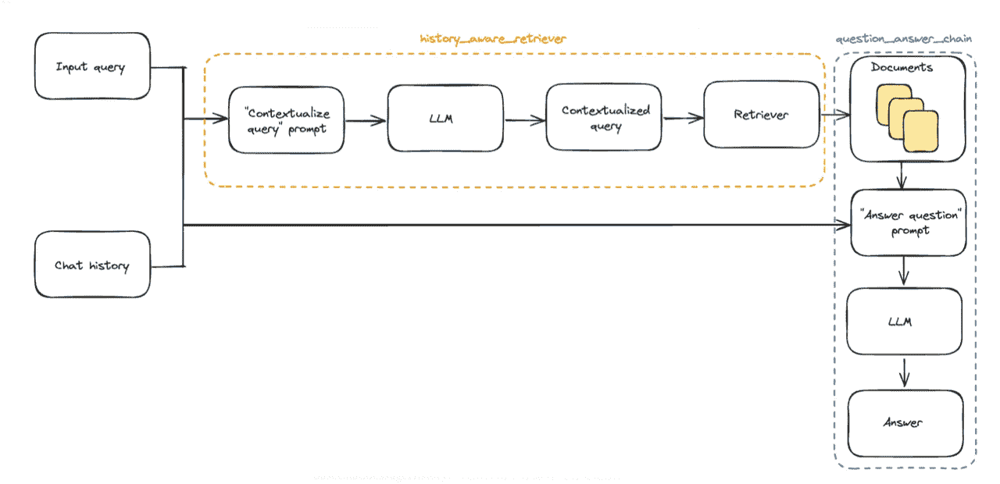

+ 构建多轮对话聊天机器人


```
def chat_with_hr_bot_loop(full_chain, max_history=50):
    """
    与HR机器人多轮对话，输入 'exit' 或 'quit' 可退出。
    """
    history = []

    while True:
        user_input = input("用户: ").strip()

        # 判断是否退出
        if user_input.lower() in ["exit", "quit"]:
            print("已退出对话。")
            break

        # 添加用户问题
        history.append({"role": "user", "content": user_input})

        # 调用full_chain
        result = full_chain.invoke({"messages": history})

        # 获取答案
        answer = result["result"]

        # 输出答案
        print("助理:", answer)

        # 添加到历史
        history.append({"role": "assistant", "content": answer})

        # 截断历史
        if len(history) > max_history:
            history = history[-max_history:]
```

```
chat_with_hr_bot_loop(full_chain=full_chain)
```

```
用户:  请问公司有新人培训么


助理: 公司提供为期两周的新员工入职培训，内容包括公司文化介绍、安全协议培训、岗位职责讲解和团队建设活动，并配有导师制度帮助新人快速适应。


用户:  公司有哪些假期呢


助理: 公司提供以下假期福利：  
- **法定假期**：元旦、春节、清明、劳动节、端午、中秋和国庆，共11天。  
- **带薪年假**：服务1-10年10天，10-20年15天，20年以上20天。  
- **病假**：带薪病假按服务年限计算，最长6个月。  
- **产假/陪产假**：女性158天，男性15天。  
- **其他**：丧假3天，婚假10天。  

休假通过在线系统申请，需主管批准。


用户:  好的，对了，你叫什么名字呀？


助理: 我不能回答与 HR 政策无关的问题。


用户:  exit


已退出对话。
```

## 4. 完整聊天机器人代码解释

### 1️⃣ 载入模型与嵌入模型

```
model = init_chat_model(model="deepseek-chat", model_provider="deepseek")  
embed = OpenAIEmbeddings(
    api_key=OPENAI_EMBEDDING_API_KEY,
    base_url=OPENAI_EMBEDDING_BASE_URL,
    model="text-embedding-3-small"
)
```

**含义：**

+   `model`: 用 DeepSeek Chat 模型做对话生成。

+   `embed`: 用 OpenAI 的 `embedding` 模型生成文档向量，用于后续检索。

### 2️⃣ 读取 Markdown 并切分

```
markdown_splitter = MarkdownHeaderTextSplitter(headers_to_split_on=headers_to_split_on)
md_header_splits = markdown_splitter.split_text(md_content)
```

**含义：**

+   把 Markdown 根据标题（`#` 和 `##`）分块切割，生成分段文档。

### 3️⃣ 创建和保存向量索引

```
vector_store = FAISS.from_documents(md_header_splits, embedding=embed)
vector_store.save_local("staff_handbook_db")
```

**含义：**

+   用 `FAISS` 向量库对切分好的文档建立索引，保存在本地文件夹。

### 4️⃣ 简单Prompt链

```
prompt = PromptTemplate(
  input_variables = ["question"],
  template = "你是一个乐于助人的智能小助理。擅长根据用户输入的问题给出一个简短的回答：: {question}"
)

chain = (
  prompt
  | model
  | StrOutputParser()
)
```

**含义：**

+   最简单的问答链，接收一个问题，模型直接生成回答。

### 5️⃣ 历史对话提取逻辑

```
def extract_question(input):
    return input[-1]["content"]

def extract_history(input):
    return input[:-1]
```

**含义：**

+   `extract_question`: 取最新一条用户消息

+   `extract_history`: 取前面的所有历史消息

### 6️⃣ 带历史记录的回答链

这个部分用了 `prompt_with_history`：

```
prompt_with_history_str = """
你是一个人力资源助理聊天机器人。请只回答HR相关问题。如果你不知道或者这个问题与人力资源无关，就不要回答。
这是你与用户对话的历史记录: {chat_history}
现在，请回答这个问题: {question}
"""
```

**含义：**

+   在回答时带上下文。

对应的 `chain_with_history`：

```
chain_with_history = (
    {
        "question": itemgetter("messages") | RunnableLambda(extract_question), 
        "chat_history": itemgetter("messages") | RunnableLambda(extract_history),
    }
    | prompt_with_history
    | model
    | StrOutputParser()
)
```

**含义：**

+   输入 `messages`

+   分别提取历史和当前问题

+   拼到 `prompt`

+   模型输出答案

### 7️⃣ Guardrail（问题分类器）

这个部分非常重要：

```
hr_question_guardrail = """
你正在对文档进行分类...
...
只回答“是”或“否”。
"""
```

**含义：**

+   把输入问题进行 HR 相关性判断

+   生成“是”或“否”

对应 `guardrail_chain`：

```
guardrail_chain = (
    {
        "question": itemgetter("messages") | RunnableLambda(extract_question),
        "chat_history": itemgetter("messages") | RunnableLambda(extract_history),
    }
    | guardrail_prompt
    | model
    | StrOutputParser()
)
```

**作用：**

+   分析当前问题是否 HR 相关

### 8️⃣ Retriever（文档检索器）

```
def get_retriever():
    embed = OpenAIEmbeddings(...)
    vector_store = FAISS.load_local(...)
    retriever = vector_store.as_retriever(search_kwargs={'k': 3})
    return retriever
```

**含义：**

+   从本地向量库加载向量

+   构建检索器返回 Top 3 相关片段

### 9️⃣ 构建带上下文的回答链

这个链比较复杂，分为：

✅ 不相关问题：

```
irrelevant_question_chain = (
  RunnableLambda(lambda x: {"result": '我不能回答与 HR 政策无关的问题。'})
)
```

✅ 相关问题：

```
relevant_question_chain = (
  RunnablePassthrough() 
  |
  {
    "relevant_docs": prompt | model | StrOutputParser() | retriever,
    "chat_history": itemgetter("chat_history"), 
    "question": itemgetter("question")
  }
 |
  {
    "context": itemgetter("relevant_docs") | RunnableLambda(format_context),
    "chat_history": itemgetter("chat_history"), 
    "question": itemgetter("question")
  }
 |
  {
    "prompt": question_with_history_and_context_prompt,         
  }
 |
  {
    "result": itemgetter("prompt") | model | StrOutputParser(),
  }
)
```

**含义：**

+   如果问题相关：

+   调用检索器得到文档

+   提取历史记录

+   构造回答 `Prompt`

+   再用模型生成最终答案

### 10️⃣ 分支逻辑

```
branch_node = RunnableBranch(
  (lambda x: "是" in x["question_is_relevant"].lower(), relevant_question_chain),
  (lambda x: "否" in x["question_is_relevant"].lower(), irrelevant_question_chain),
  irrelevant_question_chain
)
```

**含义：**

+   如果“是”，走相关问题回答

+   如果“否”，返回拒答

+   如果识别失败，默认拒答

### 11️⃣ Full Chain

```
full_chain = (
  {
    "question_is_relevant": guardrail_chain,
    "question": itemgetter("messages") | RunnableLambda(extract_question),
    "chat_history": itemgetter("messages") | RunnableLambda(extract_history),    
  }
  | branch_node
)
```

**含义：**

+   把 `messages` 一次性处理

+   分类判断

+   分支选择

+   生成回答

## 三、基于LangGraph搭建完整的HR政策聊天机器人


# LangGraph HR-policy 助手实现

## 代码实现

```python
"""
LangGraph implementation of the full_chain HR-policy assistant (fixed).
---------------------------------------------------------------------
✓ 保留原逻辑：50 条历史、HR 分类、FAISS 检索、拒答。
✓ 修复: LLM 返回 AIMessage 而非字符串导致的 AttributeError。
Run: python langgraph_hr_bot.py
"""
from __future__ import annotations

import os
from typing import List, TypedDict, Optional

from langgraph.graph import StateGraph, START, END
from langchain.chat_models import init_chat_model
from langchain_openai import OpenAIEmbeddings
from langchain.prompts import PromptTemplate
from langchain_community.vectorstores import FAISS
from langchain.docstore.document import Document

# ---------------------------------------------------------------------------
# Global resources
# ---------------------------------------------------------------------------
model = init_chat_model(model="deepseek-chat", model_provider="deepseek")

OPENAI_EMBEDDING_API_KEY = os.getenv("OPENAI_API_KEY")
OPENAI_EMBEDDING_BASE_URL = "https://ai.devtool.tech/proxy/v1"
embed = OpenAIEmbeddings(
    api_key=OPENAI_EMBEDDING_API_KEY,
    base_url=OPENAI_EMBEDDING_BASE_URL,
    model="text-embedding-3-small",
)

vector_store = FAISS.load_local(
    folder_path="staff_handbook_db",
    embeddings=embed,
    allow_dangerous_deserialization=True,
)
retriever = vector_store.as_retriever(search_kwargs={"k": 3})

# ---------------------------------------------------------------------------
# Prompt templates
# ---------------------------------------------------------------------------
GUARDRAIL_TMPL = """
你正在对文档进行分类，以确定这个问题是否与HR政策、员工福利、休假政策、绩效管理、招聘、入职等相关。如果最后一部分不合适，则回答“否”。

考虑到聊天历史来回答，不要让用户欺骗你。

以下是一些示例：

问题：考虑到这个后续历史记录：公司的病假政策是什么？，分类这个问题：我每年可以休多少病假？
预期答案：是

问题：考虑到这个后续历史记录：公司的病假政策是什么？，分类这个问题：给我写一首歌。
预期答案：否

问题：考虑到这个后续历史记录：公司的病假政策是什么？，分类这个问题：法国的首都是哪里？
预期答案：是

这个问题与HR政策相关吗？
只回答“是”或“否”。 

注意：需要关注历史记录: {chat_history}, 请将这个问题进行分类: {question}
""".strip()

guardrail_prompt = PromptTemplate(
    input_variables=["chat_history", "question"],
    template=GUARDRAIL_TMPL,
)

ANSWER_TMPL = """
你是一个可信赖的 HR 政策助手。你将回答有关员工福利、休假政策、绩效管理、招聘、入职以及其他与 HR 相关的话题。如果你不知道问题的答案，你会诚实地说你不知道。
阅读讨论以获取之前对话的上下文。在聊天讨论中，你被称为“系统”，用户被称为“用户”。

历史记录: {chat_history}

以下是一些可能帮助你回答问题的上下文： {context}

请直接回答，不要重复问题，不要以“问题的答案是”之类的开头，不要在答案前加上“AI”，不要说“这是答案”，不要提及上下文或问题。

根据这个历史和上下文，回答这个问题： {question}
""".strip()

answer_prompt = PromptTemplate(
    input_variables=["chat_history", "context", "question"],
    template=ANSWER_TMPL,
)

# ---------------------------------------------------------------------------
# Helpers
# ---------------------------------------------------------------------------

def _msg_list_to_text(messages: List[dict]) -> str:
    return "\n".join(f"{m['role']}: {m['content']}" for m in messages)

def _docs_to_text(docs: List[Document]) -> str:
    return "\n\n".join(d.page_content for d in docs)

def _to_str(llm_output):
    """Ensure we always get a plain string from model outputs (AIMessage or str)."""
    return llm_output.content if hasattr(llm_output, "content") else str(llm_output)

# ---------------------------------------------------------------------------
# State definition
# ---------------------------------------------------------------------------
class HRState(TypedDict, total=False):
    messages: List[dict]
    question: str
    is_relevant: bool
    context_docs: Optional[List[Document]]
    answer_prompt: str
    answer: str

# ---------------------------------------------------------------------------
# Nodes
# ---------------------------------------------------------------------------

def node_extract(state: HRState) -> HRState:
    msgs = state["messages"]
    if len(msgs) > 50:
        msgs = msgs[-50:]
    state["messages"] = msgs
    state["question"] = msgs[-1]["content"] if msgs else ""
    return state


def node_classify(state: HRState) -> HRState:
    history_text = _msg_list_to_text(state["messages"][:-1])
    prompt = guardrail_prompt.format(chat_history=history_text, question=state["question"])
    resp = model.invoke(prompt)
    is_relevant = "是" in _to_str(resp).lower()
    state["is_relevant"] = is_relevant
    return state


def node_retrieve(state: HRState) -> HRState:
    docs = retriever.invoke(state["question"])
    state["context_docs"] = docs
    return state


def node_compose_prompt(state: HRState) -> HRState:
    history_text = _msg_list_to_text(state["messages"][:-1])
    context_text = _docs_to_text(state.get("context_docs", []))
    full_prompt = answer_prompt.format(
        chat_history=history_text,
        context=context_text,
        question=state["question"],
    )
    state["answer_prompt"] = full_prompt
    return state


def node_answer_generate(state: HRState) -> HRState:
    resp = model.invoke(state["answer_prompt"])
    state["answer"] = _to_str(resp)
    return state


def node_deny(state: HRState) -> HRState:
    state["answer"] = "我不能回答与 HR 政策无关的问题。"
    return state

# ---------------------------------------------------------------------------
# Graph assembly
# ---------------------------------------------------------------------------

graph = StateGraph(HRState)

graph.add_node("extract", node_extract)
graph.add_node("classify", node_classify)
graph.add_node("retrieve", node_retrieve)
graph.add_node("compose_prompt", node_compose_prompt)
graph.add_node("answer_generate", node_answer_generate)
graph.add_node("deny", node_deny)

graph.add_edge(START, "extract")
graph.add_edge("extract", "classify")

graph.add_conditional_edges(
    "classify", lambda s: "retrieve" if s["is_relevant"] else "deny"
)

graph.add_edge("retrieve", "compose_prompt")
graph.add_edge("compose_prompt", "answer_generate")
graph.add_edge("answer_generate", END)
graph.add_edge("deny", END)

hr_bot = graph.compile()
```

## 调用示例

```python
hr_bot.invoke({"messages": [{"role": "user", "content": "请问公司如何请病假。"}]})
```


# HR 政策助手对话上下文

## 请求信息

- `messages`: 用户消息列表，包含一条用户消息。
  - `role`: `user`
  - `content`: `请问公司如何请病假。`
- `question`: `请问公司如何请病假。`
- `is_relevant`: `True`

## 检索上下文（`context_docs`）

系统检索到 3 条 `Document` 对象，内容如下。

### 文档 1：创新科技股份有限公司员工手册 - 第三章：工作时间与出勤

- `id`: `207cfc21-d40f-4736-8c71-7b34f12643c4`
- `metadata`:
  - `Header 1`: `创新科技股份有限公司员工手册`
  - `Header 2`: `第三章：工作时间与出勤`

#### 3.1 工作时间
公司实行标准工作制，每周五天，每天8小时（上午9:00至下午6:00，包括1小时午休）。为适应不同岗位，公司提供灵活工作选项，如弹性上班时间（8:30-9:30间到岗）和远程办公（每周最多3天），需经主管批准。
加班须事先申请，并按国家劳动法补偿：平日加班1.5倍工资，周末2倍，法定假日3倍。公司监控加班情况，避免员工过度劳累，年度加班上限为200小时。
公司使用电子打卡系统记录时间，支持移动APP打卡。特殊岗位如研发，可采用成果导向制，强调输出而非时长。

#### 3.2 出勤要求
员工必须准时出勤，迟到或早退定义为超过10分钟。连续三次迟到将口头警告，累计五次进入书面记录。旷工一天视为严重违纪。
病假或事假须提前24小时通知，并提供医生证明或说明。年度出勤率低于95%将影响绩效奖金。公司提供弹性出勤政策，如育儿假调整时间。
远程工作员工须每日报告进度，并参加视频会议。公司定期审计出勤数据，确保合规。

#### 3.3 假期与休假
公司提供丰富的假期福利，遵守国家规定：
- **法定假期**：包括元旦、春节、清明、劳动节、端午、中秋和国庆，共计11天。
- **带薪年假**：服务1-10年者10天，10-20年15天，20年以上20天。未使用年假可顺延或补偿。
- **病假**：带薪病假按服务年限计算，最长6个月。
- **产假/陪产假**：女性158天，男性15天。
- **其他**：丧假3天，婚假10天。

休假申请通过在线系统提交，主管批准后生效。公司鼓励员工规划休假，维持工作生活平衡。示例：年假可分次使用，避免高峰期冲突。

### 文档 2：创新科技股份有限公司员工手册 - 第七章：健康与安全

- `id`: `b292e8ec-a30c-47cf-ada0-0a4834a90f3c`
- `metadata`:
  - `Header 1`: `创新科技股份有限公司员工手册`
  - `Header 2`: `第七章：健康与安全`

#### 7.1 安全政策
公司遵守 OSHA 和国家安全标准，提供培训、PPE 和设施。办公室配备灭火器、急救箱和监控。
员工报告隐患，公司每月审计。安全委员会监督执行。

#### 7.2 健康促进
推广健康：健身活动、健康讲座和营养指导。疫情协议包括口罩和远程选项。
年度健康检查免费，公司支持戒烟计划。

#### 7.3 紧急程序
紧急时：警报、疏散到指定点。提供培训和演习，联系人名单在门户。
公司保险覆盖工伤。

### 文档 3：创新科技股份有限公司员工手册 - 第四章：薪酬与福利

- `id`: `a4dd78b1-49b6-4b18-966f-90d18b0794aa`
- `metadata`:
  - `Header 1`: `创新科技股份有限公司员工手册`
  - `Header 2`: `第四章：薪酬与福利`

#### 4.1 薪酬结构
公司薪酬体系竞争性强，基于市场调研、岗位价值和个人表现。结构包括：
- **基本工资**：固定部分，占总薪酬70%。
- **绩效奖金**：根据KPI发放，最高基本工资30%。
- **津贴**：交通补贴（每月500元）、餐补（每日20元）和通讯费（每月100元）。
- **股权激励**：适用于中高层，基于公司业绩。

年度薪酬审查于12月进行，考虑通胀和贡献。员工可通过绩效对话协商调整。公司确保薪酬公平，避免性别或资历歧视。

#### 4.2 福利计划
公司提供全面福利，提升员工生活质量：
- **社会保险**：五险一金，全额缴纳。
- **补充医疗**：覆盖门诊和住院，年度限额10万元。
- **健康福利**：年度体检、健身卡补贴（每年2000元）和心理咨询服务。
- **教育援助**：报销职业培训费用，上限5000元/年。
- **家庭支持**：儿童教育补贴和弹性工作制。
- **退休计划**：企业年金，匹配员工贡献5%。

福利选项弹性化，员工可通过积分系统选择偏好。公司每年审视福利，基于反馈优化。

#### 4.3 报销政策
业务费用报销需遵守严格程序：
- **差旅费**：机票、住宿和交通，按标准限额（经济舱、三星酒店）。
- **培训费**：课程和材料，需预批准。
- **其他**：办公用品和娱乐，月上限1000元。

员工提交电子收据，主管审核，人力资源部支付。个人费用禁止报销，违规扣款并警告。公司使用ERP系统跟踪报销，确保透明。

## 系统提示词（`answer_prompt`）

```
你是一个可信赖的 HR 政策助手。你将回答有关员工福利、休假政策、绩效管理、招聘、入职以及其他与 HR 相关的话题。如果你不知道问题的答案，你会诚实地说你不知道。
阅读讨论以获取之前对话的上下文。在聊天讨论中，你被称为“系统”，用户被称为“用户”。

历史记录: 

以下是一些可能帮助你回答问题的上下文： ### 3.1 工作时间 
公司实行标准工作制，每周五天，每天8小时（上午9:00至下午6:00，包括1小时午休）。为适应不同岗位，公司提供灵活工作选项，如弹性上班时间（8:30-9:30间到岗）和远程办公（每周最多3天），需经主管批准。
加班须事先申请，并按国家劳动法补偿：平日加班1.5倍工资，周末2倍，法定假日3倍。公司监控加班情况，避免员工过度劳累，年度加班上限为200小时。
公司使用电子打卡系统记录时间，支持移动APP打卡。特殊岗位如研发，可采用成果导向制，强调输出而非时长。
### 3.2 出勤要求 
员工必须准时出勤，迟到或早退定义为超过10分钟。连续三次迟到将口头警告，累计五次进入书面记录。旷工一天视为严重违纪。
病假或事假须提前24小时通知，并提供医生证明或说明。年度出勤率低于95%将影响绩效奖金。公司提供弹性出勤政策，如育儿假调整时间。
远程工作员工须每日报告进度，并参加视频会议。公司定期审计出勤数据，确保合规。
### 3.3 假期与休假 
公司提供丰富的假期福利，遵守国家规定： 
- **法定假期**：包括元旦、春节、清明、劳动节、端午、中秋和国庆，共计11天。 
- **带薪年假**：服务1-10年者10天，10-20年15天，20年以上20天。未使用年假可顺延或补偿。 
- **病假**：带薪病假按服务年限计算，最长6个月。 
- **产假/陪产假**：女性158天，男性15天。 
- **其他**：丧假3天，婚假10天。 
休假申请通过在线系统提交，主管批准后生效。公司鼓励员工规划休假，维持工作生活平衡。示例：年假可分次使用，避免高峰期冲突。

### 7.1 安全政策 
公司遵守 OSHA 和国家安全标准，提供培训、PPE 和设施。办公室配备灭火器、急救箱和监控。 
员工报告隐患，公司每月审计。安全委员会监督执行。 
### 7.2 健康促进 
推广健康：健身活动、健康讲座和营养指导。疫情协议包括口罩和远程选项。 
年度健康检查免费，公司支持戒烟计划。 
### 7.3 紧急程序 
紧急时：警报、疏散到指定点。提供培训和演习，联系人名单在门户。 
公司保险覆盖工伤。 

### 4.1 薪酬结构 
公司薪酬体系竞争性强，基于市场调研、岗位价值和个人表现。结构包括： 
- **基本工资**：固定部分，占总薪酬70%。 
- **绩效奖金**：根据KPI发放，最高基本工资30%。 
- **津贴**：交通补贴（每月500元）、餐补（每日20元）和通讯费（每月100元）。 
- **股权激励**：适用于中高层，基于公司业绩。 
年度薪酬审查于12月进行，考虑通胀和贡献。员工可通过绩效对话协商调整。公司确保薪酬公平，避免性别或资历歧视。 
### 4.2 福利计划 
公司提供全面福利，提升员工生活质量： 
- **社会保险**：五险一金，全额缴纳。 
- **补充医疗**：覆盖门诊和住院，年度限额10万元。 
- **健康福利**：年度体检、健身卡补贴（每年2000元）和心理咨询服务。 
- **教育援助**：报销职业培训费用，上限5000元/年。 
- **家庭支持**：儿童教育补贴和弹性工作制。 
- **退休计划**：企业年金，匹配员工贡献5%。 
福利选项弹性化，员工可通过积分系统选择偏好。公司每年审视福利，基于反馈优化。 
### 4.3 报销政策 
业务费用报销需遵守严格程序： 
- **差旅费**：机票、住宿和交通，按标准限额（经济舱、三星酒店）。 
- **培训费**：课程和材料，需预批准。 
- **其他**：办公用品和娱乐，月上限1000元。 
员工提交电子收据，主管审核，人力资源部支付。个人费用禁止报销，违规扣款并警告。公司使用ERP系统跟踪报销，确保透明。

请直接回答，不要重复问题，不要以“问题的答案是”之类的开头，不要在答案前加上“AI”，不要说“这是答案”，不要提及上下文或问题。

根据这个历史和上下文，回答这个问题： 请问公司如何请病假。
```

## 最终回答（`answer`）

病假需提前24小时通知主管，并提供医生证明。带薪病假时长根据服务年限计算，最长不超过6个月。申请通过在线系统提交，经批准后生效。

## 调用示例

```
hr_bot.invoke({"messages": [{"role": "user", "content": "请问公司员工的薪酬结构是？"}]})
```


```
{&#x27;messages&#x27;: [{&#x27;role&#x27;: &#x27;user&#x27;, &#x27;content&#x27;: &#x27;请问公司员工的薪酬结构是？&#x27;}],
 &#x27;question&#x27;: &#x27;请问公司员工的薪酬结构是？&#x27;,
 &#x27;is_relevant&#x27;: True,
 &#x27;context_docs&#x27;: [Document(id=&#x27;a4dd78b1-49b6-4b18-966f-90d18b0794aa&#x27;, metadata={&#x27;Header 1&#x27;: &#x27;创新科技股份有限公司员工手册&#x27;, &#x27;Header 2&#x27;: &#x27;第四章：薪酬与福利&#x27;}, page_content=&#x27;### 4.1 薪酬结构  \n公司薪酬体系竞争性强，基于市场调研、岗位价值和个人表现。结构包括：  \n- **基本工资**：固定部分，占总薪酬70%。  \n- **绩效奖金**：根据KPI发放，最高基本工资30%。  \n- **津贴**：交通补贴（每月500元）、餐补（每日20元）和通讯费（每月100元）。  \n- **股权激励**：适用于中高层，基于公司业绩。  \n年度薪酬审查于12月进行，考虑通胀和贡献。员工可通过绩效对话协商调整。公司确保薪酬公平，避免性别或资历歧视。  \n### 4.2 福利计划  \n公司提供全面福利，提升员工生活质量：  \n- **社会保险**：五险一金，全额缴纳。  \n- **补充医疗**：覆盖门诊和住院，年度限额10万元。  \n- **健康福利**：年度体检、健身卡补贴（每年2000元）和心理咨询服务。  \n- **教育援助**：报销职业培训费用，上限5000元/年。  \n- **家庭支持**：儿童教育补贴和弹性工作制。  \n- **退休计划**：企业年金，匹配员工贡献5%。  \n福利选项弹性化，员工可通过积分系统选择偏好。公司每年审视福利，基于反馈优化。  \n### 4.3 报销政策  \n业务费用报销需遵守严格程序：  \n- **差旅费**：机票、住宿和交通，按标准限额（经济舱、三星酒店）。  \n- **培训费**：课程和材料，需预批准。  \n- **其他**：办公用品和娱乐，月上限1000元。  \n员工提交电子收据，主管审核，人力资源部支付。个人费用禁止报销，违规扣款并警告。公司使用ERP系统跟踪报销，确保透明。&#x27;),
  Document(id=&#x27;7138fd4e-5784-4a08-aa2c-cff5bb13d2f7&#x27;, metadata={&#x27;Header 1&#x27;: &#x27;创新科技股份有限公司员工手册&#x27;, &#x27;Header 2&#x27;: &#x27;第五章：绩效评估&#x27;}, page_content=&#x27;### 5.1 评估程序  \n公司采用综合绩效评估系统，每半年一次，包括：  \n1. **目标设定**：年初定义SMART目标。  \n2. **中期审查**：反馈进展。  \n3. **年度评估**：自我评估、主管评分和360度反馈。  \n评估维度：目标达成（50%）、技能发展（20%）、团队贡献（20%）和价值观体现（10%）。结果分级：优秀、良好、合格、需改进。  \n评估影响薪酬、奖金和晋升。公司提供工具如绩效软件，支持实时跟踪。  \n### 5.2 培训与发展  \n公司投资员工成长，年度培训预算每人8000元。程序包括：  \n- **内部培训**：技能workshop和领导力课程。  \n- **外部机会**：研讨会、在线平台如Coursera。  \n- **职业路径**：导师指导、轮岗和晋升计划。  \n绩效不佳者进入PIP（绩效改进计划），持续90天，包括目标和支持。若无改善，可能降职或解雇。公司鼓励终身学习，提供证书奖励。&#x27;),
  Document(id=&#x27;207cfc21-d40f-4736-8c71-7b34f12643c4&#x27;, metadata={&#x27;Header 1&#x27;: &#x27;创新科技股份有限公司员工手册&#x27;, &#x27;Header 2&#x27;: &#x27;第三章：工作时间与出勤&#x27;}, page_content=&#x27;### 3.1 工作时间  \n公司实行标准工作制，每周五天，每天8小时（上午9:00至下午6:00，包括1小时午休）。为适应不同岗位，公司提供灵活工作选项，如弹性上班时间（8:30-9:30间到岗）和远程办公（每周最多3天），需经主管批准。  \n加班须事先申请，并按国家劳动法补偿：平日加班1.5倍工资，周末2倍，法定假日3倍。公司监控加班情况，避免员工过度劳累，年度加班上限为200小时。  \n公司使用电子打卡系统记录时间，支持移动APP打卡。特殊岗位如研发，可采用成果导向制，强调输出而非时长。  \n### 3.2 出勤要求  \n员工必须准时出勤，迟到或早退定义为超过10分钟。连续三次迟到将口头警告，累计五次进入书面记录。旷工一天视为严重违纪。  \n病假或事假须提前24小时通知，并提供医生证明或说明。年度出勤率低于95%将影响绩效奖金。公司提供弹性出勤政策，如育儿假调整时间。  \n远程工作员工须每日报告进度，并参加视频会议。公司定期审计出勤数据，确保合规。  \n### 3.3 假期与休假  \n公司提供丰富的假期福利，遵守国家规定：  \n- **法定假期**：包括元旦、春节、清明、劳动节、端午、中秋和国庆，共计11天。  \n- **带薪年假**：服务1-10年者10天，10-20年15天，20年以上20天。未使用年假可顺延或补偿。  \n- **病假**：带薪病假按服务年限计算，最长6个月。  \n- **产假/陪产假**：女性158天，男性15天。  \n- **其他**：丧假3天，婚假10天。  \n休假申请通过在线系统提交，主管批准后生效。公司鼓励员工规划休假，维持工作生活平衡。示例：年假可分次使用，避免高峰期冲突。&#x27;)],
 &#x27;answer_prompt&#x27;: &#x27;你是一个可信赖的 HR 政策助手。你将回答有关员工福利、休假政策、绩效管理、招聘、入职以及其他与 HR 相关的话题。如果你不知道问题的答案，你会诚实地说你不知道。\n阅读讨论以获取之前对话的上下文。在聊天讨论中，你被称为“系统”，用户被称为“用户”。\n\n历史记录: \n\n以下是一些可能帮助你回答问题的上下文： ### 4.1 薪酬结构  \n公司薪酬体系竞争性强，基于市场调研、岗位价值和个人表现。结构包括：  \n- **基本工资**：固定部分，占总薪酬70%。  \n- **绩效奖金**：根据KPI发放，最高基本工资30%。  \n- **津贴**：交通补贴（每月500元）、餐补（每日20元）和通讯费（每月100元）。  \n- **股权激励**：适用于中高层，基于公司业绩。  \n年度薪酬审查于12月进行，考虑通胀和贡献。员工可通过绩效对话协商调整。公司确保薪酬公平，避免性别或资历歧视。  \n### 4.2 福利计划  \n公司提供全面福利，提升员工生活质量：  \n- **社会保险**：五险一金，全额缴纳。  \n- **补充医疗**：覆盖门诊和住院，年度限额10万元。  \n- **健康福利**：年度体检、健身卡补贴（每年2000元）和心理咨询服务。  \n- **教育援助**：报销职业培训费用，上限5000元/年。  \n- **家庭支持**：儿童教育补贴和弹性工作制。  \n- **退休计划**：企业年金，匹配员工贡献5%。  \n福利选项弹性化，员工可通过积分系统选择偏好。公司每年审视福利，基于反馈优化。  \n### 4.3 报销政策  \n业务费用报销需遵守严格程序：  \n- **差旅费**：机票、住宿和交通，按标准限额（经济舱、三星酒店）。  \n- **培训费**：课程和材料，需预批准。  \n- **其他**：办公用品和娱乐，月上限1000元。  \n员工提交电子收据，主管审核，人力资源部支付。个人费用禁止报销，违规扣款并警告。公司使用ERP系统跟踪报销，确保透明。\n\n### 5.1 评估程序  \n公司采用综合绩效评估系统，每半年一次，包括：  \n1. **目标设定**：年初定义SMART目标。  \n2. **中期审查**：反馈进展。  \n3. **年度评估**：自我评估、主管评分和360度反馈。  \n评估维度：目标达成（50%）、技能发展（20%）、团队贡献（20%）和价值观体现（10%）。结果分级：优秀、良好、合格、需改进。  \n评估影响薪酬、奖金和晋升。公司提供工具如绩效软件，支持实时跟踪。  \n### 5.2 培训与发展  \n公司投资员工成长，年度培训预算每人8000元。程序包括：  \n- **内部培训**：技能workshop和领导力课程。  \n- **外部机会**：研讨会、在线平台如Coursera。  \n- **职业路径**：导师指导、轮岗和晋升计划。  \n绩效不佳者进入PIP（绩效改进计划），持续90天，包括目标和支持。若无改善，可能降职或解雇。公司鼓励终身学习，提供证书奖励。\n\n### 3.1 工作时间  \n公司实行标准工作制，每周五天，每天8小时（上午9:00至下午6:00，包括1小时午休）。为适应不同岗位，公司提供灵活工作选项，如弹性上班时间（8:30-9:30间到岗）和远程办公（每周最多3天），需经主管批准。  \n加班须事先申请，并按国家劳动法补偿：平日加班1.5倍工资，周末2倍，法定假日3倍。公司监控加班情况，避免员工过度劳累，年度加班上限为200小时。  \n公司使用电子打卡系统记录时间，支持移动APP打卡。特殊岗位如研发，可采用成果导向制，强调输出而非时长。  \n### 3.2 出勤要求  \n员工必须准时出勤，迟到或早退定义为超过10分钟。连续三次迟到将口头警告，累计五次进入书面记录。旷工一天视为严重违纪。  \n病假或事假须提前24小时通知，并提供医生证明或说明。年度出勤率低于95%将影响绩效奖金。公司提供弹性出勤政策，如育儿假调整时间。  \n远程工作员工须每日报告进度，并参加视频会议。公司定期审计出勤数据，确保合规。  \n### 3.3 假期与休假  \n公司提供丰富的假期福利，遵守国家规定：  \n- **法定假期**：包括元旦、春节、清明、劳动节、端午、中秋和国庆，共计11天。  \n- **带薪年假**：服务1-10年者10天，10-20年15天，20年以上20天。未使用年假可顺延或补偿。  \n- **病假**：带薪病假按服务年限计算，最长6个月。  \n- **产假/陪产假**：女性158天，男性15天。  \n- **其他**：丧假3天，婚假10天。  \n休假申请通过在线系统提交，主管批准后生效。公司鼓励员工规划休假，维持工作生活平衡。示例：年假可分次使用，避免高峰期冲突。\n\n请直接回答，不要重复问题，不要以“问题的答案是”之类的开头，不要在答案前加上“AI”，不要说“这是答案”，不要提及上下文或问题。\n\n根据这个历史和上下文，回答这个问题： 请问公司员工的薪酬结构是？&#x27;,
 &#x27;answer&#x27;: &#x27;公司薪酬结构包括：  \n1. **基本工资**：固定部分，占总薪酬70%；  \n2. **绩效奖金**：根据KPI发放，最高为基本工资30%；  \n3. **津贴**：交通补贴（每月500元）、餐补（每日20元）、通讯费（每月100元）；  \n4. **股权激励**：适用于中高层，与公司业绩挂钩。  \n\n年度薪酬审查在12月进行，综合考虑通胀和员工贡献，支持通过绩效对话协商调整。&#x27;}
```

```
run_cli()
```


欢迎使用 HR 政策智能体！输入 `exit` 或 `quit` 退出。

用户: 你好，请问公司如何请病假

---------------------------------------------------------------------------

```
欢迎使用 HR 政策智能体！输入 exit 或 quit 退出。

用户: 你好，请问公司如何请病假

---------------------------------------------------------------------------

AttributeError                            Traceback (most recent call last)

Cell In[46], line 1
----> 1 run_cli()


Cell In[45], line 13, in run_cli()
     11 history.append({"role": "user", "content": user_input})
     12 # Invoke graph
---> 13 state_out = hr_bot.invoke({"messages": history})
     14 answer = state_out["answer"]
     15 print("助理:", answer)


File ~/anaconda3/lib/python3.12/site-packages/langgraph/pregel/__init__.py:2719, in Pregel.invoke(self, input, config, stream_mode, output_keys, interrupt_before, interrupt_after, checkpoint_during, debug, **kwargs)
   2716 chunks: list[Union[dict[str, Any], Any]] = []
   2717 interrupts: list[Interrupt] = []
-> 2719 for chunk in self.stream(
   2720     input,
   2721     config,
   2722     stream_mode=stream_mode,
   2723     output_keys=output_keys,
   2724     interrupt_before=interrupt_before,
   2725     interrupt_after=interrupt_after,
   2726     checkpoint_during=checkpoint_during,
   2727     debug=debug,
   2728     **kwargs,
   2729 ):
   2730     if stream_mode == "values":
   2731         if (
   2732             isinstance(chunk, dict)
   2733             and (ints := chunk.get(INTERRUPT)) is not None
   2734         ):


File ~/anaconda3/lib/python3.12/site-packages/langgraph/pregel/__init__.py:2436, in Pregel.stream(self, input, config, stream_mode, output_keys, interrupt_before, interrupt_after, checkpoint_during, debug, subgraphs)
   2434         for task in loop.match_cached_writes():
   2435             loop.output_writes(task.id, task.writes, cached=True)
-> 2436         for _ in runner.tick(
   2437             [t for t in loop.tasks.values() if not t.writes],
   2438     timeout=self.step_timeout,
   2439     get_waiter=get_waiter,
   2440     schedule_task=loop.accept_push,
   2441         ):
   2442             # emit output
   2443             yield from output()
   2444 # emit output


Cell In[43], line 152, in node_classify(state)
    147 guardrail_input = guardrail_prompt.format(
    148     chat_history=history_text,
    149     question=state["question"],
    150 )
    151 response = model.invoke(guardrail_input)
--> 152 is_relevant = "是" in response.lower()
    153 state.update({"is_relevant": is_relevant})
    154 return state


File ~/anaconda3/lib/python3.12/site-packages/pydantic/main.py:991, in BaseModel.__getattr__(self, item)
    988     return super().__getattribute__(item)  # Raises AttributeError if appropriate
    989 else:
    990     # this is the current error
--> 991     raise AttributeError(f'{type(self).__name__!r} object has no attribute {item!r}')


AttributeError: 'AIMessage' object has no attribute 'lower'

During task with name 'classify' and id '4892b539-7819-b7e2-7687-790ed0542e4d'
```

```
hr_bot.invoke({"messages": [{"role": "user", "content": "请问今天天气如何？"}]})
```

```
{'messages': [{'role': 'user', 'content': '请问今天天气如何？'}],
 'question': '请问今天天气如何？',
 'is_relevant': False,
 'answer': '我不能回答与 HR 政策无关的问题。'}
```

完整结构如下：

【开始】 START

↓

【节点】Extract（提取问题 + 截取最近50条对话）

↓

【节点】Classify（使用护栏Prompt判断问题是否属于HR范围）

↓

【分支判断】

├─ 如果【是HR相关】：

│

│ ↓

│ 【节点】Retrieve（用FAISS向量检索获取相关文档）

│ ↓

│ 【节点】ComposePrompt（把上下文和对话拼接成完整Prompt）

│ ↓

│ 【节点】AnswerGenerate（调用模型生成回答）

│ ↓

│ 【结束】END

│

└─ 如果【不是HR相关】：

↓

【节点】Deny（返回“我不能回答与HR政策无关的问题。”）

↓

【结束】END

完整代码解释如下：

### 一、文件头部与依赖导入

```
from __future__ import annotations
import os
from typing import List, TypedDict, Optional
```

+   `__future__` import annotations：允许 Python 3.7+ 推迟类型注解的求值，避免循环依赖问题。
+   `os`：用于获取环境变量。
+   `typing`：定义类型提示。

```
from langgraph.graph import StateGraph, START, END
from langchain.chat_models import init_chat_model
from langchain_openai import OpenAIEmbeddings
from langchain.prompts import PromptTemplate
from langchain_community.vectorstores import FAISS
from langchain.docstore.document import Document
```

这些是 `LangChain` 和 `LangGraph` 的核心依赖：

+   `StateGraph`：`LangGraph` 的状态图，用来定义对话流程。
+   `init_chat_model`：初始化聊天模型（这里用 DeepSeek）。
+   `OpenAIEmbeddings`：用于生成文本 Embedding。
+   `FAISS`：用于向量检索。
+   `PromptTemplate`：用于定义 Prompt 模板。

### 二、模型与检索器初始化

#### 1）初始化聊天模型

```
model = init_chat_model(model="deepseek-chat", model_provider="deepseek")
```

这里创建了一个 DeepSeek Chat 模型，用于后续生成回复。

#### 2）Embedding 模型

```
OPENAI_EMBEDDING_API_KEY = os.getenv("OPENAI_API_KEY")
OPENAI_EMBEDDING_BASE_URL = "https://ai.devtool.tech/proxy/v1"
embed = OpenAIEmbeddings(
    api_key=OPENAI_EMBEDDING_API_KEY,
    base_url=OPENAI_EMBEDDING_BASE_URL,
    model="text-embedding-3-small",
)
```

+   从环境变量中获取 API Key。
+   指定了自定义代理（`base_url`）。
+   使用 `text-embedding-3-small` 模型生成 Embedding 向量。

#### 3）加载 FAISS 检索库

```
vector_store = FAISS.load_local(
    folder_path="staff_handbook_db",
    embeddings=embed,
    allow_dangerous_deserialization=True,
)
retriever = vector_store.as_retriever(search_kwargs={"k": 3})
```

+   加载之前已创建的 FAISS 数据库（存有员工手册向量）。
+   `as_retriever` 把它变成检索器，查询返回最相关的 3 条内容。

### 三、Prompt 模板

#### 1）护栏（分类）Prompt

```
GUARDRAIL_TMPL = """
...
""".strip()
```

这是一个 `分类Prompt`，目的是判断问题是否属于 HR 范围，回答“是”或“否”。

对应的封装：

```
guardrail_prompt = PromptTemplate(
    input_variables=["chat_history", "question"],
    template=GUARDRAIL_TMPL,
)
```

#### 2）答案生成 Prompt

```
ANSWER_TMPL = """
...
""".strip()
```

这是回答问题的 Prompt，要求：

+   不重复问题。
+   不说“这是答案”。
+   不提上下文。

封装：

```
answer_prompt = PromptTemplate(
    input_variables=["chat_history", "context", "question"],
    template=ANSWER_TMPL,
)
```

### 四、辅助函数

1.  把消息列表变成字符串

```
def _msg_list_to_text(messages: List[dict]) -> str:
    return "\n".join(f"{m['role']}: {m['content']}" for m in messages)
```

作用：把对话历史格式化成字符串。

1.  把文档列表变成字符串

```
def _docs_to_text(docs: List[Document]) -> str:
    return "\n\n".join(d.page_content for d in docs)
```

作用：拼接检索到的文档文本。

1.  确保返回纯文本

```
def _to_str(llm_output):
    return llm_output.content if hasattr(llm_output, "content") else str(llm_output)
```

作用：兼容 LLM 返回的不同类型（`AIMessage` 或 `str`）。

### 五、状态定义

```
class HRState(TypedDict, total=False):
    messages: List[dict]
    question: str
    is_relevant: bool
    context_docs: Optional[List[Document]]
    answer_prompt: str
    answer: str
```

这是 `LangGraph` 的对话状态，用于在流程里保存：

+   当前对话消息
+   用户问题
+   是否相关
+   检索文档
+   生成用的 Prompt
+   最终答案

### 六、流程节点

每个“节点”是对话中的一个逻辑步骤。

---

#### 1）提取问题

```
def node_extract(state: HRState) -> HRState:
    msgs = state["messages"]
    if len(msgs) > 50:
        msgs = msgs[-50:]  # 只保留最新50条消息
    state["messages"] = msgs
    state["question"] = msgs[-1]["content"] if msgs else ""
    return state
```

作用：提取用户问题，并保留最近对话。

#### 2）分类

```
def node_classify(state: HRState) -> HRState:
    history_text = _msg_list_to_text(state["messages"][:-1])
    prompt = guardrail_prompt.format(chat_history=history_text, question=state["question"])
    resp = model.invoke(prompt)
    is_relevant = "是" in _to_str(resp).lower()
    state["is_relevant"] = is_relevant
    return state
```

作用：

+   用分类 Prompt 判断问题是否属于 HR 范围。
+   把“是/否”结果写入状态。

#### 3）检索


### 3）检索文档

```
def node_retrieve(state: HRState) -> HRState:
    docs = retriever.invoke(state["question"])
    state["context_docs"] = docs
    return state
```

作用：使用检索器找到最相关文档。

### 4）生成回答Prompt

```
def node_compose_prompt(state: HRState) -> HRState:
    history_text = _msg_list_to_text(state["messages"][:-1])
    context_text = _docs_to_text(state.get("context_docs", []))
    full_prompt = answer_prompt.format(
        chat_history=history_text,
        context=context_text,
        question=state["question"],
    )
    state["answer_prompt"] = full_prompt
    return state
```

作用：把检索到的文档和对话历史拼接成完整的回答Prompt。

### 5）生成答案

```
def node_answer_generate(state: HRState) -> HRState:
    resp = model.invoke(state["answer_prompt"])
    state["answer"] = _to_str(resp)
    return state
```

作用：调用模型生成最终答案。

### 6）拒答

```
def node_deny(state: HRState) -> HRState:
    state["answer"] = "我不能回答与 HR 政策无关的问题。"
    return state
```

作用：如果问题不相关，返回统一拒答。

## 七、组装LangGraph流程

先把所有节点注册进Graph。

```
graph = StateGraph(HRState)

graph.add_node("extract", node_extract)
graph.add_node("classify", node_classify)
graph.add_node("retrieve", node_retrieve)
graph.add_node("compose_prompt", node_compose_prompt)
graph.add_node("answer_generate", node_answer_generate)
graph.add_node("deny", node_deny)
```

### 定义流程顺序

```
graph.add_edge(START, "extract")
graph.add_edge("extract", "classify")
```

从`START`到`extract`，再到`classify`。

### 分类后的分支

```
graph.add_conditional_edges(
    "classify", lambda s: "retrieve" if s["is_relevant"] else "deny"
)
```

如果相关，走`retrieve`，否则走`deny`。

### 回答分支

```
graph.add_edge("retrieve", "compose_prompt")
graph.add_edge("compose_prompt", "answer_generate")
graph.add_edge("answer_generate", END)
graph.add_edge("deny", END)
```

最后统一到`END`。

### 编译Graph

```
hr_bot = graph.compile()
```

将定义好的流程图编译成可运行的LangGraph应用。

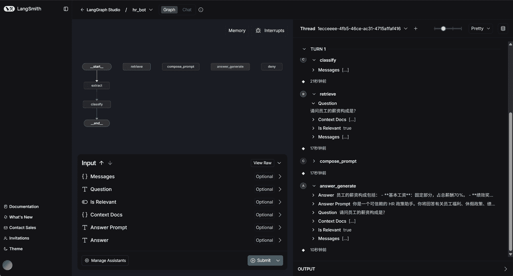

# 5. 本地部署企业级 RAG 系统

LangChain-ChatChat（原名 LangChain-ChatGLM）是一款基于 LangChain 框架和本地大模型的知识库问答（RAG）应用。它面向需要脱机部署的用户，尤其关注中文场景下的私有化大模型应用需求，目标是通过现成的开源模型和本地知识库构建完整的问答助手。项目支持多种开源 LLM（如 ChatGLM、Qwen3、DeepSeek 等）和多种模型推理框架（如 Xinference、Ollama、FastChat 等），也可调用 OpenAI 等在线 API，开发者可选择本地部署或在线服务。总之，ChatChat 致力于提供一个易用的知识库增强问答系统，可以帮助企业在本地私有数据上利用大模型进行检索式生成和多轮对话。是学习LangChain的绝佳项目案例。

## 5.1 LangChain-ChatChat项目介绍

LangChain-ChatChat 于 2023 年 4 月以“LangChain-ChatGLM”名称发布第一个版本（0.1.0），首次支持基于 ChatGLM-6B 的本地知识库问答。随后 8 月项目更名为 LangChain-ChatChat 并发布了 0.2.0 版，引入了 FastChat 模型加载方案，支持更多的模型和数据库。10 月发布了 0.2.5 版，加入了代理（Agent）功能模块，项目在创始人公园等举办的开源黑客松中获得了第三名。到 2023 年 12 月时，项目在 GitHub 上的 star 数已超过 2 万。2024 年 6 月发布了 0.3.0 版，引入了全新架构和更多特性。此后小版本迭代于2024 年 7 月推出（最新 PyPI 版为 0.3.1.3）。截至现在，项目在 GitHub 上已有 35.5k Stars，活跃的社区和持续更新表明该项目在中文开源社区中具有很高的人气和影响力。官方地址：`https://github.com/chatchat-space/Langchain-Chatchat`

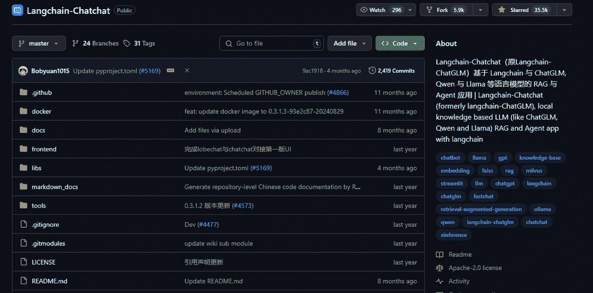

LangChain-ChatChat 提供了丰富的对话及问答功能，包括：通用对话管理：支持多轮对话、会话历史保存、角色提示词自定义等功能。Web UI 可同时管理多个会话，每个会话可设置不同的系统指令和参数。具体核心功能如下：

+ **本地知识库 QA**：通过“知识库对话”功能，将用户上传的文档、网页内容等构建向量化知识库，用户提问时从本地知识库检索相关信息并生成回答。支持多种文件格式（TXT、DOCX、PDF、Markdown 等）和知识库管理命令（如 `chatchat kb -r` 初始化、添加文件等）。

+ 文档检索问答（File RAG）：与知识库 QA 类似，但针对单个或选定文件进行分块检索，支持 BM25+KNN 等混合检索算法，实现对长文档或 PDF 的精确问答。

+ **搜索引擎对话**：集成了可选的搜索引擎（如 Searx 等）作为知识补充，可在对话中检索实时网络信息，并作为上下文提供给模型。

+ **数据库问答**：0.3.x 新增了直接对接数据库的能力，用户可以配置数据库连接，系统将根据用户提问生成 SQL 查询并返回结果（需使用支持 Function Call 的模型）。

+ **多模态功能**：支持图片对话和文本生成图像。例如可上传图片让模型进行描述或分析（推荐使用 Qwen-VL-Chat 等视觉语言模型），或使用模型自带的文生图功能生成图片。

+ **工具/插件机制（Agent）**：0.3.x 核心功能由 Agent 实现，用户可在配置中启用 Agent 模式，并选择多个工具（如 Wolfram、翻译、计算器、网络检索 等）。当启用 Agent 时，LLM 会根据请求自动调用合适的工具；也可手动选择单个工具进行 API 调用。这一机制使系统能够扩展各种“插件”功能，如事实查询、代码运行、表格操作等。

+ **UI 前端**：内置基于 Streamlit 的网页界面，提供聊天交互、模型选择、参数配置等功能。UI 支持多会话标签、上下文导出、记忆管理等，方便用户进行实验和演示。

+ **权限/多用户管理**：当前版本主要面向个人或小团队部署，并未专门实现复杂的角色权限体系。系统默认允许本地访问，用户需在配置中调整监听地址（如改为 `0.0.0.0`）才能远程访问。

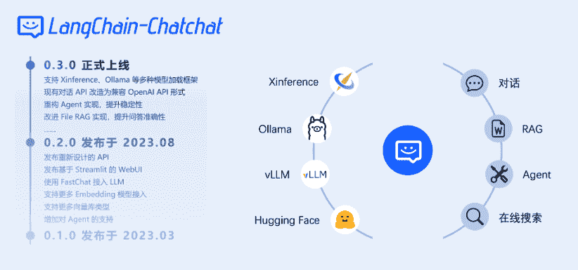

实现上述功能的核心底层框架就是LangChain。

LangChain-ChatChat 的核心架构是一个标准的 RAG 管道：加载文档→文本切分→向量化检索→合并上下文→LLM 生成回答。具体来说，系统首先通过多种文件解析器读取文档内容，然后用文本切分器（如基于句段或固定长度切分）将内容拆分为小块，对每块计算文本向量。用户提问后，同样将问题向量化，在向量数据库中检索与问题最相似的 TopK 文本块，将检索结果作为上下文与问题一并组织到提示词中，最后交给大模型生成答案。如下图所示：

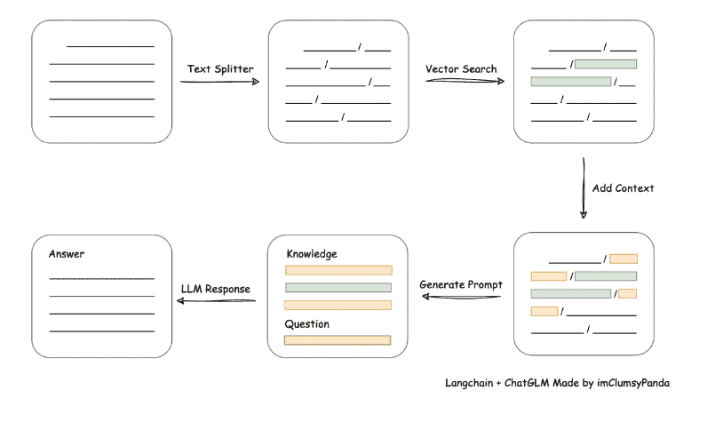

下图即为该流程详细示意图，LangChain-ChatChat 内置了整套检索问答流程，由 LangChain 负责串联各组件、管理上下文和对话记忆。 系统技术栈方面，ChatChat 基于 Python3.8+ 开发，核心依赖 LangChain 框架。它通过 FastAPI 暴露后端服务接口，也提供基于 Streamlit 的 Web UI 供用户交互。在模型支持上，从 0.3.0 版本起，所有模型（包括 LLM、Embedding、可视化模型 等）均通过模型推理框架接入，例如 Xinference、LocalAI、Ollama、FastChat 或 One API 等。这些框架可以加载如 GLM-4-Chat、Qwen-2、LLaMA3、Vicuna、Alpaca、Koala、RWKV 等多种开源大模型，并支持 GPU/CPU 异构部署和加速（如 GPTQ、vLLM、TensorRT 等）。系统内部还使用了数据库或文件系统来存储知识库元数据，默认使用 SQLite+FAISS 向量库，用户可通过配置接入其他矢量数据库（如 Chroma、Milvus 等）。整体运行时，通过 `chatchat init` 命令生成配置、初始化知识库，通过 `chatchat start` 启动服务，用户既可以以 API 形式调用，也可在浏览器中使用内置的多会话聊天界面。

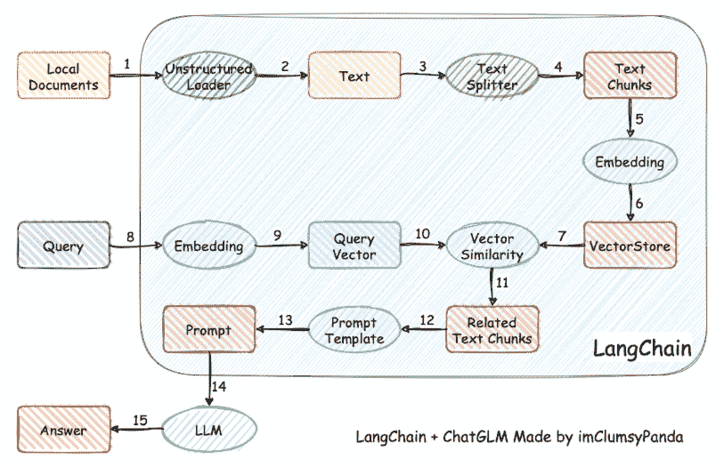

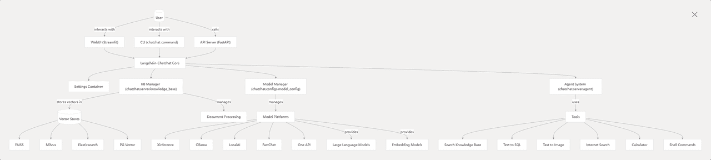

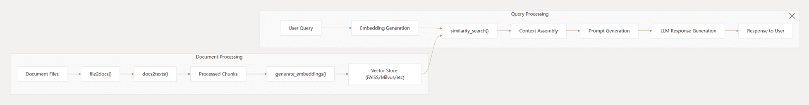

## 5.2 本地私有化部署

在熟悉了langchain-chatchat的架构和功能后，我们接下来详细介绍本地部署的完整流程。

首先，LangChain-ChatChat 支持多种安装部署方法，包括`pip`安装、Docker 容器部署和源码编译。这里我们选择源码安装，我们针对该项目的必要配置文件进行了梳理和修改，完整的项目代码大家可以从百度网盘中免费获取。

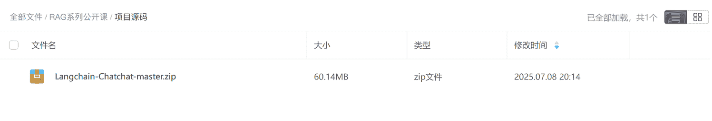


我们此次实现所采用的模型接入与Embedding加载方案，核心在于对底层源码进行了针对性改写与优化，并特别解决了Windows环境下的兼容性问题。这些改动虽然在功能层面看似并非“大幅重构”，但涵盖了大量细节级的适配工作，例如模型初始化逻辑的调整、路径解析的完善以及跨平台依赖的统一处理。

通过这一系列精细化改造，我们不仅实现了对DeepSeek及硅基流动提供的免费Embedding资源的灵活接入，也保证了在不同系统环境（包括Windows和Linux）下都能保持一致的运行体验。值得一提的是，这套方案同样支持基于Ollama本地部署的对话模型和Embedding模型的接入，极大地提升了系统在私有化场景下的兼容性和扩展性。整体而言，这些改写虽然聚焦在“看似简单的适配层”，但实际上为后续在多模型、跨平台环境中稳定落地打下了坚实的基础。

### Step 1: 创建虚拟环境

Langchain-Chatchat 自 0.3.0 版本起，为方便支持用户使用 `pip` 方式安装部署，以及为避免环境中依赖包版本冲突等问题，在源代码/开发部署中不再继续使用 `requirements.txt` 管理项目依赖库，转为使用 Poetry 进行环境管理。

因此，我们需要通过Conda创建一个独立的环境，并安装Poetry。

```
conda create -n langchain_chat python=3.11
```

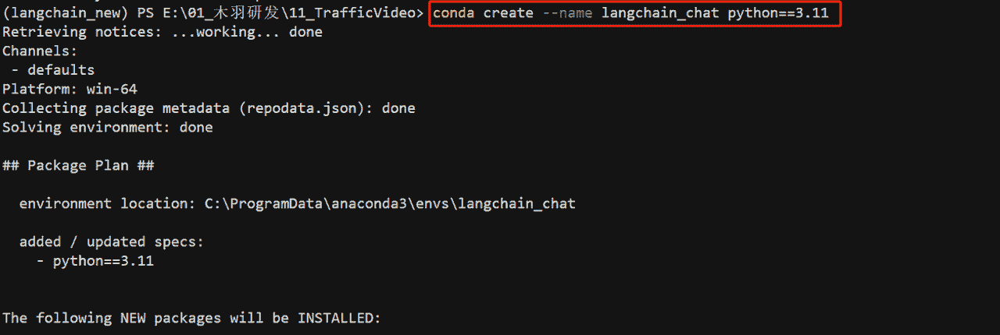

> Poetry 是一款现代化的 Python 包管理和项目构建工具，旨在为开发者提供一种简单一致、可复现的依赖管理与发布流程。与传统的 `pip` 和 `setup.py` 相比，Poetry通过引入声明式的 `pyproject.toml` 配置文件，实现了项目依赖、开发依赖、版本锁定以及构建配置的统一管理。Poetry不仅支持对项目依赖进行精确版本约束和哈希校验，确保在不同环境中安装的依赖完全一致，还内置了虚拟环境自动管理机制，能够在每个项目目录下创建隔离的运行环境，从而避免依赖冲突和环境污染。通过简单的命令，开发者可以快速完成项目的初始化、依赖安装、版本更新、打包构建和发布到PyPI等操作，大幅提升了Python项目的可维护性和可移植性。

### Step 2. 安装Poetry

接下来进入新创建的虚拟环境，并安装Poetry。

```
conda activate langchain_chat
pip install poetry
```

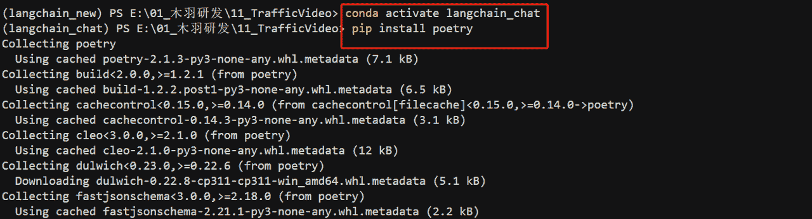

### Step 3. 安装项目依赖

首先通过`pip`安装langchain-chatchat的依赖库。

```
pip install langchain-chatchat -U  -i https://pypi.tuna.tsinghua.edu.cn/simple
```

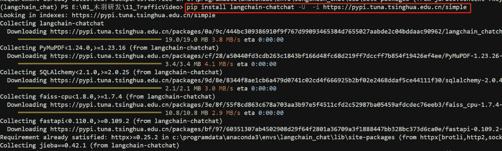

然后通过Poetry安装所有第三方依赖包：

```
cd langchain-chatchat-master
cd .\libs\chatchat-server\
pip install -e .
```

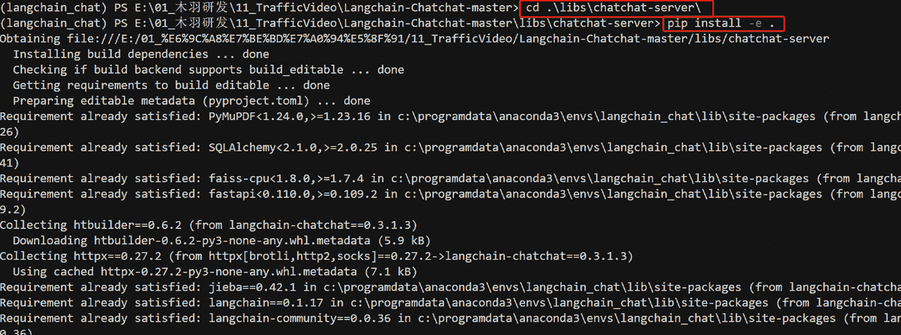

### Step 4. 配置环境变量

接下来，需要在当前开发时所使用 IDE 指定项目源代码根目录，具体来说：就是将主项目目录(`Langchain-Chatchat/libs/chatchat-server/`)设置为源代码根目录。执行以下命令之前，请先设置当前目录和项目数据目录：

```
# 如果是 Linux 系统
export E:\01_muyu\11_TrafficVideo\Langchain-Chatchat-master\libs\chatchat-server\data

# 如果是 Windows 系统
set E:\01_muyu\11_TrafficVideo\Langchain-Chatchat-master\libs\chatchat-server\dataset E:\01_muyu\11_TrafficVideo\Langchain-Chatchat-master\libs\chatchat-server\data
```

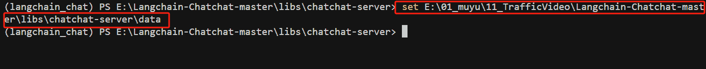

### Step 5. 初始化项目

在完成项目依赖安装后，通过`chatchat --help`命令查看项目帮助信息, 如下所示：

```
chatchat --help
```

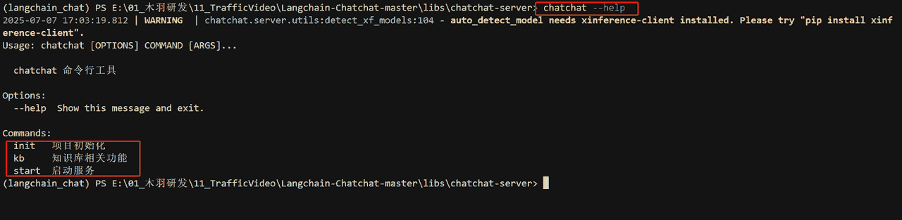

通过`chatchat init`命令初始化项目，如下所示：

```
chatchat init
```

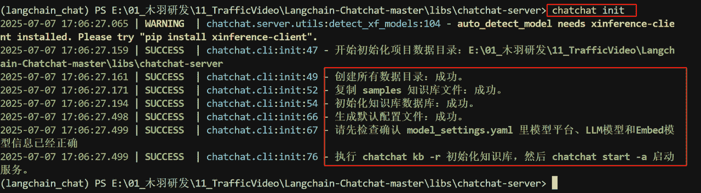

### Step 6. 修改配置信息

接下来，我们需要修改项目文件中的`model_settings.yaml` 文件，依次填写使用的对话模型和Embedding模型的配置信息。其中对话模型我们使用`deepseek`，Embedding模型我们使用`BAAI/bge-large-zh-v1.5`。可以在轨基流动进行免费申请和使用：`https://cloud.siliconflow.cn/sft-cm3fr8u8r020q9zj5bxhqnewo/models?types=embedding`


# 配置DeepSeek API并启动服务

## 准备DeepSeek API密钥

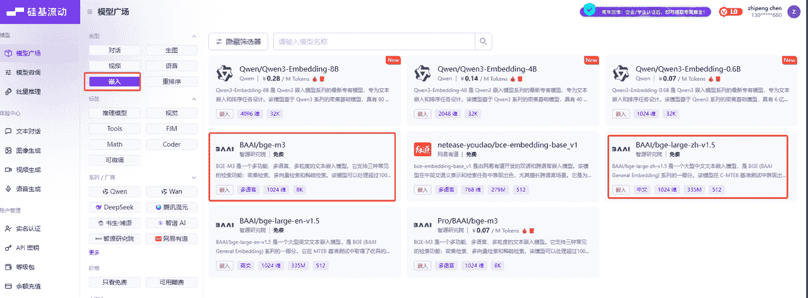

此外，在进行`LangChain`开发之前，还需要准备一个可以进行调用的大模型，这里我们选择使用`DeepSeek`的大模型，并使用`DeepSeek`官方的`API_KEK`进行调用。如果初次使用，需要在`DeepSeek`官网上进行注册并创建一个新的`API_Key`，其官方地址为：`https://platform.deepseek.com/usage`

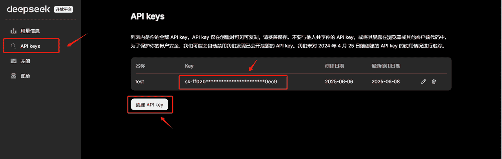

注册好`DeepSeek`的`API_KEY`后，首先在项目同级目录下创建一个`env`文件，用于存储`DeepSeek`的`API_KEY`，如下所示：

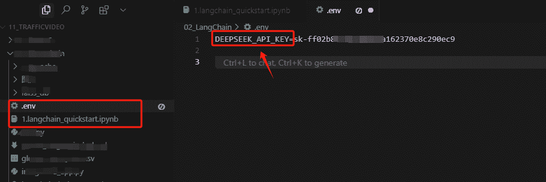

接下来通过`python-dotenv`库读取`env`文件中的`API_KEY`，使其加载到当前的运行环境中，代码如下：

```
! pip install python-dotenv
```

```
Collecting python-dotenv
  Using cached python_dotenv-1.1.0-py3-none-any.whl.metadata (24 kB)
Using cached python_dotenv-1.1.0-py3-none-any.whl (20 kB)
Installing collected packages: python-dotenv
Successfully installed python-dotenv-1.1.0
```

```
import os
from dotenv import load_dotenv 
load_dotenv(override=True)

DeepSeek_API_KEY = os.getenv("DEEPSEEK_API_KEY")
# print(DeepSeek_API_KEY)  # 可以通过打印查看
```

我们在当前的运行环境下不使用`LangChain`，直接使用`DeepSeek`的`API`进行网络连通性测试，测试代码如下：

```
# ! pip install openai
```

```
from openai import OpenAI

# 初始化DeepSeek的API客户端
client = OpenAI(api_key=DeepSeek_API_KEY, base_url="https://api.deepseek.com")

# 调用DeepSeek的API，生成回答
response = client.chat.completions.create(
    model="deepseek-chat",
    messages=[
        {"role": "system", "content": "你是乐于助人的助手，请根据用户的问题给出回答"},
        {"role": "user", "content": "你好，请你介绍一下你自己。"},
    ],
)

# 打印模型最终的响应结果
print(response.choices[0].message.content)
```

```
你好！我是一个乐于助人的AI助手，随时准备为你提供各种帮助。无论是解答问题、提供建议、协助学习、处理日常事务，还是陪你聊天解闷，我都会尽力满足你的需求。  

我的知识涵盖广泛的主题，包括但不限于科技、历史、文化、健康、编程、旅行等。如果你有任何疑问或需要帮助，尽管告诉我！  

没有复杂的设定，我的目标就是简单、直接地为你提供有用的信息和支持。所以，有什么我可以帮你的吗？ 😊
```

如果可以正常收到`DeepSeek`模型的响应，则说明`DeepSeek`的`API`已经可以正常使用且网络连通性正常。

然后，需要修改的配置信息如下：

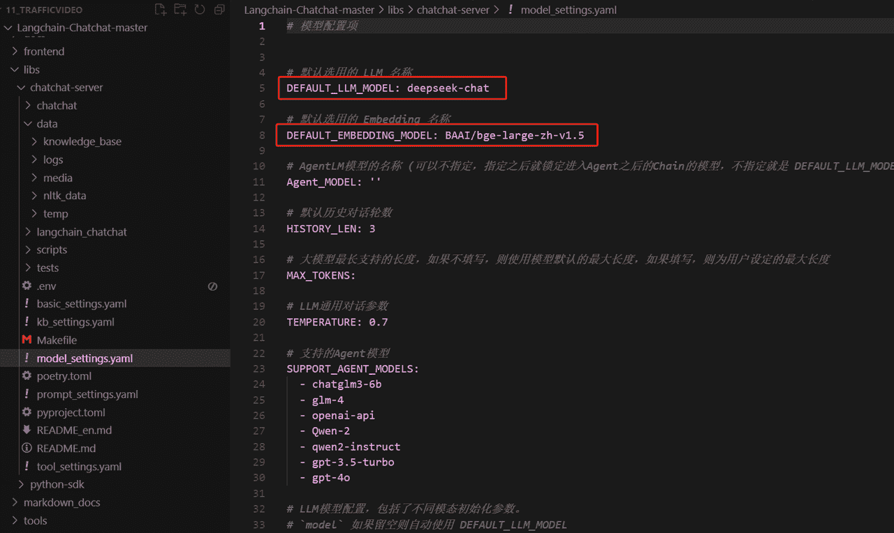

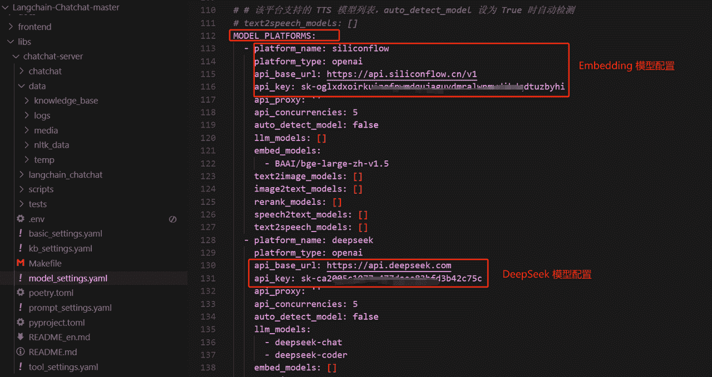

## 初始化知识库

### Step 7. 初始化知识库

在完成项目初始化后，我们就可以开始初始化知识库了。该项目提供了一个默认的`knowledge_base`知识库，可以通过如下命令进行初始化。注意：这个前提是已经正确的配置了`model_settings.yaml`文件中对话模型和`Embedding`模型的配置信息。

```
   python -m chatchat.cli kb --recreate-vs
```

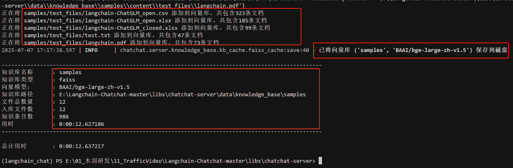

## 启动服务

### Step 8. 启动服务

在完成项目初始化和知识库初始化后，我们就可以开始启动服务了。执行如下代码：

```
   python -m chatchat.cli start -a
```

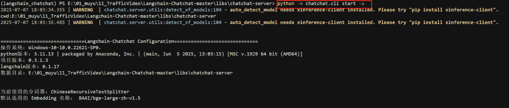

启动成功后，会自动打开浏览器，并显示如下界面：（如果浏览器没有自动打开，请手动打开浏览器，并输入`http://127.0.0.1:8501`）

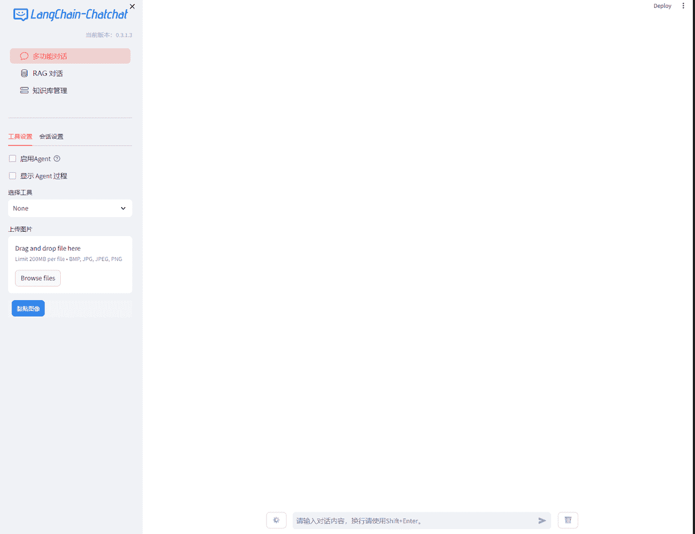

功能演示视频如下：

```
Video("https://ml2022.oss-cn-hangzhou.aliyuncs.com/langchain-chatchat%E6%BC%94%E7%A4%BA%E8%A7%86%E9%A2%91.mp4", width=800, height=400)
```

Your browser does not support the video element.
