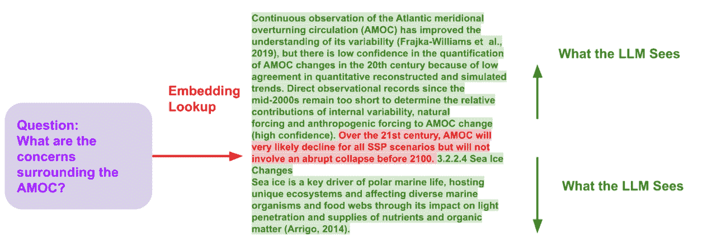
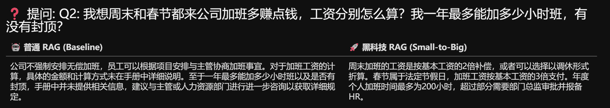
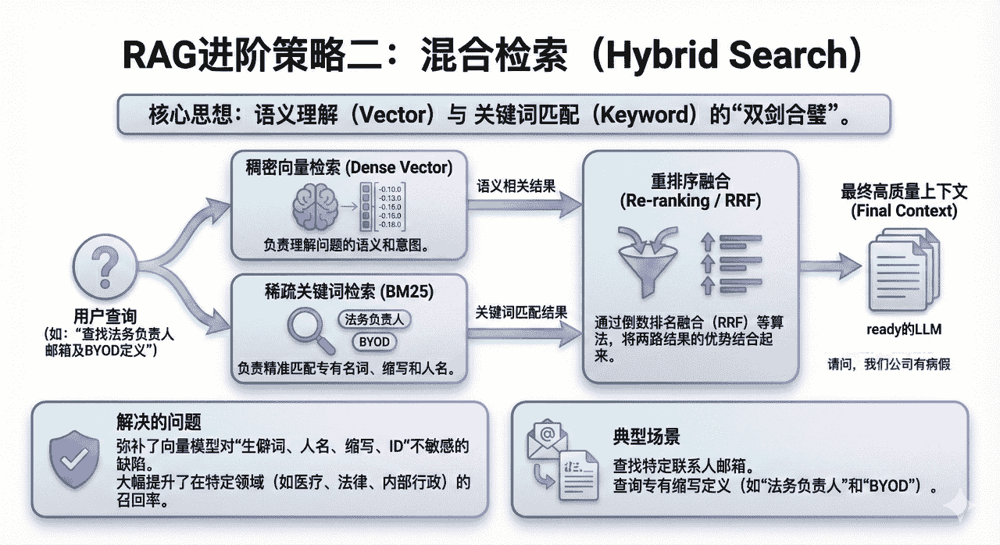
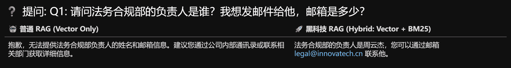
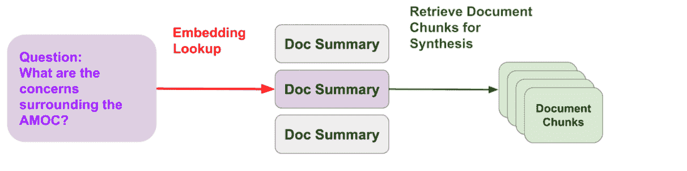
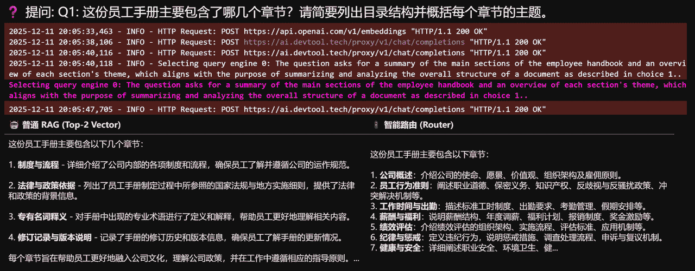

# Part 2. Llama-Index RAG 进阶检索策略介绍

> 来源：[https://kq4b3vgg5b.feishu.cn/docx/UQmPd7jJGoJz6OxtzLdc9ehEnJ8](https://kq4b3vgg5b.feishu.cn/docx/UQmPd7jJGoJz6OxtzLdc9ehEnJ8)

## 一、Llama-Index 进阶 RAG 策略介绍

在掌握了基础的 RAG 流程后，我们很快就会在实际生产环境中遇到瓶颈。本章将揭示传统 RAG 的局限性，并重点介绍 Llama-Index 提供的三种“破局”策略。这些策略正是我们将 AI 从“玩具”提升为“工具”的关键技术。

### 1. 传统 RAG 的局限性：为何“Top-K”不够用？

传统的 RAG（即 Naive RAG）架构通常非常简单直接：将文档切分成固定大小的块（Chunk），计算向量，然后根据余弦相似度检索 Top-K 个片段。这种“一刀切”的模式在处理复杂业务文档时，往往面临三大挑战：

1. 精度与上下文的矛盾（Granularity Trade-off）：
   - 如果切片太小，虽然检索精准，但 LLM 看到的上下文支离破碎，容易断章取义。
   - 如果切片太大，虽然上下文完整，但包含了大量无关噪声，且检索匹配度会下降。

2. “懂意思不懂字面”的盲区（Semantic vs. Keyword）：
   - 向量检索擅长捕捉语义（如“请假”和“休假”），但对于精确的实体名称（如人名“周云杰”）、专有缩写（如“ROWE”）或具体数字（如“200小时”），往往不如传统的关键词搜索准确。

3. 缺乏宏观与微观的判断力（Lack of Intent）：
   - 系统对待所有问题一视同仁。无论用户问的是“总结全文”（宏观），还是“查某条款”（微观），它都只会呆板地检索几个片段。用“管中窥豹”的方式去回答宏观总结类问题，效果注定失败。

为了解决这些痛点，Llama-Index 引入了一系列高级检索策略。我们将重点学习以下三种核心技术：

### 2. 进阶策略一：小索引，大窗口 (Small-to-Big Retrieval)

**核心思想：** “检索粒度”与“生成粒度”的分离。

- **原理：** 我们不直接对大段落进行索引，而是将文档切分成极小的颗粒（例如：句子）。检索时，利用句子级的高精度匹配找到目标；但在通过 Prompt 发送给 LLM 之前，系统会自动将这个“小句子”扩展为包含其前后上下文的“大窗口”。

- **解决的问题：**
  - 解决了“断章取义”的问题。
  - 让检索像手术刀一样精准，同时让回答像专家一样全面。
  - 典型场景：法律条款查询、规章制度细节问答（如“迟到/旷工后果”）。

- 流程示意图



- 实际运行效果展示



### 3. 进阶策略二：混合检索 (Hybrid Search)

**核心思想：** **语义理解（Vector）与关键词匹配（Keyword）**的“双剑合璧”。

- **原理：** 系统同时运行两套检索机制：

1. 稠密向量检索 (Dense Vector)：负责理解问题的语义和意图。
2. 稀疏关键词检索 (BM25)：负责精准匹配专有名词、缩写和人名。

- 最后通过重排序算法（如 RRF - 倒数排名融合）将两路结果的优势结合起来。

- **解决的问题：**
  - 弥补了向量模型对“生僻词、人名、缩写、ID”不敏感的缺陷。
  - 大幅提升了在特定领域（如医疗、法律、内部行政）的召回率。
  - 典型场景：查找特定联系人邮箱、查询专有缩写定义（如“法务负责人”和“BYOD”）。

- 流程示意图



- 实际运行效果展示



### 4. 进阶策略三：智能路由 (Router Query Engine)

**核心思想：** **给 RAG 系统装上一个“分诊台”**（Agentic Behavior）。

- **原理：** 我们不再用单一的索引处理所有问题，而是构建多个针对性索引（例如：一个擅长查细节的 Vector Index，一个擅长做总结的 Summary Index）。在检索之前，引入一个“路由层（Router）”，由 LLM 先分析用户意图，再决定分发给哪个索引，甚至同时分发给多个。

- **解决的问题：**
  - 解决了“用战术动作解决战略问题”的尴尬。
  - 实现了按需分配算力，既能快速查细节，又能深度做总结。
  - 典型场景：既要回答“某项补贴金额”，又要回答“公司价值观总结”（如复杂多意图场景）。

- 流程示意图



- 实际运行效果展示



### 5. 基本开发环境准备

```
import os
from dotenv import load_dotenv
import llama_index.core
```

```
# 1. 加载环境变量
load_dotenv(override=True)

# 2. 检查 Llama-Index 版本
print(f"Llama-Index Version: {llama_index.core.__version__}")
```

```
Llama-Index Version: 0.14.10
```

```
from llama_index.core import Settings
from llama_index.llms.openai import OpenAI
```

```
base_url=os.getenv("BASE_URL")
api_key=os.getenv("OPENAI_API_KEY")
```

```
# 配置 LLM (大语言模型)
Settings.llm = OpenAI(              
    model="gpt-4o",
    api_key=api_key,
    api_base=base_url                  
)
```

```
from llama_index.core import VectorStoreIndex, SimpleDirectoryReader

# 1. 数据摄入 (Loading)
documents = SimpleDirectoryReader("data").load_data()

# 2. 索引构建 (Indexing)
index = VectorStoreIndex.from_documents(documents)

# 3. 引擎配置 (Query Engine)
query_engine = index.as_query_engine()

# 4. 执行查询 (Execution)
# 注意：aquery 是异步调用，在 Jupyter 或标准脚本中通常使用同步的 query
response = query_engine.query("请问，我们公司有病假政策么？请用中文进行回复。")
```

```
2025-12-11 19:09:57,729 - INFO - HTTP Request: POST https://api.openai.com/v1/embeddings "HTTP/1.1 200 OK"
2025-12-11 19:09:58,785 - INFO - HTTP Request: POST https://api.openai.com/v1/embeddings "HTTP/1.1 200 OK"
2025-12-11 19:10:01,429 - INFO - HTTP Request: POST https://ai.devtool.tech/proxy/v1/chat/completions "HTTP/1.1 200 OK"
```

```
response.response
```

```
'是的，公司有病假政策。病假最长可达6个月，带薪比例根据员工的工龄计算。'
```

## 二、小索引，大窗口RAG策略详解

在 RAG 系统中，我们经常面临一个两难的选择：切片（Chunk）切小了，检索虽然精准，但丢给大模型的上下文支离破碎；切片切大了，上下文虽然完整，但包含大量无关噪声，导致检索准确率下降。

Small-to-Big（小索引，大窗口）策略，又称 Sentence Window Retrieval，正是为了解决这一痛点而生。该策略的核心思想在于将用于“搜索”的数据与用于“给 LLM 看”的数据分离开来。

- 小索引 (Small Index for Retrieval)：

系统将文档切分为极细颗粒度的“单句”。我们在向量库中存储的是这些单句的向量。这样做的好处是，当用户提问时，问题能与最相关的某一句特定的话产生极高的相似度匹配，最大程度减少噪声干扰。

- 大窗口 (Big Window for Generation)：

虽然我们搜的是句子，但单句往往缺乏上下文（例如“否则将被解雇”，光看这句不知道“否则”是指什么）。因此，我们在切分时，会预先将这句子前后相邻的 N 句话作为元数据（Metadata）存储起来。

- 偷梁换柱 (Metadata Replacement)：

在检索到目标句子后，系统在发送给 LLM 之前，会执行一个“后处理”动作：将这个孤立的句子替换为它预存的“大窗口”内容。

```
# 3. 检查数据文件是否存在
if not os.path.exists("./data/创新科技股份有限公司员工手册.txt"):
    print("❌ 错误：请确保 './data' 目录下存放了员工手册 txt 文件！")
else:
    print("✅ 环境检查通过，正在加载数据...")
    # 加载文档
    documents = SimpleDirectoryReader("./data").load_data()
    print(f"📄 成功加载文档，共 {len(documents)} 页/部分。")
```

```
✅ 环境检查通过，正在加载数据...
📄 成功加载文档，共 1 页/部分。
```

```
# === Cell 2: 构建“普通 RAG” (Baseline) ===

print("🛠️ 正在构建普通 RAG 索引 (使用默认 Chunking)...")

# 1. 建立普通索引
# 默认行为：Chunk Size = 1024, Top-k = 2
base_index = VectorStoreIndex.from_documents(documents)
base_engine = base_index.as_query_engine(similarity_top_k=2)

print("✅ 普通 RAG 就绪！")

# 定义我们的“找茬”问题集
test_questions = [
    "Q1: 如果我这个月迟到了 4 次，会受到什么样的具体处理？如果连续 3 天没打卡呢？",
    "Q2: 我想周末和春节都来公司加班多赚点钱，工资分别怎么算？我一年最多能加多少小时班，有没有封顶？",
    "Q3: 我还在试用期，最近家里有事想请半个月（15天）的假，按规定可以请吗？会不会影响我转正？"
]
```

```
🛠️ 正在构建普通 RAG 索引 (使用默认 Chunking)...

2025-12-11 19:41:03,477 - INFO - HTTP Request: POST https://api.openai.com/v1/embeddings "HTTP/1.1 200 OK"


✅ 普通 RAG 就绪！
```

```
# === Cell 3: 构建“黑科技 RAG” (Small-to-Big / Sentence Window) ===
from llama_index.core.node_parser import SentenceWindowNodeParser
from llama_index.core.postprocessor import MetadataReplacementPostProcessor
import re

print("🚀 正在构建黑科技 RAG 索引 (Small-to-Big)...")

# --- 🛠️ 关键修复：定义一个中文句子切分函数 ---
def chinese_sentence_splitter(text):
    # 使用正则表达式，按中文句号、问号、感叹号及换行符进行切分
    return re.split(r'(?<=[。？！\n])', text)

# 1. 定义窗口切分器 (加入 sentence_splitter 参数)
node_parser = SentenceWindowNodeParser.from_defaults(
    # 告诉它用我们定义的中文切分函数
    sentence_splitter=chinese_sentence_splitter, 
    # 窗口大小
    window_size=3,
    window_metadata_key="window",
    original_text_metadata_key="original_text",
)

# 2. 手动切分文档
nodes = node_parser.get_nodes_from_documents(documents)
print(f"🔪 文档被切分为 {len(nodes)} 个句子节点")

# --- 🔍 验证一下是否切分成功 (如果这里打印的是1，说明还是没切开) ---
if len(nodes) < 10:
    print("⚠️ 警告：节点数量过少，可能切分失败！请检查分割符。")
else:
    print(f"✅ 切分成功！第一个节点预览: {nodes[0].text[:50]}...")

# 3. 建立索引 (现在每个 Node 都很小，不会报错了)
advanced_index = VectorStoreIndex(nodes)

# 4. 创建引擎
advanced_engine = advanced_index.as_query_engine(
    similarity_top_k=5, 
    node_postprocessors=[
        MetadataReplacementPostProcessor(target_metadata_key="window")
    ]
)

print("✅ 黑科技 RAG 就绪！")
```


# 黑科技 RAG 索引构建 (Small-to-Big)

```
🚀 正在构建黑科技 RAG 索引 (Small-to-Big)...
🔪 文档被切分为 2371 个句子节点
✅ 切分成功！第一个节点预览: # 创新科技股份有限公司员工手册
...

2025-12-11 19:46:15,343 - INFO - HTTP Request: POST https://api.openai.com/v1/embeddings "HTTP/1.1 200 OK"
2025-12-11 19:46:16,120 - INFO - HTTP Request: POST https://api.openai.com/v1/embeddings "HTTP/1.1 200 OK"
2025-12-11 19:46:17,133 - INFO - HTTP Request: POST https://api.openai.com/v1/embeddings "HTTP/1.1 200 OK"
2025-12-11 19:46:17,702 - INFO - HTTP Request: POST https://api.openai.com/v1/embeddings "HTTP/1.1 200 OK"
2025-12-11 19:46:18,486 - INFO - HTTP Request: POST https://api.openai.com/v1/embeddings "HTTP/1.1 200 OK"
2025-12-11 19:46:19,123 - INFO - HTTP Request: POST https://api.openai.com/v1/embeddings "HTTP/1.1 200 OK"
2025-12-11 19:46:19,966 - INFO - HTTP Request: POST https://api.openai.com/v1/embeddings "HTTP/1.1 200 OK"
2025-12-11 19:46:21,570 - INFO - HTTP Request: POST https://api.openai.com/v1/embeddings "HTTP/1.1 200 OK"
2025-12-11 19:46:22,397 - INFO - HTTP Request: POST https://api.openai.com/v1/embeddings "HTTP/1.1 200 OK"
2025-12-11 19:46:22,916 - INFO - HTTP Request: POST https://api.openai.com/v1/embeddings "HTTP/1.1 200 OK"
2025-12-11 19:46:23,719 - INFO - HTTP Request: POST https://api.openai.com/v1/embeddings "HTTP/1.1 200 OK"
2025-12-11 19:46:24,224 - INFO - HTTP Request: POST https://api.openai.com/v1/embeddings "HTTP/1.1 200 OK"
2025-12-11 19:46:25,997 - INFO - HTTP Request: POST https://api.openai.com/v1/embeddings "HTTP/1.1 200 OK"
2025-12-11 19:46:26,721 - INFO - HTTP Request: POST https://api.openai.com/v1/embeddings "HTTP/1.1 200 OK"
2025-12-11 19:46:28,175 - INFO - HTTP Request: POST https://api.openai.com/v1/embeddings "HTTP/1.1 200 OK"
2025-12-11 19:46:28,936 - INFO - HTTP Request: POST https://api.openai.com/v1/embeddings "HTTP/1.1 200 OK"
2025-12-11 19:46:29,408 - INFO - HTTP Request: POST https://api.openai.com/v1/embeddings "HTTP/1.1 200 OK"
2025-12-11 19:46:29,854 - INFO - HTTP Request: POST https://api.openai.com/v1/embeddings "HTTP/1.1 200 OK"
2025-12-11 19:46:30,442 - INFO - HTTP Request: POST https://api.openai.com/v1/embeddings "HTTP/1.1 200 OK"
2025-12-11 19:46:31,247 - INFO - HTTP Request: POST https://api.openai.com/v1/embeddings "HTTP/1.1 200 OK"
2025-12-11 19:46:31,915 - INFO - HTTP Request: POST https://api.openai.com/v1/embeddings "HTTP/1.1 200 OK"
2025-12-11 19:46:38,478 - INFO - HTTP Request: POST https://api.openai.com/v1/embeddings "HTTP/1.1 200 OK"
2025-12-11 19:46:39,172 - INFO - HTTP Request: POST https://api.openai.com/v1/embeddings "HTTP/1.1 200 OK"
2025-12-11 19:46:40,021 - INFO - HTTP Request: POST https://api.openai.com/v1/embeddings "HTTP/1.1 200 OK"
2025-12-11 19:46:40,632 - INFO - HTTP Request: POST https://api.openai.com/v1/embeddings "HTTP/1.1 200 OK"


✅ 黑科技 RAG 就绪！
```

这段代码不仅仅是简单的 API 调用，它包含了一个针对中文环境的特殊优化，以及 `Llama-Index` 中最核心的元数据替换机制。我们将代码拆解为四个关键逻辑块进行讲解。

## 1. 关键设置：自定义中文分词器 (The Chinese Fix)

```
import re

# --- 🛠️ 关键修复：定义一个中文句子切分函数 ---
def chinese_sentence_splitter(text):
    # 使用正则表达式，按中文句号、问号、感叹号及换行符进行切分
    return re.split(r'(?<=[。？！\n])', text)
```

### 为什么要写这个函数？

- `Llama-Index` 的 `SentenceWindowNodeParser` 默认是为英文设计的，它寻找英文句号 `.` 来断句。
- 如果直接处理中文文档，解析器会“视而不见”中文的句号 `。`，导致它把整篇几千字的文档当成一整句话。这不仅会导致检索精度归零，更会直接撑爆 `Embedding` 模型的 `Token` 限制（如 `OpenAI` 的 `8192` 限制），引发报错。

### 代码原理解析

- 我们使用了 `Python` 的正则表达式 `re.split`。
- `(?<=[。？！\n])` 是一个“后向断言” (`Lookbehind Assertion`)。它的意思是：“只要看到中文句号、问号、感叹号或者换行符，就在它们后面切一刀”。这样能保证标点符号被保留在句子里，而不是被切掉。

## 2. 定义窗口解析器 (The Architect)

```
# 1. 定义窗口切分器
node_parser = SentenceWindowNodeParser.from_defaults(
    sentence_splitter=chinese_sentence_splitter, # 挂载上面的中文切分函数
    window_size=3,                               # 核心参数：窗口半径
    window_metadata_key="window",                # 存储大窗口内容的字段名
    original_text_metadata_key="original_text",  # 存储原始句子的字段名
)
```

### 核心逻辑

这是该策略的“总设计师”。它决定了数据被切分后的形态。

### 参数详解

- `window_size=3`：这是策略的灵魂。意味着当系统切分出第 `N` 句话时，它会同时把 `[N-3, N-2, N-1, N, N+1, N+2, N+3]` 这 `7` 句话打包在一起，存储在元数据里。
- `window_metadata_key="window"`：告诉系统，把打包好的“7句话大窗口”藏在节点的 `metadata['window']` 字段里，备用。

## 3. 切分与验证 (Parsing & Validation)

```
# 2. 手动切分文档
nodes = node_parser.get_nodes_from_documents(documents)

# --- 🔍 验证环节 ---
if len(nodes) < 10:
    print("⚠️ 警告...")
else:
    print(f"✅ 切分成功...")

# 3. 建立索引
advanced_index = VectorStoreIndex(nodes)
```

### 流程变化

- 在普通 RAG 中，我们直接用 `VectorStoreIndex.from_documents()`。
- 在这里，我们必须先手动调用 `get_nodes_from_documents` 获得 `nodes`，然后再建索引。这是为了确保我们的切分策略生效。

### 向量化的是谁？

- 关键点：此时建立索引，`Embedding` 模型计算的是 `node.text`（也就是单句）的向量，而不是那个“大窗口”的向量。这保证了检索的极致精准度。

## 4. 引擎构建与“偷梁换柱” (The Magic Swap)

```
# 4. 创建引擎
advanced_engine = advanced_index.as_query_engine(
    similarity_top_k=5, 
    node_postprocessors=[
        MetadataReplacementPostProcessor(target_metadata_key="window")
    ]
)
```

- `similarity_top_k=5`：

- 因为我们检索的是“细粒度”的句子，单个节点包含的信息量很小，所以我们需要稍微多找几个（`Top-5`），以确保覆盖足够的信息。

- `MetadataReplacementPostProcessor` (魔法核心)：

- 这是 `Llama-Index` 特有的后处理器。

### 工作流

1. 检索时：系统用问题去匹配“单句”。
2. 命中后：处理器介入，检查每个命中节点的 `metadata`。
3. 替换（Swap）：它把 `metadata['window']`（那个包含上下文的大段落）取出来，直接覆盖掉原本的 `node.text`（单句）。
4. 合成时：发送给 `LLM` 的 `Prompt` 里，填入的就是替换后的“大窗口”内容。

整体来说基本流程如下：

1. 原始文档：孤立句子
2. 孤立句子：带有“上下文背包”的句子节点
3. 索引阶段：只对“句子”做向量化（为了搜得准）
4. 检索阶段：搜到了“句子”
5. 处理阶段：扔掉句子，打开背包拿出“大窗口”
6. 生成阶段：`LLM` 阅读“大窗口”并回答（为了看得全）


```
# === Cell 4: 效果对比展示 ===
from IPython.display import display, Markdown

def compare_answers(question):
    # 1. 跑普通 RAG
    response_base = base_engine.query(question)
    
    # 2. 跑黑科技 RAG
    response_adv = advanced_engine.query(question)
    
    # 3. 格式化输出 (使用 Markdown 表格让对比更强烈)
    display(Markdown(f"### ❓ 提问: {question}"))
    
    # 构建对比表格
    table_md = f"""
| 🤖 普通 RAG (Baseline) | 🚀 黑科技 RAG (Small-to-Big) |
| :--- | :--- |
| {response_base.response} | {response_adv.response} |
"""
    display(Markdown(table_md))
    
    # 4. (可选) 展示黑科技到底引用了什么原文，增强可信度
    # display(Markdown("**🚀 黑科技引用原文窗口:**"))
    # for node in response_adv.source_nodes:
    #     display(Markdown(f"> ...{node.node.metadata['window']}..."))
    
    display(Markdown("---"))

# 开始循环测试
for q in test_questions:
    compare_answers(q)
```

```
2025-12-11 19:46:57,639 - INFO - HTTP Request: POST https://api.openai.com/v1/embeddings "HTTP/1.1 200 OK"
2025-12-11 19:46:59,213 - INFO - HTTP Request: POST https://ai.devtool.tech/proxy/v1/chat/completions "HTTP/1.1 200 OK"
2025-12-11 19:46:59,615 - INFO - HTTP Request: POST https://api.openai.com/v1/embeddings "HTTP/1.1 200 OK"
2025-12-11 19:47:01,469 - INFO - HTTP Request: POST https://ai.devtool.tech/proxy/v1/chat/completions "HTTP/1.1 200 OK"
```

### ❓ 提问: Q1: 如果我这个月迟到了 4 次，会受到什么样的具体处理？如果连续 3 天没打卡呢？

| 🤖 普通 RAG (Baseline) | 🚀 黑科技 RAG (Small-to-Big) |
| --- | --- |
| 如果这个月迟到了4次，将会由主管进行面谈。如果连续3天未打卡，将被视为严重违纪，并启动正式调查程序。 | 如果这个月迟到了 4 次，你将由主管进行面谈。若连续 3 天未打卡，将被视为严重违纪，并启动正式调查程序。 |

```
2025-12-11 19:47:01,885 - INFO - HTTP Request: POST https://api.openai.com/v1/embeddings "HTTP/1.1 200 OK"
2025-12-11 19:47:04,442 - INFO - HTTP Request: POST https://ai.devtool.tech/proxy/v1/chat/completions "HTTP/1.1 200 OK"
2025-12-11 19:47:04,825 - INFO - HTTP Request: POST https://api.openai.com/v1/embeddings "HTTP/1.1 200 OK"
2025-12-11 19:47:07,058 - INFO - HTTP Request: POST https://ai.devtool.tech/proxy/v1/chat/completions "HTTP/1.1 200 OK"
```


### ❓ 提问: Q2: 我想周末和春节都来公司加班多赚点钱，工资分别怎么算？我一年最多能加多少小时班，有没有封顶？

| 🤖 普通 RAG (Baseline) | 🚀 黑科技 RAG (Small-to-Big) |
| --- | --- |
| 公司不强制安排无偿加班，员工可以根据项目安排与主管协商加班事宜。对于加班工资的计算，具体的金额和计算方式未在手册中详细说明。至于一年最多能加多少小时班以及是否有封顶，手册中并未提供相关信息，建议与主管或人力资源部门进行进一步咨询以获取详细规定。 | 周末加班的工资是按基本工资的2倍补偿，或者可以选择以调休形式折算。春节属于法定节假日，加班工资按基本工资的3倍支付。年度个人加班时间最多为200小时，超过部分需要部门总监审批并报备HR。 |

```
2025-12-11 19:47:07,433 - INFO - HTTP Request: POST https://api.openai.com/v1/embeddings "HTTP/1.1 200 OK"
2025-12-11 19:47:10,823 - INFO - HTTP Request: POST https://ai.devtool.tech/proxy/v1/chat/completions "HTTP/1.1 200 OK"
2025-12-11 19:47:11,297 - INFO - HTTP Request: POST https://api.openai.com/v1/embeddings "HTTP/1.1 200 OK"
2025-12-11 19:47:13,295 - INFO - HTTP Request: POST https://ai.devtool.tech/proxy/v1/chat/completions "HTTP/1.1 200 OK"
```

### ❓ 提问: Q3: 我还在试用期，最近家里有事想请半个月（15天）的假，按规定可以请吗？会不会影响我转正？

| 🤖 普通 RAG (Baseline) | 🚀 黑科技 RAG (Small-to-Big) |
| --- | --- |
| 在试用期内请假通常需要遵循公司的请假规定。如果您有正当理由，可以向人力资源部门申请假期。请假是否会影响转正，通常取决于公司的具体政策和您在试用期内的表现。建议您与直接上级或人力资源部门沟通，了解请假对转正的具体影响。 | 在试用期内，你可以请假，包括病假、事假、婚假等法定假期。然而，如果累计请假超过10个工作日，试用期考核结果可能会受到影响。因此，请半个月（15天）的假可能会影响你的转正。 |

---

## 三、混合检索 (Hybrid Search)执行策略

### 1. 策略背景：告别“懂意不懂字”的单腿走路

在基础的 RAG 系统中，我们通常完全依赖向量检索（`Vector Search`）。向量检索的魔法在于它能通过计算高维空间的距离来理解“语义”。例如，用户搜“请假规则”，它能通过语义关联找到“考勤管理”或“休假制度”，即便这几个字没有完全对应。

然而，在企业级落地中，我们很快发现纯向量检索存在一个致命的“语义盲区”：它对精确匹配（`Exact Match`）极不敏感。

当用户搜索一个特定的错误码（如 `Error 503`）、一个生僻的人名（如“周云杰”）、一个专有的缩写（如 `ROWE`）或一个具体的产品型号（如 `X-2000`）时，向量模型往往会因为这些词在语义空间中过于稀疏，而检索到一堆“意思相近”但完全不相关的通用描述，导致“张冠李戴”。

混合检索（`Hybrid Search`）的诞生，正是为了解决这一痛点。它主张“两条腿走路”，既要 AI 的“脑子”（语义理解），也要传统搜索引擎的“眼睛”（字面匹配）。

### 2. 核心原理：双路召回与加权融合

混合检索策略在底层构建了两条并行的检索链路，并通过精密的算法将结果合二为一：

+   链路 A：稠密向量检索 (`Dense Retrieval`)

+   **机制：** 使用 `Embedding` 模型将文本转化为向量。

+   **强项：** 擅长处理模糊查询、概念关联、同义词匹配。

+   **角色：** 负责“懂你什么意思”。

+   链路 B：稀疏关键词检索 (`Sparse Retrieval` / `BM25`)

+   **机制：** 基于传统的 `TF-IDF`（词频-逆文档频率）算法演进而来的 `BM25` 算法。

+   **强项：** 擅长捕捉生僻词、专有名词、精确数字。它不关心语义，只关心关键词是否在文档中高频出现。

+   **角色：** 负责“精准定位字面”。

+   融合机制：倒数排名融合 (`Reciprocal Rank Fusion`, `RRF`)

+   系统不会简单地把两路结果拼在一起，而是使用 `RRF` 算法。它像一个公正的裁判，查看两个链路的排名情况。如果一个文档在向量检索中排第 1，在关键词检索中也排第 1，它的最终权重会极高；如果只在单路出现，权重则会降低。

### 3. 执行流程

```
# !pip install rank_bm25 jieba
```

```
# === Cell 1: 初始化与分词器配置 ===
import nest_asyncio
import jieba
from typing import List
from llama_index.core import SimpleDirectoryReader, VectorStoreIndex, Settings, StorageContext
from llama_index.core.node_parser import SentenceSplitter

nest_asyncio.apply()

# 1. 定义一个中文分词函数 (给 BM25 用)
def chinese_tokenizer(text: str) -> List[str]:
    # 使用 jieba 进行分词
    return list(jieba.cut(text))

# 2. 加载数据
print("📂 正在加载文档...")
documents = SimpleDirectoryReader("./data").load_data()

# 3. 将文档切分为节点 (标准切分，Chunk Size=512 适中)
# 为什么要手动切分？因为 BM25 和 向量索引 需要共享同一套节点数据
splitter = SentenceSplitter(chunk_size=512, chunk_overlap=50)
nodes = splitter.get_nodes_from_documents(documents)
print(f"✅ 文档已切分为 {len(nodes)} 个标准节点。")
```

```
C:\Users\Admin\anaconda3\envs\llamaindex\Lib\site-packages\jieba\_compat.py:18: UserWarning: pkg_resources is deprecated as an API. See https://setuptools.pypa.io/en/latest/pkg_resources.html. The pkg_resources package is slated for removal as early as 2025-11-30. Refrain from using this package or pin to Setuptools<81.
  import pkg_resources


📂 正在加载文档...
✅ 文档已切分为 117 个标准节点。
```

```
# === Cell 2: 构建“普通 RAG” (纯向量) ===
print("🛠️ 正在构建向量索引 (Vector Index)...")

# 1. 构建向量索引
vector_index = VectorStoreIndex(nodes)

# 2. 创建纯向量检索引擎
# similarity_top_k=2
vector_engine = vector_index.as_query_engine(similarity_top_k=2)

print("✅ 普通 RAG (Vector Only) 就绪！")
```

```
🛠️ 正在构建向量索引 (Vector Index)...


2025-12-11 19:50:11,353 - INFO - HTTP Request: POST https://api.openai.com/v1/embeddings "HTTP/1.1 200 OK"
2025-12-11 19:50:12,070 - INFO - HTTP Request: POST https://api.openai.com/v1/embeddings "HTTP/1.1 200 OK"


✅ 普通 RAG (Vector Only) 就绪！
```

```
# === Cell 3: 构建“黑科技 RAG” (混合检索: Vector + BM25) ===
import inspect
from llama_index.retrievers.bm25 import BM25Retriever
from llama_index.core.retrievers import VectorIndexRetriever
from llama_index.core.retrievers import QueryFusionRetriever
from llama_index.core.query_engine import RetrieverQueryEngine

print("🚀 正在构建混合检索系统 (Hybrid Search)...")

# --- 🛠️ 自动侦测修复：从类型提示中提取 FusionMode ---
try:
    # 1. 获取 __init__ 函数的签名
    sig = inspect.signature(QueryFusionRetriever.__init__)
    # 2. 找到 'mode' 参数的类型定义
    ModeEnum = sig.parameters['mode'].annotation
    print(f"✅ 成功自动侦测到 Mode 类型: {ModeEnum}")
    
    # 3. 获取 RECIPROCAL_RANK 的值
    # 如果它是枚举，直接取属性；如果是 Optional[FusionMode]，可能需要剥离一层
    # 这里做一个简单的容错遍历
    if hasattr(ModeEnum, 'RECIPROCAL_RANK'):
        target_mode = ModeEnum.RECIPROCAL_RANK
    else:
        # 如果类型提示没拿到，或者版本太旧是字符串，直接用字符串兜底
        print("⚠️ 未找到枚举属性，尝试使用字符串模式...")
        target_mode = "reciprocal_rank"
        
except Exception as e:
    print(f"⚠️ 自动侦测失败 ({e})，回退到字符串模式...")
    target_mode = "reciprocal_rank"

print(f"👉 最终使用的 mode 参数: {target_mode}")


# 1. 创建 BM25 检索器
bm25_retriever = BM25Retriever.from_defaults(
    nodes=nodes,
    similarity_top_k=2,
    tokenizer=chinese_tokenizer
)

# 2. 创建 向量 检索器
vector_retriever = VectorIndexRetriever(index=vector_index, similarity_top_k=2)

# 3. 创建 融合检索器
fusion_retriever = QueryFusionRetriever(
    [vector_retriever, bm25_retriever],
    similarity_top_k=4,
    num_queries=1,
    # 使用我们要么侦测到、要么回退的 mode
    mode=target_mode,
    use_async=True
)

# 4. 组装成引擎
hybrid_engine = RetrieverQueryEngine.from_args(
    retriever=fusion_retriever
)

print("✅ 黑科技 RAG (Hybrid Search) 就绪！")
```

```
2025-12-11 19:58:19,832 - WARNING - The tokenizer parameter is deprecated and will be removed in a future release. Use a stemmer from PyStemmer instead.
2025-12-11 19:58:19,853 - DEBUG - Building index from IDs objects


🚀 正在构建混合检索系统 (Hybrid Search)...
✅ 成功自动侦测到 Mode 类型: <enum 'FUSION_MODES'>
👉 最终使用的 mode 参数: FUSION_MODES.RECIPROCAL_RANK
✅ 黑科技 RAG (Hybrid Search) 就绪！
```

这段代码展示了如何将 `关键词检索 (BM25)` 与 `向量检索 (Vector)` 结合，并通过 `RRF` (倒数排名融合) 算法实现 1+1 > 2 的效果。不仅如此，代码开头包含了一段处理版本兼容性的“防御性编程”技巧。

我们将代码逻辑拆解为三个核心模块进行讲解：

#### 1. 自动侦测与版本适配 (The Compatibility Fix)

```
import inspect

# --- 🛠️ 自动侦测修复：从类型提示中提取 FusionMode ---
try:
    # 1. 获取构造函数的签名 (Signature)
    sig = inspect.signature(QueryFusionRetriever.__init__)
    # 2. 侦测 'mode' 参数到底想要什么类型 (Enum 还是 String?)
    ModeEnum = sig.parameters['mode'].annotation
    # ... (省略中间判断逻辑)
    if hasattr(ModeEnum, 'RECIPROCAL_RANK'):
        target_mode = ModeEnum.RECIPROCAL_RANK
    else:
        target_mode = "reciprocal_rank"
except Exception as e:
    target_mode = "reciprocal_rank"
```

+   **为什么要写这段复杂的逻辑？**

+   **背景：** `Llama-Index` 更新极快，`v0.10.x` 版本中，`FusionMode` 从字符串变成了严格的枚举类型（`Enum`）。直接写字符串 `reciprocal_rank` 在新版会报错，直接引枚举类在旧版又会报错。

+   **原理：** 这里使用了 `Python` 的 `inspect` (反射) 模块。

+   **比喻：** 这就像在进门前，先用扫描仪看一眼门锁是“指纹锁”还是“钥匙锁”，然后再决定掏出指纹还是钥匙。这是一种“防御性编程”，确保你的代码在不同版本的 `Llama-Index` 上都能跑通，不至于因为版本升级而崩溃。

#### 2. 创建双路检索器 (Two-Stream Retrievers)

```
# 1. 创建 BM25 检索器 (关键词派 - The Eye)
bm25_retriever = BM25Retriever.from_defaults(
    nodes=nodes,
    similarity_top_k=2,     # 只要最匹配关键字的前2名
    tokenizer=chinese_tokenizer # ⚠️ 关键：中文必须传入分词函数
)

# 2. 创建 向量 检索器 (语义派 - The Brain)
vector_retriever = VectorIndexRetriever(
    index=vector_index, 
    similarity_top_k=2      # 只要语义最相似的前2名
)
```

+   **分工明确：**

+   `BM25Retriever`：它是系统的“眼睛”，负责盯着字面。如果用户搜“周云杰”，它能精准抓取包含这三个字的人名，哪怕语义上这只是一个普通名字。

+   `VectorIndexRetriever`：它是系统的“脑子”，负责理解含义。如果用户搜“法务负责人”，它能理解这和“周云杰”是关联的。

+   **注意点：** `BM25` 必须传入 `tokenizer=chinese_tokenizer`，否则它会把一整句中文当成一个长单词，无法匹配关键词。

#### 3. 融合与引擎组装 (The Fusion Core)


## 三、融合检索策略

### 3. 创建融合检索器

```
# 3. 创建 融合检索器
fusion_retriever = QueryFusionRetriever(
    [vector_retriever, bm25_retriever], # 输入两路检索器
    similarity_top_k=4,                 # 融合后，给 LLM 看前 4 个结果
    num_queries=1,                      # 只处理原问题，不生成额外问题
    mode=target_mode,                   # 使用 RRF 算法 (Reciprocal Rank Fusion)
    use_async=True
)
```

### 4. 组装成引擎

```
# 4. 组装成引擎
hybrid_engine = RetrieverQueryEngine.from_args(
    retriever=fusion_retriever
)
```

+ **核心组件：** `QueryFusionRetriever`

它是整个策略的指挥官。

+ **mode：** `RECIPROCAL_RANK` (RRF 算法)

这是目前业界最流行的无监督融合算法。

+ **工作原理：** 它不看分数（因为 BM25 的分数和向量的 Cosine 分数无法直接比较），它看排名。

+ **举例：** 如果文档 A 在关键词检索排第 1，在向量检索也排第 1，它的 RRF 得分就会极高，被置顶。如果文档 B 只在向量检索出现，关键词检索里没影，它的排名就会下降。

+ **结果：** `hybrid_engine` 最终吐出的答案，既包含了字面精准的信息，也包含了语义相关的信息，消除了单一检索的盲区。

```
# === Cell 4: 效果对比展示 ===
from IPython.display import display, Markdown

# 定义“找茬”问题
# 这些问题包含了具体的实体名(Entity)和缩写，是向量检索的弱项
questions = [
    "Q1: 请问法务合规部的负责人是谁？我想发邮件给他，邮箱是多少？",
    "Q2: 公司关于 BYOD (自带设备) 的具体政策要求是什么？",
    "我是研发部的老员工，听说有个‘ROWE’工作制，具体需要满足哪些硬性条件才能申请？",
    "如果我遇到紧急情况需要心理支持，公司有没有专门的援助热线？具体的电话号码是多少？",
    "公司内部有没有专门支持女性发展的组织？这个小组的准确名称叫什么？"
]

def compare_hybrid(question):
    # 1. 普通 RAG
    response_base = vector_engine.query(question)
    
    # 2. 混合 RAG
    response_hybrid = hybrid_engine.query(question)
    
    # 3. 展示对比
    display(Markdown(f"### ❓ 提问: {question}"))
    
    table_md = f"""
| 🤖 普通 RAG (Vector Only) | 🚀 黑科技 RAG (Hybrid: Vector + BM25) |
| :--- | :--- |
| {response_base.response} | {response_hybrid.response} |
"""
    display(Markdown(table_md))
    
    # 可选：查看混合检索到底融合了哪些节点
    # print("🔍 混合检索命中的节点片段:")
    # for node in response_hybrid.source_nodes:
    #     print(f"[{node.score:.2f}] {node.node.text[:50]}...")
    
    display(Markdown("---"))

# 开始测试
for q in questions:
    compare_hybrid(q)
```

```
2025-12-11 20:00:12,472 - INFO - HTTP Request: POST https://api.openai.com/v1/embeddings "HTTP/1.1 200 OK"
2025-12-11 20:00:13,925 - INFO - HTTP Request: POST https://ai.devtool.tech/proxy/v1/chat/completions "HTTP/1.1 200 OK"
2025-12-11 20:00:13,937 - INFO - Retrying request to /embeddings in 0.409338 seconds
2025-12-11 20:00:15,131 - INFO - HTTP Request: POST https://api.openai.com/v1/embeddings "HTTP/1.1 200 OK"
2025-12-11 20:00:16,623 - INFO - HTTP Request: POST https://ai.devtool.tech/proxy/v1/chat/completions "HTTP/1.1 200 OK"
```

### ❓ 提问: Q1: 请问法务合规部的负责人是谁？我想发邮件给他，邮箱是多少？

| 🤖 普通 RAG (Vector Only) | 🚀 黑科技 RAG (Hybrid: Vector + BM25) |

| --- | --- |

| 抱歉，无法提供法务合规部负责人的姓名和邮箱信息。建议您通过公司内部通讯录或联系相关部门获取详细信息。 | 法务合规部的负责人是周云杰，您可以通过邮箱 legal@innovatech.cn 联系他。 |

---

```
2025-12-11 20:00:16,996 - INFO - HTTP Request: POST https://api.openai.com/v1/embeddings "HTTP/1.1 200 OK"
2025-12-11 20:00:18,039 - INFO - HTTP Request: POST https://ai.devtool.tech/proxy/v1/chat/completions "HTTP/1.1 200 OK"
2025-12-11 20:00:18,043 - INFO - Retrying request to /embeddings in 0.465214 seconds
2025-12-11 20:00:19,036 - INFO - HTTP Request: POST https://api.openai.com/v1/embeddings "HTTP/1.1 200 OK"
2025-12-11 20:00:20,251 - INFO - HTTP Request: POST https://ai.devtool.tech/proxy/v1/chat/completions "HTTP/1.1 200 OK"
```

### ❓ 提问: Q2: 公司关于 BYOD (自带设备) 的具体政策要求是什么？

| 🤖 普通 RAG (Vector Only) | 🚀 黑科技 RAG (Hybrid: Vector + BM25) |

| --- | --- |

| 公司关于 BYOD（自带设备）的政策要求是：自带设备需要提前登记备案，并通过加密配置。 | 公司关于 BYOD（自带设备）的政策要求包括：自带设备需提前登记备案，并通过加密配置，以确保安全性。 |

---

```
2025-12-11 20:00:20,635 - INFO - HTTP Request: POST https://api.openai.com/v1/embeddings "HTTP/1.1 200 OK"
2025-12-11 20:00:22,026 - INFO - HTTP Request: POST https://ai.devtool.tech/proxy/v1/chat/completions "HTTP/1.1 200 OK"
2025-12-11 20:00:22,034 - INFO - Retrying request to /embeddings in 0.419734 seconds
2025-12-11 20:00:23,035 - INFO - HTTP Request: POST https://api.openai.com/v1/embeddings "HTTP/1.1 200 OK"
2025-12-11 20:00:24,799 - INFO - HTTP Request: POST https://ai.devtool.tech/proxy/v1/chat/completions "HTTP/1.1 200 OK"
```

### ❓ 提问: 我是研发部的老员工，听说有个‘ROWE’工作制，具体需要满足哪些硬性条件才能申请？

| 🤖 普通 RAG (Vector Only) | 🚀 黑科技 RAG (Hybrid: Vector + BM25) |

| --- | --- |

| 要申请“以成果为导向的工作制度（ROWE）”，需要满足以下硬性条件：任职时间不少于一年，过往绩效为“良好”以上，能够独立承担项目任务并具备自我管理能力，以及已签署《ROWE工作协议》，明确目标设定与交付周期。 | 要申请“以成果为导向的工作制度（ROWE）”，需要满足以下硬性条件：任职时间不少于一年，过往绩效为“良好”以上，能够独立承担项目任务并具备自我管理能力，以及已签署《ROWE工作协议》，明确目标设定与交付周期。 |

---

```
2025-12-11 20:00:25,128 - INFO - HTTP Request: POST https://api.openai.com/v1/embeddings "HTTP/1.1 200 OK"
2025-12-11 20:00:26,712 - INFO - HTTP Request: POST https://ai.devtool.tech/proxy/v1/chat/completions "HTTP/1.1 200 OK"
2025-12-11 20:00:26,728 - INFO - Retrying request to /embeddings in 0.376975 seconds
2025-12-11 20:00:27,726 - INFO - HTTP Request: POST https://api.openai.com/v1/embeddings "HTTP/1.1 200 OK"
2025-12-11 20:00:29,424 - INFO - HTTP Request: POST https://ai.devtool.tech/proxy/v1/chat/completions "HTTP/1.1 200 OK"
```

### ❓ 提问: 如果我遇到紧急情况需要心理支持，公司有没有专门的援助热线？具体的电话号码是多少？

| 🤖 普通 RAG (Vector Only) | 🚀 黑科技 RAG (Hybrid: Vector + BM25) |

| --- | --- |

| 公司员工手册中没有提到专门的心理支持援助热线或具体电话号码。建议联系公司的人力资源部门或查看员工门户以获取更多信息。 | 公司没有提供专门的心理支持援助热线的具体电话号码。不过，员工在遭遇紧急事件时可以拨打公司应急热线，具体号码分部门张贴，或者通过企业IM标记“#紧急”发布信息，系统会自动通知相关部门进行响应。 |

---

```
2025-12-11 20:00:29,935 - INFO - HTTP Request: POST https://api.openai.com/v1/embeddings "HTTP/1.1 200 OK"
2025-12-11 20:00:30,869 - INFO - HTTP Request: POST https://ai.devtool.tech/proxy/v1/chat/completions "HTTP/1.1 200 OK"
2025-12-11 20:00:30,878 - INFO - Retrying request to /embeddings in 0.420910 seconds
2025-12-11 20:00:31,874 - INFO - HTTP Request: POST https://api.openai.com/v1/embeddings "HTTP/1.1 200 OK"
2025-12-11 20:00:33,213 - INFO - HTTP Request: POST https://ai.devtool.tech/proxy/v1/chat/completions "HTTP/1.1 200 OK"
```

### ❓ 提问: 公司内部有没有专门支持女性发展的组织？这个小组的准确名称叫什么？

| 🤖 普通 RAG (Vector Only) | 🚀 黑科技 RAG (Hybrid: Vector + BM25) |

| --- | --- |

| 公司内部有专门支持女性发展的组织，准确名称是 Women@Innovation。 | 公司内部有专门支持女性发展的组织，准确名称是 "Women@Innovation"。 |

---


## 四、路由检索策略介绍

### 1. 策略背景：打破“一刀切”的检索僵局

在传统的 RAG 架构中，存在一个尴尬的悖论：“宏观与微观的冲突”。

+ 如果我们为了回答“总结全文核心思想”这样的宏观问题，而将 `Top-K` 设得很大或使用摘要索引，那么在回答“某项补贴具体是多少钱”这种微观问题时，就会造成巨大的算力浪费和响应延迟。

+ 反之，如果我们为了快速查细节而使用标准的 `Top-2` 向量检索，那么面对“请概述公司发展历程”这样的问题时，系统就像“管中窥豹”，只能抓取到零星片段，给出的答案往往是片面甚至错误的。

智能路由（`Router Query Engine`） 的引入，标志着 RAG 系统从“自动化”向“Agent（智能体）”迈出了关键一步。它不再机械地执行单一动作，而是学会了“先思考，再行动”。

### 2. 核心原理：RAG 系统的“前置分诊台”

智能路由策略的核心在于构建了一个决策层，位于用户提问和数据索引之间：

+ **构建多元工具箱：**

我们不再只维护一个索引，而是针对不同的任务构建不同的索引结构，并将它们封装为“工具（Tools）”。

+ **工具 A（向量工具）：** 基于 `VectorStoreIndex`，擅长点对点的细节查询（查数据、查条款）。

+ **工具 B（摘要工具）：** 基于 `SummaryIndex`，擅长遍历全文档构建树状摘要（做总结、看全貌）。

+ AI 路由选择器 (`LLM Selector`)：

这是系统的“大脑”。当问题进来时，`Selector` 会先阅读问题的意图，然后对比手边工具的“功能描述（Description）”，动态决定：

+ “这个问题是查细节的 -> 派发给工具 A。”

+ “这个问题是做总结的 -> 派发给工具 B。”

+ “这个问题既要细节又要总结 -> 同时派发给 A 和 B，最后汇总。”

### 3. 执行流程

```
# === Cell 1: 初始化与构建双索引 (Vector + Summary) ===
import nest_asyncio
from llama_index.core import SimpleDirectoryReader, VectorStoreIndex, SummaryIndex, Settings
from llama_index.core.node_parser import SentenceSplitter

nest_asyncio.apply()

# 1. 加载数据
print("📂 正在加载文档...")
documents = SimpleDirectoryReader("./data").load_data()

# 2. 切分文档 (通用切分)
splitter = SentenceSplitter(chunk_size=1024, chunk_overlap=20)
nodes = splitter.get_nodes_from_documents(documents)

# 3. 构建【向量索引】 (擅长查细节)
print("🛠️ 正在构建向量索引 (Vector Index)...")
vector_index = VectorStoreIndex(nodes)

# 4. 构建【摘要索引】 (擅长做总结)
# SummaryIndex 不做向量化，它把所有节点存成一个列表，查询时会遍历阅读
print("📚 正在构建摘要索引 (Summary Index)...")
summary_index = SummaryIndex(nodes)

print("✅ 双索引构建完毕！")
```


# LlamaIndex 智能路由引擎 (Router) 构建与测试

## 环境初始化与索引构建

```
📂 正在加载文档...
🛠️ 正在构建向量索引 (Vector Index)...

2025-12-11 20:03:14,514 - INFO - HTTP Request: POST https://api.openai.com/v1/embeddings &quot;HTTP/1.1 200 OK&quot;


📚 正在构建摘要索引 (Summary Index)...
✅ 双索引构建完毕！
```

## Cell 2: 定义工具与构建 Router

```
# === Cell 2: 定义工具与构建 Router ===
from llama_index.core.tools import QueryEngineTool
from llama_index.core.selectors import LLMSingleSelector
from llama_index.core.query_engine import RouterQueryEngine

# 1. 定义 Vector 工具 (查细节)
vector_tool = QueryEngineTool.from_defaults(
    query_engine=vector_index.as_query_engine(similarity_top_k=2),
    description=&quot;专门用于查询具体的、特定的事实细节，例如补贴金额、电话号码、具体政策条款等。&quot;
)

# 2. 定义 Summary 工具 (做总结)
# response_mode=&quot;tree_summarize&quot; 是关键，它会构建一棵摘要树，从底向上递归总结
summary_tool = QueryEngineTool.from_defaults(
    query_engine=summary_index.as_query_engine(response_mode=&quot;tree_summarize&quot;),
    description=&quot;专门用于对文档进行宏观的总结、概括全文主题、分析整体结构或提取跨章节的综合信息。&quot;
)

# 3. 构建 Router 引擎
print(&quot;🚦 正在构建智能路由引擎 (Router Engine)...&quot;)
router_engine = RouterQueryEngine(
    selector=LLMSingleSelector.from_defaults(),
    query_engine_tools=[summary_tool, vector_tool],
    verbose=True # 开启 verbose，我们可以看到它到底选了哪个工具
)

print(&quot;✅ Router 引擎就绪！&quot;)
```

```
🚦 正在构建智能路由引擎 (Router Engine)...
✅ Router 引擎就绪！
```

这段代码展示了如何将两个功能迥异的检索引擎（查细节的 Vector 和 查全貌的 Summary）封装成工具，并教会系统如何根据用户的问题自动选择最合适的一个。

### 1. 定义工具：给系统装上“手脚” (The Tools)

在 Router 模式下，索引（`Index`）本身不能直接被路由，必须先封装成 `QueryEngineTool`。

```
# 1. 定义 Vector 工具 (查细节)
vector_tool = QueryEngineTool.from_defaults(
    query_engine=vector_index.as_query_engine(similarity_top_k=2),
    description=&quot;专门用于查询具体的、特定的事实细节，例如补贴金额、电话号码、具体政策条款等。&quot;
)
```

- `QueryEngineTool`：这是 Llama-Index 中的标准工具包装器。
- `description` (至关重要！)：
  - 这不仅仅是写给开发者看的注释，它是写给 AI 看的 Prompt（指令）。
  - Router 内部的 LLM 会阅读这段文字，来判断：“这个工具是干嘛的？它能解决当前用户的问题吗？”
  - 教学点：描述写得越精准，路由的准确率就越高。

### 2. 定义摘要工具与合成策略 (The Summary Strategy)

```
# 2. 定义 Summary 工具 (做总结)
summary_tool = QueryEngineTool.from_defaults(
    # 核心参数：response_mode=&quot;tree_summarize&quot;
    query_engine=summary_index.as_query_engine(response_mode=&quot;tree_summarize&quot;),
    description=&quot;专门用于对文档进行宏观的总结、概括全文主题、分析整体结构或提取跨章节的综合信息。&quot;
)
```

- 为什么要用 `SummaryIndex`？
  - 向量索引通过计算距离找 Top-K，会漏掉全局信息。而 `SummaryIndex`（摘要索引）存储的是节点列表，它允许我们遍历文档的所有内容。
- `response_mode="tree_summarize"` (树状总结)：
  - 这是处理长文档总结的神器。
  - **原理：** 如果文档很长，它不会试图一次塞进 LLM。而是先把文档切块，分别总结（叶子节点），然后把这些小总结拼起来再总结（父节点），像爬树一样直到生成最终的根节点摘要。
  - **效果：** 能够生成覆盖全文档的高质量宏观摘要。

### 3. 构建大脑：选择器与引擎 (The Brain & Body)

```
from llama_index.core.selectors import LLMSingleSelector

# 3. 构建 Router 引擎
router_engine = RouterQueryEngine(
    selector=LLMSingleSelector.from_defaults(), # 决策核心
    query_engine_tools=[summary_tool, vector_tool], # 备选工具箱
    verbose=True # 开启日志
)
```

- `LLMSingleSelector` (决策者)：
  - 这是一个小型分类器。它接收用户的问题和工具的描述，然后输出一个最佳工具的名称。
  - 注：还有 `LLMMultiSelector`，可以同时选择多个工具（例如既查 Google 又查本地文档），但在本例中我们只需要“二选一”。
- `verbose=True` (调试模式)：
  - 在教学和调试中非常有用。开启后，你会在控制台看到系统“思考”的过程，例如：Selecting query engine 0: ...。这能让你直观地确认 Router 是否变聪明了。

## 整体执行逻辑

1. 用户提问：“公司有哪些福利？”
1. Router (`Selector`) 思考：
   - 看工具 A（Vector）描述：查具体细节、数字。-> 不太匹配。
   - 看工具 B（Summary）描述：查宏观总结、概括。-> 匹配！
1. 分发任务：将问题扔给 `summary_tool`。
1. 执行任务：`summary_index` 启动 `tree_summarize` 模式，遍历文档生成总结。
1. 返回结果：用户得到一份全面的福利概览，而不是零星的补贴数字。

## Cell 3: 定义 5 个测试问题

```
# === Cell 3: 定义 5 个测试问题 ===

questions = [
    # --- 宏观总结题 (普通 RAG 的死穴) ---
    # 1. 全文总结
    &quot;Q1: 这份员工手册主要包含了哪几个章节？请简要列出目录结构并概括每个章节的主题。&quot;,
    # 2. 跨章节综合分析
    &quot;Q2: 请详细总结一下公司的核心价值观以及我们对待多样性（D&amp;I）的整体策略。&quot;,
    
    # --- 微观细节题 (普通 RAG 的强项) ---
    # 3. 具体数字
    &quot;Q3: 公司的健身房补贴每年最高是多少钱？&quot;,
    # 4. 具体人名
    &quot;Q4: 请问法务合规部的负责人是谁？&quot;,
    # 5. 具体条款
    &quot;Q5: 试用期员工如果累计请假超过 10 天，会有什么具体后果？&quot;
]
```

## Cell 4: 效果对比展示 (修复表格渲染版)

```
# === Cell 4: 效果对比展示 (修复表格渲染版) ===
from IPython.display import display, Markdown

# 准备一个普通的 Vector Engine 作为对照组
base_engine = vector_index.as_query_engine(similarity_top_k=2)

def clean_text(text):
    &quot;&quot;&quot;
    清洗文本：将换行符替换为HTML换行标签，防止Markdown表格崩坏
    &quot;&quot;&quot;
    if not text:
        return &quot;&quot;
    # 截取前 300 字符，并将换行符替换为 &lt;br&gt;
    cleaned = str(text)[:300].replace(&quot;\n&quot;, &quot;&lt;br&gt;&quot;)
    return cleaned + &quot;...&quot;

print(&quot;🔥 开始 5 轮智能路由测试...&quot;)
print(&quot;(请耐心等待，Q1 和 Q2 需要总结全文，速度较慢...)&quot;)

for q in questions:
    display(Markdown(f&quot;### ❓ 提问: {q}&quot;))
    
    # 1. 普通 RAG
    response_base = base_engine.query(q)
    
    # 2. Router RAG
    # 这一步可能会打印 &quot;Selecting query engine...&quot; 日志，请留意
    response_router = router_engine.query(q)
    
    # 3. 提取结果并清洗
    base_text = clean_text(response_base.response)
    router_text = clean_text(response_router.response)
    
    # 4. 构建严格格式的 Markdown 表格
    # 注意：表格每一行开头和结尾都要有 |
    table_md = f&quot;&quot;&quot;
| 🤖 普通 RAG (Top-2 Vector) | 🚦 智能路由 (Router) |
| :--- | :--- |
| {base_text} | {router_text} |
&quot;&quot;&quot;
    display(Markdown(table_md))
    display(Markdown(&quot;---&quot;))
```

```
🔥 开始 5 轮智能路由测试...
(请耐心等待，Q1 和 Q2 需要总结全文，速度较慢...)
```

### ❓ 提问: Q1: 这份员工手册主要包含了哪几个章节？请简要列出目录结构并概括每个章节的主题。

```
2025-12-11 20:05:33,463 - INFO - HTTP Request: POST https://api.openai.com/v1/embeddings &quot;HTTP/1.1 200 OK&quot;
2025-12-11 20:05:38,106 - INFO - HTTP Request: POST https://ai.devtool.tech/proxy/v1/chat/completions &quot;HTTP/1.1 200 OK&quot;
2025-12-11 20:05:40,116 - INFO - HTTP Request: POST https://ai.devtool.tech/proxy/v1/chat/completions &quot;HTTP/1.1 200 OK&quot;
2025-12-11 20:05:40,118 - INFO - Selecting query engine 0: The question asks for a summary of the main sections of the employee handbook and an overview of each section&#x27;s theme, which aligns with the purpose of summarizing and analyzing the overall structure of a document as described in choice 1..


Selecting query engine 0: The question asks for a summary of the main sections of the employee handbook and an overview of each section&#x27;s theme, which aligns with the purpose of summarizing and analyzing the overall structure of a document as described in choice 1..


2025-12-11 20:05:47,705 - INFO - HTTP Request: POST https://ai.devtool.tech/proxy/v1/chat/completions &quot;HTTP/1.1 200 OK&quot;
```

| 🤖 普通 RAG (Top-2 Vector) | 🚦 智能路由 (Router) |
| :--- | :--- |
| 这份员工手册主要包含以下几个章节： 1. 制度与流程 - 详细介绍了公司内部的各项制度和流程，确保员工了解并遵循公司的运作规范。 2. 法律与政策依据 - 列出了员工手册制定过程中所参照的国家法规与地方实施细则，提供了法律和政策的背景信息。 3. 专有名词释义 - 对手册中出现的专业术语进行了定义和解释，帮助员工更好地理解相关内容。 4. 修订记录与版本说明 - 记录了手册的修订历史和版本信息，确保员工了解手册的更新情况。 每个章节旨在帮助员工更好地融入公司文化，理解公司政策，并在工作中遵循相应的指导原则。... | 这份员工手册主要包含以下章节： 1. 公司概述：介绍公司的使命、愿景、价值观、组织架构及雇佣原则。 2. 员工行为准则：阐述职业道德、保密义务、知识产权、反歧视与反骚扰政策、冲突解决机制等。 3. 工作时间与出勤：描述标准工时制度、出勤要求、考勤管理、假期安排等。 4. 薪酬与福利：说明薪酬结构、年度调薪、福利计划、报销制度、奖金激励等。 5. 绩效评估：介绍绩效评估的组织架构、实施流程、评估标准、应用机制等。 6. 纪律与惩戒：定义违纪行为，说明惩戒措施、调查处理流程、申诉与复议机制。 7. 健康与安全：详细阐述职业安全、环境卫生、健... |

---

### ❓ 提问: Q2: 请详细总结一下公司的核心价值观以及我们对待多样性（D&amp;I）的整体策略。


# RAG 对比测试报告

## 公司核心价值观与多元化、公平与包容（D&I）对比

```
2025-12-11 20:05:48,573 - INFO - HTTP Request: POST https://api.openai.com/v1/embeddings "HTTP/1.1 200 OK"
2025-12-11 20:05:53,673 - INFO - HTTP Request: POST https://ai.devtool.tech/proxy/v1/chat/completions "HTTP/1.1 200 OK"
2025-12-11 20:05:55,089 - INFO - HTTP Request: POST https://ai.devtool.tech/proxy/v1/chat/completions "HTTP/1.1 200 OK"
2025-12-11 20:05:55,095 - INFO - Selecting query engine 0: The question asks for a detailed summary of the company's core values and overall strategy towards diversity and inclusion, which requires a macro-level understanding and synthesis of the document's themes and structure..
2025-12-11 20:06:00,314 - INFO - HTTP Request: POST https://ai.devtool.tech/proxy/v1/chat/completions "HTTP/1.1 200 OK"
```

| 🤖 普通 RAG (Top-2 Vector) | 🚦 智能路由 (Router) |
| --- | --- |
| 公司的核心价值观包括尊重差异、公平发展和包容共创。公司认为多样化的员工群体能够带来丰富的视角和创意，推动技术创新和产品多元发展。公平的制度安排确保每位员工的努力和价值被公正对待，而包容的文化氛围帮助员工更安心和积极地投入工作，实现自我成长与组织目标的统一。在多样性、公平与包容（D&I）方面，公司采取了一系列策略。首先，建立可衡量的 D&I 发展目标，并与业务指标挂钩。公司致力于提升女性、残障人士和少数群体在中高层管理团队中的占比，确保所有职位、薪酬、晋升、培训和绩效等环节遵循公平原则。所有员工都接受反歧视、偏见意识和包容力培训，并建立高信任度的申诉与反馈机制，鼓励安全发声。招聘过程中，公司... | 公司的核心价值观包括创新、诚信、协作、卓越和责任。创新鼓励员工提出大胆和前沿的想法，诚信强调真实和透明的交流，协作注重跨部门和跨文化的高效合作，卓越追求高质量标准，责任则关注社会责任和环境保护。在多样性、公平与包容（D&I）方面，公司致力于建立一个多元、平等、开放的工作环境。策略包括消除招聘过程中的偏见，确保薪酬和晋升的公平性，提供无障碍办公支持，并通过员工资源小组和培训计划促进包容性文化建设。公司还设立了监督机制和数据披露制度，以确保D&I目标的实现和透明度。... |

---

### ❓ 提问: Q3: 公司的健身房补贴每年最高是多少钱？

```
2025-12-11 20:06:00,956 - INFO - HTTP Request: POST https://api.openai.com/v1/embeddings "HTTP/1.1 200 OK"
2025-12-11 20:06:03,393 - INFO - HTTP Request: POST https://ai.devtool.tech/proxy/v1/chat/completions "HTTP/1.1 200 OK"
2025-12-11 20:06:05,268 - INFO - HTTP Request: POST https://ai.devtool.tech/proxy/v1/chat/completions "HTTP/1.1 200 OK"
2025-12-11 20:06:05,271 - INFO - Selecting query engine 1: The question asks for a specific factual detail about the maximum annual amount of the company's gym subsidy, which aligns with choice 2 that is used for querying specific factual details..
2025-12-11 20:06:05,644 - INFO - HTTP Request: POST https://api.openai.com/v1/embeddings "HTTP/1.1 200 OK"
2025-12-11 20:06:07,805 - INFO - HTTP Request: POST https://ai.devtool.tech/proxy/v1/chat/completions "HTTP/1.1 200 OK"
```

| 🤖 普通 RAG (Top-2 Vector) | 🚦 智能路由 (Router) |
| --- | --- |
| 公司的健身房补贴每年最高为2000元。... | 公司的健身房补贴每年最高是2000元。... |

---

### ❓ 提问: Q4: 请问法务合规部的负责人是谁？

```
2025-12-11 20:06:08,535 - INFO - HTTP Request: POST https://api.openai.com/v1/embeddings "HTTP/1.1 200 OK"
2025-12-11 20:06:09,977 - INFO - HTTP Request: POST https://ai.devtool.tech/proxy/v1/chat/completions "HTTP/1.1 200 OK"
2025-12-11 20:06:11,813 - INFO - HTTP Request: POST https://ai.devtool.tech/proxy/v1/chat/completions "HTTP/1.1 200 OK"
2025-12-11 20:06:11,816 - INFO - Selecting query engine 1: The question asks for a specific detail, namely the identity of the person responsible for the legal compliance department, which aligns with choice 2 that is used for querying specific factual details..
2025-12-11 20:06:12,185 - INFO - HTTP Request: POST https://api.openai.com/v1/embeddings "HTTP/1.1 200 OK"
2025-12-11 20:06:13,237 - INFO - HTTP Request: POST https://ai.devtool.tech/proxy/v1/chat/completions "HTTP/1.1 200 OK"
```

| 🤖 普通 RAG (Top-2 Vector) | 🚦 智能路由 (Router) |
| --- | --- |
| 抱歉，无法提供法务合规部负责人的具体信息。... | 抱歉，无法提供法务合规部负责人的具体信息。... |

---

### ❓ 提问: Q5: 试用期员工如果累计请假超过 10 天，会有什么具体后果？

```
2025-12-11 20:06:13,573 - INFO - HTTP Request: POST https://api.openai.com/v1/embeddings "HTTP/1.1 200 OK"
2025-12-11 20:06:15,272 - INFO - HTTP Request: POST https://ai.devtool.tech/proxy/v1/chat/completions "HTTP/1.1 200 OK"
2025-12-11 20:06:16,981 - INFO - HTTP Request: POST https://ai.devtool.tech/proxy/v1/chat/completions "HTTP/1.1 200 OK"
2025-12-11 20:06:16,982 - INFO - Selecting query engine 1: The question asks for specific consequences related to an employee's leave during the probation period, which requires querying specific factual details..
2025-12-11 20:06:17,363 - INFO - HTTP Request: POST https://api.openai.com/v1/embeddings "HTTP/1.1 200 OK"
2025-12-11 20:06:19,834 - INFO - HTTP Request: POST https://ai.devtool.tech/proxy/v1/chat/completions "HTTP/1.1 200 OK"
```

| 🤖 普通 RAG (Top-2 Vector) | 🚦 智能路由 (Router) |
| --- | --- |
| 试用期员工如果累计请假超过10天，具体后果可能包括影响试用期的考核结果，延长试用期，或者在某些情况下可能导致试用期不通过。具体的后果会根据公司的政策和员工手册中的规定来决定。... | 试用期员工如果累计请假超过10天，具体后果在提供的信息中没有详细说明。通常情况下，试用期员工的请假政策可能会影响其试用期的考核结果或延长试用期，但具体后果需要根据公司内部的详细规定来确定。建议员工咨询人力资源部门以获取明确的指导。... |

---
