# 七大场景企业级RAG检索实战

> 来源：[https://kq4b3vgg5b.feishu.cn/docx/QNYydqs3CoGDBkxueQzcdwubnKb](https://kq4b3vgg5b.feishu.cn/docx/QNYydqs3CoGDBkxueQzcdwubnKb)

## 课程说明

体验课内容节选自《2025大模型Agent智能体开发实战》(12月班)完整版付费课程

体验课时间有限，若想深度学习大模型技术，欢迎大家报名由我主讲的《2025大模型Agent智能体开发实战》(12月班)

---

## Llama-Index进阶实战

## 七大企业级应用场景RAG检索实战

### Part 1. Llama-Index核心功能快速回顾

RAG，Retrieval-Augmented Generation，也被称作检索增强生成技术，最早在 Facebook AI（Meta AI）在 2020 年发表的论文《Retrieval-Augmented Generation for Knowledge-Intensive NLP Tasks》（ https://arxiv.org/abs/2005.11401 ）中正式提出，这种方法的核心思想是借助一些文本检索策略，让大模型每次问答前都带入相关文本，以此来改善大模型回答时的准确性。这项技术刚发布时并未引发太大关注，而伴随2022年大模型技术大爆发，RAG技术才逐渐进入人们视野，并且由于早期大模型技术应用均已“知识库问答”为主，而RAG技术是最易上手、并且上限极高的技术，因此很快就成为了大模型技术人必备的技术之一。

时至今日，RAG技术已经是非常庞大的技术体系了，从简答的文档切分、存储、匹配，再到复杂的入GraphRAG（基于知识图谱的检索增强），以及复杂文档解析+多模态识别技术等等等等。

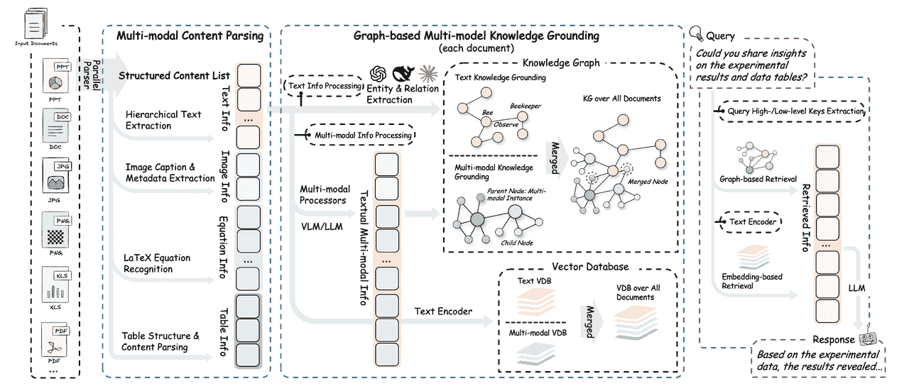

而对于初学者来说，为了更好的上手学习RAG技术，我们首先需要对RAG技术最简单的实现形式有个基础的了解。一个最简单的RAG技术实现流程如下所示：

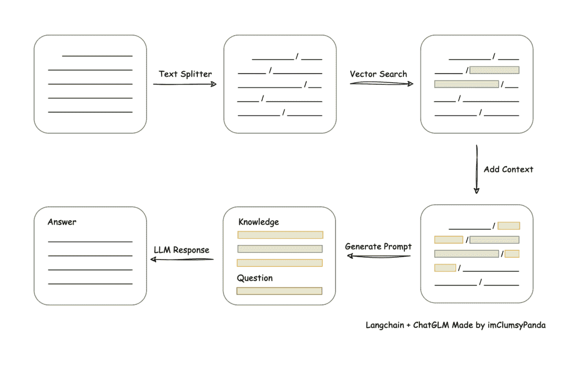

我们需要围绕给定的文档（往往是非常长的文档）先进行切分，然后将切分的文档转化为计算机能识别的形式，也就是将其转化为一个数值型向量（也被称为词向量），然后当用户询问问题的时候，我们再将用户的问题转化为词向量，并和段落文档的词向量进行相似度匹配，借此找出和当前用户问题最相关的原始文档片段，然后将用户的问题和匹配的到的原文片段都带入大模型，进行最终的问答。由此便可实现一次完整的文档检索增强执行流程。

具体执行过程如下所示：

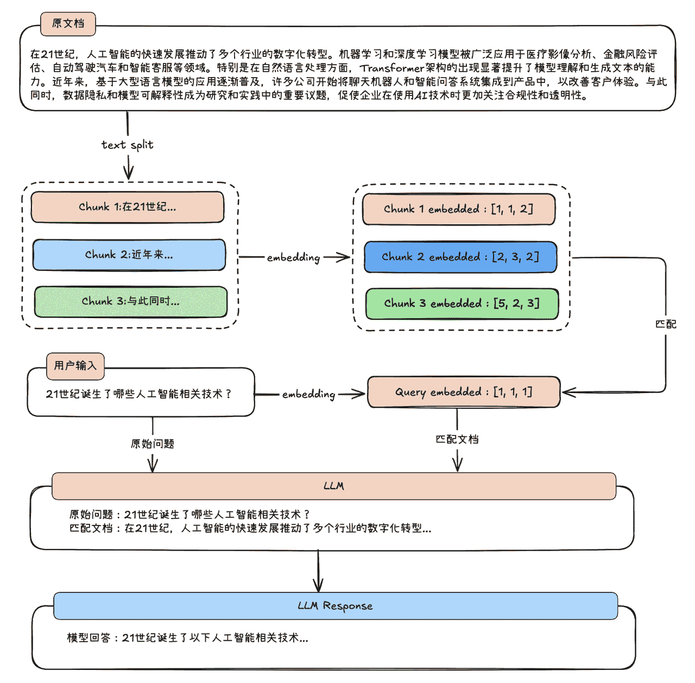

#### 1. Llama-Index 项目介绍

+   Llama-Index官方网站：https://www.llamaindex.ai/

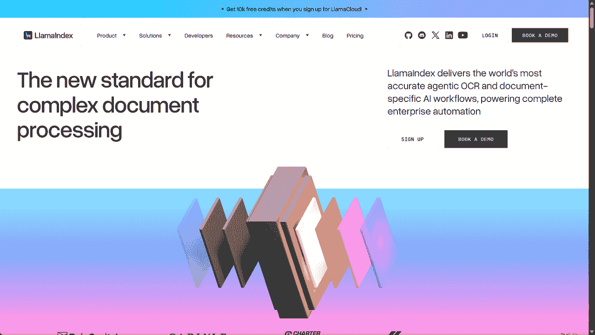

+   Llama-Index GitHub项目主页：https://github.com/run-llama/llama_index

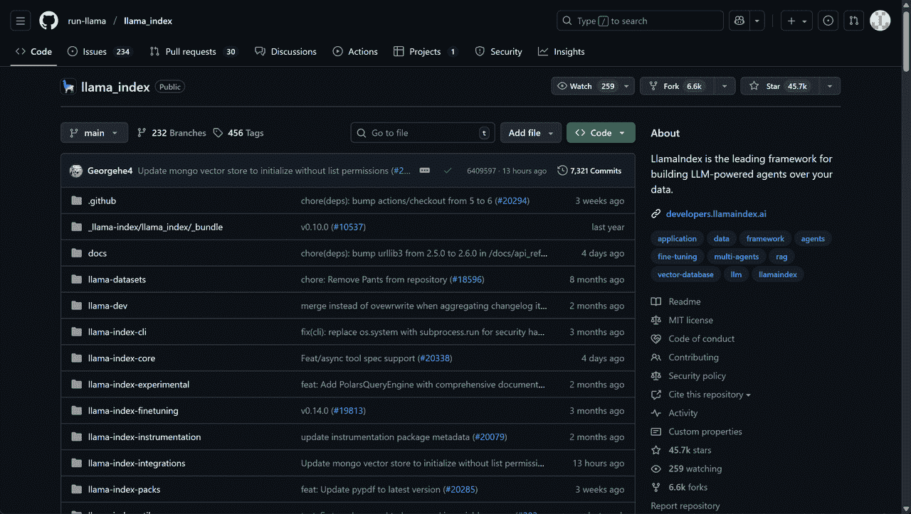

Llama-Index（前身为 GPT Index）由 Jerry Liu 于 2022 年底发起。项目的诞生背景源于大语言模型（LLM）落地初期的一个核心痛点：模型虽然具备强大的通用推理能力，但缺乏特定领域的私有知识（Private Knowledge），且受限于上下文窗口（Context Window）的长度，无法处理大规模文档。

Llama-Index 最初的初衷非常纯粹：构建一个高效的“接口”，将用户的私有数据（如 PDF、Notion、SQL、API 数据）转化为 LLM 能够理解和利用的格式，从而通过上下文学习（In-context Learning）来增强模型的能力。经过两年的高速迭代，它已从一个简单的索引工具演变为一个完整的“数据驱动型”大模型应用开发框架。

如果把大模型比作“大脑”，Llama-Index 的定位就是“记忆增强系统”。它的官方定义是：“用于构建上下文增强型（Context-augmented）LLM 应用程序的数据框架”。

它不仅仅关注于如何向模型提问（Prompt Engineering），更侧重于数据管理（Data Management）的全生命周期，包括数据的摄入（Ingestion）、结构化索引（Indexing）以及高效检索（Retrieval）。其核心目标是打破私有数据孤岛，让 LLM 能够以最低的成本、最高的精度访问海量外部知识。

目前，Llama-Index 是全球 AI 开源社区中最活跃的项目之一。

+   技术迭代：保持着极高的更新频率，已发布 v0.10+ 版本，完成了核心架构的模块化重构，具备了企业级生产环境所需的稳定性。

+   生态系统：拥有庞大的 LlamaHub 数据加载器生态，支持数百种数据源（从文件系统到 SaaS 服务）的开箱即用连接；同时支持 Python 和 TypeScript 双语言版本。

在 LLM 开发领域，通过对比可以更清晰地理解两者的差异：

+   LangChain（通用编排者）：

+   定位：通用的 LLM 应用开发框架。

+   强项：侧重于“计算逻辑”的编排。它擅长管理复杂的 Agent 行为链、工具调用（Tool Usage）以及多模态交互的流程控制。它像是一个“胶水”，连接模型与万物。

+   Llama-Index（数据专家）：

+   定位：专注于数据处理与检索的垂直框架。

+   强项：侧重于“数据结构”的优化。它在 RAG 领域拥有更深的护城河，特别是在处理非结构化数据切片、层级索引构建、复杂查询路由等方面提供了更精细的控制能力。

相较于其他框架，Llama-Index 在 RAG（检索增强生成）方面展现出显著的专业性优势：

1. 更丰富的数据索引结构：不仅支持简单的向量索引，还原生支持树状索引、关键词表索引、知识图谱索引等多种结构。

2. 更高级的检索策略：提供了递归检索（Recursive Retrieval）、混合检索（Hybrid Search）及元数据过滤等开箱即用的高级功能。

3. 数据与 LLM 的深度对齐：能够更好地处理长文档摘要、跨文档推理等复杂的数据任务。

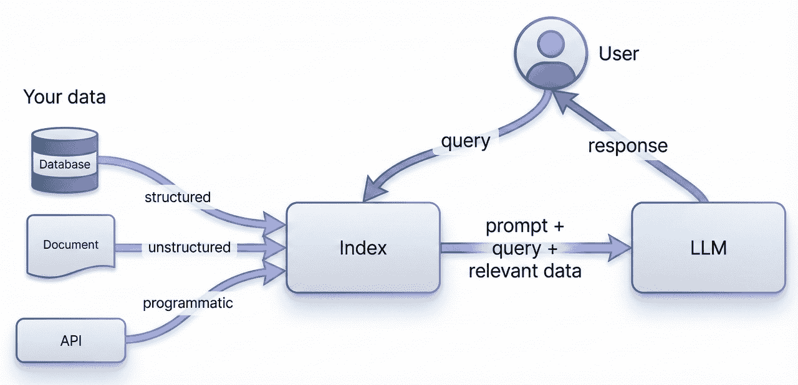

#### 2. Llama-Index RAG核心优势

##### 2.1 RAG 全生命周期（Full-Lifecycle）的闭环支持

与许多仅关注“向量检索”单一环节的工具不同，Llama-Index 提供了从数据源头到最终评估的 RAG 全流程解决方案。它将 RAG 系统抽象为五个标准化的流水线环节，开发者可以在同一个框架内完成所有工作，无需拼凑多个零散的工具库。

+   数据加载 (Loading)：提供统一接口将各类非结构化数据转化为标准的 `Document` 对象。

+   索引构建 (Indexing)：将文档切分（Chunking）并向量化（Embedding），构建出不仅包含向量、还包含元数据（Metadata）和节点关系（Relationships）的高级索引结构。

+   存储 (Storing)：原生适配数十种主流向量数据库（如 Chroma, Weaviate, Milvus）及图数据库，支持索引的持久化与增量更新。

+   查询 (Querying)：这一环节是 Llama-Index 的核心，它封装了检索、后处理和合成的复杂逻辑，对外提供简洁的查询接口。

+   评估 (Evaluation)：独有的 "Evaluation-First" 理念，内置了基于 LLM 的评估模块，能够对检索的准确性（Retrieval metrics）和生成的质量（Response metrics）进行自动化评分，解决了 RAG 难以优化的痛点。

##### 2.2 极致的定制化空间与丰富的功能接口

Llama-Index 最大的架构优势在于其模块化（Modularity）设计。它将 RAG 的每个步骤都解耦为可插拔的组件，特别是在查询引擎（Query Engine）环节，提供了极高的定制自由度：

+   高级后处理 (Post-Processing)：

在检索与生成之间，Llama-Index 允许开发者插入“节点后处理器（Node Postprocessors）”。这使得我们可以轻松实现：

+   重排序（Re-ranking）：集成 Cohere Rerank 或 BGE Rerank 模型，对检索到的 Top-K 结果进行二次精排，大幅提升相关性。

+   元数据过滤（Metadata Filtering）：基于时间、作者或文件类型过滤节点。

+   相似度截断（Similarity Cutoff）：自动丢弃相似度低于阈值的噪声数据。

+   灵活的响应合成 (Response Synthesis)：

针对不同的业务场景，提供了多种内置的合成策略，而非单一的拼接：

+   Refine（精炼模式）：线性遍历检索结果，逐步迭代优化答案，适合生成详尽的回答。

+   Tree Summarize（树状总结）：自底向上构建摘要树，适合处理海量上下文的归纳总结任务。

+   Compact（紧凑模式）：最大化利用 Context Window，平衡速度与成本。

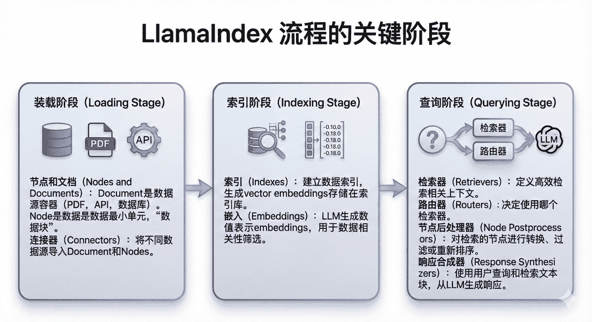

##### 2.3 庞大的数据生态：LlamaHub

Llama-Index 拥有目前 AI 社区中最丰富的数据连接器生态——LlamaHub。它解决了 RAG 开发中“最后一公里”的数据获取难题，让开发者无需自行编写爬虫或解析脚本。

+   海量数据加载器 (Data Loaders)：

社区维护了超过 400 种数据加载器，覆盖了几乎所有主流数据源：

+   文件类：PDF, Markdown, PowerPoint, Word, Excel, CSV 等。

+   SaaS 类：Notion, Slack, Discord, Jira, Salesforce, Google Docs 等。

+   网络类：Wikipedia, YouTube Transcripts, Web Page Reader 等。

+   数据库类：PostgreSQL, MongoDB, SQL Database 等。

+   多模态原生支持：

除了文本，LlamaHub 还提供了针对图像、音频和视频的加载器，支持构建图文混排的 RAG 系统，能够将多模态信息统一映射到向量空间。

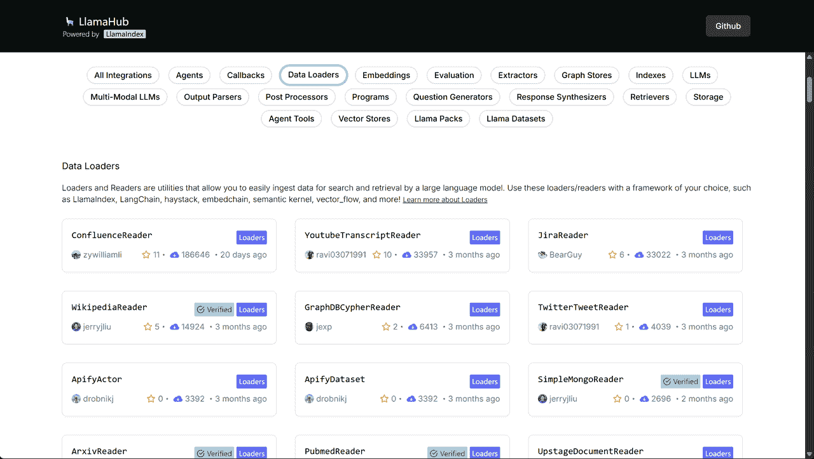

##### 2.4 企业级云服务：LlamaCloud

为了满足企业对高性能和免运维的需求，Llama-Index 团队还推出了配套的商业化云服务，进一步补全了开源框架的拼图：

+   LlamaParse：

这是目前业界最先进的文档解析服务之一。专为解决 RAG 中的“复杂文档处理”难题而生，能够精准识别和解析 PDF 中的复杂表格、图表、数学公式以及多栏排版，将其转化为 LLM 易于理解的 Markdown 格式，从源头上提升了 RAG 的检索质量。

+   Managed Indexing：

提供“检索即服务（Retrieval-as-a-Service）”，开发者无需自行维护向量数据库和索引管道，通过 API 即可直接上传文件并进行高效检索，大幅降低了企业级 RAG 的落地门槛。

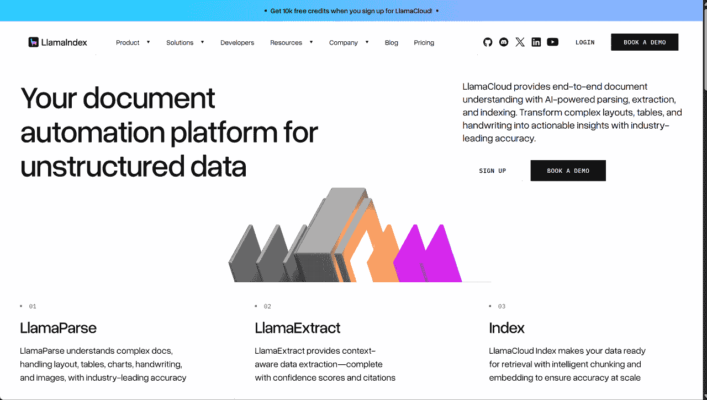

```
import os
from dotenv import load_dotenv
import llama_index.core
```

```
# 1. 加载环境变量
load_dotenv()

# 2. 检查 Llama-Index 版本
print(f"Llama-Index Version: {llama_index.core.__version__}")
```

```
Llama-Index Version: 0.14.10
```

```
import os
```

```
file_path = "./data/创新科技股份有限公司员工手册.txt"

with open(file_path, "r", encoding="utf-8") as f:
    md_content = f.read()
```

```
md_content[:1000]
```

```
'# 创新科技股份有限公司员工手册\n\n## 前言\n\n尊敬的各位员工：\n\n欢迎您加入创新科技股份有限公司（以下简称“公司”或“创新科技”）。在您正式开启职业生涯新阶段的这一时刻，我们谨代表全体管理层及全体同仁，对您的加入表示最热烈的欢迎和最诚挚的祝贺。无论您是刚步入职场的应届毕业生，还是经验丰富的行业专家，我们都深信，您的才华、热情与努力将为公司注入新的活力，也将在这里收获丰富的成长与成就。\n\n创新科技股份有限公司自2010年成立以来，始终秉持“科技改变未来，创新引领发展”的理念，致力于推动人工智能、云计算、大数据、物联网等前沿科技在各行业的应用落地，助力全球客户实现数字化转型和可持续发展。作为一家快速成长的高科技企业，我们的每一次突破、每一次扩张、每一次变革，无不凝聚着每一位员工的智慧与汗水。今天，我们已经拥有超过800位来自五湖四海、充满激情的同仁，分布在北京总部、上海、深圳、广州等主要城市，并在美国硅谷、新加坡等国际科技枢纽设有办事处。公司的服务范围广泛涵盖金融、医疗、教育、制造业、智慧城市等多个关键领域，并与多家国内外知名企业建立了长期稳定的合作关系。\n\n我们深知，企业的可持续发展，离不开良好的企业文化和科学的人力资源管理制度。而这一切的基础，正是规范、清晰、公开、透明的员工政策体系。本员工手册的制定，旨在为所有员工提供一份详尽而实用的行为指南，帮助您全面了解公司的核心价值观、组织架构、行为规范、管理流程以及相关福利政策。它不仅是公司与员工之间的一份制度性文件，更是双方建立互信、合作与共同成长的重要载体。\n\n在本手册中，您将系统地了解公司在多个层面的基本政策，包括但不限于雇佣制度、职业道德准则、信息安全与数据保护、绩效评估与职业发展、薪酬福利计划、员工健康与安全保障、多样性与包容性倡议、环境可持续发展目标，以及员工在不同生命周期阶段（包括入职、在职、调动、离职等）的应尽义务与享有权利。手册中的每一项制度、每一个流程，都是经过充分调研与反复论证制定而成，力求在保障公司合规运营与高效管理的同时，也最大限度地维护员工的合法权益和个人尊严。\n\n公司始终奉行“以人为本”的管理理念。我们不仅视员工为最宝贵的资产，更把员工的成长、发展与幸福作为企业成功的核心指标之一。在创新科技，您将拥有公平公正的发展平台、丰富多样的培训资源、具有市场竞争力的薪酬福利体系，以及健康积极的工作氛'
```

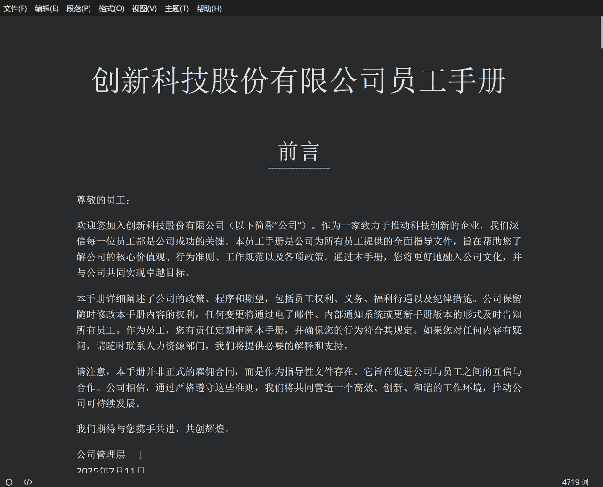

接下来介绍如何从零构建一个能够回答公司内部政策的 AI 助手。请注意，这几行代码虽然简洁，但它们在后台完成了 RAG 系统中最核心的 ETL（抽取、转换、加载）、索引构建以及检索生成的全流程。我们将逐行拆解，重点剖析在默认参数下，Llama-Index 到底在后台做了什么，以及如何查看底层结果。


```
from llama_index.core import VectorStoreIndex, SimpleDirectoryReader

# 1. 数据摄入 (Loading)
documents = SimpleDirectoryReader("data").load_data()

# 2. 索引构建 (Indexing)
index = VectorStoreIndex.from_documents(documents)

# 3. 引擎配置 (Query Engine)
query_engine = index.as_query_engine()

# 4. 执行查询 (Execution)
# 注意：aquery 是异步调用，在 Jupyter 或标准脚本中通常使用同步的 query
response = query_engine.query("请问，我们公司有病假政策么？请用中文进行回复。")
```

```
2025-12-11 17:52:14,257 - INFO - HTTP Request: POST https://api.openai.com/v1/embeddings "HTTP/1.1 200 OK"
2025-12-11 17:52:15,993 - INFO - HTTP Request: POST https://api.openai.com/v1/embeddings "HTTP/1.1 200 OK"
2025-12-11 17:52:17,533 - INFO - HTTP Request: POST https://api.openai.com/v1/chat/completions "HTTP/1.1 200 OK"
```

```
response.response
```

```
'公司有病假政策，员工可以享受最长为6个月的病假，具体的带薪比例根据工龄计算。'
```


### Part 2. 三大文本检索进阶策略介绍

```
import os
from dotenv import load_dotenv
import llama_index.core
```


```
# 1. 加载环境变量
load_dotenv(override=True)

# 2. 检查 Llama-Index 版本
print(f"Llama-Index Version: {llama_index.core.__version__}")
```

```
Llama-Index Version: 0.14.10
```

```
from llama_index.core import Settings
from llama_index.llms.openai import OpenAI
```

```
base_url=os.getenv("BASE_URL")
api_key=os.getenv("OPENAI_API_KEY")
```

```
# 配置 LLM (大语言模型)
Settings.llm = OpenAI(              
    model="gpt-4o",
    api_key=api_key,
    api_base=base_url                  
)
```

```
from llama_index.core import VectorStoreIndex, SimpleDirectoryReader

# 1. 数据摄入 (Loading)
documents = SimpleDirectoryReader("data").load_data()

# 2. 索引构建 (Indexing)
index = VectorStoreIndex.from_documents(documents)

# 3. 引擎配置 (Query Engine)
query_engine = index.as_query_engine()

# 4. 执行查询 (Execution)
# 注意：aquery 是异步调用，在 Jupyter 或标准脚本中通常使用同步的 query
response = query_engine.query("请问，我们公司有病假政策么？请用中文进行回复。")
```

```
2025-12-11 19:09:57,729 - INFO - HTTP Request: POST https://api.openai.com/v1/embeddings "HTTP/1.1 200 OK"
2025-12-11 19:09:58,785 - INFO - HTTP Request: POST https://api.openai.com/v1/embeddings "HTTP/1.1 200 OK"
2025-12-11 19:10:01,429 - INFO - HTTP Request: POST https://ai.devtool.tech/proxy/v1/chat/completions "HTTP/1.1 200 OK"
```

```
response.response
```

```
'是的，公司有病假政策。病假最长可达6个月，带薪比例根据员工的工龄计算。'
```

## 二、小索引，大窗口RAG策略详解

在 RAG 系统中，我们经常面临一个两难的选择：切片（Chunk）切小了，检索虽然精准，但丢给大模型的上下文支离破碎；切片切大了，上下文虽然完整，但包含大量无关噪声，导致检索准确率下降。

Small-to-Big（小索引，大窗口）策略，又称 Sentence Window Retrieval，正是为了解决这一痛点而生。该策略的核心思想在于将用于 “搜索” 的数据与用于 “给 LLM 看” 的数据分离开来。

+ 小索引 (Small Index for Retrieval)：

系统将文档切分为极细颗粒度的“单句”。我们在向量库中存储的是这些单句的向量。这样做的好处是，当用户提问时，问题能与最相关的某一句特定的话产生极高的相似度匹配，最大程度减少噪声干扰。

+ 大窗口 (Big Window for Generation)：

虽然我们搜的是句子，但单句往往缺乏上下文（例如“否则将被解雇”，光看这句不知道“否则”是指什么）。因此，我们在切分时，会预先将这句子前后相邻的 N 句话作为元数据（Metadata）存储起来。

+ 偷梁换柱 (Metadata Replacement)：

在检索到目标句子后，系统在发送给 LLM 之前，会执行一个“后处理”动作：将这个孤立的句子替换为它预存的“大窗口”内容。

```
# 3. 检查数据文件是否存在
if not os.path.exists("data/创新科技股份有限公司员工手册.txt"):
    print("❌ 错误：请确保 'data' 目录下存放了员工手册 txt 文件！")
else:
    print("✅ 环境检查通过，正在加载数据...")
    # 加载文档
    documents = SimpleDirectoryReader("./data").load_data()
    print(f"📄 成功加载文档，共 {len(documents)} 页/部分。")
```

```
✅ 环境检查通过，正在加载数据...
📄 成功加载文档，共 1 页/部分。
```

```
# === Cell 2: 构建“普通 RAG” (Baseline) ===

print("🛠️ 正在构建普通 RAG 索引 (使用默认 Chunking)...")

# 1. 建立普通索引
# 默认行为：Chunk Size = 1024, Top-k = 2
base_index = VectorStoreIndex.from_documents(documents)
base_engine = base_index.as_query_engine(similarity_top_k=2)

print("✅ 普通 RAG 就绪！")

# 定义我们的“找茬”问题集
test_questions = [
    "Q1: 如果我这个月迟到了 4 次，会受到什么样的具体处理？如果连续 3 天没打卡呢？",
    "Q2: 我想周末和春节都来公司加班多赚点钱，工资分别怎么算？我一年最多能加多少小时班，有没有封顶？",
    "Q3: 我还在试用期，最近家里有事想请半个月（15天）的假，按规定可以请吗？会不会影响我转正？"
]
```

```
🛠️ 正在构建普通 RAG 索引 (使用默认 Chunking)...

2025-12-11 19:41:03,477 - INFO - HTTP Request: POST https://api.openai.com/v1/embeddings "HTTP/1.1 200 OK"

✅ 普通 RAG 就绪！
```

```
# === Cell 3: 构建“黑科技 RAG” (Small-to-Big / Sentence Window) ===
from llama_index.core.node_parser import SentenceWindowNodeParser
from llama_index.core.postprocessor import MetadataReplacementPostProcessor
import re

print("🚀 正在构建黑科技 RAG 索引 (Small-to-Big)...")

# --- 🛠️ 关键修复：定义一个中文句子切分函数 ---
def chinese_sentence_splitter(text):
    # 使用正则表达式，按中文句号、问号、感叹号及换行符进行切分
    return re.split(r'(?<=[。？！\n])', text)

# 1. 定义窗口切分器 (加入 sentence_splitter 参数)
node_parser = SentenceWindowNodeParser.from_defaults(
    # 告诉它用我们定义的中文切分函数
    sentence_splitter=chinese_sentence_splitter, 
    # 窗口大小
    window_size=3,
    window_metadata_key="window",
    original_text_metadata_key="original_text",
)

# 2. 手动切分文档
nodes = node_parser.get_nodes_from_documents(documents)
print(f"🔪 文档被切分为 {len(nodes)} 个句子节点")

# --- 🔍 验证一下是否切分成功 (如果这里打印的是1，说明还是没切开) ---
if len(nodes) < 10:
    print("⚠️ 警告：节点数量过少，可能切分失败！请检查分割符。")
else:
    print(f"✅ 切分成功！第一个节点预览: {nodes[0].text[:50]}...")

# 3. 建立索引 (现在每个 Node 都很小，不会报错了)
advanced_index = VectorStoreIndex(nodes)

# 4. 创建引擎
advanced_engine = advanced_index.as_query_engine(
    similarity_top_k=5, 
    node_postprocessors=[
        MetadataReplacementPostProcessor(target_metadata_key="window")
    ]
)

print("✅ 黑科技 RAG 就绪！")
```

```
🚀 正在构建黑科技 RAG 索引 (Small-to-Big)...
🔪 文档被切分为 2371 个句子节点
✅ 切分成功！第一个节点预览: # 创新科技股份有限公司员工手册
...

2025-12-11 19:46:15,343 - INFO - HTTP Request: POST https://api.openai.com/v1/embeddings "HTTP/1.1 200 OK"
2025-12-11 19:46:16,120 - INFO - HTTP Request: POST https://api.openai.com/v1/embeddings "HTTP/1.1 200 OK"
2025-12-11 19:46:17,133 - INFO - HTTP Request: POST https://api.openai.com/v1/embeddings "HTTP/1.1 200 OK"
2025-12-11 19:46:17,702 - INFO - HTTP Request: POST https://api.openai.com/v1/embeddings "HTTP/1.1 200 OK"
2025-12-11 19:46:18,486 - INFO - HTTP Request: POST https://api.openai.com/v1/embeddings "HTTP/1.1 200 OK"
2025-12-11 19:46:19,123 - INFO - HTTP Request: POST https://api.openai.com/v1/embeddings "HTTP/1.1 200 OK"
2025-12-11 19:46:19,966 - INFO - HTTP Request: POST https://api.openai.com/v1/embeddings "HTTP/1.1 200 OK"
2025-12-11 19:46:21,570 - INFO - HTTP Request: POST https://api.openai.com/v1/embeddings "HTTP/1.1 200 OK"
2025-12-11 19:46:22,397 - INFO - HTTP Request: POST https://api.openai.com/v1/embeddings "HTTP/1.1 200 OK"
2025-12-11 19:46:22,916 - INFO - HTTP Request: POST https://api.openai.com/v1/embeddings "HTTP/1.1 200 OK"
2025-12-11 19:46:23,719 - INFO - HTTP Request: POST https://api.openai.com/v1/embeddings "HTTP/1.1 200 OK"
2025-12-11 19:46:24,224 - INFO - HTTP Request: POST https://api.openai.com/v1/embeddings "HTTP/1.1 200 OK"
2025-12-11 19:46:25,997 - INFO - HTTP Request: POST https://api.openai.com/v1/embeddings "HTTP/1.1 200 OK"
2025-12-11 19:46:26,721 - INFO - HTTP Request: POST https://api.openai.com/v1/embeddings "HTTP/1.1 200 OK"
2025-12-11 19:46:28,175 - INFO - HTTP Request: POST https://api.openai.com/v1/embeddings "HTTP/1.1 200 OK"
2025-12-11 19:46:28,936 - INFO - HTTP Request: POST https://api.openai.com/v1/embeddings "HTTP/1.1 200 OK"
2025-12-11 19:46:29,408 - INFO - HTTP Request: POST https://api.openai.com/v1/embeddings "HTTP/1.1 200 OK"
2025-12-11 19:46:29,854 - INFO - HTTP Request: POST https://api.openai.com/v1/embeddings "HTTP/1.1 200 OK"
2025-12-11 19:46:30,442 - INFO - HTTP Request: POST https://api.openai.com/v1/embeddings "HTTP/1.1 200 OK"
2025-12-11 19:46:31,247 - INFO - HTTP Request: POST https://api.openai.com/v1/embeddings "HTTP/1.1 200 OK"
2025-12-11 19:46:31,915 - INFO - HTTP Request: POST https://api.openai.com/v1/embeddings "HTTP/1.1 200 OK"
2025-12-11 19:46:38,478 - INFO - HTTP Request: POST https://api.openai.com/v1/embeddings "HTTP/1.1 200 OK"
2025-12-11 19:46:39,172 - INFO - HTTP Request: POST https://api.openai.com/v1/embeddings "HTTP/1.1 200 OK"
2025-12-11 19:46:40,021 - INFO - HTTP Request: POST https://api.openai.com/v1/embeddings "HTTP/1.1 200 OK"
2025-12-11 19:46:40,632 - INFO - HTTP Request: POST https://api.openai.com/v1/embeddings "HTTP/1.1 200 OK"

✅ 黑科技 RAG 就绪！
```

这段代码不仅仅是简单的 API 调用，它包含了一个针对中文环境的特殊优化，以及 Llama-Index 中最核心的元数据替换机制。我们将代码拆解为四个关键逻辑块进行讲解。

1. 关键设置：自定义中文分词器 (The Chinese Fix)

```
import re

# --- 🛠️ 关键修复：定义一个中文句子切分函数 ---
def chinese_sentence_splitter(text):
    # 使用正则表达式，按中文句号、问号、感叹号及换行符进行切分
    return re.split(r'(?<=[。？！\n])', text)
```

+ 为什么要写这个函数？

+ Llama-Index 的 `SentenceWindowNodeParser` 默认是为英文设计的，它寻找英文句号 . 来断句。


+ 如果直接处理中文文档，解析器会“视而不见”中文的句号。，导致它把整篇几千字的文档当成一整句话。这不仅会导致检索精度归零，更会直接撑爆 Embedding 模型的 Token 限制（如 OpenAI 的 8192 限制），引发报错。

+ **代码原理解析：**

+ 我们使用了 Python 的正则表达式 `re.split`。

+ `(?<=[。？！\n])` 是一个“后向断言” (Lookbehind Assertion)。它的意思是：“只要看到中文句号、问号、感叹号或者换行符，就在它们后面切一刀”。这样能保证标点符号被保留在句子里，而不是被切掉。

## 2. 定义窗口解析器 (The Architect)

```
# 1. 定义窗口切分器
node_parser = SentenceWindowNodeParser.from_defaults(
    sentence_splitter=chinese_sentence_splitter, # 挂载上面的中文切分函数
    window_size=3,                               # 核心参数：窗口半径
    window_metadata_key="window",                # 存储大窗口内容的字段名
    original_text_metadata_key="original_text",  # 存储原始句子的字段名
)
```

+ **核心逻辑：**

+ 这是该策略的“总设计师”。它决定了数据被切分后的形态。

+ **参数详解：**

+ `window_size=3`：这是策略的灵魂。意味着当系统切分出第 N 句话时，它会同时把 `[N-3, N-2, N-1, N, N+1, N+2, N+3]` 这 7 句话打包在一起，存储在元数据里。

+ `window_metadata_key="window"`：告诉系统，把打包好的“7句话大窗口”藏在节点的 `metadata['window']` 字段里，备用。

## 3. 切分与验证 (Parsing & Validation)

```
# 2. 手动切分文档
nodes = node_parser.get_nodes_from_documents(documents)

# --- 🔍 验证环节 ---
if len(nodes) < 10:
    print("⚠️ 警告...")
else:
    print("✅ 切分成功...")

# 3. 建立索引
advanced_index = VectorStoreIndex(nodes)
```

+ **流程变化：**

+ 在普通 RAG 中，我们直接用 `VectorStoreIndex.from_documents()`。

+ 在这里，我们必须先手动调用 `get_nodes_from_documents` 获得 `nodes`，然后再建索引。这是为了确保我们的切分策略生效。

+ **向量化的是谁？**

+ **关键点：** 此时建立索引，Embedding 模型计算的是 `node.text`（也就是单句）的向量，而不是那个“大窗口”的向量。这保证了检索的极致精准度。

## 4. 引擎构建与“偷梁换柱” (The Magic Swap)

```
# 4. 创建引擎
advanced_engine = advanced_index.as_query_engine(
    similarity_top_k=5, 
    node_postprocessors=[
        MetadataReplacementPostProcessor(target_metadata_key="window")
    ]
)
```

+ `similarity_top_k=5`：

+ 因为我们检索的是“细粒度”的句子，单个节点包含的信息量很小，所以我们需要稍微多找几个（Top-5），以确保覆盖足够的信息。

+ `MetadataReplacementPostProcessor` (魔法核心)：

+ 这是 Llama-Index 特有的后处理器。

+ **工作流：**

1. **检索时：** 系统用问题去匹配“单句”。

1. **命中后：** 处理器介入，检查每个命中节点的 `metadata`。

1. **替换（Swap）：** 它把 `metadata['window']`（那个包含上下文的大段落）取出来，直接覆盖掉原本的 `node.text`（单句）。

1. **合成时：** 发送给 LLM 的 Prompt 里，填入的就是替换后的“大窗口”内容。

整体来说基本流程如下：

1. **原始文档** **孤立句子**

1. **孤立句子** **带有“上下文背包”的句子节点**

1. **索引阶段** 只对 **“句子”** 做向量化（为了搜得准）

1. **检索阶段** 搜到了 **“句子”**

1. **处理阶段** 扔掉句子，打开背包拿出 **“大窗口”**

1. **生成阶段** LLM 阅读 **“大窗口”** 并回答（为了看得全）

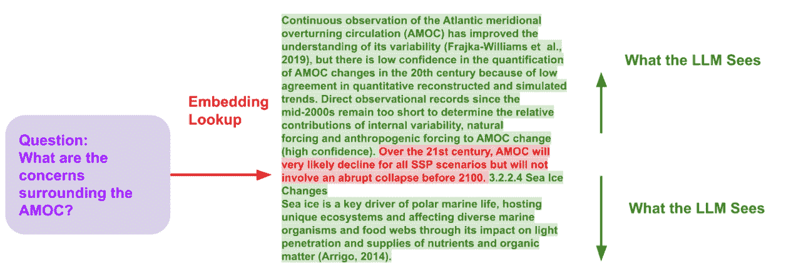

```
# === Cell 4: 效果对比展示 ===
from IPython.display import display, Markdown

def compare_answers(question):
    # 1. 跑普通 RAG
    response_base = base_engine.query(question)
    
    # 2. 跑黑科技 RAG
    response_adv = advanced_engine.query(question)
    
    # 3. 格式化输出 (使用 Markdown 表格让对比更强烈)
    display(Markdown(f"### ❓ 提问: {question}"))
    
    # 构建对比表格
    table_md = f"""
| 🤖 普通 RAG (Baseline) | 🚀 黑科技 RAG (Small-to-Big) |
| :--- | :--- |
| {response_base.response} | {response_adv.response} |
"""
    display(Markdown(table_md))
    
    # 4. (可选) 展示黑科技到底引用了什么原文，增强可信度
    # display(Markdown("**🚀 黑科技引用原文窗口:**"))
    # for node in response_adv.source_nodes:
    #     display(Markdown(f"> ...{node.node.metadata['window']}..."))
    
    display(Markdown("---"))

# 开始循环测试
for q in test_questions:
    compare_answers(q)
```

```
2025-12-11 19:46:57,639 - INFO - HTTP Request: POST https://api.openai.com/v1/embeddings "HTTP/1.1 200 OK"
2025-12-11 19:46:59,213 - INFO - HTTP Request: POST https://ai.devtool.tech/proxy/v1/chat/completions "HTTP/1.1 200 OK"
2025-12-11 19:46:59,615 - INFO - HTTP Request: POST https://api.openai.com/v1/embeddings "HTTP/1.1 200 OK"
2025-12-11 19:47:01,469 - INFO - HTTP Request: POST https://ai.devtool.tech/proxy/v1/chat/completions "HTTP/1.1 200 OK"
```

### ❓ 提问: Q1: 如果我这个月迟到了 4 次，会受到什么样的具体处理？如果连续 3 天没打卡呢？

| 🤖 普通 RAG (Baseline) | 🚀 黑科技 RAG (Small-to-Big) |
| --- | --- |
| 如果这个月迟到了4次，将会由主管进行面谈。如果连续3天未打卡，将被视为严重违纪，并启动正式调查程序。 | 如果这个月迟到了 4 次，你将由主管进行面谈。若连续 3 天未打卡，将被视为严重违纪，并启动正式调查程序。 |

```
2025-12-11 19:47:01,885 - INFO - HTTP Request: POST https://api.openai.com/v1/embeddings "HTTP/1.1 200 OK"
2025-12-11 19:47:04,442 - INFO - HTTP Request: POST https://ai.devtool.tech/proxy/v1/chat/completions "HTTP/1.1 200 OK"
2025-12-11 19:47:04,825 - INFO - HTTP Request: POST https://api.openai.com/v1/embeddings "HTTP/1.1 200 OK"
2025-12-11 19:47:07,058 - INFO - HTTP Request: POST https://ai.devtool.tech/proxy/v1/chat/completions "HTTP/1.1 200 OK"
```

### ❓ 提问: Q2: 我想周末和春节都来公司加班多赚点钱，工资分别怎么算？我一年最多能加多少小时班，有没有封顶？

| 🤖 普通 RAG (Baseline) | 🚀 黑科技 RAG (Small-to-Big) |
| --- | --- |
| 公司不强制安排无偿加班，员工可以根据项目安排与主管协商加班事宜。对于加班工资的计算，具体的金额和计算方式未在手册中详细说明。至于一年最多能加多少小时班以及是否有封顶，手册中并未提供相关信息，建议与主管或人力资源部门进行进一步咨询以获取详细规定。 | 周末加班的工资是按基本工资的2倍补偿，或者可以选择以调休形式折算。春节属于法定节假日，加班工资按基本工资的3倍支付。年度个人加班时间最多为200小时，超过部分需要部门总监审批并报备HR。 |

```
2025-12-11 19:47:07,433 - INFO - HTTP Request: POST https://api.openai.com/v1/embeddings "HTTP/1.1 200 OK"
2025-12-11 19:47:10,823 - INFO - HTTP Request: POST https://ai.devtool.tech/proxy/v1/chat/completions "HTTP/1.1 200 OK"
2025-12-11 19:47:11,297 - INFO - HTTP Request: POST https://api.openai.com/v1/embeddings "HTTP/1.1 200 OK"
2025-12-11 19:47:13,295 - INFO - HTTP Request: POST https://ai.devtool.tech/proxy/v1/chat/completions "HTTP/1.1 200 OK"
```

### ❓ 提问: Q3: 我还在试用期，最近家里有事想请半个月（15天）的假，按规定可以请吗？会不会影响我转正？

| 🤖 普通 RAG (Baseline) | 🚀 黑科技 RAG (Small-to-Big) |
| --- | --- |
| 在试用期内请假通常需要遵循公司的请假规定。如果您有正当理由，可以向人力资源部门申请假期。请假是否会影响转正，通常取决于公司的具体政策和您在试用期内的表现。建议您与直接上级或人力资源部门沟通，了解请假对转正的具体影响。 | 在试用期内，你可以请假，包括病假、事假、婚假等法定假期。然而，如果累计请假超过10个工作日，试用期考核结果可能会受到影响。因此，请半个月（15天）的假可能会影响你的转正。 |

## 三、混合检索 (Hybrid Search)执行策略

### 1. 策略背景：告别“懂意不懂字”的单腿走路

在基础的 RAG 系统中，我们通常完全依赖向量检索（Vector Search）。向量检索的魔法在于它能通过计算高维空间的距离来理解“语义”。例如，用户搜“请假规则”，它能通过语义关联找到“考勤管理”或“休假制度”，即便这几个字没有完全对应。

然而，在企业级落地中，我们很快发现纯向量检索存在一个致命的“语义盲区”：它对精确匹配（`Exact Match`）极不敏感。

+ 当用户搜索一个特定的错误码（如“Error 503”）、一个生僻的人名（如“周云杰”）、一个专有的缩写（如“ROWE”）或一个具体的产品型号（如“X-2000”）时，向量模型往往会因为这些词在语义空间中过于稀疏，而检索到一堆“意思相近”但完全不相关的通用描述，导致“张冠李戴”。

混合检索（Hybrid Search） 的诞生，正是为了解决这一痛点。它主张“两条腿走路”，既要 AI 的“脑子”（语义理解），也要传统搜索引擎的“眼睛”（字面匹配）。

### 2. 核心原理：双路召回与加权融合

混合检索策略在底层构建了两条并行的检索链路，并通过精密的算法将结果合二为一：

+ 链路 A：稠密向量检索 (Dense Retrieval)

+ **机制：** 使用 Embedding 模型将文本转化为向量。

+ **强项：** 擅长处理模糊查询、概念关联、同义词匹配。

+ **角色：** 负责“懂你什么意思”。

+ 链路 B：稀疏关键词检索 (Sparse Retrieval / `BM25`)

+ **机制：** 基于传统的 `TF-IDF`（词频-逆文档频率）算法演进而来的 `BM25` 算法。

+ **强项：** 擅长捕捉生僻词、专有名词、精确数字。它不关心语义，只关心关键词是否在文档中高频出现。

+ **角色：** 负责“精准定位字面”。

+ **融合机制：** 倒数排名融合 (`Reciprocal Rank Fusion`, `RRF`)

+ 系统不会简单地把两路结果拼在一起，而是使用 `RRF` 算法。它像一个公正的裁判，查看两个链路的排名情况。如果一个文档在向量检索中排第 1，在关键词检索中也排第 1，它的最终权重会极高；如果只在单路出现，权重则会降低。

### 3. 执行流程

```
# !pip install rank_bm25 jieba
```

```
# === Cell 1: 初始化与分词器配置 ===
import nest_asyncio
import jieba
from typing import List
from llama_index.core import SimpleDirectoryReader, VectorStoreIndex, Settings, StorageContext
from llama_index.core.node_parser import SentenceSplitter

nest_asyncio.apply()

# 1. 定义一个中文分词函数 (给 BM25 用)
def chinese_tokenizer(text: str) -> List[str]:
    # 使用 jieba 进行分词
    return list(jieba.cut(text))

# 2. 加载数据
print("📂 正在加载文档...")
documents = SimpleDirectoryReader("./data").load_data()

# 3. 将文档切分为节点 (标准切分，Chunk Size=512 适中)
# 为什么要手动切分？因为 BM25 和 向量索引 需要共享同一套节点数据
splitter = SentenceSplitter(chunk_size=512, chunk_overlap=50)
nodes = splitter.get_nodes_from_documents(documents)
print(f"✅ 文档已切分为 {len(nodes)} 个标准节点。")
```

```
C:\Users\Admin\anaconda3\envs\llamaindex\Lib\site-packages\jieba\_compat.py:18: UserWarning: pkg_resources is deprecated as an API. See https://setuptools.pypa.io/en/latest/pkg_resources.html. The pkg_resources package is slated for removal as early as 2025-11-30. Refrain from using this package or pin to Setuptools<81.
  import pkg_resources


📂 正在加载文档...
✅ 文档已切分为 117 个标准节点。
```


# RAG 混合检索系统构建与效果对比

## Cell 2: 构建“普通 RAG” (纯向量)

```python
# === Cell 2: 构建“普通 RAG” (纯向量) ===
print("🛠️ 正在构建向量索引 (Vector Index)...")

# 1. 构建向量索引
vector_index = VectorStoreIndex(nodes)

# 2. 创建纯向量检索引擎
# similarity_top_k=2
vector_engine = vector_index.as_query_engine(similarity_top_k=2)

print("✅ 普通 RAG (Vector Only) 就绪！")
```

```text
🛠️ 正在构建向量索引 (Vector Index)...

2025-12-11 19:50:11,353 - INFO - HTTP Request: POST `https://api.openai.com/v1/embeddings` "HTTP/1.1 200 OK"
2025-12-11 19:50:12,070 - INFO - HTTP Request: POST `https://api.openai.com/v1/embeddings` "HTTP/1.1 200 OK"


✅ 普通 RAG (Vector Only) 就绪！
```

## Cell 3: 构建“黑科技 RAG” (混合检索: Vector + BM25)

```python
# === Cell 3: 构建“黑科技 RAG” (混合检索: Vector + BM25) ===
import inspect
from llama_index.retrievers.bm25 import BM25Retriever
from llama_index.core.retrievers import VectorIndexRetriever
from llama_index.core.retrievers import QueryFusionRetriever
from llama_index.core.query_engine import RetrieverQueryEngine

print("🚀 正在构建混合检索系统 (Hybrid Search)...")

# --- 🛠️ 自动侦测修复：从类型提示中提取 FusionMode ---
try:
    # 1. 获取 __init__ 函数的签名
    sig = inspect.signature(QueryFusionRetriever.__init__)
    # 2. 找到 'mode' 参数的类型定义
    ModeEnum = sig.parameters['mode'].annotation
    print(f"✅ 成功自动侦测到 Mode 类型: {ModeEnum}")
    
    # 3. 获取 RECIPROCAL_RANK 的值
    # 如果它是枚举，直接取属性；如果是 Optional[FusionMode]，可能需要剥离一层
    # 这里做一个简单的容错遍历
    if hasattr(ModeEnum, 'RECIPROCAL_RANK'):
        target_mode = ModeEnum.RECIPROCAL_RANK
    else:
        # 如果类型提示没拿到，或者版本太旧是字符串，直接用字符串兜底
        print("⚠️ 未找到枚举属性，尝试使用字符串模式...")
        target_mode = "reciprocal_rank"
        
except Exception as e:
    print(f"⚠️ 自动侦测失败 ({e})，回退到字符串模式...")
    target_mode = "reciprocal_rank";

print(f"👉 最终使用的 mode 参数: {target_mode}")


# 1. 创建 BM25 检索器
bm25_retriever = BM25Retriever.from_defaults(
    nodes=nodes,
    similarity_top_k=2,
    tokenizer=chinese_tokenizer
)

# 2. 创建 向量 检索器
vector_retriever = VectorIndexRetriever(index=vector_index, similarity_top_k=2)

# 3. 创建 融合检索器
fusion_retriever = QueryFusionRetriever(
    [vector_retriever, bm25_retriever],
    similarity_top_k=4,
    num_queries=1,
    # 使用我们要么侦测到、要么回退的 mode
    mode=target_mode,
    use_async=True
)

# 4. 组装成引擎
hybrid_engine = RetrieverQueryEngine.from_args(
    retriever=fusion_retriever
)

print("✅ 黑科技 RAG (Hybrid Search) 就绪！")
```

```text
2025-12-11 19:58:19,832 - WARNING - The tokenizer parameter is deprecated and will be removed in a future release. Use a stemmer from `PyStemmer` instead.
2025-12-11 19:58:19,853 - DEBUG - Building index from IDs objects


🚀 正在构建混合检索系统 (Hybrid Search)...
✅ 成功自动侦测到 Mode 类型: <enum 'FUSION_MODES'>
👉 最终使用的 mode 参数: FUSION_MODES.RECIPROCAL_RANK
✅ 黑科技 RAG (Hybrid Search) 就绪！
```

这段代码展示了如何将关键词检索 (BM25) 与 向量检索 (Vector) 结合，并通过 RRF (倒数排名融合) 算法实现 1+1 > 2 的效果。值得注意的是，代码开头包含了一段处理版本兼容性的“防御性编程”技巧。

我们将代码逻辑拆解为三个核心模块进行讲解：

### 1. 自动侦测与版本适配 (The Compatibility Fix)

```python
import inspect

# --- 🛠️ 自动侦测修复：从类型提示中提取 FusionMode ---
try:
    # 1. 获取构造函数的签名 (Signature)
    sig = inspect.signature(QueryFusionRetriever.__init__)
    # 2. 侦测 'mode' 参数到底想要什么类型 (Enum 还是 String?)
    ModeEnum = sig.parameters['mode'].annotation
    # ... (省略中间判断逻辑)
    if hasattr(ModeEnum, 'RECIPROCAL_RANK'):
        target_mode = ModeEnum.RECIPROCAL_RANK
    else:
        target_mode = "reciprocal_rank"
except Exception as e:
    target_mode = "reciprocal_rank"
```

+   为什么要写这段复杂的逻辑？

+   背景：`Llama-Index` 更新极快，v0.10.x 版本中，`FusionMode` 从字符串变成了严格的枚举类型（`Enum`）。直接写字符串 `"reciprocal_rank"` 在新版会报错，直接引枚举类在旧版又会报错。

+   原理：这里使用了 Python 的 `inspect`（反射）模块。

+   比喻：这就像在进门前，先用扫描仪看一眼门锁是“指纹锁”还是“钥匙锁”，然后再决定掏出指纹还是钥匙。这是一种“防御性编程”，确保你的代码在不同版本的 `Llama-Index` 上都能跑通，不至于因为版本升级而崩溃。

### 2. 创建双路检索器 (Two-Stream Retrievers)

```python
# 1. 创建 BM25 检索器 (关键词派 - The Eye)
bm25_retriever = BM25Retriever.from_defaults(
    nodes=nodes,
    similarity_top_k=2,     # 只要最匹配关键字的前2名
    tokenizer=chinese_tokenizer # ⚠️ 关键：中文必须传入分词函数
)

# 2. 创建 向量 检索器 (语义派 - The Brain)
vector_retriever = VectorIndexRetriever(
    index=vector_index, 
    similarity_top_k=2      # 只要语义最相似的前2名
)
```

+   分工明确：

+   `BM25Retriever`：它是系统的“眼睛”，负责盯着字面。如果用户搜“周云杰”，它能精准抓取包含这三个字的人名，哪怕语义上这只是一个普通名字。

+   `VectorIndexRetriever`：它是系统的“脑子”，负责理解含义。如果用户搜“法务负责人”，它能理解这和“周云杰”是关联的。

+   注意点：`BM25` 必须传入 `tokenizer=chinese_tokenizer`，否则它会把一整句中文当成一个长单词，无法匹配关键词。

### 3. 融合与引擎组装 (The Fusion Core)

```python
# 3. 创建 融合检索器
fusion_retriever = QueryFusionRetriever(
    [vector_retriever, bm25_retriever], # 输入两路检索器
    similarity_top_k=4,                 # 融合后，给 LLM 看前 4 个结果
    num_queries=1,                      # 只处理原问题，不生成额外问题
    mode=target_mode,                   # 使用 RRF 算法 (Reciprocal Rank Fusion)
    use_async=True
)

# 4. 组装成引擎
hybrid_engine = RetrieverQueryEngine.from_args(
    retriever=fusion_retriever
)
```

+   核心组件 `QueryFusionRetriever`：

    它是整个策略的指挥官。

+   `mode=RECIPROCAL_RANK` (RRF 算法)：

    +   这是目前业界最流行的无监督融合算法。

    +   工作原理：它不看分数（因为 `BM25` 的分数和向量的 `Cosine` 分数无法直接比较），它看排名。

    +   举例：如果文档 A 在关键词检索排第 1，在向量检索也排第 1，它的 `RRF` 得分就会极高，被置顶。如果文档 B 只在向量检索出现，关键词检索里没影，它的排名就会下降。

    +   结果：`hybrid_engine` 最终吐出的答案，既包含了字面精准的信息，也包含了语义相关的信息，消除了单一检索的盲区。

## Cell 4: 效果对比展示

```python
# === Cell 4: 效果对比展示 ===
from IPython.display import display, Markdown

# 定义“找茬”问题
# 这些问题包含了具体的实体名(Entity)和缩写，是向量检索的弱项
questions = [
    "Q1: 请问法务合规部的负责人是谁？我想发邮件给他，邮箱是多少？",
    "Q2: 公司关于 BYOD (自带设备) 的具体政策要求是什么？",
    "我是研发部的老员工，听说有个‘ROWE’工作制，具体需要满足哪些硬性条件才能申请？",
    "如果我遇到紧急情况需要心理支持，公司有没有专门的援助热线？具体的电话号码是多少？",
    "公司内部有没有专门支持女性发展的组织？这个小组的准确名称叫什么？"
]

def compare_hybrid(question):
    # 1. 普通 RAG
    response_base = vector_engine.query(question)
    
    # 2. 混合 RAG
    response_hybrid = hybrid_engine.query(question)
    
    # 3. 展示对比
    display(Markdown(f"### ❓ 提问: {question}"))
    
    table_md = f"""
| 🤖 普通 RAG (Vector Only) | 🚀 黑科技 RAG (Hybrid: Vector + BM25) |
| :--- | :--- |
| {response_base.response} | {response_hybrid.response} |
"""
    display(Markdown(table_md))
    
    # 可选：查看混合检索到底融合了哪些节点
    # print("🔍 混合检索命中的节点片段:")
    # for node in response_hybrid.source_nodes:
    #     print(f"[{node.score:.2f}] {node.node.text[:50]}...")
    
    display(Markdown("---"))

# 开始测试
for q in questions:
    compare_hybrid(q)
```

```text
2025-12-11 20:00:12,472 - INFO - HTTP Request: POST `https://api.openai.com/v1/embeddings` "HTTP/1.1 200 OK"
2025-12-11 20:00:13,925 - INFO - HTTP Request: POST `https://ai.devtool.tech/proxy/v1/chat/completions` "HTTP/1.1 200 OK"
2025-12-11 20:00:13,937 - INFO - Retrying request to `/embeddings` in 0.409338 seconds
2025-12-11 20:00:15,131 - INFO - HTTP Request: POST `https://api.openai.com/v1/embeddings` "HTTP/1.1 200 OK"
2025-12-11 20:00:16,623 - INFO - HTTP Request: POST `https://ai.devtool.tech/proxy/v1/chat/completions` "HTTP/1.1 200 OK"
```

### ❓ 提问: Q1: 请问法务合规部的负责人是谁？我想发邮件给他，邮箱是多少？

| 🤖 普通 RAG (Vector Only) | 🚀 黑科技 RAG (Hybrid: Vector + BM25) |
| --- | --- |
| 抱歉，无法提供法务合规部负责人的姓名和邮箱信息。建议您通过公司内部通讯录或联系相关部门获取详细信息。 | 法务合规部的负责人是周云杰，您可以通过邮箱 legal@innovatech.cn 联系他。 |

```text
2025-12-11 20:00:16,996 - INFO - HTTP Request: POST `https://api.openai.com/v1/embeddings` "HTTP/1.1 200 OK"
2025-12-11 20:00:18,039 - INFO - HTTP Request: POST `https://ai.devtool.tech/proxy/v1/chat/completions` "HTTP/1.1 200 OK"
2025-12-11 20:00:18,043 - INFO - Retrying request to `/embeddings` in 0.465214 seconds
2025-12-11 20:00:19,036 - INFO - HTTP Request: POST `https://api.openai.com/v1/embeddings` "HTTP/1.1 200 OK"
2025-12-11 20:00:20,251 - INFO - HTTP Request: POST `https://ai.devtool.tech/proxy/v1/chat/completions` "HTTP/1.1 200 OK"
```

### ❓ 提问: Q2: 公司关于 BYOD (自带设备) 的具体政策要求是什么？

| 🤖 普通 RAG (Vector Only) | 🚀 黑科技 RAG (Hybrid: Vector + BM25) |
| --- | --- |


| 公司关于 BYOD（自带设备）的政策要求是：自带设备需要提前登记备案，并通过加密配置。 | 公司关于 BYOD（自带设备）的政策要求包括：自带设备需提前登记备案，并通过加密配置，以确保安全性。 |

---

```
2025-12-11 20:00:20,635 - INFO - HTTP Request: POST https://api.openai.com/v1/embeddings &quot;HTTP/1.1 200 OK&quot;
2025-12-11 20:00:22,026 - INFO - HTTP Request: POST https://ai.devtool.tech/proxy/v1/chat/completions &quot;HTTP/1.1 200 OK&quot;
2025-12-11 20:00:22,034 - INFO - Retrying request to /embeddings in 0.419734 seconds
2025-12-11 20:00:23,035 - INFO - HTTP Request: POST https://api.openai.com/v1/embeddings &quot;HTTP/1.1 200 OK&quot;
2025-12-11 20:00:24,799 - INFO - HTTP Request: POST https://ai.devtool.tech/proxy/v1/chat/completions &quot;HTTP/1.1 200 OK&quot;
```

## ❓ 提问: 我是研发部的老员工，听说有个‘ROWE’工作制，具体需要满足哪些硬性条件才能申请？

| 🤖 普通 RAG (Vector Only) | 🚀 黑科技 RAG (Hybrid: Vector + BM25) |

| --- | --- |

| 要申请“以成果为导向的工作制度（ROWE）”，需要满足以下硬性条件：任职时间不少于一年，过往绩效为“良好”以上，能够独立承担项目任务并具备自我管理能力，以及已签署《ROWE工作协议》，明确目标设定与交付周期。 | 要申请“以成果为导向的工作制度（ROWE）”，需要满足以下硬性条件：任职时间不少于一年，过往绩效为“良好”以上，能够独立承担项目任务并具备自我管理能力，以及已签署《ROWE工作协议》，明确目标设定与交付周期。 |

---

```
2025-12-11 20:00:25,128 - INFO - HTTP Request: POST https://api.openai.com/v1/embeddings &quot;HTTP/1.1 200 OK&quot;
2025-12-11 20:00:26,712 - INFO - HTTP Request: POST https://ai.devtool.tech/proxy/v1/chat/completions &quot;HTTP/1.1 200 OK&quot;
2025-12-11 20:00:26,728 - INFO - Retrying request to /embeddings in 0.376975 seconds
2025-12-11 20:00:27,726 - INFO - HTTP Request: POST https://api.openai.com/v1/embeddings &quot;HTTP/1.1 200 OK&quot;
2025-12-11 20:00:29,424 - INFO - HTTP Request: POST https://ai.devtool.tech/proxy/v1/chat/completions &quot;HTTP/1.1 200 OK&quot;
```

## ❓ 提问: 如果我遇到紧急情况需要心理支持，公司有没有专门的援助热线？具体的电话号码是多少？

| 🤖 普通 RAG (Vector Only) | 🚀 黑科技 RAG (Hybrid: Vector + BM25) |

| --- | --- |

| 公司员工手册中没有提到专门的心理支持援助热线或具体电话号码。建议联系公司的人力资源部门或查看员工门户以获取更多信息。 | 公司没有提供专门的心理支持援助热线的具体电话号码。不过，员工在遭遇紧急事件时可以拨打公司应急热线，具体号码分部门张贴，或者通过企业IM标记“#紧急”发布信息，系统会自动通知相关部门进行响应。 |

---

```
2025-12-11 20:00:29,935 - INFO - HTTP Request: POST https://api.openai.com/v1/embeddings &quot;HTTP/1.1 200 OK&quot;
2025-12-11 20:00:30,869 - INFO - HTTP Request: POST https://ai.devtool.tech/proxy/v1/chat/completions &quot;HTTP/1.1 200 OK&quot;
2025-12-11 20:00:30,878 - INFO - Retrying request to /embeddings in 0.420910 seconds
2025-12-11 20:00:31,874 - INFO - HTTP Request: POST https://api.openai.com/v1/embeddings &quot;HTTP/1.1 200 OK&quot;
2025-12-11 20:00:33,213 - INFO - HTTP Request: POST https://ai.devtool.tech/proxy/v1/chat/completions &quot;HTTP/1.1 200 OK&quot;
```

## ❓ 提问: 公司内部有没有专门支持女性发展的组织？这个小组的准确名称叫什么？

| 🤖 普通 RAG (Vector Only) | 🚀 黑科技 RAG (Hybrid: Vector + BM25) |

| --- | --- |

| 公司内部有专门支持女性发展的组织，准确名称是 "Women@Innovation"。 | 公司内部有专门支持女性发展的组织，准确名称是 "Women@Innovation"。 |

---

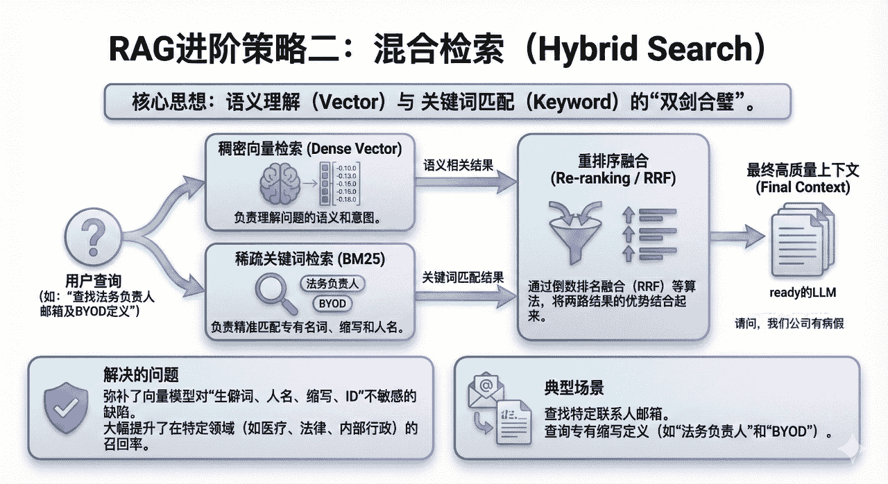

## 四、路由检索策略介绍

### 1. 策略背景：打破“一刀切”的检索僵局

在传统的 RAG 架构中，存在一个尴尬的悖论：“宏观与微观的冲突”。

+ 如果我们为了回答“总结全文核心思想”这样的宏观问题，而将 Top-K 设得很大或使用摘要索引，那么在回答“某项补贴具体是多少钱”这种微观问题时，就会造成巨大的算力浪费和响应延迟。

+ 反之，如果我们为了快速查细节而使用标准的 Top-2 向量检索，那么面对“请概述公司发展历程”这样的问题时，系统就像“管中窥豹”，只能抓取到零星片段，给出的答案往往是片面甚至错误的。

智能路由（`Router Query Engine`）的引入，标志着 RAG 系统从“自动化”向 `Agent`（智能体）迈出了关键一步。它不再机械地执行单一动作，而是学会了“先思考，再行动”。

### 2. 核心原理：RAG 系统的“前置分诊台”

智能路由策略的核心在于构建了一个决策层，位于用户提问和数据索引之间：

+ **构建多元工具箱：**

我们不再只维护一个索引，而是针对不同的任务构建不同的索引结构，并将它们封装为“工具（Tools）”。

+ **工具 A（向量工具）：** 基于 `VectorStoreIndex`，擅长点对点的细节查询（查数据、查条款）。

+ **工具 B（摘要工具）：** 基于 `SummaryIndex`，擅长遍历全文档构建树状摘要（做总结、看全貌）。

+ AI 路由选择器 (`LLM Selector`):

这是系统的“大脑”。当问题进来时，`Selector` 会先阅读问题的意图，然后对比手边工具的“功能描述（`Description`）”，动态决定：

+ “这个问题是查细节的 -> 派发给工具 A。”

+ “这个问题是做总结的 -> 派发给工具 B。”

+ “这个问题既要细节又要总结 -> 同时派发给 A 和 B，最后汇总。”

### 3. 执行流程

```
# === Cell 1: 初始化与构建双索引 (Vector + Summary) ===
import nest_asyncio
from llama_index.core import SimpleDirectoryReader, VectorStoreIndex, SummaryIndex, Settings
from llama_index.core.node_parser import SentenceSplitter

nest_asyncio.apply()

# 1. 加载数据
print(&quot;📂 正在加载文档...&quot;)
documents = SimpleDirectoryReader(&quot;./data&quot;).load_data()

# 2. 切分文档 (通用切分)
splitter = SentenceSplitter(chunk_size=1024, chunk_overlap=20)
nodes = splitter.get_nodes_from_documents(documents)

# 3. 构建【向量索引】 (擅长查细节)
print(&quot;🛠️ 正在构建向量索引 (Vector Index)...&quot;)
vector_index = VectorStoreIndex(nodes)

# 4. 构建【摘要索引】 (擅长做总结)
# SummaryIndex 不做向量化，它把所有节点存成一个列表，查询时会遍历阅读
print(&quot;📚 正在构建摘要索引 (Summary Index)...&quot;)
summary_index = SummaryIndex(nodes)

print(&quot;✅ 双索引构建完毕！&quot;)
```

```
📂 正在加载文档...
🛠️ 正在构建向量索引 (Vector Index)...


2025-12-11 20:03:14,514 - INFO - HTTP Request: POST https://api.openai.com/v1/embeddings &quot;HTTP/1.1 200 OK&quot;


📚 正在构建摘要索引 (Summary Index)...
✅ 双索引构建完毕！
```

```
# === Cell 2: 定义工具与构建 Router ===
from llama_index.core.tools import QueryEngineTool
from llama_index.core.selectors import LLMSingleSelector
from llama_index.core.query_engine import RouterQueryEngine

# 1. 定义 Vector 工具 (查细节)
vector_tool = QueryEngineTool.from_defaults(
    query_engine=vector_index.as_query_engine(similarity_top_k=2),
    description=&quot;专门用于查询具体的、特定的事实细节，例如补贴金额、电话号码、具体政策条款等。&quot;
)

# 2. 定义 Summary 工具 (做总结)
# response_mode=&quot;tree_summarize&quot; 是关键，它会构建一棵摘要树，从底向上递归总结
summary_tool = QueryEngineTool.from_defaults(
    query_engine=summary_index.as_query_engine(response_mode=&quot;tree_summarize&quot;),
    description=&quot;专门用于对文档进行宏观的总结、概括全文主题、分析整体结构或提取跨章节的综合信息。&quot;
)

# 3. 构建 Router 引擎
print(&quot;🚦 正在构建智能路由引擎 (Router Engine)...&quot;)
router_engine = RouterQueryEngine(
    selector=LLMSingleSelector.from_defaults(),
    query_engine_tools=[summary_tool, vector_tool],
    verbose=True # 开启 verbose，我们可以看到它到底选了哪个工具
)

print(&quot;✅ Router 引擎就绪！&quot;)
```

```
🚦 正在构建智能路由引擎 (Router Engine)...
✅ Router 引擎就绪！
```

这段代码展示了如何将两个功能迥异的检索引擎（查细节的 `Vector` 和 查全貌的 `Summary`）封装成工具，并教会系统如何根据用户的问题自动选择最合适的一个。

1. 定义工具：给系统装上“手脚” (The Tools)

在 Router 模式下，索引（`Index`）本身不能直接被路由，必须先封装成 `QueryEngineTool`。

```
# 1. 定义 Vector 工具 (查细节)
vector_tool = QueryEngineTool.from_defaults(
    query_engine=vector_index.as_query_engine(similarity_top_k=2),
    description=&quot;专门用于查询具体的、特定的事实细节，例如补贴金额、电话号码、具体政策条款等。&quot;
)
```

+ `QueryEngineTool`：这是 Llama-Index 中的标准工具包装器。

+ `description` (至关重要！):

+ 这不仅仅是写给开发者看的注释，它是写给 AI 看的 Prompt（指令）。

+ Router 内部的 LLM 会阅读这段文字，来判断：“这个工具是干嘛的？它能解决当前用户的问题吗？”

+ 教学点： 描述写得越精准，路由的准确率就越高。

2. 定义摘要工具与合成策略 (The Summary Strategy)

```
# 2. 定义 Summary 工具 (做总结)
summary_tool = QueryEngineTool.from_defaults(
    # 核心参数：response_mode=&quot;tree_summarize&quot;
    query_engine=summary_index.as_query_engine(response_mode=&quot;tree_summarize&quot;),
    description=&quot;专门用于对文档进行宏观的总结、概括全文主题、分析整体结构或提取跨章节的综合信息。&quot;
)
```

+ 为什么要用 `SummaryIndex`？

+ 向量索引通过计算距离找 Top-K，会漏掉全局信息。而 `SummaryIndex`（摘要索引）存储的是节点列表，它允许我们遍历文档的所有内容。

+ `response_mode="tree_summarize"` (树状总结):

+ 这是处理长文档总结的神器。

+ **原理：** 如果文档很长，它不会试图一次塞进 LLM。而是先把文档切块，分别总结（叶子节点），然后把这些小总结拼起来再总结（父节点），像爬树一样直到生成最终的根节点摘要。

+ **效果：** 能够生成覆盖全文档的高质量宏观摘要。

3. 构建大脑：选择器与引擎 (The Brain & Body)

```
from llama_index.core.selectors import LLMSingleSelector

# 3. 构建 Router 引擎
router_engine = RouterQueryEngine(
    selector=LLMSingleSelector.from_defaults(), # 决策核心
    query_engine_tools=[summary_tool, vector_tool], # 备选工具箱
    verbose=True # 开启日志
)
```

+ `LLMSingleSelector` (决策者):

+ 这是一个小型分类器。它接收用户的问题和工具的描述，然后输出一个最佳工具的名称。

+ 注： 还有 `LLMMultiSelector`，可以同时选择多个工具（例如既查 Google 又查本地文档），但在本例中我们只需要“二选一”。

+ `verbose=True` (调试模式):

+ 在教学和调试中非常有用。开启后，你会在控制台看到系统“思考”的过程，例如：Selecting query engine 0: ...。这能让你直观地确认 Router 是否变聪明了。

整体执行逻辑如下：

1. **用户提问：** “公司有哪些福利？”

1. Router (`Selector`) 思考：

+ 看工具 A（`Vector`）描述：查具体细节、数字。-> 不太匹配。

+ 看工具 B（`Summary`）描述：查宏观总结、概括。-> 匹配！

1. **分发任务：** 将问题扔给 `summary_tool`。

1. **执行任务：** `summary_index` 启动 `tree_summarize` 模式，遍历文档生成总结。

1. **返回结果：** 用户得到一份全面的福利概览，而不是零星的补贴数字。


```python
# === Cell 3: 定义 5 个测试问题 ===

questions = [
    # --- 宏观总结题 (普通 RAG 的死穴) ---
    # 1. 全文总结
    "Q1: 这份员工手册主要包含了哪几个章节？请简要列出目录结构并概括每个章节的主题。",
    # 2. 跨章节综合分析
    "Q2: 请详细总结一下公司的核心价值观以及我们对待多样性（D&I）的整体策略。",
    
    # --- 微观细节题 (普通 RAG 的强项) ---
    # 3. 具体数字
    "Q3: 公司的健身房补贴每年最高是多少钱？",
    # 4. 具体人名
    "Q4: 请问法务合规部的负责人是谁？",
    # 5. 具体条款
    "Q5: 试用期员工如果累计请假超过 10 天，会有什么具体后果？"
]
```

```python
# === Cell 4: 效果对比展示 (修复表格渲染版) ===
from IPython.display import display, Markdown

# 准备一个普通的 Vector Engine 作为对照组
base_engine = vector_index.as_query_engine(similarity_top_k=2)

def clean_text(text):
    """
    清洗文本：将换行符替换为HTML换行标签，防止Markdown表格崩坏
    """
    if not text:
        return ""
    # 截取前 300 字符，并将换行符替换为 <br>
    cleaned = str(text)[:300].replace("\n", "<br>")
    return cleaned + "..."

print("🔥 开始 5 轮智能路由测试...")
print("(请耐心等待，Q1 和 Q2 需要总结全文，速度较慢...)")

for q in questions:
    display(Markdown(f"### ❓ 提问: {q}"))
    
    # 1. 普通 RAG
    response_base = base_engine.query(q)
    
    # 2. Router RAG
    # 这一步可能会打印 "Selecting query engine..." 日志，请留意
    response_router = router_engine.query(q)
    
    # 3. 提取结果并清洗
    base_text = clean_text(response_base.response)
    router_text = clean_text(response_router.response)
    
    # 4. 构建严格格式的 Markdown 表格
    # 注意：表格每一行开头和结尾都要有 |
    table_md = f"""
| 🤖 普通 RAG (Top-2 Vector) | 🚦 智能路由 (Router) |
| :--- | :--- |
| {base_text} | {router_text} |
"""
    display(Markdown(table_md))
    display(Markdown("---"))
```

```
🔥 开始 5 轮智能路由测试...
(请耐心等待，Q1 和 Q2 需要总结全文，速度较慢...)
```

### ❓ 提问: Q1: 这份员工手册主要包含了哪几个章节？请简要列出目录结构并概括每个章节的主题。

```
2025-12-11 20:05:33,463 - INFO - HTTP Request: POST https://api.openai.com/v1/embeddings "HTTP/1.1 200 OK"
2025-12-11 20:05:38,106 - INFO - HTTP Request: POST https://ai.devtool.tech/proxy/v1/chat/completions "HTTP/1.1 200 OK"
2025-12-11 20:05:40,116 - INFO - HTTP Request: POST https://ai.devtool.tech/proxy/v1/chat/completions "HTTP/1.1 200 OK"
2025-12-11 20:05:40,118 - INFO - Selecting query engine 0: The question asks for a summary of the main sections of the employee handbook and an overview of each section's theme, which aligns with the purpose of summarizing and analyzing the overall structure of a document as described in choice 1..

2025-12-11 20:05:47,705 - INFO - HTTP Request: POST https://ai.devtool.tech/proxy/v1/chat/completions "HTTP/1.1 200 OK"
```

| 🤖 普通 RAG (Top-2 Vector) | 🚦 智能路由 (Router) |
| --- | --- |
| 这份员工手册主要包含以下几个章节：  1. 制度与流程 - 详细介绍了公司内部的各项制度和流程，确保员工了解并遵循公司的运作规范。  2. 法律与政策依据 - 列出了员工手册制定过程中所参照的国家法规与地方实施细则，提供了法律和政策的背景信息。  3. 专有名词释义 - 对手册中出现的专业术语进行了定义和解释，帮助员工更好地理解相关内容。  4. 修订记录与版本说明 - 记录了手册的修订历史和版本信息，确保员工了解手册的更新情况。  每个章节旨在帮助员工更好地融入公司文化，理解公司政策，并在工作中遵循相应的指导原则。... | 这份员工手册主要包含以下章节：  1. 公司概述：介绍公司的使命、愿景、价值观、组织架构及雇佣原则。  2. 员工行为准则：阐述职业道德、保密义务、知识产权、反歧视与反骚扰政策、冲突解决机制等。  3. 工作时间与出勤：描述标准工时制度、出勤要求、考勤管理、假期安排等。  4. 薪酬与福利：说明薪酬结构、年度调薪、福利计划、报销制度、奖金激励等。  5. 绩效评估：介绍绩效评估的组织架构、实施流程、评估标准、应用机制等。  6. 纪律与惩戒：定义违纪行为，说明惩戒措施、调查处理流程、申诉与复议机制。  7. 健康与安全：详细阐述职业安全、环境卫生、健... |

---

### ❓ 提问: Q2: 请详细总结一下公司的核心价值观以及我们对待多样性（D&I）的整体策略。

```
2025-12-11 20:05:48,573 - INFO - HTTP Request: POST https://api.openai.com/v1/embeddings "HTTP/1.1 200 OK"
2025-12-11 20:05:53,673 - INFO - HTTP Request: POST https://ai.devtool.tech/proxy/v1/chat/completions "HTTP/1.1 200 OK"
2025-12-11 20:05:55,089 - INFO - HTTP Request: POST https://ai.devtool.tech/proxy/v1/chat/completions "HTTP/1.1 200 OK"
2025-12-11 20:05:55,095 - INFO - Selecting query engine 0: The question asks for a detailed summary of the company's core values and overall strategy towards diversity and inclusion, which requires a macro-level understanding and synthesis of the document's themes and structure..

2025-12-11 20:06:00,314 - INFO - HTTP Request: POST https://ai.devtool.tech/proxy/v1/chat/completions "HTTP/1.1 200 OK"
```

| 🤖 普通 RAG (Top-2 Vector) | 🚦 智能路由 (Router) |
| --- | --- |
| 公司的核心价值观包括尊重差异、公平发展和包容共创。公司认为多样化的员工群体能够带来丰富的视角和创意，推动技术创新和产品多元发展。公平的制度安排确保每位员工的努力和价值被公正对待，而包容的文化氛围帮助员工更安心和积极地投入工作，实现自我成长与组织目标的统一。  在多样性、公平与包容（D&I）方面，公司采取了一系列策略。首先，建立可衡量的 D&I 发展目标，并与业务指标挂钩。公司致力于提升女性、残障人士和少数群体在中高层管理团队中的占比，确保所有职位、薪酬、晋升、培训和绩效等环节遵循公平原则。所有员工都接受反歧视、偏见意识和包容力培训，并建立高信任度的申诉与反馈机制，鼓励安全发声。招聘过程中，公司... | 公司的核心价值观包括创新、诚信、协作、卓越和责任。创新鼓励员工提出大胆和前沿的想法，诚信强调真实和透明的交流，协作注重跨部门和跨文化的高效合作，卓越追求高质量标准，责任则关注社会责任和环境保护。  在多样性、公平与包容（D&I）方面，公司致力于建立一个多元、平等、开放的工作环境。策略包括消除招聘过程中的偏见，确保薪酬和晋升的公平性，提供无障碍办公支持，并通过员工资源小组和培训计划促进包容性文化建设。公司还设立了监督机制和数据披露制度，以确保D&I目标的实现和透明度。... |

---

### ❓ 提问: Q3: 公司的健身房补贴每年最高是多少钱？

```
2025-12-11 20:06:00,956 - INFO - HTTP Request: POST https://api.openai.com/v1/embeddings "HTTP/1.1 200 OK"
2025-12-11 20:06:03,393 - INFO - HTTP Request: POST https://ai.devtool.tech/proxy/v1/chat/completions "HTTP/1.1 200 OK"
2025-12-11 20:06:05,268 - INFO - HTTP Request: POST https://ai.devtool.tech/proxy/v1/chat/completions "HTTP/1.1 200 OK"
2025-12-11 20:06:05,271 - INFO - Selecting query engine 1: The question asks for a specific factual detail about the maximum annual amount of the company's gym subsidy, which aligns with choice 2 that is used for querying specific factual details..

2025-12-11 20:06:05,644 - INFO - HTTP Request: POST https://api.openai.com/v1/embeddings "HTTP/1.1 200 OK"
2025-12-11 20:06:07,805 - INFO - HTTP Request: POST https://ai.devtool.tech/proxy/v1/chat/completions "HTTP/1.1 200 OK"
```

| 🤖 普通 RAG (Top-2 Vector) | 🚦 智能路由 (Router) |
| --- | --- |
| 公司的健身房补贴每年最高为2000元。... | 公司的健身房补贴每年最高是2000元。... |

---

### ❓ 提问: Q4: 请问法务合规部的负责人是谁？

```
2025-12-11 20:06:08,535 - INFO - HTTP Request: POST https://api.openai.com/v1/embeddings "HTTP/1.1 200 OK"
2025-12-11 20:06:09,977 - INFO - HTTP Request: POST https://ai.devtool.tech/proxy/v1/chat/completions "HTTP/1.1 200 OK"
2025-12-11 20:06:11,813 - INFO - HTTP Request: POST https://ai.devtool.tech/proxy/v1/chat/completions "HTTP/1.1 200 OK"
2025-12-11 20:06:11,816 - INFO - Selecting query engine 1: The question asks for a specific detail, namely the identity of the person responsible for the legal compliance department, which aligns with choice 2 that is used for querying specific factual details..

2025-12-11 20:06:12,185 - INFO - HTTP Request: POST https://api.openai.com/v1/embeddings "HTTP/1.1 200 OK"
2025-12-11 20:06:13,237 - INFO - HTTP Request: POST https://ai.devtool.tech/proxy/v1/chat/completions "HTTP/1.1 200 OK"
```

| 🤖 普通 RAG (Top-2 Vector) | 🚦 智能路由 (Router) |
| --- | --- |
| 抱歉，无法提供法务合规部负责人的具体信息。... | 抱歉，无法提供法务合规部负责人的具体信息。... |

---

### ❓ 提问: Q5: 试用期员工如果累计请假超过 10 天，会有什么具体后果？


```
2025-12-11 20:06:13,573 - INFO - HTTP Request: POST https://api.openai.com/v1/embeddings "HTTP/1.1 200 OK"
2025-12-11 20:06:15,272 - INFO - HTTP Request: POST https://ai.devtool.tech/proxy/v1/chat/completions "HTTP/1.1 200 OK"
2025-12-11 20:06:16,981 - INFO - HTTP Request: POST https://ai.devtool.tech/proxy/v1/chat/completions "HTTP/1.1 200 OK"
2025-12-11 20:06:16,982 - INFO - Selecting query engine 1: The question asks for specific consequences related to an employee's leave during the probation period, which requires querying specific factual details.
2025-12-11 20:06:17,363 - INFO - HTTP Request: POST https://api.openai.com/v1/embeddings "HTTP/1.1 200 OK"
2025-12-11 20:06:19,834 - INFO - HTTP Request: POST https://ai.devtool.tech/proxy/v1/chat/completions "HTTP/1.1 200 OK"
```

| 🤖 普通 RAG (Top-2 Vector) | 🚦 智能路由 (Router) |
| --- | --- |
| 试用期员工如果累计请假超过10天，具体后果可能包括影响试用期的考核结果，延长试用期，或者在某些情况下可能导致试用期不通过。具体的后果会根据公司的政策和员工手册中的规定来决定。... | 试用期员工如果累计请假超过10天，具体后果在提供的信息中没有详细说明。通常情况下，试用期员工的请假政策可能会影响其试用期的考核结果或延长试用期，但具体后果需要根据公司内部的详细规定来确定。建议员工咨询人力资源部门以获取明确的指导。... |

---

## Part 3.结构化数据检索实战

```
# === Cell 1: 加载数据与初始化引擎 ===
import pandas as pd
import os
from llama_index.experimental.query_engine import PandasQueryEngine
from llama_index.core import Settings
from llama_index.llms.openai import OpenAI

import os
import sys
from dotenv import load_dotenv

# 1. 加载本地 .env 文件
# override=True 确保如果系统环境变量里有冲突，以 .env 为准
load_dotenv(override=True)
```

```
True
```

```
Settings.llm = OpenAI(model="gpt-4o")
```

```
csv_path = "telco_data.csv"
df = pd.read_csv(csv_path)
```

```
# 3. 构建 PandasQueryEngine
# verbose=True 会让我们看到它生成的 Python 代码，非常适合调试
query_engine = PandasQueryEngine(
    df=df,
    verbose=True,
    synthesize_response=True # 让 LLM 最后把代码运行结果翻译成自然语言
)
```

```
# 问题 1: 简单的统计
query_str_1 = "流失用户(Churn='Yes')的平均月费(MonthlyCharges)是多少？"
```

```
print(f"❓ 问题: {query_str_1}")
response = query_engine.query(query_str_1)
```

```
❓ 问题: 流失用户(Churn='Yes')的平均月费(MonthlyCharges)是多少？
INFO:httpx:HTTP Request: POST https://api.openai.com/v1/chat/completions "HTTP/1.1 200 OK"
HTTP Request: POST https://api.openai.com/v1/chat/completions "HTTP/1.1 200 OK"
> Pandas Instructions:
`df[df['Churn'] == 'Yes']['MonthlyCharges'].mean()`
> Pandas Output: 74.44133226324237
INFO:httpx:HTTP Request: POST https://api.openai.com/v1/chat/completions "HTTP/1.1 200 OK"
HTTP Request: POST https://api.openai.com/v1/chat/completions "HTTP/1.1 200 OK"
```

```
print("\n🤖 分析结果:")
print(response)

print("-" * 50)
```

```
🤖 分析结果:
流失用户的平均月费为 74.44。
--------------------------------------------------
```

```
# 问题 2: 复杂的分组统计
query_str_2 = "Show me the count of churned vs non-churned customers grouped by Contract type."
# 中文: "按合同类型(Contract)分组，统计流失和未流失用户的数量。"

print(f"\n❓ 问题: {query_str_2}")
response = query_engine.query(query_str_2)

print("\n🤖 分析结果:")
print(response)
```

````
❓ 问题: Show me the count of churned vs non-churned customers grouped by Contract type.
INFO:httpx:HTTP Request: POST https://api.openai.com/v1/chat/completions "HTTP/1.1 200 OK"
HTTP Request: POST https://api.openai.com/v1/chat/completions "HTTP/1.1 200 OK"
> Pandas Instructions:
```python
df.groupby(['Contract', 'Churn']).size()
```
> Pandas Output: Contract        Churn
Month-to-month  No       2220
                Yes      1655
                         ... 
Two year        No       1647
                Yes        48
Length: 6, dtype: int64
INFO:httpx:HTTP Request: POST https://api.openai.com/v1/chat/completions "HTTP/1.1 200 OK"
HTTP Request: POST https://api.openai.com/v1/chat/completions "HTTP/1.1 200 OK"

🤖 分析结果:
The data shows the count of churned versus non-churned customers grouped by contract type as follows:

- **Month-to-month Contract:**
  - Non-churned customers: 2,220
  - Churned customers: 1,655

- **One-year Contract:**
  - Non-churned customers: 1,300
  - Churned customers: 166

- **Two-year Contract:**
  - Non-churned customers: 1,647
  - Churned customers: 48

This indicates that customers with month-to-month contracts have a higher churn rate compared to those with one-year or two-year contracts.
````

```
response
```

````
Response(response='The data shows the count of churned versus non-churned customers grouped by contract type as follows:\n\n- **Month-to-month Contract:**\n  - Non-churned customers: 2,220\n  - Churned customers: 1,655\n\n- **One-year Contract:**\n  - Non-churned customers: 1,300\n  - Churned customers: 166\n\n- **Two-year Contract:**\n  - Non-churned customers: 1,647\n  - Churned customers: 48\n\nThis indicates that customers with month-to-month contracts have a higher churn rate compared to those with one-year or two-year contracts.', source_nodes=[], metadata={'pandas_instruction_str': "```python\ndf.groupby(['Contract', 'Churn']).size()\n```", 'raw_pandas_output': 'Contract        Churn\nMonth-to-month  No       2220\n                Yes      1655\n                         ... \nTwo year        No       1647\n                Yes        48\nLength: 6, dtype: int64'})
````

```
import matplotlib.pyplot as plt
```

```
# 我们修改一下提示词，明确要求它用代码画图

# 注意：这需要 LLM 具备写 Matplotlib 代码的能力

query_str_viz = (
    "Visualize the churn count by Contract type using a bar chart. "
    "Use distinct colors for Churn vs Non-Churn. "
    "Make sure to set the title as 'Churn Distribution by Contract Type'."
)

print(f"❓ 画图指令: {query_str_viz}")

# 使用之前定义的 query_engine

response_viz = query_engine.query(query_str_viz)

print("\n🤖 AI 回复:")

print(response_viz)

# 注意：PandasQueryEngine 有时会直接执行绘图代码并弹窗，
# 有时代码虽然执行了但图像没显示在 Jupyter 里。

# 如果没看到图，我们可以手动检查生成的代码：

print("\n📝 AI 生成的绘图代码:")

print(response_viz.metadata.get("pandas_instruction_str"))
```

````
❓ 画图指令: Visualize the churn count by Contract type using a bar chart. Use distinct colors for Churn vs Non-Churn. Make sure to set the title as 'Churn Distribution by Contract Type'.

INFO:httpx:HTTP Request: POST https://api.openai.com/v1/chat/completions "HTTP/1.1 200 OK"

HTTP Request: POST https://api.openai.com/v1/chat/completions "HTTP/1.1 200 OK"

> Pandas Instructions:
```python
df.groupby(['Contract', 'Churn']).size().unstack().plot(kind='bar', stacked=False, color=['#1f77b4', '#ff7f0e'], title='Churn Distribution by Contract Type')
```
> Pandas Output: Axes(0.125,0.11;0.775x0.77)

INFO:httpx:HTTP Request: POST https://api.openai.com/v1/chat/completions "HTTP/1.1 200 OK"

HTTP Request: POST https://api.openai.com/v1/chat/completions "HTTP/1.1 200 OK"

🤖 AI 回复:

To visualize the churn count by contract type using a bar chart, you can use the provided Pandas instructions. This will create a bar chart where each bar represents a different contract type, and the bars are split into two colors to distinguish between churn and non-churn customers. The chart will have a title 'Churn Distribution by Contract Type'.

Here's a step-by-step explanation of the code:

1. **Grouping and Counting**: The `df.groupby(['Contract', 'Churn']).size()` part groups the data by 'Contract' and 'Churn' columns and counts the number of occurrences for each group.
````


2. **Unstacking**: The `.unstack()` method is used to pivot the `'Churn'` level of the index columns to the columns of the DataFrame, making it easier to plot.

3. **Plotting**: The `.plot(kind='bar', stacked=False, color=['#1f77b4', '#ff7f0e'])` method creates a bar chart. The `stacked=False` parameter ensures that the bars for churn and non-churn are placed side by side rather than stacked on top of each other. The `color` parameter specifies distinct colors for churn and non-churn bars.

4. **Title**: The `title='Churn Distribution by Contract Type'` sets the title of the chart.

By executing this code, you will generate a bar chart that visually represents the distribution of churn and non-churn customers across different contract types, with clear color differentiation for easy interpretation.

📝 AI 生成的绘图代码:

```python
df.groupby(['Contract', 'Churn']).size().unstack().plot(kind='bar', stacked=False, color=['#1f77b4', '#ff7f0e'], title='Churn Distribution by Contract Type')
```

# 获取当前的 prompt 模板

`prompts = query_engine.get_prompts()`

`prompts`

```python
{'pandas_prompt': PromptTemplate(metadata={'prompt_type': <PromptType.PANDAS: 'pandas'>}, template_vars=['df_str', 'instruction_str', 'query_str'], kwargs={}, output_parser=None, template_var_mappings=None, function_mappings=None, template='You are working with a pandas dataframe in Python.\nThe name of the dataframe is `df`.\nThis is the result of `print(df.head())`:\n{df_str}\n\nFollow these instructions:\n{instruction_str}\nQuery: {query_str}\n\nExpression:'),

 'response_synthesis_prompt': PromptTemplate(metadata={'prompt_type': <PromptType.CUSTOM: 'custom'>}, template_vars=['query_str', 'pandas_instructions', 'pandas_output'], kwargs={}, output_parser=None, template_var_mappings=None, function_mappings=None, template='Given an input question, synthesize a response from the query results.\nQuery: {query_str}\n\nPandas Instructions (optional):\n{pandas_instructions}\n\nPandas Output: {pandas_output}\n\nResponse: ')}
```

## 打印出 Text-to-Pandas 的核心指令

# 注意：这只是模板，运行时会自动填入 `df.head()`

```python
print("📋 核心指令模板 (Pandas Instruction):")

print(prompts["pandas_prompt"].template)

print("\n" + "="*50 + "\n")

# 如果想看填入数据后的完整 Prompt，我们可以模拟一下

# LlamaIndex 内部会把 df_str 注入进去

df_head_str = df.head().to_markdown()

instruction_str = prompts["pandas_prompt"].format(

    df_str=df_head_str,

    query_str="你的问题在这里",

    instruction_str="Select the most relevant dataframe..." 

)

print("🕵️♂️ 实际发送给 LLM 的完整 Prompt :")

print(instruction_str) 
```

📋 核心指令模板 (Pandas Instruction):

You are working with a pandas dataframe in Python.

The name of the dataframe is `df`.

This is the result of `print(df.head())`:

|    | customerID   | gender   |   SeniorCitizen | Partner   | Dependents   |   tenure | PhoneService   | MultipleLines    | InternetService   | OnlineSecurity   | OnlineBackup   | DeviceProtection   | TechSupport   | StreamingTV   | StreamingMovies   | Contract       | PaperlessBilling   | PaymentMethod             |   MonthlyCharges |   TotalCharges | Churn   |

|---:|:-------------|:---------|----------------:|:----------|:-------------|---------:|:---------------|:-----------------|:------------------|:-----------------|:---------------|:-------------------|:--------------|:--------------|:------------------|:---------------|:-------------------|:--------------------------|-----------------:|---------------:|:--------|

|  0 | 7590-VHVEG   | Female   |               0 | Yes       | No           |        1 | No             | No phone service | DSL               | No               | Yes            | No                 | No            | No            | No                | Month-to-month | Yes                | Electronic check          |            29.85 |          29.85 | No      |

|  1 | 5575-GNVDE   | Male     |               0 | No        | No           |       34 | Yes            | No               | DSL               | Yes              | No             | Yes                | No            | No            | No                | One year       | No                 | Mailed check              |            56.95 |        1889.5  | No      |

|  2 | 3668-QPYBK   | Male     |               0 | No        | No           |        2 | Yes            | No               | DSL               | Yes              | Yes            | No                 | No            | No            | No                | Month-to-month | Yes                | Mailed check              |            53.85 |         108.15 | Yes     |

|  3 | 7795-CFOCW   | Male     |               0 | No        | No           |       45 | No             | No phone service | DSL               | Yes              | No             | Yes                | Yes           | No            | No                | One year       | No                 | Bank transfer (automatic) |            42.3  |        1840.75 | No      |

|  4 | 9237-HQITU   | Female   |               0 | No        | No           |        2 | Yes            | No               | Fiber optic       | No               | No             | No                 | No            | No            | No                | Month-to-month | Yes                | Electronic check          |            70.7  |         151.65 | Yes     |

Follow these instructions:

Select the most relevant dataframe...

Query: 你的问题在这里

Expression:

`df`

|  | customerID | gender | SeniorCitizen | Partner | Dependents | tenure | PhoneService | MultipleLines | InternetService | OnlineSecurity | OnlineBackup | DeviceProtection | TechSupport | StreamingTV | StreamingMovies | Contract | PaperlessBilling | PaymentMethod | MonthlyCharges | TotalCharges | Churn |
| --- | --- | --- | --- | --- | --- | --- | --- | --- | --- | --- | --- | --- | --- | --- | --- | --- | --- | --- | --- | --- | --- |
| 0 | 7590-VHVEG | Female | 0 | Yes | No | 1 | No | No phone service | DSL | No | Yes | No | No | No | No | Month-to-month | Yes | Electronic check | 29.85 | 29.85 | No |
| 1 | 5575-GNVDE | Male | 0 | No | No | 34 | Yes | No | DSL | Yes | No | Yes | No | No | No | One year | No | Mailed check | 56.95 | 1889.5 | No |
| ... | ... | ... | ... | ... | ... | ... | ... | ... | ... | ... | ... | ... | ... | ... | ... | ... | ... | ... | ... | ... | ... |
| 7041 | 8361-LTMKD | Male | 1 | Yes | No | 4 | Yes | Yes | Fiber optic | No | No | No | No | No | No | Month-to-month | Yes | Mailed check | 74.40 | 306.6 | Yes |
| 7042 | 3186-AJIEK | Male | 0 | No | No | 66 | Yes | No | Fiber optic | Yes | No | Yes | Yes | Yes | Yes | Two year | Yes | Bank transfer (automatic) | 105.65 | 6844.5 | No |

7043 rows × 21 columns

```python
chinese_instruction_str = (

    "你是一位精通 Python Pandas 的数据分析专家。\n"

    "你的任务是将用户的自然语言问题转换为可执行的 Python 代码，并基于执行结果回答问题。\n"

    "请严格遵守以下规则：\n"

    "1. 代码必须是有效的 Pandas 操作。\n"

    "2. 代码的最后一行必须是一个返回结果的表达式（Expression），不要用 print()。\n"

    "3. 最终的自然语言分析结果（Synthesis Response）必须强制使用中文回答。\n"

    "4. 如果结果是数据表，请简要总结关键发现。"

)
```

## 3. 初始化引擎

```python
engine = PandasQueryEngine(

    df=df,

    verbose=True,             # 显示思考过程（生成的代码）

    synthesize_response=True, # 关键：开启结果总结，否则只会丢给你一个 DataFrame

    instruction_str=chinese_instruction_str # <--- 注入我们的中文指令

)
```

## 4. 运行测试

```python
print("🤔 正在提问...")
```


`response = engine.query("请对比流失和非流失用户的月均消费金额。")`

# 5. 输出结果

`print("\n📝 AI 回复:")`

`print(response)`

# 6. 查看生成的代码 (考古乐趣所在)

`print("\n💻 生成的 Pandas 代码:")`

`print(response.metadata["pandas_instruction_str"])`

🤔 正在提问...

`INFO:httpx:HTTP Request: POST https://api.openai.com/v1/chat/completions "HTTP/1.1 200 OK"`

`HTTP Request: POST https://api.openai.com/v1/chat/completions "HTTP/1.1 200 OK"`

> Pandas Instructions:

```python
df.groupby('Churn')['MonthlyCharges'].mean()
```

Synthesis Response: 流失用户的月均消费金额高于非流失用户。这可能表明高消费用户更容易流失。

> Pandas Output: `Churn`

```
No     61.265124
Yes    74.441332
Name: MonthlyCharges, dtype: float64
```

`INFO:httpx:HTTP Request: POST https://api.openai.com/v1/chat/completions "HTTP/1.1 200 OK"`

`HTTP Request: POST https://api.openai.com/v1/chat/completions "HTTP/1.1 200 OK"`

📝 AI 回复:

根据数据分析，流失用户的月均消费金额为 74.44，而非流失用户的月均消费金额为 61.27。这表明流失用户的月均消费金额高于非流失用户，可能意味着高消费用户更容易流失。

💻 生成的 Pandas 代码:

```python
df.groupby('Churn')['MonthlyCharges'].mean()
```

Synthesis Response: 流失用户的月均消费金额高于非流失用户。这可能表明高消费用户更容易流失。

## Part 4. 图文混排 PDF 检索实战

```python
import os
import sys
from dotenv import load_dotenv

# 1. 加载本地 .env 文件
# override=True 确保如果系统环境变量里有冲突，以 .env 为准
load_dotenv(override=True)

# 2. 检查 Key 是否存在
dashscope_key = os.getenv("DASHSCOPE_API_KEY")
mineru_key = os.getenv("MINERU_API_KEY")
openai_key = os.getenv("OPENAI_API_KEY") 
base_url = os.getenv("BASE_URL") 
```

```python
if not dashscope_key or not mineru_key:
    print("❌ 错误：未找到 API Key，请检查 .env 文件！")
else:
    print(f"✅ 成功加载 DashScope Key: {dashscope_key[:6]}******")
    print(f"✅ 成功加载 MinerU Key: {mineru_key[:6]}******")
```

✅ 成功加载 DashScope Key: sk-4b8******
✅ 成功加载 MinerU Key: eyJ0eX******

### 3. 检查必要的库是否安装

```python
try:
    import llama_index.core
    import requests
    import dashscope
    print("✅ 依赖库检查通过")
except ImportError as e:
    print(f"❌ 缺少依赖库: {e}")
    print("请运行: pip install llama-index-core llama-index-multi-modal-llms-openai python-dotenv requests dashscope")
```

✅ 依赖库检查通过

### Cell 2: 终极适配版 `MinerUAPIReader` (适配 `full.md`)

```python
import time
import requests
import zipfile
import shutil
import os
import json
from pathlib import Path
from typing import List
from llama_index.core import Document
from llama_index.core.schema import ImageDocument

class MinerUAPIReader:
    def __init__(self, api_key: str, output_dir="./mineru_output"):
        self.api_key = api_key
        self.base_url = "https://mineru.net/api/v4"
        self.output_dir = Path(output_dir)

    def load_data(self, pdf_url: str) -> List[Document]:
        """
        核心方法：传入 PDF URL -> 轮询 -> 下载 ZIP -> 提取 full.md 和图片
        """
        if not pdf_url.startswith("http"):
            raise ValueError("❌ 请传入有效的公网 URL (http/https)")

        # 1. 提交解析任务
        print(f"🚀 [MinerU] 提交解析任务 URL: {pdf_url[:50]}...")
        headers = {
            "Content-Type": "application/json",
            "Authorization": f"Bearer {self.api_key}"
        }
        data = {
            "url": pdf_url,
            "model_version": "vlm",  # 保持 VLM 模式
            "is_ocr": True,
            "lang": "auto"
        }

        try:
            resp = requests.post(f"{self.base_url}/extract/task", headers=headers, json=data)
            resp_json = resp.json()
            if resp.status_code != 200 or resp_json.get('code') != 0:
                print(f"❌ 提交失败响应: {resp.text}")
                raise Exception(f"API 请求失败: {resp_json.get('msg', '未知错误')}")

            task_id = resp_json['data']  # 获取 task_id 字符串 (v4 接口直接返回 ID)

            # 如果 data 是字典，尝试获取 task_id 字段 (容错)
            if isinstance(task_id, dict):
                task_id = task_id.get('task_id')

            print(f"⏳ [MinerU] 任务 ID: {task_id}，正在解析中...")
        except Exception as e:
            raise Exception(f"提交任务出错: {e}")

        # 2. 轮询结果
        result_url = None
        start_time = time.time()
        timeout = 600  # 10分钟超时，防止大文件解析慢

        while True:
            if time.time() - start_time > timeout:
                raise TimeoutError("解析超时")

            time.sleep(3)

            try:
                status_resp = requests.get(f"{self.base_url}/extract/task/{task_id}", headers=headers)
                if status_resp.status_code != 200:
                    continue

                status_json = status_resp.json()

                # 容错处理：确保 data 存在
                if 'data' not in status_json:
                    continue

                status_data = status_json['data']
                state = status_data['state']

                if state == 'done':
                    result_url = status_data['full_zip_url']
                    print("")  # 换行
                    break
                elif state in ['failed', 'error', 'cancelled']:
                    raise Exception(f"解析最终失败，状态: {state}")
                else:
                    print(".", end="", flush=True)  # 打印进度点
            except Exception as e:
                # 网络波动不中断，继续重试
                print(f"⚠️ 轮询波动: {e}")
                time.sleep(2)
                continue

        print(f"\n✅ [MinerU] 解析完成，开始处理结果包...")
        return self._process_zip(result_url, str(task_id))

    def _process_zip(self, url, task_id) -> List[Document]:
        # 清理并创建目录
        extract_path = self.output_dir / task_id
        if extract_path.exists():
            shutil.rmtree(extract_path)
        extract_path.mkdir(parents=True, exist_ok=True)

        # 下载 Zip
        zip_path = extract_path / "result.zip"
        try:
            print(f"📥 正在下载结果包...")
            with requests.get(url, stream=True) as r:
                r.raise_for_status()
                with open(zip_path, 'wb') as f:
                    shutil.copyfileobj(r.raw, f)
        except Exception as e:
            raise Exception(f"下载结果 zip 失败: {e}")

        # 解压
        try:
            with zipfile.ZipFile(zip_path, 'r') as z:
                z.extractall(extract_path)
        except Exception:
            raise Exception("文件解压失败")

        # 封装 Document
        documents = []
        try:
            # === 关键修正：根据您的截图寻找 full.md ===
            # 使用 rglob 递归查找，因为 full.md 可能在 task_id 同名子目录里
            md_files = list(extract_path.rglob("full.md"))
            if not md_files:
                # 容错：如果找不到 full.md，尝试找任何 .md 文件
                md_files = list(extract_path.rglob("*.md"))

            if not md_files:
                print(f"⚠️ 警告：解压目录中未找到 full.md。目录内容: {[p.name for p in extract_path.rglob('*')]}")
                return []

            target_md_file = md_files[0]
            print(f"📖 锁定核心文档: {target_md_file.name} (路径: {target_md_file.parent.name})")
        except Exception as e:
            print(f"⚠️ 文件结构错误: {e}")
            return []

        # 1. 读取 Markdown 文本
        with open(target_md_file, 'r', encoding='utf-8') as f:
            documents.append(Document(
                text=f.read(),
                metadata={"file_name": "mineru_doc.pdf", "task_id": task_id}
            ))

        # 2. 读取图片 (images 文件夹通常和 full.md 在同一级
```


```python
images_dir = target_md_file.parent / "images"

if images_dir.exists():
    valid_images = [
        img for img in images_dir.iterdir()
        if img.suffix.lower() in [".jpg", ".png", ".jpeg"] and img.stat().st_size > 2048  # 过滤小图
    ]
    print(f"📸 [MinerU] 成功提取图表: {len(valid_images)} 张")
    for img in valid_images:
        documents.append(
            ImageDocument(
                image_path=str(img),
                metadata={"file_name": "mineru_doc.pdf", "task_id": task_id}
            )
        )
else:
    print("ℹ️ 未发现 images 文件夹，可能是纯文本文档。")

return documents

print("✅ 终极适配版 MinerUAPIReader 定义完成！")
```

✅ 终极适配版 MinerUAPIReader 定义完成！

# Cell 2 (Qwen2.5-VL 适配版): 定义 DashScopeEmbedding 类

```python
from typing import Any, List

from llama_index.core.embeddings import MultiModalEmbedding
from llama_index.core.schema import ImageType
import dashscope
from http import HTTPStatus
import asyncio
from pathlib import Path


class DashScopeMultiModalEmbedding(MultiModalEmbedding):
    """
    适配阿里百炼最新 Qwen2.5-VL-Embedding 模型
    """

    def __init__(self, api_key: str, model_name: str = "qwen2.5-vl-embedding"):
        super().__init__(model_name=model_name)
        dashscope.api_key = api_key

    # --- 通用调用逻辑 (私有方法) ---

    def _call_api(self, input_data: list) -> List[float]:
        """
        统一处理 API 调用与结果解析

        input_data 示例: [{'text': 'hello'}] 或 [{'image': 'file://...'}]
        """
        try:
            resp = dashscope.MultiModalEmbedding.call(
                model=self.model_name,
                input=input_data
            )
            if resp.status_code == HTTPStatus.OK:
                # 适配新版返回结构: output -> embeddings -> [0] -> embedding
                if 'embeddings' in resp.output and len(resp.output['embeddings']) > 0:
                    return resp.output['embeddings'][0]['embedding']
                else:
                    print(f"⚠️ API 返回结果为空: {resp}")
                    return [0.0] * 1536  # 假设维度，避免程序崩溃
            else:
                print(f"⚠️ API 调用失败: {resp.message}")
                return [0.0] * 1536
        except Exception as e:
            print(f"⚠️ 网络或处理异常: {e}")
            return [0.0] * 1536

    # --- 1. 图片向量化 ---

    def _get_image_embedding(self, img_file_path: ImageType) -> List[float]:
        # 必须转换为绝对路径并加 file:// 前缀
        abs_path = Path(img_file_path).absolute()
        input_data = [{'image': f"file://{abs_path}"}]
        return self._call_api(input_data)

    # --- 2. 文档文本向量化 ---

    def _get_text_embedding(self, text: str) -> List[float]:
        input_data = [{'text': text}]
        return self._call_api(input_data)

    # --- 3. 查询文本向量化 ---

    def _get_query_embedding(self, query: str) -> List[float]:
        input_data = [{'text': query}]
        return self._call_api(input_data)

    # --- 4. 异步方法 ---

    async def _aget_image_embedding(self, img_file_path: ImageType) -> List[float]:
        return self._get_image_embedding(img_file_path)

    async def _aget_text_embedding(self, text: str) -> List[float]:
        return self._get_text_embedding(text)

    async def _aget_query_embedding(self, query: str) -> List[float]:
        return self._get_query_embedding(query)
```

✅ Qwen2.5-VL 适配版 Embedding 类定义完成！

# Cell 3 (Step 1): 单独测试 MinerU 解析

```python
from llama_index.core.schema import ImageDocument
import os

# 1. 准备测试数据 
test_url = "https://ml2022.oss-cn-hangzhou.aliyuncs.com/0.LangChain%E6%8A%80%E6%9C%AF%E7%94%9F%E6%80%81%E4%BB%8B%E7%BB%8D.pdf"
```

### 2. 实例化读取器 (确保 mineru_key 已正确加载)

```python
if 'mineru_key' not in globals():
    mineru_key = os.getenv("MINERU_API_KEY")
```

### 2. 实例化 (确保 mineru_key 存在)

```python
reader = MinerUAPIReader(api_key=mineru_key)
print(f"🔄 开始测试解析 URL: {test_url}")
try:
    documents = reader.load_data(test_url)
    print(f"\n✅ 解析成功！")
    print(f"📊 获得节点总数: {len(documents)}")
    # 打印前几个节点的类型
    for i, doc in enumerate(documents[:3]):
        doc_type = "图片节点 (Image)" if isinstance(doc, ImageDocument) else "文本节点 (Text)"
        print(f"   - 节点 {i+1}: {doc_type}")
        if not isinstance(doc, ImageDocument):
            print(f"     文本预览: {doc.text[:100]}...")
except Exception as e:
    print(f"\n❌ 测试失败: {e}")
    import traceback
    traceback.print_exc()
```

🔄 开始测试解析 URL: https://ml2022.oss-cn-hangzhou.aliyuncs.com/0.LangChain%E6%8A%80%E6%9C%AF%E7%94%9F%E6%80%81%E4%BB%8B%E7%BB%8D.pdf

🚀 [MinerU] 提交解析任务 URL: https://ml2022.oss-cn-hangzhou.aliyuncs.com/0.Lang...

⏳ [MinerU] 任务 ID: `c25ef0fd-eb56-4851-967a-959e56fe93bd`，正在解析中...

✅ [MinerU] 解析完成，开始处理结果包...

📥 正在下载结果包...

📖 锁定核心文档: `full.md` (路径: `c25ef0fd-eb56-4851-967a-959e56fe93bd`)

📸 [MinerU] 成功提取图表: 13 张

✅ 解析成功！

📊 获得节点总数: 14

   - 节点 1: 文本节点 (Text)

     文本预览: # LangChain快速入门与Agent开发实战-Part 1

# 一、LangChain.ai工具生态介绍

本期公开课，我将为大家详细讲解元老级Agent开发工具——LangChain。

#...

   - 节点 2: 图片节点 (Image)

   - 节点 3: 图片节点 (Image)

# Cell 4: 索引构建 (最终测试)

```python
from llama_index.core.indices.multi_modal import MultiModalVectorStoreIndex
from llama_index.core import StorageContext, load_index_from_storage
import os

# 1. 实例化新版 Embedding
embed_model = DashScopeMultiModalEmbedding(api_key=dashscope_key)
persist_dir = "./storage_qwen_vl"

if os.path.exists(persist_dir):
    print(f"📂 加载本地索引: {persist_dir} ...")
    storage_context = StorageContext.from_defaults(persist_dir=persist_dir)
    index = load_index_from_storage(storage_context)
    print("✅ 加载完成")
else:
    print("🧠 正在调用 Qwen2.5-VL 构建图文索引...")
    # 关键：同时指定 embed_model 和 image_embed_model
    index = MultiModalVectorStoreIndex.from_documents(
        documents,
        embed_model=embed_model,       # 文本 -> Qwen2.5
        image_embed_model=embed_model  # 图片 -> Qwen2.5
    )
    print(f"💾 保存索引至 {persist_dir} ...")
    index.storage_context.persist(persist_dir=persist_dir)
    print("✅ 构建并保存完成")

# --- 简单验证一下维度 ---

print("🎉 RAG 引擎就绪！")
```

🧠 正在调用 Qwen2.5-VL 构建图文索引...

💾 保存索引至 `./storage_qwen_vl` ...

✅ 构建并保存完成

🎉 RAG 引擎就绪！

# Cell 5: 多模态问答 (最新标准版 - 无警告)

```python
import os

# 1. 改用标准 OpenAI 类 (它现在已经内置了多模态支持)
from llama_index.llms.openai import OpenAI 
from IPython.display import display, Image, Markdown

# 2. 配置 GPT-4o (支持国内反代)
openai_api_key = os.getenv("OPENAI_API_KEY")
openai_base_url = os.getenv("BASE_URL") 

if not openai_base_url:
    print("⚠️ 警告: 未找到 OPENAI_BASE_URL，尝试官方直连...")
else:
    print(f"🌍 使用 OpenAI 反代地址: {openai_base_url}")

# 3. 实例化模型 (注意：不再使用 OpenAIMultiModal)
# LlamaIndex 的 OpenAI 类会自动识别 gpt-4o 并开启视觉能力
llm = OpenAI(
    model="gpt-4o",
    api_key=openai_api_key,
    api_base=openai_base_url  # 设置反代
)

# 4. 构建查询引擎
# 注意：在 MultiModalIndex 中，我们将其传递给 llm 参数即可
# 系统会自动检测这个 LLM 是否支持多模态
query_engine = index.as_query_engine(
    llm=llm,                  # 传入通用的 OpenAI 对象
    similarity_top_k=2,       # 2 段文本
    image_similarity_top_k=1  # 1 张图片
)
```

🌍 使用 OpenAI 反代地址: https://ai.devtool.tech/proxy/v1

## 3. 发起提问

### 针对我们刚才解析的 LangChain 文档，问一个图文结合的问题

```python
query_str = "根据文档内容，LangChain 的整体架构包含哪几个核心层？请结合架构图进行说明。"
print(f"\n❓ [提问]: {query_str}")
print("⏳ 正在检索上下文并进行视觉推理...")
response = query_engine.query(query_str)
```


## 4. 结果可视化展示 (核心教学环节)

```python
print("\n" + "="*50)

display(Markdown(f"### 🤖 AI 回答:\n\n{response.response}"))

print("="*50 + "\n")

print("🔍 --- [RAG 检索证据展示] ---")

# 遍历所有检索到的节点 (Source Nodes)
for i, node_with_score in enumerate(response.source_nodes):
    node = node_with_score.node
    score = node_with_score.score
    print(f"\n🏷️ [证据 #{i+1}] 相似度: {score:.4f}")
    # 判断是图片还是文本
    # 注意：LlamaIndex 的 ImageNode 通常包含 image_path
    if hasattr(node, "image_path") and node.image_path:
        print(f"📸 类型: 图片节点")
        print(f"📂 路径: {node.image_path}")
        try:
            display(Image(filename=node.image_path, width=500))
        except:
            print("⚠️ 图片无法显示")
    else:
        print(f"📄 类型: 文本节点")
        # 截取前 200 字展示，避免刷屏
        preview_text = node.text[:200].replace('\n', ' ')
        print(f"📝 内容片段: \"{preview_text}...")

print("\n🎉 恭喜！全链路多模态 RAG 完美跑通！")
```

❓ [提问]: 根据文档内容，`LangChain` 的整体架构包含哪几个核心层？请结合架构图进行说明。

⏳ 正在检索上下文并进行视觉推理...

==================================================

### 🤖 AI 回答:

根据文档内容和架构图，`LangChain` 的整体架构包含以下几个核心层：

1. Architecture (架构层):

+ `LangChain`: 作为模型能力增强器，提供模块化功能，如模型接口封装、输出结构化、`Memory`管理、`Tool`接入、`Agent`架构、`RAG`集成、`Server/API`发布、`Debug & Callback`等。

+ `LangGraph`: 基于 `LangChain` 的更高层次封装，用于搭建图结构的大模型工作流，特别是 `Multi-Agent` 系统。

1. Components (组件层):

+ `Integrations`: 提供与其他工具和平台的集成，支持开源（OSS）。

1. Deployment (部署层):

+ `LangGraph Platform`: 商业化平台，用于部署和管理 `LangGraph` 工作流。

+ `LangSmith`: 提供调试、测试、监控等功能的商业化平台，帮助开发者监控和测试基于 `LangChain` 的 `Agent`。

这些层次共同构成了 `LangChain` 的整体架构，支持从开发到部署的完整流程。

==================================================

🔍 --- [RAG 检索证据展示] ---

🏷️ [证据 #1] 相似度: 0.7582

📄 类型: 文本节点

📝 内容片段: "更加适用于当前`Agent`开发的`LangChain`工具生态  在经历了短暂的阵痛后，`LangChain`果断进行了大刀阔斧的改革。`LangChain`调整的思路非常简单：  1. `LangChain`本身仍然坚守作为“模型能力增强器”的功能定位，并且逐渐稳定更新节奏和频率，虽说实际使用`LangChain`进行开发的代码量仍然没变，但模块划分更加清晰、功能更加丰富和稳定，逐步达到企业级应用水准。目前最新版La..."

🏷️ [证据 #2] 相似度: 0.7009

📄 类型: 文本节点

📝 内容片段: "[](`images/7598546bae7e34f86b59c86df2861984f1061c866e15dc7af5a44123ea0a184e.jpg`)   `LangChain`官网：https://www.langchain.com/  # 2.备受争议的工具功能  虽说`LangChain`的开源，在短时间内收获了大量的开发者用户，这也一度使得`LangChain`在2023年成为最受欢迎的大模型..."

🏷️ [证据 #3] 相似度: 0.4960

📸 类型: 图片节点

📂 路径: `mineru_output\c25ef0fd-eb56-4851-967a-959e56fe93bd\images\2cebee5ebf8eec7ed07852655b11655a8692178737c5aef72131ee770ed92ca9.jpg`

🎉 恭喜！全链路多模态 RAG 完美跑通！

## Part 5. 多模态文搜图、图搜图RAG检索实战

```python
# === Cell 1: 升级版 Qwen2.5-VL Embedding (带自动压缩功能) ===

import os

import dashscope

import tempfile

from typing import List, Any

from pathlib import Path

from http import HTTPStatus

from PIL import Image

from llama_index.core.embeddings import MultiModalEmbedding

from llama_index.core.schema import ImageType

# 确保安装了 dashscope

# !pip install dashscope pillow

class DashScopeMultiModalEmbedding(MultiModalEmbedding):

    """

    适配阿里百炼 Qwen2.5-VL-Embedding 模型

    ✨ 新增特性：上传前自动压缩图片，提升速度并减少 Token 消耗

    """

    def __init__(self, api_key: str, model_name: str = "qwen2.5-vl-embedding"):

        super().__init__(model_name=model_name)

        dashscope.api_key = api_key

    def _call_api(self, input_data: list) -> List[float]:

        try:

            resp = dashscope.MultiModalEmbedding.call(

                model=self.model_name,

                input=input_data

            )

            if resp.status_code == HTTPStatus.OK:

                if 'embeddings' in resp.output and len(resp.output['embeddings']) > 0:

                    return resp.output['embeddings'][0]['embedding']

                else:

                    print(f"⚠️ API 返回结果为空: {resp}")

                    return [0.0] * 1024 

            else:

                print(f"⚠️ API 调用失败: {resp.message}")

                return [0.0] * 1024

        except Exception as e:

            print(f"⚠️ 网络或处理异常: {e}")

            return [0.0] * 1024

    # --- ✨ 新增：图片压缩辅助函数 ---

    def _compress_image(self, image_path: str, max_size: int = 1024, quality: int = 85) -> str:

        """

        读取图片，压缩大小和质量，保存到临时文件，返回临时文件路径。

        """

        try:

            with Image.open(image_path) as img:

                # 1. 转换格式：如果是 PNG 透明图，转为 RGB，防止保存为 JPEG 出错

                if img.mode in ('RGBA', 'P'):

                    img = img.convert('RGB')

                # 2. 调整尺寸：保持比例，长边不超过 max_size

                # thumbnail 方法是原地修改，且只有当图片大于指定尺寸时才缩放

                img.thumbnail((max_size, max_size))

                # 3. 创建临时文件

                # delete=False 确保我们可以把路径传给 API，用完后再手动删

                temp_file = tempfile.NamedTemporaryFile(suffix=".jpg", delete=False)

                img.save(temp_file.name, format="JPEG", quality=quality)

                # print(f"📉 图片已压缩: {os.path.basename(image_path)} -> {os.path.getsize(temp_file.name)/1024:.1f} KB")

                return temp_file.name

        except Exception as e:

            print(f"⚠️ 图片压缩失败，将使用原图: {e}")

            return image_path

    # --- 1. 图片向量化 (修改版) ---

    def _get_image_embedding(self, img_file_path: ImageType) -> List[float]:

        # 1. 先进行本地压缩，获取临时文件路径

        compressed_path = self._compress_image(img_file_path)

        try:

            # 2. 转换为绝对路径并加 file:// 前缀

            abs_path = Path(compressed_path).absolute()

            input_data = [{'image': f"file://{abs_path}"}]

            # 3. 调用 API

            return self._call_api(input_data)

        finally:

            # 4. 清理：如果 compressed_path 是临时文件（和原图路径不同），则删除

            if compressed_path != img_file_path and os.path.exists(compressed_path):

                try:

                    os.remove(compressed_path)

                except:

                    pass

    # --- 2. 文档文本向量化 ---

    def _get_text_embedding(self, text: str) -> List[float]:

        input_data = [{'text': text}]

        return self._call_api(input_data)

    # --- 3. 查询文本向量化 ---

    def _get_query_embedding(self, query: str) -> List[float]:

        input_data = [{'text': query}]

        return self._call_api(input_data)

    # --- 4. 异步方法 ---

    async def _aget_image_embedding(self, img_file_path: ImageType) -> List[float]:

        return self._get_image_embedding(img_file_path)

    async def _aget_text_embedding(self, text: str) -> List[float]:

        return self._get_text_embedding(text)

    async def _aget_query_embedding(self, query: str) -> List[float]:

        return self._get_query_embedding(query)

print(f"✅ Qwen2.5-VL 适配版 (带自动压缩) 定义完成！")
```

✅ Qwen2.5-VL 适配版 (带自动压缩) 定义完成！

```python
# === Cell 2: 使用 Qwen 构建多模态索引 ===

from llama_index.core import SimpleDirectoryReader

from llama_index.core.indices import MultiModalVectorStoreIndex

# 1. 设置您的阿里云 API Key

# 建议直接替换字符串，或者从环境变量读取

my_api_key = os.environ["DASHSCOPE_API_KEY"]

# 2. 初始化我们的自定义模型

print("🚀 正在初始化 Qwen2.5-VL Embedding 模型...")

qwen_embed_model = DashScopeMultiModalEmbedding(api_key=my_api_key)
```

🚀 正在初始化 Qwen2.5-VL Embedding 模型...

```python
# 2. 初始化我们的自定义模型

print("🚀 正在初始化 Qwen2.5-VL Embedding 模型...")

qwen_embed_model = DashScopeMultiModalEmbedding(api_key=my_api_key)

# 3. 加载本地图片数据

image_dir = "test_images"

if not os.path.exists(image_dir):

    print(f"⚠️ 警告: 目录 {image_dir} 不存在，请先运行上一轮的下载图片代码！")

else:

    print(f"📂 正在读取目录: {image_dir} ...")

    documents = SimpleDirectoryReader(image_dir).load_data()

    # 4. 构建索引 (关键一步)

    # image_embed_model 指定为我们的 qwen 对象

    print("🧠 正在调用阿里百炼 API 构建索引 (这会消耗 token)...")
```


# 多模态 RAG 实战笔记

## 多模态向量索引构建与检索

### 初始化多模态索引

```python
index = MultiModalVectorStoreIndex.from_documents(
    documents,
    image_embed_model=qwen_embed_model
)

print("✅ 基于 Qwen2.5-VL 的多模态索引构建完成！")
```

🚀 正在初始化 `Qwen2.5-VL Embedding` 模型...

📂 正在读取目录: `test_images` ...

🧠 正在调用阿里百炼 API 构建索引 (这会消耗 `token`)...

✅ 基于 `Qwen2.5-VL` 的多模态索引构建完成！

### Matplotlib 中文显示配置

```python
import matplotlib.pyplot as plt

import platform

# 判断系统类型，自动选择合适的字体

system_name = platform.system()

if system_name == "Windows":

    # Windows 系统常用字体：SimHei (黑体), Microsoft YaHei (微软雅黑)

    plt.rcParams['font.sans-serif'] = ['SimHei', 'Microsoft YaHei']

elif system_name == "Darwin":

    # Mac 系统常用字体：Arial Unicode MS, PingFang SC

    plt.rcParams['font.sans-serif'] = ['Arial Unicode MS', 'PingFang SC']

else:

    # Linux 系统 (通常是服务器环境)，如果没有中文字体，可能需要安装

    # 这里尝试一种通用的 fallback

    plt.rcParams['font.sans-serif'] = ['WenQuanYi Micro Hei', 'SimHei']

# 解决负号 '-' 显示为方块的问题

plt.rcParams['axes.unicode_minus'] = False

print(f"✅ Matplotlib 字体已配置为适配 {system_name} 环境。")
```

✅ Matplotlib 字体已配置为适配 Windows 环境。

### 辅助显示函数

```python
def display_results(nodes, title="Results"):

    if not nodes:

        print("⚠️ 未找到匹配结果。")

        return

    fig, ax = plt.subplots(1, len(nodes), figsize=(10, 5))

    if len(nodes) == 1: ax = [ax]

    for i, node in enumerate(nodes):

        path = node.node.metadata['file_path']

        score = node.score

        img = mpimg.imread(path)

        ax[i].imshow(img)

        ax[i].axis('off')

        ax[i].set_title(f"Score: {score:.4f}\n{path}")

    plt.suptitle(title)

    plt.show()
```

### 文本到图像检索测试

#### 测试 1: 家具搜索

```python
# 可以尝试更复杂的中文描述

query_str = "最近家里装修，希望推荐一些好看的家具"

print(f"❓ [文搜图] 正在搜索: '{query_str}'")

# 1. 获取检索器

retriever = index.as_retriever(image_similarity_top_k=1)

# 2. 执行检索 (会自动调用 _get_query_embedding)

retrieval_results = retriever.text_to_image_retrieve(query_str)

# 3. 显示结果

display_results(retrieval_results, title=f"Query: {query_str}")
```

❓ [文搜图] 正在搜索: '最近家里装修，希望推荐一些好看的家具'

#### 测试 2: 男士穿搭

```python
# 可以尝试更复杂的中文描述

query_str = "男士穿搭推荐。"

print(f"❓ [文搜图] 正在搜索: '{query_str}'")

# 1. 获取检索器

retriever = index.as_retriever(image_similarity_top_k=2)

# 2. 执行检索 (会自动调用 _get_query_embedding)

retrieval_results = retriever.text_to_image_retrieve(query_str)

# 3. 显示结果

display_results(retrieval_results, title=f"Query: {query_str}")
```

❓ [文搜图] 正在搜索: '男士穿搭推荐。'

#### 测试 3: 户型图纸

```python
# 可以尝试更复杂的中文描述

query_str = "请帮我查询四室一厅的户型图纸。"

print(f"❓ [文搜图] 正在搜索: '{query_str}'")

# 1. 获取检索器

retriever = index.as_retriever(image_similarity_top_k=2)

# 2. 执行检索 (会自动调用 _get_query_embedding)

retrieval_results = retriever.text_to_image_retrieve(query_str)

# 3. 显示结果

display_results(retrieval_results, title=f"Query: {query_str}")
```

❓ [文搜图] 正在搜索: '请帮我查询四室一厅的户型图纸。'

### 图像到图像检索

```python
import requests

# 1. 准备一张不在库里的图片 (Query Image)

query_image_path = "./test_images/Image_rm5lrzrm5lrzrm5l.png"

if not os.path.exists(query_image_path):

    print("📥 下载查询图片...")

    resp = requests.get(query_url)

    with open(query_image_path, "wb") as f:

        f.write(resp.content)

# 显示查询图

print("🖼️ 查询图片 (Input):")

plt.figure(figsize=(3,3))

plt.imshow(mpimg.imread(query_image_path))

plt.axis('off')

plt.show()

# 2. 执行检索

# 这一步会自动调用 _get_image_embedding 对查询图进行向量化

print(f"🔍 [图搜图] 正在库中寻找相似图片...")

retrieval_results = retriever.image_to_image_retrieve(query_image_path)

# 3. 显示结果

display_results(retrieval_results, title="Image-to-Image Results")
```

🖼️ 查询图片 (Input):


🔍 [图搜图] 正在库中寻找相似图片...

# Part 6.多模态视频检索实战

目前工业界在解决视频 `RAG` 问题时，形成了三种主流的技术范式。我们需要深入理解它们的底层逻辑差异，以便在实际业务中做出正确的架构选型。

### 1. 离散化流水线模式 (The Discretization Pipeline / Slicing)

这是早期最常见的处理方案，其核心思想是 `降维` ——将视频问题退化为图像和文本问题来处理。

+ **技术原理**：
该方案采用“分而治之”的策略。首先通过 `抽帧（Frame Extraction）` 将连续视频离散化为静态图片序列，利用 `CLIP` 等视觉模型提取图像特征；同时剥离音频轨道，利用 `ASR`（如 `Whisper`）生成文本。最终，`RAG` 系统检索的是这些“切片”后的图文向量。

+ **架构评价**：

+ **优势**：工程实现成熟，可复用现有的图文检索基础设施。

+ **缺陷**：存在严重的时序语义丢失（Temporal Semantic Loss）。由于切片之间相互独立，模型难以捕捉跨帧的动作逻辑（如“拿起”与“放下”的区别）和因果关系。它检索的是“瞬间”，而非“过程”。

### 2. 原生长窗口 LLM 模式 (Native Long-Context LLM)

以 `Google Gemini 3 Pro` 为代表的端到端方案。

+ **技术原理**：
这是一种非索引化的处理方式。得益于 `Transformer` 架构上下文窗口的突破（1M+ Tokens），这类模型可以直接摄入原生的视频流数据。模型内部通过对 `Video Token` 的注意力机制计算，实现对视频内容的完整理解。

+ **架构评价**：

+ **优势**：理解能力最强，具备极高的推理上限，能够理解复杂的叙事结构和隐喻，无需构建中间索引。

+ **缺陷**：推理成本与延迟（`Latency & Cost`）是最大瓶颈。在 `RAG` 场景下，如果面对海量视频库，无法将所有视频实时塞入 `Context` 进行检索。它更适合作为检索后的“重排序（`Rerank`）”或“精读生成”环节，而非底层的召回环节。

### 3. 时空对齐向量索引模式 (Spatiotemporal Vector Indexing)

以 `Twelve Labs` (`Marengo`/`Pegasus`) 为代表的专用模型方案。

+ **技术原理**：
该方案旨在构建一个视频-语言对齐（`Video-Language Alignment`）的共享向量空间。不同于 `CLIP` 只能对齐静态图片，`Twelve Labs` 的模型引入了时空模块（`Time-Space Module`），将视频的视觉特征、时间变化和音频信息压缩进同一个多维向量中。

+ **架构评价**：

+ **核心突破**：实现了细粒度的时间定位（`Fine-grained Temporal Grounding`）。当用户通过自然语言检索“汽车发生碰撞的瞬间”时，系统可以通过向量距离计算，直接返回精确到秒的时间戳（`Timestamp`），而不仅仅是返回整个视频文件。

+ **定位**：它在“理解深度”和“检索效率”之间取得了最佳平衡，是目前构建大规模视频 `RAG` 知识库的首选索引方案。

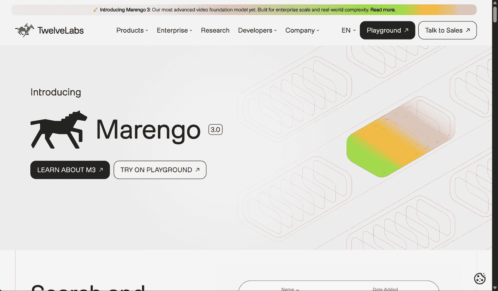

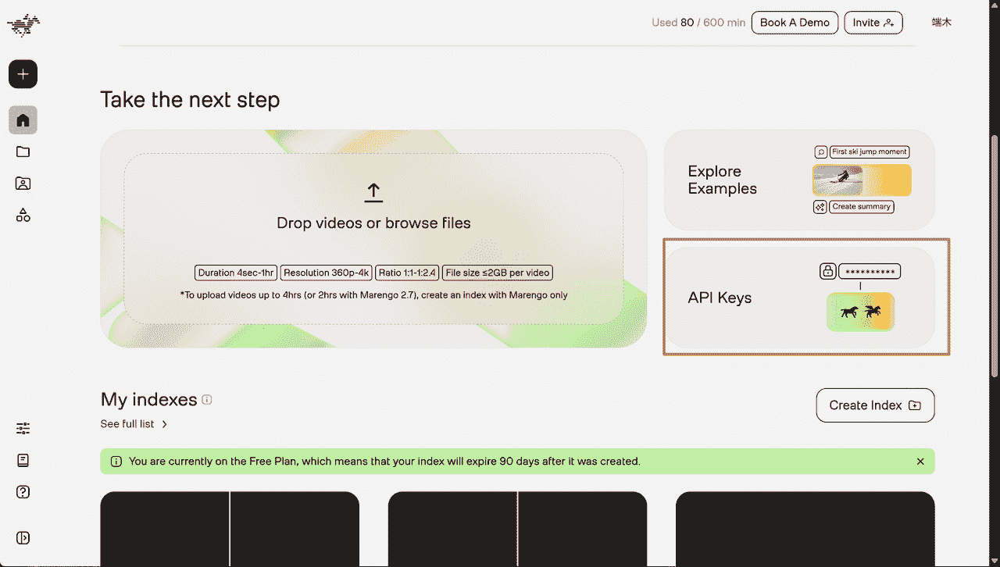

## Twelve Labs 集成

### 环境准备与代理配置

```python
import os

import sys

from dotenv import load_dotenv

# 1. 加载本地 .env 文件

# override=True 确保如果系统环境变量里有冲突，以 .env 为准

load_dotenv(override=True)

# 2. 检查 Key 是否存在

tl_api_key = os.getenv("TL_API_KEY")
```

```python
import os

# 1. 设置本地代理 (VPN 端口 10080)

# 这行代码必须在 import 其他网络库之前运行

proxy_url = "http://127.0.0.1:10080"

os.environ["HTTP_PROXY"] = proxy_url

os.environ["HTTPS_PROXY"] = proxy_url
```

### API 连通性测试

```python
import requests

import os

# 随便写个 API Key 或者留空，我们只是测网络通不通，不是测鉴权

url = "https://api.twelvelabs.io/v1.2/indexes"

try:

    print(f"📡 正在尝试连接 {url} ...")

    # 设置 timeout=5，如果 5 秒没反应就是被墙了

    resp = requests.get(url, timeout=5)

    # 如果返回 401 (Unauthorized)，说明连上了（只是没 Key），这是好消息！

    # 如果返回 200，说明连上了。

    # 如果报错 ConnectionError，说明被墙了。

    print(f"✅ 连接成功！状态码: {resp.status_code}")

    print(f"   (提示: 返回 401 是正常的，说明网络通了，只是缺 Key)")

except Exception as e:

    print(f"❌ 连接失败: {e}")

    print("💡 建议：请确保您的 VPN 开启了 'TUN模式' 或在代码中配置了 proxies 参数。")
```

📡 正在尝试连接 https://api.twelvelabs.io/v1.2/indexes ...

✅ 连接成功！状态码: 404

   (提示: 返回 401 是正常的，说明网络通了，只是缺 Key)

### 自定义 Twelve Labs 检索器 (SDK v0.5)

```python
import os

import time

from typing import List

from llama_index.core import QueryBundle

from llama_index.core.retrievers import BaseRetriever

from llama_index.core.schema import NodeWithScore, TextNode

# SDK 导入

from twelvelabs import TwelveLabs

from twelvelabs.indexes import IndexesCreateRequestModelsItem

from twelvelabs.tasks import TasksRetrieveResponse

class TwelveLabsRetriever(BaseRetriever):

    def __init__(self, api_key: str, index_name: str = "demo_rag_v6"):

        self.client = TwelveLabs(api_key=api_key)

        self.index_name = index_name

        self.index_id = self._get_or_create_index()

        super().__init__()

    def _get_or_create_index(self):

        """检查是否有索引，没有就新建"""

        try:

            # 尝试查找现有索引

            existing_indexes = self.client.indexes.list(page_limit=50)

            for idx in existing_indexes:

                current_name = getattr(idx, "name", None) or getattr(idx, "index_name", None)

                if current_name == self.index_name:
```


# === Cell 1: TwelveLabs 检索器方法实现 ===

```python
print(f"✅ 找到现有索引: {current_name} ({idx.id})")

return idx.id

except Exception as e:

    print(f"⚠️ 获取索引列表提示: {e}")

# 如果没找到，创建新的 (虽然您的 v6 已经存在，但这段逻辑保留以防万一)

print(f"🆕 正在云端创建新索引: {self.index_name} ...")

try:

    new_index = self.client.indexes.create(

        index_name=self.index_name,

        models=[

            IndexesCreateRequestModelsItem(

                model_name="marengo2.7",  # 或 marengo3.0

                model_options=["visual", "audio"]

            ),

            IndexesCreateRequestModelsItem(

                model_name="pegasus1.1",  # 或 pegasus1.2

                model_options=["visual", "audio"]

            )

        ]

    )

    print(f"✅ 索引创建成功: {new_index.id}")

    return new_index.id

except Exception as e:

    raise Exception(f"创建索引失败: {e}")

def ingest_video(self, video_path: str):

    """上传并索引视频"""

    print(f"🚀 [TwelveLabs] 正在上传视频: {video_path} ...")

    try:

        # 1. 提交任务 (关键修正 1: file -> video_file)

        with open(video_path, "rb") as f:

            task = self.client.tasks.create(

                index_id=self.index_id, 

                video_file=f

            )

        print(f"⏳ 任务已提交 (ID: {task.id})，等待云端处理...")

        # 2. 轮询等待

        def on_task_update(task: TasksRetrieveResponse):

            percent = task.process.percentage if task.process else 0

            print(f"   进度: {percent}% (状态: {task.status})", end="\r")

        finished_task = self.client.tasks.wait_for_done(

            task_id=task.id, 

            callback=on_task_update

        )

        if finished_task.status != "ready":

            raise Exception(f"视频处理失败: {finished_task.status}")

        print(f"\n✅ 视频索引构建完成！")

    except Exception as e:

        if "already exists" in str(e) or "409" in str(e):

            print(f"\nℹ️ 视频看起来已经存在，跳过上传。")

        else:

            print(f"\n❌ 上传过程异常: {e}")

def _retrieve(self, query_bundle: QueryBundle) -> List[NodeWithScore]:

    """执行搜索"""

    query_str = query_bundle.query_str

    print(f"🔍 [TwelveLabs] 云端视觉搜索: '{query_str}'")

    # Search 接口 (关键修正 2: options -> search_options)

    try:

        search_results = self.client.search.query(

            index_id=self.index_id,

            query_text=query_str,

            search_options=["visual", "audio"] # <--- 修正点：参数名必须是 search_options

        )

    except TypeError as e:

         # 双重保险：如果 SDK 版本极新，有时也会用 options，但 v0.5 通常是 search_options

         print(f"⚠️ 搜索参数尝试失败，正在重试: {e}")

         raise e

    nodes = []

    # 获取数据

    results_list = getattr(search_results, "data", search_results)

    for clip in results_list:

        # 封装结果

        # 注意：v0.5 返回的时间戳可能是 start/end 属性

        start_ts = getattr(clip, "start", 0)

        end_ts = getattr(clip, "end", 0)

        score = getattr(clip, "score", 0)

        node_text = f"Segment: {start_ts}s - {end_ts}s. Confidence: {score}"

        node = TextNode(

            text=node_text,

            metadata={

                "start": start_ts,

                "end": end_ts,

                "score": score,

                "video_id": getattr(clip, "video_id", "")

            }

        )

        nodes.append(NodeWithScore(node=node, score=score))

    return nodes

# 辅助函数

def build_video_index(video_path):

    retriever = TwelveLabsRetriever(api_key=os.environ["TL_API_KEY"])

    retriever.ingest_video(video_path)

    return retriever

print("✅ SDK v0.5 终极修正版 (video_file + search_options) 定义完成！")
```

✅ SDK v0.5 终极修正版 (`video_file` + `search_options`) 定义完成！

# === Cell 2: 自定义 Twelve Labs 检索器 (SDK v0.5 完美通关版) ===

```python
import os

import time

from typing import List

from llama_index.core import QueryBundle

from llama_index.core.retrievers import BaseRetriever

from llama_index.core.schema import NodeWithScore, TextNode

# SDK 导入

from twelvelabs import TwelveLabs

from twelvelabs.indexes import IndexesCreateRequestModelsItem

from twelvelabs.tasks import TasksRetrieveResponse

class TwelveLabsRetriever(BaseRetriever):

    def __init__(self, api_key: str, index_name: str = "demo_rag_v9_final"): 

        # 建议换个新名字 v8，确保从零开始验证

        self.client = TwelveLabs(api_key=api_key)

        self.index_name = index_name

        self.index_id = self._get_or_create_index()

        super().__init__()

    def _get_or_create_index(self):

        """检查是否有索引，没有就新建"""

        try:

            existing_indexes = self.client.indexes.list(page_limit=50)

            for idx in existing_indexes:

                current_name = getattr(idx, "name", None) or getattr(idx, "index_name", None)

                if current_name == self.index_name:

                    print(f"✅ 找到现有索引: {current_name} ({idx.id})")

                    return idx.id

        except Exception as e:

            print(f"⚠️ 获取索引列表提示: {e}")

        print(f"🆕 正在云端创建新索引: {self.index_name} ...")

        try:

            new_index = self.client.indexes.create(

                index_name=self.index_name,

                models=[

                    IndexesCreateRequestModelsItem(

                        model_name="marengo3.0",  

                        model_options=["visual", "audio"]

                    ),

                    IndexesCreateRequestModelsItem(

                        model_name="pegasus1.2", 

                        model_options=["visual", "audio"]

                    )

                ]

            )

            print(f"✅ 索引创建成功: {new_index.id}")

            return new_index.id

        except Exception as e:

            raise Exception(f"创建索引失败: {e}")

    def ingest_video(self, video_path: str):

        """上传并索引视频"""

        print(f"🚀 [TwelveLabs] 正在上传视频: {video_path} ...")

        try:

            # 1. 提交任务

            with open(video_path, "rb") as f:

                task = self.client.tasks.create(

                    index_id=self.index_id, 

                    video_file=f 

                    # ❌ 已移除 language="en"，避免报错

                )

            print(f"⏳ 任务已提交 (ID: {task.id})，等待云端处理...")

            # 2. 轮询等待 (修复版)

            def on_task_update(task: TasksRetrieveResponse):

                # 🛡️ 安全获取进度：task.process 可能是 None

                if hasattr(task, 'process') and task.process:

                    percent = task.process.percentage

                else:

                    percent = 0

                print(f"   进度: {percent}% (状态: {task.status})", end="\r")

            finished_task = self.client.tasks.wait_for_done(

                task_id=task.id, 

                callback=on_task_update

            )

            if finished_task.status != "ready":

                raise Exception(f"视频处理失败: {finished_task.status}")

            print(f"\n✅ 视频索引构建完成！")
```


```
except Exception as e:

    if "already exists" in str(e) or "409" in str(e):

        print(f"\nℹ️ 视频看起来已经存在，跳过上传。")

    else:

        print(f"\n❌ 上传过程异常: {e}")

def _retrieve(self, query_bundle: QueryBundle) -> List[NodeWithScore]:

    """执行搜索"""

    query_str = query_bundle.query_str

    print(f"🔍 [TwelveLabs] 云端视觉搜索: '{query_str}'")

    # Search 接口

    try:

        search_results = self.client.search.query(

            index_id=self.index_id,

            query_text=query_str,

            search_options=["visual", "audio"]

        )

    except Exception as e:

        print(f"⚠️ 搜索请求失败: {e}")

        return []

    nodes = []

    # 获取结果列表

    results_list = getattr(search_results, "data", search_results)

    for clip in results_list:

        # 安全获取属性

        start = getattr(clip, "start", 0)

        end = getattr(clip, "end", 0)

        score = getattr(clip, "score", 0)

        video_id = getattr(clip, "video_id", "")

        node_text = f"Segment: {start}s - {end}s. Confidence: {score}"

        node = TextNode(

            text=node_text,

            metadata={

                "start": start,

                "end": end,

                "score": score,

                "video_id": video_id

            }

        )

        nodes.append(NodeWithScore(node=node, score=score))

    return nodes
```

# 辅助函数

```
def build_video_index(video_path):

    retriever = TwelveLabsRetriever(api_key=os.environ["TL_API_KEY"])

    retriever.ingest_video(video_path)

    return retriever

print("✅ SDK v0.5 完美修复版 (进度条补丁) 定义完成！")
```

```
✅ SDK v0.5 完美修复版 (进度条补丁) 定义完成！
```

# === Cell 3: 执行检索 ===

```
from IPython.display import display, HTML

video_file = "DeepSeek-V3.mp4"

retriever = build_video_index(video_file)

# 提问

query_str = "找到解释模型架构的部分。"

print(f"\n❓ [提问]: {query_str}")

retrieved_nodes = retriever.retrieve(query_str)
```

```
🆕 正在云端创建新索引: demo_rag_v9_final ...

✅ 索引创建成功: 6940130981d8349939340edd

🚀 [TwelveLabs] 正在上传视频: DeepSeek-V3.mp4 ...

⏳ 任务已提交 (ID: 6940131e81d8349939340ee9)，等待云端处理...

   进度: 0% (状态: ready)ng)

✅ 视频索引构建完成！

❓ [提问]: 找到解释模型架构的部分。

🔍 [TwelveLabs] 云端视觉搜索: '找到解释模型架构的部分。'
```

```
retrieved_nodes
```

```
[NodeWithScore(node=TextNode(id_='2cbe0d04-d5f3-4634-8394-cb1568b598f0', embedding=None, metadata={'start': 5.75, 'end': 11.5, 'score': None, 'video_id': '6940131e81d8349939340ee9'}, excluded_embed_metadata_keys=[], excluded_llm_metadata_keys=[], relationships={}, metadata_template='{key}: {value}', metadata_separator='\n', text='Segment: 5.75s - 11.5s. Confidence: None', mimetype='text/plain', start_char_idx=None, end_char_idx=None, metadata_seperator='\n', text_template='{metadata_str}\n\n{content}'), score=None),
 NodeWithScore(node=TextNode(id_='fa1de23b-6d2a-49f3-8914-7a480977d88c', embedding=None, metadata={'start': 17.25, 'end': 22.75, 'score': None, 'video_id': '6940131e81d8349939340ee9'}, excluded_embed_metadata_keys=[], excluded_llm_metadata_keys=[], relationships={}, metadata_template='{key}: {value}', metadata_separator='\n', text='Segment: 17.25s - 22.75s. Confidence: None', mimetype='text/plain', start_char_idx=None, end_char_idx=None, metadata_seperator='\n', text_template='{metadata_str}\n\n{content}'), score=None),
 NodeWithScore(node=TextNode(id_='becc0755-cb6e-4e2c-aa30-508c01049a4d', embedding=None, metadata={'start': 11.5, 'end': 17.25, 'score': None, 'video_id': '6940131e81d8349939340ee9'}, excluded_embed_metadata_keys=[], excluded_llm_metadata_keys=[], relationships={}, metadata_template='{key}: {value}', metadata_separator='\n', text='Segment: 11.5s - 17.25s. Confidence: None', mimetype='text/plain', start_char_idx=None, end_char_idx=None, metadata_seperator='\n', text_template='{metadata_str}\n\n{content}'), score=None),
 NodeWithScore(node=TextNode(id_='66c65afe-b9d9-48b0-afff-b29a96a4d262', embedding=None, metadata={'start': 0.0, 'end': 5.75, 'score': None, 'video_id': '6940131e81d8349939340ee9'}, excluded_embed_metadata_keys=[], excluded_llm_metadata_keys=[], relationships={}, metadata_template='{key}: {value}', metadata_separator='\n', text='Segment: 0.0s - 5.75s. Confidence: None', mimetype='text/plain', start_char_idx=None, end_char_idx=None, metadata_seperator='\n', text_template='{metadata_str}\n\n{content}'), score=None),
 NodeWithScore(node=TextNode(id_='0a8fbf02-9a77-4cb3-ae82-172a8375a4e2', embedding=None, metadata={'start': 274.5, 'end': 281.5, 'score': None, 'video_id': '6940131e81d8349939340ee9'}, excluded_embed_metadata_keys=[], excluded_llm_metadata_keys=[], relationships={}, metadata_template='{key}: {value}', metadata_separator='\n', text='Segment: 274.5s - 281.5s. Confidence: None', mimetype='text/plain', start_char_idx=None, end_char_idx=None, metadata_seperator='\n', text_template='{metadata_str}\n\n{content}'), score=None),
 NodeWithScore(node=TextNode(id_='61ac66d2-2b8b-4a1d-9e7e-d00a86575e32', embedding=None, metadata={'start': 433.75, 'end': 440.0, 'score': None, 'video_id': '6940131e81d8349939340ee9'}, excluded_embed_metadata_keys=[], excluded_llm_metadata_keys=[], relationships={}, metadata_template='{key}: {value}', metadata_separator='\n', text='Segment: 433.75s - 440.0s. Confidence: None', mimetype='text/plain', start_char_idx=None, end_char_idx=None, metadata_seperator='\n', text_template='{metadata_str}\n\n{content}'), score=None),
 NodeWithScore(node=TextNode(id_='d9ee70fc-43fe-4744-9716-1deb80a767b3', embedding=None, metadata={'start': 232.25, 'end': 237.0, 'score': None, 'video_id': '6940131e81d8349939340ee9'}, excluded_embed_metadata_keys=[], excluded_llm_metadata_keys=[], relationships={}, metadata_template='{key}: {value}', metadata_separator='\n', text='Segment: 232.25s - 237.0s. Confidence: None', mimetype='text/plain', start_char_idx=None, end_char_idx=None, metadata_seperator='\n', text_template='{metadata_str}\n\n{content}'), score=None),
 NodeWithScore(node=TextNode(id_='c13e91d3-b480-470c-8b27-595f40f2b8ee', embedding=None, metadata={'start': 328.5, 'end': 335.75, 'score': None, 'video_id': '6940131e81d8349939340ee9'}, excluded_embed_metadata_keys=[], excluded_llm_metadata_keys=[], relationships={}, metadata_template='{key}: {value}', metadata_separator='\n', text='Segment: 328.5s - 335.75s. Confidence: None', mimetype='text/plain', start_char_idx=None, end_char_idx=None, metadata_seperator='\n', text_template='{metadata_str}\n\n{content}'), score=None),
```


```
NodeWithScore(node=TextNode(id_='6d18a9b5-e237-4203-b9dc-82eed37b4159', embedding=None, metadata={'start': 421.25, 'end': 427.5, 'score': None, 'video_id': '6940131e81d8349939340ee9'}, excluded_embed_metadata_keys=[], excluded_llm_metadata_keys=[], relationships={}, metadata_template='{key}: {value}', metadata_separator='\n', text='Segment: 421.25s - 427.5s. Confidence: None', mimetype='text/plain', start_char_idx=None, end_char_idx=None, metadata_seperator='\n', text_template='{metadata_str}\n\n{content}'), score=None),
NodeWithScore(node=TextNode(id_='f1d79bf0-e2f2-48f8-956f-5fe9dab3b14e', embedding=None, metadata={'start': 36.0, 'end': 42.5, 'score': None, 'video_id': '6940131e81d8349939340ee9'}, excluded_embed_metadata_keys=[], excluded_llm_metadata_keys=[], relationships={}, metadata_template='{key}: {value}', metadata_separator='\n', text='Segment: 36.0s - 42.5s. Confidence: None', mimetype='text/plain', start_char_idx=None, end_char_idx=None, metadata_seperator='\n', text_template='{metadata_str}\n\n{content}'), score=None),
NodeWithScore(node=TextNode(id_='b5d43f3c-d778-4675-9eb2-2edad7e9185e', embedding=None, metadata={'start': 253.25, 'end': 260.5, 'score': None, 'video_id': '6940131e81d8349939340ee9'}, excluded_embed_metadata_keys=[], excluded_llm_metadata_keys=[], relationships={}, metadata_template='{key}: {value}', metadata_separator='\n', text='Segment: 253.25s - 260.5s. Confidence: None', mimetype='text/plain', start_char_idx=None, end_char_idx=None, metadata_seperator='\n', text_template='{metadata_str}\n\n{content}'), score=None),
NodeWithScore(node=TextNode(id_='1bfea57f-0fc6-4d0d-ad22-bb046bdee005', embedding=None, metadata={'start': 155.0, 'end': 161.75, 'score': None, 'video_id': '6940131e81d8349939340ee9'}, excluded_embed_metadata_keys=[], excluded_llm_metadata_keys=[], relationships={}, metadata_template='{key}: {value}', metadata_separator='\n', text='Segment: 155.0s - 161.75s. Confidence: None', mimetype='text/plain', start_char_idx=None, end_char_idx=None, metadata_seperator='\n', text_template='{metadata_str}\n\n{content}'), score=None),
NodeWithScore(node=TextNode(id_='9b8e4bef-6e71-4835-ab5a-94a73986e0b6', embedding=None, metadata={'start': 267.5, 'end': 274.5, 'score': None, 'video_id': '6940131e81d8349939340ee9'}, excluded_embed_metadata_keys=[], excluded_llm_metadata_keys=[], relationships={}, metadata_template='{key}: {value}', metadata_separator='\n', text='Segment: 267.5s - 274.5s. Confidence: None', mimetype='text/plain', start_char_idx=None, end_char_idx=None, metadata_seperator='\n', text_template='{metadata_str}\n\n{content}'), score=None),
NodeWithScore(node=TextNode(id_='3e7c3ad1-a843-4ed9-92a5-ee8ece3b7a05', embedding=None, metadata={'start': 427.5, 'end': 433.75, 'score': None, 'video_id': '6940131e81d8349939340ee9'}, excluded_embed_metadata_keys=[], excluded_llm_metadata_keys=[], relationships={}, metadata_template='{key}: {value}', metadata_separator='\n', text='Segment: 427.5s - 433.75s. Confidence: None', mimetype='text/plain', start_char_idx=None, end_char_idx=None, metadata_seperator='\n', text_template='{metadata_str}\n\n{content}'), score=None),
NodeWithScore(node=TextNode(id_='992d8534-fe7a-4b05-82f4-8d5d6dc3b3ae', embedding=None, metadata={'start': 22.75, 'end': 29.5, 'score': None, 'video_id': '6940131e81d8349939340ee9'}, excluded_embed_metadata_keys=[], excluded_llm_metadata_keys=[], relationships={}, metadata_template='{key}: {value}', metadata_separator='\n', text='Segment: 22.75s - 29.5s. Confidence: None', mimetype='text/plain', start_char_idx=None, end_char_idx=None, metadata_seperator='\n', text_template='{metadata_str}\n\n{content}'), score=None),
NodeWithScore(node=TextNode(id_='d2c18bb7-b1f1-4e66-8310-8eacaa2eed47', embedding=None, metadata={'start': 29.5, 'end': 36.0, 'score': None, 'video_id': '6940131e81d8349939340ee9'}, excluded_embed_metadata_keys=[], excluded_llm_metadata_keys=[], relationships={}, metadata_template='{key}: {value}', metadata_separator='\n', text='Segment: 29.5s - 36.0s. Confidence: None', mimetype='text/plain', start_char_idx=None, end_char_idx=None, metadata_seperator='\n', text_template='{metadata_str}\n\n{content}'), score=None),
NodeWithScore(node=TextNode(id_='11f28c29-af69-4b4b-86ef-419e50ba9e95', embedding=None, metadata={'start': 237.0, 'end': 242.5, 'score': None, 'video_id': '6940131e81d8349939340ee9'}, excluded_embed_metadata_keys=[], excluded_llm_metadata_keys=[], relationships={}, metadata_template='{key}: {value}', metadata_separator='\n', text='Segment: 237.0s - 242.5s. Confidence: None', mimetype='text/plain', start_char_idx=None, end_char_idx=None, metadata_seperator='\n', text_template='{metadata_str}\n\n{content}'), score=None),
NodeWithScore(node=TextNode(id_='ebc0f3f0-9614-46a4-bb0e-9709732be292', embedding=None, metadata={'start': 321.25, 'end': 328.5, 'score': None, 'video_id': '6940131e81d8349939340ee9'}, excluded_embed_metadata_keys=[], excluded_llm_metadata_keys=[], relationships={}, metadata_template='{key}: {value}', metadata_separator='\n', text='Segment: 321.25s - 328.5s. Confidence: None', mimetype='text/plain', start_char_idx=None, end_char_idx=None, metadata_seperator='\n', text_template='{metadata_str}\n\n{content}'), score=None),
NodeWithScore(node=TextNode(id_='c01629b8-4b3e-497f-864c-26239e5e585b', embedding=None, metadata={'start': 141.5, 'end': 148.25, 'score': None, 'video_id': '6940131e81d8349939340ee9'}, excluded_embed_metadata_keys=[], excluded_llm_metadata_keys=[], relationships={}, metadata_template='{key}: {value}', metadata_separator='\n', text='Segment: 141.5s - 148.25s. Confidence: None', mimetype='text/plain', start_char_idx=None, end_char_idx=None, metadata_seperator='\n', text_template='{metadata_str}\n\n{content}'), score=None),
NodeWithScore(node=TextNode(id_='ab7f157f-7d0d-4493-a69e-ed102c0854a7', embedding=None, metadata={'start': 148.25, 'end': 155.0, 'score': None, 'video_id': '6940131e81d8349939340ee9'}, excluded_embed_metadata_keys=[], excluded_llm_metadata_keys=[], relationships={}, metadata_template='{key}: {value}', metadata_separator='\n', text='Segment: 148.25s - 155.0s. Confidence: None', mimetype='text/plain', start_char_idx=None, end_char_idx=None, metadata_seperator='\n', text_template='{metadata_str}\n\n{content}'), score=None),
```


```
NodeWithScore(node=TextNode(id_='896c0f90-58fd-40e0-9b97-85e9afbf820d', embedding=None, metadata={'start': 260.5, 'end': 267.5, 'score': None, 'video_id': '6940131e81d8349939340ee9'}, excluded_embed_metadata_keys=[], excluded_llm_metadata_keys=[], relationships={}, metadata_template='{key}: {value}', metadata_separator='\n', text='Segment: 260.5s - 267.5s. Confidence: None', mimetype='text/plain', start_char_idx=None, end_char_idx=None, metadata_seperator='\n', text_template='{metadata_str}\n\n{content}'), score=None),

NodeWithScore(node=TextNode(id_='9c51d326-8f8f-4cc3-901b-6bd29e716592', embedding=None, metadata={'start': 242.5, 'end': 248.0, 'score': None, 'video_id': '6940131e81d8349939340ee9'}, excluded_embed_metadata_keys=[], excluded_llm_metadata_keys=[], relationships={}, metadata_template='{key}: {value}', metadata_separator='\n', text='Segment: 242.5s - 248.0s. Confidence: None', mimetype='text/plain', start_char_idx=None, end_char_idx=None, metadata_seperator='\n', text_template='{metadata_str}\n\n{content}'), score=None),

NodeWithScore(node=TextNode(id_='48d11bc6-782d-4065-aadb-be99dffdbc9e', embedding=None, metadata={'start': 48.5, 'end': 54.25, 'score': None, 'video_id': '6940131e81d8349939340ee9'}, excluded_embed_metadata_keys=[], excluded_llm_metadata_keys=[], relationships={}, metadata_template='{key}: {value}', metadata_separator='\n', text='Segment: 48.5s - 54.25s. Confidence: None', mimetype='text/plain', start_char_idx=None, end_char_idx=None, metadata_seperator='\n', text_template='{metadata_str}\n\n{content}'), score=None),

NodeWithScore(node=TextNode(id_='fcad58de-019e-44cb-b619-effbce074b1e', embedding=None, metadata={'start': 248.0, 'end': 253.25, 'score': None, 'video_id': '6940131e81d8349939340ee9'}, excluded_embed_metadata_keys=[], excluded_llm_metadata_keys=[], relationships={}, metadata_template='{key}: {value}', metadata_separator='\n', text='Segment: 248.0s - 253.25s. Confidence: None', mimetype='text/plain', start_char_idx=None, end_char_idx=None, metadata_seperator='\n', text_template='{metadata_str}\n\n{content}'), score=None),

NodeWithScore(node=TextNode(id_='c5071bb2-cc4a-4a4e-9934-a6919bc2d8d4', embedding=None, metadata={'start': 227.25, 'end': 232.25, 'score': None, 'video_id': '6940131e81d8349939340ee9'}, excluded_embed_metadata_keys=[], excluded_llm_metadata_keys=[], relationships={}, metadata_template='{key}: {value}', metadata_separator='\n', text='Segment: 227.25s - 232.25s. Confidence: None', mimetype='text/plain', start_char_idx=None, end_char_idx=None, metadata_seperator='\n', text_template='{metadata_str}\n\n{content}'), score=None),

NodeWithScore(node=TextNode(id_='5b7e0f3f-8e5b-4c3a-84e5-f02d3f39ad53', embedding=None, metadata={'start': 134.75, 'end': 141.5, 'score': None, 'video_id': '6940131e81d8349939340ee9'}, excluded_embed_metadata_keys=[], excluded_llm_metadata_keys=[], relationships={}, metadata_template='{key}: {value}', metadata_separator='\n', text='Segment: 134.75s - 141.5s. Confidence: None', mimetype='text/plain', start_char_idx=None, end_char_idx=None, metadata_seperator='\n', text_template='{metadata_str}\n\n{content}'), score=None),

NodeWithScore(node=TextNode(id_='6dcda4eb-a80e-44ab-89f9-04b46edab1f1', embedding=None, metadata={'start': 415.0, 'end': 421.25, 'score': None, 'video_id': '6940131e81d8349939340ee9'}, excluded_embed_metadata_keys=[], excluded_llm_metadata_keys=[], relationships={}, metadata_template='{key}: {value}', metadata_separator='\n', text='Segment: 415.0s - 421.25s. Confidence: None', mimetype='text/plain', start_char_idx=None, end_char_idx=None, metadata_seperator='\n', text_template='{metadata_str}\n\n{content}'), score=None),

NodeWithScore(node=TextNode(id_='96d78780-5287-44e3-98e4-ba723aaac7f7', embedding=None, metadata={'start': 408.5, 'end': 415.0, 'score': None, 'video_id': '6940131e81d8349939340ee9'}, excluded_embed_metadata_keys=[], excluded_llm_metadata_keys=[], relationships={}, metadata_template='{key}: {value}', metadata_separator='\n', text='Segment: 408.5s - 415.0s. Confidence: None', mimetype='text/plain', start_char_idx=None, end_char_idx=None, metadata_seperator='\n', text_template='{metadata_str}\n\n{content}'), score=None),

NodeWithScore(node=TextNode(id_='52debf1f-ed69-4e51-b704-c95f20bbf261', embedding=None, metadata={'start': 60.0, 'end': 65.75, 'score': None, 'video_id': '6940131e81d8349939340ee9'}, excluded_embed_metadata_keys=[], excluded_llm_metadata_keys=[], relationships={}, metadata_template='{key}: {value}', metadata_separator='\n', text='Segment: 60.0s - 65.75s. Confidence: None', mimetype='text/plain', start_char_idx=None, end_char_idx=None, metadata_seperator='\n', text_template='{metadata_str}\n\n{content}'), score=None),

NodeWithScore(node=TextNode(id_='d958b787-5192-44f1-bc01-e2353ea0cda5', embedding=None, metadata={'start': 401.75, 'end': 408.5, 'score': None, 'video_id': '6940131e81d8349939340ee9'}, excluded_embed_metadata_keys=[], excluded_llm_metadata_keys=[], relationships={}, metadata_template='{key}: {value}', metadata_separator='\n', text='Segment: 401.75s - 408.5s. Confidence: None', mimetype='text/plain', start_char_idx=None, end_char_idx=None, metadata_seperator='\n', text_template='{metadata_str}\n\n{content}'), score=None),

NodeWithScore(node=TextNode(id_='de9d65b6-205b-44e8-ab8c-d9bc570fddbf', embedding=None, metadata={'start': 203.5, 'end': 209.75, 'score': None, 'video_id': '6940131e81d8349939340ee9'}, excluded_embed_metadata_keys=[], excluded_llm_metadata_keys=[], relationships={}, metadata_template='{key}: {value}', metadata_separator='\n', text='Segment: 203.5s - 209.75s. Confidence: None', mimetype='text/plain', start_char_idx=None, end_char_idx=None, metadata_seperator='\n', text_template='{metadata_str}\n\n{content}'), score=None),

NodeWithScore(node=TextNode(id_='86f87b97-684c-409d-bdd4-946a3ad97753', embedding=None, metadata={'start': 54.25, 'end': 60.0, 'score': None, 'video_id': '6940131e81d8349939340ee9'}, excluded_embed_metadata_keys=[], excluded_llm_metadata_keys=[], relationships={}, metadata_template='{key}: {value}', metadata_separator='\n', text='Segment: 54.25s - 60.0s. Confidence: None', mimetype='text/plain', start_char_idx=None, end_char_idx=None, metadata_seperator='\n', text_template='{metadata_str}\n\n{content}'), score=None),
```


```
NodeWithScore(node=TextNode(id_=&#x27;6aafacd3-5884-43ce-901c-19ec243ce04e&#x27;, embedding=None, metadata={&#x27;start&#x27;: 299.75, &#x27;end&#x27;: 307.0, &#x27;score&#x27;: None, &#x27;video_id&#x27;: &#x27;6940131e81d8349939340ee9&#x27;}, excluded_embed_metadata_keys=[], excluded_llm_metadata_keys=[], relationships={}, metadata_template=&#x27;{key}: {value}&#x27;, metadata_separator=&#x27;\n&#x27;, text=&#x27;Segment: 299.75s - 307.0s. Confidence: None&#x27;, mimetype=&#x27;text/plain&#x27;, start_char_idx=None, end_char_idx=None, metadata_seperator=&#x27;\n&#x27;, text_template=&#x27;{metadata_str}\n\n{content}&#x27;), score=None),

NodeWithScore(node=TextNode(id_=&#x27;bf2c7d05-0b1c-49eb-adfa-255a06d37dc0&#x27;, embedding=None, metadata={&#x27;start&#x27;: 209.75, &#x27;end&#x27;: 216.0, &#x27;score&#x27;: None, &#x27;video_id&#x27;: &#x27;6940131e81d8349939340ee9&#x27;}, excluded_embed_metadata_keys=[], excluded_llm_metadata_keys=[], relationships={}, metadata_template=&#x27;{key}: {value}&#x27;, metadata_separator=&#x27;\n&#x27;, text=&#x27;Segment: 209.75s - 216.0s. Confidence: None&#x27;, mimetype=&#x27;text/plain&#x27;, start_char_idx=None, end_char_idx=None, metadata_seperator=&#x27;\n&#x27;, text_template=&#x27;{metadata_str}\n\n{content}&#x27;), score=None),

NodeWithScore(node=TextNode(id_=&#x27;cbb570a9-250f-4f1b-932f-3b45e8e5d78e&#x27;, embedding=None, metadata={&#x27;start&#x27;: 314.0, &#x27;end&#x27;: 321.25, &#x27;score&#x27;: None, &#x27;video_id&#x27;: &#x27;6940131e81d8349939340ee9&#x27;}, excluded_embed_metadata_keys=[], excluded_llm_metadata_keys=[], relationships={}, metadata_template=&#x27;{key}: {value}&#x27;, metadata_separator=&#x27;\n&#x27;, text=&#x27;Segment: 314.0s - 321.25s. Confidence: None&#x27;, mimetype=&#x27;text/plain&#x27;, start_char_idx=None, end_char_idx=None, metadata_seperator=&#x27;\n&#x27;, text_template=&#x27;{metadata_str}\n\n{content}&#x27;), score=None),

NodeWithScore(node=TextNode(id_=&#x27;a913fcda-73a2-43ff-b147-af63829953f5&#x27;, embedding=None, metadata={&#x27;start&#x27;: 129.25, &#x27;end&#x27;: 134.75, &#x27;score&#x27;: None, &#x27;video_id&#x27;: &#x27;6940131e81d8349939340ee9&#x27;}, excluded_embed_metadata_keys=[], excluded_llm_metadata_keys=[], relationships={}, metadata_template=&#x27;{key}: {value}&#x27;, metadata_separator=&#x27;\n&#x27;, text=&#x27;Segment: 129.25s - 134.75s. Confidence: None&#x27;, mimetype=&#x27;text/plain&#x27;, start_char_idx=None, end_char_idx=None, metadata_seperator=&#x27;\n&#x27;, text_template=&#x27;{metadata_str}\n\n{content}&#x27;), score=None),

NodeWithScore(node=TextNode(id_=&#x27;ec3ef055-96eb-4763-b615-248bb4c8255f&#x27;, embedding=None, metadata={&#x27;start&#x27;: 388.25, &#x27;end&#x27;: 395.0, &#x27;score&#x27;: None, &#x27;video_id&#x27;: &#x27;6940131e81d8349939340ee9&#x27;}, excluded_embed_metadata_keys=[], excluded_llm_metadata_keys=[], relationships={}, metadata_template=&#x27;{key}: {value}&#x27;, metadata_separator=&#x27;\n&#x27;, text=&#x27;Segment: 388.25s - 395.0s. Confidence: None&#x27;, mimetype=&#x27;text/plain&#x27;, start_char_idx=None, end_char_idx=None, metadata_seperator=&#x27;\n&#x27;, text_template=&#x27;{metadata_str}\n\n{content}&#x27;), score=None),

NodeWithScore(node=TextNode(id_=&#x27;dfcc2e9b-a216-4a6a-a679-a1ed73b2973d&#x27;, embedding=None, metadata={&#x27;start&#x27;: 307.0, &#x27;end&#x27;: 314.0, &#x27;score&#x27;: None, &#x27;video_id&#x27;: &#x27;6940131e81d8349939340ee9&#x27;}, excluded_embed_metadata_keys=[], excluded_llm_metadata_keys=[], relationships={}, metadata_template=&#x27;{key}: {value}&#x27;, metadata_separator=&#x27;\n&#x27;, text=&#x27;Segment: 307.0s - 314.0s. Confidence: None&#x27;, mimetype=&#x27;text/plain&#x27;, start_char_idx=None, end_char_idx=None, metadata_seperator=&#x27;\n&#x27;, text_template=&#x27;{metadata_str}\n\n{content}&#x27;), score=None),

NodeWithScore(node=TextNode(id_=&#x27;9636cc0b-e544-4980-95cd-8e41e9989cab&#x27;, embedding=None, metadata={&#x27;start&#x27;: 73.0, &#x27;end&#x27;: 80.25, &#x27;score&#x27;: None, &#x27;video_id&#x27;: &#x27;6940131e81d8349939340ee9&#x27;}, excluded_embed_metadata_keys=[], excluded_llm_metadata_keys=[], relationships={}, metadata_template=&#x27;{key}: {value}&#x27;, metadata_separator=&#x27;\n&#x27;, text=&#x27;Segment: 73.0s - 80.25s. Confidence: None&#x27;, mimetype=&#x27;text/plain&#x27;, start_char_idx=None, end_char_idx=None, metadata_seperator=&#x27;\n&#x27;, text_template=&#x27;{metadata_str}\n\n{content}&#x27;), score=None),

NodeWithScore(node=TextNode(id_=&#x27;a5357c99-83d4-4d4f-9bd2-0a94592dcbf1&#x27;, embedding=None, metadata={&#x27;start&#x27;: 395.0, &#x27;end&#x27;: 401.75, &#x27;score&#x27;: None, &#x27;video_id&#x27;: &#x27;6940131e81d8349939340ee9&#x27;}, excluded_embed_metadata_keys=[], excluded_llm_metadata_keys=[], relationships={}, metadata_template=&#x27;{key}: {value}&#x27;, metadata_separator=&#x27;\n&#x27;, text=&#x27;Segment: 395.0s - 401.75s. Confidence: None&#x27;, mimetype=&#x27;text/plain&#x27;, start_char_idx=None, end_char_idx=None, metadata_seperator=&#x27;\n&#x27;, text_template=&#x27;{metadata_str}\n\n{content}&#x27;), score=None),

NodeWithScore(node=TextNode(id_=&#x27;2208ba8b-c4e6-4197-88fd-71c95e8deab3&#x27;, embedding=None, metadata={&#x27;start&#x27;: 94.75, &#x27;end&#x27;: 102.0, &#x27;score&#x27;: None, &#x27;video_id&#x27;: &#x27;6940131e81d8349939340ee9&#x27;}, excluded_embed_metadata_keys=[], excluded_llm_metadata_keys=[], relationships={}, metadata_template=&#x27;{key}: {value}&#x27;, metadata_separator=&#x27;\n&#x27;, text=&#x27;Segment: 94.75s - 102.0s. Confidence: None&#x27;, mimetype=&#x27;text/plain&#x27;, start_char_idx=None, end_char_idx=None, metadata_seperator=&#x27;\n&#x27;, text_template=&#x27;{metadata_str}\n\n{content}&#x27;), score=None),

NodeWithScore(node=TextNode(id_=&#x27;9d42f23c-d500-4f3b-86a2-d88be21644e3&#x27;, embedding=None, metadata={&#x27;start&#x27;: 197.25, &#x27;end&#x27;: 203.5, &#x27;score&#x27;: None, &#x27;video_id&#x27;: &#x27;6940131e81d8349939340ee9&#x27;}, excluded_embed_metadata_keys=[], excluded_llm_metadata_keys=[], relationships={}, metadata_template=&#x27;{key}: {value}&#x27;, metadata_separator=&#x27;\n&#x27;, text=&#x27;Segment: 197.25s - 203.5s. Confidence: None&#x27;, mimetype=&#x27;text/plain&#x27;, start_char_idx=None, end_char_idx=None, metadata_seperator=&#x27;\n&#x27;, text_template=&#x27;{metadata_str}\n\n{content}&#x27;), score=None),

NodeWithScore(node=TextNode(id_=&#x27;8240b8e6-c2c7-4714-b2dd-dfb40724653e&#x27;, embedding=None, metadata={&#x27;start&#x27;: 292.5, &#x27;end&#x27;: 299.75, &#x27;score&#x27;: None, &#x27;video_id&#x27;: &#x27;6940131e81d8349939340ee9&#x27;}, excluded_embed_metadata_keys=[], excluded_llm_metadata_keys=[], relationships={}, metadata_template=&#x27;{key}: {value}&#x27;, metadata_separator=&#x27;\n&#x27;, text=&#x27;Segment: 292.5s - 299.75s. Confidence: None&#x27;, mimetype=&#x27;text/plain&#x27;, start_char_idx=None, end_char_idx=None, metadata_seperator=&#x27;\n&#x27;, text_template=&#x27;{metadata_str}\n\n{content}&#x27;), score=None),

NodeWithScore(node=TextNode(id_=&#x27;5ccb6fc9-170d-46ec-ad20-a89404f9cb1a&#x27;, embedding=None, metadata={&#x27;start&#x27;: 365.0, &#x27;end&#x27;: 371.25, &#x27;score&#x27;: None, &#x27;video_id&#x27;: &#x27;6940131e81d8349939340ee9&#x27;}, excluded_embed_metadata_keys=[], excluded_llm_metadata_keys=[], relationships={}, metadata_template=&#x27;{key}: {value}&#x27;, metadata_separator=&#x27;\n&#x27;, text=&#x27;Segment: 365.0s - 371.25s. Confidence: None&#x27;, mimetype=&#x27;text/plain&#x27;, start_char_idx=None, end_char_idx=None, metadata_seperator=&#x27;\n&#x27;, text_template=&#x27;{metadata_str}\n\n{content}&#x27;), score=None),
```


```
NodeWithScore(node=TextNode(id_=&#x27;ff490bd3-f812-4741-9792-5b03db8fce5a&#x27;, embedding=None, metadata={&#x27;start&#x27;: 222.25, &#x27;end&#x27;: 227.25, &#x27;score&#x27;: None, &#x27;video_id&#x27;: &#x27;6940131e81d8349939340ee9&#x27;}, excluded_embed_metadata_keys=[], excluded_llm_metadata_keys=[], relationships={}, metadata_template=&#x27;{key}: {value}&#x27;, metadata_separator=&#x27;\n&#x27;, text=&#x27;Segment: 222.25s - 227.25s. Confidence: None&#x27;, mimetype=&#x27;text/plain&#x27;, start_char_idx=None, end_char_idx=None, metadata_seperator=&#x27;\n&#x27;, text_template=&#x27;{metadata_str}\n\n{content}&#x27;), score=None),
NodeWithScore(node=TextNode(id_=&#x27;67883459-6d4e-4d07-8b4f-a7c71bb6670a&#x27;, embedding=None, metadata={&#x27;start&#x27;: 80.25, &#x27;end&#x27;: 87.5, &#x27;score&#x27;: None, &#x27;video_id&#x27;: &#x27;6940131e81d8349939340ee9&#x27;}, excluded_embed_metadata_keys=[], excluded_llm_metadata_keys=[], relationships={}, metadata_template=&#x27;{key}: {value}&#x27;, metadata_separator=&#x27;\n&#x27;, text=&#x27;Segment: 80.25s - 87.5s. Confidence: None&#x27;, mimetype=&#x27;text/plain&#x27;, start_char_idx=None, end_char_idx=None, metadata_seperator=&#x27;\n&#x27;, text_template=&#x27;{metadata_str}\n\n{content}&#x27;), score=None),
NodeWithScore(node=TextNode(id_=&#x27;432085d7-dafb-4b2e-be5b-b8d9b872d5ac&#x27;, embedding=None, metadata={&#x27;start&#x27;: 87.5, &#x27;end&#x27;: 94.75, &#x27;score&#x27;: None, &#x27;video_id&#x27;: &#x27;6940131e81d8349939340ee9&#x27;}, excluded_embed_metadata_keys=[], excluded_llm_metadata_keys=[], relationships={}, metadata_template=&#x27;{key}: {value}&#x27;, metadata_separator=&#x27;\n&#x27;, text=&#x27;Segment: 87.5s - 94.75s. Confidence: None&#x27;, mimetype=&#x27;text/plain&#x27;, start_char_idx=None, end_char_idx=None, metadata_seperator=&#x27;\n&#x27;, text_template=&#x27;{metadata_str}\n\n{content}&#x27;), score=None),
NodeWithScore(node=TextNode(id_=&#x27;6d798bd8-dec5-4607-aec6-a580f587ee7c&#x27;, embedding=None, metadata={&#x27;start&#x27;: 216.0, &#x27;end&#x27;: 222.25, &#x27;score&#x27;: None, &#x27;video_id&#x27;: &#x27;6940131e81d8349939340ee9&#x27;}, excluded_embed_metadata_keys=[], excluded_llm_metadata_keys=[], relationships={}, metadata_template=&#x27;{key}: {value}&#x27;, metadata_separator=&#x27;\n&#x27;, text=&#x27;Segment: 216.0s - 222.25s. Confidence: None&#x27;, mimetype=&#x27;text/plain&#x27;, start_char_idx=None, end_char_idx=None, metadata_seperator=&#x27;\n&#x27;, text_template=&#x27;{metadata_str}\n\n{content}&#x27;), score=None),
NodeWithScore(node=TextNode(id_=&#x27;6111ee5c-5907-44cc-a3b7-6f2853044cdb&#x27;, embedding=None, metadata={&#x27;start&#x27;: 65.75, &#x27;end&#x27;: 73.0, &#x27;score&#x27;: None, &#x27;video_id&#x27;: &#x27;6940131e81d8349939340ee9&#x27;}, excluded_embed_metadata_keys=[], excluded_llm_metadata_keys=[], relationships={}, metadata_template=&#x27;{key}: {value}&#x27;, metadata_separator=&#x27;\n&#x27;, text=&#x27;Segment: 65.75s - 73.0s. Confidence: None&#x27;, mimetype=&#x27;text/plain&#x27;, start_char_idx=None, end_char_idx=None, metadata_seperator=&#x27;\n&#x27;, text_template=&#x27;{metadata_str}\n\n{content}&#x27;), score=None),
NodeWithScore(node=TextNode(id_=&#x27;4c5be099-6563-4054-b184-f3172d0a2328&#x27;, embedding=None, metadata={&#x27;start&#x27;: 102.0, &#x27;end&#x27;: 109.25, &#x27;score&#x27;: None, &#x27;video_id&#x27;: &#x27;6940131e81d8349939340ee9&#x27;}, excluded_embed_metadata_keys=[], excluded_llm_metadata_keys=[], relationships={}, metadata_template=&#x27;{key}: {value}&#x27;, metadata_separator=&#x27;\n&#x27;, text=&#x27;Segment: 102.0s - 109.25s. Confidence: None&#x27;, mimetype=&#x27;text/plain&#x27;, start_char_idx=None, end_char_idx=None, metadata_seperator=&#x27;\n&#x27;, text_template=&#x27;{metadata_str}\n\n{content}&#x27;), score=None),
NodeWithScore(node=TextNode(id_=&#x27;0fd72360-9dc1-4bd5-9c39-9e40688d1961&#x27;, embedding=None, metadata={&#x27;start&#x27;: 287.0, &#x27;end&#x27;: 292.5, &#x27;score&#x27;: None, &#x27;video_id&#x27;: &#x27;6940131e81d8349939340ee9&#x27;}, excluded_embed_metadata_keys=[], excluded_llm_metadata_keys=[], relationships={}, metadata_template=&#x27;{key}: {value}&#x27;, metadata_separator=&#x27;\n&#x27;, text=&#x27;Segment: 287.0s - 292.5s. Confidence: None&#x27;, mimetype=&#x27;text/plain&#x27;, start_char_idx=None, end_char_idx=None, metadata_seperator=&#x27;\n&#x27;, text_template=&#x27;{metadata_str}\n\n{content}&#x27;), score=None),
NodeWithScore(node=TextNode(id_=&#x27;d7fcb06f-ab2d-469d-8924-e7e2832e66b5&#x27;, embedding=None, metadata={&#x27;start&#x27;: 123.5, &#x27;end&#x27;: 129.25, &#x27;score&#x27;: None, &#x27;video_id&#x27;: &#x27;6940131e81d8349939340ee9&#x27;}, excluded_embed_metadata_keys=[], excluded_llm_metadata_keys=[], relationships={}, metadata_template=&#x27;{key}: {value}&#x27;, metadata_separator=&#x27;\n&#x27;, text=&#x27;Segment: 123.5s - 129.25s. Confidence: None&#x27;, mimetype=&#x27;text/plain&#x27;, start_char_idx=None, end_char_idx=None, metadata_seperator=&#x27;\n&#x27;, text_template=&#x27;{metadata_str}\n\n{content}&#x27;), score=None),
NodeWithScore(node=TextNode(id_=&#x27;c307ec3f-40d2-45dc-a3cb-e643569ea38c&#x27;, embedding=None, metadata={&#x27;start&#x27;: 446.75, &#x27;end&#x27;: 453.5, &#x27;score&#x27;: None, &#x27;video_id&#x27;: &#x27;6940131e81d8349939340ee9&#x27;}, excluded_embed_metadata_keys=[], excluded_llm_metadata_keys=[], relationships={}, metadata_template=&#x27;{key}: {value}&#x27;, metadata_separator=&#x27;\n&#x27;, text=&#x27;Segment: 446.75s - 453.5s. Confidence: None&#x27;, mimetype=&#x27;text/plain&#x27;, start_char_idx=None, end_char_idx=None, metadata_seperator=&#x27;\n&#x27;, text_template=&#x27;{metadata_str}\n\n{content}&#x27;), score=None),
NodeWithScore(node=TextNode(id_=&#x27;bae7e1aa-8394-4d1d-a1a7-af0b8e752245&#x27;, embedding=None, metadata={&#x27;start&#x27;: 460.25, &#x27;end&#x27;: 467.0, &#x27;score&#x27;: None, &#x27;video_id&#x27;: &#x27;6940131e81d8349939340ee9&#x27;}, excluded_embed_metadata_keys=[], excluded_llm_metadata_keys=[], relationships={}, metadata_template=&#x27;{key}: {value}&#x27;, metadata_separator=&#x27;\n&#x27;, text=&#x27;Segment: 460.25s - 467.0s. Confidence: None&#x27;, mimetype=&#x27;text/plain&#x27;, start_char_idx=None, end_char_idx=None, metadata_seperator=&#x27;\n&#x27;, text_template=&#x27;{metadata_str}\n\n{content}&#x27;), score=None),
NodeWithScore(node=TextNode(id_=&#x27;9360a447-b737-4e86-b53a-b79e36ee799b&#x27;, embedding=None, metadata={&#x27;start&#x27;: 376.5, &#x27;end&#x27;: 381.5, &#x27;score&#x27;: None, &#x27;video_id&#x27;: &#x27;6940131e81d8349939340ee9&#x27;}, excluded_embed_metadata_keys=[], excluded_llm_metadata_keys=[], relationships={}, metadata_template=&#x27;{key}: {value}&#x27;, metadata_separator=&#x27;\n&#x27;, text=&#x27;Segment: 376.5s - 381.5s. Confidence: None&#x27;, mimetype=&#x27;text/plain&#x27;, start_char_idx=None, end_char_idx=None, metadata_seperator=&#x27;\n&#x27;, text_template=&#x27;{metadata_str}\n\n{content}&#x27;), score=None),
NodeWithScore(node=TextNode(id_=&#x27;370b1103-8d20-41e6-9ac7-2f9ecda2b6c7&#x27;, embedding=None, metadata={&#x27;start&#x27;: 467.0, &#x27;end&#x27;: 473.5, &#x27;score&#x27;: None, &#x27;video_id&#x27;: &#x27;6940131e81d8349939340ee9&#x27;}, excluded_embed_metadata_keys=[], excluded_llm_metadata_keys=[], relationships={}, metadata_template=&#x27;{key}: {value}&#x27;, metadata_separator=&#x27;\n&#x27;, text=&#x27;Segment: 467.0s - 473.5s. Confidence: None&#x27;, mimetype=&#x27;text/plain&#x27;, start_char_idx=None, end_char_idx=None, metadata_seperator=&#x27;\n&#x27;, text_template=&#x27;{metadata_str}\n\n{content}&#x27;), score=None),
```


```
NodeWithScore(node=TextNode(id_='6d3ee5e7-45ee-459e-9ddb-19670dd98551', embedding=None, metadata={'start': 191.0, 'end': 197.25, 'score': None, 'video_id': '6940131e81d8349939340ee9'}, excluded_embed_metadata_keys=[], excluded_llm_metadata_keys=[], relationships={}, metadata_template='{key}: {value}', metadata_separator='\n', text='Segment: 191.0s - 197.25s. Confidence: None', mimetype='text/plain', start_char_idx=None, end_char_idx=None, metadata_seperator='\n', text_template='{metadata_str}\n\n{content}'), score=None),
NodeWithScore(node=TextNode(id_='54f62a23-5272-40de-b18f-ae0ad8635465', embedding=None, metadata={'start': 42.5, 'end': 48.5, 'score': None, 'video_id': '6940131e81d8349939340ee9'}, excluded_embed_metadata_keys=[], excluded_llm_metadata_keys=[], relationships={}, metadata_template='{key}: {value}', metadata_separator='\n', text='Segment: 42.5s - 48.5s. Confidence: None', mimetype='text/plain', start_char_idx=None, end_char_idx=None, metadata_seperator='\n', text_template='{metadata_str}\n\n{content}'), score=None),
NodeWithScore(node=TextNode(id_='527577ba-deae-4825-aad5-4d62ddb9994d', embedding=None, metadata={'start': 358.75, 'end': 365.0, 'score': None, 'video_id': '6940131e81d8349939340ee9'}, excluded_embed_metadata_keys=[], excluded_llm_metadata_keys=[], relationships={}, metadata_template='{key}: {value}', metadata_separator='\n', text='Segment: 358.75s - 365.0s. Confidence: None', mimetype='text/plain', start_char_idx=None, end_char_idx=None, metadata_seperator='\n', text_template='{metadata_str}\n\n{content}'), score=None),
NodeWithScore(node=TextNode(id_='e2fc25ef-8f46-404b-abee-8851f84d4d38', embedding=None, metadata={'start': 281.5, 'end': 287.0, 'score': None, 'video_id': '6940131e81d8349939340ee9'}, excluded_embed_metadata_keys=[], excluded_llm_metadata_keys=[], relationships={}, metadata_template='{key}: {value}', metadata_separator='\n', text='Segment: 281.5s - 287.0s. Confidence: None', mimetype='text/plain', start_char_idx=None, end_char_idx=None, metadata_seperator='\n', text_template='{metadata_str}\n\n{content}'), score=None),
NodeWithScore(node=TextNode(id_='11edc5bb-42f3-49e6-892b-cdc8366a76cf', embedding=None, metadata={'start': 453.5, 'end': 460.25, 'score': None, 'video_id': '6940131e81d8349939340ee9'}, excluded_embed_metadata_keys=[], excluded_llm_metadata_keys=[], relationships={}, metadata_template='{key}: {value}', metadata_separator='\n', text='Segment: 453.5s - 460.25s. Confidence: None', mimetype='text/plain', start_char_idx=None, end_char_idx=None, metadata_seperator='\n', text_template='{metadata_str}\n\n{content}'), score=None),
NodeWithScore(node=TextNode(id_='9a7cc7f1-4a49-46fb-8e17-34f3ba6ee706', embedding=None, metadata={'start': 352.5, 'end': 358.75, 'score': None, 'video_id': '6940131e81d8349939340ee9'}, excluded_embed_metadata_keys=[], excluded_llm_metadata_keys=[], relationships={}, metadata_template='{key}: {value}', metadata_separator='\n', text='Segment: 352.5s - 358.75s. Confidence: None', mimetype='text/plain', start_char_idx=None, end_char_idx=None, metadata_seperator='\n', text_template='{metadata_str}\n\n{content}'), score=None),
NodeWithScore(node=TextNode(id_='0cab4f13-94bf-44cb-878a-8e3be4a3daf1', embedding=None, metadata={'start': 167.75, 'end': 173.75, 'score': None, 'video_id': '6940131e81d8349939340ee9'}, excluded_embed_metadata_keys=[], excluded_llm_metadata_keys=[], relationships={}, metadata_template='{key}: {value}', metadata_separator='\n', text='Segment: 167.75s - 173.75s. Confidence: None', mimetype='text/plain', start_char_idx=None, end_char_idx=None, metadata_seperator='\n', text_template='{metadata_str}\n\n{content}'), score=None),
NodeWithScore(node=TextNode(id_='0a23a656-fbb6-40f9-a1ff-ca64b74f281e', embedding=None, metadata={'start': 335.75, 'end': 341.0, 'score': None, 'video_id': '6940131e81d8349939340ee9'}, excluded_embed_metadata_keys=[], excluded_llm_metadata_keys=[], relationships={}, metadata_template='{key}: {value}', metadata_separator='\n', text='Segment: 335.75s - 341.0s. Confidence: None', mimetype='text/plain', start_char_idx=None, end_char_idx=None, metadata_seperator='\n', text_template='{metadata_str}\n\n{content}'), score=None),
NodeWithScore(node=TextNode(id_='3945791a-f35c-433f-a7f8-c5a4aaf61a06', embedding=None, metadata={'start': 179.5, 'end': 185.25, 'score': None, 'video_id': '6940131e81d8349939340ee9'}, excluded_embed_metadata_keys=[], excluded_llm_metadata_keys=[], relationships={}, metadata_template='{key}: {value}', metadata_separator='\n', text='Segment: 179.5s - 185.25s. Confidence: None', mimetype='text/plain', start_char_idx=None, end_char_idx=None, metadata_seperator='\n', text_template='{metadata_str}\n\n{content}'), score=None),
NodeWithScore(node=TextNode(id_='b89db24d-3cba-4f17-a23d-d5320bb22fba', embedding=None, metadata={'start': 185.25, 'end': 191.0, 'score': None, 'video_id': '6940131e81d8349939340ee9'}, excluded_embed_metadata_keys=[], excluded_llm_metadata_keys=[], relationships={}, metadata_template='{key}: {value}', metadata_separator='\n', text='Segment: 185.25s - 191.0s. Confidence: None', mimetype='text/plain', start_char_idx=None, end_char_idx=None, metadata_seperator='\n', text_template='{metadata_str}\n\n{content}'), score=None),
NodeWithScore(node=TextNode(id_='4ec580a6-4dec-483a-86e8-74f2238c56ec', embedding=None, metadata={'start': 346.25, 'end': 352.5, 'score': None, 'video_id': '6940131e81d8349939340ee9'}, excluded_embed_metadata_keys=[], excluded_llm_metadata_keys=[], relationships={}, metadata_template='{key}: {value}', metadata_separator='\n', text='Segment: 346.25s - 352.5s. Confidence: None', mimetype='text/plain', start_char_idx=None, end_char_idx=None, metadata_seperator='\n', text_template='{metadata_str}\n\n{content}'), score=None),
NodeWithScore(node=TextNode(id_='7eef7838-7f25-494b-8765-48f720e178f3', embedding=None, metadata={'start': 381.5, 'end': 388.25, 'score': None, 'video_id': '6940131e81d8349939340ee9'}, excluded_embed_metadata_keys=[], excluded_llm_metadata_keys=[], relationships={}, metadata_template='{key}: {value}', metadata_separator='\n', text='Segment: 381.5s - 388.25s. Confidence: None', mimetype='text/plain', start_char_idx=None, end_char_idx=None, metadata_seperator='\n', text_template='{metadata_str}\n\n{content}'), score=None),
```


```python
NodeWithScore(node=TextNode(id_='65b77a9a-38c8-462c-8803-febe3ce0882e', embedding=None, metadata={'start': 440.0, 'end': 446.75, 'score': None, 'video_id': '6940131e81d8349939340ee9'}, excluded_embed_metadata_keys=[], excluded_llm_metadata_keys=[], relationships={}, metadata_template='{key}: {value}', metadata_separator='\n', text='Segment: 440.0s - 446.75s. Confidence: None', mimetype='text/plain', start_char_idx=None, end_char_idx=None, metadata_seperator='\n', text_template='{metadata_str}\n\n{content}'), score=None),

NodeWithScore(node=TextNode(id_='be87b6f6-5b83-4703-92e2-eea4534069ea', embedding=None, metadata={'start': 173.75, 'end': 179.5, 'score': None, 'video_id': '6940131e81d8349939340ee9'}, excluded_embed_metadata_keys=[], excluded_llm_metadata_keys=[], relationships={}, metadata_template='{key}: {value}', metadata_separator='\n', text='Segment: 173.75s - 179.5s. Confidence: None', mimetype='text/plain', start_char_idx=None, end_char_idx=None, metadata_seperator='\n', text_template='{metadata_str}\n\n{content}'), score=None),

NodeWithScore(node=TextNode(id_='10f3915c-cf4e-4488-ad0c-70ff91a33c1a', embedding=None, metadata={'start': 371.25, 'end': 376.5, 'score': None, 'video_id': '6940131e81d8349939340ee9'}, excluded_embed_metadata_keys=[], excluded_llm_metadata_keys=[], relationships={}, metadata_template='{key}: {value}', metadata_separator='\n', text='Segment: 371.25s - 376.5s. Confidence: None', mimetype='text/plain', start_char_idx=None, end_char_idx=None, metadata_seperator='\n', text_template='{metadata_str}\n\n{content}'), score=None),

NodeWithScore(node=TextNode(id_='83e21e18-b83b-4113-b3ce-4ab4f9004bac', embedding=None, metadata={'start': 161.75, 'end': 167.75, 'score': None, 'video_id': '6940131e81d8349939340ee9'}, excluded_embed_metadata_keys=[], excluded_llm_metadata_keys=[], relationships={}, metadata_template='{key}: {value}', metadata_separator='\n', text='Segment: 161.75s - 167.75s. Confidence: None', mimetype='text/plain', start_char_idx=None, end_char_idx=None, metadata_seperator='\n', text_template='{metadata_str}\n\n{content}'), score=None),

NodeWithScore(node=TextNode(id_='7c73105b-7611-47ee-bd3e-186a655e4cb7', embedding=None, metadata={'start': 116.5, 'end': 123.5, 'score': None, 'video_id': '6940131e81d8349939340ee9'}, excluded_embed_metadata_keys=[], excluded_llm_metadata_keys=[], relationships={}, metadata_template='{key}: {value}', metadata_separator='\n', text='Segment: 116.5s - 123.5s. Confidence: None', mimetype='text/plain', start_char_idx=None, end_char_idx=None, metadata_seperator='\n', text_template='{metadata_str}\n\n{content}'), score=None),

NodeWithScore(node=TextNode(id_='f6fbd4b5-9cda-4a66-9e19-dea29c6537a6', embedding=None, metadata={'start': 109.25, 'end': 116.5, 'score': None, 'video_id': '6940131e81d8349939340ee9'}, excluded_embed_metadata_keys=[], excluded_llm_metadata_keys=[], relationships={}, metadata_template='{key}: {value}', metadata_separator='\n', text='Segment: 109.25s - 116.5s. Confidence: None', mimetype='text/plain', start_char_idx=None, end_char_idx=None, metadata_seperator='\n', text_template='{metadata_str}\n\n{content}'), score=None),

NodeWithScore(node=TextNode(id_='6ffbee9d-6e7a-491d-8690-f9a596d20a6e', embedding=None, metadata={'start': 341.0, 'end': 346.25, 'score': None, 'video_id': '6940131e81d8349939340ee9'}, excluded_embed_metadata_keys=[], excluded_llm_metadata_keys=[], relationships={}, metadata_template='{key}: {value}', metadata_separator='\n', text='Segment: 341.0s - 346.25s. Confidence: None', mimetype='text/plain', start_char_idx=None, end_char_idx=None, metadata_seperator='\n', text_template='{metadata_str}\n\n{content}'), score=None)]
```

## Cell 4: 结果可视化（让数据动起来）

```python
from IPython.display import display, HTML

# 确保我们要播放的视频文件路径正确
video_file = "DeepSeek-V3.mp4"

# retrieved_nodes 是你刚才 Cell 3 运行出来的结果变量
# 如果 Cell 3 报错中断了，请确保先运行 Cell 3 拿到 retrieved_nodes

if 'retrieved_nodes' in locals() and retrieved_nodes:
    print(f"🎉 成功检索到 {len(retrieved_nodes)} 个相关片段！\n")

    # 构建 HTML 播放器
    html_content = f"""
    <div style="border: 1px solid #ddd; padding: 15px; border-radius: 8px; background-color: #f9f9f9;">
        <h3 style="margin-top: 0;">📺 视频检索结果</h3>
        <video id="videoPlayer" width="100%" height="auto" controls style="border-radius: 5px; background: black;">
          <source src="{video_file}" type="video/mp4">
          您的浏览器不支持 Video 标签。
        </video>
        <div style="margin-top: 15px;">
            <strong>点击下方按钮跳转到精彩瞬间：</strong>
        </div>
        <div style="display: flex; flex-direction: column; gap: 8px; margin-top: 10px;">
    """

    # 遍历检索结果生成按钮
    for i, node_w_score in enumerate(retrieved_nodes):
        # 从 metadata 中提取时间
        meta = node_w_score.node.metadata
        start_sec = meta.get('start', 0)
        end_sec = meta.get('end', 0)

        # 即使 score 是 None，列表也是有序的，第一个就是最匹配的
        rank_label = "🥇 最佳匹配" if i == 0 else f"片段 #{i+1}"
        html_content += f"""
        <button onclick="jumpTo({start_sec})" 
            style="text-align: left; padding: 10px; cursor: pointer; 
                   background-color: white; border: 1px solid #ccc; border-radius: 5px;
                   transition: background-color 0.2s;">
            <span style="font-weight: bold; color: #007bff;">{rank_label}</span> 
            <span style="margin-left: 10px; color: #333;">
                ⏱️ {start_sec:.1f}s - {end_sec:.1f}s
            </span>
        </button>
        """

    html_content += """
        </div>
    </div>
    <script>
      function jumpTo(time) {
        var vid = document.getElementById("videoPlayer");
        vid.currentTime = time;
        vid.play();
      }
    </script>
    """

    display(HTML(html_content))
else:
    print("⚠️ 没有找到检索结果 (retrieved_nodes)，请先运行上一个 Cell 进行检索。")
```

🎉 成功检索到 75 个相关片段！

### 📺 视频检索结果

```html
<video id="videoPlayer" width="100%" height="auto" controls style="border-radius: 5px; background: black;">
  <source src="DeepSeek-V3.mp4" type="video/mp4">
  您的浏览器不支持 Video 标签。
</video>

<div style="margin-top: 15px;">
    <strong>点击下方按钮跳转到精彩瞬间：</strong>
</div>

<div style="display: flex; flex-direction: column; gap: 8px; margin-top: 10px;">
<button onclick="jumpTo(5.75)" 
    style="text-align: left; padding: 10px; cursor: pointer; 
           background-color: white; border: 1px solid #ccc; border-radius: 5px;
           transition: background-color 0.2s;">
```


```html
<span style="font-weight: bold; color: #007bff;">🥇 最佳匹配</span>

<span style="margin-left: 10px; color: #333;">⏱️ 5.8s - 11.5s</span>

</button>

<button onclick="jumpTo(17.25)" style="text-align: left; padding: 10px; cursor: pointer; background-color: white; border: 1px solid #ccc; border-radius: 5px; transition: background-color 0.2s;">
    <span style="font-weight: bold; color: #007bff;">片段 #2</span>
    <span style="margin-left: 10px; color: #333;">⏱️ 17.2s - 22.8s</span>
</button>

<button onclick="jumpTo(11.5)" style="text-align: left; padding: 10px; cursor: pointer; background-color: white; border: 1px solid #ccc; border-radius: 5px; transition: background-color 0.2s;">
    <span style="font-weight: bold; color: #007bff;">片段 #3</span>
    <span style="margin-left: 10px; color: #333;">⏱️ 11.5s - 17.2s</span>
</button>

<button onclick="jumpTo(0.0)" style="text-align: left; padding: 10px; cursor: pointer; background-color: white; border: 1px solid #ccc; border-radius: 5px; transition: background-color 0.2s;">
    <span style="font-weight: bold; color: #007bff;">片段 #4</span>
    <span style="margin-left: 10px; color: #333;">⏱️ 0.0s - 5.8s</span>
</button>

<button onclick="jumpTo(274.5)" style="text-align: left; padding: 10px; cursor: pointer; background-color: white; border: 1px solid #ccc; border-radius: 5px; transition: background-color 0.2s;">
    <span style="font-weight: bold; color: #007bff;">片段 #5</span>
    <span style="margin-left: 10px; color: #333;">⏱️ 274.5s - 281.5s</span>
</button>

<button onclick="jumpTo(433.75)" style="text-align: left; padding: 10px; cursor: pointer; background-color: white; border: 1px solid #ccc; border-radius: 5px; transition: background-color 0.2s;">
    <span style="font-weight: bold; color: #007bff;">片段 #6</span>
    <span style="margin-left: 10px; color: #333;">⏱️ 433.8s - 440.0s</span>
</button>

<button onclick="jumpTo(232.25)" style="text-align: left; padding: 10px; cursor: pointer; background-color: white; border: 1px solid #ccc; border-radius: 5px; transition: background-color 0.2s;">
    <span style="font-weight: bold; color: #007bff;">片段 #7</span>
    <span style="margin-left: 10px; color: #333;">⏱️ 232.2s - 237.0s</span>
</button>

<button onclick="jumpTo(328.5)" style="text-align: left; padding: 10px; cursor: pointer; background-color: white; border: 1px solid #ccc; border-radius: 5px; transition: background-color 0.2s;">
    <span style="font-weight: bold; color: #007bff;">片段 #8</span>
    <span style="margin-left: 10px; color: #333;">⏱️ 328.5s - 335.8s</span>
</button>

<button onclick="jumpTo(421.25)" style="text-align: left; padding: 10px; cursor: pointer; background-color: white; border: 1px solid #ccc; border-radius: 5px; transition: background-color 0.2s;">
    <span style="font-weight: bold; color: #007bff;">片段 #9</span>
    <span style="margin-left: 10px; color: #333;">⏱️ 421.2s - 427.5s</span>
</button>

<button onclick="jumpTo(36.0)" style="text-align: left; padding: 10px; cursor: pointer; background-color: white; border: 1px solid #ccc; border-radius: 5px; transition: background-color 0.2s;">
    <span style="font-weight: bold; color: #007bff;">片段 #10</span>
    <span style="margin-left: 10px; color: #333;">⏱️ 36.0s - 42.5s</span>
</button>

<button onclick="jumpTo(253.25)" style="text-align: left; padding: 10px; cursor: pointer; background-color: white; border: 1px solid #ccc; border-radius: 5px; transition: background-color 0.2s;">
    <span style="font-weight: bold; color: #007bff;">片段 #11</span>
    <span style="margin-left: 10px; color: #333;">⏱️ 253.2s - 260.5s</span>
</button>

<button onclick="jumpTo(155.0)" style="text-align: left; padding: 10px; cursor: pointer; background-color: white; border: 1px solid #ccc; border-radius: 5px; transition: background-color 0.2s;">
    <span style="font-weight: bold; color: #007bff;">片段 #12</span>
    <span style="margin-left: 10px; color: #333;">⏱️ 155.0s - 161.8s</span>
</button>

<button onclick="jumpTo(267.5)" style="text-align: left; padding: 10px; cursor: pointer; background-color: white; border: 1px solid #ccc; border-radius: 5px; transition: background-color 0.2s;">
    <span style="font-weight: bold; color: #007bff;">片段 #13</span>
    <span style="margin-left: 10px; color: #333;">⏱️ 267.5s - 274.5s</span>
</button>

<button onclick="jumpTo(427.5)" style="text-align: left; padding: 10px; cursor: pointer; background-color: white; border: 1px solid #ccc; border-radius: 5px; transition: background-color 0.2s;">
    <span style="font-weight: bold; color: #007bff;">片段 #14</span>
    <span style="margin-left: 10px; color: #333;">⏱️ 427.5s - 433.8s</span>
</button>

<button onclick="jumpTo(22.75)" style="text-align: left; padding: 10px; cursor: pointer; background-color: white; border: 1px solid #ccc; border-radius: 5px; transition: background-color 0.2s;">
    <span style="font-weight: bold; color: #007bff;">片段 #15</span>
    <span style="margin-left: 10px; color: #333;">⏱️ 22.8s - 29.5s</span>
</button>

<button onclick="jumpTo(29.5)" style="text-align: left; padding: 10px; cursor: pointer; background-color: white; border: 1px solid #ccc; border-radius: 5px; transition: background-color 0.2s;">
    <span style="font-weight: bold; color: #007bff;">片段 #16</span>
    <span style="margin-left: 10px; color: #333;">⏱️ 29.5s - 36.0s</span>
</button>

<button onclick="jumpTo(237.0)" style="text-align: left; padding: 10px; cursor: pointer; background-color: white; border: 1px solid #ccc; border-radius: 5px; transition: background-color 0.2s;">
    <span style="font-weight: bold; color: #007bff;">片段 #17</span>
    <span style="margin-left: 10px; color: #333;">⏱️ 237.0s - 242.5s</span>
</button>

<button onclick="jumpTo(321.25)" style="text-align: left; padding: 10px; cursor: pointer;
```  


```
background-color: white; border: 1px solid #ccc; border-radius: 5px;
transition: background-color 0.2s;">
<span style="font-weight: bold; color: #007bff;">片段 #18</span>
<span style="margin-left: 10px; color: #333;">
    ⏱️ 321.2s - 328.5s
</span>
</button>

<button onclick="jumpTo(141.5)"
    style="text-align: left; padding: 10px; cursor: pointer;
           background-color: white; border: 1px solid #ccc; border-radius: 5px;
           transition: background-color 0.2s;">
    <span style="font-weight: bold; color: #007bff;">片段 #19</span>
    <span style="margin-left: 10px; color: #333;">
        ⏱️ 141.5s - 148.2s
    </span>
</button>

<button onclick="jumpTo(148.25)"
    style="text-align: left; padding: 10px; cursor: pointer;
           background-color: white; border: 1px solid #ccc; border-radius: 5px;
           transition: background-color 0.2s;">
    <span style="font-weight: bold; color: #007bff;">片段 #20</span>
    <span style="margin-left: 10px; color: #333;">
        ⏱️ 148.2s - 155.0s
    </span>
</button>

<button onclick="jumpTo(260.5)"
    style="text-align: left; padding: 10px; cursor: pointer;
           background-color: white; border: 1px solid #ccc; border-radius: 5px;
           transition: background-color 0.2s;">
    <span style="font-weight: bold; color: #007bff;">片段 #21</span>
    <span style="margin-left: 10px; color: #333;">
        ⏱️ 260.5s - 267.5s
    </span>
</button>

<button onclick="jumpTo(242.5)"
    style="text-align: left; padding: 10px; cursor: pointer;
           background-color: white; border: 1px solid #ccc; border-radius: 5px;
           transition: background-color 0.2s;">
    <span style="font-weight: bold; color: #007bff;">片段 #22</span>
    <span style="margin-left: 10px; color: #333;">
        ⏱️ 242.5s - 248.0s
    </span>
</button>

<button onclick="jumpTo(48.5)"
    style="text-align: left; padding: 10px; cursor: pointer;
           background-color: white; border: 1px solid #ccc; border-radius: 5px;
           transition: background-color 0.2s;">
    <span style="font-weight: bold; color: #007bff;">片段 #23</span>
    <span style="margin-left: 10px; color: #333;">
        ⏱️ 48.5s - 54.2s
    </span>
</button>

<button onclick="jumpTo(248.0)"
    style="text-align: left; padding: 10px; cursor: pointer;
           background-color: white; border: 1px solid #ccc; border-radius: 5px;
           transition: background-color 0.2s;">
    <span style="font-weight: bold; color: #007bff;">片段 #24</span>
    <span style="margin-left: 10px; color: #333;">
        ⏱️ 248.0s - 253.2s
    </span>
</button>

<button onclick="jumpTo(227.25)"
    style="text-align: left; padding: 10px; cursor: pointer;
           background-color: white; border: 1px solid #ccc; border-radius: 5px;
           transition: background-color 0.2s;">
    <span style="font-weight: bold; color: #007bff;">片段 #25</span>
    <span style="margin-left: 10px; color: #333;">
        ⏱️ 227.2s - 232.2s
    </span>
</button>

<button onclick="jumpTo(134.75)"
    style="text-align: left; padding: 10px; cursor: pointer;
           background-color: white; border: 1px solid #ccc; border-radius: 5px;
           transition: background-color 0.2s;">
    <span style="font-weight: bold; color: #007bff;">片段 #26</span>
    <span style="margin-left: 10px; color: #333;">
        ⏱️ 134.8s - 141.5s
    </span>
</button>

<button onclick="jumpTo(415.0)"
    style="text-align: left; padding: 10px; cursor: pointer;
           background-color: white; border: 1px solid #ccc; border-radius: 5px;
           transition: background-color 0.2s;">
    <span style="font-weight: bold; color: #007bff;">片段 #27</span>
    <span style="margin-left: 10px; color: #333;">
        ⏱️ 415.0s - 421.2s
    </span>
</button>

<button onclick="jumpTo(408.5)"
    style="text-align: left; padding: 10px; cursor: pointer;
           background-color: white; border: 1px solid #ccc; border-radius: 5px;
           transition: background-color 0.2s;">
    <span style="font-weight: bold; color: #007bff;">片段 #28</span>
    <span style="margin-left: 10px; color: #333;">
        ⏱️ 408.5s - 415.0s
    </span>
</button>

<button onclick="jumpTo(60.0)"
    style="text-align: left; padding: 10px; cursor: pointer;
           background-color: white; border: 1px solid #ccc; border-radius: 5px;
           transition: background-color 0.2s;">
    <span style="font-weight: bold; color: #007bff;">片段 #29</span>
    <span style="margin-left: 10px; color: #333;">
        ⏱️ 60.0s - 65.8s
    </span>
</button>

<button onclick="jumpTo(401.75)"
    style="text-align: left; padding: 10px; cursor: pointer;
           background-color: white; border: 1px solid #ccc; border-radius: 5px;
           transition: background-color 0.2s;">
    <span style="font-weight: bold; color: #007bff;">片段 #30</span>
    <span style="margin-left: 10px; color: #333;">
        ⏱️ 401.8s - 408.5s
    </span>
</button>

<button onclick="jumpTo(203.5)"
    style="text-align: left; padding: 10px; cursor: pointer;
           background-color: white; border: 1px solid #ccc; border-radius: 5px;
           transition: background-color 0.2s;">
    <span style="font-weight: bold; color: #007bff;">片段 #31</span>
    <span style="margin-left: 10px; color: #333;">
        ⏱️ 203.5s - 209.8s
    </span>
</button>

<button onclick="jumpTo(54.25)"
    style="text-align: left; padding: 10px; cursor: pointer;
           background-color: white; border: 1px solid #ccc; border-radius: 5px;
           transition: background-color 0.2s;">
    <span style="font-weight: bold; color: #007bff;">片段 #32</span>
    <span style="margin-left: 10px; color: #333;">
        ⏱️ 54.2s - 60.0s
    </span>
</button>

<button onclick="jumpTo(299.75)"
    style="text-align: left; padding: 10px; cursor: pointer;
           background-color: white; border: 1px solid #ccc; border-radius: 5px;
           transition: background-color 0.2s;">
    <span style="font-weight: bold; color: #007bff;">片段 #33</span>
    <span style="margin-left: 10px; color: #333;">
        ⏱️ 299.8s - 307.0s
    </span>
</button>

<button onclick="jumpTo(209.75)"
    style="text-align: left; padding: 10px; cursor: pointer;
           background-color: white; border: 1px solid #ccc; border-radius: 5px;
           transition: background-color 0.2s;">
    <span style="font-weight: bold; color: #007bff;">片段 #34</span>
    <span style="margin-left: 10px; color: #333;">
        ⏱️ 209.8s - 216.0s
    </span>
</button>
```


```
&lt;button onclick=&quot;jumpTo(314.0)&quot; 

    style=&quot;text-align: left; padding: 10px; cursor: pointer; 

           background-color: white; border: 1px solid #ccc; border-radius: 5px;

           transition: background-color 0.2s;&quot;&gt;

    &lt;span style=&quot;font-weight: bold; color: #007bff;&quot;&gt;片段 #35&lt;/span&gt; 

    &lt;span style=&quot;margin-left: 10px; color: #333;&quot;&gt;

        ⏱️ 314.0s - 321.2s

    &lt;/span&gt;

&lt;/button&gt;

&lt;button onclick=&quot;jumpTo(129.25)&quot; 

    style=&quot;text-align: left; padding: 10px; cursor: pointer; 

           background-color: white; border: 1px solid #ccc; border-radius: 5px;

           transition: background-color 0.2s;&quot;&gt;

    &lt;span style=&quot;font-weight: bold; color: #007bff;&quot;&gt;片段 #36&lt;/span&gt; 

    &lt;span style=&quot;margin-left: 10px; color: #333;&quot;&gt;

        ⏱️ 129.2s - 134.8s

    &lt;/span&gt;

&lt;/button&gt;

&lt;button onclick=&quot;jumpTo(388.25)&quot; 

    style=&quot;text-align: left; padding: 10px; cursor: pointer; 

           background-color: white; border: 1px solid #ccc; border-radius: 5px;

           transition: background-color 0.2s;&quot;&gt;

    &lt;span style=&quot;font-weight: bold; color: #007bff;&quot;&gt;片段 #37&lt;/span&gt; 

    &lt;span style=&quot;margin-left: 10px; color: #333;&quot;&gt;

        ⏱️ 388.2s - 395.0s

    &lt;/span&gt;

&lt;/button&gt;

&lt;button onclick=&quot;jumpTo(307.0)&quot; 

    style=&quot;text-align: left; padding: 10px; cursor: pointer; 

           background-color: white; border: 1px solid #ccc; border-radius: 5px;

           transition: background-color 0.2s;&quot;&gt;

    &lt;span style=&quot;font-weight: bold; color: #007bff;&quot;&gt;片段 #38&lt;/span&gt; 

    &lt;span style=&quot;margin-left: 10px; color: #333;&quot;&gt;

        ⏱️ 307.0s - 314.0s

    &lt;/span&gt;

&lt;/button&gt;

&lt;button onclick=&quot;jumpTo(73.0)&quot; 

    style=&quot;text-align: left; padding: 10px; cursor: pointer; 

           background-color: white; border: 1px solid #ccc; border-radius: 5px;

           transition: background-color 0.2s;&quot;&gt;

    &lt;span style=&quot;font-weight: bold; color: #007bff;&quot;&gt;片段 #39&lt;/span&gt; 

    &lt;span style=&quot;margin-left: 10px; color: #333;&quot;&gt;

        ⏱️ 73.0s - 80.2s

    &lt;/span&gt;

&lt;/button&gt;

&lt;button onclick=&quot;jumpTo(395.0)&quot; 

    style=&quot;text-align: left; padding: 10px; cursor: pointer; 

           background-color: white; border: 1px solid #ccc; border-radius: 5px;

           transition: background-color 0.2s;&quot;&gt;

    &lt;span style=&quot;font-weight: bold; color: #007bff;&quot;&gt;片段 #40&lt;/span&gt; 

    &lt;span style=&quot;margin-left: 10px; color: #333;&quot;&gt;

        ⏱️ 395.0s - 401.8s

    &lt;/span&gt;

&lt;/button&gt;

&lt;button onclick=&quot;jumpTo(94.75)&quot; 

    style=&quot;text-align: left; padding: 10px; cursor: pointer; 

           background-color: white; border: 1px solid #ccc; border-radius: 5px;

           transition: background-color 0.2s;&quot;&gt;

    &lt;span style=&quot;font-weight: bold; color: #007bff;&quot;&gt;片段 #41&lt;/span&gt; 

    &lt;span style=&quot;margin-left: 10px; color: #333;&quot;&gt;

        ⏱️ 94.8s - 102.0s

    &lt;/span&gt;

&lt;/button&gt;

&lt;button onclick=&quot;jumpTo(197.25)&quot; 

    style=&quot;text-align: left; padding: 10px; cursor: pointer; 

           background-color: white; border: 1px solid #ccc; border-radius: 5px;

           transition: background-color 0.2s;&quot;&gt;

    &lt;span style=&quot;font-weight: bold; color: #007bff;&quot;&gt;片段 #42&lt;/span&gt; 

    &lt;span style=&quot;margin-left: 10px; color: #333;&quot;&gt;

        ⏱️ 197.2s - 203.5s

    &lt;/span&gt;

&lt;/button&gt;

&lt;button onclick=&quot;jumpTo(292.5)&quot; 

    style=&quot;text-align: left; padding: 10px; cursor: pointer; 

           background-color: white; border: 1px solid #ccc; border-radius: 5px;

           transition: background-color 0.2s;&quot;&gt;

    &lt;span style=&quot;font-weight: bold; color: #007bff;&quot;&gt;片段 #43&lt;/span&gt; 

    &lt;span style=&quot;margin-left: 10px; color: #333;&quot;&gt;

        ⏱️ 292.5s - 299.8s

    &lt;/span&gt;

&lt;/button&gt;

&lt;button onclick=&quot;jumpTo(365.0)&quot; 

    style=&quot;text-align: left; padding: 10px; cursor: pointer; 

           background-color: white; border: 1px solid #ccc; border-radius: 5px;

           transition: background-color 0.2s;&quot;&gt;

    &lt;span style=&quot;font-weight: bold; color: #007bff;&quot;&gt;片段 #44&lt;/span&gt; 

    &lt;span style=&quot;margin-left: 10px; color: #333;&quot;&gt;

        ⏱️ 365.0s - 371.2s

    &lt;/span&gt;

&lt;/button&gt;

&lt;button onclick=&quot;jumpTo(222.25)&quot; 

    style=&quot;text-align: left; padding: 10px; cursor: pointer; 

           background-color: white; border: 1px solid #ccc; border-radius: 5px;

           transition: background-color 0.2s;&quot;&gt;

    &lt;span style=&quot;font-weight: bold; color: #007bff;&quot;&gt;片段 #45&lt;/span&gt; 

    &lt;span style=&quot;margin-left: 10px; color: #333;&quot;&gt;

        ⏱️ 222.2s - 227.2s

    &lt;/span&gt;

&lt;/button&gt;

&lt;button onclick=&quot;jumpTo(80.25)&quot; 

    style=&quot;text-align: left; padding: 10px; cursor: pointer; 

           background-color: white; border: 1px solid #ccc; border-radius: 5px;

           transition: background-color 0.2s;&quot;&gt;

    &lt;span style=&quot;font-weight: bold; color: #007bff;&quot;&gt;片段 #46&lt;/span&gt; 

    &lt;span style=&quot;margin-left: 10px; color: #333;&quot;&gt;

        ⏱️ 80.2s - 87.5s

    &lt;/span&gt;

&lt;/button&gt;

&lt;button onclick=&quot;jumpTo(87.5)&quot; 

    style=&quot;text-align: left; padding: 10px; cursor: pointer; 

           background-color: white; border: 1px solid #ccc; border-radius: 5px;

           transition: background-color 0.2s;&quot;&gt;

    &lt;span style=&quot;font-weight: bold; color: #007bff;&quot;&gt;片段 #47&lt;/span&gt; 

    &lt;span style=&quot;margin-left: 10px; color: #333;&quot;&gt;

        ⏱️ 87.5s - 94.8s

    &lt;/span&gt;

&lt;/button&gt;

&lt;button onclick=&quot;jumpTo(216.0)&quot; 

    style=&quot;text-align: left; padding: 10px; cursor: pointer; 

           background-color: white; border: 1px solid #ccc; border-radius: 5px;

           transition: background-color 0.2s;&quot;&gt;

    &lt;span style=&quot;font-weight: bold; color: #007bff;&quot;&gt;片段 #48&lt;/span&gt; 

    &lt;span style=&quot;margin-left: 10px; color: #333;&quot;&gt;

        ⏱️ 216.0s - 222.2s

    &lt;/span&gt;

&lt;/button&gt;

&lt;button onclick=&quot;jumpTo(65.75)&quot; 

    style=&quot;text-align: left; padding: 10px; cursor: pointer; 

           background-color: white; border: 1px solid #ccc; border-radius: 5px;

           transition: background-color 0.2s;&quot;&gt;

    &lt;span style=&quot;font-weight: bold; color: #007bff;&quot;&gt;片段 #49&lt;/span&gt; 

    &lt;span style=&quot;margin-left: 10px; color: #333;&quot;&gt;

        ⏱️ 65.8s - 73.0s

    &lt;/span&gt;

&lt;/button&gt;

&lt;button onclick=&quot;jumpTo(102.0)&quot; 

    style=&quot;text-align: left; padding: 10px; cursor: pointer; 

           background-color: white; border: 1px solid #ccc; border-radius: 5px;

           transition: background-color 0.2s;&quot;&gt;

    &lt;span style=&quot;font-weight: bold; color: #007bff;&quot;&gt;片段 #50&lt;/span&gt; 

    &lt;span style=&quot;margin-left: 10px; color: #333;&quot;&gt;

        ⏱️ 102.0s - 109.2s

    &lt;/span&gt;

&lt;/button&gt;

&lt;button onclick=&quot;jumpTo(287.0)&quot; 

    style=&quot;text-align: left; padding: 10px; cursor: pointer; 

           background-color: white; border: 1px solid #ccc; border-radius: 5px;

           transition: background-color 0.2s;&quot;&gt;

    &lt;span style=&quot;font-weight: bold; color: #007bff;&quot;&gt;片段 #51&lt;/span&gt; 
```


```html
<span style="margin-left: 10px; color: #333;">
    ⏱️ 287.0s - 292.5s
</span>
</button>
<button onclick="jumpTo(123.5)"
    style="text-align: left; padding: 10px; cursor: pointer;
           background-color: white; border: 1px solid #ccc; border-radius: 5px;
           transition: background-color 0.2s;">
    <span style="font-weight: bold; color: #007bff;">片段 #52</span>
    <span style="margin-left: 10px; color: #333;">
        ⏱️ 123.5s - 129.2s
    </span>
</button>
<button onclick="jumpTo(446.75)"
    style="text-align: left; padding: 10px; cursor: pointer;
           background-color: white; border: 1px solid #ccc; border-radius: 5px;
           transition: background-color 0.2s;">
    <span style="font-weight: bold; color: #007bff;">片段 #53</span>
    <span style="margin-left: 10px; color: #333;">
        ⏱️ 446.8s - 453.5s
    </span>
</button>
<button onclick="jumpTo(460.25)"
    style="text-align: left; padding: 10px; cursor: pointer;
           background-color: white; border: 1px solid #ccc; border-radius: 5px;
           transition: background-color 0.2s;">
    <span style="font-weight: bold; color: #007bff;">片段 #54</span>
    <span style="margin-left: 10px; color: #333;">
        ⏱️ 460.2s - 467.0s
    </span>
</button>
<button onclick="jumpTo(376.5)"
    style="text-align: left; padding: 10px; cursor: pointer;
           background-color: white; border: 1px solid #ccc; border-radius: 5px;
           transition: background-color 0.2s;">
    <span style="font-weight: bold; color: #007bff;">片段 #55</span>
    <span style="margin-left: 10px; color: #333;">
        ⏱️ 376.5s - 381.5s
    </span>
</button>
<button onclick="jumpTo(467.0)"
    style="text-align: left; padding: 10px; cursor: pointer;
           background-color: white; border: 1px solid #ccc; border-radius: 5px;
           transition: background-color 0.2s;">
    <span style="font-weight: bold; color: #007bff;">片段 #56</span>
    <span style="margin-left: 10px; color: #333;">
        ⏱️ 467.0s - 473.5s
    </span>
</button>
<button onclick="jumpTo(191.0)"
    style="text-align: left; padding: 10px; cursor: pointer;
           background-color: white; border: 1px solid #ccc; border-radius: 5px;
           transition: background-color 0.2s;">
    <span style="font-weight: bold; color: #007bff;">片段 #57</span>
    <span style="margin-left: 10px; color: #333;">
        ⏱️ 191.0s - 197.2s
    </span>
</button>
<button onclick="jumpTo(42.5)"
    style="text-align: left; padding: 10px; cursor: pointer;
           background-color: white; border: 1px solid #ccc; border-radius: 5px;
           transition: background-color 0.2s;">
    <span style="font-weight: bold; color: #007bff;">片段 #58</span>
    <span style="margin-left: 10px; color: #333;">
        ⏱️ 42.5s - 48.5s
    </span>
</button>
<button onclick="jumpTo(358.75)"
    style="text-align: left; padding: 10px; cursor: pointer;
           background-color: white; border: 1px solid #ccc; border-radius: 5px;
           transition: background-color 0.2s;">
    <span style="font-weight: bold; color: #007bff;">片段 #59</span>
    <span style="margin-left: 10px; color: #333;">
        ⏱️ 358.8s - 365.0s
    </span>
</button>
<button onclick="jumpTo(281.5)"
    style="text-align: left; padding: 10px; cursor: pointer;
           background-color: white; border: 1px solid #ccc; border-radius: 5px;
           transition: background-color 0.2s;">
    <span style="font-weight: bold; color: #007bff;">片段 #60</span>
    <span style="margin-left: 10px; color: #333;">
        ⏱️ 281.5s - 287.0s
    </span>
</button>
<button onclick="jumpTo(453.5)"
    style="text-align: left; padding: 10px; cursor: pointer;
           background-color: white; border: 1px solid #ccc; border-radius: 5px;
           transition: background-color 0.2s;">
    <span style="font-weight: bold; color: #007bff;">片段 #61</span>
    <span style="margin-left: 10px; color: #333;">
        ⏱️ 453.5s - 460.2s
    </span>
</button>
<button onclick="jumpTo(352.5)"
    style="text-align: left; padding: 10px; cursor: pointer;
           background-color: white; border: 1px solid #ccc; border-radius: 5px;
           transition: background-color 0.2s;">
    <span style="font-weight: bold; color: #007bff;">片段 #62</span>
    <span style="margin-left: 10px; color: #333;">
        ⏱️ 352.5s - 358.8s
    </span>
</button>
<button onclick="jumpTo(167.75)"
    style="text-align: left; padding: 10px; cursor: pointer;
           background-color: white; border: 1px solid #ccc; border-radius: 5px;
           transition: background-color 0.2s;">
    <span style="font-weight: bold; color: #007bff;">片段 #63</span>
    <span style="margin-left: 10px; color: #333;">
        ⏱️ 167.8s - 173.8s
    </span>
</button>
<button onclick="jumpTo(335.75)"
    style="text-align: left; padding: 10px; cursor: pointer;
           background-color: white; border: 1px solid #ccc; border-radius: 5px;
           transition: background-color 0.2s;">
    <span style="font-weight: bold; color: #007bff;">片段 #64</span>
    <span style="margin-left: 10px; color: #333;">
        ⏱️ 335.8s - 341.0s
    </span>
</button>
<button onclick="jumpTo(179.5)"
    style="text-align: left; padding: 10px; cursor: pointer;
           background-color: white; border: 1px solid #ccc; border-radius: 5px;
           transition: background-color 0.2s;">
    <span style="font-weight: bold; color: #007bff;">片段 #65</span>
    <span style="margin-left: 10px; color: #333;">
        ⏱️ 179.5s - 185.2s
    </span>
</button>
<button onclick="jumpTo(185.25)"
    style="text-align: left; padding: 10px; cursor: pointer;
           background-color: white; border: 1px solid #ccc; border-radius: 5px;
           transition: background-color 0.2s;">
    <span style="font-weight: bold; color: #007bff;">片段 #66</span>
    <span style="margin-left: 10px; color: #333;">
        ⏱️ 185.2s - 191.0s
    </span>
</button>
<button onclick="jumpTo(346.25)"
    style="text-align: left; padding: 10px; cursor: pointer;
           background-color: white; border: 1px solid #ccc; border-radius: 5px;
           transition: background-color 0.2s;">
    <span style="font-weight: bold; color: #007bff;">片段 #67</span>
    <span style="margin-left: 10px; color: #333;">
        ⏱️ 346.2s - 352.5s
    </span>
</button>
<button onclick="jumpTo(381.5)"
    style="text-align: left; padding: 10px; cursor: pointer;
           background-color: white; border: 1px solid #ccc; border-radius: 5px;
           transition: background-color 0.2s;"
``` 


# 视频片段跳转按钮

```html
           transition: background-color 0.2s">

    <span style="font-weight: bold; color: #007bff;">片段 #68</span>
    <span style="margin-left: 10px; color: #333;">
        ⏱️ 381.5s - 388.2s
    </span>
</button>

<button onclick="jumpTo(440.0)"
    style="text-align: left; padding: 10px; cursor: pointer;
           background-color: white; border: 1px solid #ccc; border-radius: 5px;
           transition: background-color 0.2s;"
>
    <span style="font-weight: bold; color: #007bff;">片段 #69</span>
    <span style="margin-left: 10px; color: #333;">
        ⏱️ 440.0s - 446.8s
    </span>
</button>

<button onclick="jumpTo(173.75)"
    style="text-align: left; padding: 10px; cursor: pointer;
           background-color: white; border: 1px solid #ccc; border-radius: 5px;
           transition: background-color 0.2s;"
>
    <span style="font-weight: bold; color: #007bff;">片段 #70</span>
    <span style="margin-left: 10px; color: #333;">
        ⏱️ 173.8s - 179.5s
    </span>
</button>

<button onclick="jumpTo(371.25)"
    style="text-align: left; padding: 10px; cursor: pointer;
           background-color: white; border: 1px solid #ccc; border-radius: 5px;
           transition: background-color 0.2s;"
>
    <span style="font-weight: bold; color: #007bff;">片段 #71</span>
    <span style="margin-left: 10px; color: #333;">
        ⏱️ 371.2s - 376.5s
    </span>
</button>

<button onclick="jumpTo(161.75)"
    style="text-align: left; padding: 10px; cursor: pointer;
           background-color: white; border: 1px solid #ccc; border-radius: 5px;
           transition: background-color 0.2s;"
>
    <span style="font-weight: bold; color: #007bff;">片段 #72</span>
    <span style="margin-left: 10px; color: #333;">
        ⏱️ 161.8s - 167.8s
    </span>
</button>

<button onclick="jumpTo(116.5)"
    style="text-align: left; padding: 10px; cursor: pointer;
           background-color: white; border: 1px solid #ccc; border-radius: 5px;
           transition: background-color 0.2s;"
>
    <span style="font-weight: bold; color: #007bff;">片段 #73</span>
    <span style="margin-left: 10px; color: #333;">
        ⏱️ 116.5s - 123.5s
    </span>
</button>

<button onclick="jumpTo(109.25)"
    style="text-align: left; padding: 10px; cursor: pointer;
           background-color: white; border: 1px solid #ccc; border-radius: 5px;
           transition: background-color 0.2s;"
>
    <span style="font-weight: bold; color: #007bff;">片段 #74</span>
    <span style="margin-left: 10px; color: #333;">
        ⏱️ 109.2s - 116.5s
    </span>
</button>

<button onclick="jumpTo(341.0)"
    style="text-align: left; padding: 10px; cursor: pointer;
           background-color: white; border: 1px solid #ccc; border-radius: 5px;
           transition: background-color 0.2s;"
>
    <span style="font-weight: bold; color: #007bff;">片段 #75</span>
    <span style="margin-left: 10px; color: #333;">
        ⏱️ 341.0s - 346.2s
    </span>
</button>
</div>
```

# Cell 5: 让 Pegasus 开口说话 (Analyze API 适配版)

```python
from IPython.display import display, Markdown

def generate_answer_from_video(query_str, nodes):

    if not nodes:

        print("⚠️ 没有检索到视频片段，无法生成答案。")

        return

    # 1. 获取 Video ID

    target_video_id = nodes[0].node.metadata.get('video_id')

    if not target_video_id:

        print("⚠️ 无法从检索结果中提取 Video ID。")

        return

    print(f"🤖 正在请求 Pegasus 模型分析视频 (ID: {target_video_id})...")

    print(f"❓ 问题: {query_str}")

    try:

        # 2. 调用 Analyze API (核心修正点)

        # 根据您找到的公告：generate.text is now analyze

        # 参数通常还是 video_id 和 prompt

        res = retriever.client.analyze(

            video_id=target_video_id,

            prompt=query_str

        )

        # 3. 解析结果

        # Analyze 接口返回的对象通常直接包含 text 或者 data

        # 我们这里做一个安全的提取

        answer = getattr(res, "data", None) or getattr(res, "text", None)

        # 如果还是没拿到，可能是对象结构，直接打印看一眼

        if not answer:

            answer = str(res)

        print("\n" + "="*40)

        display(Markdown(f"### 🧠 Pegasus 回答:\n\n{answer}"))

        print("="*40)

    except AttributeError:

        print("❌ 依然报错: client 似乎没有 analyze 方法？")

        print("💡 调试建议: 请尝试运行 `dir(retriever.client)` 查看可用方法列表。")

    except Exception as e:

        print(f"❌ 生成请求异常: {e}")

# 运行生成

if 'retrieved_nodes' in locals():

    # 使用 Cell 3 定义的问题

    generate_answer_from_video(query_str, retrieved_nodes)

else:

    print("⚠️ 请先运行 Cell 3 完成检索！")
```

## 程序运行输出

```
🤖 正在请求 Pegasus 模型分析视频 (ID: 6940131e81d8349939340ee9)...
❓ 问题: 找到解释模型架构的部分。
========================================
```

### 🧠 Pegasus 回答:

视频中解释模型架构的部分主要集中在早期和中期。在大约112秒（01:52）到139秒（02:19）的时间段内，视频介绍了DeepSeek V3.2模型作为新的挑战者，它带来了针对开源模型三大核心问题的一整套解决方案。其中，第一个技术法宝被称为DeepSeek稀疏注意力（DSA），这是一种更高效的信息处理方式，与传统注意力机制相比，它能够更精准快速地找到相关的信息段落。

接着，在大约224秒（03:44）到251秒（04:11）的时间段内，视频进一步解释了DeepSeek如何通过自动化流水线生成超过1800个不同的虚拟环境和85000个复杂任务，以训练模型的实际操作能力。这表明模型架构不仅包括高效的注意力机制，还涉及大规模的数据合成和任务训练，以提升模型的实用性和智能水平。

========================================
