# Claude Code快速入门实战指南

> 来源：[https://kq4b3vgg5b.feishu.cn/docx/MN8ZdKSf7oHoK0xB7OJcB1S6n2g](https://kq4b3vgg5b.feishu.cn/docx/MN8ZdKSf7oHoK0xB7OJcB1S6n2g)

# Claude Code快速入门实战指南

## 一、Agent 时代下的顶尖智能体：Claude Code

### 1. 一个 GitHub 纪录的诞生：OpenClaw 与全民 Agent 时代

**  2026 年**** 1 月 2**7 日，一个名为 OpenC**law **的开源项目在 GitHub 上悄然上线。仅仅 48 小时后，它的 Star 数突破了 10 万——这是 GitHub 历史上从未有任何项目达到过的速度。此前的纪录保持者 DeepSeek 用了整整两周才做到这一点。而 OpenClaw 用两天就把它甩在了身后。

+   项目地址：https://github.com/openclaw/openclaw

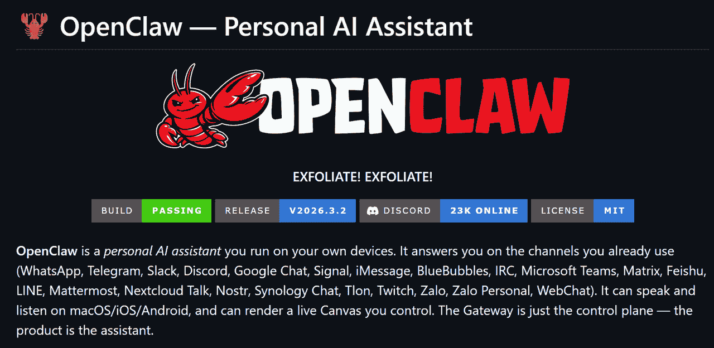

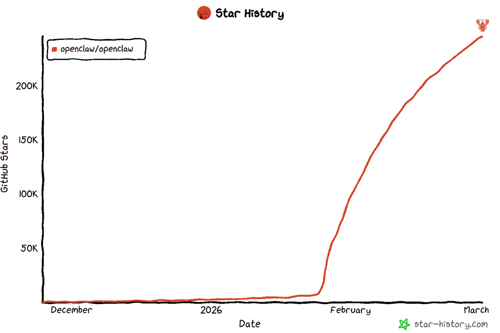

到了 2026 年 3 月，Op**enCl**aw 的 Star 数已经超过 25 万，正式超越了盘踞榜首近十年的 Re**act**，成为 GitHub 有史以来 Star 数最高的软件项目。作为参照：Kubernetes 用了近十年才积累到 12 万 Star；Linux 内核经过三十多年也才 19.5 万。而 OpenClaw 只用了不到两个月。

这不只是一个开源项目的爆发。这个数字背后，折射的是一个更深刻的行业信号——全民 Agent 应用时代正式拉开序幕。

#### 1.1 OpenClaw 做了什么？

OpenClaw 是一个开源的通用型 AI 智能体 (AI Agent)。与传统的聊天机器人不同，它不是"你问我答"的模式——而是能够自主规划、调用工具、执行多步骤任务，本质上更接近一个 7×24 在线的"数字员工"。

**Op**enClaw 由奥地**利开发者 Pete**r Steinberger 创建（最初叫 Clawd，后更名为 Moltbot，最终定名 OpenClaw），它之所以能引爆全球开发者社区，核心在于两个字：通用。通过其独创的网关系统 (Gateway System)，OpenClaw 可以接入几乎所有主流平台——WhatsApp、Discord、iMessage、Slack、飞书、🛰️——同时支持 Claude、GPT、Gemini、DeepSeek 等多种底层大模型。这使得 OpenClaw 成为真正意义上"接入万物，指挥一切"的通用 Agent 平台。

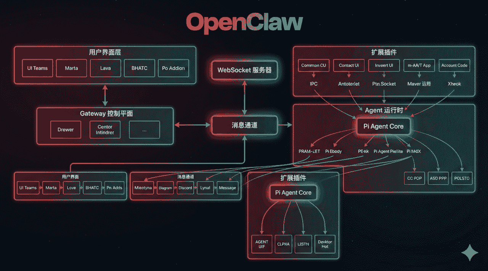

#### 1.2 全球开发者在用 OpenClaw 做什么？

** 真正让 O**penClaw 区别于以往任何"明星开源项目"的，不是 Star 数本身，而是全球开发者基于它构建的真实应用场景——这些案例充分展示了 Agent 在实际生产和生活中的技术价值。

+   **自主商务谈判**：一位开发者让 OpenClaw** 通过浏览器、邮件和 i**M**essage 同时与多**家汽车经销商议价，Agent 全程自主完成了报价对比、还价策略和沟通跟进。最终在这位开发者睡觉的时候，Agent 帮他谈下了 4,200 美元的折扣。

+   **多 Agent 团队运营**：一位独立创业者搭建了由 4 个 Agent 组成的虚拟团队——分别负责战略规划、技术开发、市场营销和商务运营，各自拥有独立的上下文记忆，同时共享核心决策信息。整个系统 24/7 运行在一台 VPS 上，通过 Telegram 远程管控。

+   **移动端全流程开发**：有开发者仅通过 Telegram 向 OpenClaw 下达指令，就完成了一款 iOS 应用的开发和提交——从代码编写、测试到 TestFlight 构建和 App Store 审核提交，全程无需坐在电脑前。

+   **法律文书自主处理**：一位用户的 Agent 在检测到保险公司的拒赔通知后，未经人工指示便自主起草了法律申诉文书并完成了提交——这已经逼近了"自主决策"的边界。

+   **生活场景深度融合**：家政人员发送消息说"洗洁精用完了"，OpenClaw 自动登录超市账号（通过 1Password 获取凭证）、将商品加入购物车并下单；另一位用户的 Agent 每天早晨自动汇总全家人的日历、天气预报和通勤路况，生成一份结构化的晨间简报。

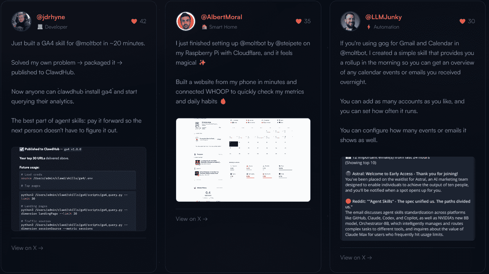

这些案例的共同特征是：**A**gent 不再局限于"问答"，而是在真实世界中自主完成涉及多平台、多步骤、甚至涉及资金操作的复杂任务。 这正是 Agent 技术从"技术演示"走向"生产力工具"的标志。

+   OpenClaw系列公开课


+   霸榜硅谷热搜！ClawdBot功能解读与本地部署指南：https://www.bilibili.com/video/BV1Pv67B9EPf/

+   不写一行代码，开发AI数字员工！OpenClaw企业级应用：https://www.bilibili.com/video/BV1biFizeEZs/

+   2026 Agent开发必学，OpenClaw原理精讲与从零手搓！https://www.bilibili.com/video/BV1mScqzqEDN/

+   【2026开发必备】Agent Skills零基础工业级实战！https://www.bilibili.com/video/BV12VZXBqECz/

### 2. 从 OpenClaw 到 Claude Code：通用 Agent 与专业 Agent 的分水岭

**  理解了 OpenC**law 的火爆，也就更容易理解本课程的主角——Claude Code。

**  如果****把 A**gent 领域比作武器库，OpenClaw 是一把瑞士军刀——什么都能干一点，适应各种场景；而 Claude Code 则是一把手术刀——在特定领域做到极致精准。

#### 2.1 架构同源，方向分野

从技术底层来看，OpenClaw** 和 C**laude Code 的架构思路高度一致。它们都遵循现代 Agent 的核心范式：

| **架构维度** | **OpenClaw** | **Claude Code** |
| --- | --- | --- |
| **工具调用 (Tool Use)** | 通过网关连接外部 API、消息平台 | 内置 Read/Write/Bash/Grep 等系统级工具 |
| **记忆管理 (Memory)** | 跨会话记忆 + 用户画像 | CLAUDE.md + Auto Memory 层级记忆体系 |
| **技能扩展 (Skills)** | ClawHub 技能市场，50,000+ Skills | SKILL.md 标准 + 社区 Skills 生态 |
| 多智能体 (Multi-Agent) | 支持 Agent 间协作与任务委托 | Sub-Agent 委托机制 + Agents Team |
| 上下文工程 (Context Engineering) | 索引-按需加载的 JIT 注入策略 | /compact 压缩 + 动态上下文窗口管理 |

理解 Claude Code 的架构原理，也就同时理解了 OpenClaw 这类通用 Agent 的核心机制——因为它们是同一个时代、同一套思想的两种实现。


#### 2.2 关键区别：通用网关 vs 专业纵深

但两者的核心定位截然不同：

+   **OpenClaw 追求"广"**：通过网关系统打通万物连接，核心价值在于**"接入一切"**——管理邮件、操控手机 App、在 Discord 上自动回复，定位是一个全能型的数字助手。

+   **Clau**de Code 追求"深"：从 2025 年开源至今，一直深耕软件工程这个最复杂的专业领域。Claude Code 不仅是当前最强的编程 Agent，在文档编写、全自动化工作流设计、系统架构分析等方面同样展现出了惊人的专业度。

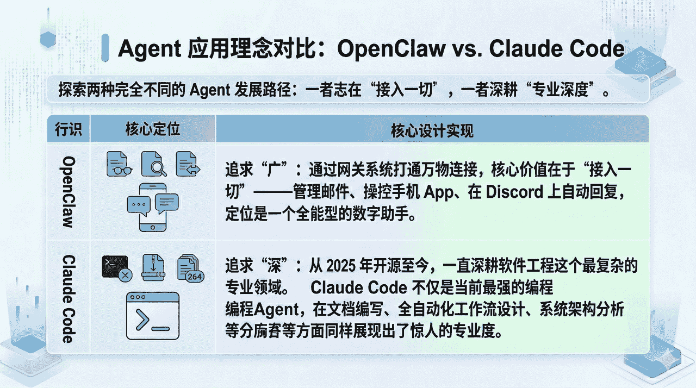

彭博社在 2026 年 2 **月的一篇报道中，用了一个非常直白的标题："Claude Code and the **Great Productivity Panic of 202**6"（Claude Code 与** 2026 大生产力恐慌）。报道指出，Claude Code 正在引发整个科技行业的生产力焦虑——因为它让人们第一次真切感受到：一个 AI Agent 能够独立完成过去需要整个工程团队才能搞定的工作。

### 3. 为什么现在必须学会 Claude Code？

理解了 Agent 时代的大背景，接下来需要回答一个关键问题：为什么是 Claude Code？为什么是现在？

#### 3.1 Vibe Coding：程序员的技能大迁徙

**  2025 年初，前 Ope**nAI 研究员 Andrej Karpathy 提出了一个**概念：V**ibe Coding（氛围编程）。Vibe Coding 的核心理念是：程序员不再一行行手写代码，而是用自然语言描述意图，由 AI Agent 完成从代码生成、调试到部署的全过程。程序员的角色，从"代码的编写者"转变为"意图的表达者和质量的审查者"。

这个看似学术化的概念，在 2026 年变成了触目惊心的现实。

**  Anthropic **C**EO Dario Amodei 在 2025 年 3 月**的美国外交关系委员会 (Council on Foreign Relations) 演讲中公开预测："3 到 6 个月内，AI 将编写 90% 的代码；12 个月内，AI 可能编写几乎所有代码。" 这个预言在当时引发了激烈争议，但到了 2026 年，Anthropic 内部的数据显示——部分团队已经实现了 90% 的合并代码由 AI 生成，全公司平均值也达到了约 50%。


全球科技行业的反应是剧烈的。SaaStr 在年度报告中将 2026 年定义为**"隐形失业年" (The Year of Invisible Unemployment)。Bloomberg 的标题赫然写道："AI 编程 Agent（如 Claude Code）正在引发科技行业的大恐慌。"** 一项 CEO 调查显示，66% 的科技公司领导者计划在 2026 年裁员或冻结招聘规模，只有三分之一表示会扩招。

但硬币的另一面同样值得关注。AsianFin 的报道指出，行业正在从追捧 "Vibe Coder"（能聊天、懂氛围的文化型**程**序员）转向争抢 "Cracked Engineer"（硬核深度工程师）——那些能够驾驭 AI Agent、理解底层架构、在 Agent 辅助下完成 10 倍产出的技术人才。掌握 Claude Code 这样的顶级 Agent 工具，正是成为"Cracked Engineer"的必经之路。

**  最具冲击力的案例发**生在 2026 年** 2 月 ****26 日。Ja**c**k**** Dorsey 的金**融科技公司 Block（前身为 Square）宣布裁员约 4,000 人——接近公司总人数的一半，员工从 10,000+ 缩减至不到 6,000 人。Dorsey 在公开信中明确表示："我们正在创建和使用的智能工具，配合更小、更扁平的团队，正在开启一种全新的工作方式，从根本上改变了构建和运营一家公司的含义。" 更引人注目的是市场的反应——消息公布后 Block 股价单日暴涨超过 23%，市值一夜增加约 60 亿美元。华尔街用真金白银投票：用 AI 替代人力，不是利空，是利好。 Dorsey 甚至在 X 平台上警告同行："我认为大多数公司已经迟了。未来一年内，多数公司将得出相同的结论并做出类似的结构性变革。"

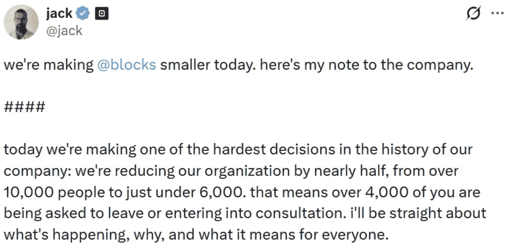

几乎同一时间，国内也出现了类**似信号。**2026 **年 **2 月 25 日，昆仑万维 CEO 方汉发布内部信《关于扩展**AI编程工具应用范围的通**知》，要求所有技术研发人员（包括各级 CTO）必须使用 OpenAI Codex 或 Claude Code，每人每月提供 100 美元的工具预算，并设定了明确的量化指标：生产效率至少提升 50%。更关键的是——AI 编程能力被正式纳入 H1 半年度绩效考核，无法达标者将按 5%-20% 的比例进行末位淘汰。方汉在此前的访谈中曾阐述其底层逻辑：AI 正在淘汰的是"中间层"——那些工作流程可被验证、学习和复现的岗位。他的建议是："要么冲进前 10%，要么学会向下兼容。"

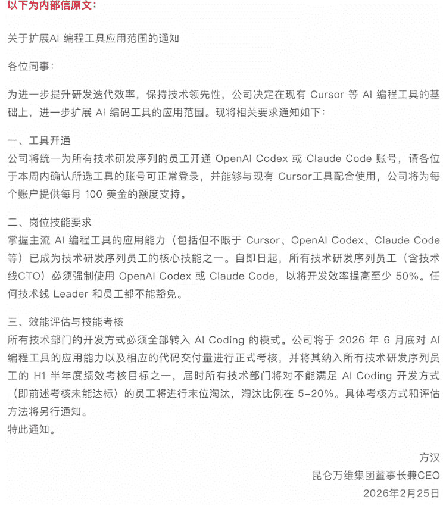

> **关键洞察**：从 Block 的大规模裁员到昆仑万维的末位淘汰，信号已经非常明确——AI 编程能力正在从"加分项"变为"生存技能"。Vibe Coding 浪潮并不是要"消灭程序员"，而是在重新定义"什么是有价值的技术能力"。学会与 AI Agent 高效协作，从"手写代码"转向"驾驭 Agent"，是每一位开发者必须完成的技能迁徙。

#### 3.2 Agent 开发者的最佳学习素材

Claude Code** 的学习价值不仅仅在于"**用它写代码"。对于大模型开发者和 Agent 架构师而言，Claude Code 本身就是一份价值连城的架构教科书——它几乎完美展示了一个工业级 Agent 系统应该如何设计：

+   **工具系统设计**：Claude Code 内置了 Read、Write、Edit、Bash、Grep、Glob 等精心设计的原子工具，每个工具都有明确的边界和安全约束。这套工具体系的设计思路，可以直接迁移到自定义 Agent 项目中。

+   **记忆管理架构**：CLAUDE.md（项目级记忆）+ Auto Memory（自动记忆）的双层架构，解决了 Agent 的"长期记忆"难题，成熟度超过大多数开源 Agent 框架的记忆方案。

+   **上下文工程**：Claude Code 的 /compact 命令背后是一套精密的上下文压缩与管理策略，它解决的是所有 Agent 都面临的核心挑战——如何在有限的 Context Window 里塞下无限的世界知识。

+   人机协作模式 (Human-in-the-Loop)：Claude Code 的权限确认机制、Checkpoint 回滚机制、Plan Mode 等设计，展示了 Agent 与人类如何高效且安全地协作。

+   **扩展生态**：Skills / MCP / Plugin 三套扩展体系，分别解决了"业务逻辑封装"、"外部能力连接"和"社区生态接入"三个不同层次的问题。

**学**习 Claude Code，获得的不只是一个编程工具的使用技能，更是一整套顶尖 Agent 系统的架构认知。

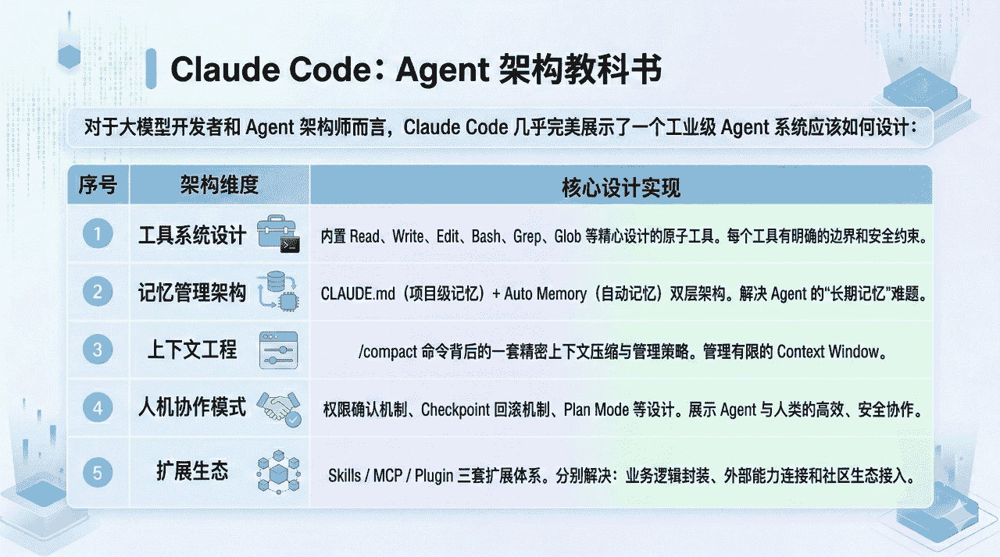

#### 3.3 可定制的专业 Agent 底座

** 以上两点——实战生产力和架构认知——已经足**够让 Claude Code 值得深入学习。**但还有第三个维度，往往被**初学者忽略：Claude Code 本身就是一个高度可定制的基座智能体 (Base Agent)，通过调整其记忆、Skills、MCP、插件乃至自定义子 Agent，可以将其改造为任何专业领域的垂直智能体。

与 OpenClaw 等通用 Agent 相比，Claude Code 的定制化能力更加系统化：

| **定制维度** | **机制** | **效果** |
| --- | --- | --- |
| 记忆系统 | CLAUDE.md（项目级）+ Auto Memory（自动积累）+ rag-memory（知识图谱） | Agent 理解你的业务领域、工作习惯、质量标准 |
| Skills 技能库 | .claude/skills/ 目录下的 SKILL.md 模板 | Agent 掌握可复用的专业工作流（如&quot;课件编写&quot;、&quot;代码审查&quot;） |
| MCP 工具链 | 15+ 可插拔的 MCP Server | Agent 获得 PDF 阅读、YouTube 字幕提取、图片生成等外部能力 |
| Hooks 自动化 | SessionStart / PostToolUse / Stop 等生命周期钩子 | Agent 在关键节点自动执行质检、格式修正、通知提醒 |
| 子 Agent 团队 | Agent SDK 的 subAgents 机制 | 主 Agent 拆解任务、派发给专业子 Agent 并行执行 |

**  举一个真**实案例——我们团队正在构建的九天智课系统。这个系统的核心思路，就是在一台专项 Mac Mini 上运行 Claude Code，通过以下定制将其从"通用编程助手"改造为"专业课件编写助理"：

+   **全局 CLAUDE.md** 写入讲师的编写方法论（五阶段工作流、16 条写作原则、4 条红线）

+   **8 个定制 Skills** 覆盖从调研（/research-topic）到发布（/publish-chapter）的完整链路

+   **15 个 MCP Server** 提供 PDF 阅读、视频字幕提取、链接检测、图片压缩等课件编写所需的全部外部能力

+   **四层记忆进化体系****（原始知识** → 观察模式 → 确认规则 → 灵魂准则），让系统越用越聪明

换言之，Claude Code 不只是一个"开箱即用"的编程工具，更是一个可以不断进化的 Agent 平台。掌握了它的定制方法论，就等于掌握了将 AI 能力注入任何垂直领域的通用技能。

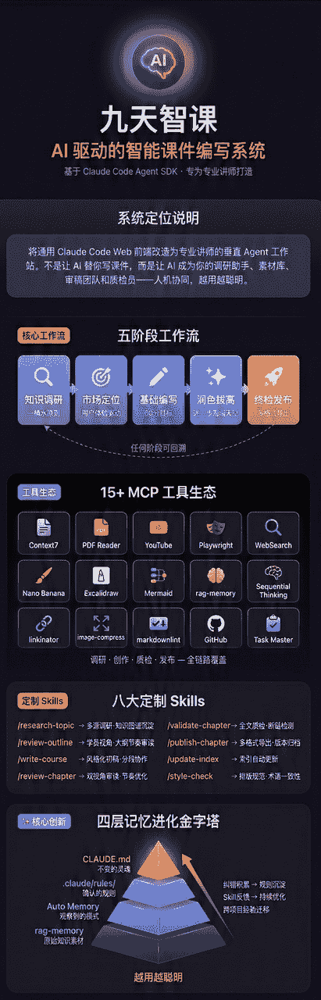

### 4. 本期公开课：从入门到定制的三段旅程

基于以上三个学习维度——实战生产力、架构认知、可定制 Ag**ent 底座**——本期公开课的内容设计分为三个递进部分：

第一部分：Claude Code 快速入门（本课件）

1.  从零部署 Claude Code——环境准备、安装配置、认证授权、国产模型替换，完成本地环境的完整搭建

1.  **核心功能逐一拆解**——内置工具、内置命令、记忆管理、扩展体系，每个功能不仅讲操作，还讲底层原理

1.  Fufan-CC Flow Web 界面同步演示——通过自研的 Claude Code Web 前端，直观呈现每个 CLI 操作在图形界面中的对应效果

**第二部分：企业级项目开发实战**

1.  用 Claude Code 完成一个真实项目——不是 Todo List，而是一个具备三栏布局、WebSocket 实时通信、Agent SDK 集成的完整 Web 应用

1.  **Agent SDK 的集成实战**——深入理解 Claude Code 底层的 Agent SDK 工作机制

1.  **工业级项目的开发工作流**——从需求分析到架构设计，再到 Vibe Coding 的完整实操

第三部分：打造专业领域智能体（彩蛋）

1.  **定制化方法论**——如何通过 CLAUDE.md、Skills、MCP、Hooks 四个维度将 Claude Code 改造为垂直领域 Agent

1.  **九天智课系统实例拆解**——以真实的课件编写智能体为例，展示从通用工具到专业助理的完整改造路径

1.  **越用越聪明的进化架构**——四层记忆体系如何让 Agent 在长期使用中持续积累领域经验

> **💡 提示：**第三部分属于高价值进阶内容，篇幅不会太长，但会提供完整的方法论框架和可复用的配置模板——掌握这套方法，你可以将 Claude Code 定制为任何领域的专业智能体。

## 二、Claude Code 部署与上手指南

在动[手安装之前，有一个关键背景需](https://claude.ai/code/family)要先了解：Claude Code 并不只有命令行这一种使用方式。 根据 Anthropic 官方说明，Claude Code 目前提供了三大运行模式，覆盖了从终端到浏览器的全场景：

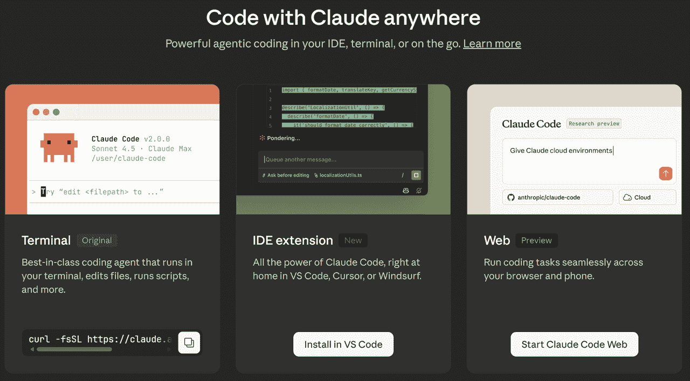

#### 三种运行模式一览

| **模式** | **载体** | **核心特点** | **适用场景** |
| --- | --- | --- | --- |
| **Terminal（终端命令行）** | 系统终端（PowerShell / Bash / Zsh） | 功能最完整、灵活度最高，支持全部 CLI 命令、Hooks、MCP、管道操作 | 日常开发、自动化脚本、CI/CD 集成、专业开发者首选 |
| IDE Extension（编辑器扩展） | VS Code / JetBrains 全系列（IntelliJ、PyCharm、WebStorm 等） | 图形化界面，支持内联 Diff 预览、@ 提及文件、代码选中即问，与编辑器深度融合 | 习惯 IDE 工作流的开发者，需要可视化代码对比时 |
| **Web（浏览器云端）** | 浏览器访问 [claude.ai/code](https://claude.ai/code)，同时支持 iOS App | 零安装、云端运行，可处理本地没有的远程仓库，支持启动长时间任务后离开页面 | 临时使用、移动端查看、不方便配置本地环境时 |

三种模式底层连接的是同一个 Claude Code 引擎——你在项目中配置的 CLAUDE.md、MCP Servers、Skills 等设置，在所有模式中通用。它们的区别在于交互方式和功能完整度。

#### 国内开发者最佳使用模式：Terminal 模式

既然有Claude Code有三种模式可选，为什么我们不从更"友好"的 IDE 扩展或 Web 模式开始，而是直接从看起来门槛最高的命令行入手？原因有四：

第一，Terminal 是功能最完整的模式。 Claude Code 的所有能力——Hooks 自动化、管道操作（| 将输出流传给 Claude）、非交互模式（-p 参数批处理）、Agent SDK 集成——都只有在终端中才能完全发挥。IDE 扩展和 Web 模式本质上是终端能力的"子集"封装。学会了终端，其他两种模式自然会用；反过来则不行。

第二，IDE 扩展在国内存在网络限制。 VS Code 扩展和 JetBrains 插件在连接 Anthr**opic 服**务器时，走的是编辑器内置的网络通道。国内开发者常用的 HTTP 代理（如 Clash 的系统代理）往往无法被 IDE 扩展正确识别，需要额外配置 TUN 模式（虚拟网卡全局代理）才能稳定连接。相比之下，终端中设置代理只需三行 export 命令，简单可控。

第三，Web 模式受云端资源和额度约束。 Web 模式虽然零安装，但它的会话运行在 Anthropic 的云端沙箱中，对单次任务的运行时长、并发数量均有限制。更关键的是，Web 模式要求授权 GitHub 仓库访问权限，对于私有项目或本地项目并不方便。

第四，Terminal 是理解 Agent 工作原理的最佳窗口。 在终端中，你能直接看到 Claude Code 调用了哪些工具、执行了什么命令、读写了哪些文件——这种"透明感"对于理解 Agent 的决策过程至关重要。IDE 和 Web 模式的图形化封装反而会遮蔽这些细节。

> **💡 提示：**这并不意味着 IDE 扩展和 Web 模式不好——它们各有优势。掌握终端操作后，**完全可以根据**场景灵活切换。事实上，Claude Code 还支持在不同模式之间无缝转移会话：终端中用 /desktop 命令可将当前会话转移到桌面应用，Web 端启动的任务也可以用 /teleport 拉回本地终端继续。

明确了"从终端入手"的策略，接下来正式开始部署。

### 1. 环境准备：从打开终端开始

Claude Code 是一个命令行工具 (CLI, Command Line Interface)，所有操作都在终端中完成。对于从未使用过终端的开发者，首先需要知道如何打开它：

| **操作系统** | **终端打开方式** |
| --- | --- |
| **Windows 11** | 右键点击&quot;开始&quot;按钮 → 选择&quot;终端&quot;（或搜索 PowerShell） |
| **Windows 10** | 搜索栏输入 PowerShell，点击&quot;Windows PowerShell&quot; |
| **macOS** | Command + 空格 打开 Spotlight → 输入 Terminal → 回车 |
| **Linux** | Ctrl + Alt + T（大多数发行版的快捷键） |

以Windows为例，win+R打开运行页面并输入cmd，

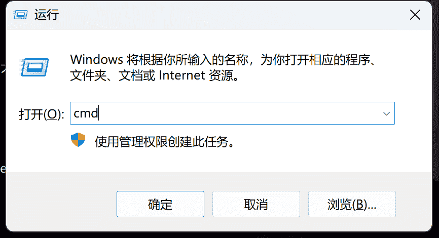

点击确定即可打开cmd命令行页面：

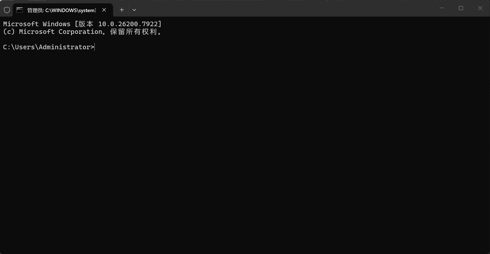

> **⚠️ 注意（国内开发者必读）**：Claude Code 需要连接 Anthropic 的海外服务器。在执行任何安装命令之前，必须确保代理 (VPN) 已正确配置并处于运行状态。以代理端口 10080 为例，不同操作系统的终端代理设置方式如下：

macOS / Linux（Bash / Zsh）：

```
export https_proxy=http://127.0.0.1:10080
export http_proxy=http://127.0.0.1:10080
export all_proxy=socks5://127.0.0.1:10080
```

Windows PowerShell：

```
$env:HTTPS_PROXY = &quot;http://127.0.0.1:10080&quot;
$env:HTTP_PROXY = &quot;http://127.0.0.1:10080&quot;
```

**Windows CMD**：

```
set HTTPS_PROXY=http://127.0.0.1:10080
set HTTP_PROXY=http://127.0.0.1:10080
```

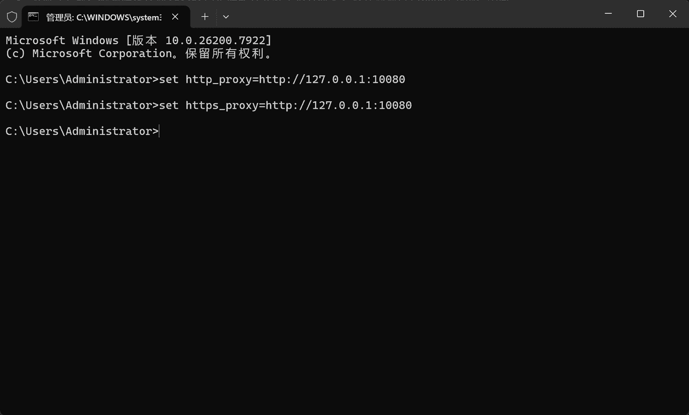

> **💡 提示：**以上环境变量仅在当前终端会话中生效。如果关闭终端后重新打开，需要再次设置。建议将这些命令写入 Shell 配置文件（如 ~/.bashrc 或 ~/.zshrc），实现持久化配置。端口号 10080 需替换为你实际使用的代理端口。

然后即可输入如下命令测试能否连通Anthropic服务：

```
ping api.anthropic.com
```

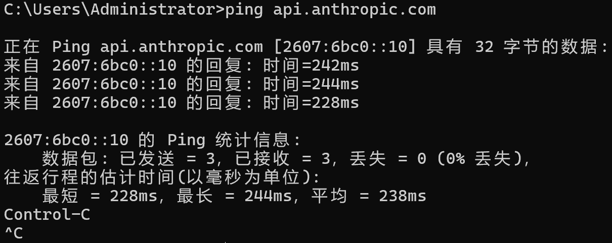

### 2. Claude Code 安装：三大平台全流程

2025 年 Claude Code 初次发布时，安装方式是通过 npm（Node.js 包管理器），需要预先安装 Node.js 18+ **环境。而截至 2026 年 3** 月，Anthropic 已将安装方式切换为原生二进制安装器 (Native Installer)——无需任何 Node.js 依赖，一条命令即可完成安装。npm 安装方式已被标记为 Deprecated（已弃用）。

| **安装方式** | **状态** | **是否自动更新** | **需要 Node.js** |
| --- | --- | --- | --- |
| 原生安装器（curl / irm 脚本） | **推荐** | 是（后台静默更新） | 否 |
| Homebrew（macOS / Linux） | 支持 | 否（需手动 brew upgrade） | 否 |
| WinGet（Windows） | 支持 | 否（需手动 winget upgrade） | 否 |
| npm | **已弃用** | 否 | 是（18+） |

#### 2.1 macOS / Linux 安装

```
curl -fsSL https://claude.ai/install.sh | bash
```

**代码解析**：

+   **curl -fsSL**：静默下载安装脚本（-f 失败时不输出 HTML，-s 静默模式，-S 显示错误，-L 跟随重定向）

+   **| bash**：将下载的脚本直接传递给 Bash 执行

如果希望安装更为稳定的版本（通常比最新版延迟约一周，跳过有重大回退的版本）：

```
curl -fsSL https://claude.ai/install.sh | bash -s stable
```

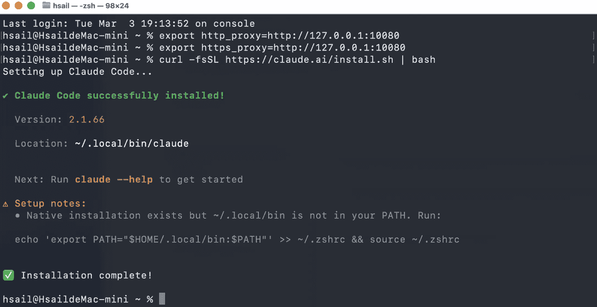

通过 Homebrew 安装（备选）：

```
brew install --cask claude-code
```

#### 2.2 Windows 安装

**PowerShell（推荐）**：

```
irm https://claude.ai/install.ps1 | iex
```

**代码解析**：

+   **irm**：Invoke-RestMethod 的别名，下载安装脚本内容

+   **iex**：Invoke-Expression 的别名，执行下载的脚本

+   无需以管理员身份运行

**CMD 命令提示符**：

```
curl -fsSL https://claude.ai/install.cmd -o install.cmd &amp;&amp; install.cmd &amp;&amp; del install.cmd
```

**代码解析**：

+   **curl -fsSL**：静默下载安装脚本到本地文件 install.cmd

+   **&& install.cmd**：下载成功后执行安装脚本

+   && del install.cmd：安装完成后删除临时脚本，保持目录整洁

+   适用于习惯使用传统 CMD 命令提示符的开发者，效果与 PowerShell 安装完全一致

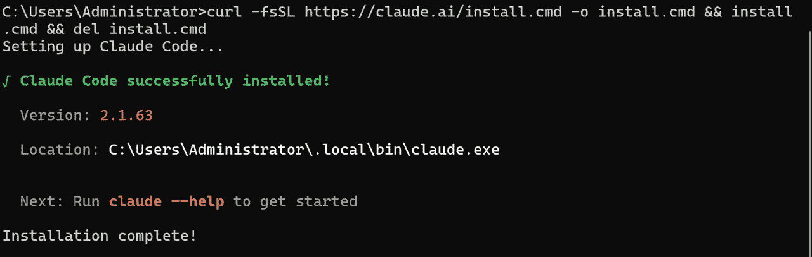

**WinGet（备选）**：

```
winget install Anthropic.ClaudeCode
```

> **⚠️ Windows 用户注意****：Claude Code 在 **[Windows 下需要](https://git-scm.com/) Git for Windows（提供 Git Bash 环境）。如果尚未安装 Git，请先前往 git-scm.com 下载安装。

#### 2.3 安装验证

安装完成后，运行以下命令确认安装成功：

```
claude --version
```

如果输出版本号（如 claude v2.1.x），则说明安装成功。

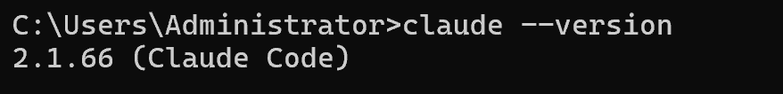

#### 2.4 Claude Code 的本地数据：配置文件与会话记录

在介绍更新机制之前，有一个基础知识点需要先建立：Claude Code 的所有数据都保存在本地。这一点对后续理解配置管理、记忆系统、会话恢复等功能至关重要。

安装完成后，Claude Code 会在用户主目录下创建 ~/.claude/ 文件夹（Windows 下对应 C:\Users\<用户名>\.claude\），这是它的"大本营"：

| **路径** | **内容** | **说明** |
| --- | --- | --- |
| ~/.claude/settings.json | 全局配置文件 | 更新通道、API Key、环境变量、MCP Server 等所有全局设置 |
| ~/.claude/CLAUDE.md | 全局记忆文件 | 跨项目生效的指令和偏好（后续&quot;记忆管理&quot;章节详细介绍） |
| ~/.claude/projects/ | 项目级数据 | 每个项目的会话记录、自动记忆、本地配置等 |
| ~/.claude/credits.json | 用量与额度 | API 调用次数、Token 消耗统计 |

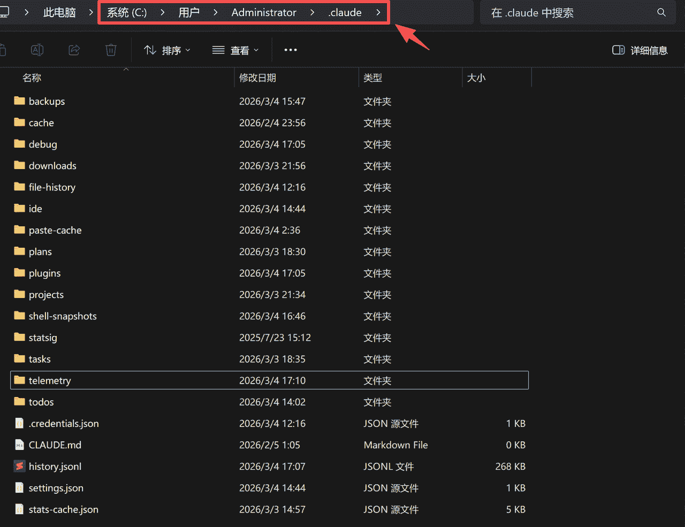

其中 settings.json 是最核心的配置文件——Claude Code 的大量行为都可以通过修改这个文件来调整。后续章节中涉及到的模型切换、权限管理、MCP 配置等，都会回到这个文件。

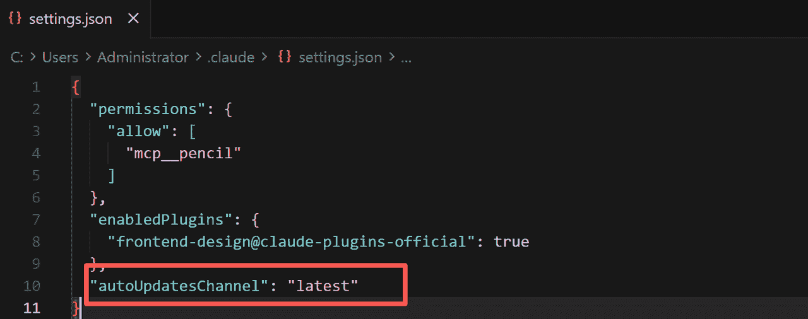

> **💡 提示：**除了全局配置，每个项目根目录下也可以创建 .claude/settings.json（项目级配置）和 .claude/settings.local.json（项目私有配置，不提交到 Git）。三者的优先级为：项目私有 > 项目共享 > 全局，后续在模型替换章节会详细说明。

#### 2.5 自动更新与手动更新

通过原生安装器安装的 Claude Code 具备后台静默更新 (Background Auto-Update) 机制——每次启动时自动检查新版本，在后台下载安装，下次启动时生效。这意味着开发者无需关注版本更新，始终使用最新版。

不过，Claude Code 迭代非常快（几乎每周都有新版本），偶尔新版本可能引入 Bug。前面提到的 ~/.claude/settings.json 中有一个实用的配置项可以控制更新策略——发布通道 (Update Channel)。Claude Code 提供两个通道：

| **通道** | **配置值** | **更新节奏** | **适用场景** |
| --- | --- | --- | --- |
| 最新通道 | &quot;latest&quot; | 新版发布后立即推送 | 想第一时间体验新功能、能接受偶尔的小 Bug |
| 稳定通道 | &quot;stable&quot; | 比 latest 延迟约一周 | 正式项目开发，优先保证稳定性 |

**对于绝大多数****开发者**，保持默认的 latest 即可——Claude Code 团队的发布质量总体很高，且新功能往往能显著提升效率。只有当你正在进行关键项目交付、不希望工具链出现任何意外时，才建议临时切换到 stable 通道。切换方式是在 ~/.claude/settings.json 中添加：

```
{
  &quot;autoUpdatesChannel&quot;: &quot;stable&quot;
}
```

如果需要立刻获取最新版本而不想等待自动更新，可以手动触发：

```
claude update
```

> **💡 提示：**一般不建议禁用自动更新。Claude Code 的新版本经常修复关键 Bug 和安全问题，关闭更新可能导致兼容性问题。如果确实有特殊需求（如离线环境），可以在 settings.json 的 env 中设置 "DISABLE_AUTOUPDATER": "1"。

#### 2.5 Doctor 诊断：遇到问题第一个运行的命令

在使用 Claude Code 的过程中，你可能会遇到一些令人困惑的状况：刚配置好的 MCP Server 始终连不上、切换了国产模型却得不到响应、或者 Claude Code 突然变得很"迟钝"——每次对话都消耗异常多的 Token。这些问题的原因各不相同，逐一排查既耗时又容易遗漏。

claude doctor 正是为此而生的**一站式诊断工具**。它会自动扫描 Claude Code 的完整运行环境，逐项检查可能出问题的环节，并以绿色（通过）、黄色（警告）、红色（错误）直观标识每项检查结果：

```
claude doctor
```

在 Cla**ude Code 会话**内部也可以直接运行 /doctor。以下是它检查的核心项目，以及每项检查实际能帮你发现什么问题：

| **检查项** | **能发现的典型问题** |
| --- | --- |
| 安装类型与版本 | 还在用旧的 npm 安装方式，应该迁移到原生安装器 |
| 自动更新状态 | 当前版本过旧，已知 Bug 在新版中已修复 |
| 配置文件有效性 | settings.json 里多了个逗号导致 JSON 解析失败，所有配置项静默失效 |
| MCP 服务器配置 | 某个 MCP Server 的路径写错了，或者依赖的 Node.js 版本不对 |
| 快捷键配置 | 自定义的快捷键与系统默认键冲突，导致某些操作无响应 |
| 上下文使用情况 | CLAUDE.md 文件写了 2000 行，每次对话都白白消耗大量 Token 在加载记忆上 |
| 插件与 Agent 加载 | 安装的某个 Plugin 与当前 Claude Code 版本不兼容 |

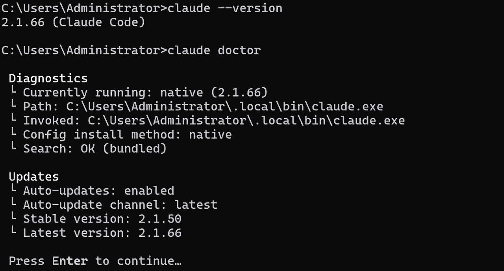

> **💡 提示：**养成一个好习惯——任**何时候 Claude Co**de 的行为不符合预期，先跑一次 claude doctor。它相当于 Claude Code 的"体检报告"，80% 的常见问题都能在这里找到线索。在向社区求助或提交 GitHub Issue 时，附上 doctor 的输出也能显著加速问题定位。

### 3. Fufan-CC Flow：在 Web 界面中安装与验证 Claude Code

**  对于报名正课的学员，还**可以通过本课程的配套项目 Fufan-CC Flow 来完成上述所有操作。Fufan-CC Flow 是我们打造的 Claude Code Web 图形化前端——在 Settings 页面中，安装状态检测、版本更新、连通性验证等操作都可以通过可视化界面一键完成，无需手动输入任何命令。

Settings 页面采用两步验证流程 (Two-Step Checklist) 设计：

**Step 1 — 环境检测**：自动检查 Claude Code 是否已安装、当前版本号、代理连通性。页面底部内嵌 MiniTerminal，可直接执行安装和更新命令


**Step 2 — 模型配置**：配置 Anthropic 官方 API Key 或切换国产基座模型（后续章节详细介绍）

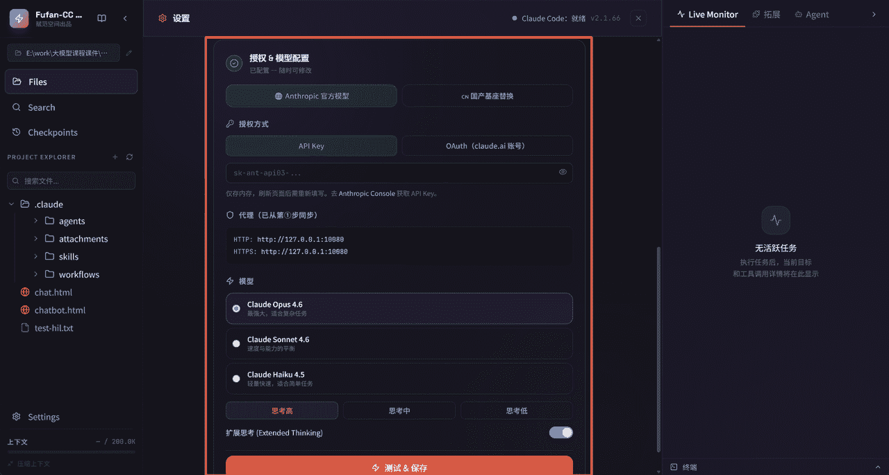

### 4. 登录验证与计费方式

Claude Code 安装完成后，首次运行需要完成身份认证。Claude Code 支持两种认证方式，对应不同的计费模式：

#### 4.1 认证方式对比

| **维度** | **OAuth 订阅登录** | **API Key 登录** |
| --- | --- | --- |
| **认证方式** | 浏览器跳转 Anthropic 账户授权 | 设置 ANTHROPIC_API_KEY 环境变量 |
| **计费模式** | 包含在 Pro/Max 订阅套餐内 | 按 Token 用量付费（后付费） |
| **适用人群** | 个人开发者、轻度使用 | 团队/企业、重度使用、需要精细成本控制 |
| **费用透明度** | 按&quot;消息数&quot;限额，不可见具体 Token 消耗 | 完全按 Token 计费，可精确计算成本 |
| **额度限制** | 滚动 5 小时窗口限额 | 受组织级 TPM/RPM 限制 |

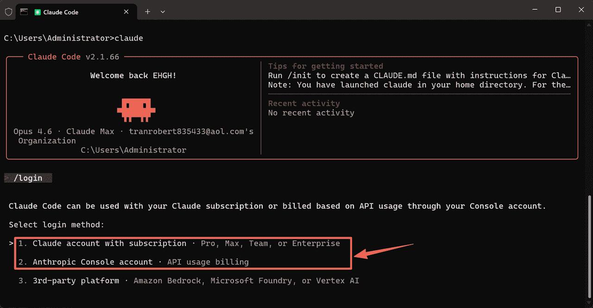

**OAuth 登录流程**：

```
claude
# 首次运行会自动打开浏览器，跳转到 Anthropic 授权页面
# 授权完成后自动返回终端，进入对话
```

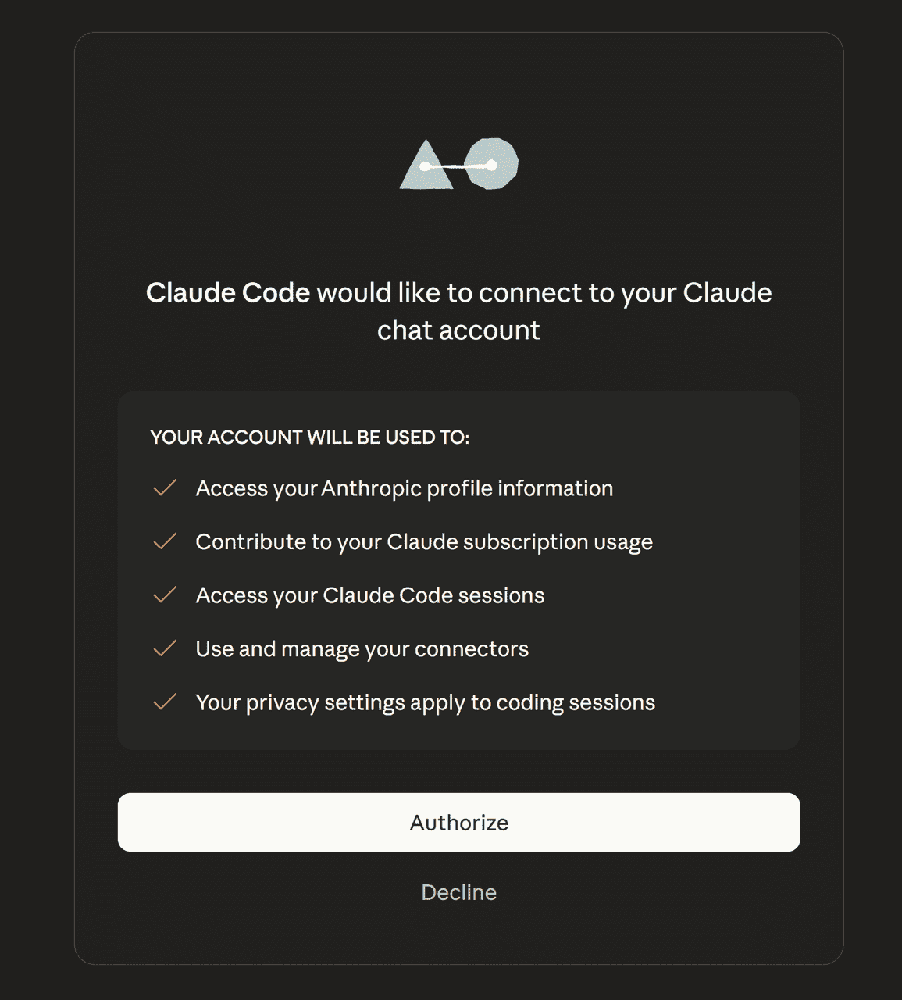

**  OAuth 授权完**成**后，Claude Code **会将获取到的 OAuth Token（包含 Access Token 和 Refresh Token）保存在本地。macOS 上凭证存储在系统钥匙串 (Keychain) 中（加密保护），Linux 和 Windows 上则存储在 ~/.claude/.credentials.json 文件中。后续启动 Claude Code 时，程序会自动读取本地凭证完成身份验证，无需重复登录——除非 Token 过期或主动执行 /logout。

**API Key 登录流程**：

```
# 方式一：通过环境变量设置（推荐）
export ANTHROPIC_API_KEY=&quot;sk-ant-api03-xxxxxxxxxxxx&quot;
claude

# 方式二：首次运行时选择 API Key 选项，在终端中输入
```

与 OAuth 不同，API Key** 不涉及**浏**览器跳转。它**的本质是将密钥写入环境变量或本地配置文件。如果通过 export ANTHROPIC_API_KEY=... 设置，密钥仅在当前终端会话中有效，关闭终端即失效；如果在首次运行 claude 时交互式输入 API Key，Claude Code 会将其持久化保存到 ~/.claude/settings.json 的 env 节点中，后续启动自动读取。

> **⚠️ 注意**：API Key 等同于你的账户密码，泄露后他人可以用你的账户产生费用。切勿将 API Key 提交到 Git 仓库或分享给他人。如果不慎泄露，应立即在 Anthropic Console 中轮换密钥。

#### 4.2 基础环境依赖：让 Claude Code 完整运行

** Clau**de Code 本体安装完成、认证也通过了，但这并不意味着所有功能都能正常工作。Claude Code 在运行过程中会调用一些系统级工具——如果这些工具缺失，部分功能会静默失败或报错。以下是各平台需要确认的依赖项：

| **依赖** | **用途** | **平台** | **重要性** |
| --- | --- | --- | --- |
| **Git** | Checkpoint 检查点（自动保存代码快照）、/diff 差异对比、版本控制操作 | 全平台必需 | ⭐ 必装，缺失将导致核心功能不可用 |
| Xcode Command Line Tools | 提供 gcc、make 等编译工具链，部分 MCP Server 安装时需要编译原生模块 | macOS 必需 | ⭐ macOS 用户必装 |
| **ripgrep (rg)** | Claude Code 的 Grep 工具底层依赖，用于高速代码搜索 | 全平台 | 通常随 Claude Code 自带，一般无需手动安装 |

**快速检查方式**——在终端中逐一验证：

```
git --version          # 应输出 git version 2.x.x
xcode-select -p        # macOS：应输出 /Library/Developer/CommandLineTools（Windows/Linux 跳过）
rg --version           # 应输出 ripgrep 14.x.x（可选检查）
```

如果上述命令提示"命令未找到"，说明对应工具尚未安装，请按照下面的指引完成安装。

##### Git 安装指引

**macOS**：

macOS 通常预装了 Git（随 Xcode Command Line Tools 一起提供）。如果执行 git --version 无输出，最快的方式是安装 Xcode Command Line Tools（下一节），它会同时安装 Git。也可以通过 Homebrew 单独安装：

```
brew install git
```

**Windows**：

访问 Git 官方下载页 git-scm.com/downloads/win，下载 64-bit Git for Windows Setup 安装包。运行安装程序时，关键选项建议如下：

| **安装步骤** | **推荐选择** |
| --- | --- |
| Default Editor | 选择你惯用的编辑器（如 VS Code） |
| PATH environment | 选择 **&quot;**Git from the command line and also from 3rd-party software&quot;（默认项，确保终端可用） |
| Line ending | 选择 &quot;Checkout as-is, commit Unix-style&quot;（适合跨平台开发） |
| 其余选项 | 保持默认即可 |

安装完成后，**重新打开终端**（PowerShell 或 Git Bash），执行 git --version 确认输出版本号。

**Linux**：

```
# Ubuntu / Debian
sudo apt update &amp;&amp; sudo apt install git

# CentOS / RHEL / Fedora
sudo dnf install git
```

##### Xcode Command Line Tools 安装指引（仅 macOS）

Xcode Command Li**ne Too**ls 包含了 git、gcc、make、clang 等开发者必备工具。macOS 用户强烈建议安装——不仅 Claude Code 需要，后续安装部分 MCP Server（需要编译原生 Node.js 模块）时也会依赖它。

```
xcode-select --install
```

执行后系统会弹出安装确认窗口，点击"安装"并等待完成（约 5-10 分钟，下载约 1.5 GB）。安装完成后验证：

```
xcode-select -p
# 应输出：/Library/Developer/CommandLineTools
```

> **💡 提示：**如果你已安装完整版 Xcode（从 App Store），Command Line Tools 已包含在内，无需重复安装。

##### ripgrep 安装指引（通常无需手动安装）

ripgrep（rg）通常随 Claude Code 自动安装。如果执行 rg --version 提示未找到命令，可手动安装：

```
# macOS
brew install ripgrep

# Windows（使用 winget）
winget install BurntSushi.ripgrep.MSVC

# Linux（Ubuntu / Debian）
sudo apt install ripgrep
```

**三项依赖中，Git 是最关键的**——没有 Git，Claude Code 的 Checkpoint 回滚机制将完全无法工作，/diff 命令也无法使用。请务必确认 Git 已正确安装后再继续。

#### 4.3 首次对话：验证一切就绪

所有准备工作完成后——Claude Code 已安装、认证已通过、Git 等依赖已就绪——是时候发送第一条消息，验证整个链路是否畅通。

进入任意项目目录（或直接在主目录），启动 Claude Code 并输入一句问候：

```
cd ~/my-project    # 进入任意项目目录
claude              # 启动 Claude Code
```

在对话界面中输入：

```
你好，好久不见
```

如果一切配置正确，Claude Code 会在几秒内返回一段自然语言回复——它会根据当前项目上下文做出响应，可能会简单介绍自己的能力，或者主动分析当前目录的项目结构。

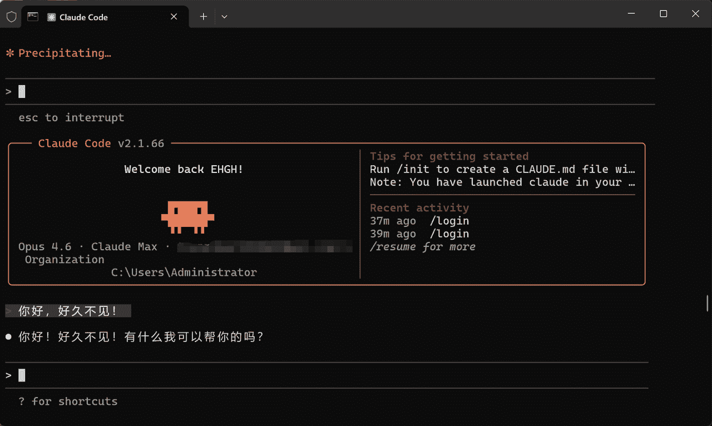

看到回复，就说明以下环节全部打通：

+   Claude Code 安装正确，可执行文件在系统 PATH 中

+   网络代理配置正确，能连接到 Anthropic 服务器

+   身份认证有效（OAuth Token 或 API Key）

+   模型调用正常，Claude 能正确接收和返回消息

> **💡 提示：**如果长时间没有响应或报错，先运行 claude doctor 做一次诊断（前文已介绍）。最常见的问题是代理未正确配置——回到前面的"代理设置"章节检查 https_proxy 和 http_proxy 环境变量是否生效。

首次对话成功，环境搭建阶段正式完成。接下来了解 Claude Code 的计费方式，做到心中有数。

同时，双击CTRL+C即可退出对话。


退出对话时能看到当前对话ID。而下次再次进入会话的话，需要在同一文件夹内输入resume命令：

```
claude --resume f06bc5d1-1523-4e1e-bead-9bf9f522953a
```


或者直接输入claude -c就能直接恢复上一次停止的会话。

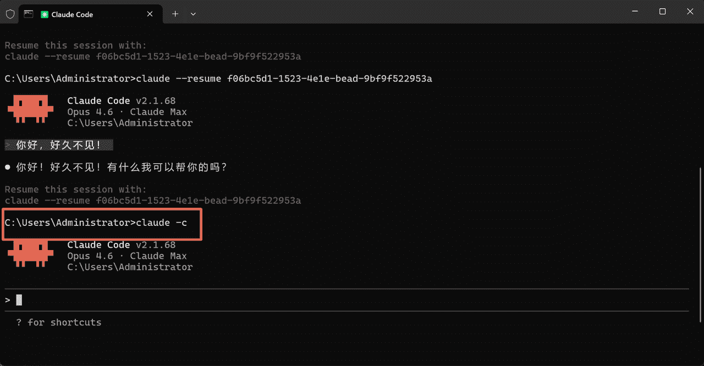

#### 4.4 深入理解：会话存储与项目绑定机制

上面的 -c 和 --resume 操作看似简单，背后却隐藏着 Cla**ude Code 最核心**的设计哲学之一：会话与项目目录的绑定关系。理解这一机制，不仅能避免很多初学者常见的困惑（"我的对话怎么找不到了？"），更能帮你建立正确的 Claude Code 工作心智模型。

##### 操作层面：为什么必须在同一文件夹内恢复对话？

尝试一个实验：在 ~/project-A 目录下与 Claude Code 进行了一次深入的代码重构对话，然后退出。接着 cd ~/project-B，**再执行 claude** -c——你会发现，刚才的对话完全消失了，-c 恢复的是 project-B 目录下的上一次会话（如果有的话），而不是你刚才在 project-A 中的那次。

这不是 Bug，而是**刻意为之****。Claude **Code 本质上是一个项目级的开发助手，而非全局聊天工具。它的每一次对话都深度嵌入当前项目的上下文——读取了哪些文件、修改了哪些代码、创建了哪些 Checkpoint、遵循了哪些 CLAUDE.md 规范。如果允许在 project-B 中恢复 project-A 的会话，Claude 可能会按照 A 项目的规范去修改 B 项目的代码，后果不堪设想。

> **核心认知**：Claude Code 不是"通用对话工具碰巧能写代码"，而是"项目级 Agent 碰巧通过对话交互"。每个项目目录就是一个独立的工作空间，会话、记忆、配置三者在目录维度上完全隔离。

##### 底层机制：会话如何存储在本地？

打开 ~/.claude/projects/ 目录**，你会看到 Cla**ude Code 会话存储的全貌。每个项目目录的绝对路径会被编码为一个文件夹名——路径分隔符替换为连字符：

| **项目路径** | **编码后的文件夹名** |
| --- | --- |
| /Users/alice/code/myapp（macOS） | -Users-alice-code-myapp |
| C:\Users\Bob\dev\project（Windows） | C--Users-Bob-dev-project |

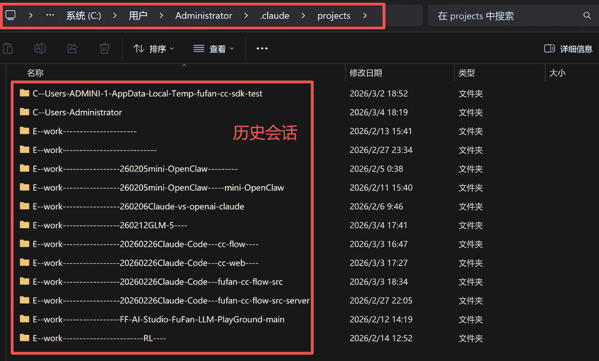

每个编码后的项目文件夹内部结构如下：

```
~/.claude/projects/-Users-alice-code-myapp/
├── a1b2c3d4-e5f6-7890-abcd-ef1234567890.jsonl   # 会话记录（每次对话一个文件）
├── f06bc5d1-1523-4e1e-bead-9bf9f522953a.jsonl   # 另一次会话的记录
├── sessions-index.json                           # 会话索引（元数据）
└── memory/
    └── MEMORY.md                                 # 项目级 Auto Memory
```

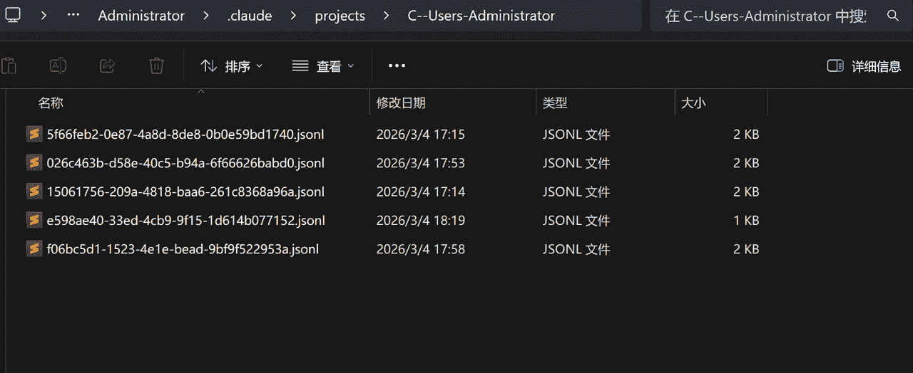

其中，.jsonl 文**件是会话**的完整记录——每一行是一个 JSON 对象，记录了每一轮对话的消息内容、时间戳、Token 用量、工具调用结果、当前 Git 分支等信息。Claude Code 采用追加写入（append-only）模式，每产生一条消息就立即写入磁盘，即使进程崩溃也不会丢失已完成的对话内容。

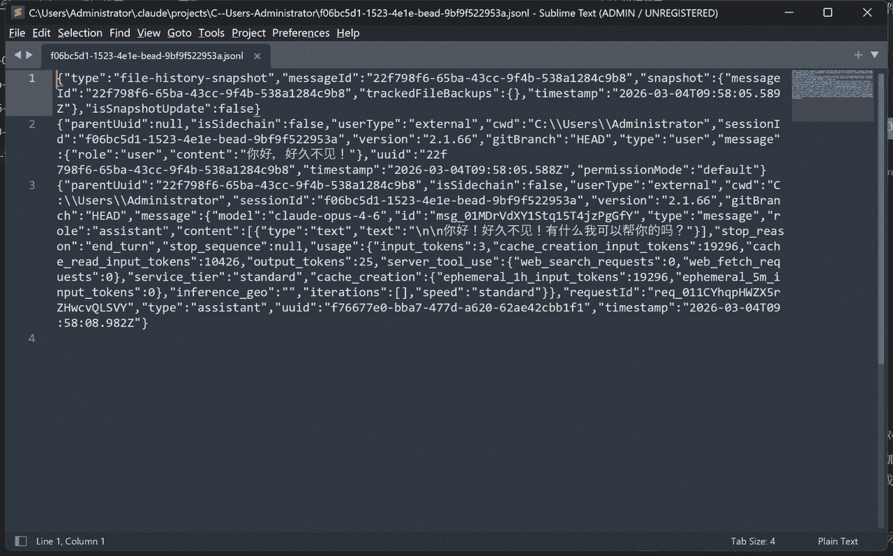

sessions-index.json 则是一个轻量级索引文件，记录每个会话的元数据（首条提示词、摘要、消息数量、创建/修改时间、Git 分支等），供 claude --resume 的交互式选择器快速检索，无需逐一解析完整的 JSONL 文件。

> 注意，最新版sessions-index.json内容已经合并到历史对话记录json字段中。

理解了这套存储结构，几个常见问题就迎刃而解了：

| **问题** | **原因** |
| --- | --- |
| 移动项目文件夹后，-c 找不到之前的对话 | 路径变了，编码后的文件夹名也变了，Claude Code 认为这是一个新项目 |
| 不同电脑之间无法共享会话 | 会话存储在本地 ~/.claude/ 中，不会上传到云端 |
| 删除了 ~/.claude/projects/ 后所有历史记录消失 | 那就是会话数据的唯一存储位置 |

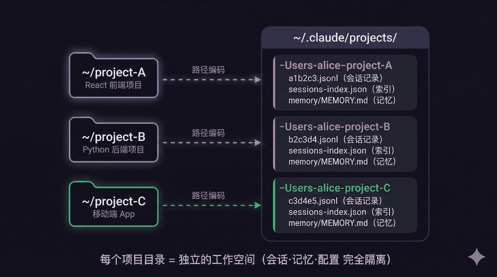

##### 延伸思考：Claude Code 能否"多开"？

理解了"会话绑定项目目录"的机制后，一个自然的问题浮现：能不能同时开多个 Claude Code 实例，并行处理不同任务？

答案需要分两种情况讨论：

**不同项目目录——完全可以多开。** 你可以在一个终端窗口中用 Claude Code 开发前端项目 ~/frontend，同时在另一个窗口中开发后端项目 ~/backend。两个实例的会话、记忆、Checkpoint 各自独立，互不干扰。这正是"项目级隔离"设计的优势——每个项目目录映射到 ~/.claude/projects/ 下不同的文件夹，数据天然隔离。

同一项目目录——强烈不建议多开。 虽然技术上 Claude Code 不会阻止你在同一个目录下启动第二个实例，但这样做会引发一系列问题：

| **问题** | **原因** |
| --- | --- |
| 命令历史串台 | 两个实例共享同一目录的 readline 历史，按上箭头可能调出另一个实例的输入 |
| 上下文污染 | 实例 A 正在读取的文件可能被实例 B 修改，导致 A 基于过时信息做出错误操作 |
| Checkpoint 冲突 | 两个实例同时创建 Git 快照，可能导致回滚行为不可预测 |
| Auto Memory 竞争写入 | 两个实例可能同时尝试更新 MEMORY.md，造成数据丢失 |

Claude Code 之所以没有实现目录级的进程锁，是因为它信任开发者的使用习惯——就像你**不会同时用两个编辑器打开**同一个文件并同时保存一样。如果确实需要在同一个代码仓库中并行开发两个独立功能，正确的做法是使用 Git Worktree：

```
# 为新功能创建独立的工作树（物理上是不同的目录，但共享 Git 历史）
git worktree add ../myapp-feature-auth feature/auth
git worktree add ../myapp-fix-bug    fix/bug-123

# 然后在各自的目录中启动 Claude Code，互不干扰
cd ../myapp-feature-auth &amp;&amp; claude
cd ../myapp-fix-bug &amp;&amp; claude
```

每个 Worktree 是一个独立的目录路径，因此在 ~/.claude/projects/ 下会自动产生独立的会话空间——既保留了 Git 历史的统一性，又实现了 Claude Code 层面的完全隔离。

> **💡 小结：**Claude Code 的会话绑定机制看似是一种"**限制"，实则****是深思熟虑的****设计。它确保了**记忆的一致性（同一项目的所有对话共享 Auto Memory）、配置的安全性（不同项目的 CLAUDE.md 规范不会交叉污染）、以及操作的可预测性（Checkpoint 回滚只影响当前项目）。理解这一点，就理解了 Claude Code "项目级 Agent"的定位——它不是在"聊天"，而是在"驻场开发"。

#### 4.5 Anthropic API 计费详情

对于使用 API Key 的开发者，计费完全基于 Token 用量。以下是截至 2026 年 3 月的 Claude 4.6 系列模型定价（单位：美元 / 百万 Tokens）：

| **模型** | **输入** | **输出** | **缓存写入** | **缓存读取** |
| --- | --- | --- | --- | --- |
| **Claude Opus 4.6** | $5.00 | $25.00 | $6.25 | $0.50 |
| Claude Sonnet 4.6 | $3.00 | $15.00 | $3.75 | $0.30 |
| Claude Haiku 4.5 | $1.00 | $5.00 | $1.25 | $0.10 |

> **💡 提示：****Claude Cod**e 默认使用 Sonnet 4.6 作为主力**模型**。根据 Anthropic 官方数据，开发者日均 API 成本约为  12。使用 /model 命令可在会话中随时切换模型——简单任务用 Haiku 节省成本，复杂推理任务切换 Opus 获取更高质量输出。

#### 4.6 订阅套餐与用量限额

** 对于使用 OAuth 订阅方式**的开发者，Claude Code 的使用量包含在 Claude 订阅套餐中。需要特别注意：Claude.ai 网页端和 Claude Code 共享同一份用量配额。

| **套餐** | **月费** | **Claude Code 支持** | **约每 5 小时消息数** | **核心特性** |
| --- | --- | --- | --- | --- |
| **Free** | $0 | **不支持** | — | 基础 Claude 对话 |
| **Pro** | $20 | 支持 | ~45 条 | Sonnet 4.6，扩展思考 |
| **Max 5x** | $100 | 支持 | ~225 条 | Sonnet 4.6 + Opus 4.6，1M 上下文（Beta） |
| **Max 20x** | $200 | 支持 | ~900 条 | 全模型，20 倍 Pro 限额，优先访问 |

**关键细节**：

+   免费套餐不包含 Claude Code，至少需要 Pro 订阅（$20/月）

+   用量限额基于**滚动 5 小时窗口**，而非按天重置

+   **当消息达到限额后，需等**待窗口滚动释放配额，或开启 Extra Usage（超额使用）功能按 API Token 费率收费

+   Claude Code 界面内可通过 /cost 命令（API 用户）或 /stats 命令（订阅用户）查看实时用量

> 官网额度查询：https://claude.ai/settings/usage

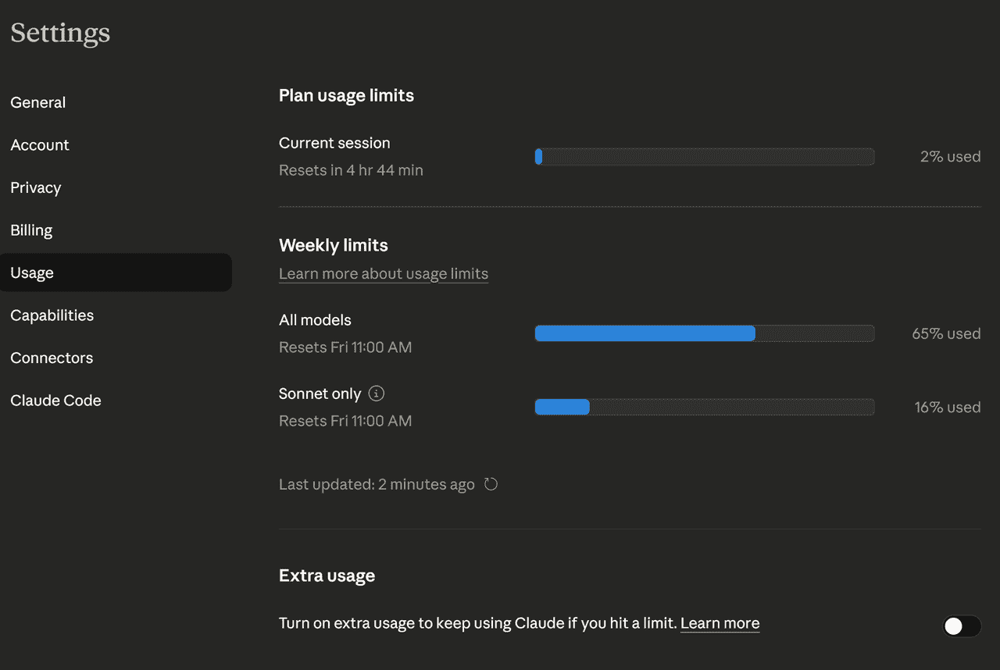

> **💡 提示：**对于大多数个人开发者，**Pro 套餐（ 150+ 的 API 用量。如果 5 小时内经常触达限额，再考虑升级到 Max 套餐。

### 5. 在 VS Code 和 Claude 官网中使用 Claude Code

#### 5.1 VS Code 插件

Anthropic 官方发布了 Claude Code for VS Code 扩展，在 VS Code 中提供了图形化的 Claude Code 交互面板。

**安装方式**：

1.  确保已安装 Claude Code CLI（扩展依赖 CLI 进程）

1.  VS Code 中按 Ctrl+Shift+X 打开扩展商店

1.  搜索 **"Claude Code"**，安装发布者为 **Anthropic** 的扩展（注意区分第三方扩展）


安装完成后，通过编辑器右上角的 Spark 图标或 Ctrl+Shift+P → Claude Code 启动交互面板。扩展提供了 GUI 聊天面板、内联 Diff 预览、@ 文件引用等功能。

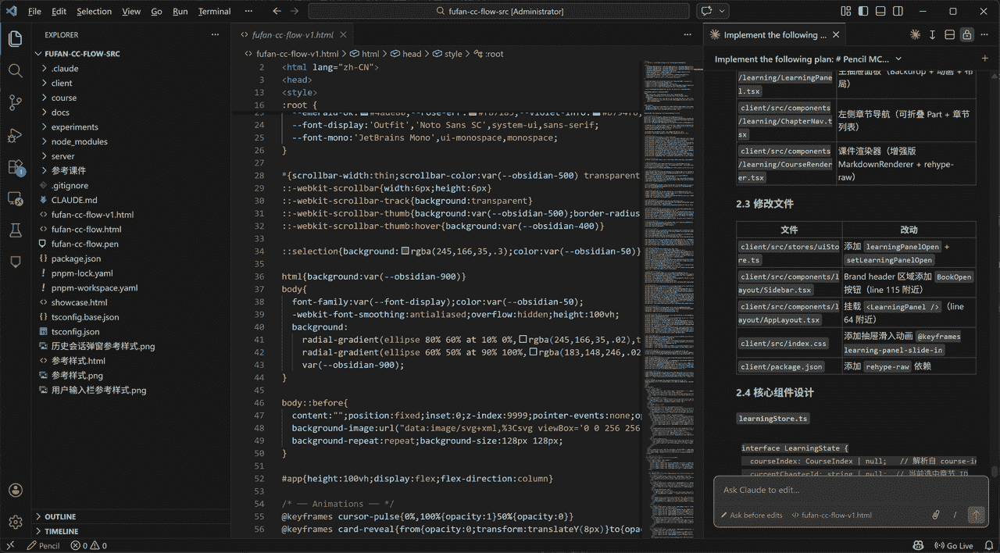

> ⚠️ VS Code 代理配置注意事项：**在 VS Cod**e 中使用 Claude Code 时，代理配置需要特别注意。CLI** 终端方式下，在终端中设置** **HTTPS_**PROXY 环境变量即可正常工作；但 VS Code 扩展的 GUI 面板存在已知的代理兼容性问题（部分版本会忽略代理设置），建议国内开发者优先从终端启动 VS Code（确保 Shell 环境变量被继承），或直接使用 VS Code 内置终端中的 CLI 模式。如果需要代理透明化，建议使用 VPN 的 TUN 模式（全局透明代理），这样 VS Code 扩展无需额外配置即可联网。

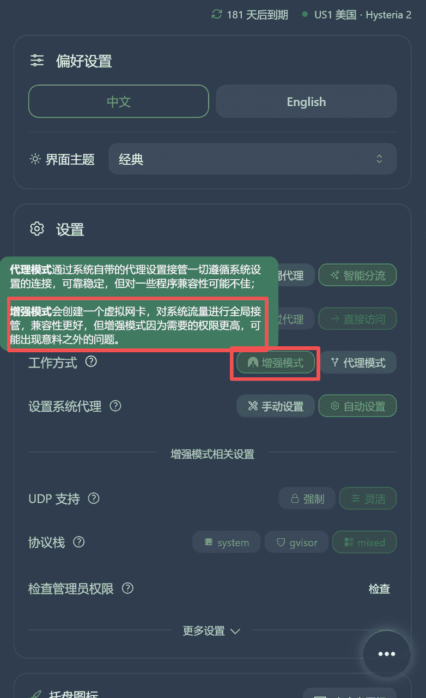

#### 5.2 Claude 官网 Web 版

Anthropic 还推出了 Claude Code Web 版（https://claude.ai/code/onboarding），完全在浏览器中运行，无需任何本地安装。用户连接 GitHub 仓库后，Claude 会在云端沙箱中克隆代码、编辑、测试，并可直接创建 Pull Request。

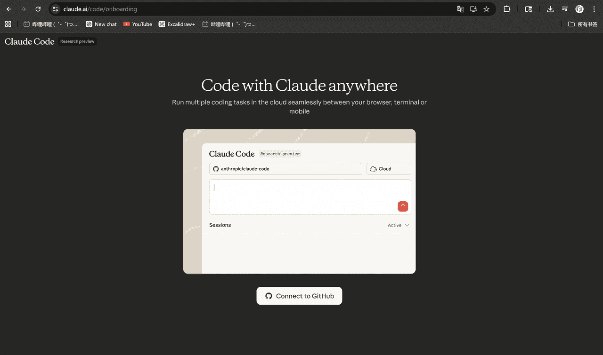

Web 版支持异步执行——提交任务后可以离开页面，Claude 在云端自主完成工作，完成后通知查看结果。适合不方便配置本地环境或需要在移动设备上远程操作的场景。

> **💡 提示：****截至 202**6 年 3 月，Claude Code 已覆盖五个使用环境：终端 CLI、VS Code 扩展、JetBrains 插件（Beta）、桌面应用（Desktop App）、Web 版。本课程以终端 CLI 为主线讲解，原理和操作逻辑在各环境中完全一致。

### 6. 基座模型替换：使用国产模型驱动 Claude Code

对于国内开发者而言，直接使用 Anthropic 官方 API 存在网络访问和费用两方面的门槛。一个重要的替代方案是：将 Claude Code 的底层模型替换为国产大模型。

#### 6.1 替换原理：为什么 Claude Code 能用其他模型？

Claude Code** 本质上是一个 Anthr**opic Messages API 客户端。它与模型的所有交互都遵循 Anthropic 定义的 /v1/messages 接口协议——包括请求的 JSON 结构、工具调用格式 (Tool Use)、流式响应 (SSE Streaming) 等。这套协议是与具体模型无关的：任何后端只要正确实现了相同的请求/响应契约，就可以作为 Claude Code 的模型提供方。

正是基于这一点，国内多家大模型厂商主动实现了 Anthropic API 兼容端点，使其模型能够直接接入 Claude Code：

| **厂商** | **兼容模型** | **API 端点** |
| --- | --- | --- |
| 月之暗面 (Moonshot) | **Kimi K2.5** | https://api.moonshot.cn/anthropic |
| DeepSeek | **DeepSeek-V3.2** | https://api.deepseek.com/anthropic |
| 智谱 AI (Zhipu) | **GLM-5 / GLM-4.7** | https://open.bigmodel.cn/api/anthropic |
| 阿里云 (Alibaba) | Qwen-3.5-Plus / Qwen3-Coder | https://dashscope.aliyuncs.com/apps/anthropic |
| MiniMax | **MiniMax-M2.5** | https://api.minimax.io/anthropic |

注意 URL 路径中的 /anthropic 后缀——这正是这些厂商为兼容 Claude Code 而专门开设的接口路径。当 Claude Code 将请求发送到这些端点时，厂商的服务器会按照 Anthropic Messages API 的格式解析请求、调用自家模型进行推理、再以相同格式返回响应。对 Claude Code 而言，整个过程与调用 Anthropic 原生 API 完全一致。

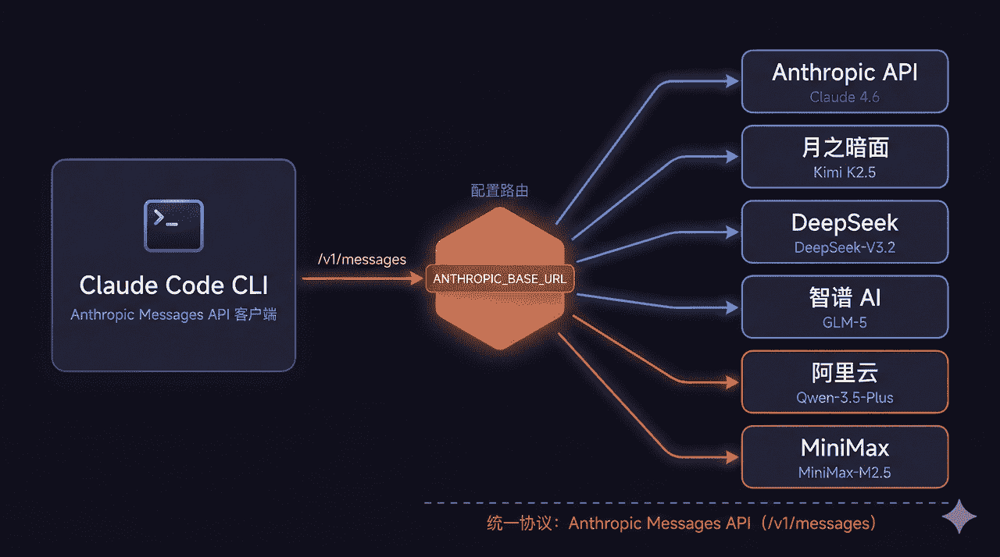

#### 6.2 配置方法：修改 settings.json

替换基座模型的核心操作是修改两个关键配置：API 端点 (Base URL) 和 认证密钥 (Auth Token)。配置文件路径及优先级如下：

| **配置文件** | **路径** | **作用域** | **优先级** |
| --- | --- | --- | --- |
| 全局配置 | ~/.claude/settings.json | 所有项目 | 低 |
| 项目配置（共享） | &lt;项目&gt;/.claude/settings.json | 当前项目（可提交到 Git） | 中 |
| 项目配置（私有） | &lt;项目&gt;/.claude/settings.local.json | 当前项目（不提交到 Git） | 高 |

+   全局配置如下图

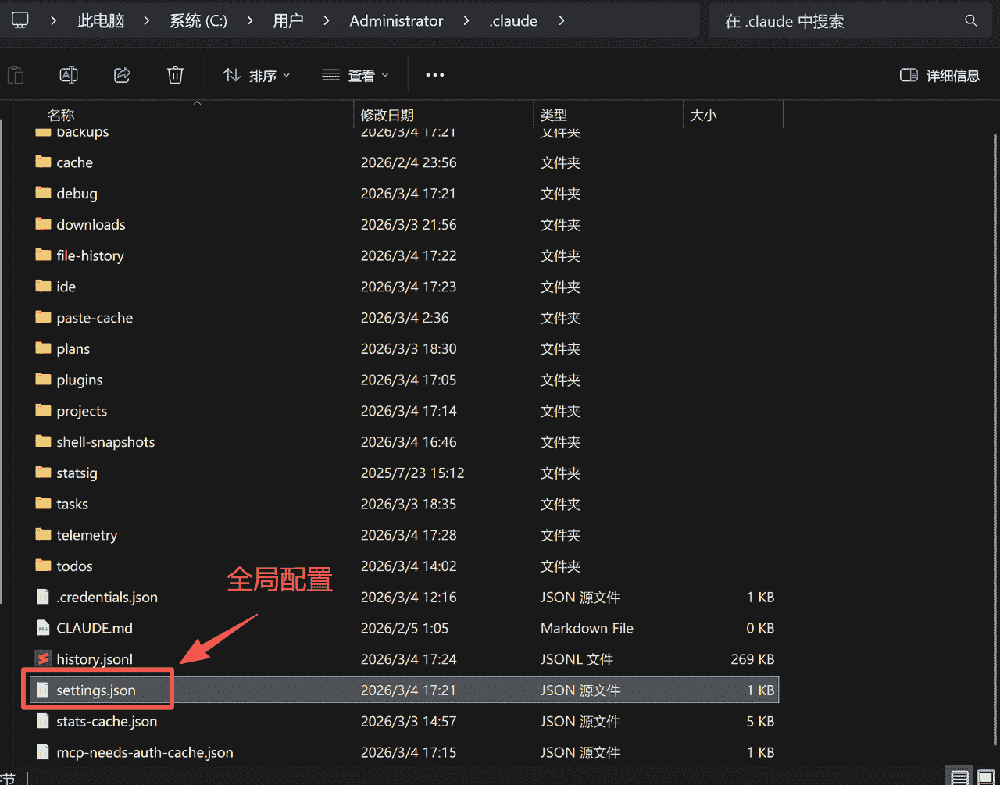

+   项目配置（涵私有）

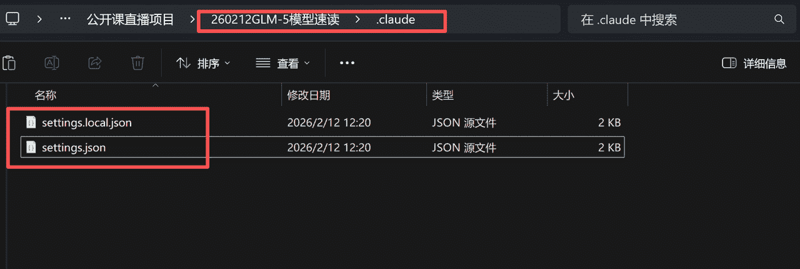

> **💡 提示：**Windows 系统中 ~ 对应 C:\Users\<用户名>\。推荐将 API Key 配置在全局配置文件中，避免意外提交到代码仓库。

而一般情况下私有的项目配置往往是一些当前用户确认可以执行的指令：

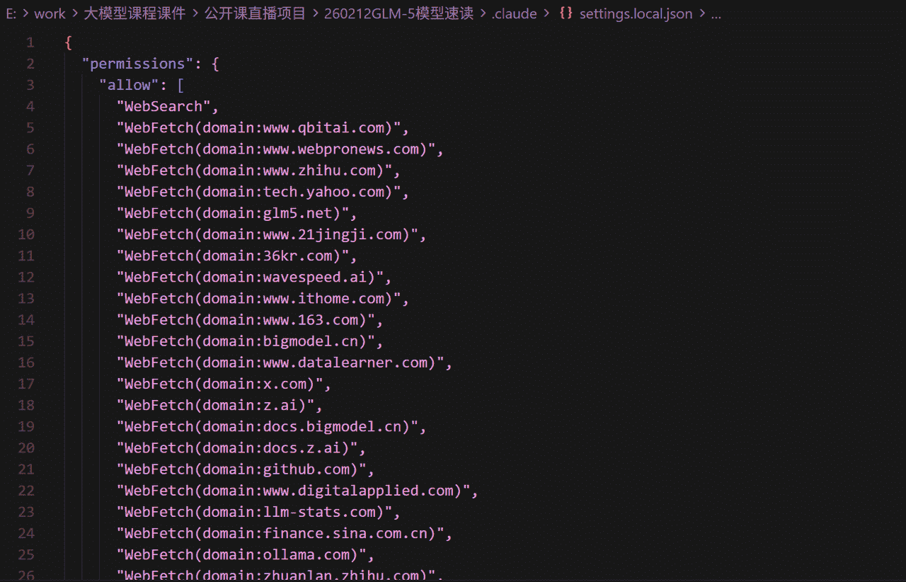

此外，需要注意的是，不仅是配置是分为三层，Claude Code的Skills、MCP、记忆管理系统等等也都是分层了，为了更好的进行项目管理。

以下是替换基座模型需要用到的核心环境变量：

| **环境变量** | **用途** |
| --- | --- |
| ANTHROPIC_BASE_URL | 替换 API 端点地址 |
| ANTHROPIC_AUTH_TOKEN | 第三方平台的 API Key |
| ANTHROPIC_MODEL | 主模型标识 |
| ANTHROPIC_DEFAULT_SONNET_MODEL | Sonnet 档位对应的模型（执行模式） |
| ANTHROPIC_DEFAULT_HAIKU_MODEL | Haiku 档位对应的模型（后台任务/子 Agent） |
| ANTHROPIC_DEFAULT_OPUS_MODEL | Opus 档位对应的模型（Plan Mode） |
| CLAUDE_CODE_DISABLE_NONESSENTIAL_TRAFFIC | 设为 1 阻止向 Anthropic 发送后台请求 |
| API_TIMEOUT_MS | 请求超时（第三方建议设为 600000，即 10 分钟） |

#### 6.3 实战演示：以 Kimi K2.5 为例

以下以月之暗面 Kimi K2.5 编程模型为例，演示完整的基座模型替换流程。

**前置条件**：

+   Claude Code CLI 已安装

+   已在 [Moonshot 开放平台](https://platform.moonshot.cn/) 注册并获取 API Key，流程如下图：

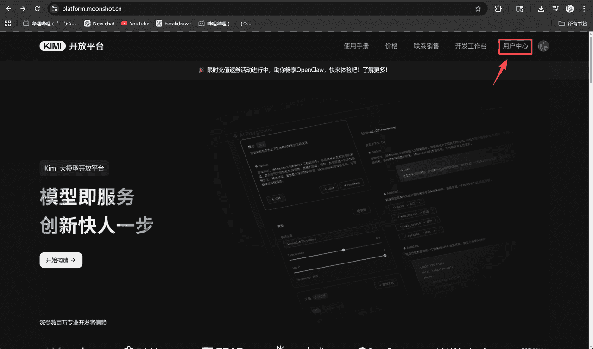

+

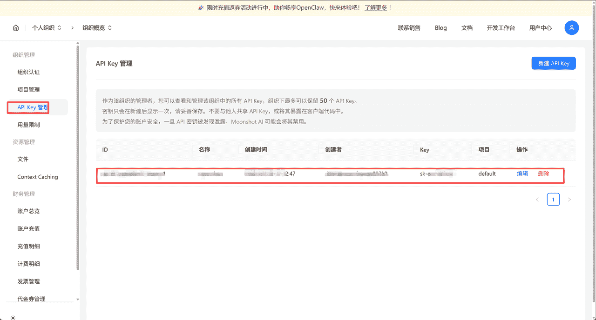

**Step 1. 编辑配置文件**

打开 ~/.claude/settings.json（如不存在则新建），写入以下内容：

```
{
  &quot;env&quot;: {
    &quot;ANTHROPIC_BASE_URL&quot;: &quot;https://api.moonshot.cn/anthropic&quot;,
    &quot;ANTHROPIC_AUTH_TOKEN&quot;: &quot;sk-your-moonshot-api-key&quot;,
    &quot;ANTHROPIC_MODEL&quot;: &quot;kimi-k2.5&quot;,
    &quot;ANTHROPIC_DEFAULT_SONNET_MODEL&quot;: &quot;kimi-k2.5&quot;,
    &quot;ANTHROPIC_DEFAULT_HAIKU_MODEL&quot;: &quot;kimi-k2.5&quot;,
    &quot;CLAUDE_CODE_DISABLE_NONESSENTIAL_TRAFFIC&quot;: &quot;1&quot;,
    &quot;API_TIMEOUT_MS&quot;: &quot;600000&quot;
  }
}
```

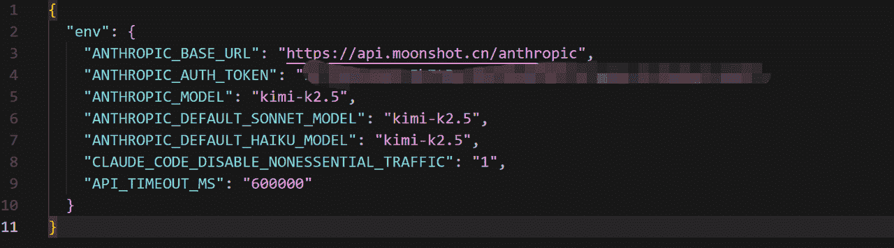

> 这里也可以替换为私有项目配置。

**配置解析**：

+   ANTHROPIC_BASE_URL：指向 Moonshot 的 Anthropic 兼容端点（国内用 .cn 域名，海外用 .ai 域名）

+   ANTHROPIC_AUTH_TOKEN：Moonshot 平台的 API Key（替换为实际值）

+   **ANTHROPIC_MODEL**：指定主力模型为 kimi-k2.5

+   **ANT**HROPIC_DEFAULT_SONNET_MODEL / ANTHROPIC_DEFAULT_HAIKU_MODEL：将 Claude Code 内部的 Sonnet 和 Haiku 模型档位都映射到 kimi-k2.5（单模型场景下需统一设置）

+   **CLAUDE_CODE_DISABLE_**N**ONES**SENTIAL_TRAFFIC：阻止 Claude Code 向 Anthropic 官方服务器发送后台遥测等非必要请求——使用第三方模型时必须开启此选项

+   **API_TIMEOUT_MS**：将请求超时设为 10 分钟，第三方 API 的响应速度通常慢于 Anthropic 官方，适当放宽超时可避免长任务中断

**Step 2. 启动验证**

```
claude
```

进入会话后，输入一个简单问题验证模型是否正常响应。可以直接询问 "你是什么模型？" 来确认请求是否正确路由到 Kimi K2.5。

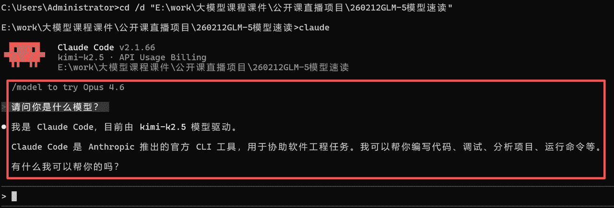

Step 3.（可选）通过环境变量临时切换

如果不想修改配置文件，也可以通过环境变量临时切换，仅对当前终端会话生效：

```
export ANTHROPIC_BASE_URL=&quot;https://api.moonshot.cn/anthropic&quot;
export ANTHROPIC_AUTH_TOKEN=&quot;sk-your-moonshot-api-key&quot;
export ANTHROPIC_MODEL=&quot;kimi-k2.5&quot;
export CLAUDE_CODE_DISABLE_NONESSENTIAL_TRAFFIC=1
export API_TIMEOUT_MS=600000
claude
```

> **⚠️ 注意**：使用第三方模型时，部分 Anthropic 专属功能可能不完全兼容，包括：图片/文档类型的内容输入、anthropic-beta 请求头、Prompt Caching 精细控制等。核心的文本对话、工具调用、流式输出等主要功能均可正常使用。

#### 6.4 其他国产模型配置参考

以下列出其他主流国产模型的配置示例，配置结构与 Kimi K2.5 完全一致，仅需替换 ANTHROPIC_BASE_URL、ANTHROPIC_AUTH_TOKEN 和模型标识：

**DeepSeek-V3.2**（API Key 申请：platform.deepseek.com）：

```
{
  &quot;env&quot;: {
    &quot;ANTHROPIC_BASE_URL&quot;: &quot;https://api.deepseek.com/anthropic&quot;,
    &quot;ANTHROPIC_AUTH_TOKEN&quot;: &quot;sk-your-deepseek-key&quot;,
    &quot;ANTHROPIC_MODEL&quot;: &quot;deepseek-chat&quot;,
    &quot;ANTHROPIC_DEFAULT_HAIKU_MODEL&quot;: &quot;deepseek-chat&quot;,
    &quot;CLAUDE_CODE_DISABLE_NONESSENTIAL_TRAFFIC&quot;: &quot;1&quot;,
    &quot;API_TIMEOUT_MS&quot;: &quot;600000&quot;
  }
}
```

**智谱 GLM-5**（API Key 申请：open.bigmodel.cn）：

```
{
  &quot;env&quot;: {
    &quot;ANTHROPIC_BASE_URL&quot;: &quot;https://open.bigmodel.cn/api/anthropic&quot;,
    &quot;ANTHROPIC_AUTH_TOKEN&quot;: &quot;your-zhipu-api-key&quot;,
    &quot;ANTHROPIC_DEFAULT_OPUS_MODEL&quot;: &quot;glm-5&quot;,
    &quot;ANTHROPIC_DEFAULT_SONNET_MODEL&quot;: &quot;glm-4.7&quot;,
    &quot;ANTHROPIC_DEFAULT_HAIKU_MODEL&quot;: &quot;glm-4.5-air&quot;,
    &quot;CLAUDE_CODE_DISABLE_NONESSENTIAL_TRAFFIC&quot;: &quot;1&quot;,
    &quot;API_TIMEOUT_MS&quot;: &quot;600000&quot;
  }
}
```

**阿里云 Qwen-3.5**（API Key 申请：bailian.console.aliyun.com）：

```
{
  &quot;env&quot;: {
    &quot;ANTHROPIC_BASE_URL&quot;: &quot;https://dashscope.aliyuncs.com/apps/anthropic&quot;,
    &quot;ANTHROPIC_AUTH_TOKEN&quot;: &quot;sk-your-dashscope-key&quot;,
    &quot;ANTHROPIC_DEFAULT_SONNET_MODEL&quot;: &quot;qwen3.5-plus&quot;,
    &quot;ANTHROPIC_DEFAULT_HAIKU_MODEL&quot;: &quot;qwen3-coder-next&quot;,
    &quot;CLAUDE_CODE_DISABLE_NONESSENTIAL_TRAFFIC&quot;: &quot;1&quot;,
    &quot;API_TIMEOUT_MS&quot;: &quot;600000&quot;
  }
}
```

> **💡 提示：****智谱 GL**M-5 配置示例展示了多模型分档的最佳实践：将性能最强的 GLM-5 分配给 Opus（用于复杂规划），GLM-4.7 分配给 Sonnet（日常编码），GLM-4.5-Air 分配给 Haiku（轻量后台任务），实现性能与成本的平衡。

### 7. 国产编程模型费用参考

上一节介绍了 API 按量计费模式下的国产模型接入。但对于日常高频使用 Claude Code 的开发者来说，按 Token 计费可能导致费用不可预测。2026 年初，多家平台推出了面向 Claude Code 等 AI 编程工具的包月订阅套餐（Coding Plan）——按请求次数计费而非按 Token 计量，月费固定、用量可控，更适合持续开发场景。

**关键问题：这些 Coding Pla**n 能接**入 Cl**aude Code 吗？ 答案是完全可以。所有 Coding Plan 本质上仍然兼容 Anthropic Message**s API 协**议，接入方式与上一节的按量计费配置几乎一致——只需修改 s**etti**ngs.json 中的 ANTHROPIC_BASE_URL 和 ANTHROPIC_AUTH_TOKEN。但有一个极其重要的细节：部分平台的 Coding Plan 使用的 Base URL 和 API Key 与按量计费模式完全不同，切勿混用。

#### 7.1 API 按量计费定价速览

先快速了解各模型的按量计费价格，作为与 Coding Plan 对比的基准：

| **模型** | 输入价格（¥/百万 Tokens） | 输出价格（¥/百万 Tokens） | **备注** |
| --- | --- | --- | --- |
| Qwen-3.5-Plus | 0.8 | 4.8 | 性价比最高 |
| DeepSeek-V3.2 | ~1.9 | ~3.0 | 中英双语优秀 |
| Kimi K2.5 | ~4.3 | ~21.5 | 按  3.00 折算 |
| GLM-5（≤32K 上下文） | 4.0 | 18.0 | 编程能力最强 |
| GLM-5（&gt;32K 上下文） | 6.0 | 22.0 | 长上下文加价 |
| Qwen3-Coder | 4.0 | 16.0 | 专用编程模型 |

按量计费的配置方式已在上一节（6.3/6.4）详细介绍。如果你的使用频率较低（每天几次对话），按量计费可能更经济。但一旦进入密集开发阶段，Coding Plan 的固定月费优势就非常明显了。

#### 7.2 Coding Plan 接入 Claude Code 详解

以下逐一介绍各平台的 Coding Plan 方案，重点讲解如何接入 Claude Code。

##### 阿里云百炼 Coding Plan（推荐入门首选）

阿里云百炼 Coding Plan **于 2026 年 2** 月推出，最大亮点是一个订阅覆盖多家模型（Qwen + GLM + Kimi + MiniMax），可自由切换。

| **套餐** | **月费** | **新用户首月** | **月请求额度** | **限流** | **可用模型** |
| --- | --- | --- | --- | --- | --- |
| Lite 基础版 | 40 元 | **7.9 元** | 18,000 次 | 1,200 次/5 小时 | Qwen3.5-Plus、Qwen3-Coder-Next、GLM-4.7、Kimi K2.5 |
| Pro 高级版 | 200 元 | **39.9 元** | 90,000 次 | 按比例提升 | 同上 |

官网地址：https://www.aliyun.com/benefit/scene/codingplan?tlog=yuekan_2


接入 Claude Code 的配置方法：

订阅百炼 Coding Plan 后，在百炼控制台的** Coding Pl**an 页面会生成一个专属 API Key（格式为 sk-sp-xxxxx，注意 sp 前缀）。将以下内容写入 ~/.claude/settings.json：

```
{
  &quot;env&quot;: {
    &quot;ANTHROPIC_BASE_URL&quot;: &quot;https://coding.dashscope.aliyuncs.com/apps/anthropic&quot;,
    &quot;ANTHROPIC_AUTH_TOKEN&quot;: &quot;sk-sp-你的百炼CodingPlan密钥&quot;,
    &quot;ANTHROPIC_MODEL&quot;: &quot;qwen3.5-plus&quot;,
    &quot;CLAUDE_CODE_DISABLE_NONESSENTIAL_TRAFFIC&quot;: &quot;1&quot;,
    &quot;API_TIMEOUT_MS&quot;: &quot;600000&quot;
  }
}
```

> **⚠️ 关键区别**：百炼 Coding P**lan 的 **Base URL 是 coding.dashscope.aliyuncs.com（注意 coding 前缀），而按量计费模式的 Base URL 是 dashscope.aliyuncs.com——两者不可互换。同样，Coding Plan 的 API Key（sk-sp-xxx）与按量计费的 API Key（sk-xxx）也不通用。如果你同时拥有两种 Key，请确认使用了正确的组合。

切换模型只需修改 ANTHROPIC_MODEL 的值，例如改为 kimi-k2.5 或 glm-4.7，无需更换 API Key 或 Base URL——这正是百炼"一个订阅用多家模型"的便利之处。

##### 智谱 GLM Coding Plan

智谱 GLM Coding Plan 主打 GLM-5 旗舰模型的编程能力，是目前国产模型中 SWE-bench 评测得分最高的选项之一。

| **套餐** | **月费（约）** | **可用模型** | **限流** |
| --- | --- | --- | --- |
| Lite | ~21 元起 | GLM-4.7 | ~80 Prompt/5 小时 |
| Pro | ~104 元起 | GLM-4.7 + GLM-5 | 按比例提升 |
| Max | ~208 元起 | GLM-4.7 + GLM-5 | 按比例提升 |

> **⚠️ 注意**：智谱于 2026 年 2 月 GLM-5 发布时宣布 Coding Plan 涨价 30%+，同时取消了首购优惠。已订阅且开启自动续费的老用户在有效期内价格不变。GLM-5 在高峰时段（14:00-18:00）消耗 3 倍额度，非高峰 2 倍。

官方地址：https://www.bigmodel.cn/glm-coding?ic=HOAN5OJYWW&closedialog=true

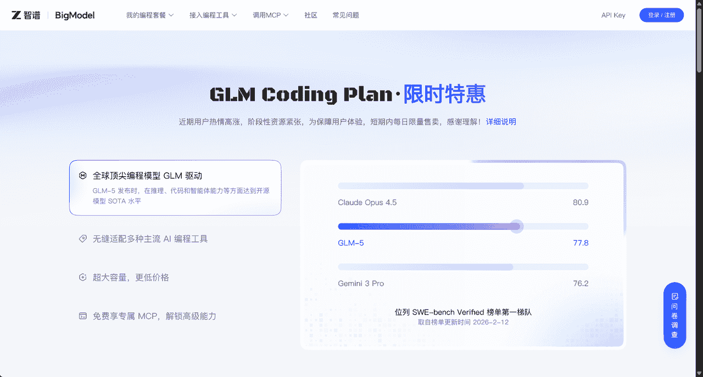

接入 Claude Code 的配置方法：

智谱的配置相对简单——Coding Plan 和按量计费使用相同的 Base URL 和 API Key，订阅 Coding Plan 后，系统会自动按套餐额度扣减，无需修改配置：

```
{
  &quot;env&quot;: {
    &quot;ANTHROPIC_BASE_URL&quot;: &quot;https://open.bigmodel.cn/api/anthropic&quot;,
    &quot;ANTHROPIC_AUTH_TOKEN&quot;: &quot;你的智谱APIKey&quot;,
    &quot;ANTHROPIC_DEFAULT_OPUS_MODEL&quot;: &quot;glm-5&quot;,
    &quot;ANTHROPIC_DEFAULT_SONNET_MODEL&quot;: &quot;glm-4.7&quot;,
    &quot;ANTHROPIC_DEFAULT_HAIKU_MODEL&quot;: &quot;glm-4.5-air&quot;,
    &quot;CLAUDE_CODE_DISABLE_NONESSENTIAL_TRAFFIC&quot;: &quot;1&quot;,
    &quot;API_TIMEOUT_MS&quot;: &quot;600000&quot;
  }
}
```

如果你之前已按照 6.4 节配置了智谱按量计**费模式，订阅** Coding Plan 后无需任何改动，智谱后台会自动优先使用套餐额度。

##### Kimi Code 会员

月之暗面（Moonshot）提供 Kimi Code 会员订阅，主打 Kimi K2.5 模型的 Agent Swarm 能力。

| **套餐** | **月费** | **API 调用额度** |
| --- | --- | --- |
| 初级 | 49 元 | 1,024 次/周 |
| 中级 | 99 元 | 2,048 次/周 |
| 高级 | 199 元 | 7,168 次/周 |

接入 Claude Code 的配置方法：

**  Ki**mi Code 会员的接入有一个独特之处——它使用 ANTHROPIC_API_KEY 而非 ANTHROPIC_AUTH_TOKEN（注意字段名差异），且 Base URL 也与按量计费模式不同：

```
{
  &quot;env&quot;: {
    &quot;ANTHROPIC_BASE_URL&quot;: &quot;https://api.kimi.com/coding/&quot;,
    &quot;ANTHROPIC_API_KEY&quot;: &quot;sk-kimi-你的KimiCode会员密钥&quot;,
    &quot;ANTHROPIC_MODEL&quot;: &quot;kimi-k2.5&quot;,
    &quot;CLAUDE_CODE_DISABLE_NONESSENTIAL_TRAFFIC&quot;: &quot;1&quot;,
    &quot;API_TIMEOUT_MS&quot;: &quot;600000&quot;
  }
}
```

> **⚠️ 注意**：Kimi Code 会员的 API Key 格式为 sk-kimi-xxxxx（在会员页面生成），认证字段为 ANTHROPIC_API_KEY；而 Moonshot 按量计费的 API Key 格式为 sk-xxxxx，认证字段为 ANTHROPIC_AUTH_TOKEN，Base URL 为 https://api.moonshot.cn/anthropic。两种模式的三要素（Base URL、Key 格式、认证字段）全部不同。

##### MiniMax Coding Plan

MiniMax 推出了 MiniMax-M2.5 模型的 Coding Plan，主打推理速度。

| **套餐** | **月费** | **新用户首月** | **对话额度** |
| --- | --- | --- | --- |
| Starter | 29 元 | **9.9 元** | 40 对话/5 小时 |
| 更高档位 | 最高 ~1000 元 | — | 按比例提升 |

接入 Claude Code 的配置方法：

```
{
  &quot;env&quot;: {
    &quot;ANTHROPIC_BASE_URL&quot;: &quot;https://api.minimaxi.com/anthropic&quot;,
    &quot;ANTHROPIC_AUTH_TOKEN&quot;: &quot;你的MiniMax-APIKey&quot;,
    &quot;ANTHROPIC_MODEL&quot;: &quot;MiniMax-M2.5&quot;,
    &quot;CLAUDE_CODE_DISABLE_NONESSENTIAL_TRAFFIC&quot;: &quot;1&quot;,
    &quot;API_TIMEOUT_MS&quot;: &quot;3000000&quot;
  }
}
```

注意 MiniMax 的 API_TIMEOUT_MS 建议设置为 3000000（约 50 分钟），因为复杂任务可能需要较长的推理时间。

#### 7.3 Coding Plan 综合对比与选择建议

| **平台** | **最低月费** | **新用户首月** | **模型数量** | **Base URL 差异** | **核心优势** |
| --- | --- | --- | --- | --- | --- |
| 阿里云百炼 | 40 元 | **7.9 元** | 4+ 个 | Coding Plan 专属 URL | 多模型自由切换，性价比极高 |
| 智谱 GLM | ~21 元起 | 无优惠 | 2-3 个 | 与按量计费相同 | GLM-5 原生支持，编程能力最强 |
| Kimi 官方 | 49 元 | 无特别优惠 | 1 个 | 会员专属 URL + Key 字段不同 | Agent Swarm 独有能力 |
| MiniMax | 29 元 | **9.9 元** | 2 个 | 与按量计费相同 | 推理速度最快 |

> **💡 建议：****对于刚接触 Claude **Code + 国产模型的开发者，阿里云百炼 Lite 套餐（新用户首月 7.**9** 元）是最低成本的入门方案——一个订阅即可体验 Qwen、GLM、Kimi 三大模型家族，足够完成本课程全部实操练习。需要特别注意的是：百炼和 Kimi 的 Coding Plan 配置与按量计费模式使用不同的 Base URL 和 API Key，切勿混用；而智谱的两种模式配置完全相同，最为省心。

### 8. 本节小结

本节覆盖了 Claude Code 从零开始的完整部署链路：

| **步骤** | **关键操作** | **注意事项** |
| --- | --- | --- |
| 环境准备 | 打开终端，配置代理 | 国内开发者必须先设置 VPN 代理 |
| 安装 | 一条命令安装原生二进制 | 已从 npm 迁移至原生安装器，无需 Node.js |
| 诊断 | claude doctor 检查环境 | 安装后第一个应运行的命令 |
| 认证 | OAuth 订阅 或 API Key | 免费套餐不含 Claude Code，最低需 Pro ($20/月) |
| IDE 集成 | VS Code 扩展 / Web 版 | VS Code 代理配置需注意 TUN 模式 |
| 模型替换 | 修改 settings.json 中的 Base URL | 必须设置 CLAUDE_CODE_DISABLE_NONESSENTIAL_TRAFFIC=1 |
| 费用优化 | 国产 Coding Plan 套餐 | 阿里云百炼新用户首月 7.9 元起 |

完成以上配置后，Claude Code 已可正常运行。接下来将对 Claude Code 的整体架构和全部核心功能做一次快速全景巡览。

---

## 三、Claude Code 整体架构与全功能概览

**  部署**完成后，在逐一深入每个功能之前，有必要先建立一个全局视角——Claude Code 作为一个工业级 Agent 系统，内部到底由哪些模块构成？它们之间如何协作？本节将以"快速巡览"的方式，结合 Fufan-CC Flow Web 界面的可视化能力，为每个核心模块留下一个直观印象。

### 1. Claude Code 架构全景

**  从宏观上**看，Claude Code 的架构可以拆分为六大核心系统，各自承担不同的职责，共同构成一个完整的 Agent 工作闭环：

| **系统** | **核心职责** | **类比** |
| --- | --- | --- |
| **内置工具系统** | 读写文件、执行命令、搜索代码——Agent 的&quot;手脚&quot; | 工人手中的工具箱 |
| **多级记忆系统** | 跨会话保留项目规范、开发偏好——Agent 的&quot;长期记忆&quot; | 工人的笔记本和经验手册 |
| **扩展能力系统** | MCP / Skills / Plugin 三套扩展机制——Agent 的&quot;技能树&quot; | 工人获取新技能的培训体系 |
| **项目管理系统** | Checkpoint 回滚、Git 集成、安全沙箱——Agent 的&quot;安全网&quot; | 工地的安全绳和施工记录 |
| **斜杠命令系统** | 50+ 内置命令控制 Agent 行为——Agent 的&quot;控制面板&quot; | 驾驶舱的仪表盘和操控杆 |
| **多 Agent 协作系统** | Sub-Agent 委托、后台任务、Team 协作——Agent 的&quot;团队&quot; | 项目经理分派任务给专业团队 |

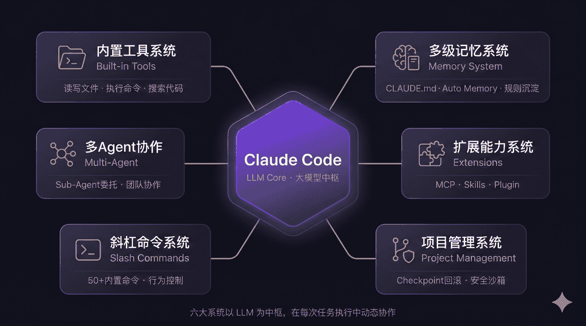

理解这张架构图的关键在于：**这六大系统并非各自独立运行，而是以 LLM（大语言模**型）为中枢，在每一次任务执行中动态协作。 举一个直观的例子：

> 当你对 Claude Code 说"帮我给这个项目添加一个用户登录功能"时，实际发生的过程是：

1.  **记忆系统**先读取 CLAUDE.md，了解项目的技术栈和代码规范

1.  **内置工具**（Grep/Glob/Read）扫描代码库，理解现有架构

1.  **斜杠命令**判断是否进入 Plan Mode 先规划再执行

1.  **内置工具**（Write/Edit/Bash）创建文件、编写代码、运行测试

1.  **项目管理系统**在每次文件变更时自动创建 Checkpoint

1.  如果任务复杂，可能**委托 Sub-Agent** 并行处理前端和后端

1.  **如果需要查询数据库 **Schema，可能调用 MCP Server 获取信息

接下来逐一巡览每个系统的核心能力。在**每个系统**的介绍中，我们都安排了一个简单的动手实验——这些实验彼此关联，串成一条完整的体验链路，帮你在 30 分钟内建立对 Claude Code 核心能力的直观感受。

> **🧪 实验准备：**在开始之前，请先创建一个练习项目目录，后续所有实验都在这里进行：

```
mkdir ~/claude-lab &amp;&amp; cd ~/claude-lab
claude
```

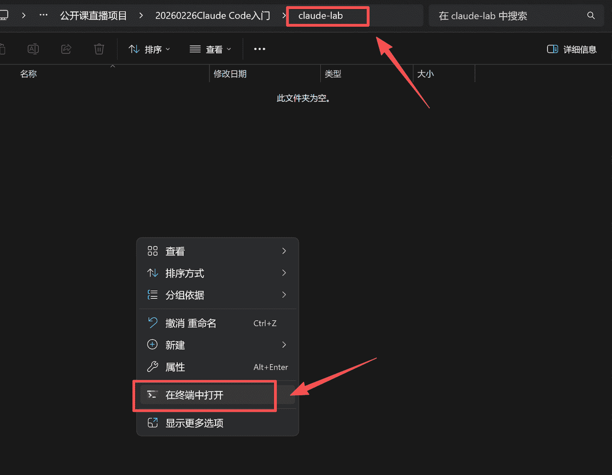

> 然后开启Claude Code：

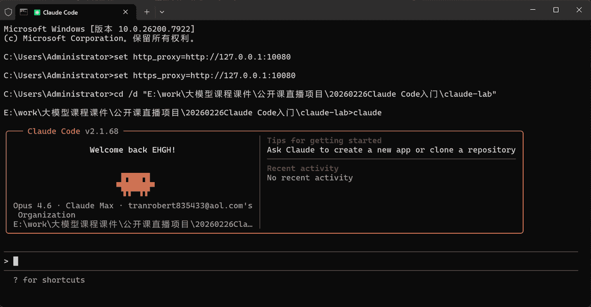

### 2. 内置工具系统：Agent 的执行引擎

**  内置**工具是 Claude Code 与外部世界交互的唯一通道——模型本身不能直接操作文件系统或执行命令，所有操作都必须通过工具调用 (Tool Use) 完成。Claude Code 内置了以下核心工具：

| **工具** | **功能** | **典型场景** |
| --- | --- | --- |
| **Read** | 读取文件内容（支持代码、图片、PDF） | 阅读代码、查看配置文件、分析截图 |
| **Write** | 创建新文件或完整覆写 | 创建新组件、写入配置文件 |
| **Edit** | 精准编辑文件的指定部分（基于字符串匹配替换） | 修改函数逻辑、更新导入语句 |
| **Bash** | 在 Shell 中执行任意命令 | 运行测试、安装依赖、Git 操作 |
| **Grep** | 基于正则表达式搜索文件内容 | 查找函数定义、追踪变量引用 |
| **Glob** | 按文件名模式匹配搜索文件 | 查找所有 .tsx 组件、定位配置文件 |
| **Think** | 模型内部推理（不产生外部操作） | 复杂逻辑规划、多方案权衡 |
| **Agent** | 启动 Sub-Agent 处理子任务 | 并行处理独立任务、深度代码探索 |
| **WebSearch** | 搜索互联网获取最新信息 | 查询 API 文档、搜索错误解决方案 |
| **WebFetch** | 获取指定 URL 的内容 | 读取在线文档、下载配置模板 |

**实际效果示例**：当你说"帮我把 utils/format.ts 里的日期格式从 YYYY-MM-DD 改成 DD/MM/YYYY**"，Cl**aude Cod**e 实际**会依次调用 Read（读取文**件）→ **Edit（定位并替换格式字符串）→ Bash（运行 pnpm test 确认测试通过），整个过程在几秒内完成。

##### 🧪 动手试一试：用 Claude Code 生成你的第一个页面

在 claude-lab 目录的 Claude Code 会话中，输入以下内容：

```
请在当前目录创建一个 index.html 文件——一个&quot;Claude Code 学习实验室&quot;页面。
要求：深色主题（背景色 #13111C，文字白色），包含一个大标题、当前日期、
以及一个&quot;实验进度&quot;列表区域（暂时留空，后续实验会逐步填充）。
```

**  观察终**端输出——你会看到 Claud**e Co**de 调用了 Write 工具创建文件，可能还会调用 Bash 工具确认文件是否正确生成。整个过程不到 10 秒。双击打开 index.html，一个深色主题的页面已经呈现在浏览器中。


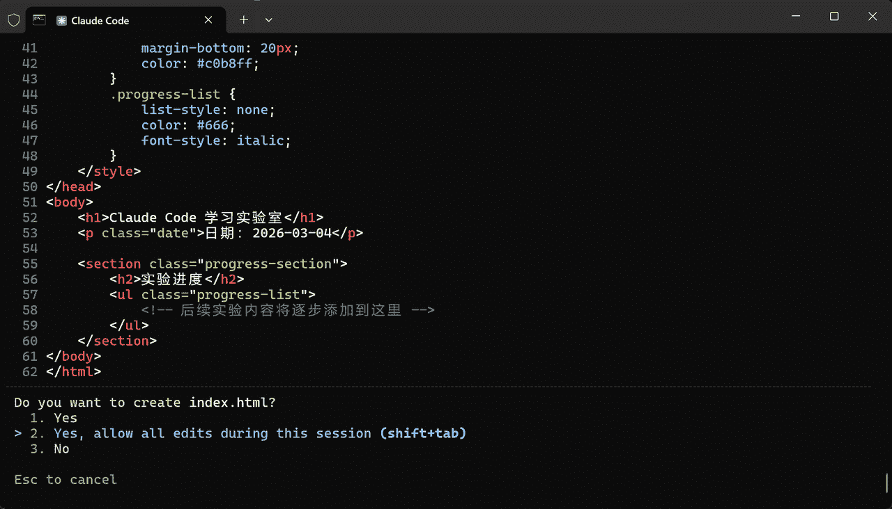

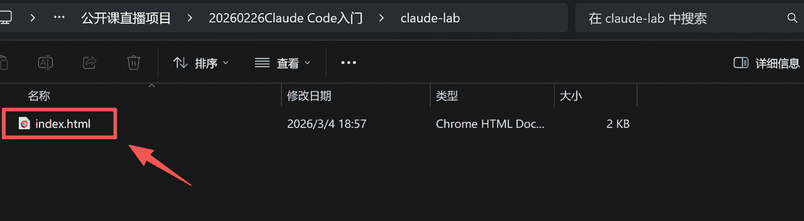

打开后效果如下：

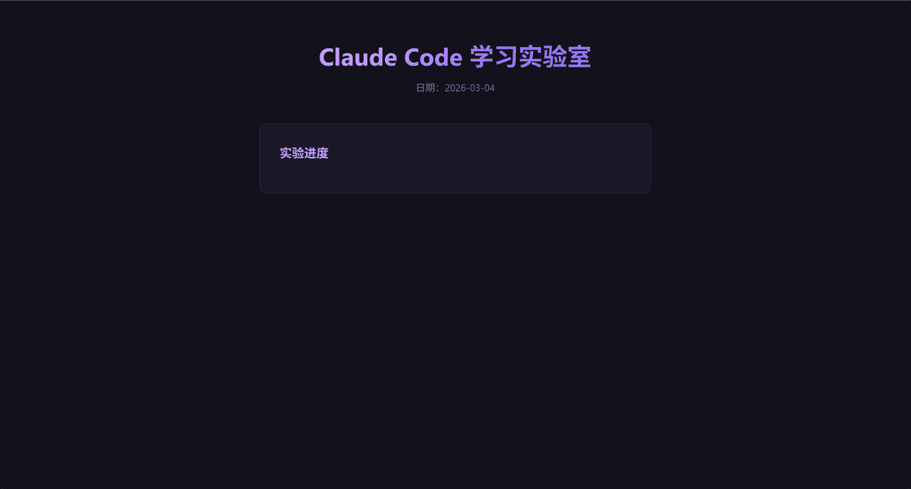

**关注点**：注意终端中每个工具调用前的标识（如 Tool: Write、Tool: Bash），这就是 Agent 的工具链在运作——模型决策用什么工具，工具负责执行操作，结果反馈给模型决定下一步。

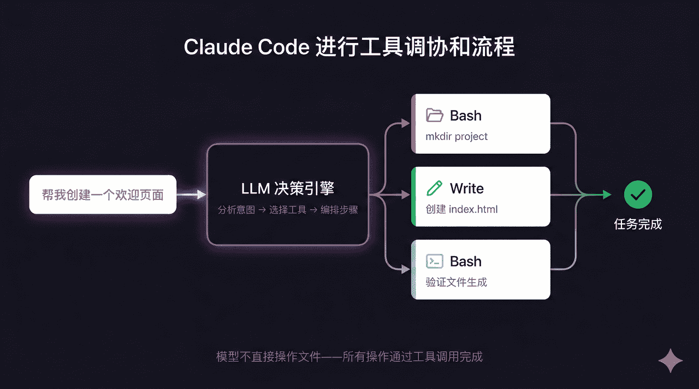

在 **Fufan-CC Flow** 中，每一次工具调用都会以可视化卡片 (ToolCallCard) 的形式展示在聊天面板中——不同工具用不同颜色标识（Read 为天蓝色、Edit 为琥珀色、Bash 为紫色），卡片支持展开查看完整的输入参数和执行结果。

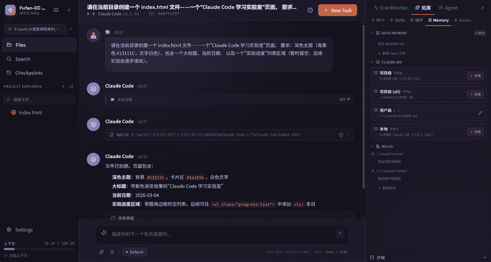

### 3. 多级记忆系统：跨会话的知识沉淀

**  一个常见的 Agent 痛点是**"**金鱼记忆"——每次新会话都从零开始，不记得之前的任何约定。Claude Code 通过一套多级记忆架构**解决了这个问题：

| **记忆层级** | **存储位置** | **作用域** | **内容示例** |
| --- | --- | --- | --- |
| 项目记忆 (CLAUDE.md) | 项目根目录 CLAUDE.md | 当前项目所有会话 | 技术栈、代码规范、架构决策 |
| 用户记忆 (~/.claude/CLAUDE.md) | 用户主目录 | 所有项目 | 个人编码偏好、常用工具链 |
| 自动记忆 (Auto Memory) | ~/.claude/memory/ | 自动沉淀 | Claude 自主记录的项目细节和经验 |

**实际效果示例**：在 CLAUDE.md 中**写入"本项目使用** Tailwind CSS，禁止编写自定义 CSS 文件"后，Claude Code 在所有后续会话中都会遵守这个约定——无需每次重复提醒。这相当于给 Agent 下达了一份持久化的项目规范。

##### 🧪 动手试一试：让 Claude Code 记住你的规则

继续在 claude-lab 目录中操作。首先，在项目根目录手动创建一个 CLAUDE.md 文件（用任何文本编辑器），写入以下内容：

```
# 项目规范

- 所有代码注释使用中文
- HTML 页面标题统一加上&quot;[Fufan Lab]&quot;前缀
- 配色方案：深色背景(#13111C) + 琥珀橙强调色(#d97757)
```


> 注意首次创建CLAUDE.md时需要重启才能生效。

然后清空当前对话（输入 /clear），


开启一轮全新会话，输入：

```
请在 index.html 的&quot;实验进度&quot;列表中添加一项：
&quot;✅ 实验一：内置工具 —— 成功创建了第一个页面&quot;
```


**  观察 Claude Co****de 的行为——它会先 Rea**d CL**AUDE.md（读取你刚写的项**目规范），然后再 Read index.html，最后 Edit index.html 修改内容。打开修改后的 HTML 文件，检查两件事：

1.  **代码注释**是否自动使用了中文？

1.  **页面标题**是否自动添加了 [Fufan Lab] 前缀？

如果答案是肯定的——恭喜，你刚刚体验了 Claude Code 记忆系统最核心的能力：规则只需声明一次，所有后续操作自动遵守。这就是 CLAUDE.md 作为"项目宪法"的意义。


+   Claude Code基础多级记忆管理系统


在 **Fufan-CC Flow** 的右侧面板 Extensions → Memory 选项卡中，可以可视化管理 CLAUDE.md 内容和查看自动记忆条目——支持在线编辑、预览和切换作用域。


### 4. 项目管理系统：Checkpoint 回滚与安全保障

**  让 AI ****Agent 自动修改代码，最大**的担忧是：改坏了怎么办？ Claude Code 的项目管理系统通过 Checkpoint（检查点） 机制解决了这个问题。

**工作原理**：Claude Code 在每次产生文件变更时，自动创建一个 Checkpoint，记录变更前的文件快照。如果对某次修改不满意，可以随时回滚到任意历史检查点——类似 Git 的 commit，但粒度更细，精确到每一轮对话中的每一次文件操作。

**实际效果示例**：Claude Code 重构了 3 个文件后，你发现新的实现方案不合适。通过 /rewind 命令选择回滚点，一键恢复到重构前的代码状态——所有被修改的文件恢复原貌，新创建的文件被删除，干净利落。

##### 🧪 动手试一试：大胆试错，一键回滚

继续在 claude-lab 的会话中。现在我们故意让 Claude Code 做一次"破坏性"操作，然后体验 Checkpoint 回滚的威力。输入：

```
请把 index.html 完全重写为极简白色风格——纯白背景、黑色文字、
移除所有 CSS 样式和颜色定义，只保留纯文本内容。
```


Claude Code 执行后，打开页面——之前精心设计的深色主题消失了，变成了一个简陋的白底页面。


不用慌，在 Claude Code 中输入：

```
/rewind
```

** 终**端会列出最近的 Checkpoint 节点，每个节点标注了对应的用户指令和变更文件。选择"重写为极简白色风格"之前的那个节点——index.html 立即恢复为深色主题版本，所有样式完好无损。


**关键体会**：有了 Checkpoint，你可以放心大胆地让 Claude Code 尝试**任何方案—**—不满意就回滚，试错成本几乎为零。这也是 Claude Code 在 4.4 节中要求必装 Git 的根本原因：Checkpoint 的底层实现依赖 Git 的快照能力。


在 **Fufan-CC Flow** 的 Agent → Checkpoint 选项卡中，CheckpointTimeline 组件以时间线形式可视化展示所有检查点——每个节点标注了关联的用户指令、变更的文件列表、执行的操作类型，支持一键"仅回滚代码"或"代码+对话一起回滚"两种模式。


### 5. 斜杠命令系统：Agent 的控制面板

**  斜杠命令**是与 Claude Code 交互的快捷控制方式——在对话输入框中**键入 / 即可调**出命令菜单。截至 2026 年 3 月，Claude Code 内置了 59 个斜杠命令（含别名），覆盖了从会话管理、模型切换到扩展配置的方方面面。

**实际效果示例**：在一轮耗时较长的开发对话后，上下文窗口即将占满。此时输入 /compact "保留前端组件相关的上下文" ——Claude Code 会智能压缩历史对话，只保留与前端组件相关的关键信息，释放大量上下文空间继续工作。

以下是完整的斜杠命令清单：

#### 5.1 会话管理

| **命令** | **功能** | **别名** |
| --- | --- | --- |
| /clear | 清空当前对话历史，释放上下文 | /reset、/new |
| /compact [指示] | 压缩对话历史，可指定保留重点 | — |
| /resume [会话] | 恢复指定历史会话（按 ID 或名称） | /continue |
| /fork [名称] | 从当前对话点创建分支副本 | — |
| /rename [名称] | 重命名当前会话 | — |
| /export [文件名] | 导出对话为纯文本文件 | — |
| /exit | 退出 CLI | /quit |

#### 5.2 模型与模式

| **命令** | **功能** | **别名** |
| --- | --- | --- |
| /model [模型名] | 切换 AI 模型（左右箭头调整 Effort Level） | — |
| /plan | 进入 Plan Mode（先规划后执行） | — |
| /fast [on|off] | 切换快速输出模式 | — |
| /output-style [风格] | 切换输出风格（Default / Explanatory / Learning） | — |
| /vim | 切换 Vim / Normal 编辑模式 | — |

#### 5.3 项目与上下文

| **命令** | **功能** | **别名** |
| --- | --- | --- |
| /init | 初始化项目，生成 CLAUDE.md | — |
| /add-dir &lt;路径&gt; | 向当前会话添加额外的工作目录 | — |
| /context | 可视化当前上下文使用情况（彩色网格） | — |
| /diff | 打开交互式 Diff 查看器，查看未提交的变更 | — |
| /rewind | 回滚对话和/或代码到历史检查点 | /checkpoint |
| /pr-comments [PR] | 获取 GitHub PR 的评论 | — |
| /review | 对 Pull Request 进行代码审查 | — |
| /security-review | 分析当前分支的变更是否存在安全漏洞 | — |
| /copy | 复制上一条 AI 回复到剪贴板 | — |

#### 5.4 配置与状态

| **命令** | **功能** | **别名** |
| --- | --- | --- |
| /config | 打开配置界面 | /settings |
| /permissions | 查看/修改工具权限 | /allowed-tools |
| /memory | 编辑 CLAUDE.md 记忆文件，管理自动记忆 | — |
| /doctor | 诊断安装和配置状态 | — |
| /status | 显示版本、模型、账户和连接状态 | — |
| /cost | 显示当前会话 Token 用量和费用（API 用户） | — |
| /stats | 可视化每日用量、会话历史和使用模式 | — |
| /usage | 显示订阅套餐限额和速率限制状态 | — |
| /theme | 更换颜色主题（含深色/浅色/色盲友好版本） | — |
| /statusline | 配置终端状态栏信息 | — |
| /keybindings | 打开快捷键配置文件 | — |
| /terminal-setup | 配置终端快捷键（如 Shift+Enter） | — |

#### 5.5 扩展与 Agent

| **命令** | **功能** | **别名** |
| --- | --- | --- |
| /mcp | 管理 MCP Server 连接和 OAuth 认证 | — |
| /skills | 列出可用的 Skills | — |
| /plugin | 管理 Plugin 插件 | — |
| /agents | 管理自定义 Agent 配置 | — |
| /tasks | 列出和管理后台任务 | — |
| /hooks | 管理 Hook 事件配置 | — |

#### 5.6 账户与平台

| **命令** | **功能** | **别名** |
| --- | --- | --- |
| /login | 登录 Anthropic 账户 | — |
| /logout | 登出 Anthropic 账户 | — |
| /upgrade | 打开套餐升级页面 | — |
| /extra-usage | 配置超额使用（限额触达后继续工作） | — |
| /privacy-settings | 查看/修改隐私设置（Pro/Max 用户） | — |
| /desktop | 将当前会话转移到桌面应用 | /app |
| /mobile | 显示移动端 App 下载二维码 | /ios、/android |
| /chrome | 配置 Chrome 集成设置 | — |
| /ide | 管理 IDE 集成状态 | — |
| /remote-control | 允许从 claude.ai 远程控制此会话 | /rc |
| /remote-env | 配置远程环境默认值 | — |
| /install-github-app | 安装 Claude GitHub Actions App | — |
| /install-slack-app | 安装 Claude Slack App | — |

#### 5.7 信息与反馈

| **命令** | **功能** | **别名** |
| --- | --- | --- |
| /help | 显示帮助信息和可用命令 | — |
| /feedback [报告] | 提交使用反馈或 Bug 报告 | /bug |
| /release-notes | 查看版本更新日志 | — |
| /insights | 生成使用分析报告（项目领域、交互模式、摩擦点） | — |
| /stickers | 订购 Claude Code 贴纸 | — |
| /passes | 分享免费试用周（符合条件的账户可见） | — |

#### 5.8 内置 Skills（以斜杠命令形式触发）

| **命令** | **功能** |
| --- | --- |
| /simplify | 审查近期变更代码的复用性、质量和效率，自动修复发现的问题 |
| /batch &lt;指令&gt; | 将大规模代码变更分解为 5-30 个独立子任务，并行派发给 Agent 在隔离的 Git Worktree 中执行 |
| /debug [描述] | 读取会话调试日志，诊断 Claude Code 自身的运行问题 |

##### 🧪 动手试一试：/init —— 最重要的第一条命令

回到 claude-lab 目录的 Claude Code 会话。在之前的实验中，我们手动创建了一个简单的 CLAUDE.md，只写了三行规范。现在体验 Claude Code 的自动化项目分析能力——输入：

```
/init
```


Claude Code 会自动扫描当前目录的所**有文件****（index.ht**ml、你手写的 CLAUDE.md），分析项目结构、使用的技术栈、文件组织方式，然后更新 CLAUDE.md，补充大量 Claude 自主观察到的项目细节。打开更新后的 CLAUDE.md，对比之前你手写的三行规范——你会看到 Claude 补充了项目描述、文件结构说明、开发注意事项等内容。


**这就是 ****/init**** 的价值**：**它帮你的项****目**建立了一份完整的"身份证"，让 Claude Code 在后续所有会话中都能快速理解这个项目是做什么的、应该遵循什么规范。建议在每个新项目中第一件事就是执行 /init。

接着再体验几个常用命令：

```
/context        # 查看当前上下文窗口使用了多少空间（会显示一个彩色网格）
/cost           # 查看本次会话消耗了多少 Token 和费用（仅API 用户可见）
/compact        # 压缩对话历史，释放上下文空间（长对话必备）
```

其中 /context 的输出特别直观——一个彩色网格展示上下文窗口的使用情况，已占用的空间用色块标记，剩余空间一目了然。


当你发现上下文快用满时，/compact 就是救命稻草——它会智能总结之前的对话，释放大量空间继续工作。


在 **Fufan-CC Flow** 的输入栏中键入 /，SlashCommandMenu 组件会弹出一个带搜索过滤的命令下拉菜单，支持模糊匹配快速定位命令。


### 6. 扩展能力系统：MCP、Skills 与 Plugin

Claude Code 的内置工具覆盖了文件操作和命令执行，但真实的开发场景往往需要更多能力——查询数据库、调用第三方 API、执行特定业务流程。Claude Code 提供了三套互补的扩展机制：

| **扩展类型** | **核心定位** | **技术实现** | **类比** |
| --- | --- | --- | --- |
| MCP (Model Context Protocol) | 连接外部数据源和工具 | 标准化的 Server-Client 协议 | 手机的 USB 接口——连接任何外设 |
| **Skills** | 封装可复用的业务流程 | Markdown 格式的提示词模板 | 标准操作手册 (SOP) |
| **Plugin** | 社区生态的打包扩展 | npm 包形式分发 | 手机 App Store 里的应用 |

**MCP 实际效果示例**：安装 github MCP Server 后，Claude Code 就能直接调用 GitHub API——查看 Issue、创建 PR、审查代码，无需手动在终端和浏览器之间切换。

**Skills 实际效果示例**：编写一个 /deploy Skill，定义完整的部署检查清单（跑测试 → 构建 → 检查包大小 → 推送 → 部署），之后每次部署只需输入 /deploy 即可按流程执行，无需每次重复描述步骤。

**Plugin 实际效果示例**：安装 @anthropic-ai/claude-code-todoist 插件后，Claude Code 可以直接操作 Todoist 任务管理——创建任务、标记完成、查询待办列表。

##### 🧪 动手试一试：30 秒创建你的第一个自定义 Skill

Skills 是三种扩展中最容易上手的——本质上就是一个 Markdown 文件，放在指定目录即可。继续在 claude-lab 中操作，输入：

```
请帮我创建一个自定义 Skill：
1. 在 .claude/commands/ 目录下创建一个 summarize.md 文件
2. 内容是：请阅读当前项目中所有文件，生成一份简洁的项目概览，
   包含文件结构树、使用的技术、核心功能列表，保存为 PROJECT-SUMMARY.md
```


**  Cl**aude Cod**e 会调用** Bash（创建目录）和 Write（写入 Skill 文件）完成操作。现在，清空对话（/clear）再重新启动一轮会话，输入：

```
/summarize
```


你会看到 Claude Code 自动按照 summarize.md 中定义的步骤执行——读取所有文件、分析项目结构、生成 PROJECT-SUMMARY.md。你刚刚用 30 秒创建了一个可复用的自动化流程，未来在任何项目中都可以用 /summarize 一键生成项目概览。

这只是 Skills 的最简单形态。在后续进阶课程中，我们会学习如何编写带有条件判断、多步骤编排、甚至调用外部 API 的复杂 Skill——将重复性工作流程封装为"一键触发"的标准操作。


在 **Fufan-CC Flow**** 的右侧面板 Ext**e**nsions 选项卡中，M**cpM**anager、Skills**Manager 和 PluginManager 三个子面板分别管理这三类扩展——支持可视化添加/删除、在线编辑 Skill 内容、浏览插件市场等操作。


### 7. 多 Agent 协作系统：从独狼到团队

** 传统的 AI 编程助手**是"**单线程"的——一次只**能处理一个任务。Claude Code 的多 Agent 系统打破了这一限制，引入了 Sub-Agent 委托和 Agent Team 两种协作模式。

Sub-Agent（子智能体委托）：Claude Code 在处理复杂任务时，可以自主派生出一个或多个 Sub-Agent，将子任务委托给它们并行处理。每个 Sub-Agent 拥有独立的上下文和工具权限，完成后将结果汇报给主 Agent。

**实际效果示例**：当你要求"将整个项目从 JavaScript 迁移到 TypeScript"时，主 Agent 分析项目结构后，可能同时派出 3 个 Sub-Agent：一个负责转换 src/utils/ 目录，一个负责转换 src/components/ 目录，一个负责更新 tsconfig.json 和构建配置——三线并行，效率成倍提升。

Agent Team（智能体团队）：这是更高级的多 Agent 编排模式（实验性功能），允许定义多个具有不同专长的 Agent 组成团队，协同完成复杂项目。

在 **Fufan-CC Flow** 的 Agent 选项卡中：

+   **AgentManager** 面板支持创建自定义 Agent，配置其模型、工具权限、后台模式等参数

+   **SubAgentTree** 以树形结构实时展示 Sub-Agent 的层级关系和执行状态

+   **BackgroundTasks** 面板监控后台运行中的 Agent 任务

+   **TeamPanel** 支持创建和管理 Agent 团队


### 8. 本节小结

本节完成了对 Claude Code 六大核心系统的全景巡览：

| **系统** | **关键能力** | Fufan-CC Flow 对应组件 |
| --- | --- | --- |
| 内置工具 | 10 种原子工具覆盖文件/命令/搜索/推理 | ToolCallCard（彩色工具卡片） |
| 多级记忆 | CLAUDE.md + Auto Memory 跨会话记忆 | MemoryManager（记忆管理面板） |
| 项目管理 | Checkpoint 自动快照 + 一键回滚 | CheckpointTimeline（时间线视图） |
| 斜杠命令 | 59 个内置命令 + 3 个内置 Skill | SlashCommandMenu（命令菜单） |
| 扩展系统 | MCP / Skills / Plugin 三层扩展 | McpManager / SkillsManager / PluginManager |
| 多 Agent | Sub-Agent 委托 + Team 协作 | SubAgentTree / AgentManager / TeamPanel |

**  以上每个系**统都值得深入探讨。接下来，我们将通过一个完整的实战项目，在实际开发过程中综合运用这些能力。

---

## 四、从零开发大模型 ChatBot —— Claude Code 工业级实战

** 前三节完成了从"安**装部署"到"六大系统巡览"的认知建设。但 Claude Code 的真正威力，只有在完整项目的开发过程中才能充分体现。本节将以一个**Web 端大模型聊天机器人（ChatBot）**为目标，从前端设计到后端开发，带你体验两种截然不同的开发模式——"一句话全自动生成"与"多 Agent 流水线协作"。

这不是一个简单的 Hello World 练习。完成本节后，你将拥有一个可运行的 ChatBot 应用，更重要的是，你将掌握 Claude Code 在工业级项目开发中的核心工作方法论。

### 1. 需求分析与 HTML 原型设计

任何项目的第一步都是**明确需求**。我们的目标是开发一个 Web 端的大模型聊天机器人，具体需求如下：

| **维度** | **要求** |
| --- | --- |
| **界面布局** | 左侧历史会话列表 + 右侧聊天主区域，深色主题 |
| **消息展示** | 用户消息靠右（浅色气泡）、AI 消息靠左（深色气泡），支持 Markdown 渲染 |
| **输入交互** | 底部输入框 + 发送按钮，支持 Enter 发送 / Shift+Enter 换行 |
| **模拟功能** | 先实现前端原型，AI 回复暂用模拟数据（打字机逐字效果） |
| **技术约束** | 单 HTML 文件，内联 CSS + JS，无外部依赖，浏览器直接打开即可运行 |

为什么从单 HTML 文件开始？ 因为这是验证前端设计的最快路径——无需启动服务器、无需安装依赖，双击打开就能看到效果。后续再拆分为前后端分离的完整应用。

#### 1.1 CLI 实操：让 Claude Code 生成初版页面

创建项目目录并启动 Claude Code：

```
mkdir ~/chatbot-project &amp;&amp; cd ~/chatbot-project
claude
```


在对话中输入以下需求（注意：Prompt 的质量直接决定输出质量，所以我们把需求描述得足够具体）：

```
请创建一个 chatbot.html 文件——一个大模型聊天机器人的前端页面。具体要求：

1. 整体布局：左侧是历史会话列表（宽度约 260px），右侧是聊天主区域
2. 深色主题：背景色 #1a1a2e，消息区域 #16213e，输入栏 #0f3460
3. 消息气泡：用户消息靠右（蓝色气泡），AI 消息靠左（深灰气泡），支持头像图标
4. 输入栏：底部固定，包含输入框和发送按钮，支持 Enter 发送
5. 模拟 AI 回复：发送消息后，模拟一段 AI 打字机逐字输出效果
6. 纯前端实现：所有 CSS 和 JS 内联在 HTML 中，无任何外部依赖
7. 响应式：移动端自动隐藏侧边栏
```


几秒钟后，双击打开 chatbot.html——一个完整的深色主题聊天界面已经呈现在浏览器中。试着输入一条消息并发送，你会看到模拟的 AI 回复以打字机效果逐字出现。


#### 1.2 Fufan-CC Flow 中的操作

在 Fufan-CC Flow 的聊天面板中输入同样的需求 Prompt。不同之处在于：你可以在聊天面板中实时看到 Write ToolCallCard（琥珀色卡片）展开后显示完整的 HTML 代码；生成完成后，左侧文件树中会自动出现 chatbot.html 文件，点击即可在代码查看器中预览。


初版页面已经可用，但坦白说，AI 直接生成的前端设计往往有一种"千篇一律"的感觉——通用字体、安全配色、极简布局。接下来，我们用两种工具逐步提升它的视觉品质。

### 2. 前端优化（一）：/frontend-design 插件

Claude Code 生成**的前端页**面，在功能层面通常没有问题，但在设计品**味上往往差强人意**。**这并非模型能力不足，而是一个统**计学现象——大语言模型倾向于生成高概率的通用方案（Inter 字体、紫色渐变、圆角卡片），因为这些组合在训练数据中出现频率最高。Anthropic 官方为此专门开发了一个插件：frontend-design。

#### 2.1 /frontend-design 是什么？

| **属性** | **说明** |
| --- | --- |
| **开发者** | Anthropic 官方团队 |
| **类型** | Claude Code Plugin（包含一个 Skill） |
| **安装量** | 24 万+（截至 2026 年 3 月） |
| **核心作用** | 注入专业设计指导，让 Claude 在前端任务中自动产出更有辨识度的界面 |
| **触发方式** | 自动激活——安装后无需手动调用，Claude 检测到前端任务时自动应用 |

它的工作原理是：在 Claude 的**系统提示中注**入约 400 token 的专业设计准则，覆盖排版、配色、动效、背景四个维度，引导模型跳出"安全方案"的舒适区。

#### 2.2 安装方法

在 Claude Code 中执行一条命令即可安装：

```
/plugin install frontend-design@claude-plugins-official
```

安装完成后，Claude Code 会提示 Successfully installed frontend-design。无需重启，下一次涉及前端的对话中它就会自动生效。


**查看完整 Prompt**：如果你好奇这个插件到底给 Claude 注入了什么指令，可以在 GitHub 上查看它的完整 SKILL.md 文件：


#### 2.3 优化维度一览

| **维度** | **默认行为（无插件）** | **优化后（有插件）** |
| --- | --- | --- |
| **排版** | Arial / Inter / Roboto 等通用字体 | 有辨识度的字体搭配（如 Playfair Display + 精炼正文字体） |
| **配色** | 平均分布的&quot;安全色&quot; | 主色 + 锐利强调色，CSS 变量保持一致性 |
| **动效** | 无或极简过渡 | 编排入场动画（staggered reveals）、滚动触发、悬停状态 |
| **背景** | 纯色或简单渐变 | 渐变网格、噪点纹理、几何图案、分层透明 |

#### 2.4 实操：优化 ChatBot 页面

安装插件后，让 Claude Code 重新审视并优化我们的 ChatBot 页面：

```
/frontend-design 请对 chatbot.html 进行一次前端设计升级——不改变功能逻辑，
重点提升视觉品质：优化排版层级、增加微交互动效、
提升色彩层次感、让界面看起来更像一个精心设计的产品而非 AI 生成的原型。
```

由于 frontend-design 插件已自动激活，Claude 在处理这个请求时**会参考专业设计**准则，产出的结果会与初版有明显的视觉差异——更精致的字体排版、更有层次的色彩方案、精心编排的过渡动画。


#### 2.5 Fufan-CC Flow 中的操作

在 Fufan-**CC Flow **中，插件管理通过右侧面板 Extensions → Plugin 选项卡完成。点击 Discover **标签页，在搜索框中**输入 frontend-design，找到 Anthropic 官方插件后点击安装即可。安装状态和已安装插件列表都可以在 Installed 标签页中查看。

### 3. 前端优化（二）：Pencil 设计工具

/**fronten**d-design 插件通过文字指令提升设计品质，但有些视觉调整——比如精确的间距、色块比例、组件布局——用语言描述效率很低。这时候需要一个可视化设计工具。Pencil 正是为此而生。

#### 3.1 Pencil 是什么？

| **属性** | **说明** |
| --- | --- |
| **产品定位** | AI 原生设计工具（类 Figma 的无限画布） |
| **核心能力** | 通过 MCP 协议与 Claude Code 深度集成，AI 可直接操控设计画布 |
| **文件格式** | .pen 格式（加密，只能通过 Pencil 工具读写） |
| **官网** | [pencil.dev](https://www.pencil.dev/) |

**  Pencil 与 Claude Code 的关系是：**Pencil 负责视觉设计，Claude Code 负责代码实现，MCP 协议在两者之间架起桥梁。安装 Pencil 后，Claude Code 可以直接在对话中创建设计元素、调整布局、生成截图预览，甚至从设计稿直接生成代码。


#### 3.2 Windows 安装指南

Pencil 在 Windows 上有两种安装方式：

方式一：VS Code 扩展（推荐）

1.  打开 VS Code → 扩展面板（Ctrl+Shift+X）

1.  搜索 **"Pencil"**，确认标识符为 highagency.pencildev

1.  点击安装

1.  用邮箱完成激活


**方式二：桌面应用**

1.  访问 pencil.dev/downloads

1.  下载 Windows .exe 安装包

1.  运行安装程序，按提示完成


#### 3.3 验证 MCP 连接

安装完成后，在 Claude Code 中验证 Pencil MCP 是否已正确连接：

```
/mcp
```

在 MCP Ser**ver 列表中，应**该看到 pencil 显示为 connected 状态。如果未显示，尝试重启 Claude Code。

#### 3.4 Pencil 暴露的核心工具

通过 MCP 协议，Pencil 向 Claude Code 暴露了以下工具，Claude 可以在对话中直接调用：

| **工具** | **功能** | **典型用途** |
| --- | --- | --- |
| batch_design | 创建/修改设计元素（插入、复制、更新、替换、移动、删除） | 在画布上构建 UI 布局 |
| batch_get | 读取组件和节点信息 | 分析现有设计结构 |
| get_screenshot | 渲染指定节点的截图 | 预览设计效果 |
| get_guidelines | 获取设计规范（landing-page / design-system / table 等） | 确保设计符合规范 |
| get_style_guide | 获取风格指南 | 保持视觉风格一致性 |
| snapshot_layout | 检查当前布局结构 | 排查布局问题 |

#### 3.5 实操：用 Pencil 精调 ChatBot 设计

在 Claude Code 中输入：

```
请使用 Pencil 设计工具，为 chatbot.html 创建一份设计稿。
在 Pencil 画布上绘制 ChatBot 的界面布局，包含：
1. 整体页面框架（左侧边栏 + 右侧聊天区）
2. 消息气泡组件（用户/AI 两种样式）
3. 输入栏组件
使用深色主题配色方案。
```

Claude Code 会调用 Pencil MCP 的工具——你可以在终端中看到 batch_design、get_screenshot 等工具调用。设计完成后，Claude 会自动截图预览。


如果想从设计稿生成代码，可以继续输入：

```
请根据 Pencil 中的设计稿，更新 chatbot.html 的样式，确保代码与设计稿一致。
```

#### 3.6 Fufan-CC Flow 中的操作

在 Fufan-CC Flow 的右侧面板 Extensions → MCP 选项卡中，可以看到 Pencil MCP Server 的连接状态。Pencil 工具的调用同样会以 ToolCallCard 形式展示在聊天面板中。


### 4. 代码开发（方案一）：一句话生成完整应用

**  前端设计已**经满意了。现在进入真正的开发环节——把这个前端原型变成一个前后端完整的 ChatBot 应用，能够真正调用大模型 API 进行对话。

方案一是最简单直接的方式：用一句话让 Claude Code 生成全部代码。

#### 4.1 需求 Prompt

这是本节最关键的一步——Prompt Engineering 的质量直接决定生成代码的质量。以下是一个经过精心设计的需求描述：

```
基于当前目录中的 chatbot.html 前端设计，请帮我开发一个完整的前后端 ChatBot 应用。
具体要求：

【前端】
- 以 chatbot.html 的设计为基础，改为通过 fetch API 调用后端接口
- 发送消息时调用 POST /api/chat，传递 messages 数组（多轮对话）
- AI 回复支持流式输出（Server-Sent Events），逐字显示

【后端】
- Node.js + Express
- 提供 POST /api/chat 接口
- 后端通过 Anthropic SDK 调用 Claude 模型，实现流式响应
- 维护多轮对话上下文（内存存储即可，无需数据库）
- 端口 3000，前端静态文件通过 Express 托管

【项目结构】
- 创建 package.json，包含所需依赖
- 创建 server.js（后端入口）
- 将前端 HTML 放在 public/ 目录下
- 创建 .env.example 文件说明需要配置的环境变量
- 创建启动脚本
```

#### 4.2 观察 Claude Code 的执行过程

发送上述 Prompt 后，Claude Code 会展现出 Agent 的完整工作流。以下是你在终端中会看到的典型执行序列：

| **步骤** | **工具调用** | **具体操作** |
| --- | --- | --- |
| 1 | **Think** | 分析需求，规划项目架构和文件结构 |
| 2 | **Bash** | mkdir -p public 创建目录结构 |
| 3 | **Write** | 创建 package.json（定义依赖：express、@anthropic-ai/sdk、dotenv） |
| 4 | **Write** | 创建 server.js（Express 服务器 + Anthropic API 调用 + SSE 流式响应） |
| 5 | **Read** | 读取现有的 chatbot.html，分析其结构 |
| 6 | **Write** | 创建 public/index.html（基于原始设计，改造为调用后端 API） |
| 7 | **Write** | 创建 .env.example（说明环境变量配置） |
| 8 | **Bash** | npm install 安装依赖 |
| 9 | **Bash** | node server.js 启动服务并测试 |

整个过程约 30-60 秒，Claude Code 会自主完成从规划到部署的全部步骤。


#### 4.3 运行验证

Claude Code 完成后，你需要配置 API Key 才能让后端正常调用大模型：

```
# 复制环境变量模板
cp .env.example .env

# 编辑 .env 文件，填入你的 API Key
# ANTHROPIC_API_KEY=sk-your-key-here
```

然后启动应用：

```
npm start
```

在浏览器中打开 http://localhost:30**00，输入一条消息——如果一切配置正确，你会看到 AI 的**回复以流式方式逐字出现。恭喜，你刚刚用 Claude Code 在 60 秒内生成了一个完整的全栈 ChatBot 应用。

#### 4.4 分析生成的代码结构

让我们看看 Claude Code 生成了什么：

```
chatbot-project/
├── package.json          # 项目依赖（express, @anthropic-ai/sdk, dotenv）
├── server.js             # 后端入口（Express + Anthropic API + SSE）
├── .env.example          # 环境变量模板
├── public/
│   └── index.html        # 前端页面（基于 chatbot.html 改造）
├── chatbot.html          # 原始前端原型（保留参考）
└── node_modules/         # 依赖包
```

**关键代码亮点**（值得在 server.js 中关注）：

| **技术点** | **实现方式** |
| --- | --- |
| 流式响应 | res.setHeader(&#x27;Content-Type&#x27;, &#x27;text/event-stream&#x27;) + Anthropic SDK 的 stream: true |
| 多轮对话 | 前端维护 messages 数组，每次请求携带完整历史 |
| 错误处理 | try-catch 包裹 API 调用，返回结构化错误信息 |
| CORS | Express 内置静态文件托管，无跨域问题 |

#### 4.5 不满意？Checkpoint 回滚

如果对 Claude Code 生成的代码结构或实现方式不满意，不需要手动删除文件重来。还记得 Part 3 中介绍的 Checkpoint 机制吗？

```
/rewind
```

选择生成代码之前的 Checkpoint 节点，所有新创建的文件会被删除，修改过的文件恢复原状——干净回到起点，然后调整 Prompt 重新生成。

#### 4.6 Fufan-CC Flow 中的操作

**  在** Fufan-CC Flow 中执行同样的操作，核心体验差异在于可视化：每个工具调用（Think/Write/Bash/Read）都以不同颜色的 ToolCallCard 展示，你可以展开每张卡片查看完整的输入参数和执行结果。生成完成后，左侧文件树自动更新，展示新创建的项目结构。

如果需要回滚，在右侧面板 Agent → Checkpoint 选项卡中，CheckpointTimeline 以时间线形式展示所有检查点，点击任意节点即可一键回滚。

### 5. 代码开发（方案二）：多 Agent 流水线协作

方案一的"一句话全自动"虽然快，但本质上是让一个 Agent 从头到尾包揽所有工作——需求分析、架构设计、编码实现、质量审查全部由同一个上下文完成。在简单项目中这没有问题，但在工业级开发中，这种"独狼模式"有明显的局限性：

| **局限** | **具体表现** |
| --- | --- |
| 上下文膨胀 | 规划、编码、审查的信息混在一起，容易丢失关键上下文 |
| 角色混淆 | 同一个 Agent 既要&quot;创造&quot;又要&quot;批判&quot;，往往对自己的代码过于宽容 |
| 无法并行 | 所有步骤串行执行，无法利用多任务加速 |
| 难以复用 | 每次都要重新描述完整需求，无法沉淀标准化流程 |

**  方案二引入 Clau**de Code 的多 Agent 协作系统——创建三个角色分明的 Agent，组成"规划 → 编码 → 审查"流水线。这正是工业级团队的常见协作模式。

#### 5.1 设计三个自定义 Agent

| **Agent** | **角色** | **模型** | **工具权限** | **核心特点** |
| --- | --- | --- | --- | --- |
| chatbot-planner | 产品架构师 | Sonnet | Read / Glob / Grep / WebSearch（只读） | 只规划不写码 |
| chatbot-coder | 前端开发工程师 | Sonnet | Read / Write / Edit / Bash / Glob / Grep（读写） | 专注代码实现 |
| chatbot-reviewer | 代码审查专家 | Haiku | Read / Glob / Grep（只读） | 后台异步审查 |

三个 Agent 各司其职：Planner 负责"想清楚"，Coder 负责"做出来"，Reviewer 负责"查一遍"。关键设计——Reviewer 使用 Haiku 模型且设置为后台运行，既节省成本又不阻塞主对话。

#### 5.2 CLI 方式：创建 Agent 配置文件

在 Claude Code 中，自定义 Agent 以 .md 文件形式存储在 .claude/agents/ 目录下。每个文件包含一段 YAML 前置元数据（定义模型、工具等参数）和 Markdown 正文（Agent 的系统提示词）。

你可以直接让 Claude Code 帮你创建这些文件：

```
请在 .claude/agents/ 目录下创建以下三个 Agent 配置文件：

1. chatbot-planner.md —— 产品架构师
   - 模型：sonnet
   - 只读工具：Read, Glob, Grep, WebSearch
   - 权限模式：plan
   - 最大轮次：10
   - Prompt：你是一位前端产品架构师，负责分析需求、设计页面结构、
     规划交互流程和技术方案，输出实现计划。你只做规划，不写代码。

2. chatbot-coder.md —— 前端开发工程师
   - 模型：sonnet
   - 读写工具：Read, Write, Edit, Bash, Glob, Grep
   - 权限模式：acceptEdits
   - 最大轮次：20
   - Prompt：你是一位前端开发工程师，根据规划方案编写完整的代码实现。
     使用现代 CSS 和 ES6+ JavaScript，注重代码质量和用户体验。

3. chatbot-reviewer.md —— 代码审查专家
   - 模型：haiku
   - 只读工具：Read, Glob, Grep
   - 后台运行：true
   - 最大轮次：10
   - Prompt：你是一位代码审查专家，重点检查可访问性、性能、安全性、
     代码质量和响应式设计，输出评分和改进建议。
```

Claude Code 会创建 .claude/agents/ 目录并生成三个 .md 文件。以 chatbot-planner.md 为例，生成的文件内容大致如下：

```
---
name: chatbot-planner
description: 规划 HTML 页面结构和交互方案
model: sonnet
maxTurns: 10
allowedTools:
  - Read
  - Glob
  - Grep
  - WebSearch
permissionMode: plan
---

你是一位前端产品架构师。你的职责是：

1. 分析用户需求，规划页面结构
2. 设计交互流程和 UI 布局
3. 列出技术方案（CSS 框架、动画、响应式策略）
4. 输出一份简洁的实现计划（不要写代码）

输出格式：
## 需求分析
## 页面结构设计
## 交互流程
## 技术方案
## 实现步骤清单
```

创建完成后，验证文件结构：

```
ls .claude/agents/
# 应输出：chatbot-coder.md  chatbot-planner.md  chatbot-reviewer.md
```

#### 5.3 执行流水线

**  三个 Agent 就**位后，按照规划 → 编码 → 审查的顺序逐步执行。

Step 1：启动 Planner Agent

在 Claude Code 中输入：

```
@chatbot-planner 请为以下需求规划一个完整的前后端 ChatBot 应用：
基于当前目录的 chatbot.html 前端设计，开发一个可运行的 ChatBot，
前端通过 fetch 调用后端 API，后端使用 Node.js + Express + Anthropic SDK，
支持流式输出和多轮对话。
```

@agent名称 是调用自定义 Agent 的语法。Planner 会分析需求，输出一份结构化的实现计划——包含**需求分析、页面结构、技术**方案和实现步骤清单。注意：由于 Planner 只有 Read/Glob/Grep 等只读工具，它不会也不能修改任何文件。

Step 2：启动 Coder Agent

Planner 输出计划后，将计划交给 Coder：

```
@chatbot-coder 根据刚才 chatbot-planner 给出的规划方案，
实现完整的前后端 ChatBot 应用。前端保存在 public/index.html，
后端入口为 server.js，包含 package.json 和 .env.example。
```

Coder 拥有 Write/Edit/Bash 等读写工具，会按照 Planner 的方案逐步创建文件、编写代码、安装依赖。

Step 3：启动 Reviewer Agent（后台运行）

编码完成后，启动 Reviewer 进行代码审查：

```
@chatbot-reviewer 请审查 server.js 和 public/index.html 的代码质量
```

由于 chatbot-re**view**er 配置了 background: true，它会进入后台运行——不阻塞你的主对话。你可以在等待审查结果的同时继续做其他事情。审查完成后，会收到一份包含评分和改进建议的报告。

#### 5.4 Fufan-CC Flow 中的操作

在 Fufan-CC Flow 中，多 Agent 流水线的体验更加直观：

**创建 Agent**：在右侧面板 Agent → Agent 管理 选项卡中，点击"新建 Agent"按钮，通过可视化表单填写配置项（名称、模型、工具权限、Prompt 等），无需手动编写 .md 文件。

**启动 Agent****：在 A**gent 管理列表中找到目标 Agent，点击 ▶ 启动按钮——输入栏会自动预填 @agent名称 前缀，你只需补充具体指令。

**观察执行树**：切换到 **执行树** 子选项卡，可以实时看到 Sub-Agent 的层级关系和执行状态。如果 Claude 在内部派发了更多子任务（如 Explore Agent 搜索代码），也会在执行树中显示。

**后台任务监控****：Rev**iewer 在后台运行时，后台任务 子选项卡会显示运行中的任务卡片（橙色边框），Tab 标签旁出现数字角标。完成后卡片变为绿色边框，展开即可查看审查报告。

#### 5.5 进阶：编排工作流（自动化流水线）

** 上面的手**动三步调用已经展示了多 Agent 协作的价值，但每次都要手动启动三个 Agent 略显繁琐。Claude Code 的工作流编排功能可以将这三步自动化为一条流水线。

**  在 Fufan-C**C Flow 的 Agent → 工作流 子选项卡中，点击"新建工作流"，配置三个步骤：

| **步骤** | **Agent** | **Prompt** |
| --- | --- | --- |
| 步骤 1 — 需求规划 | chatbot-planner | 请为以下需求规划实现方案：$REQUIREMENT |
| 步骤 2 — 编码实现 | chatbot-coder | 根据上一步的规划方案，实现完整应用 |
| 步骤 3 — 代码审查 | chatbot-reviewer | 请审查生成的代码文件 |

**  保存**后，每次只需点击工作流卡片的 ▶ 执行按钮，**填入需求描述（**$REQUIREMENT 变量），三个 Agent 就会自动按顺序执行——规划完成后自动触发编码，编码完成后自动触发审查。


#### 5.6 方案一 vs 方案二对比

| **维度** | **方案一（一句话生成）** | 方案二（多 Agent 流水线） |
| --- | --- | --- |
| **适用场景** | 快速原型、小型项目、个人开发 | 复杂项目、团队协作、工业级开发 |
| **代码质量** | 依赖单次生成质量，无内置审查 | 分阶段审查（Reviewer 自动检查），质量更可控 |
| **可定制性** | 低——需要在 Prompt 中描述所有要求 | 高——每个 Agent 独立配置模型、工具权限、提示词 |
| **可复用性** | 低——每次都要重新描述需求 | 高——Agent 和工作流可跨项目复用 |
| **成本控制** | 全程使用同一模型 | 精细控制——规划和编码用 Sonnet，审查用 Haiku 降本 |
| **上手难度** | 零门槛 | 需要理解 Agent 体系和工作流概念 |
| **执行耗时** | ~60 秒 | ~3-5 分钟（但质量更高） |

**核心认知****：方案一**和方案二并不是"非此即彼"的关系。在实际开发中，最高效的做法是组合使用——用方案一快速生成初版原型，确认方向正确后，用方案二的 Reviewer Agent 进行质量审查，再根据审查建议迭代优化。

### 6. 本节小结

本节通过一个完整的 ChatBot 项目，综合运用了 Claude Code 从前端设计到后端开发的全链路能力：

| **步骤** | **核心能力** | 涉及的 Claude Code 系统 |
| --- | --- | --- |
| 需求 → HTML 原型 | 一句话生成完整前端页面 | 内置工具（Write / Bash） |
| /frontend-design 优化 | 官方插件提升设计品质 | 扩展系统（Plugin） |
| Pencil 精调 | AI 原生设计工具 + MCP 集成 | 扩展系统（MCP） |
| 方案一：一句话全栈 | 60 秒生成前后端完整应用 | 内置工具 + 项目管理（Checkpoint） |
| 方案二：多 Agent 流水线 | Planner → Coder → Reviewer 分工协作 | 多 Agent 系统 + 斜杠命令 |

**带走的核心认知**：

1.  Claude Code 不只是"帮你写代码"的工具——它是一个可编排的 Agent 系统，能模拟团队协作流程

1.  **Prompt 质量决定输出质量**——同样的功能，精心设计的 Prompt 和随意描述的结果天壤之别

1.  **设计和开发可以无缝衔接**——通过 /frontend-design 和 Pencil MCP，从视觉设计到代码实现不再割裂

1.  Checkpoint 让试错成本归零——大胆尝试任何方案，不满意就一键回滚

---

至此，《Claude Code 快速入门实战指南》的全部内容已经覆盖完毕——从零基础的安装部署、核心概念理解、六大系统巡览，到完整的工业级项目实战。你已经具备了使用 Claude Code 进行独立开发的全部基础能力。

> 本节内容节选自《2026大模型Agent智能体开发实战》

> 100+小时体系大课，20大模块精讲，零基础直达企业级应用！

> 课程中包含更多实战内容：自定义 Agent 深度开发、MCP Server 从零构建、企业级工作流编排、多 Agent Team 协作、以及完整的 Fufan-CC Flow 项目源码解析。

体验课时间有限，若想深度学习大模型技术，欢迎大家报名由我主讲的《2026大模型Agent智能体开发实战》


**《2026大模型Agent智能体开发实战》**为【100+小时】体系大课，总共20大模块精讲精析，零基础直达大模型企业级应用！

### 课程完整介绍


**详细信息扫码添加助教，回复“大模**型”，即可领取课程大纲&查看课程详情👇


