# Claude Code源码解读

> 来源：[https://kq4b3vgg5b.feishu.cn/docx/PGaidf8FuoKALQx0ic7coISNnic](https://kq4b3vgg5b.feishu.cn/docx/PGaidf8FuoKALQx0ic7coISNnic)

## Claude Code 架构解读

一行配置的遗漏，51.2 万行代码的裸奔

一周两次泄漏:巧合还是策略?

Undercover Mode:防泄密系统本身被泄露了

从看热闹到看门道

泄露后生态:学 Claude Code 源码的参考资源全景

一、源码获取渠道

二、clean-room 重写项目

三、深度分析资源

实操:30 行代码跑一个能工作的 Agent

代码全貌:120 行,有效逻辑仅 30 行

真实 Claude Code 源码中的核心循环

跑起来看看

锚定认知:Agent 核心就是这么简单

演示:30 行 Agent 的四个致命问题

问题 1:上下文越来越大,Agent 越来越"迟钝"

问题 2:关掉就失忆,重开全不知

问题 3:安全?五行字符串匹配就是全部

问题 4:每轮都发全量历史,成本线性增长

四个问题,四个钩子

1.6% vs 98.4%:秘密武器不是模型,是约束

一个颠覆认知的数据

业内专家的判断

这意味着什么

Harness 架构:Anthropic 自己画的理论蓝图

理论四支柱

从理论到实践:四支柱映射为四大约束

约束哲学框架:98.4% 都在约束 AI 做什么

从四个问题到四大约束

五层架构鸟瞰

你的认知地图

问题回顾:Agent 聊多了就"失忆"

代码解法:简化版代码 s06 三层压缩

Layer 1:微压缩(Micro-Compact)——每轮自动、用户无感

Layer 2:自动压缩(Auto-Compact)——超阈值触发 LLM 摘要

Layer 3:手动压缩(Manual Compact)——Agent 主动调用

Before/After:加入压缩后的效果

Claude Code 的实际实现:从三层到四层 + 五步预处理

四层压缩防御体系

五步预处理流水线

Prompt Cache 稳定区/动态区分割

与替代方案的对比

局限性:有损压缩不可逆

场景扩展:分层降级防御的通用模式

甜点:沮丧检测用 regex 不用 AI

问题回顾:关掉重开,Agent 什么都不记得

代码解法:简化版代码 s05 按需知识注入

Layer 1:系统提示词只放技能目录

Layer 2:Agent 需要时才加载完整内容

效果演示

Claude Code 的实际实现:三层记忆 + "记忆是提示不是真理"

三层记忆架构

四种记忆类型

写入纪律:记忆的质量保证

CLAUDE.md 加载机制

与替代方案的对比

局限性

Auto Dream:Agent 的"睡眠记忆巩固"

类比人类的 REM 睡眠

Auto Dream 的工作机制

安全设计:梦境不能污染现实

与传统方案的对比

局限性

场景扩展:分层知识注入的通用模式

设计模式 #2:分层知识注入

设计模式 #3:认知层面的熵管理

系统提示词的六层动态组装

问题回顾:s01 的安全检查是 5 行字符串匹配

从 5 行到四层防线:安全架构的渐进演化

Level 0:字符串匹配(s01 的做法)

Level 1:正则 + 模式匹配

Level 2:白名单 + 命令分类器

Level 3:独立 LLM 审查(temperature=0)

Level 4:人类兜底

四层如何协作:管线而非替代

真实源码一瞥:bashSecurity.ts 的规模

零宽字符与控制字符防御

Claude Code 的实际实现:四层管线 + 五层权限 + 三平台沙箱

四层安全管线

五层权限优先级

三平台沙箱

23 项 Bash 安全检查

断路器:连续拒绝自动降级

甜点:反蒸馏防御——安全不只防用户

理论与实践的差距

场景扩展:纵深防御与双 AI 对抗的通用模式

设计模式 #4:纵深防御

设计模式 #5:双 AI 对抗

问题回顾:每个子 Agent 独立上下文,成本线性增长

代码解法:简化版代码 s04 子 Agent 隔离

核心机制:独立消息历史 + 摘要返回

父 Agent 侧:task 工具的调度

实际运行效果

"进程隔离 = 上下文隔离"

真实源码对照:Fork 而非 New

Claude Code 的实际实现:Fork 缓存共享经济学

核心原理:Fork = 字节级继承

Prompt Cache:相同前缀共享缓存

经济学计算:真实数字的冲击力

14种缓存中断向量追踪

反直觉的双赢

Harness Engineering 理论对此说了什么?

Coordinator Mode + Mailbox:编排者不亲自干活

Coordinator 的核心职责

三种子 Agent 执行模型

Mailbox:点对点通信

务实约束:从真实事故中学来的限制

与传统层级架构的对比

Anthropic 自己吃了自己的狗粮吗？——理论 vs 实践总对照

四大支柱对照表

三篇博文逐一对照

最有趣的偏差:自己推荐的最佳架构,自己没用

理论没有覆盖的盲区

启发:差距在哪里,以及为什么存在

前沿一览:KAIROS、ULTRAPLAN 与 Skill 渐进

KAIROS:从"你问我答"到"数字同事"

ULTRAPLAN:云端 30 分钟深度思考

Skill 渐进显示:在你需要时才出现

甜点时间:BUDDY 宠物系统的工程彩蛋

8 个可复用 AI Agent 设计模式速查表

速查表:问题 - 方案 - Claude Code 实现 - 你的项目

模式 #1:分层降级防御(来自约束工作台)

模式 #2:分层知识注入(来自约束记忆)

模式 #3:认知层面的熵管理(来自约束记忆)

模式 #4:纵深防御(来自约束行为)

模式 #5:双 AI 对抗(来自约束行为)

模式 #6:缓存感知架构(来自约束成本)

模式 #7:编排者模式(来自约束成本)

模式 #8:能力边界即架构边界(全局模式)

优先级速查:从哪里开始

回到 1.6%

三条行动建议

从 30 行到 51 万行的旅程

核心循环从未改变

现在你理解了为什么需要 51 万行

你的旅程从这里开始

课件领取

核心项目:Fufan-CC Flow 项目演示

## 一行配置的遗漏,51.2 万行代码的裸奔

2026 年 3 月 31 日,UTC 凌晨 4 点。

绝大多数开发者还在睡梦中。而区块链基础设施公司 Solayer Labs 的开发者 Chaofan Shou,正在做一件极其日常的事情——检查一个 npm 包的内容。

他注意到了一个不该存在的文件。@anthropic-ai/claude-code v2.1.88,刚刚推送到 npm 的最新版本,包里躺着一个 59.8 MB的 cli.js.map 文件。正常情况下,一个 source map 不该出现在生产发布包里——更不该有这么大。打开一看,这个 map 文件里嵌着一个指向 Anthropic 自家 Cloudflare R2 存储桶的 URL。桶是公开的,无需认证,点开就是一个 src.zip ——Claude Code 的全部源码。

04:23 UTC,Chaofan Shou 在 X(Twitter)上发了一条帖子,附上了下载链接。这条帖子最终获得了 1,600 万次浏览——相当于一颗数字信号弹,在全球开发者社区上空炸开。

接下来的两个小时发生了什么?GitHub 上疯狂 Fork 和 Mirror。一个名为 claw-code 的 clean-room 重写项目,2 小时内突破 5 万星——可能是 GitHub 有史以来增速最快的仓库。截至发稿,这个仓库已经超过 13 万星、10 万 Fork。

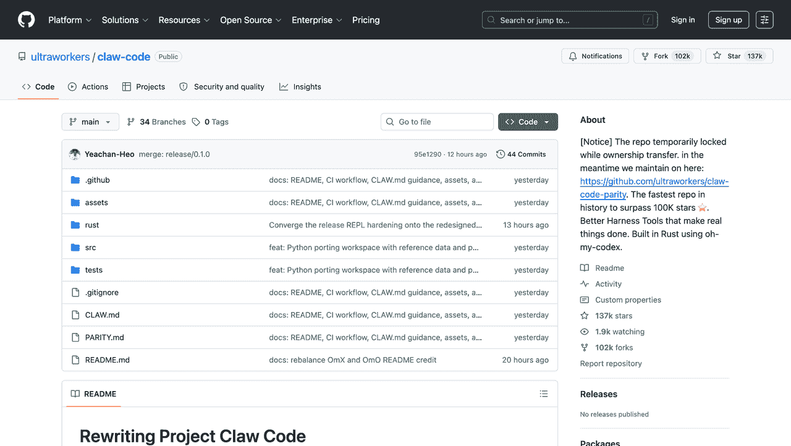

Anthropic 的反应是迅速的:从 npm 移除包、删除旧版本、发布官方声明。紧接着向 GitHub 提交DMCA 下架通知,导致超过 8,100 个仓库被禁用——包括原始泄露仓库及其整个 Fork 网络。但 clean-room 重写版本(从零用 Python 和 Rust 重新实现)和去中心化平台上的镜像仍然活着,DMCA 对它们无能为力。

一个价值 25 亿美元 ARR 的核心产品,51.2 万行 TypeScript 源码,就这样在全网裸奔。原因不是什么高级黑客攻击,不是内部员工叛变——仅仅是 .npmignore 少了一行配置。Bun 构建器默认生成source map,发布脚本没有排除 .map 文件,R2 存储桶又没设访问认证。三道防线,全部失守。

### 一周两次泄漏:巧合还是策略?

更耐人寻味的是,这并不是 Anthropic 那一周唯一的安全事故。就在 5 天前(3 月 26 日),他们的 CMS 配置错误导致近 3,000 个内部文件公开可访问——其中包括代号"Capybara"(水豚)的未发布模型 Claude Mythos 的详细资料,以及内部安全评估文档。

"号称最注重安全的 AI 公司,一周泄了两次。"——这是 Hacker News 上被引用最多的一句评论。

DEV Community 上甚至有人列出 6 条间接证据,认为这是一次精心策划的 PR 事件:泄露时间恰好在愚人节前一天,BUDDY 宠物系统的预览窗又正好从 4 月 1 日开始,10 天前 Anthropic 刚因向开源项目 OpenCode 发律师函引起社区反感,泄露后风评反而逆转——大家开始欣赏其技术实力......当然,反面论据也很充分:竞品路线图暴露、IPO 叙事受损,这些代价不是一次 PR 策略能承受的。阴谋论暂且放在一边。从竞争格局看,真正的影响是确定的:Cursor、Copilot、Windsurf 等竞品,从此永久获得了 Anthropic 的技术路线图——KAIROS 自主循环、ULTRAPLAN 远程编排、Coordinator Mode 多 Agent 协作——这相当于一份"如何构建高代理能力 AI Agent"的详细蓝图。暴露的不只是实现细节,更是产品策略。

### Undercover Mode:防泄密系统本身被泄露了

在 51.2 万行代码中,有一个大约 90 行的文件叫 undercover.ts ,它的功能是:当检测到使用者是 Anthropic 内部员工、且正在操作公开 GitHub 仓库时自动激活——抹除所有 AI 归属信息、隐藏内部代号、不提及内部频道和仓库名。系统提示词里甚至明确要求模型:"不要暴露你的身份。"代码注释还特别强调——"There is NO force-OFF"(没有强制关闭开关)。

Anthropic 精心设计了一个防止内部信息泄露的系统,结果泄露的正是这个防泄露系统本身的源码。Hacker News 上的评论一针见血:"讽刺的是,代码里专门有一个 Undercover Mode 来防止内部信息泄露——然而泄露的正是整个代码库。"

这大概是整个事件中最具元讽刺(meta-irony)色彩的桥段了。

###  从看热闹到看门道

泄露事件发生后的这几天,全网的解读铺天盖地——B 站短视频、掘金文章、知乎讨论、36 氪报道、GitHub 上甚至出现了 42 万字的电子书。BUDDY 宠物系统、Undercover Mode、沮丧检测regex、反蒸馏假工具注入......每个发现都在社交媒体上刷了一轮屏。

但今天不是来吃瓜的。 我们要做的是:把这 51.2 万行代码当教材,拆解全球最强 AI Agent 到底是怎么造出来的。看热闹的人看 BUDDY 和 Undercover,看门道的人看架构——看那 51 万行代码里藏着什么样的工程智慧,而这些智慧如何能用在我们自己的 Agent 项目里。

学完这 2.5 小时,你会得到三样东西:一张从 30 行到 51 万行的 AI Agent 完整架构地图、8 个可以直接用在你自己 Agent 项目里的设计模式、以及一个可能改变你资源分配策略的数字——1.6%。

注:本课程定位为架构学习与设计模式提炼。我们不展示原始泄露代码,所有代码演示基于简化版代码(来自开源项目 learn-claude-code,shareAI Lab 出品,MIT 许可),用简洁的 Python复现 Claude Code 的核心架构思想。同时,我们会在关键讲解点配上真实 Claude CodeTypeScript 源码截图作为视觉证据——让你既能动手练,又能看到工业级实现的真面目。

### 泄露后生态:学 Claude Code 源码的参考资源全景

泄露事件一周后,围绕 Claude Code 源码,社区迅速形成了一个小生态——有人做 clean-room 重写,有人补齐构建系统让源码可运行,有人做逐文件注释的付费课程,也有人用 200 行 Python 复现了核心循环。如果你想在本课之外进一步深入源码,以下是目前最有价值的参考资源。

一、源码获取渠道

注:Anthropic 已通过 DMCA 下架 8,100+ 个仓库,包括原始泄露仓库及其整个 Fork 网络。以上资源的可用性可能随时变化。如果你看到某个链接已失效,不必惊讶——这正是 DMCA 的威力所在。

快速入门,但多数停留在"看热闹"层面

二、clean-room 重写项目

这三个项目各有定位。claw-code 追求"功能完整的替代品",规模最大但代码量也最多;nano-claude-code 走极简路线,200 行代码帮你 10 分钟理解核心循环;learn-claude-code 走渐进教学路线,12 个阶段从 120 行到数千行,每步只加一个机制——这也是我们本课选择它的原因。

三、深度分析资源

关于本课定位:本课的简化版代码来自 learn-claude-code(shareAI Lab 开源项目,MIT 许可,

46.8K 星)。后续全课中,我们统一称之为"简化版代码"。与上述资源不同,我们不是逐行注释源码,而是提炼架构设计模式——从"怎么写的"上升到"为什么这么设计",再到"怎么用在你自己的项目里"。

实操:30 行代码跑一个能工作的 Agent

听了这么多背景,我们现在来做一件刺激的事情——用大约 30 行有效 Python 代码,跑起一个真正能工作的 AI Agent。不是概念图,不是伪代码,是一个你可以输入任务、它帮你执行命令、然后告诉你结果的真实 Agent。

我们用的简化版代码来自开源项目 learn-claude-code(shareAI Lab 出品,MIT 许可,GitHub

46.8K 星),它把 Claude Code 的核心架构用 Python 拆解成了 12 个渐进式阶段。后续我们统一称之为"简化版代码"。今天先看最基础的第一阶段—— s01_agent_loop.py 。

代码全貌:120 行,有效逻辑仅 30 行

先看一眼完整文件的结构。s01_agent_loop.py 总共 120 行,但去掉注释、导入和辅助代码

后,真正的 Agent 逻辑只有大约 30 行有效代码,分成三个部分:

第一部分:工具定义(9 行)

Agent 需要"手"来操作世界。s01 只给了它一只手——一个 bash 工具

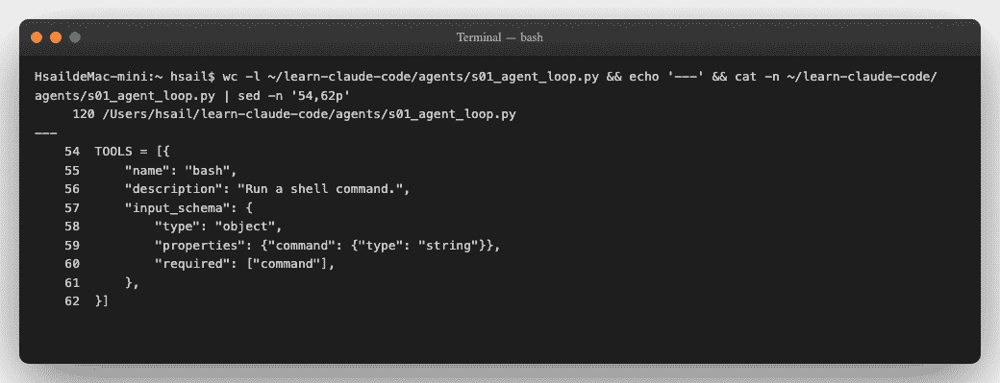

这 9 行代码告诉 LLM:"你有一个叫 bash 的工具,输入一条命令字符串,它就会执行。" 就是这么简单。Claude Code 生产版有 40 多个工具——文件读写、搜索、Git 操作、浏览器控制——但本质上都是这个结构的扩展。

第二部分:核心循环 agent_loop(21 行)

这是整个 Agent 的灵魂,也是我们今天最重要的代码。仔细看这 21 行:

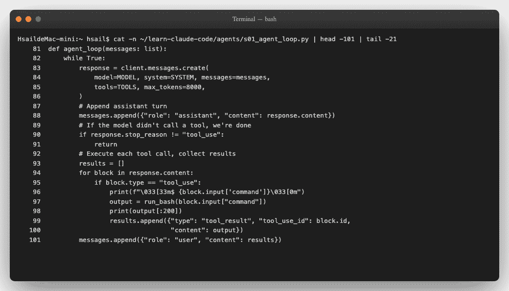

我们逐行拆解这个循环在做什么:

这就是 Agent 的全部秘密。 整个模式可以用一句话总结:

Agent = while 循环 + 工具调用 + stop_reason 检查。

LLM 说"我需要执行一个命令",Agent 就执行;执行完把结果喂回去,LLM 看了结果决定是继续调工具还是回复用户。这个循环一直转,直到 LLM 说"我说完了"(stop_reason != "tool_use" )。

注:Claude Code 的 51.2 万行 TypeScript 中,与 LLM API 直接交互的代码只有约 8,000 行(1.6%),核心循环与这 21 行 Python 的逻辑完全一致。剩下的 98.4%——我们后面会揭晓它们在干什么。

真实 Claude Code 源码中的核心循环

在 Claude Code 的 51.2 万行 TypeScript 中,这个核心循环藏在 src/query.ts 里——一个1,729 行的文件,核心结构是一个 AsyncGenerator 驱动的状态机。听起来复杂?其实核心逻辑和我们简化版代码的 while 循环完全对应。

有一个有趣的工程细节:源码中有一行注释写道 "stop_reason === 'tool_use' is unreliable -- it's not always set correctly" (第 554 行)。所以 Claude Code 并不依赖API 返回的 stop_reason ,而是自己检查响应中是否包含 tool_use 类型的内容块来判断是否需要继续循环。这就是工业级代码和教学代码的区别——教学代码可以信任 API 约定,生产代码必须自己做防御性检查。

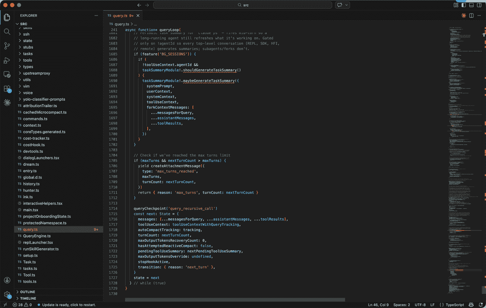

源码文件:buildable-fork/src/query.ts (1,729 行)——截图聚焦 queryLoop 函数的while (true) 循环入又(第 307 行)和 needsFollowUp 退出判断(第 1062 行)。

跑起来看看

光看代码不够,我们让它真正跑起来。给 s01 一个简单任务——"列出当前目录的文件和文件夹":

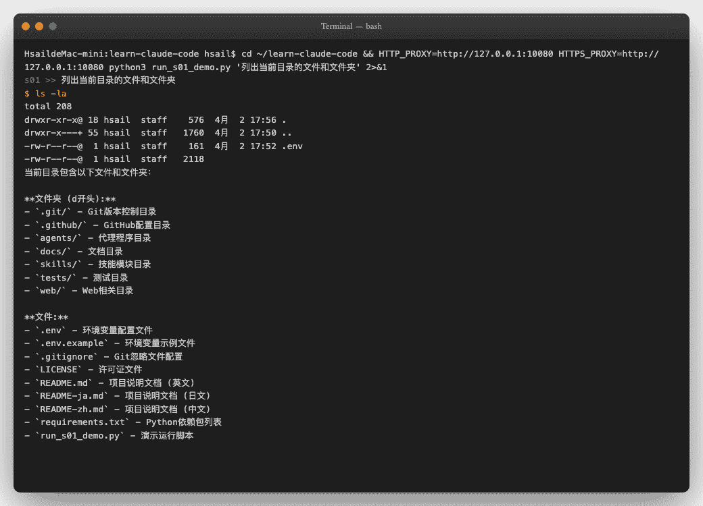

可以看到 Agent Loop 的完整工作流程:

1. 我们输入任务"列出当前目录的文件和文件夹"

2. Agent(LLM)决定调用 bash 工具,执行 ls -la (黄色部分是 Agent 发出的命令)

3. bash 工具返回了目录列表

4. Agent 读取结果,生成了整理好的文件清单回复给我们

再来一个稍微复杂的任务——"创建一个 hello.py 文件并运行它":

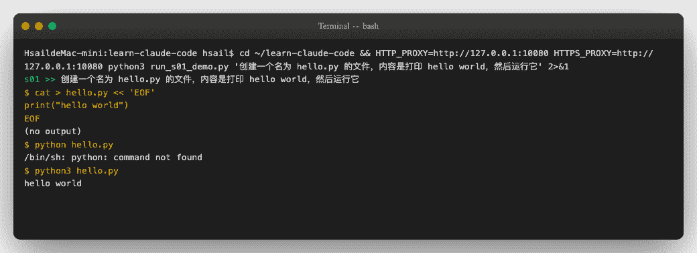

这个演示更有意思——注意 Agent 的行为:

1. 它先用 cat > hello.py 创建了文件,写入 print("hello world")

2. 然后尝试 python hello.py ——失败了,提示 command not found

3. 它自动调整策略,改用 python3 hello.py ——成功了,输出 hello world

这里展示了 Agent Loop 最核心的价值:自我纠错能力。当一个命令失败时,LLM 读到了错误信息,在下一轮循环中调整了方案。这不是我们写的重试逻辑,而是 LLM 自己"想明白了"——因为错误结果被 tool_result 反馈回去了,LLM 看到 command not found 就知道该换个命令试试。

这就是 while 循环的力量——它让 LLM 有了"再试一次"的机会。

### 锚定认知:Agent 核心就是这么简单

我们把今天最重要的认知锚定下来:

+   一个能工作的 Agent,核心就是 while 循环 + 工具调用

+   LLM 负责"想"(决定调什么工具、传什么参数),工具负责"做"(执行 bash 命令)

+   循环的退出条件是 LLM 自己说"我说完了"(stop_reason != "tool_use" )

+   工具执行的结果反馈给 LLM,形成 观察-思考-行动 的闭环

+   这个闭环天然具备自我纠错能力——错误也是一种"观察"

120 行代码,21 行核心逻辑,一个 bash 工具——就是一个 Agent。

但是,如果 Agent 真的这么简单,Claude Code 为什么需要 51.2 万行代码?

因为这 30 行代码有四个致命问题。

## 演示:30 行 Agent 的四个致命问题

刚才我们用 30 行代码跑起了一个能工作的 Agent——它能执行命令、能自我纠错、还能把结果整理成漂亮的格式。看起来很完美?

现在我们来给它"加加压",看看这个最简版 Agent 在真实使用场景下会暴露出什么问题。这四个问题不是假设——它们是每一个 Agent 开发者迟早会撞上的墙。更重要的是,这四个问题分别对应了Claude Code 51 万行代码中的四大核心模块。

问题 1:上下文越来越大,Agent 越来越"迟钝"

我们先看 s01 的主循环代码——特别注意第 105 行的 history 变量:

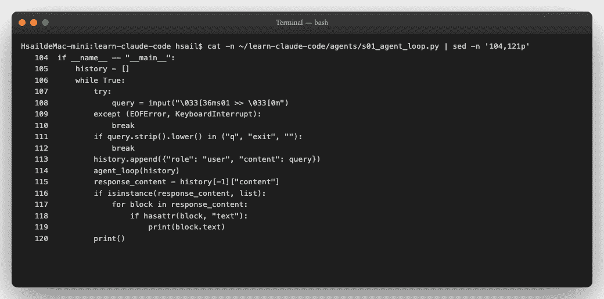

看到问题了吗?history = [] 创建了一个空列表,然后在 while True 循环中不断append 。每一轮对话——用户的输入、LLM 的回复、工具的调用请求、工具的执行结果——全部追加进去,永远不会清理。

我们用一个自动化脚本来量化这个增长。连续给 Agent 四个简单任务,观察 history 的膨胀速度:

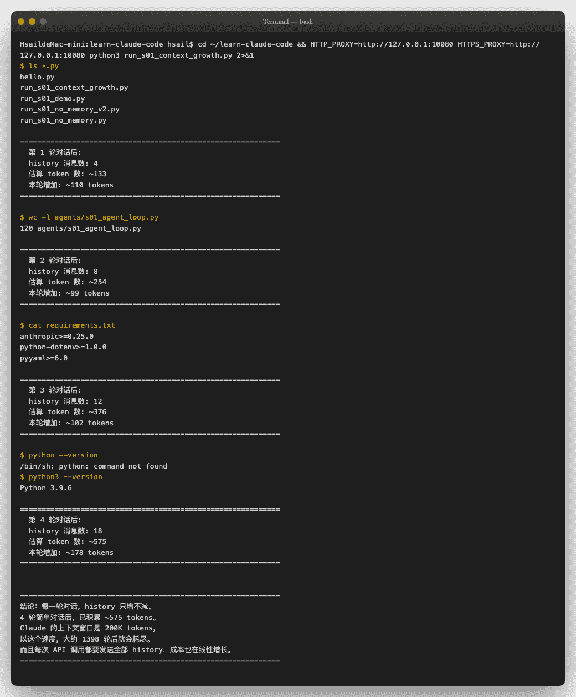

注意第 4 轮的消息数跳到了 18——因为 Agent 执行 python 失败后又用了 python3 重试,多产生了一轮工具调用。这还只是"列个文件、统计个行数"这样的简单任务。如果是真实的编程任务——读文件、改代码、跑测试、看报错、再改代码——每一轮可能产生数千 token 的工具输出。

Claude 的上下文窗又是 200K token,听起来很大。但是别忘了,这 200K 不是全给你的对话用的:

+   系统提示词(system prompt)占一部分

+   工具定义(s01 只有 1 个工具,Claude Code 有 40+)占一大部分

+   文件内容、搜索结果、命令输出——每个工具调用的结果可能上千 token

按照这个增长趋势,一个复杂编程任务可能几十轮就耗尽了上下文窗又。更关键的问题不是"耗尽"——而是上下文越大,LLM 的注意力越分散,回复质量越下降。

这是 Claude Code 需要解决的第一个问题:上下文窗又管理。后面的"约束工作台"模块会展示它的解法——一个三层(其实是四层)的压缩防御体系。

问题 2:关掉就失忆,重开全不知

这个问题更直观。我们模拟两次会话——第一次让 Agent 做一个统计任务,然后"关掉重开"(清空history),再问它刚才的结论:

Session 1 中,Agent 通过 find 和 wc 命令统计出 agents 目录有 14 个 Python 文件、共 4,626行代码。

Session 2 中(history 被重置为空列表),我们问它"刚才的统计结果是什么?不要重新统计,凭你的记忆告诉我"。Agent 的回答直白到令人心酸:

"我没有记忆之前对话的能力,每次对话都是全新开始的。"这不是 Agent "谦虚"——这是事实。看代码就知道:history = [] 这一行在每次启动时创建了一个全新的空列表。上一轮的所有对话、所有决策、所有发现——全部丢弃。这对用户体验意味着什么?想象你每天用 Agent 帮你开发一个项目。今天你花了两个小时让它熟悉了代码库的结构、约定了编码风格、告诉它"不要用 var,全部用 const"。明天打开?它什么都不记得,你得从头来。

这是第二个问题:会话间记忆。"约束记忆"模块会展示 Claude Code 怎么用三层记忆架构 +Auto Dream 来解决它——包括一个像人类 REM 睡眠一样的"记忆巩固"机制。

问题 3:安全?五行字符串匹配就是全部

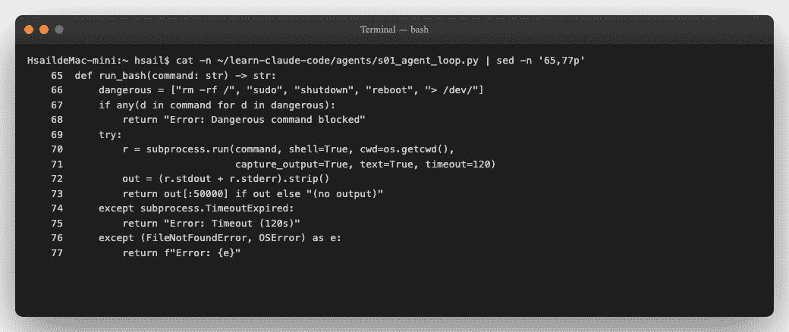

Agent 可以执行 bash 命令——这意味着它拥有你的终端权限。s01 对此的安全措施是什么?看看run_bash 函数:

安全检查的全部代码就这两行:

一个硬编码的字符串列表,5 个危险关键词,用 in 做子串匹配。这个安全检查有多脆弱?举几个例子:

更重要的是,这里没有任何确认机制——Agent 决定执行什么命令,就直接执行了。没有弹窗问你"这个命令看起来有风险,要继续吗?"。这是第三个问题:安全裸奔。"约束行为"模块会展示 Claude Code 怎么用四层安全纵深防御来解决它——包括一个"两个 AI,一个干活一个监督"的对抗机制。

问题 4:每轮都发全量历史,成本线性增长

回过头再看 agent_loop 函数的第 83 行:

注意 messages=messages ——每次调用 API 都把完整的 history 发过去。这意味着:

第 1 轮 API 调用发送 100 token

第 2 轮发送 200 token(第 1 轮 + 第 2 轮)

第 3 轮发送 300 token(第 1、2、3 轮全部)

第 N 轮发送 N * 平均单轮 token

API 按 token 计费,这意味着你为早期的对话内容反复付费。第 1 轮的内容在第 10 轮还在付费,在第 100 轮还在付费。而且如果你同时跑多个任务——比如让一个 Agent 改前端、另一个改后端——它们各自独立积累 history,没有任何共享。更糟糕的是,这种成本增长和前面的"上下文膨胀"问题是同一枚硬币的两面:上下文越大,既消耗注意力(质量下降),又消耗 token(成本上升)。

这是第四个问题:成本线性增长。"约束成本"模块会展示一个精妙的架构:通过 Fork 缓存共享,让 5 个并行 Agent 的成本约等于 1 个——而不是 5 倍。

四个问题,四个钩子

让我们把刚才发现的四个问题汇总一下:

这 30 行代码就是一个 Agent——能工作,但有四个致命缺陷。

Claude Code 的 51.2 万行代码,就是为了约束这个不完美的 AI,让它从"能跑的玩具"变成"可靠的工具"。在接下来的内容中,我们会逐个拆解这四大约束模块,看看一个价值 25 亿美元的产品是怎么解决这些问题的——以及你可以怎么把这些解法用到自己的 Agent 项目里。

## 1.6% vs 98.4%:秘密武器不是模型,是约束

我们刚才用 30 行代码跑起了一个 Agent,然后发现了它的四个致命问题。现在的关键问题是:Claude Code 的 51.2 万行代码,到底在干什么?

答案藏在一个数字里。

一个颠覆认知的数据

泄露的 Claude Code v2.1.88 源码,总计约 512,000 行 TypeScript,分布在约 1,900 个文件中。

当研究者们开始逐文件分析这些代码时,一个令人震惊的事实浮出水面:

仅 1.6% 的代码——大约 8,000 行——在"调模型"。剩下 98.4%,也就是超过 50 万行代码,都是围绕模型构建的工程基础设施。

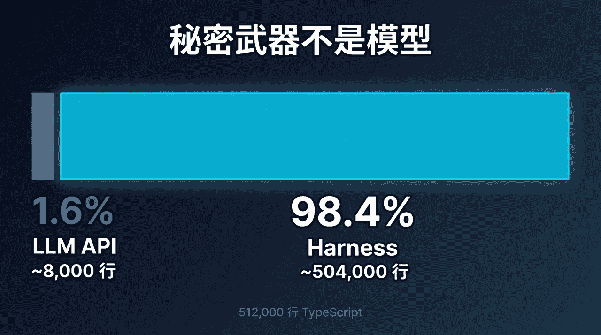

不只是一个统计数字——让我们看看这 51.2 万行代码的真实目录结构。在 Claude Code 的 src/目录下,有 41 个顶层目录 和 28 个顶层文件:

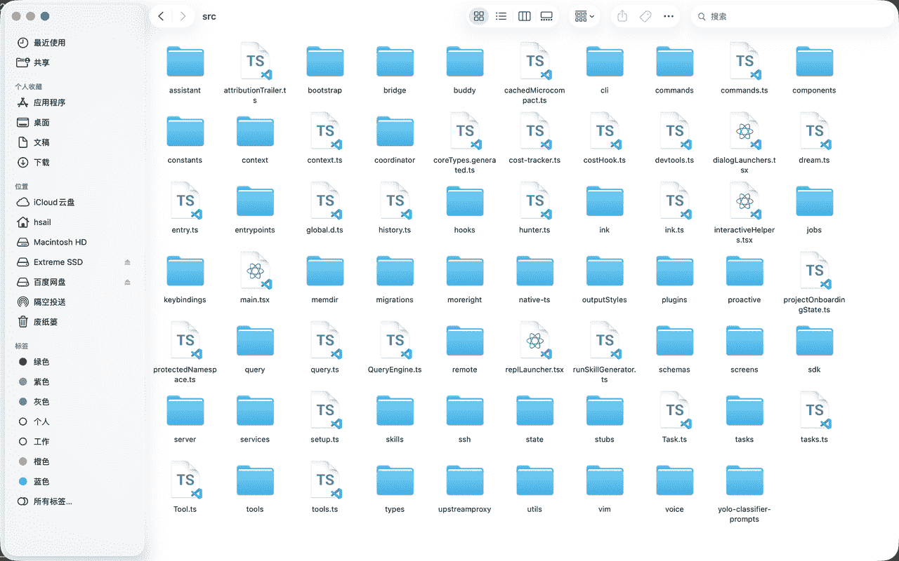

其中最大的几个目录:utils/ (576 个文件)、components/ (405 个文件)、commands/(219 个文件)、tools/ (212 个文件)。光一个 utils/ 目录的文件数量就比绝大多数完整的开源项目还多——而它只是"工具函数"。此外还有 query.ts (1,729 行)和 QueryEngine.ts (我们后面会深入分析的推理引擎核心)直接放在 src/ 根目录,与 main.tsx (804K 字节的入又文件)并列。

再把 98.4% 的部分展开看——推理引擎 9%、工具系统 5.7%、终端 UI 4.9%、安全控制 3.9%、多Agent 编排 3.5%、还有整整 71.4% 的"其余基础设施"(认证、存储、缓存、分析、传输桥接......):

Anthropic 内部把这 98.4% 称为 Harness——直译是"挽具",就像骑手用来驾驭马匹的缰绳和马鞍。这个比喻很精确:LLM 是那匹能力强大但不可预测的马,Harness 是让它安全、高效、可靠地载着骑手到达目的地的全套装备。

业内专家的判断

泄露事件发生后,LLM 领域的知名研究者 Sebastian Raschka(《Build a Large Language ModelFrom Scratch》作者)在分析泄露代码后给出了一个核心判断:

"Skimming the leaked Claude Code TypeScript snapshots suggests that much of its coding performance comes from the surrounding software harness, including repo context, tooling, caching, memory, and subagents."——Sebastian Raschka, Substack Notes, 2026-03-31

他的结论更为大胆:如果把 DeepSeek、MiniMax 或 Kimi 等其他模型换进这套 Harness 并做适配,它们也能获得非常强的编码性能。

换句话说——Claude Code 的"秘密武器",不是 Claude 模型本身,是模型外面的那 50 万行代码。

这意味着什么

这个数据颠覆了一个普遍的认知误区。

很多团队在做 AI Agent 项目时,资源分配是这样的:80% 的精力花在选模型、调提示词、微调模型上,20% 花在"其他工程工作"上。Claude Code 的代码结构告诉我们,工业级 Agent 产品的资源分配 恰好相反——不到 2% 是模型交互,超过 98% 是工程基础设施。

这不是说模型不重要——模型当然重要,它是整个系统的"大脑"。正如一匹好马是骑术的前提,一个强大的 LLM 是 Agent 能力的上限。但问题在于:从"能跑的 Demo"到"可靠的产品"之间的鸿沟,不是靠换一个更好的模型就能填平的。

回想一下我们刚才的 30 行 Agent——它用的也是 Claude 模型,但它有四个致命问题。这四个问题不是模型的问题,是"模型外面什么都没有"的问题。

重要提醒:这个 1.6% 的数据不是要贬低模型的价值。模型决定了 Agent 的能力上限,而Harness 决定了这个上限能被兑现多少。二者缺一不可——但在当前的行业认知中,Harness 的重要性被严重低估了。Sebastian Raschka 的判断也暗含一个前提:你需要一个"足够强"的基座模

型,Harness 才能发挥作用。关键是:大部分团队在模型选择上已经做到了 80 分,但在 Harness建设上可能还不到 20 分。

Harness 架构:Anthropic 自己画的理论蓝图

98.4% 的代码是 Harness——这个词不是我们发明的。

2025 年 12 月,Anthropic 发表了 "Building Effective Agents" 系列文档和后续的 HarnessEngineering 理论框架,正式定义了 AI Agent 系统中"模型之外那部分"的工程方法论。Claude Code 的51.2 万行代码,就是这个理论蓝图的工业级实现。

理论四支柱

Harness Engineering 将 Agent 系统中围绕模型构建的工程基础设施划分为四大支柱

这个框架的核心洞察是:模型能力是必要条件,但远非充分条件。一个强大的 LLM 加上糟糕的

Harness,产出还不如一个中等模型配上精心设计的工程基础设施。Sebastian Raschka 说的"换模型也能获得强编码性能",就是这个意思的实证。

从理论到实践:四支柱映射为四大约束

接下来的四个章节(5-8),我们会逐个深入 Claude Code 对这四大支柱的工程实现。但在开始之前,有必要说明:理论蓝图和工程实践的映射并非一对一。

三个值得注意的差异:

1. Orchestration 被拆成了两块。理论中"编排"是一个完整支柱,但在 Claude Code 的实践中,记忆管理和多 Agent 编排的工程挑战差异巨大,被分别归入"约束记忆"和"约束成本"。

2. 成本是理论几乎没讨论但实践极其重要的约束。理论框架关注"怎么做对",但工程实践还要关注"做得起"——Prompt Cache 经济学、Fork 缓存共享,这些在论文里一笔带过,在代码里占了数万行。

3. Tooling 在本课与成本合并讲解。不是因为工具不重要,而是 Claude Code 最有趣的工具设计(40+ 工具的权限分级和描述优化)与成本编排深度交织。

注:这些差异本身就是有价值的认知。8e 会做一次完整的"理论 vs 实践"总对照——回过头来看哪些理论预测被工程验证了,哪些在实践中被修正或补充了。

## 约束哲学框架:98.4% 都在约束 AI 做什么

刚才我们看了 Harness 的理论蓝图——四支柱、从理论到实践的映射、以及映射中那些有意思的差异。现在让我们换一个视角:Claude Code 的工程实现是怎么把这个蓝图变成四大约束系统的?

我们知道了 98.4% 的代码是 Harness。但"Harness"这个词太宽泛了——50 万行代码到底在做什么?

答案可以用一个词概括:约束。

从四个问题到四大约束

让我们回到刚才发现的四个致命问题,看看 Claude Code 是怎么回应的:

注意用词——是"约束",不是"限制"。这个区别很关键。

"限制"是防御性的,目标是"不让 AI 搞砸"。而"约束"是建设性的,目标是"让 AI 可靠地工作"。就像赛车的底盘和悬挂系统不是在"限制"发动机的马力,而是在确保这些马力能转化为真正的速度而不是失控翻车。

Claude Code 51.2 万行代码的核心使命,就是构建这四大约束系统——让一个能力强大但不可预测的 LLM,变成一个可以交付给数百万用户、每天处理数百万次编程任务的可靠工具。

五层架构鸟瞰

在深入每个约束模块之前,我们先看一眼 Claude Code 的整体架构——知道我们接下来要"潜入"的是哪些区域。

Claude Code 不是一个 CLI 工具,而是一个平台运行时,恰好以终端界面发布。它的架构分为五层:

我们今天要深入的四大约束模块,分布在 L3 和 L4 两层:

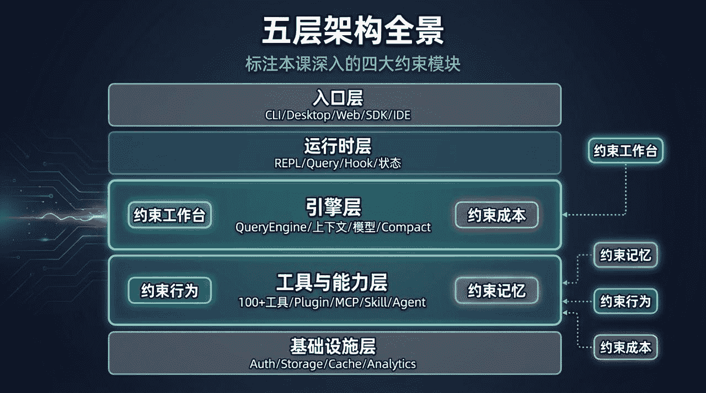

约束工作台(上下文管理)——主要在 L3 引擎层,QueryEngine 的上下文协调器和 Compact模块

约束记忆(三层记忆 + Auto Dream)——跨 L3 和 L4,Skill 加载在 L4,记忆索引管理在 L3

约束行为(安全纵深防御)——主要在 L4 工具层,每个工具的执行前后都有安全检查管线

约束成本(Prompt Cache 经济学)——主要在 L3 引擎层,Fork 模式和缓存编排

L1 入又层和 L5 基础设施层今天不深入——它们重要,但不是 Agent 架构差异化的核心。

你的认知地图

现在我们手里有了一张完整的地图。

纵向看:从 30 行 Agent Loop 到 51.2 万行 Claude Code,增加的不是"更多功能",而是"四大约束系统"——工作台、记忆、行为、成本。

横向看:这四大约束分布在五层架构的 L3(引擎层)和 L4(工具层),构成了 Agent 从"能跑的Demo"到"可靠的产品"的全部工程挑战。

接下来的四个章节,我们会逐个深入每个约束模块,沿着同一个节奏推进:

1. 问题回顾——回到 30 行 Agent 的对应问题

2. 代码解法——用 learn-claude-code 的教学代码展示解决思路

3. Claude Code 升级版——看工业级实现比教学代码多了什么

4. 场景扩展——提炼可复用的设计模式,带走一个可以用在你自己项目里的 insight

注:这张约束框架图和五层架构鸟瞰图建议保存——后续章节会反复引用它们来定位我们"当前在地图的哪个位置"。这就是本课的 T1 产出:一张从 30 行到 51 万行的 AI Agent 完整架构认知地图。

### 问题回顾:Agent 聊多了就"失忆"

在 §3 的实验中,我们亲眼见证了一个令人不安的现象——四轮简单对话之后,s01 的 history列表已经膨胀到 18 条消息、约 575 个 token。

这还只是"列个文件、统计个行数"这样的简单任务。如果换成真实的编程场景——读一个 500 行的源文件、改 3 处代码、跑一遍测试、看报错日志、再改代码——单轮工具调用就可能产生数千 token 的输出。

上下文窗又就是 Agent 的工作台面。200K token 听起来宽敞,但台面上不只有你的对话——系统提示词要占一部分、40+ 工具定义每个消耗 4,000-6,000 token、文件内容和命令输出还在不断堆积。台面很快就会满。

更关键的问题不在于"台面满了"——而在于台面越乱,Agent 的注意力越分散。LLM 处理超长上下文时,早期信息的注意力权重会系统性下降。一个在第 3 轮给出精准建议的 Agent,到了第 30 轮可能开始重复之前做过的操作、忘记之前约定的风格、甚至"发明"不存在的文件。这就是所谓的上下文退化——Agent 并没有真正"失忆",但它的注意力已经被铺满台面的杂物淹没了。

注:这就是我们要约束的第一件事——上下文管理。接下来我们先看 learn-claude-code 怎么用三层压缩策略解决这个问题,然后再拆解 Claude Code 更精密的四层防御体系。

### 代码解法:简化版代码 s06 三层压缩

简化版代码的第六个阶段(s06_context_compact.py)用 256 行 Python 实现了一个三层压缩管线。它的核心理念用一句话概括:Agent 可以策略性地遗忘,然后永远工作下去。

打开这个文件的头部注释,压缩管线的架构一目了然:

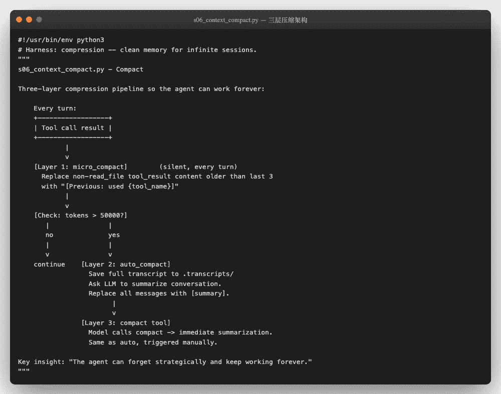

三层压缩各有分工——从"几乎无损"到"有损但可控",按紧急程度分层触发:

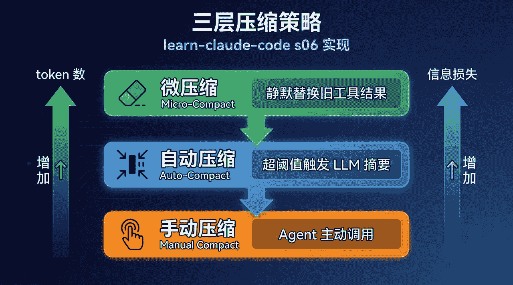

Layer 1:微压缩(Micro-Compact)——每轮自动、用户无感

微压缩是最温和的一层。它的逻辑很简单:3 轮之前的工具调用结果,如果不是文件内容,就替换成一句话占位符。

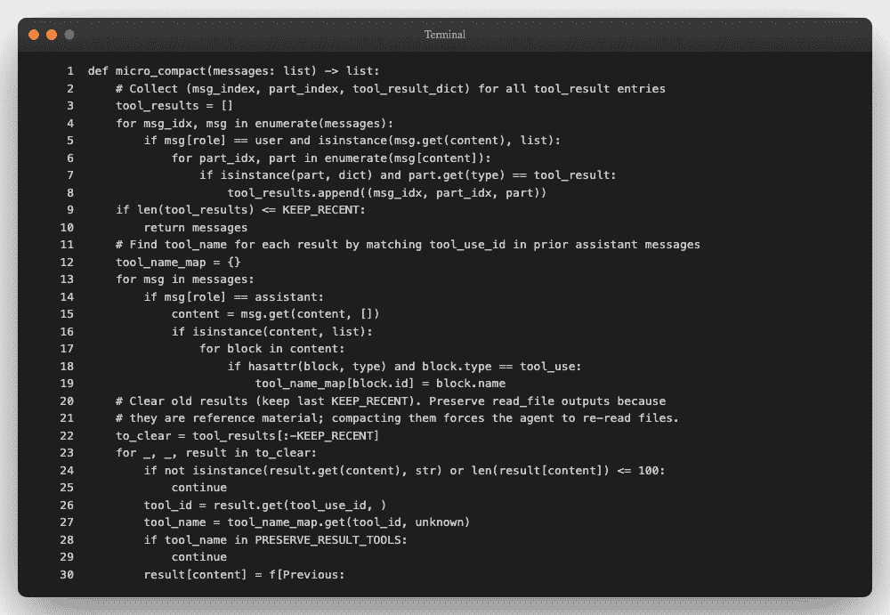

# micro_compact 核心逻辑(第 69-99 行)

在 Claude Code 的真实源码中,微压缩的实现远比简化版代码复杂。

src/services/compact/microCompact.ts (531 行)定义了一组COMPACTABLE_TOOLS ——只有特定工具(FileRead、Shell、Grep、Glob、WebSearch、WebFetch、FileEdit、FileWrite)的结果才会被压缩,其他工具的输出保持不动。更精妙的是,Claude Code 引入了缓存感知的微压缩(Cached Microcompact):当服务端缓存处于"热"状态时,不直接修改消息内容,而是通过 cache_edits API 告诉服务端"删掉这些工具结果"——这样压缩操作不会破坏已有的 Prompt Cache 前缀。只有当缓存过期(基于时间间隔检测)时,才回退到直接清除内容的方式。

注意两个设计细节:

KEEP_RECENT = 3 :保留最近 3 个工具结果不压缩。Agent 经常需要回顾刚刚做的操作,压掉太近的结果会导致它"短期失忆"。

PRESERVE_RESULT_TOOLS = {"read_file"} :读文件的结果永远不压缩。因为文件内容是参考资料——一旦压掉,Agent 就必须重新读一遍文件,反而浪费更多 token。

微压缩在每轮 LLM 调用前自动执行,用户完全感知不到。一个 bash 命令的 5000 字节输出,过三轮后变成一句 [Previous: used bash] ——从 5000 字节缩减到 20 字节,压缩率 99.6%。

Layer 2:自动压缩(Auto-Compact)——超阈值触发 LLM 摘要

当微压缩无法阻止 token 数持续增长时,第二层防线启动:

auto_compact 做两件事:先把完整对话历史存入 .transcripts/ 目录作为备份(没有真正丢失,只是移出了活跃上下文),然后调用 LLM 生成一段摘要,用这段摘要替换全部历史消息。

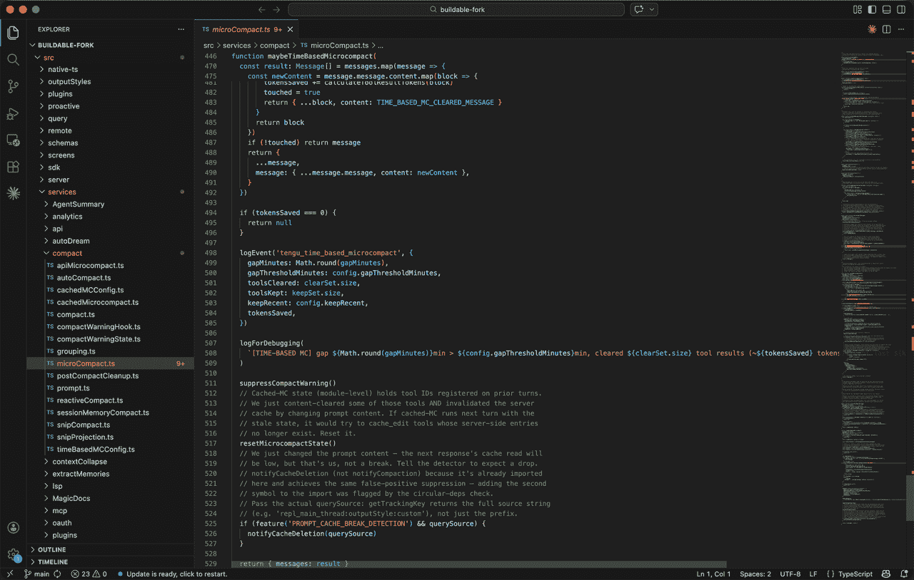

摘要的提示词要求保留三类信息:完成了什么、当前状态、做过的关键决策。压缩后的 messages只剩一条消息——但 Agent 知道之前发生过什么,可以继续工作。

对照 Claude Code 的 src/services/compact/autoCompact.ts (352 行),可以看到阈值计算远比简化版代码的硬编码 50000  精细。真实实现中,触发阈值是动态计算的:先取当前模型的上下文窗又大小,减去为输出预留的 token 数(MAX_OUTPUT_TOKENS_FOR_SUMMARY = 20,000 ),再减去

AUTOCOMPACT_BUFFER_TOKENS = 13,000 作为缓冲区。这意味着对于 200K 窗又的模型,自动压缩大约在 167K token 时触发——而不是简化版代码里的固定 50K。源码中还有一个熔断机制(MAX_CONSECUTIVE_AUTOCOMPACT_FAILURES = 3 ):如果连续 3 次压缩都失败,就停止尝试,避免陷入无限重试的死循环。

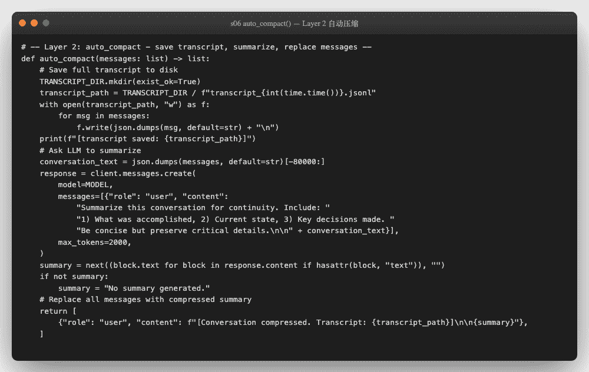

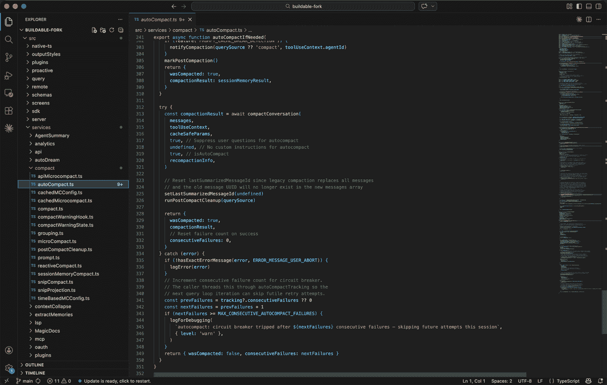

Layer 3:手动压缩(Manual Compact)——Agent 主动调用

第三层是 Agent 自己判断"该压缩了"时主动调用的 compact 工具:

与 Layer 2 的区别在于触发方式:Layer 2 是系统自动检测,Layer 3 是 Agent 根据任务情况主动决定。比如 Agent 发现自己即将切换到一个完全不同的任务,它可能主动调用 compact 清空当前上下文,为新任务腾出空间。

Claude Code 的手动压缩实现在 src/services/compact/compact.ts (一个超过 500 行的大文件)中,compactConversation 函数处理了一个简化版代码完全没有涉及的问题:压缩前先剥离图片和大型附件。stripImagesFromMessages 函数将所有图片块替换为 [image] 占位符,

stripReinjectedAttachments 过滤掉会在压缩后自动重新注入的技能发现附件——这些内容不需要进入摘要。压缩完成后,通过 preservedSegment 机制恢复文件引用和 Skill 状态——本质上是"压掉内容,保留骨架":摘要记住了"我们读过 config.yaml",但不再保留 config.yaml 的完整内容。Before/After:加入压缩后的效果

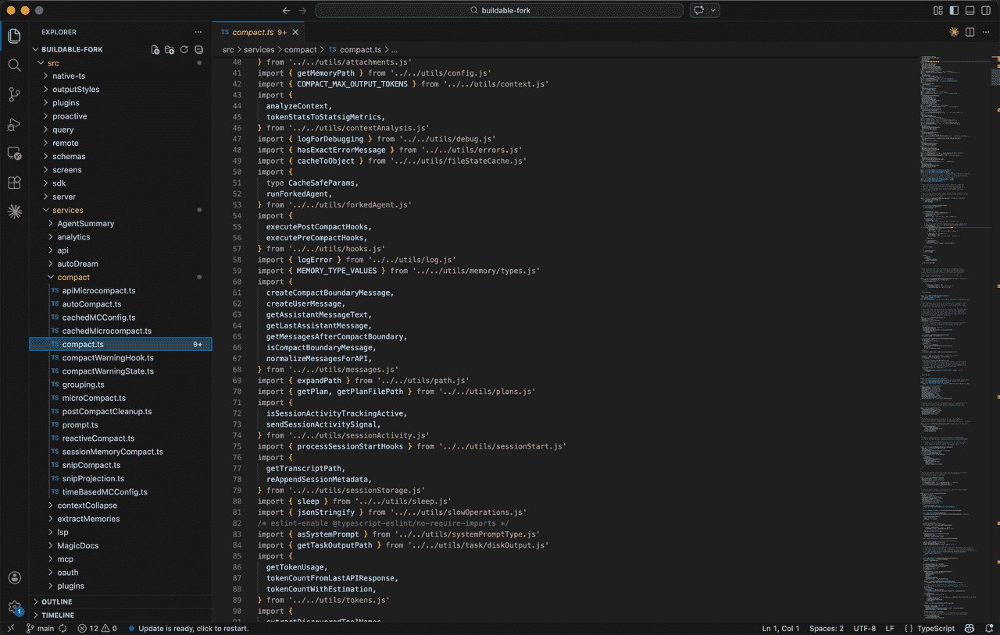

Experimenter 预先运行了 s06 的完整演示——同样的多轮任务,加入三层压缩后,Agent 不再"迟钝":

对比 s01 的"只增不减",s06 的行为变成了"增长到阈值 → 压缩 → 继续增长 → 再压缩"的锯齿形模式。上下文不再无限膨胀,Agent 可以在有限的窗又里"永远工作下去"。

注:三层压缩已经解决了最基本的问题。但 Claude Code 面对的场景远比 简化版代码的场景复杂——200K 上下文窗又、40+ 工具定义、多 Agent 并行。它需要更精密的分层策略。接下来我们看Claude Code 是怎么把三层升级到四层,并在前面加了一条五步预处理流水线的。Claude Code 的实际实现:从三层到四层 + 五步预处理

简化版代码的三层压缩解决了核心问题,但它面对的是一个"教学规模"的场景——单用户、少量工具、中等长度对话。Claude Code 面对的是另一个量级:200K 上下文窗又、40+ 工具定义(每个消耗4,000-6,000 token)、数十万日活用户的生产环境。

理论上说"做个 Compaction"——实际上做了六种不同的压缩策略组合。

四层压缩防御体系

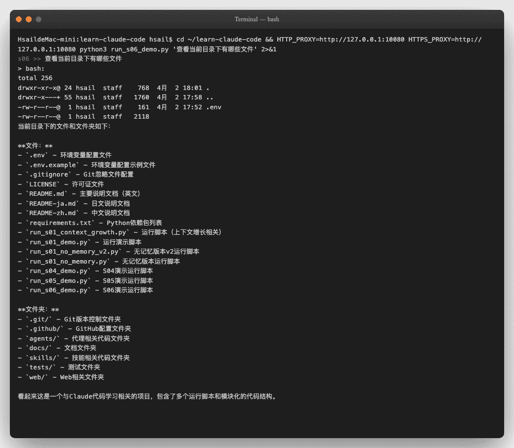

Claude Code 的上下文压缩不是一个函数,而是一个四层防御体系。每一层的触发条件和成本不同,从"优雅降级"到"紧急丢弃"逐层升级:与 简化版代码的三层对比,关键差异在于两个地方:

第一,API 原生的 MicroCompact。简化版代码的微压缩是纯本地操作——在发送 API 请求之前自己处理。Claude Code 多了一层:Anthropic API 本身会返回一个 context_management 信号,告诉客户端"某些旧的工具结果可以安全压缩了"。这意味着压缩决策部分由服务端协助做出,比纯客户端估算更精准。

第二,Reactive Compact(被动压缩)。当 AutoCompact 因为某种原因没有及时触发——比如一个超大的工具输出一次性把上下文推过了限制——API 会直接返回错误。Reactive Compact 在捕获到这个错误后紧急执行压缩,然后自动重试请求。这是一个兜底机制:即使主动防御失效,系统也不会直

接崩溃。

最底层的 Snip 则是终极保险——当所有压缩策略都无法把上下文缩减到限制以内时,直接裁剪掉最大的内容块。信息损失最大,但保证系统不会因为 token 超限而停止工作。

翻开 Claude Code 源码,Reactive Compact 的触发逻辑分散在autoCompact.ts 中——当 API返回 prompt-too-long 或 context-too-large 错误时,autoCompactIfNeeded 会作为兜底被调用。源码中可以看到明确的递归防护:querySource === 'compact' 时直接返回 false,避免"压缩过程本身触发压缩"的死循环。此外还有一个实用的注释揭示了真实世界的规模——2026 年 3 月的数据显示,有 1,279 个会话出现了 50 次以上的连续压缩失败(最高达 3,272 次),每天浪费约 25 万次 API调用。正是这个数据推动了 MAX_CONSECUTIVE_AUTOCOMPACT_FAILURES = 3 熔断器的加入。

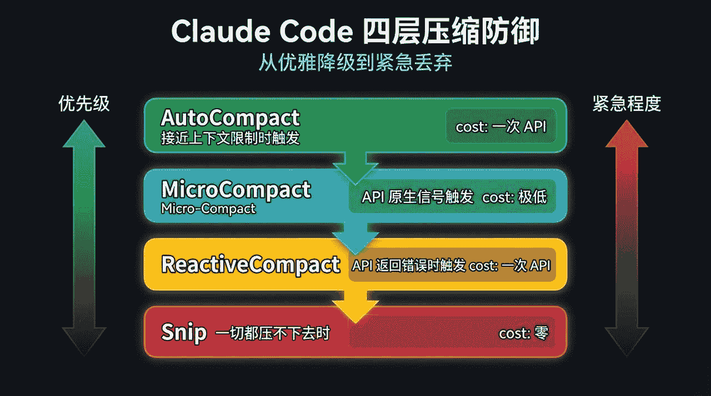

注:在我们获取的源码版本中,src/services/compact/reactiveCompact.ts 文件内容已被清空(仅保留空导出),这是 Anthropic 在开源 fork 中对部分内部模块做的脱敏处理。但Reactive Compact 的核心行为——捕获 API 错误后紧急压缩并重试——可以从autoCompact.ts 中的调用关系和错误处理逻辑中清楚地推断出来。

五步预处理流水线

在四层压缩防御之外,Claude Code 在每一轮对话开始前还有一条五步预处理流水线——它在消息发送给 API 之前就完成了大量优化工作:

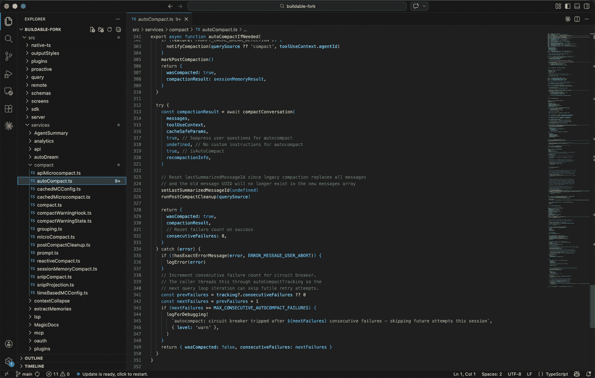

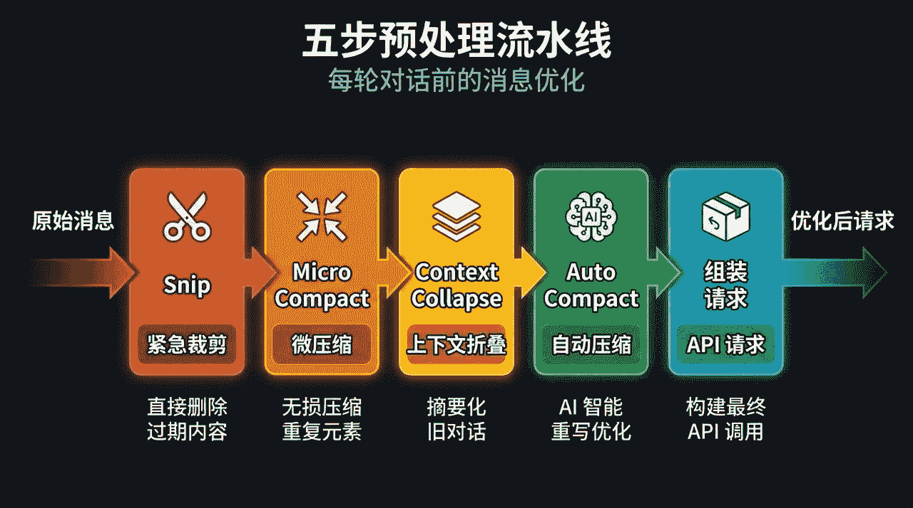

这五步的分工:

1. Snip(裁剪):紧急检查——有没有单个内容块大到不合理?有的话直接截断。

2. MicroCompact(微压缩):最细粒度的本地压缩——替换旧工具结果为占位符,与 s06 的Layer 1 原理相同但更精细。

3. Context Collapse(上下文折叠):将已完成的工具调用结果折叠为一行摘要。一个返回了3000 行文件内容的 read_file 调用,如果后续已经基于这个文件完成了编辑,就折叠为 [已读取并编辑 config.yaml] 。

4. AutoCompact(自动压缩):当前三步处理完仍然接近上下文限制时触发 LLM 摘要——保留13,000 token 缓冲区,生成最多 20,000 token 的摘要。

5. 组装请求:将预处理后的消息 + 系统提示词 + 工具定义打包成最终的 API 请求。

注意第 3 步 Context Collapse——这是简化版代码没有的。它的精妙在于语义感知压缩:不是盲目地按时间或大小裁剪,而是判断"这个工具结果是否已经被后续操作消费过了",如果已经消费过就可以安全折叠。

在源码中,Context Collapse 作为独立模块存放在src/services/contextCollapse/ 目录下

(包含 index.ts 、operations.ts 、persist.ts 三个文件)。从 autoCompact.ts 中的引用关系可以看到,当 Context Collapse 功能启用时,它会取代自动压缩成为主要的上下文管理策略——在90% 上下文占用时开始提交折叠,95% 时阻止新的子 Agent 生成。这意味着 Context Collapse 的"精确手术刀"优先于 AutoCompact 的"全面摘要",只有当 Collapse 无法处理时,才退回到传统的 LLM 摘要压缩。

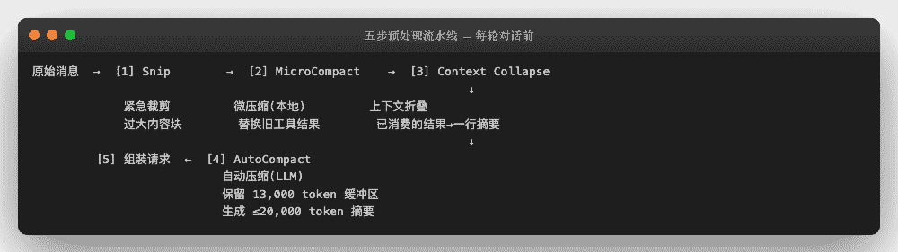

Prompt Cache 稳定区/动态区分割

压缩系统还有一个隐含的设计约束:不能破坏 Prompt Cache。

Anthropic API 的 Prompt Cache 机制是——如果两次请求的前缀完全相同,第二次不需要重新处理那个前缀,速度更快、成本更低。Claude Code 利用这个机制,把系统提示词分为两部分:

稳定区(SYSTEM_PROMPT_DYNAMIC_BOUNDARY 之前):基础行为指令,全局缓存,跨会话复用动态区(之后):会话特定上下文、用户指令、环境状态

压缩系统在工作时需要小心,不要让压缩操作意外修改了稳定区的内容——否则会导致缓存失效,所有后续请求的成本都会上升。代码中甚至有一个专门的变量 DANGEROUS_uncachedSystemPromptSection ,显式标记可能导致缓存中断的修改。打开 src/constants/prompts.ts 的第 114 行,这个边界标记定义得非常直白:

紧接着的注释(第 110-113 行)警告道:"WARNING: Do not remove or reorder this marker without updating cache logic in: src/utils/api.ts (splitSysPromptPrefix) ..."。在 api.ts 中,系统提示词被这个标记一分为二:标记之前的内容标记为可缓存前缀(跨会话复用),之后的内容每次请求都重新组装。DANGEROUS_uncachedSystemPromptSection 函数则用来注入那些必须放在动态区的系统

提示词段落——函数名里的 DANGEROUS_ 前缀就是在提醒开发者:放在这里的内容会破坏缓存前缀的稳定性,务必三思。

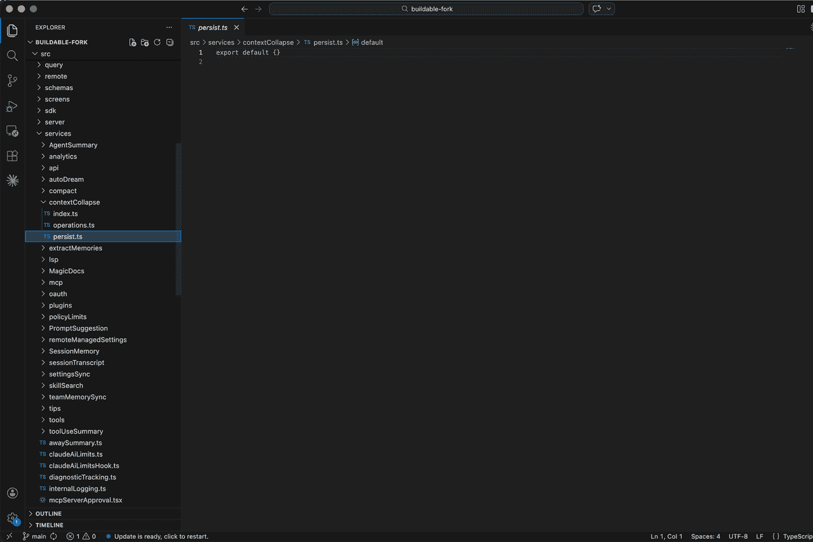

注:Prompt Cache 的完整经济学在 §8(约束成本)中详讲。这里只需要理解一个关键点:压缩系统的设计不仅要考虑"压掉什么信息",还要考虑"压缩操作本身会不会让系统变贵"。

与替代方案的对比

Harness Engineering 理论提到了 Compaction(历史摘要)和 Context Reset(清空重启)两种策略。Claude Code 的实际实现远比理论精细——不是二选一,而是六种策略的组合,按严重程度分层部署,就像网络协议栈一样有层次感。

局限性:有损压缩不可逆

这套系统有一个根本局限:压缩是有损的,不可逆的。

当 AutoCompact 把 30 轮对话压缩成一段摘要时,摘要的质量完全取决于 LLM 的判断。如果 LLM认为某个细节"不重要"而丢弃了,但后续任务恰好需要这个细节——信息就真的丢了。虽然 .transcripts/ 里保存了完整的原始对话,但 Agent 不会主动去翻旧档案。

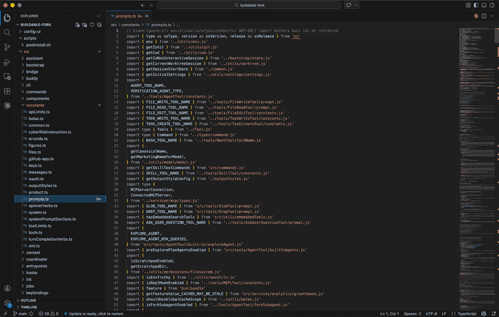

这也是为什么 Claude Code 需要一个独立的记忆系统来补偿——压缩系统管的是"当前会话的台面整洁度",记忆系统管的是"跨会话的长期知识"。两者配合,才能让 Agent 既不被当前对话淹没,又不丢失重要的长期信息。

注:Claude Code 的 compact() 函数在压缩时会做一件巧妙的事:先剥离图片和大型附件,压缩完再恢复文件引用和 Skill 状态。使用preservedSegment 边界标记支持压缩后的选择性恢复——不是全部丢掉,而是"压掉内容,保留骨架"。

场景扩展:分层降级防御的通用模式

Claude Code 的四层压缩防御体系揭示了一个通用的工程模式——分层降级防御:当资源有限时,先用代价最小的手段处理,处理不了再升级到代价更大的手段,最后才动用"紧急丢弃"这种终极手段。

这个模式在软件工程中随处可见:

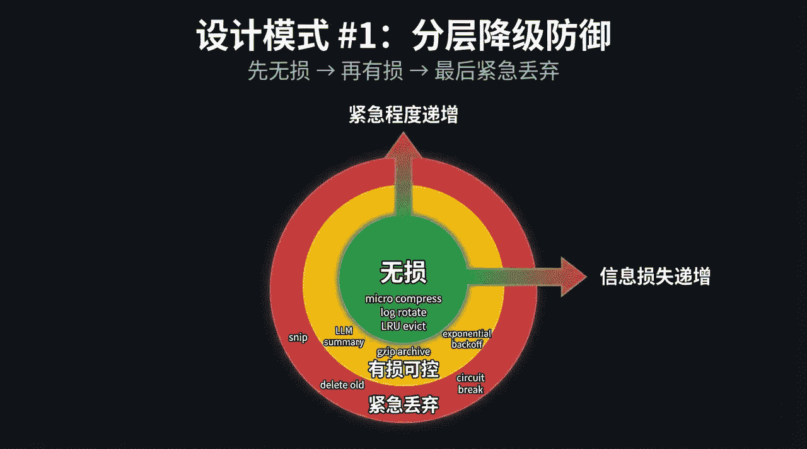

设计模式 #1:分层降级防御——核心原则是先无损、再有损、最后紧急丢弃。每一层都是上一层失效后的兜底,保证系统在资源耗尽前有多次"优雅降级"的机会,而不是直接崩溃。

如果你正在设计自己的 Agent 系统,可以直接套用这个模式:

这三层的实现代码量不大——learn-claude-code s06 用 256 行就做到了。但它能从根本上解决Agent 的"上下文膨胀"问题,让你的 Agent 从"跑几十轮就迟钝"变成"可以一直工作"。

甜点:沮丧检测用 regex 不用 AI在翻阅 Claude Code 的上下文管理代码时,有一个细节值得单独拿出来说。

Claude Code 有一个"沮丧检测"机制——当用户的输入表现出明显的负面情绪时(比如连续输入"这不对""你搞什么""为什么又错了"),系统会调整 Agent 的行为策略。

你可能会想:检测用户情绪,这不正是 LLM 最擅长的事吗?但 Claude Code 的实现方式是——用正则表达式(regex)做匹配,不是调 AI。

为什么?因为沮丧检测需要在每一轮对话前执行,而且必须极快(不能让用户等)、极便宜(不能每次都花一次 API 调用)、极可靠(不能有不确定性)。正则匹配满足这三个条件:O(n) 时间复杂度、零 API 成本、确定性输出。

一家市值数百亿美元的 AI 公司,在自己的旗舰产品里用正则表达式检测用户骂街。 这不是"技术落后"——这是最务实的工程决策。并不是所有问题都需要 AI 来解决。当一个简单的 regex 就能以零成本、零延迟、100% 确定性完成任务时,用 AI 反而是浪费。

注:这个细节来自泄露源码中的反馈循环模块。Harness Engineering 理论中 LangChain 的LoopDetectionMiddleware 也做了类似的事——监控 Agent 的行为模式并在检测到循环时注入提示。但 Claude Code 更有意思:它检测的不是 Agent 的行为,而是用户的情绪。

问题回顾:关掉重开,Agent 什么都不记得§3 的实验中,我们模拟了一个更直白的问题——两次会话之间,Agent 的记忆彻底清零:

你的 Agent 的上下文管理策略:

Layer 1(每轮自动):替换 3 轮前的工具结果为一句话摘要

Layer 2(阈值触发):超过 X token 时调用 LLM 压缩全部历史

Layer 3(错误兜底):API 报错 too-large 时紧急裁剪最大的内容块

实现复杂度:★★☆ | 收益:★★★★★

Session 1 中 Agent 辛辛苦苦统计出 agents 目录有 14 个 Python 文件、4,626 行代码。Session 2中我们问它"刚才的统计结果是什么",它的回答令人心酸:"我没有记忆之前对话的能力,每次对话都是全新开始的。"

会话间记忆就是 Agent 的长期知识库。没有它,用户每天都要重新告诉 Agent:项目用什么技术栈、编码风格是什么、哪些文件不要动、上次讨论到哪里了。这不是"不方便"的问题——这是"是否能把 Agent 当作长期协作伙伴"的分水岭。那是不是把所有历史对话塞进上下文就行了?刚才我们已经看过答案了——上下文窗又就那么大。

把所有历史往里塞,塞到第三天就爆了。而且即使不爆,200K token 里塞满了三天前的对话,Agent 的注意力会被这些过时信息严重稀释。所以这不是一个"要不要记住"的问题,而是一个"怎么记住——记多少、存在哪、什么时候加载"的系统设计问题。

注:接下来我们先看 learn-claude-code s05 怎么用"按需知识注入"解决最基本的知识加载问题,然后拆解 Claude Code 更完整的三层记忆架构和 Auto Dream 机制。

代码解法:简化版代码 s05 按需知识注入简化版代码的第五个阶段(s05_skill_loading.py,227 行)用一个简洁的两层设计解决了知识加载

问题。核心思想用一个类比就能说清:给 Agent 一张地图,而不是一整本百科全书。打开 s05 的头部注释,两层架构的数据流一目了然:

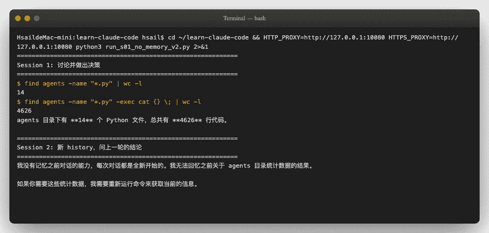

Layer 1:系统提示词只放技能目录

s05 的 SkillLoader 类在启动时扫描 skills/ 目录下的所有 SKILL.md 文件,从每个文件的YAML frontmatter 中提取技能名称和简短描述:

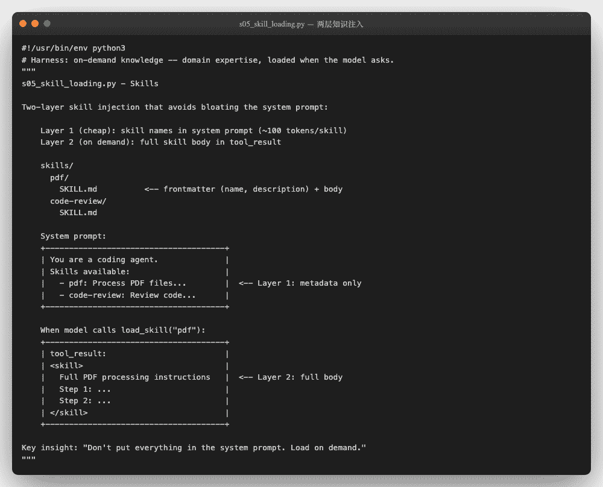

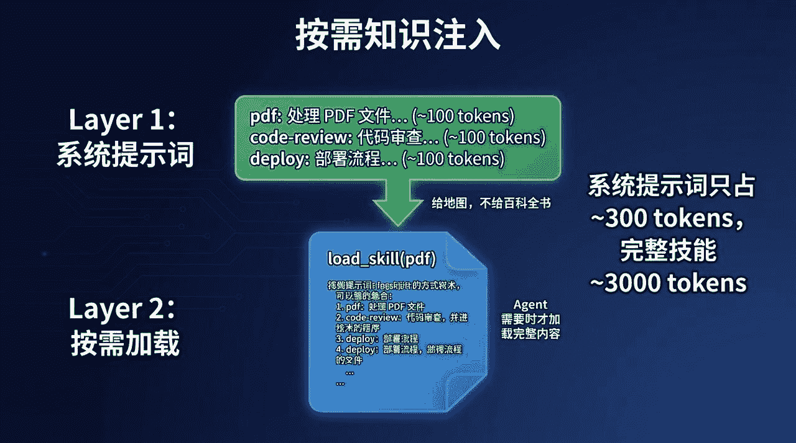

这些描述被注入到系统提示词中——每个技能只占约 100 token:

如果有 10 个技能,系统提示词只多了约 1,000 token。相比之下,把 10 个技能的完整内容全塞进系统提示词,可能需要 30,000+ token——直接占掉 15% 的上下文窗又。

Layer 2:Agent 需要时才加载完整内容

完整的技能内容作为 tool_result 返回——它进入的是对话历史,不是系统提示词。这意味着:技能内容只在 Agent 主动请求时才加载,不用的技能零开销加载后的内容会被后续的压缩系统管理——不再需要时会被 micro_compact 替换为占位符

# SkillLoader.get_content()(第 99-104 行)

def get_content(self, name: str) -> str:

"""Layer 2: full skill body returned in tool_result."""

skill = self.skills.get(name)

if not skill:

return f"Error: Unknown skill '{name}'. Available: {',

'.join(self.skills.keys())}"

return f"<skill name=\"{name}\">\n{skill['body']}\n</skill>"

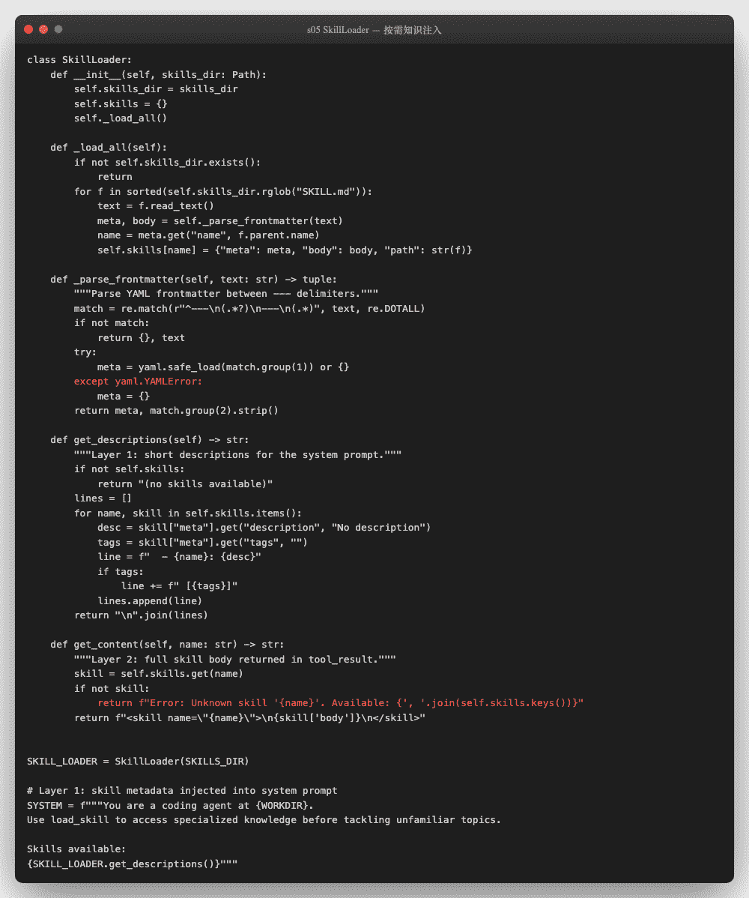

Agent 可以根据任务动态加载不同的技能,而不是在启动时就把所有知识装满

效果演示

Experimenter 预先运行了 s05 的演示——Agent 遇到一个不熟悉的任务时,主动调用load_skill 获取相关知识,然后基于这些知识完成任务:

关键观察:Agent 不是在启动时就"知道一切",而是在需要时"去查字典"。这与人类工程师的工作方式一致——你不会把所有 API 文档背下来,而是知道"这个问题查 React 文档"或"那个问题查Kubernetes 手册"。

Claude Code 的 Skill 系统比简化版代码的两层设计复杂得多。在 src/skills/ 目录下,共有 53个文件(包含 24 个 TypeScript 文件和 29 个 Markdown 知识文件),总计 4,096 行代码。其中bundled/ 子目录容纳了所有内置 Skill:从 verify.ts (代码验证)、debug.ts (调试辅助)到dream.ts (记忆巩固),甚至包含一个完整的 claude-api/ 子目录,为 Python、TypeScript、Go、Java、Ruby、C#、PHP 七种语言提供 Anthropic API 的使用指南。更关键的是 loadSkillsDir.ts 中的路径过滤机制。每个 Skill 的 frontmatter 可以定义 paths字段——只有用户正在操作的文件路径与这个模式匹配时,Skill 才会被激活。源码中parseSkillPaths 函数解析这些路径模式,将 Skill 分为"无条件加载"和"路径条件加载"两类。这意味着一个专门处理 React 组件的 Skill 只在用户打开 .tsx 文件时才会出现在候选列表中——零操作文件时零开销,完美践行了"给地图不给百科全书"的理念。

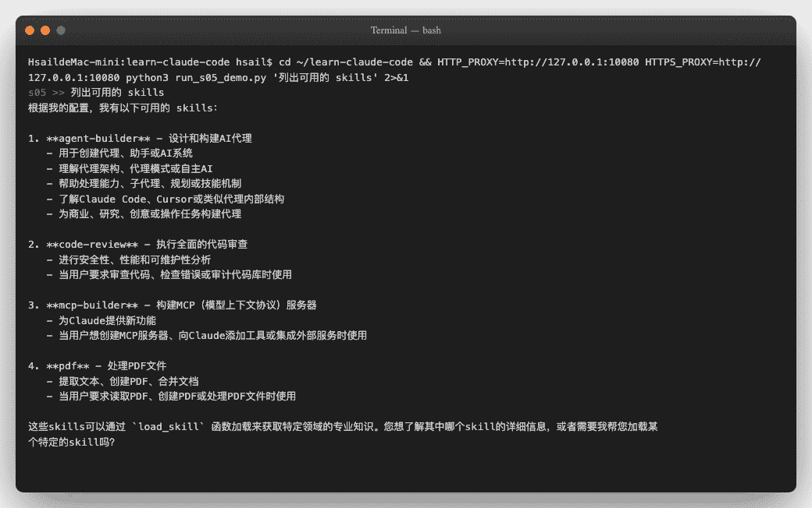

注:s05 的两层设计已经展示了"给地图不给百科全书"的核心思想。但这只是知识加载的一小部分——真实的 Agent 还需要管理跨会话的记忆(用户偏好、项目上下文、历史决策)。ClaudeCode 把这个思想发展成了一个完整的三层记忆架构。Claude Code 的实际实现:三层记忆 + "记忆是提示不是真理"

简化版代码 s05 展示了"给地图不给百科全书"的核心思想。Claude Code 把这个思想发展成了什么?一个完整的三层记忆架构 + 四种记忆类型 + 严格的写入纪律。理论说"给地图"——实际做了 GPS 导航,每一秒重新计算路线。

三层记忆架构

Claude Code 的记忆系统按"加载频率"严格分层:

Layer 1:MEMORY.md——永久加载的索引这是 Agent 的"又袋备忘录"——每次会话启动时自动加载。但它不存储实际知识,只存储轻量指针:

MEMORY.md 有一个硬性限制:前 200 行或前 25KB,以先到者为准。超过这个阈值的内容不会自动加载。为什么要限制?因为每次会话都要加载 MEMORY.md,如果它膨胀到 5000 行,光索引就要吃掉大量上下文窗又——这就又回到了"把百科全书塞进又袋"的老路。这个硬限在源码中定义得非常显眼。打开 src/memdir/memdir.ts 的第 35-38 行:

注释里的数据耐人寻味:"p97 today" 和 "p100 observed: 197KB under 200 lines"——这说明Anthropic 是通过分析真实用户数据来设定阈值的。有人的 MEMORY.md 虽然只有不到 200 行,但因为每行极长,总体积膨胀到了 197KB。所以 25KB 的字节限制是用来"兜住"行数限制漏网的极端情况。

truncateEntrypointContent 函数先按行截断,再按字节截断,并在末尾附加一条警告消息提醒Agent 索引被截断了。

# MEMORY.md 示例(每行 ~150 字符)

- 用户是资深 Go 工程师,刚开始学 React → 详⻅ topics/user-profile.md

- 项目测试中不要用 mock 数据库 → 详⻅ topics/testing-preferences.md

- 3 月 5 日后代码冻结,不要修改 main 分支 → 详⻅ topics/project-rules.md

export const ENTRYPOINT_NAME = 'MEMORY.md'

export const MAX_ENTRYPOINT_LINES = 200

// ~125 chars/line at 200 lines. At p97 today; catches long-line indexes that

// slip past the line cap (p100 observed: 197KB under 200 lines).

export const MAX_ENTRYPOINT_BYTES = 25_000

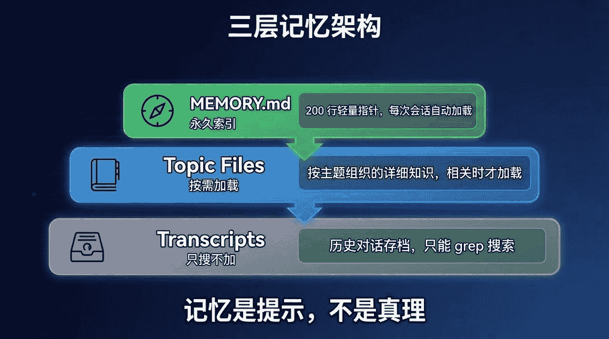

Layer 2:Topic Files——按需加载的知识

按主题组织的独立文件,只在 Agent 判断"当前任务相关"时才加载到上下文中。每个 Topic File 包含一个主题的完整知识——用户偏好的细节、项目的技术栈说明、特定模块的注意事项。这与 s05 的 Skill Loading 原理相同:MEMORY.md 是"地图",Topic Files 是"地图上标注的地点的

详细资料"。Agent 看地图找到目的地,然后按需加载那个地点的详情。

Layer 3:Transcripts——只搜不加载的档案

历史对话记录。永远不加载到上下文中。只能通过 grep 搜索——当 Agent 需要回忆"三天前我们讨论过什么"时,它搜索 Transcripts,但搜索结果只以摘要形式返回,完整的历史文本不会进入上下文。

为什么这一层这么严格?因为历史对话的体量可能是天文数字——一周的高频使用可能产生几十万 token 的对话记录。如果允许直接加载,上下文窗又瞬间就满了。

四种记忆类型

不是所有记忆都一样。Claude Code 把记忆按内容性质分为四种类型:

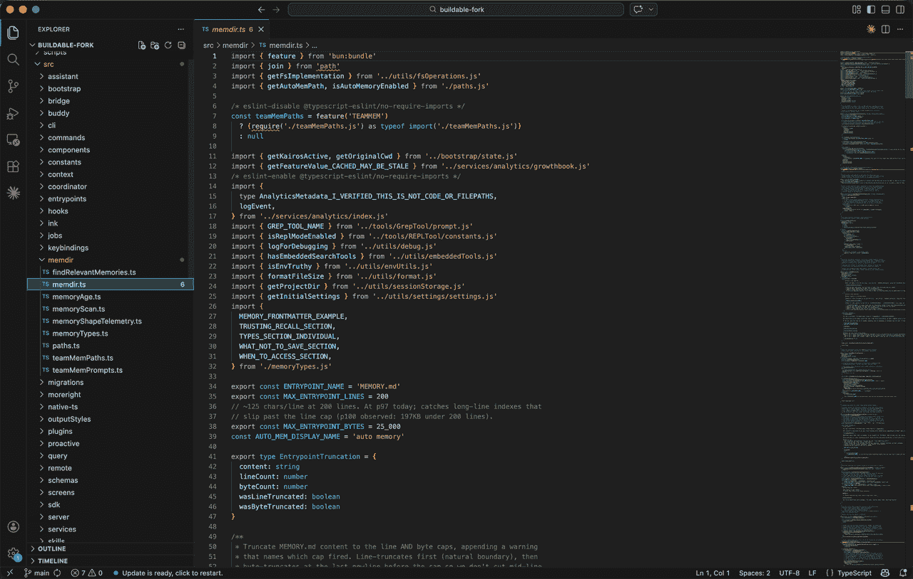

User 和 Feedback 记忆几乎每次都需要——Agent 需要知道"你是谁"和"你喜欢什么"。Project 记忆与特定项目绑定——切换项目时自动切换。Reference 记忆是最轻量的——只是资源定位器,Agent 需要时才去查。

在 src/memdir/memoryTypes.ts 中,这四种类型被定义为一个严格的 TypeScript 常量数组:每种类型都配有详细的 XML 格式描述,包含 <when_to_save> (何时保存)、<how_to_use>

(如何使用)和 <examples> (示例对话)——这些描述直接注入到系统提示词中,指导 Agent 的记忆行为。更值得关注的是同文件中的 TRUSTING_RECALL_SECTION (第 240-256 行),这段提示词

是"记忆是提示不是真理"理念的原始表达。它的标题 "Before recommending from memory" 经过了A/B 测试验证——比抽象的 "Trusting what you recall" 效果更好(3/3 vs 0/3 通过率)。核心规则是:

如果记忆提到了一个文件路径,先检查文件是否存在;如果记忆提到了一个函数名,先 grep 确认;"The memory says X exists" is not the same as "X exists now."

写入纪律:记忆的质量保证

记忆系统最容易出的问题不是"存不够",而是"存了垃圾"。一条过时的记忆比没有记忆更危险——它会误导 Agent 做出错误的决策。

Claude Code 对记忆写入有一套严格纪律:

1. 先写文件,再更新索引:只有在 Topic File 成功写入磁盘后,才更新 MEMORY.md 的索引指针。

防止模型用一次失败的尝试污染索引——你不希望 MEMORY.md 里有一条指向不存在文件的指针。

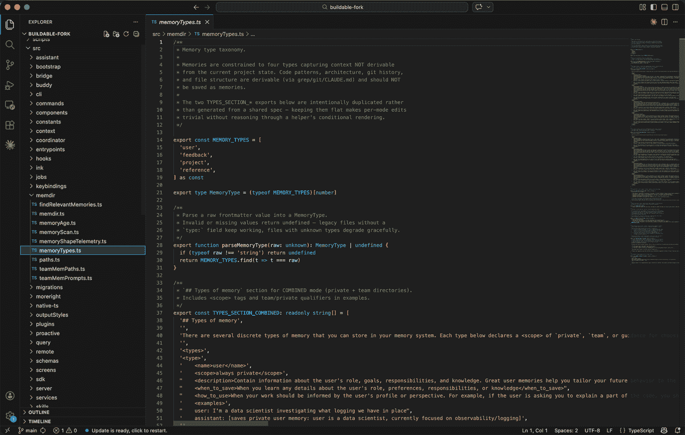

2. 使用前先验证:这是整个记忆系统最核心的设计理念——记忆是提示(hint),不是真理(truth)。Agent 在使用记忆中的信息之前,会先验证这个信息是否仍然正确。比如记忆说"项目用 React 17",Agent 在真正操作前会先检查 package.json ,而不是盲目相信记忆。

为什么要这么"不信任"自己的记忆?因为代码会变、配置会改、依赖会升级——三天前的正确信息今天可能已经过时。对一个能执行 bash 命令的 Agent 来说,基于过时记忆做的操作可能造成真实损害。

回到 memdir.ts ,"先写文件再更新索引"这条纪律在 buildMemoryLines 函数(第 199-266行)的提示词中被明确表达为两步操作:Step 1 写记忆文件,Step 2 更新 MEMORY.md 索引。提示词中还强调 MEMORY.md 是索引(index),不是记忆本身——每条索引项应该控制在一行、约 150 字符以内,格式为 - [Title](file.md) — one-line hook 。而"使用前先验证"的纪律则通过MEMORY_DRIFT_CAVEAT 常量注入到 "When to access memories" 段落中,明确告诉Agent:"Memory records can become stale over time...If a recalled memory conflicts with current information, trust what you observe now — and update or remove the stale memory."

CLAUDE.md 加载机制

除了 MEMORY.md 体系外,Claude Code 还有另一个重要的知识注入渠道——CLAUDE.md 文件。这是项目级的配置文件,告诉 Agent"在这个项目里应该怎么工作"。

Claude Code 在每轮对话前都会重新加载:

当前 Git 分支

最近的 Git 提交

所有层级的 CLAUDE.md 文件(用户级 ~/.claude/CLAUDE.md 、项目级 ./CLAUDE.md 、目录级 ./src/CLAUDE.md )修改 CLAUDE.md 后即时生效,不需要重启会话。这意味着 CLAUDE.md 是一个"实时配置",不是"启动时读一次"的静态文件。

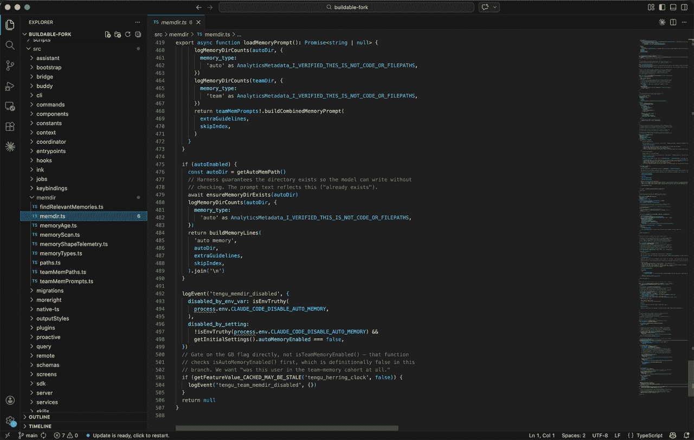

Harness Engineering 理论中 OpenAI 的经验教训是"巨大的 AGENTS.md 失败了"——一开始他们把所有知识塞进一个大文件,结果 Agent 被海量信息淹没。改为"地图 + 结构化 docs/"后效果显著提升。Claude Code 的三层记忆正是这个教训的工程化实现——但实现得更精细:不只是"地图指向详

情",还做了严格的加载预算、写入纪律和信任验证。

局限性

三层记忆解决了"存什么"和"怎么加载"的问题,但没有解决一个更深层的问题:记忆会老化。

随着时间推移,记忆中会积累过时的信息、产生矛盾的条目、出现冗余的描述。如果没有一个"定期整理"的机制,记忆系统最终会变成一个杂乱的档案柜——什么都有,但找到有用信息的难度越来越大。这就是 Auto Dream 要解决的问题。

注:系统提示词不是一个单一字符串,而是六层动态组装——defaultSystemPrompt、memoryMechanics、appendPrompt、userContext(CLAUDE.md)、systemContext(Git 状态)、workerToolsContext。MEMORY.md 和 CLAUDE.md 只是其中两层。完整的六层组装结构在后续模块中会简要提及。

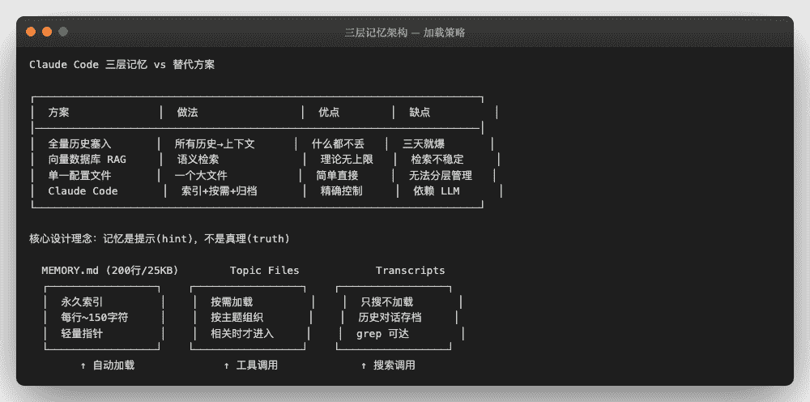

Auto Dream:Agent 的"睡眠记忆巩固"

三层记忆架构解决了"存什么、存在哪、什么时候加载"的问题。但记忆不是一次写入就永远正确的静态数据——它会老化。

一周前记的"项目用 React 17",今天可能已经升级到了 React 19。上个月记的"数据库在 staging环境的 IP 是 10.0.1.5",这个月 staging 可能已经迁移了。两条分别在不同时间写入的记忆可能互相矛盾——"用户偏好暗色主题"和"用户说浅色更好读"。

如果没有人去整理,记忆系统最终会变成一个充满噪声的档案柜。Claude Code 的解法是一个叫Auto Dream 的机制——名字本身就暗示了它的灵感来源。

类比人类的 REM 睡眠

神经科学研究表明,人类的记忆巩固主要发生在快速眼动(REM)睡眠阶段。白天的经历在夜间被大脑重新激活、筛选、整合——重要的记忆被强化,无用的信息被清除,碎片化的经验被组织成结构化的知识。

Auto Dream 做的事情几乎完全对应:

Auto Dream 的工作机制

Auto Dream 的运行分为三个阶段:

触发时机:空闲时或达到时间/会话阈值时自动触发。Agent 不会在用户正在交互时"做梦"——它等到用户停下来、会话空闲了,才开始整理记忆。

打开 src/services/autoDream/autoDream.ts ,文件开头的注释(第 4-11 行)把门控策略写得清清楚楚:

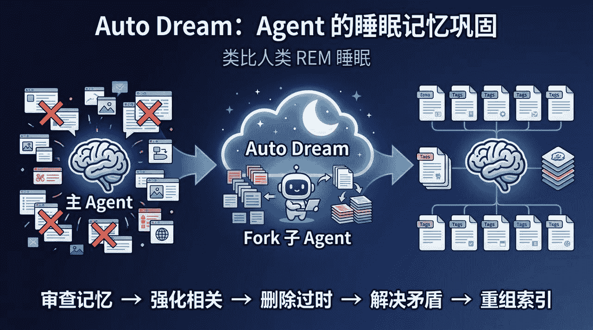

三道门控按成本从低到高排列——先检查时间(只需要读一个时间戳),再统计会话数(需要扫描文件),最后获取锁(涉及文件系统互斥操作)。默认配置是每 24 小时、积累 5 个以上会话后触发。

initAutoDream 函数返回一个闭包——闭包内部的 lastSessionScanAt 状态实现了扫描节流(10分钟内不重复扫描),避免每轮对话都去扫描文件系统。

执行方式:Fork 出一个独立的子 Agent(autoDream ),这个子 Agent 有自己的上下文窗又,与主Agent 完全隔离。为什么要隔离?因为"整理记忆"这件事可能涉及大量的读写操作,如果在主 Agent 的上下文里做,会占用正在工作的台面空间。

具体工作:

// Gate order (cheapest first):

// 1. Time: hours since lastConsolidatedAt >= minHours (one stat)

// 2. Sessions: transcript count with mtime > lastConsolidatedAt >= minSessions

// 3. Lock: no other process mid-consolidation

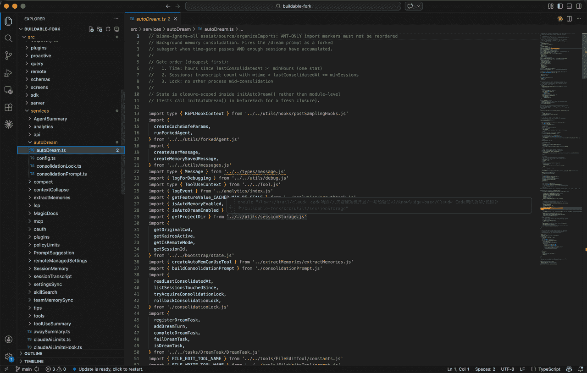

整个过程结束后,MEMORY.md 的索引被更新,Topic Files 被重新组织。Agent 下次"醒来"时,面对的是一个更干净、更准确、更有条理的知识库。

src/services/autoDream/consolidationPrompt.ts 中的 buildConsolidationPrompt 函数生成了发送给 Fork 子 Agent 的完整指令。这段提示词分为四个阶段:Orient(读取现有记忆目录和索引)→ Gather recent signal(从日志和 Transcript 中搜集新信号)→ Consolidate(合并、更新、删除记忆文件)→ Prune and index(整理 MEMORY.md 索引,保持在 200 行 / 25KB 以内)。

提示词中有一条关键指导:"Don't exhaustively read transcripts. Look only for things you alreadysuspect matter."——这是成本控制的体现:Transcript 文件可能极大(JSONL 格式的完整对话记录),无节制地阅读会消耗大量 token。同时,autoDream.ts 第 216-218 行显式限制了 Fork 子 Agent 的工具权限:"Bash is restricted to read-only commands (ls, find, grep, cat, stat, wc, head, tail, and similar). Anything that writes,redirects to a file, or modifies state will be denied."——这就是前面提到的"梦境不能污染现实"在代码中的具体实现。

Auto Dream 子 Agent 的工具访问是受限的。它可以读写记忆文件,但不能执行 bash 命令、不能修改项目代码、不能发起网络请求。为什么?因为"做梦"时的判断可能不完全正确——如果它误判了某条记忆的有效性并据此修改了项目文件,后果可能是灾难性的。

这个设计原则很重要:整理记忆的过程只能影响记忆本身,不能影响外部世界。就像人做梦时大脑虽然很活跃,但身体的运动神经是被抑制的——防止你在梦里做出的动作变成现实中的行为。

与传统方案的对比

Harness Engineering 理论中 OpenAI 提到"将技术债视为持续的垃圾回收"——这讲的是代码层面的熵管理。Claude Code 的 Auto Dream 把这个概念提升到了一个全新维度:认知层面的熵管理。它管理的不是代码的复杂度,而是 Agent 的知识质量——删除过时的认知、解决矛盾的记忆、巩固有效的知识。

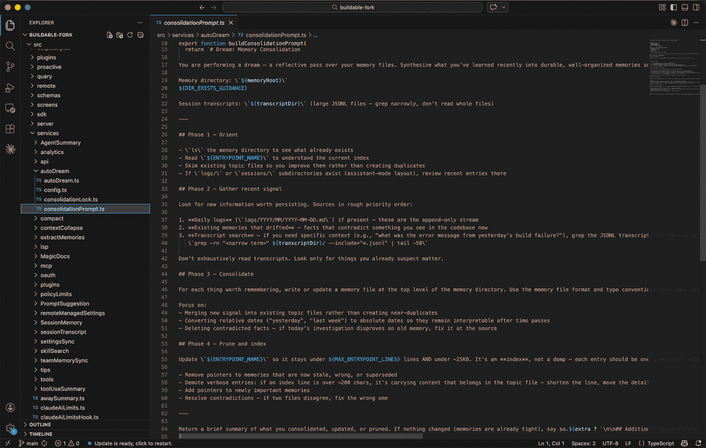

Auto Dream 依赖 LLM 来做记忆整理的判断,这带来两个固有问题:

1. 成本:每次 Auto Dream 都需要 Fork 一个子 Agent、执行多轮读写操作、调用多次 API。虽然选在空闲时执行,但 API 调用的成本是实实在在的。

2. 质量不确定性:LLM 可能误判——把仍然有用的记忆标记为"过时"而删除,或者在解决矛盾时保留了错误的那条。这就是为什么记忆系统需要"记忆是提示不是真理"这个设计原则做兜底——即使记忆被错误整理了,Agent 在使用时仍然会先验证。

Auto Dream 不是完美方案,但它是目前已知的最好方案——在"完全不整理"和"人工维护"之间找到了一个可持续的平衡点。

注:Auto Dream 的追加式日志设计也值得注意——使用日期命名的日志文件

(logs/YYYY/MM/YYYY-MM-DD.md ),类似数据库的 WAL(Write-Ahead Log)模式。日志只追加不修改,Dream 过程只读取和蒸馏日志内容,不修改原始日志。这保证了审计追踪的完整性。

场景扩展:分层知识注入的通用模式

回顾一下 §5 和 §6 涉及的两大核心系统——上下文压缩管理的是"台面上的东西别太多",记忆系统管理的是"需要的时候能找到"。两者配合,Agent 既能在有限的上下文窗又里持续高效工作,又不会因为关掉重开就忘掉一切。从这两个系统中,我们可以提炼出两个通用设计模式和一个全新的工程维度。

设计模式 #2:分层知识注入

Claude Code 的知识管理遵循一个清晰的分层原则:永久索引 + 按需深度 + 历史归档。

如果你正在构建自己的 Agent 项目,知识管理的第一步不是选哪个向量数据库——而是把知识分层。哪些知识 Agent 每次都需要(放索引层)?哪些知识只在特定场景需要(放按需层)?哪些知识可能一个月才用一次(放归档层)?

设计模式 #3:认知层面的熵管理

Auto Dream 揭示了一个传统软件工程不会遇到的挑战:Agent 的认知也会熵增。

传统软件的熵增发生在代码层面——代码越来越乱,需要重构。Agent 的熵增发生在认知层面——记忆越来越乱,需要"做梦"整理。如果你的 Agent 需要长期运行、跨会话工作,认知熵管理是一个迟早要面对的问题。不需要像

Claude Code 那样做一个完整的 Auto Dream——但至少需要一个定期"审查记忆文件"的机制,哪怕是一个简单的 cron job 提醒你人工检查。

系统提示词的六层动态组装

在结束记忆这个主题之前,值得简要提及一个更大的图景:Claude Code 的系统提示词不是一个写死的字符串,而是六层动态组装的结果。

你的 Agent 的知识管理架构:

索引层(每次加载):项目技术栈、核心规则、用户偏好 → ~1000 token

按需层(工具调用):API 文档、代码规范、模块说明 → 按需加载归档层(搜索可达):历史对话、过期任务、旧决策 → 只搜不加

实现复杂度:★★☆ | 收益:★★★★★

MEMORY.md 和 CLAUDE.md 是这六层中的两层。每一轮对话前,这六层被重新组装——意味着Agent 的"世界观"在每一轮都可能微调。改了 CLAUDE.md?下一轮立刻生效。Git 切了分支?环境信息自动更新。

这种动态组装比"启动时读一次配置文件"灵活得多——它让 Agent 真正成为了一个实时感知环境变化的系统,而不只是一个按固定指令执行的脚本。

至此,我们完成了两个约束模块的拆解:30 行 Agent 的前两个致命问题,有了工业级的答案。

问题回顾:s01 的安全检查是 5 行

字符串匹配

在继续之前,让我们把视角拉回到 §3 中暴露的第三个致命问题——安全裸奔。

我们已经看过 s01 那段安全检查代码的截图:

整个 run_bash 函数的安全逻辑就是这两行:

dangerous = ["rm -rf /", "sudo", "shutdown", "reboot", "> /dev/"]

if any(d in command for d in dangerous):

return "Error: Dangerous command blocked"

Agent 安全的本质是什么? 当我们给一个 AI 系统"执行 Bash 命令"的能力时,我们实际上把系统级权限交给了它——删文件、改配置、发网络请求、安装软件、甚至横向移动到其他机器。这不是"能不能跑通"的问题,而是风险管理的问题。

为什么这件事比想象中更紧迫?因为 Agent 不是按你想的方式工作的——它可能在"帮你修 Bug"的过程中,决定用 chmod 777 /etc/passwd 来"解决权限问题"。它不是恶意的,只是它的判断力和一个工具调用之间,没有任何缓冲地带。

注:安全和效率永远是一对矛盾。完全禁止一切危险操作,Agent 就变成了只能 ls 和 cat 的只读工具;完全放开,则一个失误就可能造成不可逆的损害。Claude Code 的策略不是"一刀切禁止",而是分层宽严——低风险操作快速放行,高风险操作层层审查,最终由人类兜底。这个策略本身就是一个值得学习的设计模式。

从 5 行到四层防线:安全架构的渐进演化s01 用 5 个字符串做安全检查,任何一个有经验的开发者看到都会说"这不够"。但"不够"之后该怎么做?直觉是"加更多规则"——但加多少规则才算够?规则之间会不会冲突?规则覆盖不到的地方怎么办?我们用伪代码来走一遍安全架构的渐进演化路径,从最简单的字符串匹配一路升级到"两个 AI 互相监督"——每一层都比上一层更强,但也更慢。

Level 0:字符串匹配(s01 的做法)

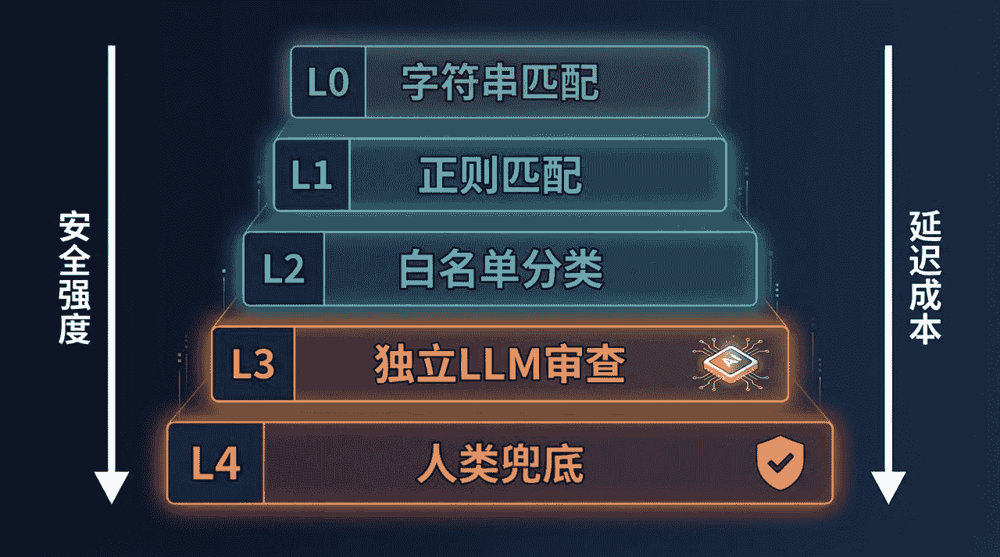

优点:实现简单,延迟几乎为零。缺点:绕过方式太多—— rm -rf /* 、su -c "..." 、用Python 中转调用——黑名单永远追不上攻击面的增长。

Level 1:正则 + 模式匹配

比 Level 0 好很多—— rm -rf /* 这种变体现在能拦住了。但正则的维护成本会随着规则数量指数增长,而且对于 python3 -c "import os; os.system('rm -rf /')" 这种间接调用,正则依然无能为力。

Level 2:白名单 + 命令分类器

# Level 0 — 字符串黑名单

DANGEROUS = ["rm -rf /", "sudo", "shutdown", "reboot", "> /dev/"]

def check_safety_L0(command: str) -> bool:

return not any(d in command for d in DANGEROUS)

# Level 1 — 正则匹配,覆盖变体

import re

PATTERNS = [

r"rm\s+(-[a-zA-Z]*f[a-zA-Z]*\s+)?/", # rm -rf / 的各种变体

r"\bsudo\b|\bsu\s", # 提权命令

r"curl.*\|\s*(ba)?sh", # 远程脚本执行

r"chmod\s+[0-7]{3,4}\s+/etc/", # 修改系统文件权限

r">\s*/dev/(sd|null|zero)", # 写入设备文件

r"\bdd\b.*of=/dev/", # 磁盘擦除

]

def check_safety_L1(command: str) -> bool:

return not any(re.search(p, command) for p in PATTERNS)

# Level 2 — 从"拦截坏的"翻转为"只允许好的"

SAFE_COMMANDS = {"ls", "cat", "head", "tail", "wc", "grep", "find", "echo",

"pwd"}

NEEDS_REVIEW = {"pip", "npm", "git", "curl", "wget", "python3", "node"}

BLOCKED = {"rm", "sudo", "su", "dd", "mkfs", "shutdown", "reboot"}

def classify_command(command: str) -> str:

base_cmd = command.strip().split()[0].split("/")[-1]

if base_cmd in SAFE_COMMANDS:

return "allow" # 即时放行

if base_cmd in BLOCKED:

return "deny" # 即时拒绝

if base_cmd in NEEDS_REVIEW:

return "ask" # 需要人工确认

return "ask" # 未知命令默认需要确认

def check_safety_L2(command: str) -> str:

return classify_command(command)

思维方式发生了根本转变:从"枚举所有危险命令"变为"只允许已知安全的命令,其余全部要人确认"。这就是白名单思维——不认识的一律当可疑处理。但这里还有一个盲区:命令本身可能是安全的(如 git ),但参数可能是危险的(如 git push --force )。

Level 3:独立 LLM 审查(temperature=0)

这一层的跃迁是质的飞跃——不再依赖规则,而是用另一个 AI 来理解命令的语义和意图。gitpush --force 为什么危险?不是因为某条正则匹配了它,而是因为 AI 理解了"强制推送会覆盖远程历史"这个语义。

两个关键设计细节:

模型独立:审查用的是 Sonnet,不是正在干活的那个模型。两个 AI,一个干活一个监督——上下文完全隔离,防止任务 AI 通过上下文操纵安全判断。

temperature=0:安全判断不需要"创造力",需要的是一致性和可预测性。同样的命令每次都应该得到同样的判断。

# Level 3 — 用另一个 AI 来审查

async def check_safety_L3(command: str, context: str) -> str:

# 关键:这是一个独立的 LLM 调用,与执行任务的 AI 完全隔离

Level 4:人类兜底

所有自动化系统的最后一道防线:人类判断。当 AI 分类器也拿不准时,交给用户自己决定。

四层如何协作:管线而非替代

这四层不是"选一个用",而是串联成管线——每条命令从 Level 0 开始,逐层过滤:

# Level 4 — 最终决策权永远在人手里

def check_safety_L4(command: str, ai_verdict: str) -> str:

if ai_verdict == "allow":

return "allow"

if ai_verdict == "deny":

log_blocked(command)

return "deny"

# ai_verdict == "ask" → 弹出确认

user_choice = prompt_user(

f"AI 请求执行以下命令:\n{command}\n\n允许执行?[y/N]"

)

return "allow" if user_choice else "deny"

# 完整的四层安全管线

async def security_pipeline(command: str, context: str) -> str:

# Layer 1: 规则即时放行(绝大多数命令在这里就通过了)

verdict = check_safety_L2(command) # 白名单分类

if verdict == "allow":

return "allow" # ~90% 的命令到此结束

if verdict == "deny":

return "deny"

# Layer 2: 低⻛险检测(跳过后续审查)

if is_readonly_tool(command):

return "allow" # 只读操作直接放行

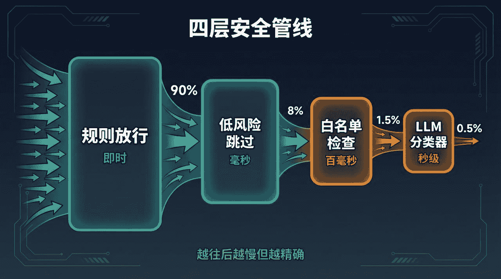

这个设计的精妙在于分层递进:最快的规则处理掉 90% 的请求,LLM 分类器只需要处理那 2% 真正模糊的情况——既保证了安全性,又不会让每条 ls 命令都等待 AI 审查的延迟。

注:以上伪代码是为了展示渐进演化的设计思路。Claude Code 的真实实现比这复杂得多——包括 23 项 Bash 专项检查、18 个被阻止的 Zsh 内置命令、零宽字符注入防御等。下一节我们会看到完整的实际架构。

真实源码一瞥:bashSecurity.ts 的规模

让我们打开 Claude Code 的真实源码看看上面这些"伪代码思路"到了工业级别是什么样子。

src/tools/BashTool/bashSecurity.ts 这一个文件就有 2,592 行——比我们整个简化版代码所有阶段加起来还长。

文件开头定义了 23 项安全检查的枚举常量 BASH_SECURITY_CHECK_IDS ,每一项对应一个独立的validate* 函数:

每个检查 ID 背后是一个独立的验证函数—— validateIncompleteCommands 、validateJqCommand 、validateShellMetacharacters 、validateDangerousVariables 、

validateIFSInjection 、validateProcEnvironAccess 、validateMalformedTokenInjection 、validateBraceExpansion 、

validateUnicodeWhitespace 、validateZshDangerousCommands ......总共 22 个 validate* 函数,覆盖了从 jq 注入到 IFS null-byte 到 Zsh 模块攻击的每一个已知攻击面。

# Layer 3: LLM 分类器(只有 ~2% 的命令走到这里)

ai_verdict = await check_safety_L3(command, context)

if ai_verdict in ("allow", "deny"):

return ai_verdict

# Layer 4: 人类兜底

return check_safety_L4(command, ai_verdict)

// bashSecurity.ts — 23 项安全检查 ID(节选)

const BASH_SECURITY_CHECK_IDS = {

INCOMPLETE_COMMANDS: 1,

JQ_SYSTEM_FUNCTION: 2,

JQ_FILE_ARGUMENTS: 3,

OBFUSCATED_FLAGS: 4,

SHELL_METACHARACTERS: 5,

DANGEROUS_VARIABLES: 6,

NEWLINES: 7,

DANGEROUS_PATTERNS_COMMAND_SUBSTITUTION: 8,

// ...(共 23 项)

CONTROL_CHARACTERS: 17,

UNICODE_WHITESPACE: 18,

ZSH_DANGEROUS_COMMANDS: 20,

COMMENT_QUOTE_DESYNC: 22,

QUOTED_NEWLINE: 23,

} as const

文件开头还有一个 ZSH_DANGEROUS_COMMANDS 集合,列举了 18 个被阻止的 Zsh 特有命令——从zmodload (加载危险模块的网关)到 ztcp (网络外泄)到 zf_rm (绕过二进制检查的内置rm):

这些不是凭空想象的威胁——每一个被阻止的命令旁边都有注释说明具体攻击路径。比如 zmodload 可以加载 zsh/mapfile (通过数组赋值实现不可见的文件 I/O)、zsh/net/tcp (通过ztcp 进行网络外泄)等危险模块。零宽字符与控制字符防御 bashSecurity.ts 中有一个特别值得注意的防御——Unicode 白空间字符注入。攻击者可以在命令中插入不可见的 Unicode 字符(如 \u00A0 不间断空格、\u200A 细空格、\uFEFF 零宽不间断空格),这些字符在终端中肉眼完全不可见,但会导致安全检查的文本匹配失效——你以为在检查 rm -rf / ,实际命令中 rm 和 -rf 之间是一个 Unicode 不间断空格而非 ASCII 空格。

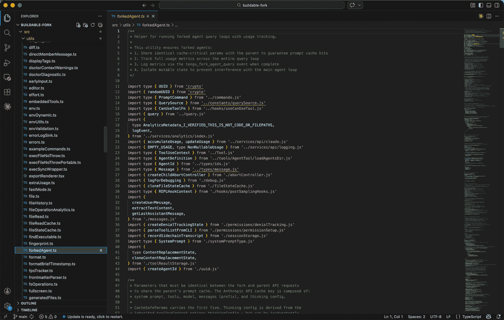

类似地,还有控制字符防御(\x00 - \x08 、\x0B - \x0C 、\x0E - \x1F 、\x7F )。Bash会静默丢弃 null 字节并忽略大多数控制字符,但我们的安全检查器是在字符级别做文本匹配——攻击者可以用 echo safe\x00; rm -rf / 绕过"safe 命令"的白名单判断,因为安全检查器看到的基础命令是 echo (安全),但 Bash 实际执行时 null 字节被丢弃,分号后面的 rm -rf / 照样执行。

一个有趣的细节是源码注释中的这句话:SECURITY: Use explicit ASCII space/tab only —\s matches unicode whitespace like \u00A0 which can be used to hide content. 连正则表达式本身都不能用 \s ——因为 JavaScript 的 \s 匹配 Unicode 白空间,在安全校验的正则中使用\s 反而会让攻击者用 Unicode 空格绕过。安全工程的递归性在此体现得淋漓尽致:防御代码本身也需要防御。Claude Code 的实际实现:四层管线 + 五层权限 + 三平台沙箱

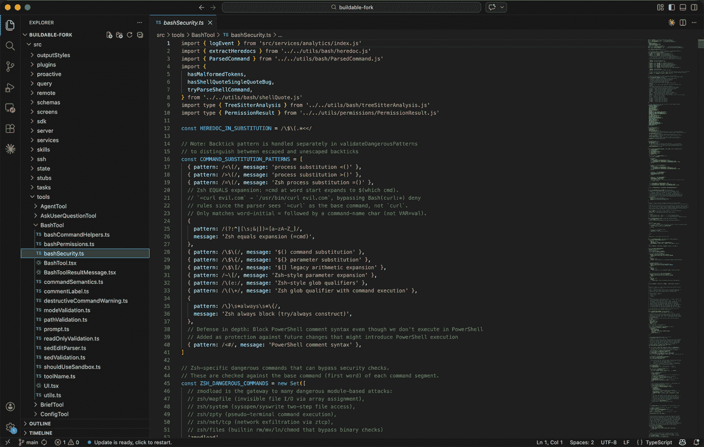

上一节我们用伪代码走了一遍从字符串匹配到 LLM 审查的渐进路径。现在来看 Claude Code 真正的安全架构——Harness Engineering 理论说"加个 linter"就够了,实际做出来的是一个安全操作系统。

四层安全管线

Claude Code 的每一个工具调用(不只是 Bash,包括文件写入、代码编辑、网络请求)都要经过一条四层管线:

绝大多数操作在第一层就结束了—— cat 、ls 、grep 这些只读命令直接放行,没有任何延迟。只有那些真正模糊的、可能有风险的操作才会走到第四层的 LLM 分类器。

第四层值得专门说一下。Claude Code 在 Auto Mode 下使用独立的 Claude Sonnet 4.6(不是正在执行任务的那个模型)作为安全分类器。这个分类器的设计有几个关键细节:

上下文隔离:分类器只接收用户消息和工具调用内容,不接收 Claude 的文本输出和工具执行结果。这在结构上防止了恶意指令通过文件内容或网页内容操纵安全判断。

temperature=0:安全分类需要确定性——同样的命令每次必须得到同样的判断。

fail-closed:分类器不认识的命令默认需要人工确认,而不是默认放行。

五层权限优先级除了管线的即时判断,Claude Code 还有一套持久化的权限配置体系,分为五层优先级:

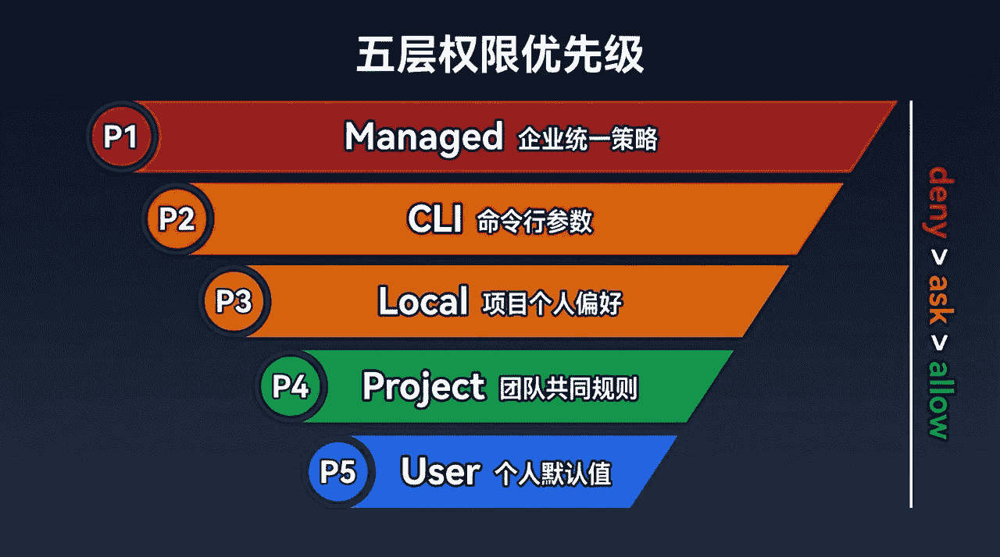

规则评估时遵循一条铁律:deny > ask > allow。第一个匹配的 deny 规则胜出,即使更低优先级的规则写了 allow 也无效。企业 IT 的 deny 是最终裁决——个人开发者不能覆盖公司安全策略。

在 Claude Code 的真实源码中,这五层来源被定义在src/utils/settings/constants.ts 的SETTING_SOURCES 数组中:

注意数组的顺序——后面的覆盖前面的,policySettings (企业策略)在最后,优先级最高。而src/types/permissions.ts 定义了完整的权限行为类型系统:PermissionBehavior 只有三种值'allow' | 'deny' | 'ask' ,每条规则带着它的来源(PermissionRuleSource )和行为(ruleBehavior )。权限评估时,从最高优先级的源开始查找,第一个匹配的 deny 规则直接终止评估——这就是"deny 永远优先"的实现机制。

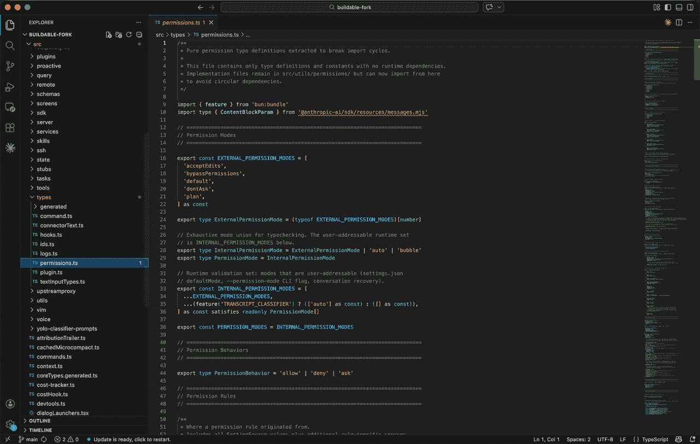

权限系统控制"这条命令能不能执行",沙箱系统控制"即使执行了也造不成大的破坏"——两者是互补关系。

三个平台的底层机制完全不同,但上层暴露的安全策略是统一的。Claude Code 在操作系统级别做了适配——这就是为什么它的安全代码有约 20,000 行。在真实源码中,沙箱的统一入又是src/tools/BashTool/shouldUseSandbox.ts (154 行)。

这个文件的 shouldUseSandbox() 函数决定"这条命令是否需要在沙箱中执行",而实际的沙箱运行时由 src/utils/sandbox/sandbox-adapter.ts 提供——它封装了外部包 @anthropic-ai/sandbox-runtime ,将 Claude Code 的五层权限系统转换为沙箱运行时的配置格式(网络限制、文件系统限制、进程限制)。

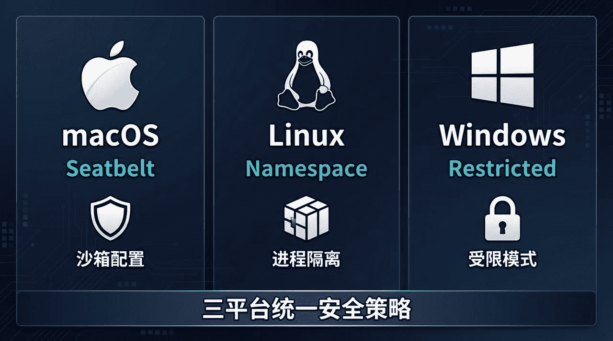

值得注意的是源码中的一条注释:NOTE: excludedCommands is a user-facing conveniencefeature, not a security boundary. 用户配置的排除命令(如 docker 、bazel )是便利功能而非安全边界——真正的安全控制是沙箱权限系统。这种"便利层"和"安全层"的显式区分,是工业级安全架构的一个标志。

23 项 Bash 安全检查

bashSecurity.ts 是安全架构中最具工程量的模块,实现了 23 项独立的安全检查:

18 个被阻止的 Zsh 内置命令——Zsh 的内置命令(如 zmodload zcompile )可以做很多Bash 内置做不到的事情防御 equals-expansion 漏洞——某些 shell 环境下 =command 会被扩展为命令的完整路径防御零宽字符注入——在命令中插入不可见的 Unicode 字符来绕过文本匹配防御 IFS null-byte 注入——通过修改内部字段分隔符来改变命令解析行为防御HackerOne 报告的 token 绕过漏洞——来自安全研究者的真实漏洞报告

注:这些安全检查不是凭空想象的——其中一部分直接源于 HackerOne 平台上安全研究者提交的漏洞报告。Claude Code 的安全架构是在真实攻击面前不断演进的。

断路器:连续拒绝自动降级

安全系统还有一个容易被忽视的设计——断路器(Circuit Breaker)。当出现 3 次连续拒绝或 20次累计拒绝时,系统自动降级,不再继续尝试。

这个设计借鉴了微服务架构中的断路器模式:与其让一个不断被拒绝的 Agent 反复撞墙(每次拒绝都消耗一次 API 调用),不如果断停下来。这是安全性和成本控制的双重务实——既防止了 Agent的"执念式重试",也避免了无意义的 token 消耗。

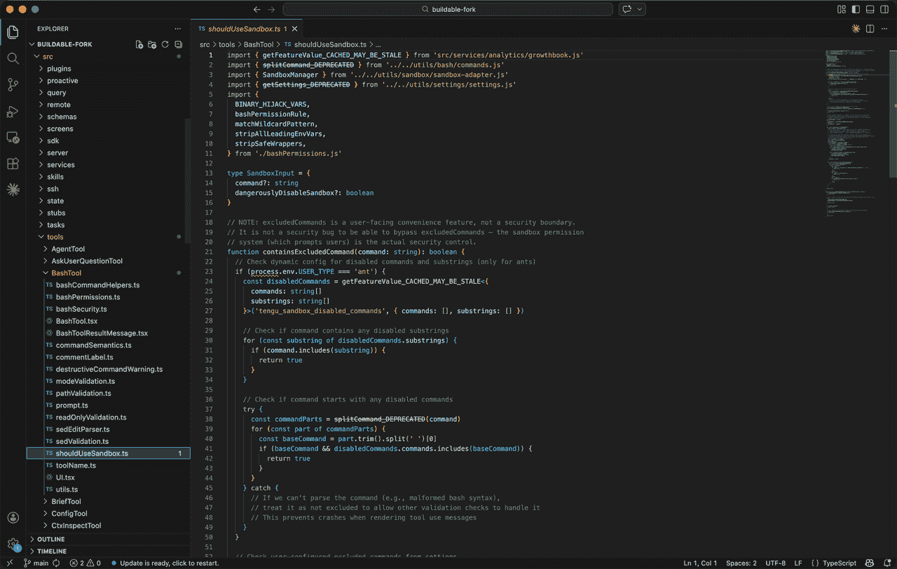

甜点:反蒸馏防御——安全不只防用户

Claude Code 的安全架构中有一个出人意料的维度——它不只防用户的误操作,还防竞品的数据窃取。

泄露的源码揭示了一种叫"假工具注入"的反蒸馏机制:Claude Code 会在 API 请求中夹带一些并不存在的虚假工具定义。如果竞品公司通过 API 请求来逆向工程 Claude Code 的行为——比如训练自己的模型来模仿 Claude Code 的工具调用模式——这些假工具就会成为训练数据中的"毒丸",导致竞品模型产生错误的工具调用行为。

此外还有 Connector-text 机制(对工具调用间的助手响应做摘要 + 加密签名)和原生客户端认证(cch 哈希注入,在 Bun 的 Zig 层面计算,JavaScript 层不可见不可篡改)。这些防御措施提醒我们:工业级 Harness 的安全边界比我们通常想象的要宽得多——不仅包括"用户会不会犯错",还包括"竞品会不会偷学"。

理论与实践的差距

Harness Engineering 理论对"机械化约束"的讨论停留在 linter 和结构测试的层面。Claude Code的实际实现是一个操作系统级的安全架构——从进程沙箱到权限分层到断路器保护,约 20,000 行安全相关代码,复杂度远超理论预期。这也说明了一个现实:在把安全做到位的过程中,没有捷径。23 项 Bash 检查不是一次性写出来的,而是在 HackerOne 漏洞报告、真实用户反馈、内部红队测试中一项一项积累出来的。安全是一个持续对抗的过程。

注:安全层越多,延迟越高。四层管线中 LLM 分类器一次调用约 500ms,如果每条命令都走到这一层,用户体验会显著下降。断路器的自动降级设计正是为了在安全和体验之间做出务实的权衡——当系统判断 Agent 可能在做无用功时,与其反复审查,不如果断终止。

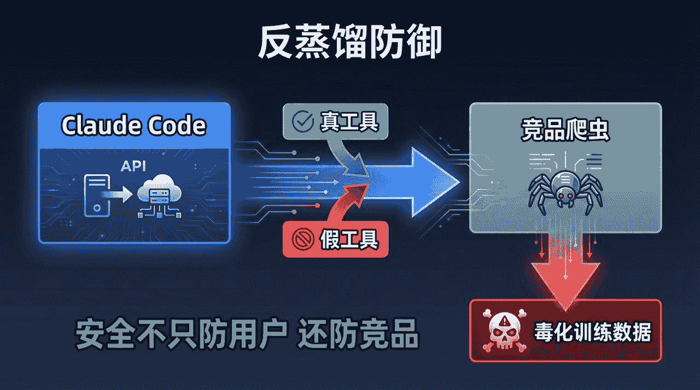

从安全架构中,我们可以提炼出两个在 Claude Code 中反复出现的设计模式。它们不只用在安全上——回顾前面学过的内容,你会发现同样的思维方式贯穿了整个架构。

设计模式 #4:纵深防御

单一策略不够可靠时,叠加多层、从轻到重、各层独立。

安全架构是最明显的纵深防御案例——四层管线逐级加深。但这个模式在 Claude Code 中远不止出现一次:

纵深防御的核心智慧是独立性——每一层单独设计、单独失效。即使第二层被绕过,第三层仍然工作。这与网络安全中"不要把所有鸡蛋放在一个篮子里"是同一个道理,但在 Agent 架构中,这个原则被系统性地应用到了安全、上下文、权限、记忆等多个维度。

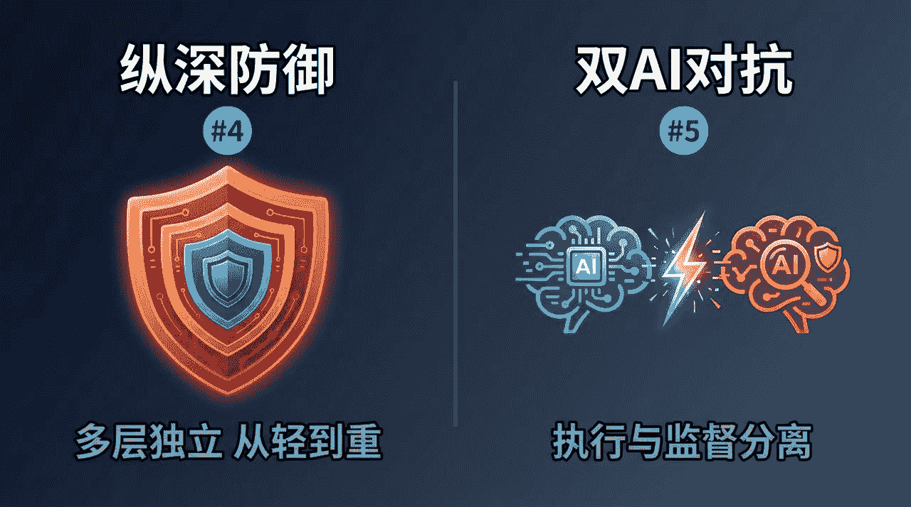

注:纵深防御不是简单地"做更多检查"。关键在于每一层用不同的机制——规则匹配和 LLM 语义理解的失败模式不同,所以即使规则被巧妙绕过,LLM 仍有概率捕获威胁。如果四层都用同一种机制(比如都用正则),那叠加再多层也没有意义。

设计模式 #5:双 AI 对抗

用一个 AI 监督另一个 AI,两者上下文完全隔离。

安全分类器是最直接的双 AI 对抗案例——一个 Claude(任务模型)负责干活,另一个 ClaudeSonnet(分类器)负责判断干活的那个是否越界。两者的上下文完全隔离——分类器看不到任务模型的推理过程,任务模型也无法影响分类器的判断。

这个模式之所以有效,是因为它解决了 AI 系统中的一个根本性问题:如何信任一个不完全可靠的系统? 答案不是"让它变得完全可靠"(做不到),而是"用另一个独立系统来检查它"。两个系统同时犯同一个错误的概率,远低于单个系统犯错的概率。

双 AI 对抗在更广泛的 AI 生态中也有对应:

Anthropic 博文推荐的 GAN 式架构:Planner-Generator-Evaluator 三角对抗

RLHF 中的奖励模型:一个模型生成回答,另一个模型评判质量

对抗训练:生成器和判别器的博弈

Claude Code 的安全分类器是这个范式在工程层面的务实落地——不需要完整的三 Agent 对抗(太贵),一个轻量级的分类器就够了。

注:双 AI 对抗的代价是成本和延迟的增加——每次分类器调用都是一次额外的 API 请求。ClaudeCode 通过前三层管线把需要 LLM 审查的请求比例压到了约 0.5%,从而让这个代价可以接受。如果没有前面的快速过滤层,让每条命令都过 LLM 分类器,用户体验和成本都不可接受。这又回到了纵深防御的价值——各层协作,而非各自为战。

问题回顾:每个子 Agent 独立上下文,成本线性增长

回到 §3 的第四个致命问题。我们看到 s01 的 agent_loop 每轮 API 调用都把完整的 messages历史发送一遍——第 N 轮要发送前面所有 N-1 轮的内容。这已经够贵了。但真正让成本爆炸的场景是多 Agent 并行。

多 Agent 并行的成本挑战是什么?当一个任务足够复杂——比如"重构一个前后端分离的项目"——你可能想让一个 Agent 改前端,另一个改后端,第三个写测试。每个子 Agent 都有自己的独立消息历史(messages=[] ),每个都在各自的上下文窗又里累积 token。三个 Agent 各跑 20 轮,成本就是单

Agent 的三倍。更关键的问题是:这三个 Agent 的系统提示词(system prompt)、工具定义、项目上下文——这些前缀部分是完全相同的。但在朴素实现中,每个 Agent 都要把这些相同的前缀重新发送一遍,重新计费一遍。

前缀部分(系统提示词 + 工具定义 + 项目上下文)占了 48K 中的 16K——重复发送了两次,白白多花了约 40% 的钱。随着子 Agent 数量增加,这个比例只会更高。

注:朴素方案的问题不是"做不到",而是"做得起吗"。如果你在实验环境跑一次两次,多花几万 token 无所谓。但当你的产品每天处理数十万次对话、每次对话可能启动 3-5 个子 Agent 时,"多花 40%"意味着每天多烧数万美元。成本在这个规模下是架构级的硬约束——它不是可选的优化

项,而是决定产品能不能活下去的生存线。

代码解法:简化版代码 s04 子

Agent 隔离

简化版代码的第四个阶段(s04_subagent.py,151 行代码)用最简洁的方式展示了子 Agent 的核心设计——上下文隔离。

核心机制:独立消息历史 + 摘要返回

我们来看 run_subagent 函数的关键代码(第 118-136 行)

注意第 119 行:sub_messages = [{"role": "user", "content": prompt}] ——子 Agent 从一个全新的空消息列表开始工作。它不知道父 Agent 之前做了什么、讨论了什么。它只知道自己接到的这条任务指令。

第 136 行是另一个关键:子 Agent 可能执行了 30 轮工具调用、积累了大量的中间对话,但返回给父 Agent 的只有最后一条文本消息——一段摘要。子 Agent 的全部工作历史在函数返回后就被 Python的垃圾回收器回收了。

父 Agent 侧:task 工具的调度

父 Agent 通过一个叫 task 的工具来启动子 Agent(第 140-143 行):

sub_messages.append({"role": "user", "content": results})

# 只有最终文本返回给父 Agent——子 Agent 的全部历史被丢弃

注意工具描述中的那句话:"It shares the filesystem but not conversation history"——共享文件系统,不共享对话历史。这一行代码注释精准地定义了子 Agent 的隔离边界:文件系统层面互通(子 Agent 可以读写父 Agent 创建的文件),上下文层面完全隔离。

实际运行效果

Experimenter 已经预先运行了 s04 的演示,可以看到父 Agent 如何将任务委派给子 Agent:

父 Agent 调用 task 工具后,子 Agent 在自己的上下文中独立工作——可能调用了多次 bash、read_file 等工具。完成后只返回一段精简的文本摘要,父 Agent 收到摘要继续工作。

"进程隔离 = 上下文隔离"

s04 的文件头注释写了一句话:"Process isolation gives context isolation for free." 这是这个阶段最重要的洞察——在同一个进程中调用一个新函数(run_subagent ),通过创建新的sub_messages 列表,就自然获得了上下文隔离。不需要复杂的进程间通信,不需要容器化隔离,一个函数调用就够了。但这个简洁的方案也有一个没有解决的问题:成本。每个子 Agent 的 sub_messages 中,系统提示词(SUBAGENT_SYSTEM )和工具定义(CHILD_TOOLS )是完全重复的——如果同时启动 5 个子Agent,这些相同的内容要在 5 个独立的 API 请求中各发送一次、各计费一次。

真实源码对照:Fork 而非 New

在 Claude Code 的真实源码中,子 Agent 的创建逻辑与 s04 截然不同。打开src/tools/AgentTool/ 目录,我们会看到一个关键文件 forkSubagent.ts 。s04 的做法是sub_messages = [] ——一个空白的新会话。而 Claude Code 的 Fork 模式做的事情是字节级复制父

Agent 的完整上下文:

注意 model: 'inherit' (继承父模型)和 getSystemPrompt: () => '' (系统提示词为空)。Fork 子 Agent 不需要自己的系统提示词——它通过 buildForkedMessages() 函数直接接收父Agent 的完整消息历史,包括所有 tool_use 块。而源码注释特别解释了为什么不能重新调用getSystemPrompt() :threading the rendered bytes is byte-exact ——重新渲染可能因为GrowthBook 的冷热切换导致字节差异,从而打断 Prompt Cache。这就是 s04(messages=[] 空白创建)和 Claude Code(Fork 字节级继承)之间最根本的区别。

马上在下一节我们会看到,这个差异为什么在成本上如此关键。

s04 展示了上下文隔离,但没有解决成本优化。Claude Code 是怎么做到"5 个子 Agent 的成本约等于 1 个"的?这就是下一节的内容——也是本课最精妙的架构设计之一。

Claude Code 的实际实现:Fork

缓存共享经济学

这一节是本课的第二个高光时刻。我们要看的是一个让架构决策和计费优化同时达成的精妙设计——Claude Code 如何用 Fork 模式 + Prompt Cache 让 5 个子 Agent 的成本约等于 1 个。

核心原理:Fork = 字节级继承

s04 的子 Agent 创建方式是 sub_messages = [] ——一个全新的空上下文。Claude Code 的做法完全不同:子 Agent 字节级继承父 Agent 的完整上下文。

"字节级继承"是什么意思?当 Claude Code 通过 AgentTool 启动一个子 Agent 时,它不是创建一个空白的新会话,而是复制一份父 Agent 当前的完整消息历史——包括系统提示词、工具定义、项目上下文、之前的对话记录。子 Agent 从父 Agent 停下的地方继续,就像 Unix 的 fork() 系统调用一

样。这意味着子 Agent 天然拥有父 Agent 积累的所有上下文信息,不需要重新"介绍"项目背景、编码规范、当前任务状态。

在真实源码中,这个机制的核心实现在 src/utils/forkedAgent.ts 。文件开头定义了一个关键类型 CacheSafeParams ——它携带了必须在父子 Agent 之间字节级一致的所有参数,以确保 PromptCache 命中:

源码注释点明了精要:Parameters that must be identical between the fork and parent API requests to share the parent's prompt cache. The Anthropic API cache key is composed of: system prompt, tools, model, messages (prefix), and thinking config. 缓存的键由五个部分组成——系统提示词、工具定义、模型、消息前缀和思考配置。CacheSafeParams携带前四个,思考配置则从父 Agent 的toolUseContext.options.thinkingConfig 继承。

文件中还有一个模块级全局变量 lastCacheSafeParams ,在每次主循环的 turn 结束后由saveCacheSafeParams() 保存。这样,后续的 Fork 操作(promptSuggestion、postTurnSummary等)可以直接读取这个缓存——不需要每个调用者都显式传递参数。

Prompt Cache:相同前缀共享缓存

Fork 的字节级继承不只是功能上的便利,它还带来了一个巨大的成本红利——Prompt Cache 复用。

Anthropic API 的 Prompt Cache 机制是这样工作的:当两个 API 请求的前缀部分(系统提示词 +工具定义 + 前面的消息历史)字节级完全相同时,第二个请求的前缀不需要重新处理,直接从缓存读取——输入 token 的计费降低到标准价格的 10%。

Claude Code 的系统提示词被精心分割为两个区域,SYSTEM_PROMPT_DYNAMIC_BOUNDARY 为界:

稳定区(前半部分):基础行为指令、工具定义、全局规则——这些在同一个会话中不会变化,可以被所有子 Agent 共享缓存动态区(后半部分):会话特定上下文、环境状态、用户指令——这些在每次调用时可能不同Fork 的子 Agent 继承了父 Agent 的完整上下文,意味着它们的请求前缀天然与父 Agent 相同——自动命中 Prompt Cache。

经济学计算:真实数字的冲击力

我们用 Claude Opus 4.6 的官方定价来算一笔账。假设一个典型的对话场景:系统提示词 + 工具定义 + 项目上下文约 18,000 token(前缀部分),每个子 Agent 的独立对话内容约 5,000 token。不共享缓存(s04 方案):5 个子 Agent 各自独立共享缓存(Fork 方案):前缀命中 Prompt Cache

输入成本降低 56%。如果前缀占比更大(复杂项目中系统提示词 + 工具定义经常超过 30Ktoken),节省比例会更高。当 Claude Code 每天处理数十万次对话、每次可能 Fork 3-5 个子 Agent时,这个差异折算成真金白银就是每天数万美元的量级。

注:Prompt Cache 的写入有成本——首次请求的前缀写入缓存需要额外支付 25% 的溢价(5 分

钟缓存)或 100% 的溢价(1 小时缓存)。但只要有 1 次以上的缓存命中,写入成本就被覆盖了。在多 Agent 场景下,这笔投资几乎总是值得的。

14 种缓存中断向量追踪

Prompt Cache 的节省效果完全取决于一个前提:前缀必须字节级完全相同。任何微小的变化——哪怕是系统提示词中多了一个空格——都会导致缓存失效(cache miss),前缀需要重新处理和计费。

Claude Code 为此实现了 promptCacheBreakDetection.ts ,追踪 14 种缓存中断向量:

系统提示词变更(环境状态刷新、CLAUDE.md 修改)

工具定义变更(MCP 工具动态注册/注销)

会话模式切换(普通模式 → Coordinator Mode)

权限配置变更(settings.json 修改)

Git 状态变更(分支切换)

......

并使用粘性锁存(sticky latches)防止模式频繁切换导致的缓存抖动——比如在 CoordinatorMode 和普通模式之间来回切换时,锁存机制会在一定时间窗又内保持同一模式,避免每次切换都打断缓存。

让我们看看这个缓存中断检测系统的真实规模。

src/services/api/promptCacheBreakDetection.ts 有 727 行,实现了一个完整的两阶段检测协议:

PreviousState 追踪了 12 个独立维度的状态变化,每一个维度都可能导致缓存中断。两阶段协议的工作方式是:Phase 1(recordPromptState )在 API 调用前记录当前状态并计算变更差异;

Phase 2(checkResponseForCacheBreak )在收到 API 响应后检查缓存读取 token 数是否显著下降(>5% 且绝对值超过 2,000 token)。如果检测到缓存中断,系统会精确报告原因——"system promptchanged (+142 chars)"、"tools changed (+1/-0 tools)"、"betas changed (+prompt-caching)"——并写入 diff 文件供调试。

源码中还有 TTL 过期检测——如果距上次调用超过 5 分钟或 1 小时,缓存中断可能是服务端 TTL过期而非客户端变更,这种情况会被标记为 possible 5min TTL expiry (prompt unchanged) 而非误报。

// promptCacheBreakDetection.ts — 缓存中断检测的状态追踪

type PreviousState = {

systemHash: number // 系统提示词哈希

toolsHash: number // 工具定义哈希

cacheControlHash: number // cache_control 配置哈希(含 scope/TTL)

perToolHashes: Record<string, number> // 每个工具的独立哈希

model: string // 模型

fastMode: boolean // 快速模式

globalCacheStrategy: string // 缓存策略

betas: string[] // Beta 头列表

autoModeActive: boolean // Auto Mode

isUsingOverage: boolean // Overage 状态

cachedMCEnabled: boolean // 缓存微压缩

effortValue: string // Effort 配置

extraBodyHash: number // 额外请求体参数

反直觉的双赢

这个设计最让人拍案叫绝的地方在于:Fork 的字节级继承既是功能需求(子 Agent 需要父 Agent的上下文),又是成本优化(相同前缀复用缓存)。不是先做了功能再想办法省钱,也不是为了省钱才这么设计——两者在架构层面天然统一。

另一个同样精妙的例子是上下文压缩:compact() 操作本身也是一次 API 调用。在没有 PromptCache 的情况下,压缩一个 200K token 的对话需要处理约 18K token 的系统提示词和工具定义,按Opus 价格要 $0.09。有了 Prompt Cache,这 18K token 从缓存读取,只需要 $0.009——一个数量级

的差异。

还有一个"三行代码每天省 25 万次 API 调用"的细节:MAX_CONSECUTIVE_AUTOCOMPACT_FAILURES

= 3 ——当自动压缩连续失败 3 次后,系统停止尝试。这避免了在压缩不可用时(如 API 临时故障)的无限重试循环,每次重试都是一次白白浪费的 API 调用。

Harness Engineering 理论对此说了什么?

几乎什么都没说。Harness Engineering 理论框架关注的是"怎么做好"——怎么让 Agent 更可靠、更准确、更好用。而 Claude Code 的 Prompt Cache 经济学回答的是另一个问题:"怎么让做好的东西还能负担得起?"

这不是理论的盲区——理论本来就不需要讨论成本。但对于做产品的工程师来说,成本是和功能同等重要的架构约束。Prompt Cache 优化不是上线后的"锦上添花",而是从第一天就嵌入架构设计的核心决策。

Coordinator Mode + Mailbox:

编排者不亲自干活

Fork + Prompt Cache 解决了"多 Agent 怎么不破产"的问题。但还有一个架构层面的问题没有回答:谁来决定哪个 Agent 做什么?做完之后怎么汇总?

s04 的方案很简单——父 Agent 调用 task 工具派任务给子 Agent,子 Agent 做完返回摘要。但父 Agent 自己既当指挥官又当战士——它一边在分派任务,一边还在用bash 和 read_file 亲自干活。当任务复杂到需要同时管理 5 个子 Agent 时,"指挥"本身就消耗了大量的上下文窗又。Claude Code 的 Coordinator Mode 对此做了一个根本性的架构决策:编排者只分活、收活、做决策,不亲自写代码。

Coordinator 的核心职责

在 Coordinator Mode 下,Claude 的角色发生了质变——从"全栈工程师"变成了"技术经理"。它的系统提示词明确规定了三件事:

1. 规划任务:把一个大需求拆分成可以并行的子任务

2. 分配给 Worker:通过 AgentTool 启动子 Agent 执行具体工作

3. 汇总结果:收集 Worker 的反馈,做质量判断,向用户汇报

系统提示词中有一条特别有意思的指令:"Do not rubber-stamp weak work"(不要对质量差的工作盖章放行)。质量控制不是通过程序化的 if-else 逻辑实现的,而是通过提示词约束——告诉Coordinator "你有责任审查 Worker 的产出"真实源码中,Coordinator Mode 的实现出人意料地简洁。

src/coordinator/coordinatorMode.ts 只有 369 行——其中大约一半是

getCoordinatorSystemPrompt() 函数返回的提示词字符串。核心开关就是一个环境变量检查:

整个 Coordinator Mode 的"魔法"不在代码逻辑里——而在 getCoordinatorSystemPrompt() 返回的那段提示词中。这个函数生成了一份长达 300+ 行的系统提示词,详细规定了 Coordinator 的角色("You are a coordinator")、可用工具(AgentTool、SendMessageTool、TaskStopTool)、任务工作流(Research → Synthesis → Implementation → Verification)、Worker 提示词的写法规范("Never write 'based on your findings'"),甚至包含了完整的交互示例。getCoordinatorUserContext() 函数则动态生成 Worker 可用工具列表——在简单模式下只有Bash、Read、Edit 三个,在完整模式下包含所有异步 Agent 允许的工具(排除 TeamCreate、TeamDelete 等内部工具)。如果有 MCP 服务器连接,还会追加 MCP 工具信息。

Claude Code 支持三种不同隔离级别的子 Agent 执行模型:

三种模型覆盖了从"快但隔离弱"到"慢但完全隔离"的完整光谱,Coordinator 根据任务性质选择最合适的模型。

Mailbox:点对点通信

传统的多 Agent 架构是层级汇报结构——所有 Worker 只能和 Coordinator 通信,Worker 之间互不可见。Claude Code 的设计更灵活:Mailbox 点对点通信。任何 Agent 可以通过 SendMessageTool 直接给任何 Agent 发消息Team Leader 可以广播消息给所有 Teammate

共享任务列表位于 ~/.claude/tasks/{team-name}/任务有依赖关系追踪——Task A 完成后自动解锁 Task BTeammate 会主动认领下一个未阻塞、无人认领的任务认领过程使用了 createResolveOnce 机制实现原子认领——防止两个 Worker 同时认领同一个任务。这是分布式系统中经典的"恰好一次"语义问题,Claude Code 在 Agent 协作层面重新解决了它。

在真实源码中,任务管理散布在 src/tasks/ 目录下的 7 种任务类型中:

types.ts 用 TypeScript 联合类型将所有任务状态统一在一起:TaskState =

LocalShellTaskState | LocalAgentTaskState | RemoteAgentTaskState |

InProcessTeammateTaskState | ... 。而在 src/tools/ 目录下,还有对应的工具:AgentTool(创建 Agent)、SendMessageTool(发消息)、TaskStopTool(终止任务)——三者组合实现了Coordinator 的"分活、收活、停活"能力。

src/tasks/

├── DreamTask/ # Auto Dream 记忆巩固任务

├── InProcessTeammateTask/ # 进程内 Teammate(最轻量)

├── LocalAgentTask/ # 本地异步 Agent 任务

├── LocalMainSessionTask.ts # 本地主会话任务

├── LocalShellTask/ # 本地 Shell 命令任务

├── LocalWorkflowTask/ # 本地工作流任务

├── MonitorMcpTask/ # MCP 服务器监控任务

├── RemoteAgentTask/ # 远程云端 Agent 任务

├── types.ts # TaskState 联合类型

├── pillLabel.ts # 任务状态标签

└── stopTask.ts # 任务终止逻辑

Coordinator Mode 的代码中有几个看似随意但来历不凡的硬编码数字:

最后一条的背后是一个真实的生产事故:之前的系统在 292 个 Agent 同运行时,内存飙升到了36.8 GB——每个 Agent 的消息历史都在内存中保留完整的 UI 渲染数据。加了 50 条消息上限后问题解决。

这三个数字不是理论推导的结果,而是在真实运行中撞了墙、留了疤之后定下来的。工程中的"最佳实践"往往不是从最佳实践指南里来的,而是从事故报告里来的。

与传统层级架构的对比

最后一行是关键——Claude Code 的多 Agent 设计哲学不是"让 Agent 能做更多",而是通过约束让Agent 做得更好。最多 10 个并发、每个最多跑 5 分钟、每个最多 50 条消息——这些约束不是能力不足的表现,而是工程成熟度的体现。Anthropic 自己吃了自己的狗粮吗?——理论 vs 实践总对照

整个课程的暗线到了收束的时刻。我们从 Harness Engineering 理论出发,用 30 行代码暴露了四个致命问题,然后逐一看了 Claude Code 的真实解法。现在最后一个问题:Anthropic 在 2025-2026年发表了三篇 Harness 相关博文——他们自己的旗舰产品有没有照着做?

四大支柱对照表

总体评价:理论框架的方向全部正确,但 Claude Code 的实际实现在每个维度上都远远超出了理论描述的复杂度。理论说"加个 linter",实际做了一个安全操作系统。理论说"做个 Compaction",实际做了六种压缩策略的组合。理论说"Agent 始终运行",实际做了 KAIROS 的 Tick/Sleep/Dream 完整架构。

三篇博文逐一对照

Context Engineering 博文(2025.09)——完全吃了

长时运行 Agent 博文(2025.11)——大部分吃了

GAN 式三 Agent 博文(2026.03.24)——没完全吃

2026 年 3 月 24 日——就在源码泄露前一周——Anthropic 发表了一篇博文,力推 GAN 式三Agent 对抗架构:一个负责规划(Planner),一个负责执行(Generator),一个负责评审(Evaluator),三者形成对抗循环。但 Claude Code 自己的代码里没有独立的 Evaluator Agent。Coordinator Mode 只有规划和执行的分离,没有独立的评审 Agent。质量控制靠的是一句提示词——"Do not rubber-stamp weakwork"。

这不是"打脸"——这恰恰是工程中最真实的权衡。Anthropic 不在自己产品里用自己推荐的架构,最可能的原因有三个:

1. 成本:每次对话都走三 Agent 对抗,意味着每次交互至少 3 倍的 API 调用。对于日处理数十万次

对话的产品,这是每天数万美元的额外成本。

2. 延迟:三 Agent 对抗的每一轮都需要等三个 Agent 完成。对于用户期望秒级响应的 CLI 工具,这个延迟不可接受。

3. 渐进演化:博文描述的是理想终态,产品在逐步迭代接近——Coordinator Mode 可能就是第一步。

理论没有覆盖的盲区

最值得注意的不是"理论说对了什么",而是理论完全没有讨论的两个领域——恰好是 Claude Code投入了大量工程资源的地方:

理论关注的是"怎么让 Agent 做好事",实践还要回答"怎么做得起"和"怎么防竞品"。这两个维度在学术讨论中不会出现,但在产品运营中是架构级的硬约束。

启发:差距在哪里,以及为什么存在

技术布道文章和实际产品之间总有差距。这不是虚伪,而是两者面对的约束不同:

博文面对的是启发性约束——怎么说清楚、怎么让人理解、怎么推广方法论产品面对的是工程性约束——成本能不能承受、延迟能不能接受、用户体验好不好、规模能不能扩展

理解差距在哪里和为什么存在,比盲目照搬任何一方都更有价值。Harness Engineering 理论给了我们正确的思考框架,Claude Code 的源码给了我们工程落地的真实参考。两者结合阅读,比任何一方单独阅读都有收获。

注:本对照表基于 Claude Code v2.1.88 泄露源码(2026-03-31)和截至 2026 年 3 月的公开博文。产品在持续迭代中,某些"没吃"的部分可能在后续版本中实现。对比的目的不是评判好坏,而是理解工程权衡。

前沿一览:KAIROS、ULTRAPLAN与 Skill 渐进

四大约束讲完了。我们已经知道 Claude Code 怎么管理上下文、怎么存记忆、怎么防安全事故、怎么省钱。但在泄露的 51.2 万行代码中,还藏着几个尚未发布的功能——它们揭示了 Agent 的下一步进化方向。

这一节语调放松一些。把它当作一次"技术预告片"——看看 Anthropic 在约束框架之上,还在酝酿什么。

KAIROS:从"你问我答"到"数字同事"

KAIROS 这个名字来自古希腊语,意思是"恰当的时机"——不是钟表意义上的 Chronos(时序时间),而是"该行动的那一刻"。在泄露源码中,KAIROS 被引用超过 150 次,是一个尚未正式发布的后台守护进程模式。

它做什么?简单说——让 Agent 不再被动等你输入命令,而是像一个真正的"数字同事"一样主动工作。

KAIROS 的核心设计由三个机制组成:

Tick 循环(主动引擎)

KAIROS 在空闲时向 Agent 注入 <tick> 消息。每次收到 tick,Agent 审视当前状态:有没有 CI跑失败了?有没有代码评审要处理?有没有之前的长命令跑完了?如果有事做就行动,没事做就继续等待。底层实现很精妙—— setTimeout(0) 确保用户输入永远能抢占自主轮次,Agent 的主动性不会干

扰到人类操作。

SleepTool(成本感知的让步)

如果 Agent 没事做,它不会傻等着烧 API 调用——而是显式选择"睡眠"。这里有一个工程权衡:每次唤醒消耗一次 API 调用,但 Prompt Cache 有 5 分钟过期时间。睡太久,缓存过期,下次唤醒要重建全部上下文;睡太短,又浪费 API 调用。SleepTool 本质上是在响应速度和成本之间做动态平衡。

系统提示词对此非常直白:"If you have nothing useful to do on a tick, you MUST call Sleep. Never respond with only a status message like 'still waiting' — that wastes a turn and burns tokens for no reason."

15 秒阻塞预算

长时间运行的命令不会冻结 Agent。超过 15 秒的命令自动后台化(startBackgrounding() ),Agent 继续处理其他事情。.unref() 定时器防止进程挂起。这个设计让 Agent 可以同时跟踪多个异步任务——比如一边跑测试,一边继续写代码。

注:KAIROS 仍在 feature flag 后面,未正式发布。它代表的是 AI Agent 的下一个范式——从"工具"到"同事"。传统 Agent 是"你给任务我做",KAIROS 式 Agent 是"我持续关注项目,在恰当的时候主动介入"。

ULTRAPLAN:云端 30 分钟深度思考

泄露代码中标记为 INTERNAL_ONLY_COMMANDS 的功能里,ULTRAPLAN 是最引人注目的一个

它的工作方式是:把一个复杂的规划任务发送到远程 Claude Code 实例(Cloud Container Runtime),给它最多 30 分钟的深度思考时间。在这 30 分钟里,远程 Agent 自由地探索、实验、制定方案——不受本地终端的上下文窗又和响应时间限制。本地客户端每 3 秒轮询一次进度,完成后用户

在浏览器中审批或拒绝方案。审批通过时,一个特殊的哨兵值__ULTRAPLAN_TELEPORT_LOCAL__ 把结果传送回本地终端。

30 分钟的思考时间,对比目前 Agent 的"秒级响应"模式,是一个量级上的跳跃——意味着 Agent可以处理更复杂、更开放的规划任务。

Skill 渐进显示:在你需要时才出现

Claude Code 有一个很聪明的 Skill 加载策略:有 paths 过滤器的 Skill 默认隐藏,只有当用户访问匹配的文件路径时才变得可见。

这是一个"渐进式披露"(progressive disclosure)的设计——不是启动时把所有能力一股脑展示给用户("我会 100 件事!"),而是在用户需要的时候让对应能力自然浮现。系统提示词只加载每个 Skill的名字和简短描述(大约 100 token/Skill),完整指令只在 Agent 判断相关时才加载。这个设计和我们前面讲的"约束记忆"中的分层知识注入是同一个哲学:给地图不给百科全书。

甜点时间:BUDDY 宠物系统的工程彩蛋

在结束前沿展望之前,让我们看一个轻松的发现。

泄露代码中藏着一个完整的虚拟宠物系统——BUDDY。18 种宠物(鸭子、企鹅、水豚、幽灵、章鱼......)、5 级稀有度、五维属性(调试力/耐心/混沌/智慧/毒舌)。4 月 1 日正式上线后,它变成了开发者圈的热门话题。

但真正有意思的不是宠物本身,而是它的生成算法。BUDDY 的物种分配使用 Mulberry32 算法——一个 32 位伪随机数生成器。种子是用户 ID 拼接上字符串 friend-2026-401 (暗示 4 月 1 日的发布日期)。这意味着:同一个用户永远得到同一只宠物。卸载重装 Claude Code?还是那只鸭子。换一台电脑登录?还是那只鸭子。为什么不用 Math.random() 生成一个随机宠物?因为 Anthropic 要建立情感连接——"这是你的宠物,不是一个随机分配的贴纸"。确定性生成是产品设计决策,不是技术限制。

代码中还有一个细节:物种名使用 String.fromCharCode() 编码,而不是直接写字符串常量。这暗示 Anthropic 内部有代码审查流程专门扫描非业务字符串——BUDDY 团队用字符编码"躲过"了审查。在严肃的企业代码库里偷偷塞一个宠物系统,本身就是一种工程文化的表达。

实用建议:Mulberry32 确定性生成的思路在很多场景都能用到——比如给用户分配默认头像颜

色、生成一致的测试数据、或者在 A/B 测试中确保同一用户总是看到同一个实验组。核心原则:用户 ID + 固定种子 = 可复现的"随机"结果。

从 30 行代码的四个致命问题出发,我们逐一拆解了 Claude Code 四大约束模块的架构设计。在这个过程中,我们提炼出了 8 个通用的设计模式——它们不是 Claude Code 的专属技巧,而是任何 AIAgent 系统都可以复用的工程智慧。这张速查表是本课最核心的"带走物"。建议截图保存,在你自己的 Agent 项目中对照使用。

速查表:问题 - 方案 - Claude Code 实现 - 你的项目

模式 #1:分层降级防御(来自约束工作台)

8 个模式不需要一次全部实现。根据你的 Agent 项目当前阶段,按照以下优先级排序:回到 1.6%

课程开头我们说过:Claude Code 51.2 万行代码中,只有 1.6%(约 8,000 行)在"调模型"。剩下的 98.4%,就是在实现这 8 个设计模式以及围绕它们的工程基础设施。

这意味着什么?AI Agent 的竞争力不在于谁的模型更强,而在于谁的约束系统更完善。 模型是引擎,约束是底盘、悬挂、刹车和安全气囊。引擎决定了车能跑多快,但底盘决定了车能不能安全地跑那么快。

如果你今天只记住一件事,就记住这个:不要只调模型——去建约束。

三条行动建议

离开课堂后,建议你做三件事:

1. 审计你的工具集(模式 #8)。列出你的 Agent 当前有哪些工具,再列出它不应该做的事。如果"不应该做的事"中有任何一件可以通过现有工具实现——你有一个架构级的安全漏洞。修复方式不是加提示词,是移除能力。

2. 给上下文加一层压缩(模式 #1)。哪怕只是最简单的一层——"超过 5 轮后,把 3 轮以前的工具输出替换为一句话摘要"——你的 Agent 的长对话表现就会有质的提升。learn-claude-code 的s06(256 行)是一个现成的参考实现。

3. 把系统提示词分成稳定区和动态区(模式 #6)。角色定义、工具说明、全局规则放前面(稳定区),会话特定的上下文放后面(动态区)。如果你用的 LLM API 支持 Prompt Cache,这一步就能立刻节省输入 token 费用。

从 30 行到 51 万行的旅程

整个课程,我们从一个简单的起点出发——用 30 行有效代码写了一个能工作的 AI Agent。然后我们一步步拆解了 Claude Code 的 51.2 万行代码是怎么把这个"能工作的玩具"变成"可靠的工具"的。现在,让我们回到那 30 行代码,换一个视角再看一次。核心循环从未改变

简化版代码的 12 个渐进式阶段,每个阶段都在上一个的基础上加入一个新机制。代码量从 120 行增长到数千行。但有一个东西始终没变——那个 while stop_reason == "tool_use" 的核心循环。

我们挑出其中四个关键阶段,看看每一步加了什么:

注意每一步的增量——从 s01 到 s04 只多了 67 行,从 s04 到 s05 多了 40 行,从 s05 到 s06 多了29 行。每个阶段的新增代码都不多,每次只解决一个具体问题但这些小增量累加起来,方向是明确的——从 Agent Loop 到约束系统,从"能跑"到"可靠"。Claude Code 的 51.2 万行代码走的是同一条路,只不过每一步都做到了工业级的精密。

现在你理解了为什么需要 51 万行

课程开头,我们提出了一个问题:如果 Agent 核心就是一个 while 循环 + 工具调用,为什么Claude Code 需要 51.2 万行代码?

现在这个答案应该很清晰了:

30 行代码让 Agent 能工作——但上下文会爆、记忆会丢、安全靠猜、成本线性涨约束工作台(四层压缩 + 五步预处理)让 Agent 能持续工作

约束记忆(三层记忆 + Auto Dream)让 Agent 能积累工作

约束行为(四层安全管线 + 双 AI 对抗)让 Agent 能安全地工作

约束成本(Fork 缓存共享 + 编排者模式)让 Agent 能负担得起地工作

8 个设计模式是从这四大约束中提炼出来的通用方法论,适用于任何 Agent 系统51 万行代码不是在做更复杂的事——而是在让同一件简单的事(while 循环 + 工具调用)变得可靠、安全、持久、经济。这就是 Harness Engineering 的核心思想:不是增强 AI 的能力,而是约束 AI的行为,让已有的能力被安全地、高效地释放出来。

你的旅程从这里开始

今天我们做了一件事——站在 Claude Code 51.2 万行代码的肩膀上,看清了一个工业级 AI Agent的完整架构图景。我们带走了三样东西:

1. 一张认知地图:四大约束(工作台、记忆、行为、成本)构成了 Agent 可靠性的基础设施

2. 8 个设计模式:从分层降级防御到能力边界即架构边界,每个都可以直接用到你自己的项目里

3. 一个判断框架:当你面对一个 Agent 架构决策时,先问"这是在增强能力还是在建约束?"——大多数时候,你更需要的是后者但看别人怎么造,和自己动手造,是两回事。今天我们做了一件竞品课程很少做到的事——不仅用简化版代码动手演练,还配上了大量 ClaudeCode 真实 TypeScript 源码截图。从 query.ts 的 AsyncGenerator 核心循环到 src/ 目录下 41 个顶层目录、1,900+ 个文件的全景结构,你看到的不是文字描述,而是真实的工业级代码。如果你想自己深入研究,第一节中的资源全景表列出了所有参考渠道——从 buildable-fork(可编译运行的完整源码)到 markdown.engineering(50 课逐文件注释),各取所需。最高效的学习路径是:从 learn-claude-code(简化版代码的来源,shareAI Lab 开源,46.8K 星)

入手动手练,对照真实源码理解设计意图,再用 8 个设计模式指导自己的 Agent 项目。30 行代码是起点。8 个设计模式是方向盘。从 30 行走到你自己的"51 万行"(当然不需要真写 51

万行),中间需要的是一步步加机制、一步步加约束的实战经验——怎么选技术栈、怎么设计工具集、怎么处理并发、怎么做安全审计、怎么优化成本。这段旅程,就是我们 Agent 开发实战课要带你走的路。从简化版代码的 s01 开始,逐阶段实现,每一步都动手写代码、跑起来、踩坑、修复。到最后,你会拥有一个自己的、可工作的 Agent 系统——不是 51 万行,但拥有让它可靠运转的全部核心约束。

