# 从零到一开发Agent Skills系统

> 来源：[https://kq4b3vgg5b.feishu.cn/docx/FW9LdV7U1omd9WxST1kcO8nin3s](https://kq4b3vgg5b.feishu.cn/docx/FW9LdV7U1omd9WxST1kcO8nin3s)

## 1. Anthropic 官方 Agent Skills 范式介绍

要构建一个企业级的 Agent Skills 系统，首先必须理解 Anthropic 官方制定的标准范式。这套范式不仅仅是文件格式的约定，更是一套关于 “如何将人类专家的隐性知识（Tacit Knowledge）转化为机器可执行的显性资产（Explicit Assets）” 的工程标准。

+   Agent Skills官方介绍：https://agentskills.io/

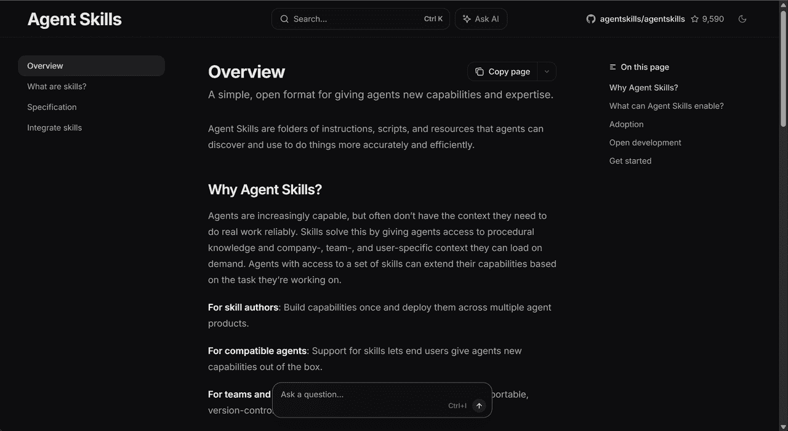

### 1.1 Agent Skills 核心定义：从“Prompt”到“资产包”

在传统的 Agent 开发中，我们习惯于将所有指令都塞进 System Prompt。但在 Agent Skills 范式下，我们引入了 “技能即文件” (Skill as a File) 的核心概念。

根据 agentskills.io 的定义，Agent Skill 是一个标准化的文件夹结构，它封装了扩展智能体能力所需的特定领域知识、指令和工具定义。

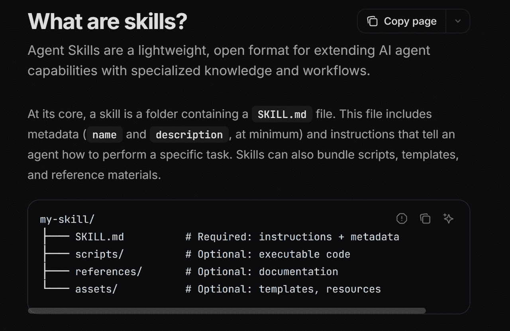

它不再是一段虚无缥缈的提示词，而是一个实实在在的资产包 (Asset Package)。一个标准的 Skill 必须包含以下核心要素，可以用一个公式来表示：

+   `Metadata` (元数据)：用于被系统索引和路由的标签（如名称、描述）。

+   `Instructions` (指令)：自然语言编写的算法或 SOP（标准作业程序）。

+   `Examples` (示例)：用于 Few-Shot Learning 的输入输出对，锁定模型行为。

+   `Tools` (依赖)：该技能运行所需的底层原子能力（如联网、数据库连接）。

这种结构化的定义，使得 Skill 具备了 可移植性 (Portability) 和 可复用性 (Reusability)。

### 1.2 架构核心：三层渐进式加载机制 (Progressive Disclosure)

Agent Skills 系统设计的最大挑战在于 Context Window（上下文窗口）的限制。为了在有限的 Token 预算内实现无限的能力扩展，Anthropic 提出了一套 “渐进式披露” (Progressive Disclosure) 的加载机制。

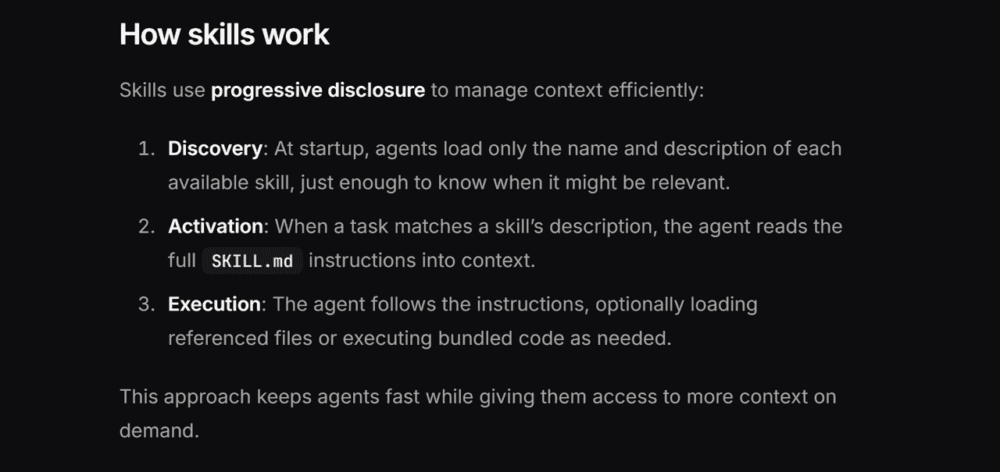

这套机制将 Skill 的生命周期划分为三个层级：

#### Level 1: 索引层 (Index Layer) - System Init

+   **加载内容**：仅加载 Skill 的 `Metadata`，通常只有 `name` 和 `description`。

+   **位置**：常驻于 System Prompt。

+   **作用**：建立 “能力目录”。此时，Agent 知道自己“能做什么”（比如“能查天气”），但完全不知道“具体怎么做”。

+   **Token 消耗**：极低（每个 Skill 约消耗 20-50 Tokens）。

#### Level 2: 指令层 (Instruction Layer) - On Demand

+   **加载内容**：`SKILL.md` 的完整正文（包含 SOP 和 `Examples`）。

+   **触发机制**：当 Agent 的意图识别（Router）命中某个 `Metadata` 时，系统触发 Function Calling (`read_file`)。

+   **位置**：动态注入到 Current Context（当前对话上下文）。

+   **作用**：JIT (Just-in-Time) 知识注入。Agent 在这一刻才真正“学会”了该技能的业务逻辑。

#### Level 3: 执行层 (Runtime Layer) - Execution

+   **加载内容**：具体的原子工具调用（Function Arguments）和外部资源。

+   **触发机制**：Agent 阅读指令层后，根据 SOP 发起具体的 Tool Calls。

+   **作用**：物理执行。调用 API、运行 Python 脚本或查询数据库，获取最终结果。

### 1.3 标准协议详解：`SKILL.md` 解剖学

在 Agent Skills 范式中，`SKILL.md` 是承载业务逻辑的核心载体。它采用 Markdown + YAML Frontmatter 的混合格式。一个符合规范的 `SKILL.md` 必须包含以下结构：

```
---
name: skill_name_id  # [必填] 技能唯一标识符，建议使用 snake_case
description: A concise description of what this skill does. # [必填] 用于路由匹配的关键语义信息
version: 1.0.0 # [选填] 版本控制
---

# [技能名称]

## Usage (使用场景)
明确描述在什么情况下应该激活此技能。这有助于模型进行自我反思和意图确认。

## Steps (执行步骤)
这是 Skill 的灵魂。使用自然语言编写的算法逻辑（SOP）。
1. 第一步做什么...
2. 第二步调用哪个工具...
3. 第三步如何处理数据...

## Examples (示例)
User: [用户输入]
Assistant: [期望的思考过程和工具调用]
System: [工具返回结果]
Assistant: [最终回复]

## Considerations (注意事项)
边界条件处理、错误重试机制或安全合规要求。
```

### 1.4 关键辨析：Skill vs Tool vs MCP

在系统架构中，必须清晰界定 Skill (技能)、Tool (工具) 和 MCP (模型上下文协议) 的边界：

| 概念 | 定义 | 形象比喻 | 职责 |
| --- | --- | --- | --- |
| Skill | 业务逻辑封装 (SOP) | 菜谱 | 告诉 Agent “先切菜，再热油，最后炒”。它不直接操作物理世界，而是编排工具的使用顺序。 |
| Tool | 原子能力接口 (API) | 菜刀/炒锅 | 执行具体的物理动作（如 `fetch_url`, `execute_sql`）。它没有业务逻辑，只有功能。 |
| MCP | 连接标准协议 | 厨房接口标准 | 规定了“菜刀”如何连接到“手臂”上。它解决了连接问题，但不解决“怎么做菜”的问题。 |

结论：Agent Skills 是位于 MCP 和 Tool 之上的 应用层 (Application Layer)。它通过编排底层的原子工具（Tool），利用标准的连接协议（MCP），来实现复杂的业务目标。

### 1.5 Agent Skill 示例：`get_weather` 技能介绍

为了验证上述理论，我们来回顾之前演示的 `get_weather` 技能。这是一个完全符合 Anthropic 标准的最简 Skill 实现。

**1. 文件结构验证**

```
/skills
  └── /get_weather       <-- Skill 包（文件夹）
       └── SKILL.md      <-- 核心定义文件
```

符合“技能即文件夹”的定义。

2. `SKILL.md` 内容验证

+   `Metadata` (索引层)：

```
name: get_weather
description: 获取指定城市的实时天气信息
```

+   解析：Agent 通过 `description` 里的语义信息，将用户 `query` "北京天气怎么样" 路由到此技能。

+   `Usage` (使用场景)：

+   “当用户询问某个城市的天气情况时使用此技能。”

+   解析：进一步强化了触发条件。

+   `Steps` (指令层 - SOP)：

1.  从用户消息中提取城市名称

1.  使用 `fetch_url` 工具访问 wttr.in...

1.  解析返回的 JSON 数据...

1.  解析：这是典型的 Logic Orchestration (逻辑编排)。它没有写 Python 代码，而是用自然语言指导 Agent 调用 `fetch_url` 这个原子工具。

+   `Examples` (对齐层)：

+   用户：「查询北京的天气」 -> ... -> 回复：「北京当前天气...」

+   解析：通过 Few-Shot 样本，锁定了 Agent 的输出格式，防止它直接把 JSON 扔给用户。

通过 `get_weather` 这个简单的例子，我们可以看到：Agent Skill 的本质，就是用结构化的自然语言，编写了一段能够被 LLM 及其 Runtime 环境（Agent）所理解和执行的“软代码”。

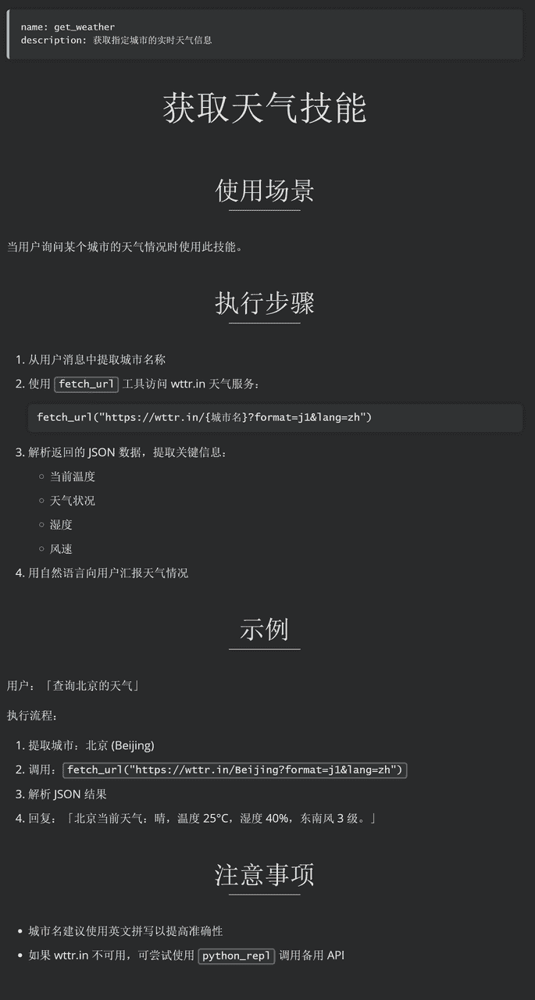

### 1.6 复杂 Agent Skill 示例：`docx` 技能介绍

在掌握了基础的 Skill 开发后，我们需要将视线投向更复杂的业务场景。Anthropic 官方仓库中的 `skills/docx` 是一个教科书般的案例，它展示了 Agent 如何像一个全栈工程师一样，操控 Word 文档的创建、读取、编辑和渲染。

+   项目地址：https://github.com/anthropics/skills/tree/main/skills/docx

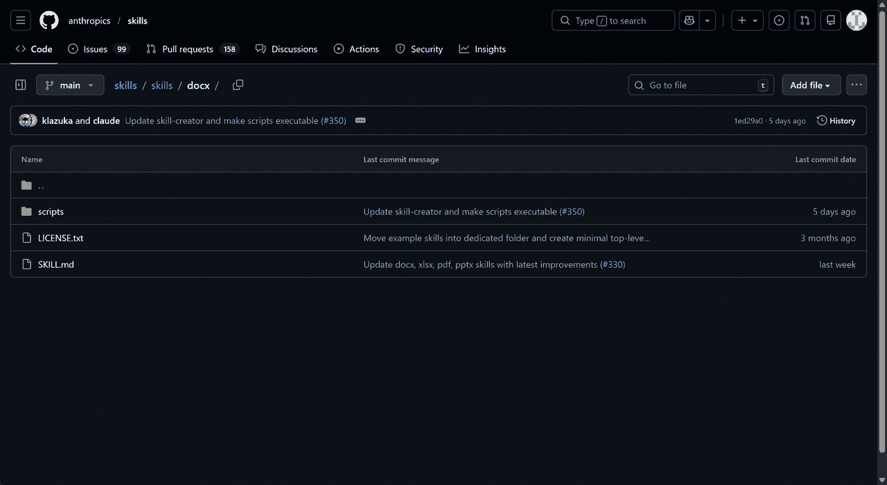

整个项目较为复杂，涉及到多个脚本：

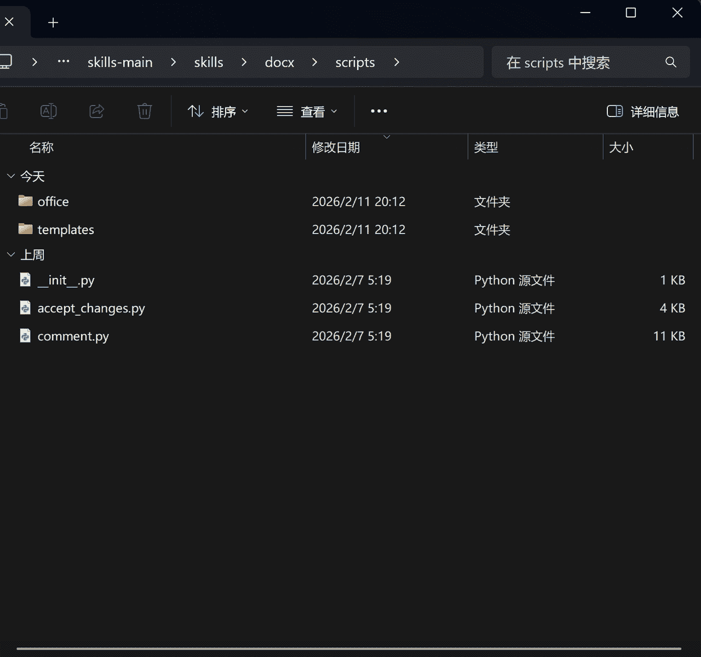

其中`SKILL.md`如下：

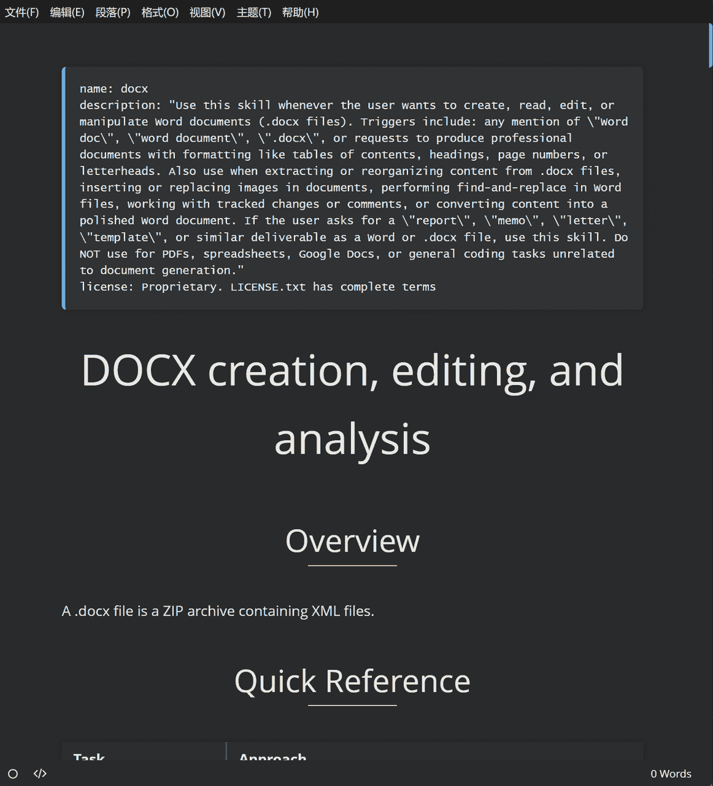

翻译后完整内容如下：

```
---

**名称**：`docx`
**描述**：“当用户想要创建、读取、编辑或操作 Word 文档（`.docx` 文件）时，使用此技能。触发条件包括：提到‘Word doc’、‘word document’、‘`.docx`’，或请求生成具有格式化内容的专业文档，如目录、标题、页码或信头。还适用于从 `.docx` 文件中提取或重组内容，在文档中插入或替换图片，执行查找和替换操作，处理跟踪更改或评论，或将内容转换为精致的 Word 文档。如果用户请求‘报告’、‘备忘录’、‘信件’、‘模板’或类似的 Word 或 `.docx` 文件形式的交付物，请使用此技能。请勿用于 PDF 文件、电子表格、Google 文档或与文档生成无关的通用编码任务。”
**许可**：专有。`LICENSE.txt` 中有完整条款。

---

# DOCX 创建、编辑与分析

## 概述

一个 `.docx` 文件是一个 ZIP 压缩包，包含 XML 文件。

## 快速参考

| 任务 | 方法 |
| --- | --- |
| 阅读/分析内容 | 使用 `pandoc` 或解压提取原始 XML |
| 创建新文档 | 使用 `docx-js` —— 请参见下面的创建新文档部分 |
| 编辑现有文档 | 解压 → 编辑 XML → 重新打包 —— 请参见下面的编辑现有文档部分 |

### 将 `.doc` 转换为 `.docx`

旧版 `.doc` 文件必须在编辑之前转换：

```bash
python scripts/office/soffice.py --headless --convert-to docx document.doc
```

### 阅读内容

```bash
# 带有跟踪更改的文本提取
pandoc --track-changes=all document.docx -o output.md

# 原始 XML 访问
python scripts/office/unpack.py document.docx unpacked/
```

### 转换为图片

```bash
python scripts/office/soffice.py --headless --convert-to pdf document.docx

pdftoppm -jpeg -r 150 document.pdf page
```

### 接受跟踪更改

要生成一个干净的文档，其中所有跟踪更改已被接受（需要 LibreOffice）：

```bash
python scripts/accept_changes.py input.docx output.docx
```

---

## 创建新文档

使用 JavaScript 生成 `.docx` 文件，然后验证。安装：`npm install -g docx`

### 设置

```javascript
const { Document, Packer, Paragraph, TextRun, Table, TableRow, TableCell, ImageRun,
        Header, Footer, AlignmentType, PageOrientation, LevelFormat, ExternalHyperlink,
        TableOfContents, HeadingLevel, BorderStyle, WidthType, ShadingType,
        VerticalAlign, PageNumber, PageBreak } = require('docx');

const doc = new Document({ sections: [{ children: [/* 内容 */] }] });

Packer.toBuffer(doc).then(buffer => fs.writeFileSync("doc.docx", buffer));
```

### 验证

创建文件后，进行验证。如果验证失败，解压、修复 XML 然后重新打包。

```bash
python scripts/office/validate.py doc.docx
```

### 页面大小

```javascript
// 关键：docx-js 默认是 A4，而不是美国信纸
// 始终显式设置页面大小以确保一致的结果

sections: [{
  properties: {
    page: {
      size: {
        width: 12240,   // 8.5 英寸的 DXA 单位
        height: 15840   // 11 英寸的 DXA 单位
      },
      margin: { top: 1440, right: 1440, bottom: 1440, left: 1440 } // 1 英寸边距
    }
  },
  children: [/* 内容 */]
}]
```

**常见页面尺寸（DXA 单位，1440 DXA = 1 英寸）：**

| 纸张 | 宽度 | 高度 | 内容宽度（1 英寸边距） |
| --- | --- | --- | --- |
| 美国信纸 | 12,240 | 15,840 | 9,360 |
| A4（默认） | 11,906 | 16,838 | 9,026 |

**横向布局：** `docx-js` 会内部交换宽度和高度，因此传入纵向尺寸并让它处理交换：

```javascript
size: {
  width: 12240,   // 传递短边为宽度
  height: 15840,  // 传递长边为高度
  orientation: PageOrientation.LANDSCAPE  // docx-js 会在 XML 中交换它们
},
// 内容宽度 = 15840 - 左边距 - 右边距（使用长边）
```

### 样式（覆盖内置标题）

使用 Arial 作为默认字体（普遍支持）。保持标题为黑色以增强可读性。

```javascript
const doc = new Document({
  styles: {
    default: { document: { run: { font: "Arial", size: 24 } } }, // 默认 12pt
    paragraphStyles: [
      // 重要：使用准确的 ID 覆盖内置样式
      { id: "Heading1", name: "Heading 1", basedOn: "Normal", next: "Normal", quickFormat: true,
        run: { size: 32, bold: true, font: "Arial" },
        paragraph: { spacing: { before: 240, after: 240 }, outlineLevel: 0 } }, // outlineLevel 必须用于目录
```


# docx-js 使用指南

## 基础元素与格式

### 列表（绝对不要使用 Unicode 项符号）

```javascript
// ❌ 错误 - 不要手动插入项目符号字符
new Paragraph({ children: [new TextRun("• Item")] })  // 不好
new Paragraph({ children: [new TextRun("\u2022 Item")] })  // 不好

// ✅ 正确 - 使用编号配置与 LevelFormat.BULLET
const doc = new Document({
  numbering: {
    config: [
      { reference: "bullets",
        levels: [{ level: 0, format: LevelFormat.BULLET, text: "•", alignment: AlignmentType.LEFT,
          style: { paragraph: { indent: { left: 720, hanging: 360 } } } }] },
      { reference: "numbers",
        levels: [{ level: 0, format: LevelFormat.DECIMAL, text: "%1.", alignment: AlignmentType.LEFT,
          style: { paragraph: { indent: { left: 720, hanging: 360 } } } }] },
    ]
  },
  sections: [{
    children: [
      new Paragraph({ numbering: { reference: "bullets", level: 0 },
        children: [new TextRun("Bullet item")] }),
      new Paragraph({ numbering: { reference: "numbers", level: 0 },
        children: [new TextRun("Numbered item")] }),
    ]
  }]
});

// ⚠️ 每个引用创建独立的编号
// 同一引用 = 连续编号（1, 2, 3 然后 4, 5, 6）
// 不同引用 = 重置编号（1, 2, 3 然后 1, 2, 3）
```

### 表格

**关键：表格需要设置双重宽度** - 同时设置 `columnWidths` 和每个单元格的 `width`。如果没有同时设置，它们在某些平台上的渲染可能会出错。

```javascript
// 关键：始终设置表格宽度以确保一致的渲染
// 关键：使用 ShadingType.CLEAR（而不是 SOLID）防止黑色背景
const border = { style: BorderStyle.SINGLE, size: 1, color: "CCCCCC" };
const borders = { top: border, bottom: border, left: border, right: border };
new Table({
  width: { size: 9360, type: WidthType.DXA }, // 始终使用 DXA（百分比在 Google Docs 中不兼容）
  columnWidths: [4680, 4680], // 必须等于表格宽度（DXA: 1440 = 1 英寸）
  rows: [
    new TableRow({
      children: [
        new TableCell({
          borders,
          width: { size: 4680, type: WidthType.DXA }, // 每个单元格也要设置
          shading: { fill: "D5E8F0", type: ShadingType.CLEAR }, // 使用 CLEAR 而不是 SOLID
          margins: { top: 80, bottom: 80, left: 120, right: 120 }, // 单元格内边距（不包括在宽度内）
          children: [new Paragraph({ children: [new TextRun("Cell")] })]
        })
      ]
    })
  ]
})
```

**表格宽度计算：**

始终使用 `WidthType.DXA` — `WidthType.PERCENTAGE` 在 Google Docs 中会导致问题。

```javascript
// 表格宽度 = 列宽之和 = 内容宽度
// 美国信纸，1 英寸边距：12240 - 2880 = 9360 DXA
width: { size: 9360, type: WidthType.DXA },
columnWidths: [7000, 2360]  // 必须加起来等于表格宽度
```

**宽度规则：**

* 始终使用 `WidthType.DXA` — 永远不要使用 `WidthType.PERCENTAGE`（与 Google Docs 不兼容）
* 表格宽度必须等于列宽之和
* 单元格 `width` 必须与对应的 `columnWidth` 匹配
* 单元格 `margins` 是内边距 - 它们减少内容区域，而不是增加单元格宽度
* 对于全宽表格：使用内容宽度（页面宽度减去左右边距）

### 图片

```javascript
// 关键：必须指定 type 参数
new Paragraph({
  children: [new ImageRun({
    type: "png", // 必须：png, jpg, jpeg, gif, bmp, svg
    data: fs.readFileSync("image.png"),
    transformation: { width: 200, height: 150 },
    altText: { title: "Title", description: "Desc", name: "Name" } // 三个都必填
  })]
})
```

### 分页符

```javascript
// 关键：PageBreak 必须在 Paragraph 内
new Paragraph({ children: [new PageBreak()] })
// 或使用 pageBreakBefore
new Paragraph({ pageBreakBefore: true, children: [new TextRun("New page")] })
```

### 目录

```javascript
// 关键：标题必须使用 HeadingLevel，只使用标准样式
new TableOfContents("Table of Contents", { hyperlink: true, headingStyleRange: "1-3" })
```

### 页眉/页脚

```javascript
sections: [{
  properties: {
    page: { margin: { top: 1440, right: 1440, bottom: 1440, left: 1440 } } // 1440 = 1 英寸
  },
  headers: {
    default: new Header({ children: [new Paragraph({ children: [new TextRun("Header")] })] })
  },
  footers: {
    default: new Footer({ children: [new Paragraph({
      children: [new TextRun("Page "), new TextRun({ children: [PageNumber.CURRENT] })]
    })] })
  },
  children: [/* 内容 */]
}]
```

### docx-js 的关键规则

* 显式设置页面大小 - `docx-js` 默认是 A4；对于美国文档，使用 US Letter（12240 x 15840 DXA）
* 横向布局：传递纵向尺寸 - `docx-js` 内部交换宽度/高度；传递短边为 `width`，长边为 `height`，并设置 `orientation: PageOrientation.LANDSCAPE`
* 永远不要使用 `\n` - 使用单独的 `Paragraph` 元素
* 永远不要使用 Unicode 项符号 - 使用 `LevelFormat.BULLET` 和编号配置
* 分页符必须在 `Paragraph` 内 - 单独使用会创建无效的 XML
* `ImageRun` 必须指定 `type` - 始终指定 png/jpg 等格式
* 始终设置表格 `width` 使用 DXA - 永远不要使用 `WidthType.PERCENTAGE`（在 Google Docs 中不兼容）
* 表格需要双重宽度 - `columnWidths` 和单元格 `width`，两者必须匹配
* 始终添加单元格边距 - 使用 `margins: { top: 80, bottom: 80, left: 120, right: 120 }` 使其可读
* 使用 `ShadingType.CLEAR` - 永远不要使用 SOLID 作为表格阴影
* 目录必须使用 `HeadingLevel` - 标题段落上不能使用自定义样式
* 覆盖内置样式 - 使用准确的 ID："Heading1"，"Heading2" 等
* 包含 `outlineLevel` - 目录需要此参数（0 对于 H1，1 对于 H2 等）
* 每个段落使用单独的 `Paragraph` 元素
* 所有图像必须使用 `type` - 必须指定图像类型，例如 png、jpg、jpeg 等

## 编辑现有文档

按照以下三步操作。

### 第 1 步：解压

```bash
python scripts/office/unpack.py document.docx unpacked/
```

提取 XML，格式化，合并相邻的 runs，并将智能引号转换为 XML 实体（`&#x201C;` 等），以便它们在编辑时能保留。使用 `--merge-runs false` 可以跳过合并运行。

### 第 2 步：编辑 XML

编辑 `unpacked/word/` 中的文件。更多模式请参见 XML 参考部分。

**请使用“Claude”作为作者**，用于跟踪更改和评论，除非用户明确要求使用其他名字。

**直接使用编辑工具进行字符串替换**。不要编写 Python 脚本。脚本会引入不必要的复杂性，编辑工具可以准确地显示正在替换的内容。

**关键：使用智能引号添加新内容。** 添加带有撇号或引号的文本时，使用 XML 实体来生成智能引号：

```xml
<!-- 使用这些实体来进行专业排版 -->
<w:t>这里&#x2019;是一个引号：&#x201C;Hello&#x201D;</w:t>
```

### 第 3 步：打包

```bash
python scripts/office/pack.py unpacked/ output.docx --original document.docx
```

验证并自动修复，压缩 XML 并创建 DOCX 文件。使用 `--validate false` 跳过验证。

## XML 参考

### 模式兼容性

* `<w:pPr>` 中元素的顺序：`<w:pStyle>`、`<w:numPr>`、`<w:spacing>`、`<w:ind>`、`<w:jc>`，`<w:rPr>` 最后
* 空格：在包含前导/尾随空格的 `<w:t>` 中，添加 `xml:space="preserve"`
* RSID：必须是 8 位十六进制（例如，`00AB1234`）

### 跟踪更改

**插入：**

```xml
<w:ins w:id="1" w:author="Claude" w:date="2025-01-01T00:00:00Z">
  <w:r><w:t>插入文本</w:t></w:r>
</w:ins>
```

**删除：**

```xml
<w:del w:id="2" w:author="Claude" w:date="2025-01-01T00:00:00Z">
  <w:r><w:delText>删除的文本</w:delText></w:r>
</w:del>
```

## 技能与文档结构

### 1. 技能概览：不仅是调用，更是“全栈开发”

与 `get_weather` 这种“单一接口调用”不同，docx 技能是一个重型资产包。它不仅教 Agent 如何使用工具，还教 Agent 如何编写代码来生成文档。

* **技能目标**：创建专业格式的 Word 文档（含表格、目录、页眉）、提取带修订模式的内容、将文档转换为 PDF/图片。
* **复杂度特征**：
  * **多语言混合**：同时使用了 Python（用于文件解包/打包）、Node.js（用于文档生成）、Bash（用于工具调用）。
  * **外部依赖**：集成了 Pandoc（文档转换）、LibreOffice（渲染）、`docx-js`（JS 库）。
  * **状态管理**：引入了“解压 -> 编辑 XML -> 重打包”的复杂工作流。

### 2. 文件结构解剖

打开 `skills/docx` 文件夹，你会发现它远比 `get_weather` 庞大：

```plaintext
skills/docx/
├── SKILL.md                # 核心大脑：SOP 与 知识库
└── scripts/                # 肢体动作：原子工具脚本库
    └── office/
        ├── unpack.py       # 工具：将 .docx 解压为 XML 目录
        ├── pack.py         # 工具：将 XML 目录重打包为 .docx
        └── soffice.py      # 工具：调用 LibreOffice 转换 PDF
```

**设计洞察**：这里体现了复杂 Skill 的一个重要设计原则——“厚工具，薄指令”。为了避免在 System Prompt 中塞入冗长的 Python 代码，开发者将复杂的文件操作封装成了独立的 `.py` 脚本（原子工具），放在 `scripts/` 目录下。`SKILL.md` 只需要告诉 Agent “运行 `unpack.py`”，而不需要解释“如何解压 ZIP 文件”。

### 3. SKILL.md 深度解析：教 Agent 写代码

`docx` 的 `SKILL.md` 最精彩的部分在于，它不仅指挥 Agent 用工具，还指挥 Agent “现场写代码”。

#### A. 元数据与触发器 (Metadata)

```yaml
name: docx
description: Create, read, edit, and manipulate Word documents (.docx). Use when user mentions "Word doc", "report", or needs professional formatting.
```


## B. 核心指令：双模态工作流 (The "Dual-Mode" Workflow)

文档中定义了两套截然不同的 SOP，分别对应“创建”和“编辑”：

### 模式一：从零创建 (Creation Mode)

Instructions: "To create new documents, `write and exec` a `Node.js` script using the `docx` library."

这里 Agent 不再是简单地调用 `create_doc(text)`，而是被要求编写一段完整的 JavaScript 代码。

Skill 中的代码片段示例（教 Agent 如何写代码）：

```javascript
// Agent 会学习这个模板，然后根据用户需求修改
const doc = new Document({
  sections: [{
    children: [
      new Paragraph({ text: "Hello World", heading: HeadingLevel.HEADING_1 }),
      new Table({ ... }) // Agent 需自行构建表格逻辑
    ]
  }]
});
```

**技术价值**：这种模式赋予了 Agent 极高的灵活性。它不仅仅是在填表，而是在利用 `docx-js` 库的强大能力进行排版编程。

### 模式二：手术刀式编辑 (Surgical Editing Mode)

Instructions: "To edit existing documents with precision:

1. Run `python scripts/office/unpack.py doc.docx output_dir` to reveal the raw XML.
2. Read and modify the `word/document.xml` file directly.
3. Run `python scripts/office/pack.py output_dir new_doc.docx`."

**技术价值**：这是非常硬核的操作。`.docx` 本质上是 XML 的压缩包。这个 Skill 教会了 Agent “外科手术”般的编辑能力——直接修改底层 XML，从而实现许多 API 无法做到的精细修改（如保留修订痕迹、修改特定样式）。

### 原子能力层 (Atomic Tools)

为了支撑上述逻辑，Skill 挂载了几个关键的“硬原子”：

- **Pandoc**：用于“读取”。Agent 并不是自己去读二进制文件，而是调用 `pandoc -t markdown doc.docx` 将 Word 文档转译为 Markdown 文本，方便自己理解。

- **Unpack/Pack 脚本**：用于“状态转换”。将封闭的 `.docx` 转换为开放的文件夹结构。

- **LibreOffice (Headless)**：用于“渲染”。当用户需要 PDF 时，Agent 调用 `soffice.py` 在后台启动无界面的 LibreOffice 进行转换。

### 总结：复杂 Skill 的系统论

docx 技能向我们展示了 Agent Skills 的上限：

1. 代码生成 (Code Gen) > 工具调用 (Tool Call)：对于复杂任务，直接让 Agent 编写并运行临时脚本（如 JS 生成文档），比预定义一千个 API 函数要灵活得多。

2. 工具链编排 (Toolchain Orchestration)：Agent 成为了一个指挥官，它指挥 `Pandoc` 读、`Node.js` 写、`Python` 改、`LibreOffice` 转，形成了一条完整的自动化流水线。

3. 知识封装 (Knowledge Encapsulation)：关于“如何操作 XML”和“如何使用 `docx-js` 库”的知识，全部封装在 `SKILL.md` 中，不需要 Agent 预训练时死记硬背。

### 1.7 热门 Agent Skills 集成网站与开源社区

在 Agent Skills 范式下，我们不需要从零编写每一个功能。目前全球开发者已经贡献了海量的 Skill 资产，我们可以像下载 App 一样直接集成这些能力。以下是目前最热门的三个资源获取渠道：

#### Anthropic Official Skills (官方标准库)

**网址**：`https://github.com/anthropics/skills`

**特点**：

- **官方出品**：这是 Anthropic 维护的官方仓库，代表了 Skill 开发的“最高标准”和“最佳实践”。

- **覆盖面广**：涵盖了从创意生成（Art/Music）、技术开发（Coding/Testing）到企业工作流（Branding/Comms）的全场景示例。

- **教学价值**：每一个 Skill 都是教科书级的 `SKILL.md` 编写范例，非常适合新手模仿学习。

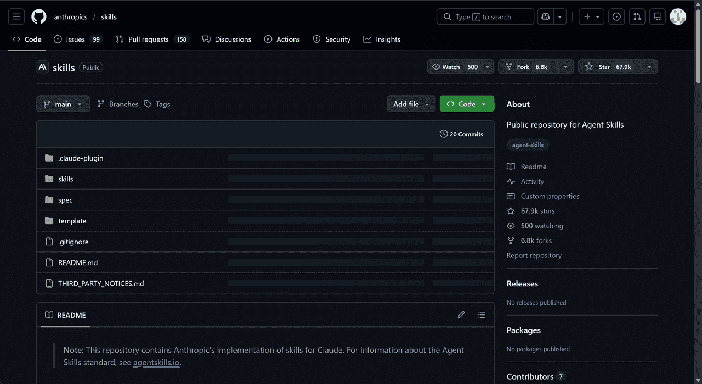

#### ClawHub (OpenClaw 技能中心)

**网址**：`https://clawhub.ai`

**特点**：

- Agent 界的“App Store”：专为 `OpenClaw` 生态设计的技能市场，拥有超过 50,000+ 个现成 Skill。

- **一键安装**：支持通过命令行 `claw install <skill-name>` 直接将能力注入到你的 Agent 中，无需手动拖拽文件。

- **社区驱动**：拥有最活跃的第三方开发者生态，大量非官方的“黑科技”Skill（如抖音爬虫、私域流量操盘手）都首发于此。

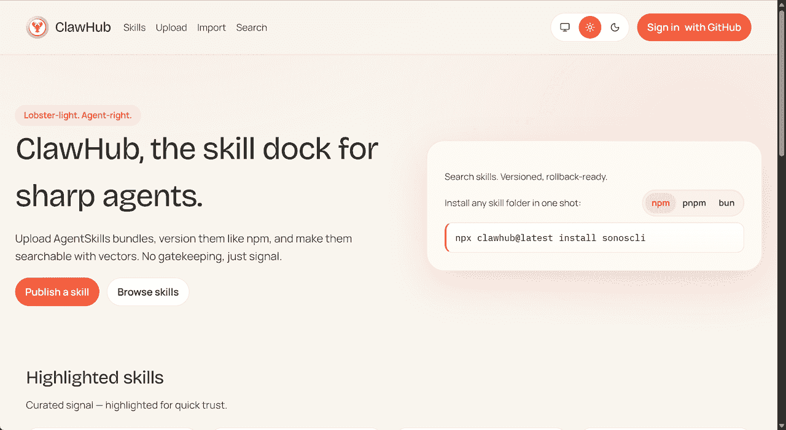

#### Awesome Agent Skills (社区精选集)

**网址**：`https://github.com/VoltAgent/awesome-agent-skills`

**特点**：

- **跨平台兼容**：这里的 Skills 不仅适配 `Claude`，还兼容 `Codex`、`Gemini CLI` 等多种主流 Agent 运行时。

- **大厂集成**：收录了来自 `Vercel`, `Stripe`, `Cloudflare` 等知名技术团队发布的官方 Skill，是企业级集成的首选。

- **数量庞大**：目前已收录超过 300+ 高质量 Skill，是寻找灵感和“现成轮子”的宝库。

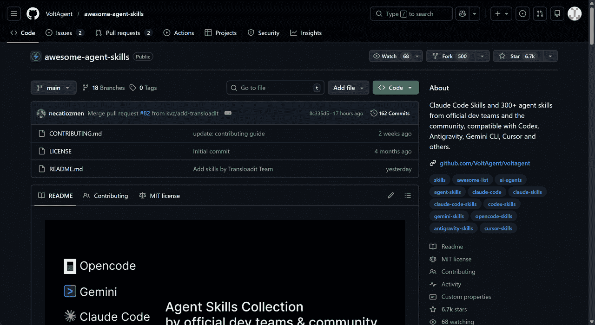

## 2. 【进阶】借助 LangChain 开发 Agent Skills 系统入门

### 2.1 系统架构设计：MVP 版本 (LangChain 1.x)

要实现一个真正支持 `Agent Skills` 的系统，我们不能只把目光停留在简单的对话链上。我们需要构建一个具有 “感知-决策-执行” 闭环的 `Runtime` (运行时)。

基于 `LangChain` 1.x 的最新标准（特别是 `Graph-based` 架构），我们将系统架构精简为以下三个核心模块。这个 `MVP` (最小可行性产品) 版本虽然精简，但保留了 `OpenClaw` 最核心的“灵魂”：

1. 能力引导层 (`Bootstrap`)：在系统启动的瞬间，扫描本地 `skills` 文件夹，提取元数据，生成技能快照 (`SKILLS_SNAPSHOT`)。

2. 核心工具层 (`Core Tools`)：赋予 Agent “阅读文件” (`Eyes`) 和 “联网获取” (`Hands`) 的基础物理能力。

3. 智能体运行时 (`Agent Runtime`)：使用最新的 `create_agent` `API` 构建核心大脑，并动态注入 `System Prompt`，实现对技能的挂载。

**架构图：**

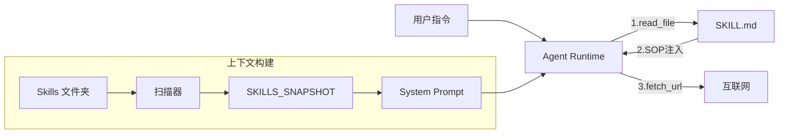

### 2.2 核心工具层 (Core Tools) 实现

Agent Skills 的核心逻辑是：“Agent 通过阅读文档学会使用工具”。因此，在 Agent 出厂设置中，必须原生具备两个最基础的工具：`read_file` (用于读文档) 和 `fetch_url` (用于执行文档里的联网请求)。我们使用 `LangChain` 的 `@tool` 装饰器进行封装：

```python
import os
from langchain_core.tools import tool
from langchain_community.tools.file_management import ReadFileTool
from langchain_community.tools import RequestsGetTool

# --- 工具 1: 安全的文件读取 (The Eyes) ---
# 初始化底层工具，强制指定 root_dir 为项目根目录
# 安全警告：这是防止 Agent 越狱读取 /etc/passwd 等系统文件的关键！
raw_read_file = ReadFileTool(root_dir="./backend/skills")

@tool
def read_file(file_path: str) -> str:
    """
    用于读取 Agent Skills 的定义文件 (SKILL.md)。
    输入参数 file_path 必须是相对于 skills 文件夹的路径，例如: 'get_weather/SKILL.md'
    """
    try:
        # 在这里可以添加额外的路径检查逻辑
        if ".." in file_path:
            return "Error: 禁止访问父目录文件。"
        return raw_read_file.invoke({"file_path": file_path})
    except Exception as e:
        return f"Error reading file: {str(e)}"

# --- 工具 2: 联网能力 (The Hands) ---
# allow_dangerous_requests=True 是必须的，否则无法访问公网
raw_requests = RequestsGetTool(allow_dangerous_requests=True)

@tool
def fetch_url(url: str) -> str:
    """
    用于执行 HTTP GET 请求获取网页或 API 数据。
    当 Skill 文档要求访问某个 URL 时使用此工具。
    """
    try:
        # 实际生产建议：在此处集成 html2text 库，将 HTML 转为 Markdown，减少 Token 消耗
        response = raw_requests.invoke({"url": url})
        return response[:2000] # 简单截断，防止网页内容过长撑爆上下文
    except Exception as e:
        return f"Error fetching URL: {str(e)}"

# 将工具打包，准备注入 Agent
core_tools = [read_file, fetch_url]
```

#### 代码深度解析

**沙箱机制 (`root_dir`)**：大家注意 `ReadFileTool` 的初始化。我们并没有让 Agent 满磁盘随便读，而是将它的视野通过 `root_dir="./backend/skills"` 锁死在技能目录中。这是 Agent 系统安全设计的第一道防线。

**装饰器 (`@tool`)**：`LangChain` 的 `@tool` 装饰器不仅是将函数转为工具，它还会自动读取函数的 `Docstring` (注释)。`read_file` 下面那段中文注释：“用于读取 Agent Skills 的定义文件...” 最终会被转换成 `Prompt` 告诉大模型，所以这段注释必须写得非常精准。

**上下文保护 (`[:2000]`)**：在 `fetch_url` 中，我们做了一个简单的截断处理。真实的网页往往包含大量无用信息，如果不做处理直接丢给 `LLM`，不仅浪费钱，还会挤占 Skill 指令的空间。

### 2.3 技能引导层 (Skill Bootstrap) 实现

Agent 怎么知道自己有哪些技能？我们需要在系统启动时，通过代码自动扫描目录。这被称为 “Bootstrap (引导过程)”。我们将编写一个 `bootstrap.py`，它的作用是生成一份 “技能菜单”：

```python
import os

def generate_skills_snapshot(skills_dir="./backend/skills"):
    """
    扫描 skills 文件夹，提取元数据，生成 XML 格式的快照
    """
    # 使用 XML 标签包裹，有助于 Claude/GPT 模型更精准地识别结构
    snapshot = "<available_skills>\n"
    
    # 1. 遍历 skills 目录下的所有子文件夹
    # 假设每个子文件夹就是一个 Skill
    if not os.path.exists(skills_dir):
        return "<available_skills>No skills found.</available_skills>"

    for skill_name in os.listdir(skills_dir):
        skill_path = os.path.join(skills_dir, skill_name, "SKILL.md")
        
        # 2. 校验：只有包含 SKILL.md 的文件夹才被视为有效技能
        if os.path.exists(skill_path):
            # 3. 读取 SKILL.md 的内容（实际项目中建议只读前几行元数据）
            with open(skill_path, 'r', encoding='utf-8') as f:
                content = f.read()
                
            # 简单提取：假设 SKILL.md 第一行是 name，第二行是 description
            # 实际生产中应使用 YAML Frontmatter 解析库
            snapshot += f"""  <skill>
<name>{skill_name}</name>
<path>{skill_name}/SKILL.md</path>
<description>（该技能的动态描述，引导 Agent 何时使用它）</description>
</skill>\n"""
            
    snapshot += "</available_skills>"
    return snapshot
```

#### 代码解析

**为什么用 XML?**：注意看 `snapshot` 变量，我们使用了 `<available_skills>` 这种 `XML` 标签。在最新的 `Prompt Engineering` 实践中（特别是 `Claude` 系列），模型对 `XML` 结构的理解能力远强于 `JSON` 或纯文本列表。这能显著提高 Agent 检索技能的准确率。

**动态扫描**：这个函数的存在，实现了 “热插拔”。你只需要在文件夹里新建一个 `get_stock` 目录，下次运行代码时，这个函数就会自动把它加入到 Agent 的菜单里，完全不需要修改核心代码。

**路径映射**：注意 `<path>` 标签。我们告诉了 Agent 技能的名称，同时告诉了它文件在哪里。这为后续 Agent 调用 `read_file` 埋下了伏笔。

### 2.4 Agent 运行时构建 (LangChain 1.x Standard)


这是最关键的一步。在 `LangChain` 1.x 中，官方引入了基于 `Graph` 理念的 `create_agent` API，它自动封装了“思考-工具调用-再思考”的复杂循环。

```python
from langchain.agents import create_agent # LangChain 1.x 新标准 API
from langchain_openai import ChatOpenAI
from langchain_core.messages import SystemMessage

# 1. 初始化模型
# 建议使用 gpt-4o 或 claude-3-5-sonnet，因为它们对 Function Calling 的支持最稳健
model = ChatOpenAI(model="gpt-4o", temperature=0)

# 2. 动态构建 System Prompt (核心魔法)
# 将刚才生成的 Skill Snapshot 注入到提示词中
snapshot_content = generate_skills_snapshot()

# 这里定义了 Agent 的“元指令” (Meta-Instructions)
# 这段 Prompt 决定了 Agent 的行为模式：是直接回答，还是去查文档
system_instruction = f"""你是一个基于 Agent Skills 架构的智能助手。

【能力清单】
你拥有以下技能列表 (SKILLS_SNAPSHOT)，它们定义了你的专业能力：
{snapshot_content}

【核心协议 (CRITICAL)】
1. 当用户请求的任务匹配上述技能时，你**严禁**直接猜测操作步骤。
2. 你的第一步行动**必须**是调用 `read_file` 工具，读取该技能对应的 `<path>` 文件。
3. 读取文件后，严格按照文件中的 Steps (步骤) 指导去执行任务。
"""

# 3. 构建 Agent Runtime
# create_agent 自动将 model 和 tools 绑定，并处理工具调用的循环逻辑
agent_executor = create_agent(
    model=model,
    tools=core_tools,
    system_prompt=system_instruction, # 直接传入动态构建的 Prompt
)

# 4. 执行测试：模拟用户提问
if __name__ == "__main__":
    print(">>> Agent System Initialized.")
    print(">>> User: 帮我查一下北京现在的天气")
    
    # stream 方法允许我们看到 Agent 的思考过程
    # inputs 是用户输入，config 可以传入会话 ID
    events = agent_executor.stream(
        {"messages": [("user", "帮我查一下北京现在的天气")]},
        stream_mode="values"
    )
    
    for event in events:
        # 打印交互过程，方便调试
        if "messages" in event:
            last_msg = event["messages"][-1]
            print(f"[{last_msg.type.upper()}]: {last_msg.content}")
```

### 代码解析

+ `System Prompt` 的动态注入：这是整个系统的灵魂。变量 `snapshot_content` 是运行时生成的，这意味着 Agent 的知识库是活的。

+ `核心协议 (CRITICAL)`：我们在 `System Prompt` 中用加粗语气写了一段“核心协议”。这是为了对抗大模型的幻觉。大模型有时候会“自作聪明”，觉得自己知道怎么查天气就直接编造 API。我们必须强制它：“先读文件，再行动”。

+ `create_agent` API：这个 API 是 `LangChain` 1.x 的集大成者。

+ 它自动识别 `Model` 是否支持 `Tool Calling`。

+ 它自动把 `core_tools` 里的函数签名转换为 `OpenAI` 格式的 `JSON Schema`。

+ 它自动管理对话历史（`Memory`），当 `Tool` 返回结果后，它会自动把结果喂回给模型进行下一轮推理。

+ 开发者不再需要手写 `while` 循环来处理“多步执行”了。

### 2.5 Fufan-OpenClaw需求文档

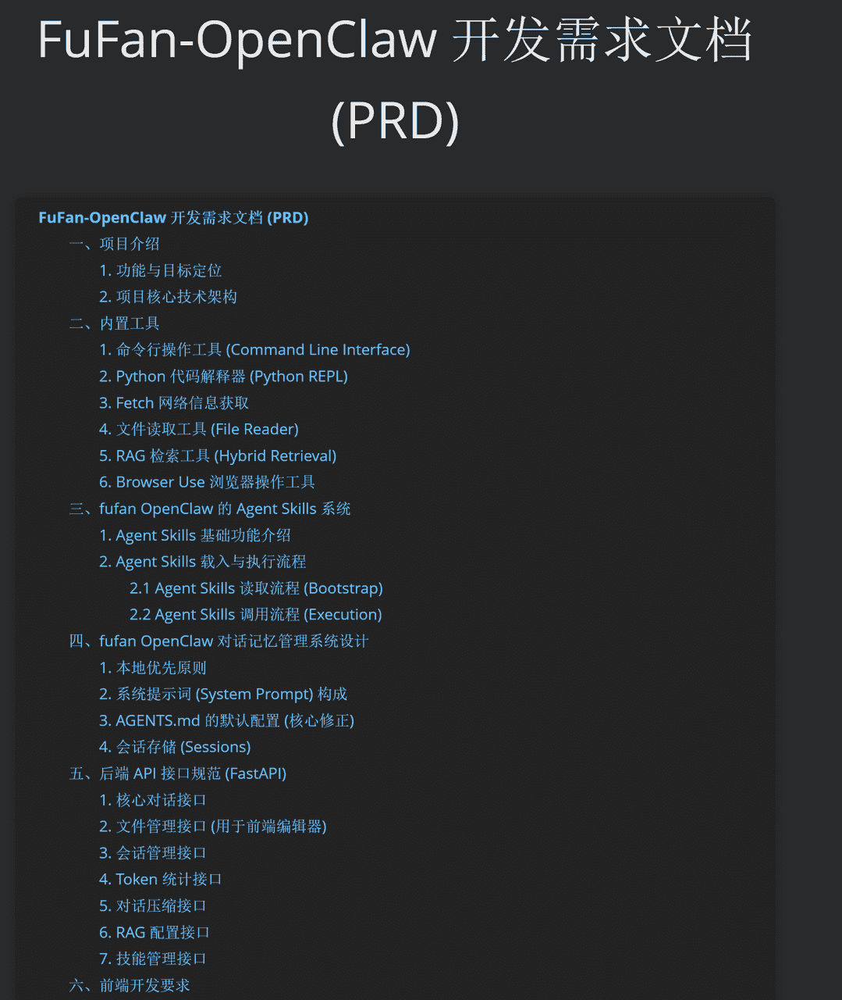
