# Part 1.DeepSeek-V3.2快速上手与Function calling功能实现

> 来源：[https://kq4b3vgg5b.feishu.cn/docx/ZDI3dYc4qoMjaexwmmIcip3Onmg](https://kq4b3vgg5b.feishu.cn/docx/ZDI3dYc4qoMjaexwmmIcip3Onmg)

## 课程说明

体验课内容节选自《2025大模型Agent智能体开发实战》(12月班)完整版付费课程

体验课时间有限，若想深度学习大模型技术，欢迎大家报名由我主讲的《2025大模型Agent智能体开发实战》(12月班)

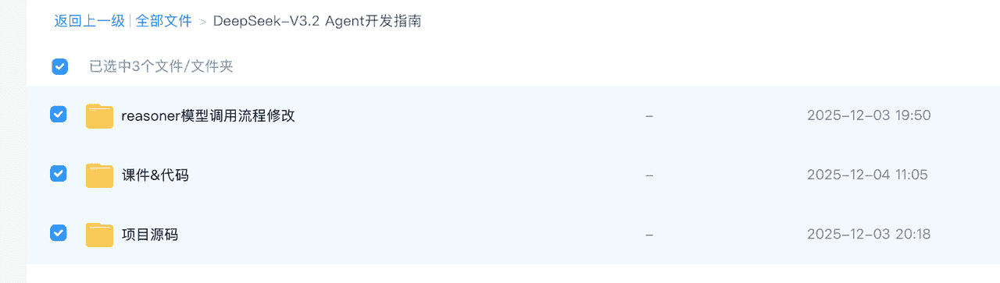


---

# 国产最强DeepSeek-V3.2 Agent开发实战

## Part 1.DeepSeek-V3.2 Agent开发入门

### 一、DeepSeek-V3.2模型介绍

两个月前，DeepSeek-V3.2-EXP实验版模型正式发布，首次提出了DSA稀疏注意力机制，在维持模型性能不变的情况下，模型推理和训练成本暴降50%以上，

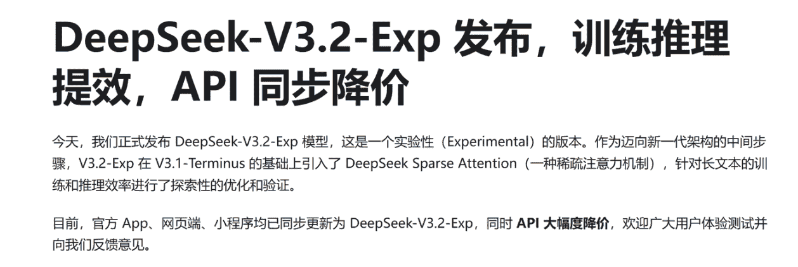

两个月后，DeepSeek-V3.2正式版重磅发布，在实验版基础上，进一步引入可拓展的GRPO训练框架搭配大规模合成Agent任务数据集，借助海量强化学习后训练，让DeepSeek-V3.2正式版模型一举突破性能极限。

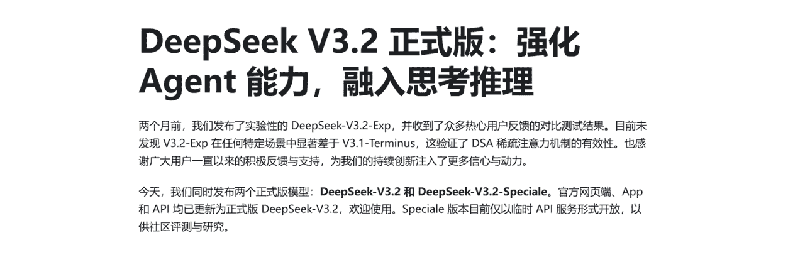

模型在数学、编程、Agent性能方面全面领先GPT-5，跻身全球顶尖大模型第一梯队。并且，DeepSeek团队还做了一项大胆的尝试，那就是为模型的训练过程解除思考链长度限制，并同时引入DeepSeekMath-V2提出的自验证数学推理训练法，最终训练得到DeepSeek-V3.2-Speciale模型，更是在各项指标上整体追平全球性能最强大模型Gemini 3.0 Pro。

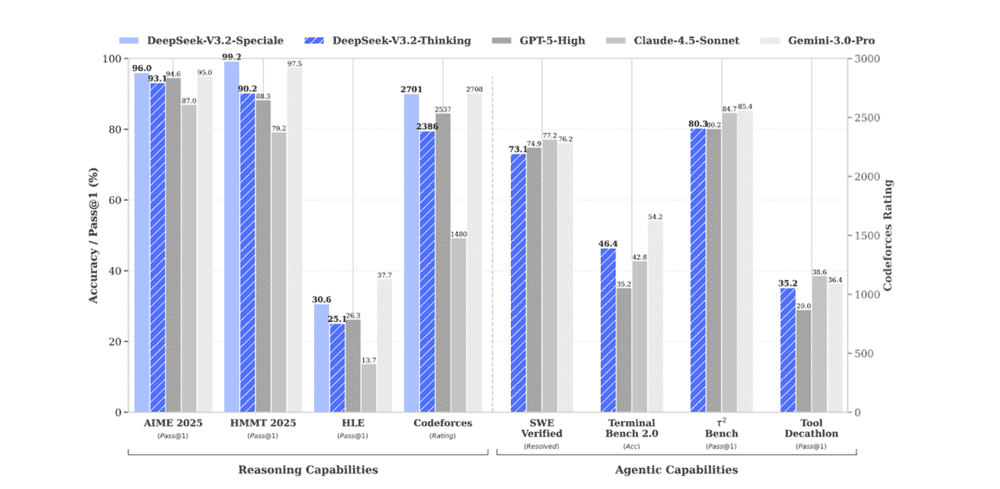

最重要的是DeepSeek-V3.2模型的价格不到Gemini 3.0的1/5，不到GPT-5.1模型的1/4，可以说性价比拉满。

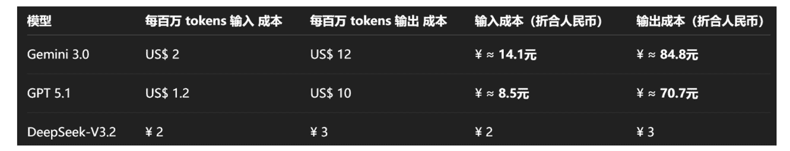

目前DeepSeek-V3.2和Speciale两款模型的API已全面上线，模型权重也已全面开源，

+ 模型权重：`https://huggingface.co/deepseek-ai/DeepSeek-V3.2`


+ DeepSeek模型演化路径


+ DeepSeek-V3.2核心技术创新点

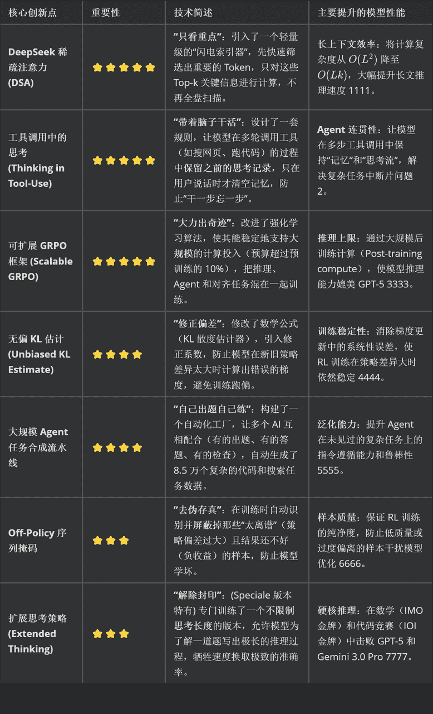


而与此同时，DeepSeek-V3.2模型的Agent性能也得到了巨大的提升，和Gemini 3、Claude 4.5等模型的差距已经不到5%。


并且DeepSeek首次引入“思考模式下工具调用”的功能，允许模型在单轮任务调用过程保持多步工具调用思考链记忆，也就是像人一样一边思考一边调用工具，从而大幅提升模型多步调用工具的前后一致性，显著提升模型Agent性能。

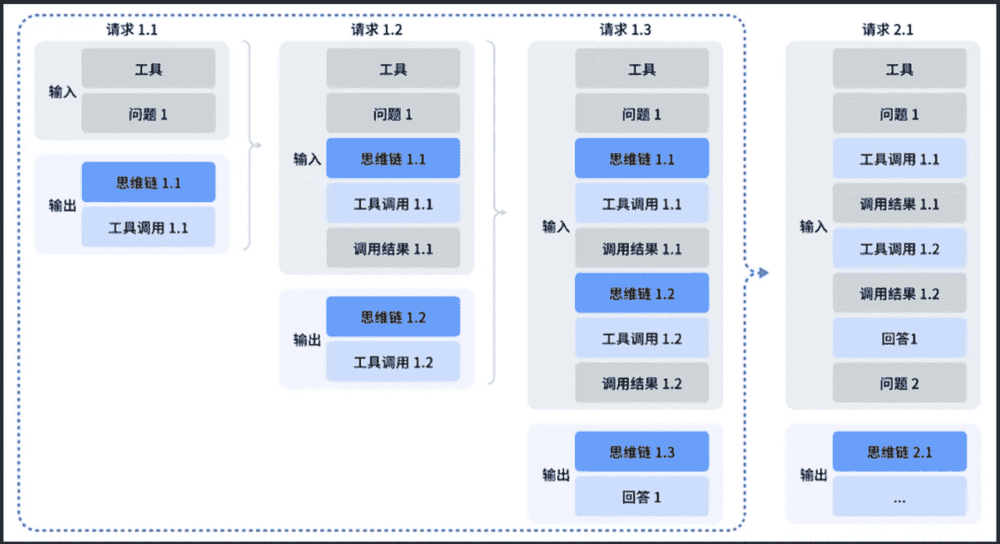

而我们团队也对此进行了测试。首先我们将DeepSeek-V3.2模型带入前不久刚开发的生产力级的基于Nano Banana Pro的AI PPT Agent，作为Agent基座模型（注意不是绘图模型），实际运行过程中，无论是多PPT任务拆解、自主提示词编写、还是外部工具调用，都达到了和Gemini 3.0 Pro的同等水平。

而除了DeepSeek-V3.2之外，本次DeepSeek还同步开源了一款实验性质的模型，DeepSeek-V3.2-Speciale。这是一次非常大胆的尝试，和DeepSeek-V3.2不同，这款Speciale模型在训练过程中采用了纯推理数据进行训练，并且放宽了普通模型都会有的推理长度惩罚力度，使得Speciale更加擅长通过长思考来解决问题，同时引入了DeepSeekMath-V2提出的自验证数学推理训练法，借助左右互搏来突破数学能力极限。


最终DeepSeek-V3.2-Speciale模型在各主流评测数据集上，无论是数学、编程、还是HLE（人类最后测试）、Agent性能等各个方面，均达到了Gemini 3.0 Pro模型的同等水平。

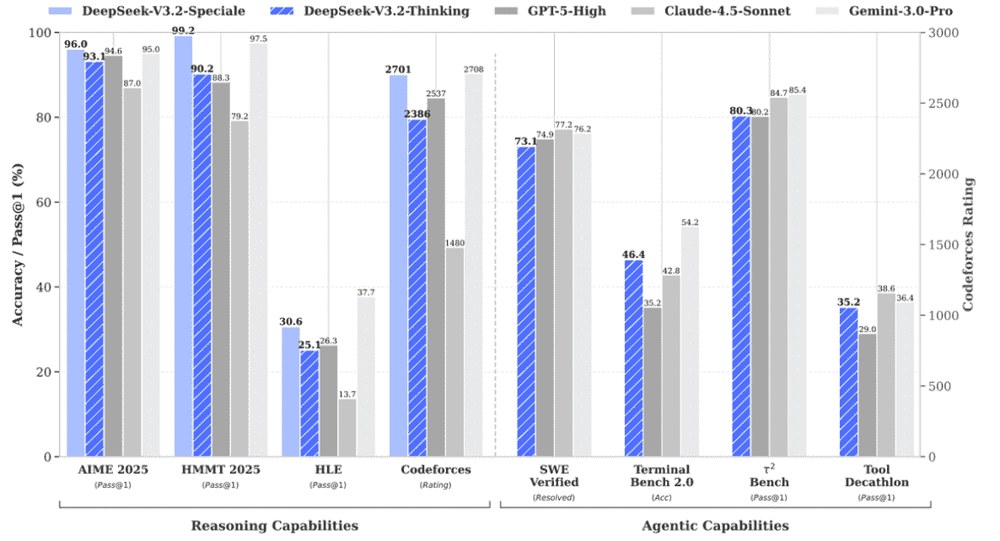

并且目前Speciale模型权重也已同步开源，而若要调用模型API，则需要更换如图所示的`base_url`，

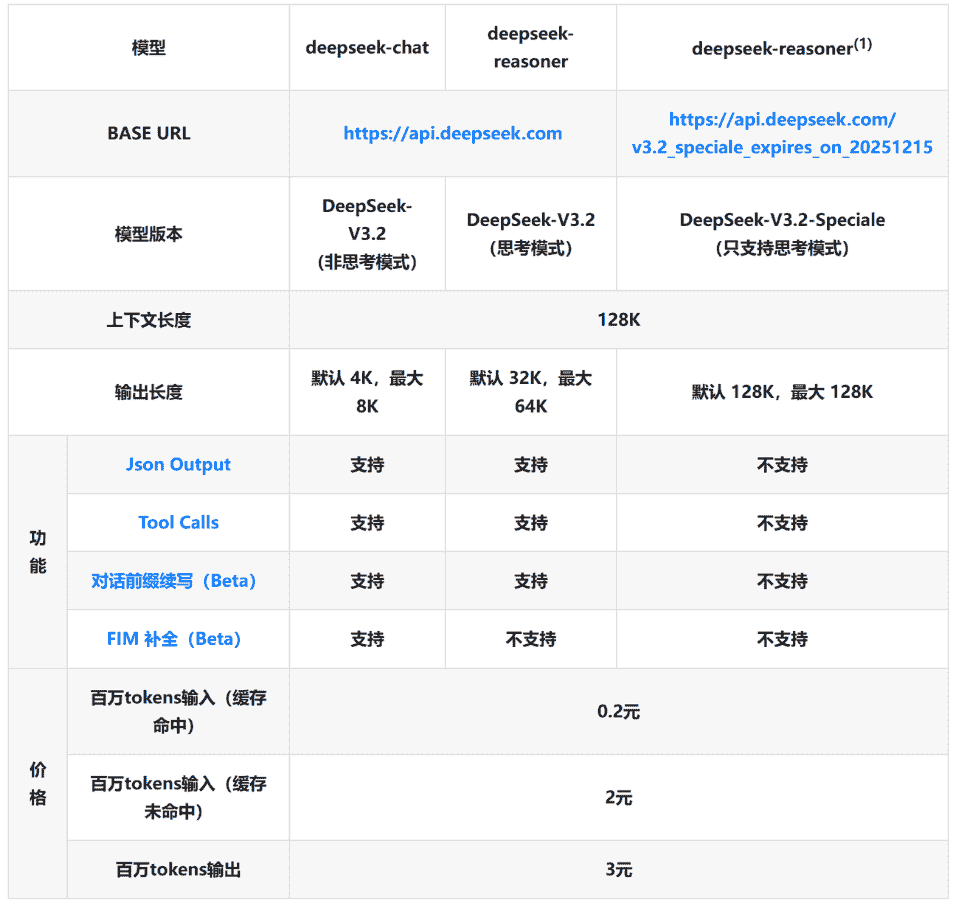

+ 视频地址：`https://www.bilibili.com/video/BV13rSHBBEoG/`


+ LangChain 1.0快速入门指南：`https://www.bilibili.com/video/BV1uV1yBHE2o/`


### 二、DeepSeek快速上手使用

#### 1.DeepSeek基础调用流程

在进行Agent开发之前，首先需要准备一个可以进行调用的大模型，这里我们选择使用DeepSeek的大模型，并使用DeepSeek官方的`API_KEK`进行调用。如果初次使用，需要现在DeepSeek官网上进行注册并创建一个新的`API_Key`，其官方地址为：`https://platform.deepseek.com/usage`


注册好DeepSeek的`API_KEY`后，首先在项目同级目录下创建一个`env`文件，用于存储DeepSeek的`API_KEY`，如下所示：

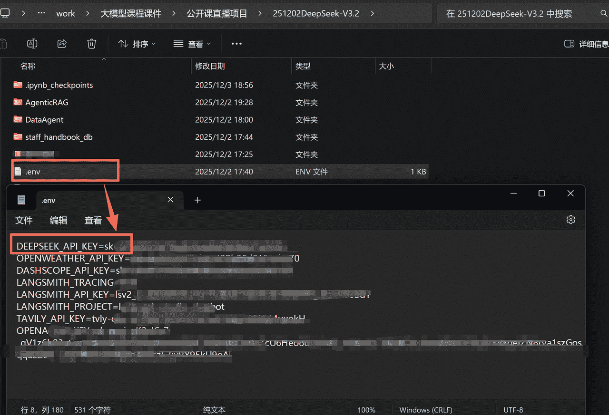

接下来通过`python-dotenv`库读取`env`文件中的`API_KEY`，使其加载到当前的运行环境中，代码如下：

```
# ! pip install python-dotenv
```

```
import os
from dotenv import load_dotenv
load_dotenv(override=True)

DeepSeek_API_KEY = os.getenv("DEEPSEEK_API_KEY")
# print(DeepSeek_API_KEY)  # 可以通过打印查看
```

我们在当前的运行环境下不使用`LangChain`，直接使用DeepSeek的API进行网络连通性测试，测试代码如下：

```
# ! pip install openai
```

```
from openai import OpenAI

# 初始化DeepSeek的API客户端
client = OpenAI(api_key=DeepSeek_API_KEY, base_url="https://api.deepseek.com")

# 调用DeepSeek的API，生成回答
response = client.chat.completions.create(
    model="deepseek-chat",
    messages=[
        {"role": "system", "content": "你是乐于助人的助手，请根据用户的问题给出回答"},
        {"role": "user", "content": "你好，请你介绍一下你自己。"},
    ],
)

# 打印模型最终的响应结果
print(response.choices[0].message.content)
```

```
你好！我是DeepSeek，很高兴认识你！😊

我是由深度求索公司创造的AI助手，致力于为大家提供热情、贴心的帮助。我有以下几个特点：

🌟 **能力方面**：
- 纯文本模型，擅长文字对话、分析和创作
- 支持文件上传功能，可以处理图像、txt、pdf、ppt、word、excel等文件，并从中读取文字信息
- 拥有128K的上下文长度，能够处理较长的对话和文档
- 支持联网搜索功能（需要你在Web/App中手动开启）

💝 **服务理念**：
- 完全免费使用，没有任何收费计划
- 乐于助人，耐心细致地回答各种问题
- 知识截止到2024年7月

📱 **使用方式**：
- 可以通过官方应用商店下载App使用
- 也可以在网页端直接对话

我的知识范围比较广泛，无论是学习答疑、工作协助、创意写作，还是日常聊天，我都很乐意帮助你！有什么想了解的或需要帮助的吗？我会尽我所能为你提供支持！✨
```

如果可以正常收到DeepSeek模型的响应，则说明DeepSeek的API已经可以正常使用且网络连通性正常。

```
response
```

```
ChatCompletion(id='8756c206-b545-4d98-a1ea-136915a915ed', choices=[Choice(finish_reason='stop', index=0, logprobs=None, message=ChatCompletionMessage(content='你好！我是DeepSeek，很高兴认识你！😊\n\n我是由深度求索公司创造的AI助手，致力于为大家提供热情、贴心的帮助。我有以下几个特点：\n\n🌟 **能力方面**：\n- 纯文本模型，擅长文字对话、分析和创作\n- 支持文件上传功能，可以处理图像、txt、pdf、ppt、word、excel等文件，并从中读取文字信息\n- 拥有128K的上下文长度，能够处理较长的对话和文档\n- 支持联网搜索功能（需要你在Web/App中手动开启）\n\n💝 **服务理念**：\n- 完全免费使用，没有任何收费计划\n- 乐于助人，耐心细致地回答各种问题\n- 知识截止到2024年7月\n\n📱 **使用方式**：\n- 可以通过官方应用商店下载App使用\n- 也可以在网页端直接对话\n\n我的知识范围比较广泛，无论是学习答疑、工作协助、创意写作，还是日常聊天，我都很乐意帮助你！有什么想了解的或需要帮助的吗？我会尽我所能为你提供支持！✨', refusal=None, role='assistant', annotations=None, audio=None, function_call=None, tool_calls=None))], created=1764657320, model='deepseek-chat', object='chat.completion', service_tier=None, system_fingerprint='fp_eaab8d114b_prod0820_fp8_kvcache', usage=CompletionUsage(completion_tokens=226, prompt_tokens=22, total_tokens=248, completion_tokens_details=None, prompt_tokens_details=PromptTokensDetails(audio_tokens=None, cached_tokens=0), prompt_cache_hit_tokens=0, prompt_cache_miss_tokens=22))
```

```
response.choices[0]
```

```
Choice(finish_reason='stop', index=0, logprobs=None, message=ChatCompletionMessage(content='你好！我是DeepSeek，很高兴认识你！😊\n\n我是由深度求索公司创造的AI助手，致力于为大家提供热情、贴心的帮助。我有以下几个特点：\n\n🌟 **能力方面**：\n- 纯文本模型，擅长文字对话、分析和创作\n- 支持文件上传功能，可以处理图像、txt、pdf、ppt、word、excel等文件，并从中读取文字信息\n- 拥有128K的上下文长度，能够处理较长的对话和文档\n- 支持联网搜索功能（需要你在Web/App中手动开启）\n\n💝 **服务理念**：\n- 完全免费使用，没有任何收费计划\n- 乐于助人，耐心细致地回答各种问题\n- 知识截止到2024年7月\n\n📱 **使用方式**：\n- 可以通过官方应用商店下载App使用\n- 也可以在网页端直接对话\n\n我的知识范围比较广泛，无论是学习答疑、工作协助、创意写作，还是日常聊天，我都很乐意帮助你！有什么想了解的或需要帮助的吗？我会尽我所能为你提供支持！✨', refusal=None, role='assistant', annotations=None, audio=None, function_call=None, tool_calls=None))
```

```
response.choices[0].message
```

```
ChatCompletionMessage(content='你好！我是DeepSeek，很高兴认识你！😊\n\n我是由深度求索公司创造的AI助手，致力于为大家提供热情、贴心的帮助。我有以下几个特点：\n\n🌟 **能力方面**：\n- 纯文本模型，擅长文字对话、分析和创作\n- 支持文件上传功能，可以处理图像、txt、pdf、ppt、word、excel等文件，并从中读取文字信息\n- 拥有128K的上下文长度，能够处理较长的对话和文档\n- 支持联网搜索功能（需要你在Web/App中手动开启）\n\n💝 **服务理念**：\n- 完全免费使用，没有任何收费计划\n- 乐于助人，耐心细致地回答各种问题\n- 知识截止到2024年7月\n\n📱 **使用方式**：\n- 可以通过官方应用商店下载App使用\n- 也可以在网页端直接对话\n\n我的知识范围比较广泛，无论是学习答疑、工作协助、创意写作，还是日常聊天，我都很乐意帮助你！有什么想了解的或需要帮助的吗？我会尽我所能为你提供支持！✨', refusal=None, role='assistant', annotations=None, audio=None, function_call=None, tool_calls=None)
```

```
response.choices[0].message.content
```

```
'你好！我是DeepSeek，很高兴认识你！😊\n\n我是由深度求索公司创造的AI助手，致力于为大家提供热情、贴心的帮助。我有以下几个特点：\n\n🌟 **能力方面**：\n- 纯文本模型，擅长文字对话、分析和创作\n- 支持文件上传功能，可以处理图像、txt、pdf、ppt、word、excel等文件，并从中读取文字信息\n- 拥有128K的上下文长度，能够处理较长的对话和文档\n- 支持联网搜索功能（需要你在Web/App中手动开启）\n\n💝 **服务理念**：\n- 完全免费使用，没有任何收费计划\n- 乐于助人，耐心细致地回答各种问题\n- 知识截止到2024年7月\n\n📱 **使用方式**：\n- 可以通过官方应用商店下载App使用\n- 也可以在网页端直接对话\n\n我的知识范围比较广泛，无论是学习答疑、工作协助、创意写作，还是日常聊天，我都很乐意帮助你！有什么想了解的或需要帮助的吗？我会尽我所能为你提供支持！✨'
```

+ 推理模型调用流程

```
# 调用DeepSeek的API，生成回答
response_reasoner = client.chat.completions.create(
    model="deepseek-reasoner",
    messages=[
        {"role": "system", "content": "你是乐于助人的助手，请根据用户的问题给出回答"},
        {"role": "user", "content": "你好，请你介绍一下你自己。"},
    ],
)
```

```
response_reasoner
```


```
ChatCompletion(id=&#x27;d62e8c7a-316c-4e5b-8dfc-f87484b7226e&#x27;, choices=[Choice(finish_reason=&#x27;stop&#x27;, index=0, logprobs=None, message=ChatCompletionMessage(content=&#x27;你好！我是DeepSeek，一个由深度求索公司创造的AI助手！😊\n\n让我简单介绍一下自己：\n\n🌟 **基本信息**：\n- 我是DeepSeek最新版本的AI模型\n- 知识截止到2024年7月\n- 拥有128K的上下文处理能力\n\n🔧 **我能做什么**：\n- 回答各种问题，进行对话交流\n- 帮助处理文本、分析文档\n- 支持文件上传（图像、txt、pdf、ppt、word、excel等）\n- 可以进行联网搜索（需要你手动开启搜索功能）\n- 支持代码编写和调试\n- 协助创作、翻译、学习等任务\n\n💝 **我的特点**：\n- 完全免费使用\n- 热情细腻的交流风格\n- 乐于助人，尽力提供详细有用的回答\n\n📱 **使用方式**：\n- 可以通过网页版使用\n- 也可以下载官方App\n\n我的回复都是纯文本形式，虽然我不支持多模态识别，但我可以读取你上传的文件中的文字信息来帮助你。\n\n有什么想了解的或需要帮助的吗？我很乐意为你提供协助！✨&#x27;, refusal=None, role=&#x27;assistant&#x27;, annotations=None, audio=None, function_call=None, tool_calls=None, reasoning_content=&#x27;嗯，用户让我介绍自己，这是个简单的开场问题。需要简洁清晰地说明身份和功能，让用户快速了解我能做什么。\n\n可以用友好问候开头，然后说明我是DeepSeek AI助手，由深度求索公司创造。要突出关键特性：免费、128K上下文、文件处理、联网搜索，顺便提醒使用限制。\n\n最后以开放性问题结束，引导用户继续对话。不需要太详细，保持亲切专业的语气就好。&#x27;))], created=1764657402, model=&#x27;deepseek-reasoner&#x27;, object=&#x27;chat.completion&#x27;, service_tier=None, system_fingerprint=&#x27;fp_eaab8d114b_prod0820_fp8_kvcache&#x27;, usage=CompletionUsage(completion_tokens=327, prompt_tokens=22, total_tokens=349, completion_tokens_details=CompletionTokensDetails(accepted_prediction_tokens=None, audio_tokens=None, reasoning_tokens=91, rejected_prediction_tokens=None), prompt_tokens_details=PromptTokensDetails(audio_tokens=None, cached_tokens=0), prompt_cache_hit_tokens=0, prompt_cache_miss_tokens=22))
```

```
response_reasoner.choices[0].message
```

```
ChatCompletionMessage(content=&#x27;你好！我是DeepSeek，一个由深度求索公司创造的AI助手！😊\n\n让我简单介绍一下自己：\n\n🌟 **基本信息**：\n- 我是DeepSeek最新版本的AI模型\n- 知识截止到2024年7月\n- 拥有128K的上下文处理能力\n\n🔧 **我能做什么**：\n- 回答各种问题，进行对话交流\n- 帮助处理文本、分析文档\n- 支持文件上传（图像、txt、pdf、ppt、word、excel等）\n- 可以进行联网搜索（需要你手动开启搜索功能）\n- 支持代码编写和调试\n- 协助创作、翻译、学习等任务\n\n💝 **我的特点**：\n- 完全免费使用\n- 热情细腻的交流风格\n- 乐于助人，尽力提供详细有用的回答\n\n📱 **使用方式**：\n- 可以通过网页版使用\n- 也可以下载官方App\n\n我的回复都是纯文本形式，虽然我不支持多模态识别，但我可以读取你上传的文件中的文字信息来帮助你。\n\n有什么想了解的或需要帮助的吗？我很乐意为你提供协助！✨&#x27;, refusal=None, role=&#x27;assistant&#x27;, annotations=None, audio=None, function_call=None, tool_calls=None, reasoning_content=&#x27;嗯，用户让我介绍自己，这是个简单的开场问题。需要简洁清晰地说明身份和功能，让用户快速了解我能做什么。\n\n可以用友好问候开头，然后说明我是DeepSeek AI助手，由深度求索公司创造。要突出关键特性：免费、128K上下文、文件处理、联网搜索，顺便提醒使用限制。\n\n最后以开放性问题结束，引导用户继续对话。不需要太详细，保持亲切专业的语气就好。&#x27;)
```

```
response_reasoner.choices[0].message.content
```

```
&#x27;你好！我是DeepSeek，一个由深度求索公司创造的AI助手！😊\n\n让我简单介绍一下自己：\n\n🌟 **基本信息**：\n- 我是DeepSeek最新版本的AI模型\n- 知识截止到2024年7月\n- 拥有128K的上下文处理能力\n\n🔧 **我能做什么**：\n- 回答各种问题，进行对话交流\n- 帮助处理文本、分析文档\n- 支持文件上传（图像、txt、pdf、ppt、word、excel等）\n- 可以进行联网搜索（需要你手动开启搜索功能）\n- 支持代码编写和调试\n- 协助创作、翻译、学习等任务\n\n💝 **我的特点**：\n- 完全免费使用\n- 热情细腻的交流风格\n- 乐于助人，尽力提供详细有用的回答\n\n📱 **使用方式**：\n- 可以通过网页版使用\n- 也可以下载官方App\n\n我的回复都是纯文本形式，虽然我不支持多模态识别，但我可以读取你上传的文件中的文字信息来帮助你。\n\n有什么想了解的或需要帮助的吗？我很乐意为你提供协助！✨&#x27;
```

```
response_reasoner.choices[0].message.reasoning_content
```

```
&#x27;嗯，用户让我介绍自己，这是个简单的开场问题。需要简洁清晰地说明身份和功能，让用户快速了解我能做什么。\n\n可以用友好问候开头，然后说明我是DeepSeek AI助手，由深度求索公司创造。要突出关键特性：免费、128K上下文、文件处理、联网搜索，顺便提醒使用限制。\n\n最后以开放性问题结束，引导用户继续对话。不需要太详细，保持亲切专业的语气就好。&#x27;
```

## 2.DeepSeek-V3.2 Function calling调用流程

`Function calling`是大模型调用外部工具的关键技术，当我们要查询当前天气时，让大模型调用外部工具的`function calling`的过程就如图所示：


### 外部函数创建流程

```
import os
from dotenv import load_dotenv 
load_dotenv(override=True)

OPENWEATHER_API_KEY = os.getenv(&quot;OPENWEATHER_API_KEY&quot;)
```

```
import requests,json
```

```
def get_weather(loc):
    &quot;&quot;&quot;
    查询即时天气函数
    :param loc: 必要参数，字符串类型，用于表示查询天气的具体城市名称，\
    注意，中国的城市需要用对应城市的英文名称代替，例如如果需要查询北京市天气，则loc参数需要输入&#x27;Beijing&#x27;；
    :return：OpenWeather API查询即时天气的结果，具体URL请求地址为：https://api.openweathermap.org/data/2.5/weather\
    返回结果对象类型为解析之后的JSON格式对象，并用字符串形式进行表示，其中包含了全部重要的天气信息
    &quot;&quot;&quot;
    # Step 1.构建请求
    url = &quot;https://api.openweathermap.org/data/2.5/weather&quot;

    # Step 2.设置查询参数
    params = {
        &quot;q&quot;: loc,               
        &quot;appid&quot;: os.getenv(&quot;OPENWEATHER_API_KEY&quot;),    # 输入API key
        &quot;units&quot;: &quot;metric&quot;,            # 使用摄氏度而不是华氏度
        &quot;lang&quot;:&quot;zh_cn&quot;                # 输出语言为简体中文
    }

    # Step 3.发送GET请求
    response = requests.get(url, params=params)
    
    # Step 4.解析响应
    data = response.json()
    return json.dumps(data)
```

```
get_weather(&quot;Beijing&quot;)
```

```
&#x27;{&quot;coord&quot;: {&quot;lon&quot;: 116.3972, &quot;lat&quot;: 39.9075}, &quot;weather&quot;: [{&quot;id&quot;: 800, &quot;main&quot;: &quot;Clear&quot;, &quot;description&quot;: &quot;\\u6674&quot;, &quot;icon&quot;: &quot;01d&quot;}], &quot;base&quot;: &quot;stations&quot;, &quot;main&quot;: {&quot;temp&quot;: -1.06, &quot;feels_like&quot;: -6.04, &quot;temp_min&quot;: -1.06, &quot;temp_max&quot;: -1.06, &quot;pressure&quot;: 1031, &quot;humidity&quot;: 10, &quot;sea_level&quot;: 1031, &quot;grnd_level&quot;: 1025}, &quot;visibility&quot;: 10000, &quot;wind&quot;: {&quot;speed&quot;: 4.67, &quot;deg&quot;: 317, &quot;gust&quot;: 10.29}, &quot;clouds&quot;: {&quot;all&quot;: 0}, &quot;dt&quot;: 1764657342, &quot;sys&quot;: {&quot;type&quot;: 1, &quot;id&quot;: 9609, &quot;country&quot;: &quot;CN&quot;, &quot;sunrise&quot;: 1764631062, &quot;sunset&quot;: 1764665409}, &quot;timezone&quot;: 28800, &quot;id&quot;: 1816670, &quot;name&quot;: &quot;Beijing&quot;, &quot;cod&quot;: 200}&#x27;
```

```
tools = [
    {
        &quot;type&quot;: &quot;function&quot;,
        &quot;function&quot;:{
            &#x27;name&#x27;: &#x27;get_weather&#x27;,
            &#x27;description&#x27;: &#x27;查询即时天气函数，根据输入的城市名称，查询对应城市的实时天气，一次只能输入一个城市名称&#x27;,
            &#x27;parameters&#x27;: {
                &#x27;type&#x27;: &#x27;object&#x27;,
                &#x27;properties&#x27;: {
                    &#x27;loc&#x27;: {
                        &#x27;description&#x27;: &quot;城市名称，注意，中国的城市需要用对应城市的英文名称代替，例如如果需要查询北京市天气，则loc参数需要输入&#x27;Beijing&#x27;&quot;,
                        &#x27;type&#x27;: &#x27;string&#x27;
                    }
                },
                &#x27;required&#x27;: [&#x27;loc&#x27;]
            }
        }
    }
]
```

### Function calling执行流程

```
messages=[
    {&quot;role&quot;: &quot;user&quot;, &quot;content&quot;: &quot;请问北京今天天气如何？&quot;}
]
```

```
chat_response = client.chat.completions.create(
    model=&quot;deepseek-chat&quot;,  
    messages=messages,
    tools=tools,
)
```

```
chat_response
```

```
ChatCompletion(id=&#x27;547b486b-130c-48cc-9610-2e98b1c7c26d&#x27;, choices=[Choice(finish_reason=&#x27;tool_calls&#x27;, index=0, logprobs=None, message=ChatCompletionMessage(content=&#x27;我来帮您查询北京今天的天气情况。&#x27;, refusal=None, role=&#x27;assistant&#x27;, annotations=None, audio=None, function_call=None, tool_calls=[ChatCompletionMessageFunctionToolCall(id=&#x27;call_00_KYFhVE6ASFoaJb8W2zLZgYQJ&#x27;, function=Function(arguments=&#x27;{&quot;loc&quot;: &quot;Beijing&quot;}&#x27;, name=&#x27;get_weather&#x27;), type=&#x27;function&#x27;, index=0)]))], created=1764659290, model=&#x27;deepseek-chat&#x27;, object=&#x27;chat.completion&#x27;, service_tier=None, system_fingerprint=&#x27;fp_eaab8d114b_prod0820_fp8_kvcache&#x27;, usage=CompletionUsage(completion_tokens=52, prompt_tokens=353, total_tokens=405, completion_tokens_details=None, prompt_tokens_details=PromptTokensDetails(audio_tokens=None, cached_tokens=320), prompt_cache_hit_tokens=320, prompt_cache_miss_tokens=33))
```

```
chat_response.choices[0]
```


# DeepSeek 工具调用（Tool Calls）完整示例

## 一、初始响应（`chat_response`）解析

```text
Choice(finish_reason='tool_calls', index=0, logprobs=None, message=ChatCompletionMessage(content='我来帮您查询北京今天的天气情况。', refusal=None, role='assistant', annotations=None, audio=None, function_call=None, tool_calls=[ChatCompletionMessageFunctionToolCall(id='call_00_KYFhVE6ASFoaJb8W2zLZgYQJ', function=Function(arguments='{"loc": "Beijing"}', name='get_weather'), type='function', index=0)]))
```

```python
chat_response.choices[0].finish_reason
```

```text
'tool_calls'
```

```python
chat_response.choices[0].message.content
```

```text
'我来帮您查询北京今天的天气情况。'
```

```python
chat_response.choices[0].message.tool_calls
```

```text
[ChatCompletionMessageFunctionToolCall(id='call_00_KYFhVE6ASFoaJb8W2zLZgYQJ', function=Function(arguments='{"loc": "Beijing"}', name='get_weather'), type='function', index=0)]
```

## 二、推理模型响应（`reasoner_response`）解析

```python
reasoner_response = client.chat.completions.create(
    model="deepseek-reasoner",  
    messages=messages,
    tools=tools,
)
```

```python
reasoner_response
```

```text
ChatCompletion(id='d03bff17-261b-4660-95b2-4a50a985eed1', choices=[Choice(finish_reason='tool_calls', index=0, logprobs=None, message=ChatCompletionMessage(content='', refusal=None, role='assistant', annotations=None, audio=None, function_call=None, tool_calls=[ChatCompletionMessageFunctionToolCall(id='call_00_ixFHiedGONNUL796DOE549PM', function=Function(arguments='{"loc": "Beijing"}', name='get_weather'), type='function', index=0)], reasoning_content='用户想了解北京今天的天气情况。我需要使用get_weather函数来查询北京的天气。根据函数描述，城市名称需要用英文表示，北京对应的英文是"Beijing"。所以，我应该调用get_weather函数，参数loc设为"Beijing"。现在就来执行这个操作。'))], created=1764659360, model='deepseek-reasoner', object='chat.completion', service_tier=None, system_fingerprint='fp_eaab8d114b_prod0820_fp8_kvcache', usage=CompletionUsage(completion_tokens=102, prompt_tokens=353, total_tokens=455, completion_tokens_details=CompletionTokensDetails(accepted_prediction_tokens=None, audio_tokens=None, reasoning_tokens=57, rejected_prediction_tokens=None), prompt_tokens_details=PromptTokensDetails(audio_tokens=None, cached_tokens=320), prompt_cache_hit_tokens=320, prompt_cache_miss_tokens=33))
```

```python
reasoner_response.choices[0]
```

```text
Choice(finish_reason='tool_calls', index=0, logprobs=None, message=ChatCompletionMessage(content='', refusal=None, role='assistant', annotations=None, audio=None, function_call=None, tool_calls=[ChatCompletionMessageFunctionToolCall(id='call_00_ixFHiedGONNUL796DOE549PM', function=Function(arguments='{"loc": "Beijing"}', name='get_weather'), type='function', index=0)], reasoning_content='用户想了解北京今天的天气情况。我需要使用get_weather函数来查询北京的天气。根据函数描述，城市名称需要用英文表示，北京对应的英文是"Beijing"。所以，我应该调用get_weather函数，参数loc设为"Beijing"。现在就来执行这个操作。'))
```

```python
reasoner_response.choices[0].finish_reason
```

```text
'tool_calls'
```

```python
reasoner_response.choices[0].message.reasoning_content
```

```text
'用户想了解北京今天的天气情况。我需要使用get_weather函数来查询北京的天气。根据函数描述，城市名称需要用英文表示，北京对应的英文是"Beijing"。所以，我应该调用get_weather函数，参数loc设为"Beijing"。现在就来执行这个操作。'
```

```python
reasoner_response.choices[0].message.tool_calls
```

```text
[ChatCompletionMessageFunctionToolCall(id='call_00_ixFHiedGONNUL796DOE549PM', function=Function(arguments='{"loc": "Beijing"}', name='get_weather'), type='function', index=0)]
```

## 三、提取并执行工具调用

```python
available_functions = {
            "get_weather": get_weather,
        }
```

```python
function_call_messages = reasoner_response.choices[0].message.tool_calls
function_call_messages
```

```text
[ChatCompletionMessageFunctionToolCall(id='call_00_ixFHiedGONNUL796DOE549PM', function=Function(arguments='{"loc": "Beijing"}', name='get_weather'), type='function', index=0)]
```

```python
len(function_call_messages)
```

```text
1
```

```python
function_call_messages[0]
```

```text
ChatCompletionMessageFunctionToolCall(id='call_00_ixFHiedGONNUL796DOE549PM', function=Function(arguments='{"loc": "Beijing"}', name='get_weather'), type='function', index=0)
```

```python
tool_call = function_call_messages[0]
```

```python
tool_name = tool_call.function.name
tool_args = json.loads(tool_call.function.arguments)
```

```python
tool_name,tool_args
```

```text
('get_weather', {'loc': 'Beijing'})
```

```python
fuction_to_call = available_functions[tool_name]
fuction_to_call
```

```text
<function __main__.get_weather(loc)>
```

```python
function_response = fuction_to_call(**tool_args)
```

```python
function_response
```

```text
'{"coord": {"lon": 116.3972, "lat": 39.9075}, "weather": [{"id": 800, "main": "Clear", "description": "\\u6674", "icon": "01d"}], "base": "stations", "main": {"temp": -1.06, "feels_like": -6.04, "temp_min": -1.06, "temp_max": -1.06, "pressure": 1030, "humidity": 9, "sea_level": 1030, "grnd_level": 1025}, "visibility": 10000, "wind": {"speed": 4.67, "deg": 317, "gust": 10.29}, "clouds": {"all": 0}, "dt": 1764659286, "sys": {"type": 1, "id": 9609, "country": "CN", "sunrise": 1764631062, "sunset": 1764665409}, "timezone": 28800, "id": 1816670, "name": "Beijing", "cod": 200}'
```

## 四、构造函数调用与响应消息

```python
# function call message
reasoner_response.choices[0].message.model_dump()
```

```text
{'content': '',
 'refusal': None,
 'role': 'assistant',
 'annotations': None,
 'audio': None,
 'function_call': None,
 'tool_calls': [{'id': 'call_00_ixFHiedGONNUL796DOE549PM',
   'function': {'arguments': '{"loc": "Beijing"}', 'name': 'get_weather'},
   'type': 'function',
   'index': 0}],
 'reasoning_content': '用户想了解北京今天的天气情况。我需要使用get_weather函数来查询北京的天气。根据函数描述，城市名称需要用英文表示，北京对应的英文是"Beijing"。所以，我应该调用get_weather函数，参数loc设为"Beijing"。现在就来执行这个操作。'}
```

```python
# function response message
{
    "role": "tool",
    "content": function_response,
    "tool_call_id": tool_call.id,
}
```


# 基于DeepSeek-V3.2的多工具调用流程

## 工具调用返回与消息构建

```
{'role': 'tool',
 'content': '{"coord": {"lon": 116.3972, "lat": 39.9075}, "weather": [{"id": 800, "main": "Clear", "description": "\\u6674", "icon": "01d"}], "base": "stations", "main": {"temp": -1.06, "feels_like": -6.04, "temp_min": -1.06, "temp_max": -1.06, "pressure": 1030, "humidity": 9, "sea_level": 1030, "grnd_level": 1025}, "visibility": 10000, "wind": {"speed": 4.67, "deg": 317, "gust": 10.29}, "clouds": {"all": 0}, "dt": 1764659286, "sys": {"type": 1, "id": 9609, "country": "CN", "sunrise": 1764631062, "sunset": 1764665409}, "timezone": 28800, "id": 1816670, "name": "Beijing", "cod": 200}',
 'tool_call_id': 'call_00_ixFHiedGONNUL796DOE549PM'}
```

```
messages
```

```
[{'role': 'user', 'content': '请问北京今天天气如何？'}]
```

```
messages.append(reasoner_response.choices[0].message.model_dump())
messages.append(
    {
        "role": "tool",
        "content": function_response,
        "tool_call_id": tool_call.id,
    }
)
```

```
messages
```

```
[{'role': 'user', 'content': '请问北京今天天气如何？'},
 {'content': '',
  'refusal': None,
  'role': 'assistant',
  'annotations': None,
  'audio': None,
  'function_call': None,
  'tool_calls': [{'id': 'call_00_ixFHiedGONNUL796DOE549PM',
    'function': {'arguments': '{"loc": "Beijing"}', 'name': 'get_weather'},
    'type': 'function',
    'index': 0}],
  'reasoning_content': '用户想了解北京今天的天气情况。我需要使用get_weather函数来查询北京的天气。根据函数描述，城市名称需要用英文表示，北京对应的英文是"Beijing"。所以，我应该调用get_weather函数，参数loc设为"Beijing"。现在就来执行这个操作。'},
 {'role': 'tool',
  'content': '{"coord": {"lon": 116.3972, "lat": 39.9075}, "weather": [{"id": 800, "main": "Clear", "description": "\\u6674", "icon": "01d"}], "base": "stations", "main": {"temp": -1.06, "feels_like": -6.04, "temp_min": -1.06, "temp_max": -1.06, "pressure": 1030, "humidity": 9, "sea_level": 1030, "grnd_level": 1025}, "visibility": 10000, "wind": {"speed": 4.67, "deg": 317, "gust": 10.29}, "clouds": {"all": 0}, "dt": 1764659286, "sys": {"type": 1, "id": 9609, "country": "CN", "sunrise": 1764631062, "sunset": 1764665409}, "timezone": 28800, "id": 1816670, "name": "Beijing", "cod": 200}',
  'tool_call_id': 'call_00_ixFHiedGONNUL796DOE549PM'}]
```

## 第二次响应

```
response = client.chat.completions.create(
    model="deepseek-reasoner",  
    messages=messages,
    tools=tools,
)
```

```
response
```

```
ChatCompletion(id='2973e5f5-deba-4733-a032-d65ba1326b74', choices=[Choice(finish_reason='stop', index=0, logprobs=None, message=ChatCompletionMessage(content='根据查询结果，北京今天天气情况如下：\n\n**天气状况**：☀️ 晴朗（Clear）\n**当前温度**：-1.06°C\n**体感温度**：-6.04°C（由于风寒效应，实际体感较冷）\n**湿度**：9%（非常干燥）\n**气压**：1030 hPa\n**风速**：4.67米/秒，西北风（约317°）\n**能见度**：10公里\n**云量**：0%（无云）\n\n今天北京天气非常晴朗，但温度较低，体感温度接近-6°C，建议外出时注意保暖，做好防寒措施。空气较为干燥，也请注意保湿。', refusal=None, role='assistant', annotations=None, audio=None, function_call=None, tool_calls=None, reasoning_content='我已经收到了北京的天气数据。现在需要将这些信息以中文形式整理并回复给用户。\n\n数据解读：\n- 天气情况：Clear（晴天），描述为“晴”\n- 温度：-1.06°C（实际温度），体感温度-6.04°C\n- 气压：1030 hPa\n- 湿度：9%\n- 风速：4.67 m/s，风向317度（大约西北风）\n- 能见度：10000米\n- 云量：0%（无云）\n\n我需要用中文组织回复，告知用户北京今天的天气情况。回复中应包括温度、天气状况、体感温度、湿度和风速等关键信息。\n\n现在开始组织回复。'))], created=1764659549, model='deepseek-reasoner', object='chat.completion', service_tier=None, system_fingerprint='fp_eaab8d114b_prod0820_fp8_kvcache', usage=CompletionUsage(completion_tokens=300, prompt_tokens=722, total_tokens=1022, completion_tokens_details=CompletionTokensDetails(accepted_prediction_tokens=None, audio_tokens=None, reasoning_tokens=149, rejected_prediction_tokens=None), prompt_tokens_details=PromptTokensDetails(audio_tokens=None, cached_tokens=320), prompt_cache_hit_tokens=320, prompt_cache_miss_tokens=402))
```

```
response.choices[0].message
```

```
ChatCompletionMessage(content='根据查询结果，北京今天天气情况如下：\n\n**天气状况**：☀️ 晴朗（Clear）\n**当前温度**：-1.06°C\n**体感温度**：-6.04°C（由于风寒效应，实际体感较冷）\n**湿度**：9%（非常干燥）\n**气压**：1030 hPa\n**风速**：4.67米/秒，西北风（约317°）\n**能见度**：10公里\n**云量**：0%（无云）\n\n今天北京天气非常晴朗，但温度较低，体感温度接近-6°C，建议外出时注意保暖，做好防寒措施。空气较为干燥，也请注意保湿。', refusal=None, role='assistant', annotations=None, audio=None, function_call=None, tool_calls=None, reasoning_content='我已经收到了北京的天气数据。现在需要将这些信息以中文形式整理并回复给用户。\n\n数据解读：\n- 天气情况：Clear（晴天），描述为“晴”\n- 温度：-1.06°C（实际温度），体感温度-6.04°C\n- 气压：1030 hPa\n- 湿度：9%\n- 风速：4.67 m/s，风向317度（大约西北风）\n- 能见度：10000米\n- 云量：0%（无云）\n\n我需要用中文组织回复，告知用户北京今天的天气情况。回复中应包括温度、天气状况、体感温度、湿度和风速等关键信息。\n\n现在开始组织回复。')
```

```
response.choices[0].finish_reason
```

```
'stop'
```

## 多城市天气查询

```
messages2=[
    {"role": "user", "content": "请问北京和杭州今天天气如何？"}
]
```

```
response2 = client.chat.completions.create(
    model="deepseek-reasoner",  
    messages=messages2,
    tools=tools,
)
```

```
response2.choices[0].message
```

```
ChatCompletionMessage(content='', refusal=None, role='assistant', annotations=None, audio=None, function_call=None, tool_calls=[ChatCompletionMessageFunctionToolCall(id='call_00_sBTH2q5djhNLlQRBpY1AoWGN', function=Function(arguments='{"loc": "Beijing"}', name='get_weather'), type='function', index=0)], reasoning_content='用户想了解北京和杭州的天气情况。我需要使用天气查询工具来获取这两个城市的天气信息。根据工具说明，一次只能查询一个城市，所以我需要分别查询北京和杭州。\n\n首先，查询北京的天气。使用工具get_weather，参数loc设置为"Beijing"。')
```

```
response2.choices[0].message.tool_calls
```

```
[ChatCompletionMessageFunctionToolCall(id='call_00_sBTH2q5djhNLlQRBpY1AoWGN', function=Function(arguments='{"loc": "Beijing"}', name='get_weather'), type='function', index=0)]
```

```
function_call_messages = response2.choices[0].message.tool_calls
function_call_messages
```

```
[ChatCompletionMessageFunctionToolCall(id='call_00_sBTH2q5djhNLlQRBpY1AoWGN', function=Function(arguments='{"loc": "Beijing"}', name='get_weather'), type='function', index=0)]
```

```
response2.choices[0].message.model_dump()
```


```
{&#x27;content&#x27;: &#x27;&#x27;,
 &#x27;refusal&#x27;: None,
 &#x27;role&#x27;: &#x27;assistant&#x27;,
 &#x27;annotations&#x27;: None,
 &#x27;audio&#x27;: None,
 &#x27;function_call&#x27;: None,
 &#x27;tool_calls&#x27;: [{&#x27;id&#x27;: &#x27;call_00_sBTH2q5djhNLlQRBpY1AoWGN&#x27;,
   &#x27;function&#x27;: {&#x27;arguments&#x27;: &#x27;{&quot;loc&quot;: &quot;Beijing&quot;}&#x27;, &#x27;name&#x27;: &#x27;get_weather&#x27;},
   &#x27;type&#x27;: &#x27;function&#x27;,
   &#x27;index&#x27;: 0}],
 &#x27;reasoning_content&#x27;: &#x27;用户想了解北京和杭州的天气情况。我需要使用天气查询工具来获取这两个城市的天气信息。根据工具说明，一次只能查询一个城市，所以我需要分别查询北京和杭州。\n\n首先，查询北京的天气。使用工具get_weather，参数loc设置为&quot;Beijing&quot;。&#x27;}
```

创建`create_function_response_messages`函数，一次性构建完整回复：

```
def create_function_response_messages(messages, response):
    function_call_messages = response.choices[0].message.tool_calls
    messages.append(response.choices[0].message.model_dump())
    for function_call_message in function_call_messages:
        tool_name = function_call_message.function.name
        tool_args = json.loads(function_call_message.function.arguments)
        
        # 运行外部函数
        fuction_to_call = available_functions[tool_name]
        try:
            function_response = fuction_to_call(**tool_args)
        except Exception as e:
            function_response = &quot;函数运行报错如下:&quot; + str(e)

        # 拼接消息队列
        messages.append(
            {
                &quot;role&quot;: &quot;tool&quot;,
                &quot;content&quot;: function_response,
                &quot;tool_call_id&quot;: function_call_message.id,
            }
        )
    return messages     
```

```
messages2=[
    {&quot;role&quot;: &quot;user&quot;, &quot;content&quot;: &quot;请问北京和杭州今天天气如何？&quot;}
]
messages2
```

```
[{&#x27;role&#x27;: &#x27;user&#x27;, &#x27;content&#x27;: &#x27;请问北京和杭州今天天气如何？&#x27;}]
```

```
response2
```

```
ChatCompletion(id=&#x27;b1b4c34e-0eb5-4ef0-a414-4f9ccad5ee5f&#x27;, choices=[Choice(finish_reason=&#x27;tool_calls&#x27;, index=0, logprobs=None, message=ChatCompletionMessage(content=&#x27;&#x27;, refusal=None, role=&#x27;assistant&#x27;, annotations=None, audio=None, function_call=None, tool_calls=[ChatCompletionMessageFunctionToolCall(id=&#x27;call_00_sBTH2q5djhNLlQRBpY1AoWGN&#x27;, function=Function(arguments=&#x27;{&quot;loc&quot;: &quot;Beijing&quot;}&#x27;, name=&#x27;get_weather&#x27;), type=&#x27;function&#x27;, index=0)], reasoning_content=&#x27;用户想了解北京和杭州的天气情况。我需要使用天气查询工具来获取这两个城市的天气信息。根据工具说明，一次只能查询一个城市，所以我需要分别查询北京和杭州。\n\n首先，查询北京的天气。使用工具get_weather，参数loc设置为&quot;Beijing&quot;。&#x27;))], created=1764659712, model=&#x27;deepseek-reasoner&#x27;, object=&#x27;chat.completion&#x27;, service_tier=None, system_fingerprint=&#x27;fp_eaab8d114b_prod0820_fp8_kvcache&#x27;, usage=CompletionUsage(completion_tokens=103, prompt_tokens=355, total_tokens=458, completion_tokens_details=CompletionTokensDetails(accepted_prediction_tokens=None, audio_tokens=None, reasoning_tokens=58, rejected_prediction_tokens=None), prompt_tokens_details=PromptTokensDetails(audio_tokens=None, cached_tokens=320), prompt_cache_hit_tokens=320, prompt_cache_miss_tokens=35))
```

```
messages2 = create_function_response_messages(messages2, response2)
```

```
[{&#x27;role&#x27;: &#x27;user&#x27;, &#x27;content&#x27;: &#x27;请问北京和杭州今天天气如何？&#x27;},
 {&#x27;content&#x27;: &#x27;&#x27;,
  &#x27;refusal&#x27;: None,
  &#x27;role&#x27;: &#x27;assistant&#x27;,
  &#x27;annotations&#x27;: None,
  &#x27;audio&#x27;: None,
  &#x27;function_call&#x27;: None,
  &#x27;tool_calls&#x27;: [{&#x27;id&#x27;: &#x27;call_00_sBTH2q5djhNLlQRBpY1AoWGN&#x27;,
    &#x27;function&#x27;: {&#x27;arguments&#x27;: &#x27;{&quot;loc&quot;: &quot;Beijing&quot;}&#x27;, &#x27;name&#x27;: &#x27;get_weather&#x27;},
    &#x27;type&#x27;: &#x27;function&#x27;,
    &#x27;index&#x27;: 0}],
  &#x27;reasoning_content&#x27;: &#x27;用户想了解北京和杭州的天气情况。我需要使用天气查询工具来获取这两个城市的天气信息。根据工具说明，一次只能查询一个城市，所以我需要分别查询北京和杭州。\n\n首先，查询北京的天气。使用工具get_weather，参数loc设置为&quot;Beijing&quot;。&#x27;},
 {&#x27;role&#x27;: &#x27;tool&#x27;,
  &#x27;content&#x27;: &#x27;{&quot;coord&quot;: {&quot;lon&quot;: 116.3972, &quot;lat&quot;: 39.9075}, &quot;weather&quot;: [{&quot;id&quot;: 800, &quot;main&quot;: &quot;Clear&quot;, &quot;description&quot;: &quot;\u6674&quot;, &quot;icon&quot;: &quot;01d&quot;}], &quot;base&quot;: &quot;stations&quot;, &quot;main&quot;: {&quot;temp&quot;: -1.06, &quot;feels_like&quot;: -6.04, &quot;temp_min&quot;: -1.06, &quot;temp_max&quot;: -1.06, &quot;pressure&quot;: 1031, &quot;humidity&quot;: 10, &quot;sea_level&quot;: 1031, &quot;grnd_level&quot;: 1025}, &quot;visibility&quot;: 10000, &quot;wind&quot;: {&quot;speed&quot;: 4.67, &quot;deg&quot;: 317, &quot;gust&quot;: 10.29}, &quot;clouds&quot;: {&quot;all&quot;: 0}, &quot;dt&quot;: 1764659181, &quot;sys&quot;: {&quot;type&quot;: 1, &quot;id&quot;: 9609, &quot;country&quot;: &quot;CN&quot;, &quot;sunrise&quot;: 1764631062, &quot;sunset&quot;: 1764665409}, &quot;timezone&quot;: 28800, &quot;id&quot;: 1816670, &quot;name&quot;: &quot;Beijing&quot;, &quot;cod&quot;: 200}&#x27;,
  &#x27;tool_call_id&#x27;: &#x27;call_00_sBTH2q5djhNLlQRBpY1AoWGN&#x27;}]
```

## 第二次响应

```
response = client.chat.completions.create(
    model=&quot;deepseek-reasoner&quot;,  
    messages=messages2,
    tools=tools,
)
```

```
response.choices[0].message
```

```
ChatCompletionMessage(content=&#x27;&#x27;, refusal=None, role=&#x27;assistant&#x27;, annotations=None, audio=None, function_call=None, tool_calls=[ChatCompletionMessageFunctionToolCall(id=&#x27;call_00_VXdCv2M2Q8nSHisWCTCnbjzz&#x27;, function=Function(arguments=&#x27;{&quot;loc&quot;: &quot;Hangzhou&quot;}&#x27;, name=&#x27;get_weather&#x27;), type=&#x27;function&#x27;, index=0)], reasoning_content=&#x27;北京天气查询结果返回了。数据显示天气晴朗（Clear），温度-1.06°C，体感温度-6.04°C，湿度10%，风速4.67米/秒，能见度10000米。现在需要查询杭州的天气。使用工具get_weather，参数loc设置为&quot;Hangzhou&quot;。&#x27;)
```

```
messages3 = create_function_response_messages(messages2, response)
```

```
messages3
```


# 大模型天气查询对话示例

## 第一步：构建消息列表

```
[{&#x27;role&#x27;: &#x27;user&#x27;, &#x27;content&#x27;: &#x27;请问北京和杭州今天天气如何？&#x27;},
 {&#x27;content&#x27;: &#x27;&#x27;,
  &#x27;refusal&#x27;: None,
  &#x27;role&#x27;: &#x27;assistant&#x27;,
  &#x27;annotations&#x27;: None,
  &#x27;audio&#x27;: None,
  &#x27;function_call&#x27;: None,
  &#x27;tool_calls&#x27;: [{&#x27;id&#x27;: &#x27;call_00_sBTH2q5djhNLlQRBpY1AoWGN&#x27;,
    &#x27;function&#x27;: {&#x27;arguments&#x27;: &#x27;{&quot;loc&quot;: &quot;Beijing&quot;}&#x27;, &#x27;name&#x27;: &#x27;get_weather&#x27;},
    &#x27;type&#x27;: &#x27;function&#x27;,
    &#x27;index&#x27;: 0}],
  &#x27;reasoning_content&#x27;: &#x27;用户想了解北京和杭州的天气情况。我需要使用天气查询工具来获取这两个城市的天气信息。根据工具说明，一次只能查询一个城市，所以我需要分别查询北京和杭州。\n\n首先，查询北京的天气。使用工具get_weather，参数loc设置为&quot;Beijing&quot;。&#x27;},
 {&#x27;role&#x27;: &#x27;tool&#x27;,
  &#x27;content&#x27;: &#x27;{&quot;coord&quot;: {&quot;lon&quot;: 116.3972, &quot;lat&quot;: 39.9075}, &quot;weather&quot;: [{&quot;id&quot;: 800, &quot;main&quot;: &quot;Clear&quot;, &quot;description&quot;: &quot;\\u6674&quot;, &quot;icon&quot;: &quot;01d&quot;}], &quot;base&quot;: &quot;stations&quot;, &quot;main&quot;: {&quot;temp&quot;: -1.06, &quot;feels_like&quot;: -6.04, &quot;temp_min&quot;: -1.06, &quot;temp_max&quot;: -1.06, &quot;pressure&quot;: 1031, &quot;humidity&quot;: 10, &quot;sea_level&quot;: 1031, &quot;grnd_level&quot;: 1025}, &quot;visibility&quot;: 10000, &quot;wind&quot;: {&quot;speed&quot;: 4.67, &quot;deg&quot;: 317, &quot;gust&quot;: 10.29}, &quot;clouds&quot;: {&quot;all&quot;: 0}, &quot;dt&quot;: 1764659181, &quot;sys&quot;: {&quot;type&quot;: 1, &quot;id&quot;: 9609, &quot;country&quot;: &#x27;CN&quot;, &quot;sunrise&quot;: 1764631062, &quot;sunset&quot;: 1764665409}, &quot;timezone&quot;: 28800, &quot;id&quot;: 1816670, &quot;name&quot;: &#x27;Beijing&quot;, &quot;cod&quot;: 200}&#x27;,
  &#x27;tool_call_id&#x27;: &#x27;call_00_sBTH2q5djhNLlQRBpY1AoWGN&#x27;},
 {&#x27;content&#x27;: &#x27;&#x27;,
  &#x27;refusal&#x27;: None,
  &#x27;role&#x27;: &#x27;assistant&#x27;,
  &#x27;annotations&#x27;: None,
  &#x27;audio&#x27;: None,
  &#x27;function_call&#x27;: None,
  &#x27;tool_calls&#x27;: [{&#x27;id&#x27;: &#x27;call_00_VXdCv2M2Q8nSHisWCTCnbjzz&#x27;,
    &#x27;function&#x27;: {&#x27;arguments&#x27;: &#x27;{&quot;loc&quot;: &quot;Hangzhou&quot;}&#x27;, &#x27;name&#x27;: &#x27;get_weather&#x27;},
    &#x27;type&#x27;: &#x27;function&#x27;,
    &#x27;index&#x27;: 0}],
  &#x27;reasoning_content&#x27;: &#x27;北京天气查询结果返回了。数据显示天气晴朗（Clear），温度-1.06°C，体感温度-6.04°C，湿度10%，风速4.67米/秒，能见度10000米。现在需要查询杭州的天气。使用工具get_weather，参数loc设置为&quot;Hangzhou&quot;。&#x27;},
 {&#x27;role&#x27;: &#x27;tool&#x27;,
  &#x27;content&#x27;: &#x27;{&quot;coord&quot;: {&quot;lon&quot;: 120.1614, &quot;lat&quot;: 30.2937}, &quot;weather&quot;: [{&quot;id&quot;: 804, &quot;main&quot;: &quot;Clouds&quot;, &quot;description&quot;: &quot;\\u9634\\uff0c\\u591a\\u4e91&quot;, &quot;icon&quot;: &quot;04d&quot;}], &quot;base&quot;: &quot;stations&quot;, &quot;main&quot;: {&quot;temp&quot;: 15.95, &quot;feels_like&quot;: 15.27, &quot;temp_min&quot;: 15.95, &quot;temp_max&quot;: 15.95, &quot;pressure&quot;: 1021, &quot;humidity&quot;: 64, &quot;sea_level&quot;: 1021, &quot;grnd_level&quot;: 1019}, &quot;visibility&quot;: 10000, &quot;wind&quot;: {&quot;speed&quot;: 4.26, &quot;deg&quot;: 14, &quot;gust&quot;: 5.79}, &quot;clouds&quot;: {&quot;all&quot;: 100}, &quot;dt&quot;: 1764659836, &quot;sys&quot;: {&quot;type&quot;: 1, &quot;id&quot;: 9651, &quot;country&quot;: &#x27;CN&quot;, &quot;sunrise&quot;: 1764628741, &quot;sunset&quot;: 1764665922}, &quot;timezone&quot;: 28800, &quot;id&quot;: 1808926, &quot;name&quot;: &#x27;Hangzhou&quot;, &quot;cod&quot;: 200}&#x27;,
  &#x27;tool_call_id&#x27;: &#x27;call_00_VXdCv2M2Q8nSHisWCTCnbjzz&#x27;}]
```

## 第三次响应

```
response = client.chat.completions.create(
    model=&quot;deepseek-reasoner&quot;,  
    messages=messages3,
    tools=tools,
)
```

## 获取响应消息

```
response.choices[0].message
```

## 响应内容详情

```
ChatCompletionMessage(content=&#x27;根据实时天气数据，北京和杭州今天的天气情况如下：\n\n## 北京\n- **天气状况**：晴朗 ☀️\n- **当前温度**：-1.1°C\n- **体感温度**：-6.0°C（风寒效应明显）\n- **湿度**：10%（非常干燥）\n- **风速**：4.7 m/s（西北风，阵风10.3 m/s）\n- **能见度**：10公里\n- **气压**：1031 hPa\n\n## 杭州\n- **天气状况**：阴天，多云 ☁️\n- **当前温度**：16.0°C\n- **体感温度**：15.3°C\n- **湿度**：64%\n- **风速**：4.3 m/s（北风，阵风5.8 m/s）\n- **能见度**：10公里\n- **气压**：1021 hPa\n\n**对比说明**：两个城市温差较大，北京处于严寒干燥的晴朗天气，而杭州则是温和湿润的多云天气。北京气温低于冰点，体感温度更低，需要注意防寒保暖；杭州温度适中，但湿度较高，体感较为舒适。&#x27;, refusal=None, role=&#x27;assistant&#x27;, annotations=None, audio=None, function_call=None, tool_calls=None, reasoning_content=&#x27;杭州的天气数据也返回了：多云（Clouds），温度15.95°C，体感温度15.27°C，湿度64%，风速4.26米/秒，能见度10000米。\n\n现在我需要把这些信息组织成对用户友好的回答。要包含两个城市的天气情况，比如天气状况、温度、体感温度、湿度和风速等。同时，可以提一下这是实时数据。\n\n接下来，用中文来回答，因为用户是用中文提问的。先总结一下北京和杭州的天气情况。\n\n北京：晴朗，气温-1.06°C，体感温度-6.04°C，湿度10%，风速4.67米/秒。\n杭州：阴天，多云，气温15.95°C，体感温度15.27°C，湿度64%，风速4.26米/秒。\n\n可以指出两个城市温差较大，北京寒冷，杭州相对温和。\n\n现在开始撰写回答。&#x27;)
```

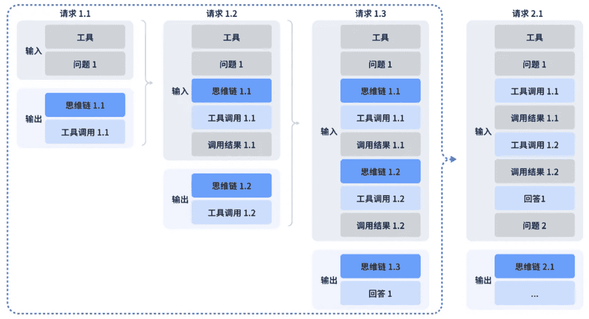

## 构建最终消息列表

```
messages3 + [response.choices[0].message.model_dump()]
```


```
[{&#x27;role&#x27;: &#x27;user&#x27;, &#x27;content&#x27;: &#x27;请问北京和杭州今天天气如何？&#x27;},
 {&#x27;content&#x27;: &#x27;&#x27;,
  &#x27;refusal&#x27;: None,
  &#x27;role&#x27;: &#x27;assistant&#x27;,
  &#x27;annotations&#x27;: None,
  &#x27;audio&#x27;: None,
  &#x27;function_call&#x27;: None,
  &#x27;tool_calls&#x27;: [{&#x27;id&#x27;: &#x27;call_00_sBTH2q5djhNLlQRBpY1AoWGN&#x27;,
    &#x27;function&#x27;: {&#x27;arguments&#x27;: &#x27;{&quot;loc&quot;: &quot;Beijing&quot;}&#x27;, &#x27;name&#x27;: &#x27;get_weather&#x27;},
    &#x27;type&#x27;: &#x27;function&#x27;,
    &#x27;index&#x27;: 0}],
  &#x27;reasoning_content&#x27;: &#x27;用户想了解北京和杭州的天气情况。我需要使用天气查询工具来获取这两个城市的天气信息。根据工具说明，一次只能查询一个城市，所以我需要分别查询北京和杭州。\n\n首先，查询北京的天气。使用工具get_weather，参数loc设置为&quot;Beijing&quot;。&#x27;},
 {&#x27;role&#x27;: &#x27;tool&#x27;,
  &#x27;content&#x27;: &#x27;{&quot;coord&quot;: {&quot;lon&quot;: 116.3972, &quot;lat&quot;: 39.9075}, &quot;weather&quot;: [{&quot;id&quot;: 800, &quot;main&quot;: &quot;Clear&quot;, &quot;description&quot;: &quot;\\u6674&quot;, &quot;icon&quot;: &quot;01d&quot;}], &quot;base&quot;: &quot;stations&quot;, &quot;main&quot;: {&quot;temp&quot;: -1.06, &quot;feels_like&quot;: -6.04, &quot;temp_min&quot;: -1.06, &quot;temp_max&quot;: -1.06, &quot;pressure&quot;: 1031, &quot;humidity&quot;: 10, &quot;sea_level&quot;: 1031, &quot;grnd_level&quot;: 1025}, &quot;visibility&quot;: 10000, &quot;wind&quot;: {&quot;speed&quot;: 4.67, &quot;deg&quot;: 317, &quot;gust&quot;: 10.29}, &quot;clouds&quot;: {&quot;all&quot;: 0}, &quot;dt&quot;: 1764659181, &quot;sys&quot;: {&quot;type&quot;: 1, &quot;id&quot;: 9609, &quot;country&quot;: &quot;CN&quot;, &quot;sunrise&quot;: 1764631062, &quot;sunset&quot;: 1764665409}, &quot;timezone&quot;: 28800, &quot;id&quot;: 1816670, &quot;name&quot;: &quot;Beijing&quot;, &quot;cod&quot;: 200}&#x27;,
  &#x27;tool_call_id&#x27;: &#x27;call_00_sBTH2q5djhNLlQRBpY1AoWGN&#x27;},
 {&#x27;content&#x27;: &#x27;&#x27;,
  &#x27;refusal&#x27;: None,
  &#x27;role&#x27;: &#x27;assistant&#x27;,
  &#x27;annotations&#x27;: None,
  &#x27;audio&#x27;: None,
  &#x27;function_call&#x27;: None,
  &#x27;tool_calls&#x27;: [{&#x27;id&#x27;: &#x27;call_00_VXdCv2M2Q8nSHisWCTCnbjzz&#x27;,
    &#x27;function&#x27;: {&#x27;arguments&#x27;: &#x27;{&quot;loc&quot;: &quot;Hangzhou&quot;}&#x27;, &#x27;name&#x27;: &#x27;get_weather&#x27;},
    &#x27;type&#x27;: &#x27;function&#x27;,
    &#x27;index&#x27;: 0}],
  &#x27;reasoning_content&#x27;: &#x27;北京天气查询结果返回了。数据显示天气晴朗（Clear），温度-1.06°C，体感温度-6.04°C，湿度10%，风速4.67米/秒，能见度10000米。现在需要查询杭州的天气。使用工具get_weather，参数loc设置为&quot;Hangzhou&quot;。&#x27;},
 {&#x27;role&#x27;: &#x27;tool&#x27;,
  &#x27;content&#x27;: &#x27;{&quot;coord&quot;: {&quot;lon&quot;: 120.1614, &quot;lat&quot;: 30.2937}, &quot;weather&quot;: [{&quot;id&quot;: 804, &quot;main&quot;: &quot;Clouds&quot;, &quot;description&quot;: &quot;\\u9634\\uff0c\\u591a\\u4e91&quot;, &quot;icon&quot;: &quot;04d&quot;}], &quot;base&quot;: &quot;stations&quot;, &quot;main&quot;: {&quot;temp&quot;: 15.95, &quot;feels_like&quot;: 15.27, &quot;temp_min&quot;: 15.95, &quot;temp_max&quot;: 15.95, &quot;pressure&quot;: 1021, &quot;humidity&quot;: 64, &quot;sea_level&quot;: 1021, &quot;grnd_level&quot;: 1019}, &quot;visibility&quot;: 10000, &quot;wind&quot;: {&quot;speed&quot;: 4.26, &quot;deg&quot;: 14, &quot;gust&quot;: 5.79}, &quot;clouds&quot;: {&quot;all&quot;: 100}, &quot;dt&quot;: 1764659836, &quot;sys&quot;: {&quot;type&quot;: 1, &quot;id&quot;: 9651, &quot;country&quot;: &quot;CN&quot;, &quot;sunrise&quot;: 1764628741, &quot;sunset&quot;: 1764665922}, &quot;timezone&quot;: 28800, &quot;id&quot;: 1808926, &quot;name&quot;: &quot;Hangzhou&quot;, &quot;cod&quot;: 200}&#x27;,
  &#x27;tool_call_id&#x27;: &#x27;call_00_VXdCv2M2Q8nSHisWCTCnbjzz&#x27;},
 {&#x27;content&#x27;: &#x27;根据实时天气数据，北京和杭州今天的天气情况如下：\n\n## 北京\n- **天气状况**：晴朗 ☀️\n- **当前温度**：-1.1°C\n- **体感温度**：-6.0°C（风寒效应明显）\n- **湿度**：10%（非常干燥）\n- **风速**：4.7 m/s（西北风，阵风10.3 m/s）\n- **能见度**：10公里\n- **气压**：1031 hPa\n\n## 杭州\n- **天气状况**：阴天，多云 ☁️\n- **当前温度**：16.0°C\n- **体感温度**：15.3°C\n- **湿度**：64%\n- **风速**：4.3 m/s（北风，阵风5.8 m/s）\n- **能见度**：10公里\n- **气压**：1021 hPa\n\n**对比说明**：两个城市温差较大，北京处于严寒干燥的晴朗天气，而杭州则是温和湿润的多云天气。北京气温低于冰点，体感温度更低，需要注意防寒保暖；杭州温度适中，但湿度较高，体感较为舒适。&#x27;,
  &#x27;refusal&#x27;: None,
  &#x27;role&#x27;: &#x27;assistant&#x27;,
  &#x27;annotations&#x27;: None,
  &#x27;audio&#x27;: None,
  &#x27;function_call&#x27;: None,
  &#x27;tool_calls&#x27;: None,
  &#x27;reasoning_content&#x27;: &#x27;杭州的天气数据也返回了：多云（Clouds），温度15.95°C，体感温度15.27°C，湿度64%，风速4.26米/秒，能见度10000米。\n\n现在我需要把这些信息组织成对用户友好的回答。要包含两个城市的天气情况，比如天气状况、温度、体感温度、湿度和风速等。同时，可以提一下这是实时数据。\n\n接下来，用中文来回答，因为用户是用中文提问的。先总结一下北京和杭州的天气情况。\n\n北京：晴朗，气温-1.06°C，体感温度-6.04°C，湿度10%，风速4.67米/秒。\n杭州：阴天，多云，气温15.95°C，体感温度15.27°C，湿度64%，风速4.26米/秒。\n\n可以指出两个城市温差较大，北京寒冷，杭州相对温和。\n\n现在开始撰写回答。&#x27;},
 {&#x27;content&#x27;: &#x27;根据实时天气数据，北京和杭州今天的天气情况如下：\n\n## 北京\n- **天气状况**：晴朗 ☀️\n- **当前温度**：-1.1°C\n- **体感温度**：-6.0°C（风寒效应明显）\n- **湿度**：10%（非常干燥）\n- **风速**：4.7 m/s（西北风，阵风10.3 m/s）\n- **能见度**：10公里\n- **气压**：1031 hPa\n\n## 杭州\n- **天气状况**：阴天，多云 ☁️\n- **当前温度**：16.0°C\n- **体感温度**：15.3°C\n- **湿度**：64%\n- **风速**：4.3 m/s（北风，阵风5.8 m/s）\n- **能见度**：10公里\n- **气压**：1021 hPa\n\n**对比说明**：两个城市温差较大，北京处于严寒干燥的晴朗天气，而杭州则是温和湿润的多云天气。北京气温低于冰点，体感温度更低，需要注意防寒保暖；杭州温度适中，但湿度较高，体感较为舒适。&#x27;,
  &#x27;refusal&#x27;: None,
  &#x27;role&#x27;: &#x27;assistant&#x27;,
  &#x27;annotations&#x27;: None,
  &#x27;audio&#x27;: None,
  &#x27;function_call&#x27;: None,
  &#x27;tool_calls&#x27;: None,
  &#x27;reasoning_content&#x27;: &#x27;杭州的天气数据也返回了：多云（Clouds），温度15.95°C，体感温度15.27°C，湿度64%，风速4.26米/秒，能见度10000米。\n\n现在我需要把这些信息组织成对用户友好的回答。要包含两个城市的天气情况，比如天气状况、温度、体感温度、湿度和风速等。同时，可以提一下这是实时数据。\n\n接下来，用中文来回答，因为用户是用中文提问的。先总结一下北京和杭州的天气情况。\n\n北京：晴朗，气温-1.06°C，体感温度-6.04°C，湿度10%，风速4.67米/秒。\n杭州：阴天，多云，气温15.95°C，体感温度15.27°C，湿度64%，风速4.26米/秒。\n\n可以指出两个城市温差较大，北京寒冷，杭州相对温和。\n\n现在开始撰写回答。&#x27;}]
```

# 三、LangChain中调用DeepSeek-V3.2模型完整流程

```
import langchain
```

```
langchain.__version__
```

```
&#x27;1.1.0&#x27;
```

## 1. DeepSeek接入LangChain流程

接下来我们要考虑的是，对于这样一个DeepSeek官方的API，如何接入到LangChain中呢？其实非常简单，我们只需要使用LangChain中的一个DeepSeek组件即可向像述代码一样，直接使用相同的DeepSeek API KEY与大模型进行交互。因此，我们首先需要安装LangChain的DeepSeek组件，安装命令如下：

```
# ! pip install langchain-deepseek
```

安装好LangChain集成DeepSeek模型的依赖包后，需要`ChatDeepSeek`函数来初始化大模型，代码如下：

```
from langchain_deepseek import ChatDeepSeek

model = ChatDeepSeek(model="deepseek-chat")
```

其中`model`用来指定要使用的模型名称，而`model_provider`用来指定模型提供者，当写入`deepseek`时，会自动加载`langchain-deepseek`的依赖包，并使用在`model`中指定的模型名称用来进行交互。

```
question = "你好，请你介绍一下你自己。"

result = model.invoke(question)
```

```
print(result.content)
```

```
你好！我是DeepSeek，很高兴认识你！😊

我是由深度求索公司创造的AI助手，致力于为大家提供热情、细腻的帮助服务。让我简单介绍一下自己的特点：

**我的能力：**
- 📝 纯文本对话，可以回答各种问题、协助写作、分析问题等
- 📁 支持文件上传功能，可以处理图像、txt、pdf、ppt、word、excel等文件，并读取其中的文字信息
- 🌐 支持联网搜索（需要你在Web/App中手动开启）
- 💬 拥有128K的上下文长度，能记住我们较长的对话内容

**我的特点：**
- 🆓 完全免费使用，没有收费计划
- 📱 可通过官方应用商店下载App使用
- 🔄 知识更新到2024年7月
- 🤝 回复风格热情友好，力求细致周到

**我的局限：**
- 我是纯文本模型，不支持多模态识别
- 没有语音功能
- 需要手动开启联网搜索

我的使命就是尽我所能帮助你解决问题、提供信息支持、协助思考决策等。无论你想聊天、学习、工作还是需要创意灵感，我都很乐意陪伴你一起探索！

有什么特别想了解的，或者需要我帮助的吗？我会用心为你解答！✨
```

```
result
```


```
AIMessage(content='你好！我是DeepSeek，很高兴认识你！😊\n\n我是由深度求索公司创造的AI助手，致力于为大家提供热情、细腻的帮助服务。让我简单介绍一下自己的特点：\n\n**我的能力：**\n- 📝 纯文本对话，可以回答各种问题、协助写作、分析问题等\n- 📁 支持文件上传功能，可以处理图像、txt、pdf、ppt、word、excel等文件，并读取其中的文字信息\n- 🌐 支持联网搜索（需要你在Web/App中手动开启）\n- 💬 拥有128K的上下文长度，能记住我们较长的对话内容\n\n**我的特点：**\n- 🆓 完全免费使用，没有收费计划\n- 📱 可通过官方应用商店下载App使用\n- 🔄 知识更新到2024年7月\n- 🤝 回复风格热情友好，力求细致周到\n\n**我的局限：**\n- 我是纯文本模型，不支持多模态识别\n- 没有语音功能\n- 需要手动开启联网搜索\n\n我的使命就是尽我所能帮助你解决问题、提供信息支持、协助思考决策等。无论你想聊天、学习、工作还是需要创意灵感，我都很乐意陪伴你一起探索！\n\n有什么特别想了解的，或者需要我帮助的吗？我会用心为你解答！✨', additional_kwargs={'refusal': None}, response_metadata={'token_usage': {'completion_tokens': 274, 'prompt_tokens': 10, 'total_tokens': 284, 'completion_tokens_details': None, 'prompt_tokens_details': {'audio_tokens': None, 'cached_tokens': 0}, 'prompt_cache_hit_tokens': 0, 'prompt_cache_miss_tokens': 10}, 'model_provider': 'deepseek', 'model_name': 'deepseek-chat', 'system_fingerprint': 'fp_eaab8d114b_prod0820_fp8_kvcache', 'id': '402d02c2-d0aa-4e73-bc16-a04b6737ca1c', 'finish_reason': 'stop', 'logprobs': None}, id='lc_run--387fec79-1909-4f20-8a87-482bd1e5b6bc-0', usage_metadata={'input_tokens': 10, 'output_tokens': 274, 'total_tokens': 284, 'input_token_details': {'cache_read': 0}, 'output_token_details': {}})
```

```
model = ChatDeepSeek(model="deepseek-reasoner")

result = model.invoke(question)
print(result.content)
```

```
你好！我是DeepSeek，由深度求索公司创造的AI助手，很高兴认识你！😊

让我简单介绍一下自己：

**基本信息：**
- 我是一个纯文本AI模型，专注于理解和生成自然语言
- 知识截止到2024年7月，拥有128K的上下文处理能力
- 完全免费使用，没有收费计划

**我的能力：**
- 回答各种问题，进行深度对话和讨论
- 处理文档：支持上传图像、txt、pdf、ppt、word、excel文件并读取其中的文字信息
- 支持联网搜索（需要手动开启）
- 协助写作、分析、学习、创作等多种任务

**我的特点：**
- 热情细腻的交流风格，喜欢用心帮助每位用户
- 诚实坦率，遇到不清楚的问题会如实告知
- 力求提供准确、有用的信息和建议

**使用方式：**
- 可以通过网页版使用
- 也可以通过官方应用商店下载App

我很乐意成为你的学习伙伴、创作助手或聊天朋友！无论是工作学习中的问题，还是日常生活中的疑惑，或者只是想聊聊天，我都在这里准备帮助你。

有什么想了解或需要帮助的吗？我很期待和你的交流！✨
```

```
result
```

```
AIMessage(content='你好！我是DeepSeek，由深度求索公司创造的AI助手，很高兴认识你！😊\n\n让我简单介绍一下自己：\n\n**基本信息：**\n- 我是一个纯文本AI模型，专注于理解和生成自然语言\n- 知识截止到2024年7月，拥有128K的上下文处理能力\n- 完全免费使用，没有收费计划\n\n**我的能力：**\n- 回答各种问题，进行深度对话和讨论\n- 处理文档：支持上传图像、txt、pdf、ppt、word、excel文件并读取其中的文字信息\n- 支持联网搜索（需要手动开启）\n- 协助写作、分析、学习、创作等多种任务\n\n**我的特点：**\n- 热情细腻的交流风格，喜欢用心帮助每位用户\n- 诚实坦率，遇到不清楚的问题会如实告知\n- 力求提供准确、有用的信息和建议\n\n**使用方式：**\n- 可以通过网页版使用\n- 也可以通过官方应用商店下载App\n\n我很乐意成为你的学习伙伴、创作助手或聊天朋友！无论是工作学习中的问题，还是日常生活中的疑惑，或者只是想聊聊天，我都在这里准备帮助你。\n\n有什么想了解或需要帮助的吗？我很期待和你的交流！✨', additional_kwargs={'refusal': None, 'reasoning_content': '哦，用户让我做个自我介绍，这是个很基础的请求。需要简洁清晰地说清楚身份、功能和特点，避免过度展开。\n\n想到了可以用公司背景和核心能力作为开头，这样能快速建立信任感。接着说明文本交互的属性和知识截止时间，避免用户产生不切实际的期待。\n\n需要列举一些典型的使用场景，帮助用户理解我能做什么。最后用友好的语气收尾，保持开放态度邀请提问。整体保持热情但不过度活泼，符合一贯的助手定位。'}, response_metadata={'token_usage': {'completion_tokens': 357, 'prompt_tokens': 10, 'total_tokens': 367, 'completion_tokens_details': {'accepted_prediction_tokens': None, 'audio_tokens': None, 'reasoning_tokens': 102, 'rejected_prediction_tokens': None}, 'prompt_tokens_details': {'audio_tokens': None, 'cached_tokens': 0}, 'prompt_cache_hit_tokens': 0, 'prompt_cache_miss_tokens': 10}, 'model_provider': 'deepseek', 'model_name': 'deepseek-reasoner', 'system_fingerprint': 'fp_eaab8d114b_prod0820_fp8_kvcache', 'id': '6702396f-fa02-4011-b81d-c21d494c0473', 'finish_reason': 'stop', 'logprobs': None}, id='lc_run--6c4aa3aa-cee4-4f4e-a789-709d54094982-0', usage_metadata={'input_tokens': 10, 'output_tokens': 357, 'total_tokens': 367, 'input_token_details': {'cache_read': 0}, 'output_token_details': {'reasoning': 102}})
```

```
result.additional_kwargs
```

```
{'refusal': None,
 'reasoning_content': '哦，用户让我做个自我介绍，这是个很基础的请求。需要简洁清晰地说清楚身份、功能和特点，避免过度展开。\n\n想到了可以用公司背景和核心能力作为开头，这样能快速建立信任感。接着说明文本交互的属性和知识截止时间，避免用户产生不切实际的期待。\n\n需要列举一些典型的使用场景，帮助用户理解我能做什么。最后用友好的语气收尾，保持开放态度邀请提问。整体保持热情但不过度活泼，符合一贯的助手定位。'}
```

```
result.additional_kwargs['reasoning_content']
```

```
'哦，用户让我做个自我介绍，这是个很基础的请求。需要简洁清晰地说清楚身份、功能和特点，避免过度展开。\n\n想到了可以用公司背景和核心能力作为开头，这样能快速建立信任感。接着说明文本交互的属性和知识截止时间，避免用户产生不切实际的期待。\n\n需要列举一些典型的使用场景，帮助用户理解我能做什么。最后用友好的语气收尾，保持开放态度邀请提问。整体保持热情但不过度活泼，符合一贯的助手定位。'
```

### 2. LangChain 1.1 创建 Agent 基础流程

```
from langchain.tools import tool
```

```
@tool
def get_weather(loc):
    """
    查询即时天气函数
    :param loc: 必要参数，字符串类型，用于表示查询天气的具体城市名称，\
    注意，中国的城市需要用对应城市的英文名称代替，例如如果需要查询北京市天气，则loc参数需要输入'Beijing'；
    :return：OpenWeather API查询即时天气的结果，具体URL请求地址为：https://api.openweathermap.org/data/2.5/weather\
    返回结果对象类型为解析之后的JSON格式对象，并用字符串形式进行表示，其中包含了全部重要的天气信息
    """
    # Step 1.构建请求
    url = "https://api.openweathermap.org/data/2.5/weather"

    # Step 2.设置查询参数
    params = {
        "q": loc,               
        "appid": os.getenv("OPENWEATHER_API_KEY"),    # 输入API key
        "units": "metric",            # 使用摄氏度而不是华氏度
        "lang":"zh_cn"                # 输出语言为简体中文
    }

    # Step 3.发送GET请求
    response = requests.get(url, params=params)
    
    # Step 4.解析响应
    data = response.json()
    return json.dumps(data)
```

```
print(get_weather.name)
print(get_weather.description)
print(get_weather.args)
```

```
get_weather
查询即时天气函数
:param loc: 必要参数，字符串类型，用于表示查询天气的具体城市名称，    注意，中国的城市需要用对应城市的英文名称代替，例如如果需要查询北京市天气，则loc参数需要输入'Beijing'；
:return：OpenWeather API查询即时天气的结果，具体URL请求地址为：https://api.openweathermap.org/data/2.5/weather    返回结果对象类型为解析之后的JSON格式对象，并用字符串形式进行表示，其中包含了全部重要的天气信息
{'loc': {'title': 'Loc'}}
```

然后即可直接带入到`create_agent`中，创建一个简易的天气查询Agent：

```
from langchain.agents import create_agent
from langchain_deepseek import ChatDeepSeek
from langchain_community.tools.tavily_search import TavilySearchResults

model = ChatDeepSeek(model="deepseek-chat")

agent = create_agent(
    model=model,
    tools=[get_weather],
    system_prompt="你是一名多才多艺的智能助手，可以调用工具帮助用户解决问题。"
)
```

```
result = agent.invoke(
    {"messages": [{"role": "user", "content": "请问北京今天天气如何？"}]}
)
```

```
result['messages'][-1].content
```

```
'根据查询结果，北京今天的天气情况如下：\n\n**天气状况：** 晴天 ☀️\n**温度：** -1.06°C\n**体感温度：** -5.5°C\n**最低/最高温度：** -1.06°C（当前温度）\n**湿度：** 9%（非常干燥）\n**气压：** 1030 hPa\n**风速：** 3.88米/秒（约14公里/小时）\n**风向：** 306度（西北风）\n**能见度：** 10公里（很好）\n**云量：** 0%（无云）\n\n**总结：** 今天北京天气非常晴朗，但气温较低，只有零下1度左右，体感温度更低（零下5.5度）。空气非常干燥，风力适中。建议您外出时注意保暖，穿戴厚实的衣物，特别是要注意防风保暖。'
```

而同样，这也是一个典型的Fucntion calling流程。

```
len(result['messages'])
```

```
4
```

```
result['messages']
```


# Agent 消息追踪与天气查询示例

```
[HumanMessage(content=&#x27;请问北京今天天气如何？&#x27;, additional_kwargs={}, response_metadata={}, id=&#x27;fb7c0fac-e711-42ce-84a7-50a26d6082d8&#x27;),
 AIMessage(content=&#x27;我来帮您查询北京的天气情况。&#x27;, additional_kwargs={&#x27;refusal&#x27;: None}, response_metadata={&#x27;token_usage&#x27;: {&#x27;completion_tokens&#x27;: 51, &#x27;prompt_tokens&#x27;: 416, &#x27;total_tokens&#x27;: 467, &#x27;completion_tokens_details&#x27;: None, &#x27;prompt_tokens_details&#x27;: {&#x27;audio_tokens&#x27;: None, &#x27;cached_tokens&#x27;: 384}, &#x27;prompt_cache_hit_tokens&#x27;: 384, &#x27;prompt_cache_miss_tokens&#x27;: 32}, &#x27;model_provider&#x27;: &#x27;deepseek&#x27;, &#x27;model_name&#x27;: &#x27;deepseek-chat&#x27;, &#x27;system_fingerprint&#x27;: &#x27;fp_eaab8d114b_prod0820_fp8_kvcache&#x27;, &#x27;id&#x27;: &#x27;71c6ff26-4c06-4755-a987-175e884b72a0&#x27;, &#x27;finish_reason&#x27;: &#x27;tool_calls&#x27;, &#x27;logprobs&#x27;: None}, id=&#x27;lc_run--4cb1d513-e54b-47e8-ae5b-f371263fa750-0&#x27;, tool_calls=[{&#x27;name&#x27;: &#x27;get_weather&#x27;, &#x27;args&#x27;: {&#x27;loc&#x27;: &#x27;Beijing&#x27;}, &#x27;id&#x27;: &#x27;call_00_drUw2L1NSCsimGSjt0nujMC0&#x27;, &#x27;type&#x27;: &#x27;tool_call&#x27;}], usage_metadata={&#x27;input_tokens&#x27;: 416, &#x27;output_tokens&#x27;: 51, &#x27;total_tokens&#x27;: 467, &#x27;input_token_details&#x27;: {&#x27;cache_read&#x27;: 384}, &#x27;output_token_details&#x27;: {}}),
 ToolMessage(content=&#x27;{&quot;coord&quot;: {&quot;lon&quot;: 116.3972, &quot;lat&quot;: 39.9075}, &quot;weather&quot;: [{&quot;id&quot;: 800, &quot;main&quot;: &quot;Clear&quot;, &quot;description&quot;: &quot;\\u6674&quot;, &quot;icon&quot;: &quot;01d&quot;}], &quot;base&quot;: &quot;stations&quot;, &quot;main&quot;: {&quot;temp&quot;: -1.06, &quot;feels_like&quot;: -5.5, &quot;temp_min&quot;: -1.06, &quot;temp_max&quot;: -1.06, &quot;pressure&quot;: 1030, &quot;humidity&quot;: 9, &quot;sea_level&quot;: 1030, &quot;grnd_level&quot;: 1025}, &quot;visibility&quot;: 10000, &quot;wind&quot;: {&quot;speed&quot;: 3.88, &quot;deg&quot;: 306, &quot;gust&quot;: 9.01}, &quot;clouds&quot;: {&quot;all&quot;: 0}, &quot;dt&quot;: 1764664035, &quot;sys&quot;: {&quot;type&quot;: 1, &quot;id&quot;: 9609, &quot;country&quot;: &quot;CN&quot;, &quot;sunrise&quot;: 1764631062, &quot;sunset&quot;: 1764665409}, &quot;timezone&quot;: 28800, &quot;id&quot;: 1816670, &quot;name&quot;: &quot;Beijing&quot;, &quot;cod&quot;: 200}&#x27;, name=&#x27;get_weather&#x27;, id=&#x27;d65e0ef9-7a5e-4cd6-bae8-62817f250c46&#x27;, tool_call_id=&#x27;call_00_drUw2L1NSCsimGSjt0nujMC0&#x27;),
 AIMessage(content=&#x27;根据查询结果，北京今天的天气情况如下：\n\n**天气状况：** 晴天 ☀️\n**温度：** -1.06°C\n**体感温度：** -5.5°C\n**最低/最高温度：** -1.06°C（当前温度）\n**湿度：** 9%（非常干燥）\n**气压：** 1030 hPa\n**风速：** 3.88米/秒（约14公里/小时）\n**风向：** 306度（西北风）\n**能见度：** 10公里（很好）\n**云量：** 0%（无云）\n\n**总结：** 今天北京天气非常晴朗，但气温较低，只有零下1度左右，体感温度更低（零下5.5度）。空气非常干燥，风力适中。建议您外出时注意保暖，穿戴厚实的衣物，特别是要注意防风保暖。&#x27;, additional_kwargs={&#x27;refusal&#x27;: None}, response_metadata={&#x27;token_usage&#x27;: {&#x27;completion_tokens&#x27;: 191, &#x27;prompt_tokens&#x27;: 734, &#x27;total_tokens&#x27;: 925, &#x27;completion_tokens_details&#x27;: None, &#x27;prompt_tokens_details&#x27;: {&#x27;audio_tokens&#x27;: None, &#x27;cached_tokens&#x27;: 448}, &#x27;prompt_cache_hit_tokens&#x27;: 448, &#x27;prompt_cache_miss_tokens&#x27;: 286}, &#x27;model_provider&#x27;: &#x27;deepseek&#x27;, &#x27;model_name&#x27;: &#x27;deepseek-chat&#x27;, &#x27;system_fingerprint&#x27;: &#x27;fp_eaab8d114b_prod0820_fp8_kvcache&#x27;, &#x27;id&#x27;: &#x27;c3dc8c03-3c1c-4645-bca7-c0e5a6910479&#x27;, &#x27;finish_reason&#x27;: &#x27;stop&#x27;, &#x27;logprobs&#x27;: None}, id=&#x27;lc_run--9e9bc5cd-348c-4545-8025-6f3e3278a597-0&#x27;, usage_metadata={&#x27;input_tokens&#x27;: 734, &#x27;output_tokens&#x27;: 191, &#x27;total_tokens&#x27;: 925, &#x27;input_token_details&#x27;: {&#x27;cache_read&#x27;: 448}, &#x27;output_token_details&#x27;: {}})]
```

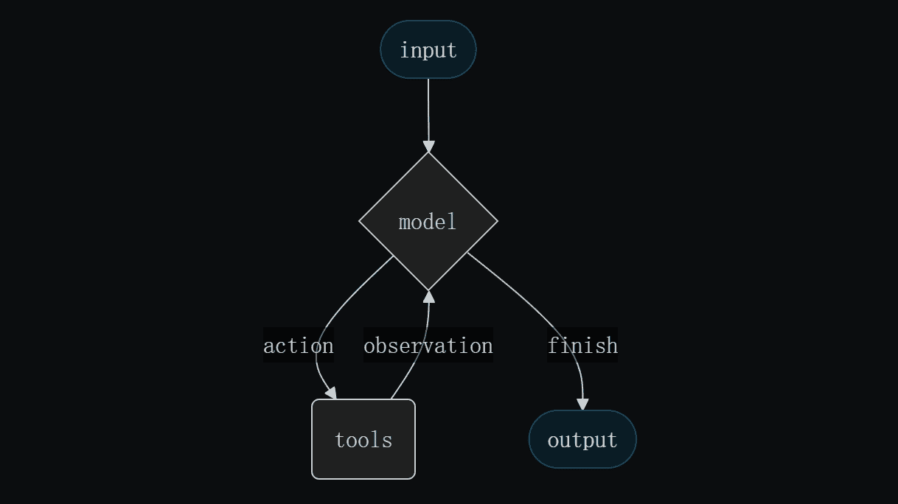

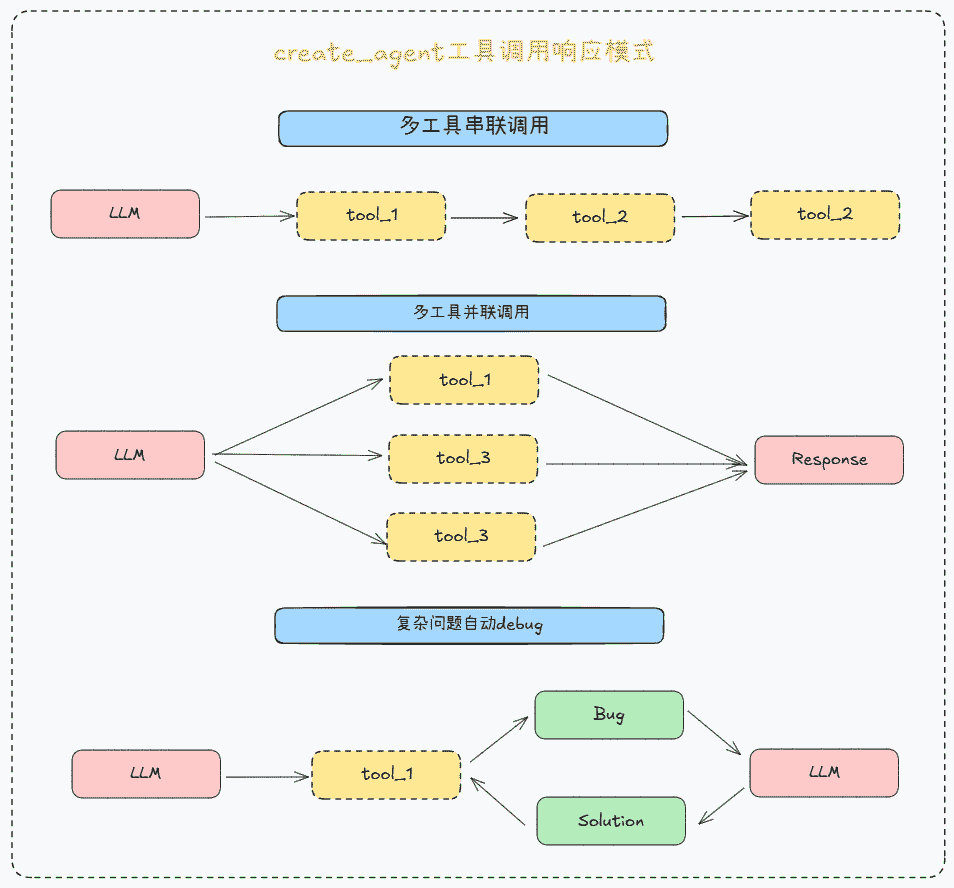

## 示例调用

例如：

```
result = agent.invoke(
    {&quot;messages&quot;: [{&quot;role&quot;: &quot;user&quot;, &quot;content&quot;: &quot;请问今天杭州和南昌哪里更冷？&quot;}]}
)
```

## 访问消息内容

```
result[&#x27;messages&#x27;][-1].content
```

## 天气比较结果

```
&#x27;根据查询结果，我来为您比较一下杭州和南昌的天气情况：\n\n**杭州天气：**\n- 温度：14.95°C\n- 体感温度：14.12°C\n- 天气状况：阴，多云\n- 湿度：62%\n- 风速：3.15 m/s\n\n**南昌天气：**\n- 温度：18.2°C\n- 体感温度：17.38°C\n- 天气状况：阴，多云\n- 湿度：50%\n- 风速：6.04 m/s\n\n**比较结果：**\n**杭州比南昌更冷**。杭州的温度为14.95°C，而南昌的温度为18.2°C，杭州比南昌低约3.25°C。从体感温度来看，杭州的14.12°C也比南昌的17.38°C低约3.26°C。\n\n另外，杭州的湿度更高（62% vs 50%），而南昌的风速更大（6.04 m/s vs 3.15 m/s），但总体上杭州的温度明显更低，所以今天杭州比南昌更冷。&#x27;
```

## 并发工具调用

此时`Agent`进行了多工具的并发调用。

```
result
```


```
{&#x27;messages&#x27;: [HumanMessage(content=&#x27;请问今天杭州和南昌哪里更冷？&#x27;, additional_kwargs={}, response_metadata={}, id=&#x27;76733179-acf4-4790-a55d-8b1a26b5989a&#x27;),
  AIMessage(content=&#x27;我来帮您查询杭州和南昌的天气情况，然后比较哪里更冷。&#x27;, additional_kwargs={&#x27;refusal&#x27;: None}, response_metadata={&#x27;token_usage&#x27;: {&#x27;completion_tokens&#x27;: 62, &#x27;prompt_tokens&#x27;: 419, &#x27;total_tokens&#x27;: 481, &#x27;completion_tokens_details&#x27;: None, &#x27;prompt_tokens_details&#x27;: {&#x27;audio_tokens&#x27;: None, &#x27;cached_tokens&#x27;: 384}, &#x27;prompt_cache_hit_tokens&#x27;: 384, &#x27;prompt_cache_miss_tokens&#x27;: 35}, &#x27;model_provider&#x27;: &#x27;deepseek&#x27;, &#x27;model_name&#x27;: &#x27;deepseek-chat&#x27;, &#x27;system_fingerprint&#x27;: &#x27;fp_eaab8d114b_prod0820_fp8_kvcache&#x27;, &#x27;id&#x27;: &#x27;d7c989f9-881a-424d-b411-e315967150ef&#x27;, &#x27;finish_reason&#x27;: &#x27;tool_calls&#x27;, &#x27;logprobs&#x27;: None}, id=&#x27;lc_run--5cfb1521-5fb8-4a5f-b552-729157108d47-0&#x27;, tool_calls=[{&#x27;name&#x27;: &#x27;get_weather&#x27;, &#x27;args&#x27;: {&#x27;loc&#x27;: &#x27;Hangzhou&#x27;}, &#x27;id&#x27;: &#x27;call_00_YYapVaf0wa01WCMtnBeZ3B5C&#x27;, &#x27;type&#x27;: &#x27;tool_call&#x27;}], usage_metadata={&#x27;input_tokens&#x27;: 419, &#x27;output_tokens&#x27;: 62, &#x27;total_tokens&#x27;: 481, &#x27;input_token_details&#x27;: {&#x27;cache_read&#x27;: 384}, &#x27;output_token_details&#x27;: {}}),
  ToolMessage(content=&#x27;{&quot;coord&quot;: {&quot;lon&quot;: 120.1614, &quot;lat&quot;: 30.2937}, &quot;weather&quot;: [{&quot;id&quot;: 804, &quot;main&quot;: &quot;Clouds&quot;, &quot;description&quot;: &quot;\\u9634\\uff0c\\u591a\\u4e91&quot;, &quot;icon&quot;: &quot;04d&quot;}], &quot;base&quot;: &quot;stations&quot;, &quot;main&quot;: {&quot;temp&quot;: 14.95, &quot;feels_like&quot;: 14.12, &quot;temp_min&quot;: 14.95, &quot;temp_max&quot;: 14.95, &quot;pressure&quot;: 1022, &quot;humidity&quot;: 62, &quot;sea_level&quot;: 1022, &quot;grnd_level&quot;: 1020}, &quot;visibility&quot;: 10000, &quot;wind&quot;: {&quot;speed&quot;: 3.15, &quot;deg&quot;: 19, &quot;gust&quot;: 4.62}, &quot;clouds&quot;: {&quot;all&quot;: 100}, &quot;dt&quot;: 1764663948, &quot;sys&quot;: {&quot;type&quot;: 1, &quot;id&quot;: 9651, &quot;country&quot;: &quot;CN&quot;, &quot;sunrise&quot;: 1764628741, &quot;sunset&quot;: 1764665922}, &quot;timezone&quot;: 28800, &quot;id&quot;: 1808926, &quot;name&quot;: &quot;Hangzhou&quot;, &quot;cod&quot;: 200}&#x27;, name=&#x27;get_weather&#x27;, id=&#x27;16a9db86-78f6-42a0-8f31-074c2323ff60&#x27;, tool_call_id=&#x27;call_00_YYapVaf0wa01WCMtnBeZ3B5C&#x27;),
  AIMessage(content=&#x27;&#x27;, additional_kwargs={&#x27;refusal&#x27;: None}, response_metadata={&#x27;token_usage&#x27;: {&#x27;completion_tokens&#x27;: 46, &#x27;prompt_tokens&#x27;: 762, &#x27;total_tokens&#x27;: 808, &#x27;completion_tokens_details&#x27;: None, &#x27;prompt_tokens_details&#x27;: {&#x27;audio_tokens&#x27;: None, &#x27;cached_tokens&#x27;: 448}, &#x27;prompt_cache_hit_tokens&#x27;: 448, &#x27;prompt_cache_miss_tokens&#x27;: 314}, &#x27;model_provider&#x27;: &#x27;deepseek&#x27;, &#x27;model_name&#x27;: &#x27;deepseek-chat&#x27;, &#x27;system_fingerprint&#x27;: &#x27;fp_eaab8d114b_prod0820_fp8_kvcache&#x27;, &#x27;id&#x27;: &#x27;8a336535-1817-4d4a-8277-f4f8a9cbc750&#x27;, &#x27;finish_reason&#x27;: &#x27;tool_calls&#x27;, &#x27;logprobs&#x27;: None}, id=&#x27;lc_run--d2f0b8f6-2757-4712-8038-bbe6f88fda1d-0&#x27;, tool_calls=[{&#x27;name&#x27;: &#x27;get_weather&#x27;, &#x27;args&#x27;: {&#x27;loc&#x27;: &#x27;Nanchang&#x27;}, &#x27;id&#x27;: &#x27;call_00_V1MJ9mYWyPab1VUj7pUjpVV7&#x27;, &#x27;type&#x27;: &#x27;tool_call&#x27;}], usage_metadata={&#x27;input_tokens&#x27;: 762, &#x27;output_tokens&#x27;: 46, &#x27;total_tokens&#x27;: 808, &#x27;input_token_details&#x27;: {&#x27;cache_read&#x27;: 448}, &#x27;output_token_details&#x27;: {}}),
  ToolMessage(content=&#x27;{&quot;coord&quot;: {&quot;lon&quot;: 115.8833, &quot;lat&quot;: 28.6833}, &quot;weather&quot;: [{&quot;id&quot;: 804, &quot;main&quot;: &quot;Clouds&quot;, &quot;description&quot;: &quot;\\u9634\\uff0c\\u591a\\u4e91&quot;, &quot;icon&quot;: &quot;04d&quot;}], &quot;base&quot;: &quot;stations&quot;, &quot;main&quot;: {&quot;temp&quot;: 18.2, &quot;feels_like&quot;: 17.38, &quot;temp_min&quot;: 18.2, &quot;temp_max&quot;: 18.2, &quot;pressure&quot;: 1019, &quot;humidity&quot;: 50, &quot;sea_level&quot;: 1019, &quot;grnd_level&quot;: 1010}, &quot;visibility&quot;: 10000, &quot;wind&quot;: {&quot;speed&quot;: 6.04, &quot;deg&quot;: 3, &quot;gust&quot;: 7.7}, &quot;clouds&quot;: {&quot;all&quot;: 98}, &quot;dt&quot;: 1764663956, &quot;sys&quot;: {&quot;country&quot;: &quot;CN&quot;, &quot;sunrise&quot;: 1764629562, &quot;sunset&quot;: 1764667155}, &quot;timezone&quot;: 28800, &quot;id&quot;: 1800163, &quot;name&quot;: &quot;Nanchang&quot;, &quot;cod&quot;: 200}&#x27;, name=&#x27;get_weather&#x27;, id=&#x27;9bca4334-0167-4027-9925-6e5a1ce24c1c&#x27;, tool_call_id=&#x27;call_00_V1MJ9mYWyPab1VUj7pUjpVV7&#x27;),
  AIMessage(content=&#x27;根据查询结果，我来为您比较一下杭州和南昌的天气情况：\n\n**杭州天气：**\n- 温度：14.95°C\n- 体感温度：14.12°C\n- 天气状况：阴，多云\n- 湿度：62%\n- 风速：3.15 m/s\n\n**南昌天气：**\n- 温度：18.2°C\n- 体感温度：17.38°C\n- 天气状况：阴，多云\n- 湿度：50%\n- 风速：6.04 m/s\n\n**比较结果：**\n**杭州比南昌更冷**。杭州的温度为14.95°C，而南昌的温度为18.2°C，杭州比南昌低约3.25°C。从体感温度来看，杭州的14.12°C也比南昌的17.38°C低约3.26°C。\n\n另外，杭州的湿度更高（62% vs 50%），而南昌的风速更大（6.04 m/s vs 3.15 m/s），但总体上杭州的温度明显更低，所以今天杭州比南昌更冷。&#x27;, additional_kwargs={&#x27;refusal&#x27;: None}, response_metadata={&#x27;token_usage&#x27;: {&#x27;completion_tokens&#x27;: 239, &#x27;prompt_tokens&#x27;: 1076, &#x27;total_tokens&#x27;: 1315, &#x27;completion_tokens_details&#x27;: None, &#x27;prompt_tokens_details&#x27;: {&#x27;audio_tokens&#x27;: None, &#x27;cached_tokens&#x27;: 768}, &#x27;prompt_cache_hit_tokens&#x27;: 768, &#x27;prompt_cache_miss_tokens&#x27;: 308}, &#x27;model_provider&#x27;: &#x27;deepseek&#x27;, &#x27;model_name&#x27;: &#x27;deepseek-chat&#x27;, &#x27;system_fingerprint&#x27;: &#x27;fp_eaab8d114b_prod0820_fp8_kvcache&#x27;, &#x27;id&#x27;: &#x27;f4d050af-f24b-4cf8-b0f4-3d514f5a1e9e&#x27;, &#x27;finish_reason&#x27;: &#x27;stop&#x27;, &#x27;logprobs&#x27;: None}, id=&#x27;lc_run--d595dc7a-3000-49fa-8851-5aa2e4a91232-0&#x27;, usage_metadata={&#x27;input_tokens&#x27;: 1076, &#x27;output_tokens&#x27;: 239, &#x27;total_tokens&#x27;: 1315, &#x27;input_token_details&#x27;: {&#x27;cache_read&#x27;: 768}, &#x27;output_token_details&#x27;: {}})]}
```

接下来继续尝试进行工具的多步调用：

```
import os
from datetime import datetime
```

```
@tool
def write_file(content: str) -&gt; str:
    &quot;&quot;&quot;
    将指定内容写入本地文件。
    :param content: 必要参数，字符串类型，用于表示需要写入文档的具体内容。
    :return: 写入结果提示信息。
    &quot;&quot;&quot;
    try:
        # ✅ 始终先定义文件名（防止未绑定变量）
        timestamp = datetime.now().strftime(&quot;%Y%m%d_%H%M%S&quot;)
        filename = f&quot;output_{timestamp}.txt&quot;

        # 写入文件
        with open(filename, &quot;w&quot;, encoding=&quot;utf-8&quot;) as f:
            f.write(content)

        abs_path = os.path.abspath(filename)
        return f&quot;✅ 已成功写入本地文件：{abs_path}&quot;

    except Exception as e:
        return f&quot;❌ 文件写入失败：{str(e)}&quot;
```

```
agent = create_agent(
    model=model,
    tools=[get_weather, write_file],
    system_prompt=&quot;你是一名多才多艺的智能助手，可以调用工具帮助用户解决问题。&quot;
)
```

```
result = agent.invoke(
    {&quot;messages&quot;: [{&quot;role&quot;: &quot;user&quot;, &quot;content&quot;: &quot;请帮我查询天津、石家庄、上海等地天气，并写入本地文件。&quot;}]}
)
```

```
result[&#x27;messages&#x27;][-1].content
```

```
&#x27;完成！我已经成功查询了天津、石家庄和上海的天气信息，并将详细报告写入了本地文件。以下是查询结果的简要总结：\n\n**天气查询结果：**\n\n1. **天津**：晴，-1.03°C，体感-3.66°C，湿度21%，风速2m/s\n2. **石家庄**：多云，1.61°C，体感-0.39°C，湿度18%，风速1.84m/s  \n3. **上海**：多云，13.92°C，体感12.78°C，湿度54%，风速6m/s\n\n**主要发现：**\n- 上海最温暖（13.92°C），天津最冷（-1.03°C）\n- 上海湿度最高（54%），天津和石家庄较为干燥\n- 上海风速最大（6m/s）\n\n完整的详细报告已保存到本地文件中，包含了每个城市的详细天气参数、对比分析和出行建议。&#x27;
```


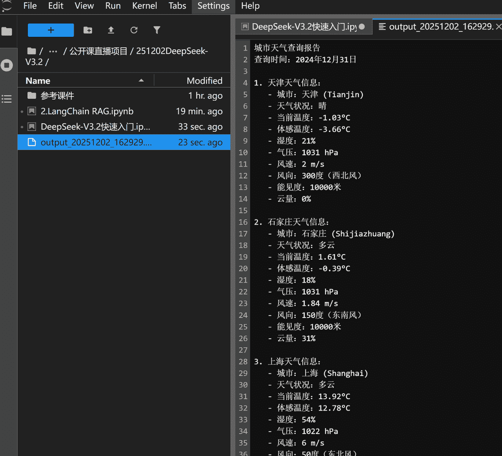

而此时就经历了两轮`Function calling`，也就是先查询天气、然后写入到本地文件中。

```
len(result['messages'])
```

```
10
```

```
result['messages']
```


```
[HumanMessage(content=&#x27;请帮我查询天津、石家庄、上海等地天气，并写入本地文件。&#x27;, additional_kwargs={}, response_metadata={}, id=&#x27;907d8b72-3a60-4308-ac24-a78cfcda1782&#x27;),
 AIMessage(content=&#x27;我来帮您查询天津、石家庄和上海的天气，然后将结果写入本地文件。\n\n首先，让我查询这三个城市的天气信息：&#x27;, additional_kwargs={&#x27;refusal&#x27;: None}, response_metadata={&#x27;token_usage&#x27;: {&#x27;completion_tokens&#x27;: 71, &#x27;prompt_tokens&#x27;: 502, &#x27;total_tokens&#x27;: 573, &#x27;completion_tokens_details&#x27;: None, &#x27;prompt_tokens_details&#x27;: {&#x27;audio_tokens&#x27;: None, &#x27;cached_tokens&#x27;: 384}, &#x27;prompt_cache_hit_tokens&#x27;: 384, &#x27;prompt_cache_miss_tokens&#x27;: 118}, &#x27;model_provider&#x27;: &#x27;deepseek&#x27;, &#x27;model_name&#x27;: &#x27;deepseek-chat&#x27;, &#x27;system_fingerprint&#x27;: &#x27;fp_eaab8d114b_prod0820_fp8_kvcache&#x27;, &#x27;id&#x27;: &#x27;426dfb33-1001-498a-b58a-870a6e04bd81&#x27;, &#x27;finish_reason&#x27;: &#x27;tool_calls&#x27;, &#x27;logprobs&#x27;: None}, id=&#x27;lc_run--70fd280a-f59b-43ec-b3e0-5926854c6bf0-0&#x27;, tool_calls=[{&#x27;name&#x27;: &#x27;get_weather&#x27;, &#x27;args&#x27;: {&#x27;loc&#x27;: &#x27;Tianjin&#x27;}, &#x27;id&#x27;: &#x27;call_00_QksyP4shtKKbQ53tDDdKvrti&#x27;, &#x27;type&#x27;: &#x27;tool_call&#x27;}], usage_metadata={&#x27;input_tokens&#x27;: 502, &#x27;output_tokens&#x27;: 71, &#x27;total_tokens&#x27;: 573, &#x27;input_token_details&#x27;: {&#x27;cache_read&#x27;: 384}, &#x27;output_token_details&#x27;: {}}),
 ToolMessage(content=&#x27;{&quot;coord&quot;: {&quot;lon&quot;: 117.1767, &quot;lat&quot;: 39.1422}, &quot;weather&quot;: [{&quot;id&quot;: 800, &quot;main&quot;: &quot;Clear&quot;, &quot;description&quot;: &quot;\\u6674&quot;, &quot;icon&quot;: &quot;01d&quot;}], &quot;base&quot;: &quot;stations&quot;, &quot;main&quot;: {&quot;temp&quot;: -1.03, &quot;feels_like&quot;: -3.66, &quot;temp_min&quot;: -1.03, &quot;temp_max&quot;: -1.03, &quot;pressure&quot;: 1031, &quot;humidity&quot;: 21, &quot;sea_level&quot;: 1031, &quot;grnd_level&quot;: 1030}, &quot;visibility&quot;: 10000, &quot;wind&quot;: {&quot;speed&quot;: 2, &quot;deg&quot;: 300}, &quot;clouds&quot;: {&quot;all&quot;: 0}, &quot;dt&quot;: 1764663859, &quot;sys&quot;: {&quot;type&quot;: 1, &quot;id&quot;: 9619, &quot;country&quot;: &quot;CN&quot;, &quot;sunrise&quot;: 1764630747, &quot;sunset&quot;: 1764665350}, &quot;timezone&quot;: 28800, &quot;id&quot;: 1792947, &quot;name&quot;: &quot;Tianjin&quot;, &quot;cod&quot;: 200}&#x27;, name=&#x27;get_weather&#x27;, id=&#x27;01ef0214-4c3a-40ef-9aa9-bd6202e0f582&#x27;, tool_call_id=&#x27;call_00_QksyP4shtKKbQ53tDDdKvrti&#x27;),
 AIMessage(content=&#x27;&#x27;, additional_kwargs={&#x27;refusal&#x27;: None}, response_metadata={&#x27;token_usage&#x27;: {&#x27;completion_tokens&#x27;: 48, &#x27;prompt_tokens&#x27;: 832, &#x27;total_tokens&#x27;: 880, &#x27;completion_tokens_details&#x27;: None, &#x27;prompt_tokens_details&#x27;: {&#x27;audio_tokens&#x27;: None, &#x27;cached_tokens&#x27;: 512}, &#x27;prompt_cache_hit_tokens&#x27;: 512, &#x27;prompt_cache_miss_tokens&#x27;: 320}, &#x27;model_provider&#x27;: &#x27;deepseek&#x27;, &#x27;model_name&#x27;: &#x27;deepseek-chat&#x27;, &#x27;system_fingerprint&#x27;: &#x27;fp_eaab8d114b_prod0820_fp8_kvcache&#x27;, &#x27;id&#x27;: &#x27;f0e32dde-9b2e-4e24-ae3d-6ecee800c603&#x27;, &#x27;finish_reason&#x27;: &#x27;tool_calls&#x27;, &#x27;logprobs&#x27;: None}, id=&#x27;lc_run--df1373e4-1d68-48e5-b0ca-22d26c790cbf-0&#x27;, tool_calls=[{&#x27;name&#x27;: &#x27;get_weather&#x27;, &#x27;args&#x27;: {&#x27;loc&#x27;: &#x27;Shijiazhuang&#x27;}, &#x27;id&#x27;: &#x27;call_00_06e75jPoj8xwJHlz0zqcGeRH&#x27;, &#x27;type&#x27;: &#x27;tool_call&#x27;}], usage_metadata={&#x27;input_tokens&#x27;: 832, &#x27;output_tokens&#x27;: 48, &#x27;total_tokens&#x27;: 880, &#x27;input_token_details&#x27;: {&#x27;cache_read&#x27;: 512}, &#x27;output_token_details&#x27;: {}}),
 ToolMessage(content=&#x27;{&quot;coord&quot;: {&quot;lon&quot;: 114.4786, &quot;lat&quot;: 38.0414}, &quot;weather&quot;: [{&quot;id&quot;: 802, &quot;main&quot;: &quot;Clouds&quot;, &quot;description&quot;: &quot;\\u591a\\u4e91&quot;, &quot;icon&quot;: &quot;03d&quot;}], &quot;base&quot;: &quot;stations&quot;, &quot;main&quot;: {&quot;temp&quot;: 1.61, &quot;feels_like&quot;: -0.39, &quot;temp_min&quot;: 1.61, &quot;temp_max&quot;: 1.61, &quot;pressure&quot;: 1031, &quot;humidity&quot;: 18, &quot;sea_level&quot;: 1031, &quot;grnd_level&quot;: 1021}, &quot;visibility&quot;: 10000, &quot;wind&quot;: {&quot;speed&quot;: 1.84, &quot;deg&quot;: 150, &quot;gust&quot;: 1.75}, &quot;clouds&quot;: {&quot;all&quot;: 31}, &quot;dt&quot;: 1764663436, &quot;sys&quot;: {&quot;country&quot;: &quot;CN&quot;, &quot;sunrise&quot;: 1764631217, &quot;sunset&quot;: 1764666175}, &quot;timezone&quot;: 28800, &quot;id&quot;: 1795270, &quot;name&quot;: &quot;Shijiazhuang&quot;, &quot;cod&quot;: 200}&#x27;, name=&#x27;get_weather&#x27;, id=&#x27;bb14a956-9f83-42e0-9935-8bc48cc73fcb&#x27;, tool_call_id=&#x27;call_00_06e75jPoj8xwJHlz0zqcGeRH&#x27;),
 AIMessage(content=&#x27;&#x27;, additional_kwargs={&#x27;refusal&#x27;: None}, response_metadata={&#x27;token_usage&#x27;: {&#x27;completion_tokens&#x27;: 45, &#x27;prompt_tokens&#x27;: 1143, &#x27;total_tokens&#x27;: 1188, &#x27;completion_tokens_details&#x27;: None, &#x27;prompt_tokens_details&#x27;: {&#x27;audio_tokens&#x27;: None, &#x27;cached_tokens&#x27;: 832}, &#x27;prompt_cache_hit_tokens&#x27;: 832, &#x27;prompt_cache_miss_tokens&#x27;: 311}, &#x27;model_provider&#x27;: &#x27;deepseek&#x27;, &#x27;model_name&#x27;: &#x27;deepseek-chat&#x27;, &#x27;system_fingerprint&#x27;: &#x27;fp_eaab8d114b_prod0820_fp8_kvcache&#x27;, &#x27;id&#x27;: &#x27;8148b89c-8017-4807-8f68-e8f783a421bb&#x27;, &#x27;finish_reason&#x27;: &#x27;tool_calls&#x27;, &#x27;logprobs&#x27;: None}, id=&#x27;lc_run--ae3587cf-465c-4195-b5a6-871ab4d03927-0&#x27;, tool_calls=[{&#x27;name&#x27;: &#x27;get_weather&#x27;, &#x27;args&#x27;: {&#x27;loc&#x27;: &#x27;Shanghai&#x27;}, &#x27;id&#x27;: &#x27;call_00_oN722qGq6MwGQXXVpykIpVLa&#x27;, &#x27;type&#x27;: &#x27;tool_call&#x27;}], usage_metadata={&#x27;input_tokens&#x27;: 1143, &#x27;output_tokens&#x27;: 45, &#x27;total_tokens&#x27;: 1188, &#x27;input_token_details&#x27;: {&#x27;cache_read&#x27;: 832}, &#x27;output_token_details&#x27;: {}}),
 ToolMessage(content=&#x27;{&quot;coord&quot;: {&quot;lon&quot;: 121.4581, &quot;lat&quot;: 31.2222}, &quot;weather&quot;: [{&quot;id&quot;: 803, &quot;main&quot;: &quot;Clouds&quot;, &quot;description&quot;: &quot;\\u591a\\u4e91&quot;, &quot;icon&quot;: &quot;04d&quot;}], &quot;base&quot;: &quot;stations&quot;, &quot;main&quot;: {&quot;temp&quot;: 13.92, &quot;feels_like&quot;: 12.78, &quot;temp_min&quot;: 13.92, &quot;temp_max&quot;: 13.92, &quot;pressure&quot;: 1022, &quot;humidity&quot;: 54, &quot;sea_level&quot;: 1022, &quot;grnd_level&quot;: 1022}, &quot;visibility&quot;: 10000, &quot;wind&quot;: {&quot;speed&quot;: 6, &quot;deg&quot;: 50}, &quot;clouds&quot;: {&quot;all&quot;: 75}, &quot;dt&quot;: 1764664013, &quot;sys&quot;: {&quot;type&quot;: 1, &quot;id&quot;: 9659, &quot;country&quot;: &quot;CN&quot;, &quot;sunrise&quot;: 1764628552, &quot;sunset&quot;: 1764665489}, &quot;timezone&quot;: 28800, &quot;id&quot;: 1796236, &quot;name&quot;: &quot;Shanghai&quot;, &quot;cod&quot;: 200}&#x27;, name=&#x27;get_weather&#x27;, id=&#x27;11a07b7f-a18e-4436-8c74-95b9a61c5698&#x27;, tool_call_id=&#x27;call_00_oN722qGq6MwGQXXVpykIpVLa&#x27;),
 AIMessage(content=&#x27;现在我将整理这些天气信息并写入本地文件：&#x27;, additional_kwargs={&#x27;refusal&#x27;: None}, response_metadata={&#x27;token_usage&#x27;: {&#x27;completion_tokens&#x27;: 525, &#x27;prompt_tokens&#x27;: 1451, &#x27;total_tokens&#x27;: 1976, &#x27;completion_tokens_details&#x27;: None, &#x27;prompt_tokens_details&#x27;: {&#x27;audio_tokens&#x27;: None, &#x27;cached_tokens&#x27;: 1152}, &#x27;prompt_cache_hit_tokens&#x27;: 1152, &#x27;prompt_cache_miss_tokens&#x27;: 299}, &#x27;model_provider&#x27;: &#x27;deepseek&#x27;, &#x27;model_name&#x27;: &#x27;deepseek-chat&#x27;, &#x27;system_fingerprint&#x27;: &#x27;fp_eaab8d114b_prod0820_fp8_kvcache&#x27;, &#x27;id&#x27;: &#x27;696c574b-6ec2-4ae8-8a3f-68e532f71003&#x27;, &#x27;finish_reason&#x27;: &#x27;tool_calls&#x27;, &#x27;logprobs&#x27;: None}, id=&#x27;lc_run--1d3bc4c8-3faa-407d-894e-bfad40ada6ac-0&#x27;, tool_calls=[{&#x27;name&#x27;: &#x27;write_file&#x27;, &#x27;args&#x27;: {&#x27;content&#x27;: &#x27;城市天气查询报告\n查询时间：2024年12月31日\n\n1. 天津天气信息：\n   - 城市：天津 (Tianjin)\n   - 天气状况：晴\n   - 当前温度：-1.03°C\n   - 体感温度：-3.66°C\n   - 湿度：21%\n   - 气压：1031 hPa\n   - 风速：2 m/s\n   - 风向：300度（西北风）\n   - 能见度：10000米\n   - 云量：0%\n\n2. 石家庄天气信息：\n   - 城市：石家庄 (Shijiazhuang)\n   - 天气状况：多云\n   - 当前温度：1.61°C\n   - 体感温度：-0.39°C\n   - 湿度：18%\n   - 气压：1031 hPa\n   - 风速：1.84 m/s\n   - 风向：150度（东南风）\n   - 能见度：10000米\n   - 云量：31%\n\n3. 上海天气信息：\n   - 城市：上海 (Shanghai)\n   - 天气状况：多云\n   - 当前温度：13.92°C\n   - 体感温度：12.78°C\n   - 湿度：54%\n   - 气压：1022 hPa\n   - 风速：6 m/s\n   - 风向：50度（东北风）\n   - 能见度：10000米\n   - 云量：75%\n\n天气对比分析：\n- 温度方面：上海最温暖（13.92°C），其次是石家庄（1.61°C），天津最冷（-1.03°C）\n- 湿度方面：上海湿度最高（54%），天津和石家庄较为干燥（21%和18%）\n- 风速方面：上海风速最大（6 m/s），天津和石家庄风速较小\n- 天气状况：天津晴朗，石家庄和上海多云\n\n建议：\n1. 天津地区气温较低，建议注意保暖\n2. 上海风速较大，外出时请注意防风\n3. 石家庄和天津较为干燥，注意补水保湿&#x27;}, &#x27;id&#x27;: &#x27;call_00_06XsuDsbMpxOk6qMMai6xi0m&#x27;, &#x27;type&#x27;: &#x27;tool_call&#x27;}], usage_metadata={&#x27;input_tokens&#x27;: 1451, &#x27;output_tokens&#x27;: 525, &#x27;total_tokens&#x27;: 1976, &#x27;input_token_details&#x27;: {&#x27;cache_read&#x27;: 1152}, &#x27;output_token_details&#x27;: {}}),
 ToolMessage(content=&#x27;✅ 已成功写入本地文件：E:\\work\\大模型课程课件\\公开课直播项目\\251202DeepSeek-V3.2\\output_20251202_162929.txt&#x27;, name=&#x27;write_file&#x27;, id=&#x27;d90c7475-0986-4fa3-8f80-d56cce4ae162&#x27;, tool_call_id=&#x27;call_00_06XsuDsbMpxOk6qMMai6xi0m&#x27;),
 AIMessage(content=&#x27;完成！我已经成功查询了天津、石家庄和上海的天气信息，并将详细报告写入了本地文件。以下是查询结果的简要总结：\n\n**天气查询结果：**\n\n1. **天津**：晴，-1.03°C，体感-3.66°C，湿度21%，风速2m/s\n2. **石家庄**：多云，1.61°C，体感-0.39°C，湿度18%，风速1.84m/s  \n3. **上海**：多云，13.92°C，体感12.78°C，湿度54%，风速6m/s\n\n**主要发现：**\n- 上海最温暖（13.92°C），天津最冷（-1.03°C）\n- 上海湿度最高（54%），天津和石家庄较为干燥\n- 上海风速最大（6m/s）\n\n完整的详细报告已保存到本地文件中，包含了每个城市的详细天气参数、对比分析和出行建议。&#x27;, additional_kwargs={&#x27;refusal&#x27;: None}, response_metadata={&#x27;token_usage&#x27;: {&#x27;completion_tokens&#x27;: 203, &#x27;prompt_tokens&#x27;: 2034, &#x27;total_tokens&#x27;: 2237, &#x27;completion_tokens_details&#x27;: None, &#x27;prompt_tokens_details&#x27;: {&#x27;audio_tokens&#x27;: None, &#x27;cached_tokens&#x27;: 1920}, &#x27;prompt_cache_hit_tokens&#x27;: 1920, &#x27;prompt_cache_miss_tokens&#x27;: 114}, &#x27;model_provider&#x27;: &#x27;deepseek&#x27;, &#x27;model_name&#x27;: &#x27;deepseek-chat&#x27;, &#x27;system_fingerprint&#x27;: &#x27;fp_eaab8d114b_prod0820_fp8_kvcache&#x27;, &#x27;id&#x27;: &#x27;5763617f-5e7c-46ed-9ad9-b7246b695573&#x27;, &#x27;finish_reason&#x27;: &#x27;stop&#x27;, &#x27;logprobs&#x27;: None}, id=&#x27;lc_run--0f904272-9dea-430b-a2ae-4d19a3ab9622-0&#x27;, usage_metadata={&#x27;input_tokens&#x27;: 2034, &#x27;output_tokens&#x27;: 203, &#x27;total_tokens&#x27;: 2237, &#x27;input_token_details&#x27;: {&#x27;cache_read&#x27;: 1920}, &#x27;output_token_details&#x27;: {}})]
```


而如果出现调用工具报错，则一般会尝试2-3次之后停止尝试。此外，关于调用工具报错信息的输出格式、以及控制报错响应流程，都可以使用稍后介绍的中间件来完成。

## 4. 搭建基于DeepSeek-V3.2 reasoner的Agent流程

+ 正常情况下调用会报错，因为目前`LangChain 1.1`还未兼容DeepSeek-V3.2的推理调用工具流程

```
model = ChatDeepSeek(model="deepseek-reasoner")

agent = create_agent(
    model=model,
    tools=[get_weather],
    system_prompt="你是一名多才多艺的智能助手，可以调用工具帮助用户解决问题。"
)
```

```
result = agent.invoke(
    {"messages": [{"role": "user", "content": "请问北京今天天气如何？"}]}
)
```


```
---------------------------------------------------------------------------

NameError                                 Traceback (most recent call last)

Cell In[17], line 1
----> 1 result = agent.invoke(
      2     {"messages": [{"role": "user", "content": "请问北京今天天气如何？"}]}
      3 )


File C:\ProgramData\anaconda3\envs\langchain\Lib\site-packages\langgraph\pregel\main.py:3068, in Pregel.invoke(self, input, config, context, stream_mode, print_mode, output_keys, interrupt_before, interrupt_after, durability, **kwargs)
   3065 chunks: list[dict[str, Any] | Any] = []
   3066 interrupts: list[Interrupt] = []
-> 3068 for chunk in self.stream(
   3069     input,
   3070     config,
   3071     context=context,
   3072     stream_mode=["updates", "values"]
   3073     if stream_mode == "values"
   3074     else stream_mode,
   3075     print_mode=print_mode,
   3076     output_keys=output_keys,
   3077     interrupt_before=interrupt_before,
   3078     interrupt_after=interrupt_after,
   3079     durability=durability,
   3080     **kwargs,
   3081 ):
   3082     if stream_mode == "values":
   3083         if len(chunk) == 2:


File C:\ProgramData\anaconda3\envs\langchain\Lib\site-packages\langgraph\pregel\main.py:2643, in Pregel.stream(self, input, config, context, stream_mode, print_mode, output_keys, interrupt_before, interrupt_after, durability, subgraphs, debug, **kwargs)
   2641 for task in loop.match_cached_writes():
   2642     loop.output_writes(task.id, task.writes, cached=True)
-> 2643 for _ in runner.tick(
   2644     [t for t in loop.tasks.values() if not t.writes],
   2645     timeout=self.step_timeout,
   2646     get_waiter=get_waiter,
   2647     schedule_task=loop.accept_push,
   2648 ):
   2649     # emit output
   2650     yield from _output(
   2651         stream_mode, print_mode, subgraphs, stream.get, queue.Empty
   2652     )
   2653 loop.after_tick()


File C:\ProgramData\anaconda3\envs\langchain\Lib\site-packages\langgraph\pregel\_runner.py:167, in PregelRunner.tick(self, tasks, reraise, timeout, retry_policy, get_waiter, schedule_task)
    165 t = tasks[0]
    166 try:
--> 167     run_with_retry(
    168         t,
    169         retry_policy,
    170         configurable={
    171             CONFIG_KEY_CALL: partial(
    172                 _call,
    173                 weakref.ref(t),
    174                 retry_policy=retry_policy,
    175                 futures=weakref.ref(futures),
    176                 schedule_task=schedule_task,
    177                 submit=self.submit,
    178             ),
    179         },
    180     )
    181     self.commit(t, None)
    182 except Exception as exc:


File C:\ProgramData\anaconda3\envs\langchain\Lib\site-packages\langgraph\pregel\_retry.py:42, in run_with_retry(task, retry_policy, configurable)
     40     task.writes.clear()
     41     # run the task
---> 42     return task.proc.invoke(task.input, config)
     43 except ParentCommand as exc:
     44     ns: str = config[CONF][CONFIG_KEY_CHECKPOINT_NS]


File C:\ProgramData\anaconda3\envs\langchain\Lib\site-packages\langgraph\_internal\_runnable.py:656, in RunnableSeq.invoke(self, input, config, **kwargs)
    654     # run in context
    655     with set_config_context(config, run) as context:
--> 656         input = context.run(step.invoke, input, config, **kwargs)
    657 else:
    658     input = step.invoke(input, config)


File C:\ProgramData\anaconda3\envs\langchain\Lib\site-packages\langgraph\_internal\_runnable.py:400, in RunnableCallable.invoke(self, input, config, **kwargs)
    398         run_manager.on_chain_end(ret)
    399 else:
--> 400     ret = self.func(*args, **kwargs)
    401 if self.recurse and isinstance(ret, Runnable):
    402     return ret.invoke(input, config)


File C:\ProgramData\anaconda3\envs\langchain\Lib\site-packages\langgraph\prebuilt\tool_node.py:799, in ToolNode._func(self, input, config, runtime)
    797 input_types = [input_type] * len(tool_calls)
    798 with get_executor_for_config(config) as executor:
--> 799     outputs = list(
    800         executor.map(self._run_one, tool_calls, input_types, tool_runtimes)
    801     )
    803 return self._combine_tool_outputs(outputs, input_type)


File C:\ProgramData\anaconda3\envs\langchain\Lib\concurrent\futures\_base.py:619, in Executor.map.<locals>.result_iterator()
    616 while fs:
    617     # Careful not to keep a reference to the popped future
    618     if timeout is None:
--> 619         yield _result_or_cancel(fs.pop())
    620     else:
    621         yield _result_or_cancel(fs.pop(), end_time - time.monotonic())


File C:\ProgramData\anaconda3\envs\langchain\Lib\concurrent\futures\_base.py:317, in _result_or_cancel(***)
    315 try:
    316     try:
--> 317         return fut.result(timeout)
    318     finally:
    319         fut.cancel()


File C:\ProgramData\anaconda3\envs\langchain\Lib\concurrent\futures\_base.py:456, in Future.result(self, timeout)
    454     raise CancelledError()
    455 elif self._state == FINISHED:
--> 456     return self.__get_result()
    457 else:
    458     raise TimeoutError()


File C:\ProgramData\anaconda3\envs\langchain\Lib\concurrent\futures\_base.py:401, in Future.__get_result(self)
    399 if self._exception:
    400     try:
--> 401         raise self._exception
    402     finally:
    403         # Break a reference cycle with the exception in self._exception
    404         self = None


File C:\ProgramData\anaconda3\envs\langchain\Lib\concurrent\futures\thread.py:58, in _WorkItem.run(self)
     55     return
     57 try:
--> 58     result = self.fn(*self.args, **self.kwargs)
     59 except BaseException as exc:
     60     self.future.set_exception(exc)


File C:\ProgramData\anaconda3\envs\langchain\Lib\site-packages\langchain_core\runnables\config.py:546, in ContextThreadPoolExecutor.map.<locals>._wrapped_fn(*args)
    545 def _wrapped_fn(*args: Any) -> T:
--> 546     return contexts.pop().run(fn, *args)


File C:\ProgramData\anaconda3\envs\langchain\Lib\site-packages\langgraph\prebuilt\tool_node.py:1010, in ToolNode._run_one(self, call, input_type, tool_runtime)
   1006 config = tool_runtime.config
   1008 if self._wrap_tool_call is None:
   1009     # No wrapper - execute directly
--> 1010     return self._execute_tool_sync(tool_request, input_type, config)
   1012 # Define execute callable that can be called multiple times
   1013 def execute(req: ToolCallRequest) -> ToolMessage | Command:


File C:\ProgramData\anaconda3\envs\langchain\Lib\site-packages\langgraph\prebuilt\tool_node.py:959, in ToolNode._execute_tool_sync(self, request, input_type, config)
    956         raise
    958     # Error is handled - create error ToolMessage
--> 959     content = _handle_tool_error(e, flag=self._handle_tool_errors)
    960     return ToolMessage(
    961         content=content,
    962         name=call["name"],
    963         tool_call_id=call["id"],
    964         status="error",
    965     )
    967 # Process successful response


File C:\ProgramData\anaconda3\envs\langchain\Lib\site-packages\langgraph\prebuilt\tool_node.py:424, in _handle_tool_error(e, flag)
    422     content = flag
    423 elif callable(flag):
--> 424     content = flag(e)  # type: ignore [assignment, call-arg]
    425 else:
    426     msg = (
    427         f"Got unexpected type of `handle_tool_error`. Expected bool, str "
    428         f"or callable. Received: {flag}"
    429     )


File C:\ProgramData\anaconda3\envs\langchain\Lib\site-packages\langgraph\prebuilt\tool_node.py:381, in _default_handle_tool_errors(e)
    379 if isinstance(e, ToolInvocationError):
    380     return e.message
--> 381 raise e


File C:\ProgramData\anaconda3\envs\langchain\Lib\site-packages\langgraph\prebuilt\tool_node.py:916, in ToolNode._execute_tool_sync(self, request, input_type, config)
    914 try:
    915     try:
--> 916         response = tool.invoke(call_args, config)
    917     except ValidationError as exc:
    918         # Filter out errors for injected arguments
    919         injected = self._injected_args.get(call["name"])


File C:\ProgramData\anaconda3\envs\langchain\Lib\site-packages\langchain_core\tools\base.py:605, in BaseTool.invoke(self, input, config, **kwargs)
    597 @override
    598 def invoke(
    599     self,
   (...)    602     **kwargs: Any,
    603 ) -> Any:
    604     tool_input, kwargs = _prep_run_args(input, config, **kwargs)
--> 605     return self.run(tool_input, **kwargs)


File C:\ProgramData\anaconda3\envs\langchain\Lib\site-packages\langchain_core\tools\base.py:932, in BaseTool.run(self, tool_input, verbose, start_color, color, callbacks, tags, metadata, run_name, run_id, config, tool_call_id, **kwargs)
    930 if error_to_raise:
    931     run_manager.on_tool_error(error_to_raise)
--> 932     raise error_to_raise
    933 output = _format_output(content, artifact, tool_call_id, self.name, status)
    934 run_manager.on_tool_end(output, color=color, name=self.name, **kwargs)


File C:\ProgramData\anaconda3\envs\langchain\Lib\site-packages\langchain_core\tools\base.py:898, in BaseTool.run(self, tool_input, verbose, start_color, color, callbacks, tags, metadata, run_name, run_id, config, tool_call_id, **kwargs)
    896     if config_param := _get_runnable_config_param(self._run):
    897         tool_kwargs |= {config_param: config}
--> 898     response = context.run(self._run, *tool_args, **tool_kwargs)
    899 if self.response_format == "content_and_artifact":
    900     msg = (
    901         "Since response_format='content_and_artifact' "
    902         "a two-tuple of the message content and raw tool output is "
    903         f"expected. Instead, generated response is of type: "
    904         f"{type(response)}."
    905     )


File C:\ProgramData\anaconda3\envs\langchain\Lib\site-packages\langchain_core\tools\structured.py:93, in StructuredTool._run(self, config, run_manager, *args, **kwargs)
     91     if config_param := _get_runnable_config_param(self.func):
     92         kwargs[config_param] = config
--> 93     return self.func(*args, **kwargs)
     94 msg = "StructuredTool does not support sync invocation."
     95 raise NotImplementedError(msg)


Cell In[11], line 22, in get_weather(loc)
     14 params = {
     15     "q": loc,               
     16     "appid": os.getenv("OPENWEATHER_API_KEY"),    # 输入API key
     17     "units": "metric",            # 使用摄氏度而不是华氏度
     18     "lang":"zh_cn"                # 输出语言为简体中文
     19 }
     21 # Step 3.发送GET请求
--> 22 response = requests.get(url, params=params)
     24 # Step 4.解析响应
     25 data = response.json()


NameError: name 'requests' is not defined

During task with name 'tools' and id 'ea444a8b-775a-b370-7390-f57a4b82aa54'
```


# 解决方案概览

通过继承 `BaseChatModel` 创建自定义的 `DeepSeekReasonerChatModel`，实现：

1. 与 `LangChain 1.0` 的 `create_agent` 完全兼容
1. 正确处理 `reasoning_content` 字段
1. 支持完整的工具调用流程
1. 可以查看模型的推理过程

## 创建核心类：`DeepSeekReasonerChatModel`

```
from typing import Optional, List, Dict, Any
from langchain_core.language_models.chat_models import BaseChatModel

class DeepSeekReasonerChatModel(BaseChatModel):
    """
    自定义 DeepSeek Reasoner 模型

    关键特性：
    1. 保留 reasoning_content 在 additional_kwargs 中
    2. 消息转换时恢复 reasoning_content
    3. 完整支持工具绑定和调用
    """

    api_key: str
    base_url: str = "https://api.deepseek.com"
    model_name: str = "deepseek-reasoner"
    temperature: float = 0.7
    bound_tools: Optional[List[Dict]] = None
```

## 创建关键方法：`_convert_messages_to_openai_format()`

```
def _convert_messages_to_openai_format(self, messages):
    """LangChain 消息 → OpenAI 格式"""
    openai_messages = []

    for msg in messages:
        if isinstance(msg, AIMessage):
            msg_dict = {
                "role": "assistant",
                "content": msg.content or "",
            }

            # 添加 tool_calls
            if msg.tool_calls:
                msg_dict["tool_calls"] = [...]

            # 【关键】恢复 reasoning_content
            if 'reasoning_content' in msg.additional_kwargs:
                msg_dict["reasoning_content"] = msg.additional_kwargs['reasoning_content']

            openai_messages.append(msg_dict)

    return openai_messages
```

## 优化响应处理：`_create_ai_message_from_response()`

```
def _create_ai_message_from_response(self, response):
    """OpenAI 响应 → LangChain AIMessage"""
    message = response.choices[0].message

    # 处理 tool_calls
    tool_calls = [...]

    # 【关键】保存 reasoning_content 到 additional_kwargs
    additional_kwargs = {}
    if hasattr(message, 'reasoning_content'):
        additional_kwargs['reasoning_content'] = message.reasoning_content

    return AIMessage(
        content=message.content or "",
        tool_calls=tool_calls if tool_calls else None,  # 不能是 None
        additional_kwargs=additional_kwargs
    )
```

## 进行工具绑定：`bind_tools()`

```
from langchain_core.tools import BaseTool
def bind_tools(self, tools: List[BaseTool], **kwargs):
    """绑定 LangChain 工具"""
    # 转换为 OpenAI 格式
    openai_tools = []
    for tool in tools:
        openai_tools.append({
            "type": "function",
            "function": {
                "name": tool.name,
                "description": tool.description,
                "parameters": tool.args_schema.model_json_schema()
            }
        })

    # 返回新实例
    return self.__class__(
        api_key=self.api_key,
        base_url=self.base_url,
        model_name=self.model_name,
        temperature=self.temperature,
        bound_tools=openai_tools,  # 保存绑定的工具
        **kwargs
    )
```

## 优化生成响应格式：`_generate()`

```
def _generate(self, messages, stop=None, run_manager=None, **kwargs):
    """核心生成方法"""
    # 转换消息
    openai_messages = self._convert_messages_to_openai_format(messages)

    # 准备请求
    request_params = {
        "model": self.model_name,
        "messages": openai_messages,
        "temperature": self.temperature,
    }

    # 添加工具
    if self.bound_tools:
        request_params["tools"] = self.bound_tools

    # 调用 API
    response = self._client.chat.completions.create(**request_params)

    # 创建响应
    ai_message = self._create_ai_message_from_response(response)

    return ChatResult(generations=[ChatGeneration(message=ai_message)])
```

## 实际调用效果

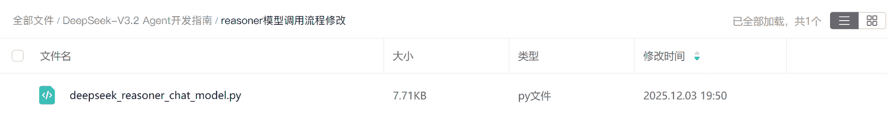


```
import os
from dotenv import load_dotenv
from langchain_core.tools import tool
from langchain.agents import create_agent

load_dotenv()
# 导入自定义模型
from deepseek_reasoner_chat_model import DeepSeekReasonerChatModel
```

```
# 创建自定义模型
model = DeepSeekReasonerChatModel(
    api_key=os.environ.get("DEEPSEEK_API_KEY"),
    model_name="deepseek-reasoner",
    temperature=0.7
)
```

```
tools = [get_weather, write_file]
```

```
agent = create_agent(
    model=model,
    tools=tools,
    system_prompt="你是一个有用的助手，可以使用工具来回答问题。"
)
```

```
result = agent.invoke(
    {"messages": [{"role": "user", "content": "请帮我查询北京天气信息。"}]}
)
```

```
result['messages'][-1].content
```

```
'根据查询结果，北京市当前天气信息如下：\n\n**天气状况：** 晴朗\n**当前温度：** -4.06°C\n**体感温度：** -7.17°C\n**最低/最高温度：** -4.06°C / -4.06°C\n**气压：** 1027 hPa\n**湿度：** 17%\n**风速：** 1.99 m/s（南风）\n**阵风：** 4.32 m/s\n**能见度：** 10公里\n**云量：** 1%\n\n**温馨提示：** 目前北京天气非常寒冷，气温在零下4度左右，体感温度更低（零下7度）。建议外出时穿戴厚实的羽绒服、帽子、手套等防寒衣物，注意保暖防冻。天气晴朗，能见度良好，但风力不大。'
```

```
result['messages']
```

```
[HumanMessage(content='请帮我查询北京天气信息。', additional_kwargs={}, response_metadata={}, id='4266bd07-163f-49d4-bc5a-2faa8baedb62'),
 AIMessage(content='', additional_kwargs={'reasoning_content': '用户想查询北京的天气信息。我需要使用get_weather工具，并传入参数loc="Beijing"。现在来调用这个函数。'}, response_metadata={}, id='lc_run--8ef7f389-8feb-4552-924d-e48a95e3020c-0', tool_calls=[{'name': 'get_weather', 'args': {'loc': 'Beijing'}, 'id': 'call_00_fZSDCV1Ho3wdnExId1TxC9oz', 'type': 'tool_call'}]),
 ToolMessage(content='{"coord": {"lon": 116.3972, "lat": 39.9075}, "weather": [{"id": 800, "main": "Clear", "description": "\u6674", "icon": "01n"}], "base": "stations", "main": {"temp": -4.06, "feels_like": -7.17, "temp_min": -4.06, "temp_max": -4.06, "pressure": 1027, "humidity": 17, "sea_level": 1027, "grnd_level": 1022}, "visibility": 10000, "wind": {"speed": 1.99, "deg": 196, "gust": 4.32}, "clouds": {"all": 1}, "dt": 1764761901, "sys": {"type": 1, "id": 9609, "country": "CN", "sunrise": 1764717520, "sunset": 1764751796}, "timezone": 28800, "id": 1816670, "name": "Beijing", "cod": 200}', name='get_weather', id='8af58243-00c7-49fd-a1be-5046244adb5f', tool_call_id='call_00_fZSDCV1Ho3wdnExId1TxC9oz'),
 AIMessage(content='根据查询结果，北京市当前天气信息如下：\n\n**天气状况：** 晴朗\n**当前温度：** -4.06°C\n**体感温度：** -7.17°C\n**最低/最高温度：** -4.06°C / -4.06°C\n**气压：** 1027 hPa\n**湿度：** 17%\n**风速：** 1.99 m/s（南风）\n**阵风：** 4.32 m/s\n**能见度：** 10公里\n**云量：** 1%\n\n**温馨提示：** 目前北京天气非常寒冷，气温在零下4度左右，体感温度更低（零下7度）。建议外出时穿戴厚实的羽绒服、帽子、手套等防寒衣物，注意保暖防冻。天气晴朗，能见度良好，但风力不大。', additional_kwargs={'reasoning_content': '收到天气数据了。需要向用户提供清晰易懂的天气信息。数据是JSON格式的，包含了气温、天气状况、风速、湿度等信息。气温单位是开尔文（K），但API返回的数据中，main.temp是-4.06，这应该是摄氏度（°C），因为零下温度在开尔文里不会是负值。实际上，OpenWeatherMap默认返回开尔文温度，但这里显示的是-4.06，这很可能是摄氏度。可能是API直接返回了摄氏度，或者工具已经做了转换。从感觉温度（feels_like）也是负值来看，这确实是摄氏度。\n\n现在整理一下信息：\n- 天气状况：Clear（晴朗），描述是中文“晴”\n- 温度：-4.06°C\n- 体感温度：-7.17°C\n- 最低/最高温度：都是-4.06°C（可能是当前温度，没有变化）\n- 气压：1027 hPa\n- 湿度：17%\n- 风速：1.99 m/s，风向196度（南风）\n- 阵风：4.32 m/s\n- 能见度：10000米\n- 云量：1%\n- 数据时间戳：dt: 1764761901（Unix时间戳，需要转换吗？可能不需要）\n- 日出/日落时间：有sunrise和sunset的时间戳\n\n我可以提供这些信息，并给出穿衣建议，比如天气寒冷，建议穿厚衣服。\n\n现在用中文回复用户。'}, response_metadata={}, id='lc_run--c0ae1f80-d9ce-4a84-8fce-0878325ca0cd-0')]
```


# 调用 agent

```python
result = agent.invoke({
    "messages": [("user", "请问北京和沈阳哪里更冷？")]
})
```

# 查看结果

```python
for msg in result["messages"]:
    if hasattr(msg, 'content') and msg.content:
        print(f"AI: {msg.content}")

        # 查看推理过程
        if hasattr(msg, 'additional_kwargs') and 'reasoning_content' in msg.additional_kwargs:
            print(f"推理: {msg.additional_kwargs['reasoning_content'][:200]}...")
```

```
AI: 请问北京和沈阳哪里更冷？
AI: {"coord": {"lon": 116.3972, "lat": 39.9075}, "weather": [{"id": 800, "main": "Clear", "description": "晴", "icon": "01n"}], "base": "stations", "main": {"temp": -4.06, "feels_like": -7.17, "temp_min": -4.06, "temp_max": -4.06, "pressure": 1027, "humidity": 17, "sea_level": 1027, "grnd_level": 1022}, "visibility": 10000, "wind": {"speed": 1.99, "deg": 196, "gust": 4.32}, "clouds": {"all": 1}, "dt": 1764761901, "sys": {"type": 1, "id": 9609, "country": "CN", "sunrise": 1764717520, "sunset": 1764751796}, "timezone": 28800, "id": 1816670, "name": "Beijing", "cod": 200}
AI: {"coord": {"lon": 123.4328, "lat": 41.7922}, "weather": [{"id": 800, "main": "Clear", "description": "晴", "icon": "01n"}], "base": "stations", "main": {"temp": -12.99, "feels_like": -17.59, "temp_min": -12.99, "temp_max": -12.99, "pressure": 1028, "humidity": 47, "sea_level": 1028, "grnd_level": 1022}, "visibility": 10000, "wind": {"speed": 2, "deg": 150}, "clouds": {"all": 0}, "dt": 1764762263, "sys": {"type": 1, "id": 9680, "country": "CN", "sunrise": 1764716162, "sunset": 1764749777}, "timezone": 28800, "id": 2034937, "name": "Shenyang", "cod": 200}
AI: 根据当前的天气数据，沈阳比北京更冷。以下是具体的温度对比：

北京当前天气：
- 当前温度：-4.06°C
- 体感温度：-7.17°C
- 天气状况：晴天
- 湿度：17%

沈阳当前天气：
- 当前温度：-12.99°C
- 体感温度：-17.59°C
- 天气状况：晴天
- 湿度：47%

从数据可以看出，沈阳的温度比北京低约9°C，体感温度更是低了约10°C，因此沈阳明显更冷。

> 注：此比较基于实时天气数据，长期气候统计通常也显示沈阳冬季平均温度低于北京。
推理: 我收到了北京和沈阳的天气数据。从数据来看，北京的温度是-4.06°C，沈阳的温度是-12.99°C。所以沈阳更冷。不过，用户问的是“哪里更冷”，这很可能是在比较当前温度。我还可以提供更多细节，比如体感温度（feels_like），北京是-7.17°C，沈阳是-17.59°C，这也说明沈阳更冷。另外，我注意到湿度也不同，北京是17%，沈阳是47%，但这对寒冷程度的直接影响较小。现在我可以给出回答了。...
```
