# LangChain 1.1 实现 Claude Skills 动态工具过滤

> 来源：[https://kq4b3vgg5b.feishu.cn/docx/SL3wdogCJoFI8SxqLaYclUiDnjD](https://kq4b3vgg5b.feishu.cn/docx/SL3wdogCJoFI8SxqLaYclUiDnjD)

## 从原理到实践的完整教学指南

**学习目标：**

+   理解 Claude Skills 的设计理念和核心价值

+   掌握 LangChain 1.1 Middleware 机制的工作原理

+   实现一个完整的动态工具过滤系统

+   通过实际运行观察工具数量的动态变化

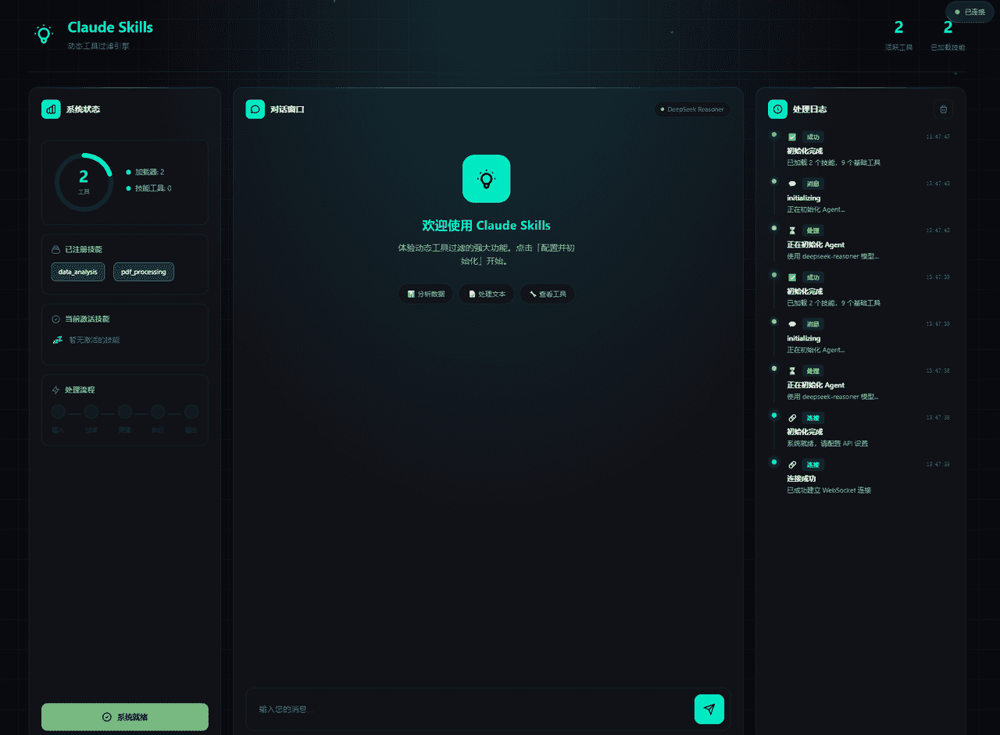

**  本期课程将带大家从零开**始，深入理解并实**现 Clau**de Skills 的核心功能——动态工具过滤。通过学习可以帮助大家深刻理解如何让 AI Agent 在运行时智能地选择需要的工具，而不是一次性加载所有工具。

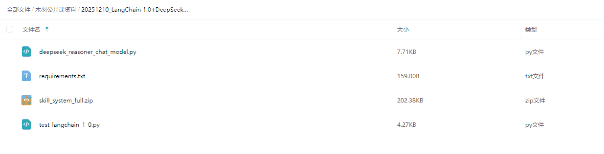


# 1. Claude Code Skills 背景介绍

Vibe Coding(氛围编程) 大家应该都听过，那它是怎么发展而来的呢？

第一代 AI 编码工具主要依赖于基于统计的补全技术，随后发展为以 GitHub Copilot 为代表的“中间填充”（Fill-in-the-Middle）预测模型，这些工具本质上是被动的，依赖开发者提供明确的上下文和光标位置。然而，随着模型推理能力的飞跃，特别是 Anthropic Claude 系列模型在长上下文处理和逻辑推理方面的突破，一种新的范式即代理式编程（Agentic Coding）应运而生。

Claude Code 的出现，其不仅仅是一个运行在终端中的 CLI 工具，而是一个具备自主规划与执行能力的智能代理 。与传统的 CLI 工具不同，Claude Code 被设计为能够理解自然语言指令，并将其转化为一系列复杂的系统操作，包括文件编辑、代码运行、Git 版本控制管理以及错误调试 。它遵循 Unix 哲学，具有高度的可组合性（Composable）和可脚本化（Scriptable）特征，能够与其他命令行工具通过管道（Pipe）进行交互 。

Claude Code 的核心竞争力在于其“全栈意识”。它不仅仅关注当前打开的文件，而是能够通过索引和检索机制理解整个代码库的架构、依赖关系以及业务逻辑 。这种能力使得开发者可以从繁琐的语法细节中解脱出来，转向更高层次的架构设计和意图表达，这种工作流在社区中被形象地称为“氛围编程”（Vibe Coding）

```
from IPython.display import Video

Video(&quot;https://muyu20241105.oss-cn-beijing.aliyuncs.com/images/202512111044143.mp4&quot;, width=1500, height=400)
```

Your browser does not support the video element.

在 Claude Code 的架构中，Skill（技能） 扮演着至关重要的角色。如果说 Claude 模型是大脑，MCP 是连接外部世界的手脚，那么 Skill 就是存储特定领域专业知识的操作手册。

虽然 Claude Opus 4.5 拥有广泛的编程知识，但它并不了解某家特定初创公司的内部部署脚本、某种冷门框架的特殊配置，或者某个团队特定的代码审查规范。传统的解决方案是将这些信息全部塞入系统提示词（System Prompt）或上下文窗口中，但这会导致两个问题：一是上下文窗口迅速耗尽，增加了推理成本（Token Economics）；二是过多的无关信息会干扰模型的注意力，导致“迷失中间”（Lost in the Middle）现象。

```
from IPython.display import Video

Video(&quot;https://muyu20241105.oss-cn-beijing.aliyuncs.com/images/202512021352519.mp4&quot;, width=1500, height=400)
```

Your browser does not support the video element.

Skill 通过引入动态加载（Dynamic Loading）和渐进式披露（Progressive Disclosure） 机制，优雅地解决了这一难题。它允许开发者将海量的程序性知识（Procedural Knowledge）封装在本地文件系统中，Agent 仅在识别到用户意图与某个 Skill 匹配时，才会按需加载相关的指令和脚本 。这种架构不仅极大地扩展了 Agent 的能力边界，还保证了推理的高效性和准确性。

```
from IPython.display import Video

Video(&quot;https://muyu20241105.oss-cn-beijing.aliyuncs.com/images/202512111128060.mp4&quot;, width=1500, height=400)
```

Your browser does not support the video element.

> 官方介绍：https://support.claude.com/en/articles/12512176-what-are-skills

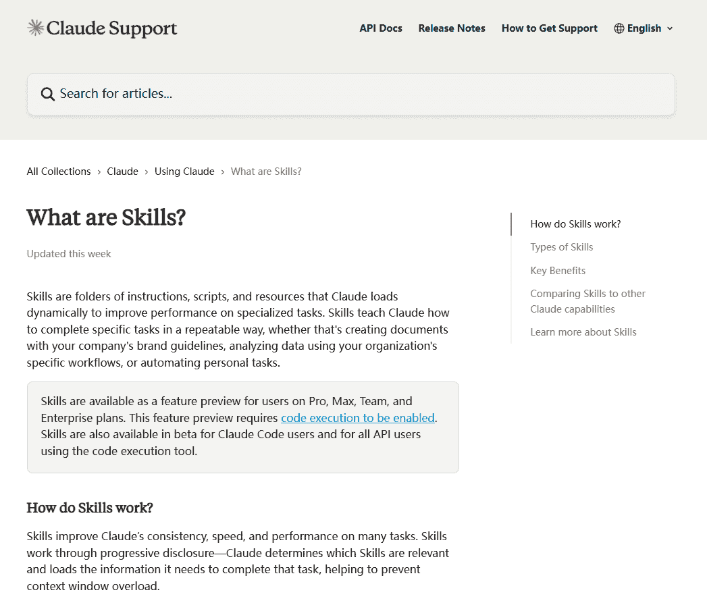

# 2. Claude Skills 给予Agent的启发

+   **大模型的工具调用流程**


传统的 AI Agent 在处理任务时，会将所有可用的工具（Tools）一次性暴露给大语言模型。想象一下，如果你有 50 个工具，每次模型调用都需要处理这 50 个工具的描述信息，

```
    传统架构：
    ┌─────────────────────────────────────────────────────────────┐
    │  Agent 启动时加载所有 50 个工具                              │
    │                                                             │
    │  用户: &quot;你好&quot;                                                │
    │  模型收到: 50 个工具描述 + 用户消息    ← 浪费大量 Token！    │
    │                                                             │
    │  用户: &quot;计算 1+1&quot;                                           │
    │  模型收到: 50 个工具描述 + 用户消息    ← 还是 50 个工具！    │
    └─────────────────────────────────────────────────────────────┘
```

这会带来几个严重问题：

1.  **Token 消耗巨大**：每个工具的描述可能有几百个 token，50 个工具就是上万个 token；

1.  **大模型困惑**：面对过多选择，模型容易选错工具或产生幻觉；

1.  **响应延迟**：处理大量工具描述需要更长时间；

1.  **成本高昂**：API 调用按 token 计费，浪费严重；

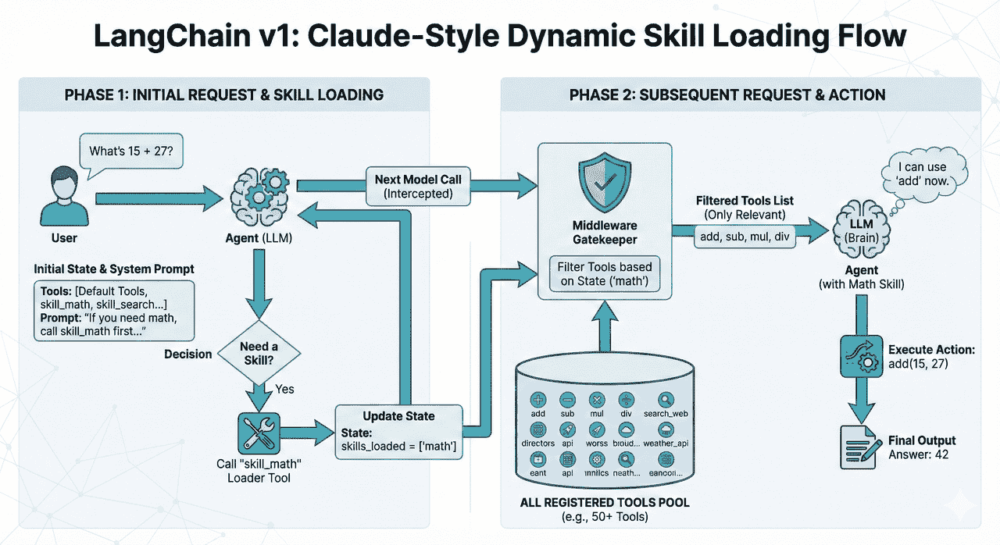

Claude Skills 的核心思想是：让模型在每次调用时只看到「相关的」工具，而不是全部工具。这就像一个智能助手，只有当你说"我要分析数据"时，才会把数据分析相关的工具拿出来；说"我要处理 PDF"时，才会展示 PDF 处理工具。

```
    Claude Skills 架构：
    ┌─────────────────────────────────────────────────────────────┐
    │  Agent 启动时只加载 2 个 &quot;Loader&quot; 工具                       │
    │                                                             │
    │  用户: &quot;你好&quot;                                                │
    │  模型收到: 2 个工具描述 + 用户消息     ← 只有 2 个工具！     │
    │                                                             │
    │  用户: &quot;分析这组数据 [1,2,3]&quot;                                │
    │  第一次调用: 2 个工具 → AI 调用 skill_data_analysis         │
    │  技能加载后: skills_loaded = [&#x27;data_analysis&#x27;]              │
    │  第二次调用: 4 个工具 (2 Loaders + 2 数据分析)              │
    │  → AI 使用 calculate_statistics 完成任务                    │
    └─────────────────────────────────────────────────────────────┘
```

接下来，我们就通过底层技术来复现这个非常高价值的Agent开发模式。

+   **为什么**选择 LangChain 1.1

LangChain 1.1 版本最大的优**势就是在LangGraph之**上构建并集成了革命性的 Middleware API。

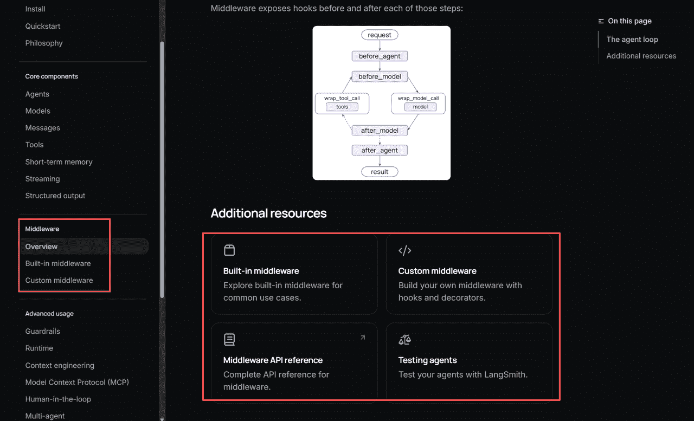

> 图片来源：https://docs.langchain.com/oss/python/langchain/middleware/overview

这个 Middleware API 允许我们在 Agent 的执行流程中插入自定义逻辑，实现：

+   **动态工具过滤**：在每次模型调用前修改工具列表

+   **状态管理**：通过 state_schema 追踪运行时状态

+   **请求拦截**：使用 request.override() 修改请求参数

在 LangChain 1.1 之前，实现动态工具过滤需要复杂的 hack，比如重写 Agent 类或修改工具列表。现在，通过官方支持的 Middleware API，我们可以优雅地实现这一功能。

LangChain 版本对比

| 特性 | LangChain 0.x | LangChain 1.1 |
| --- | --- | --- |
| 工具过滤 | 需要 hack | 官方 Middleware 支持 |
| 状态管理 | 手动实现 | state_schema 内置 |
| 请求修改 | 不支持 | request.override() |

下面这张图展示了使用LangChain 1.1 复现 Claude Skills 的核心工作流程：

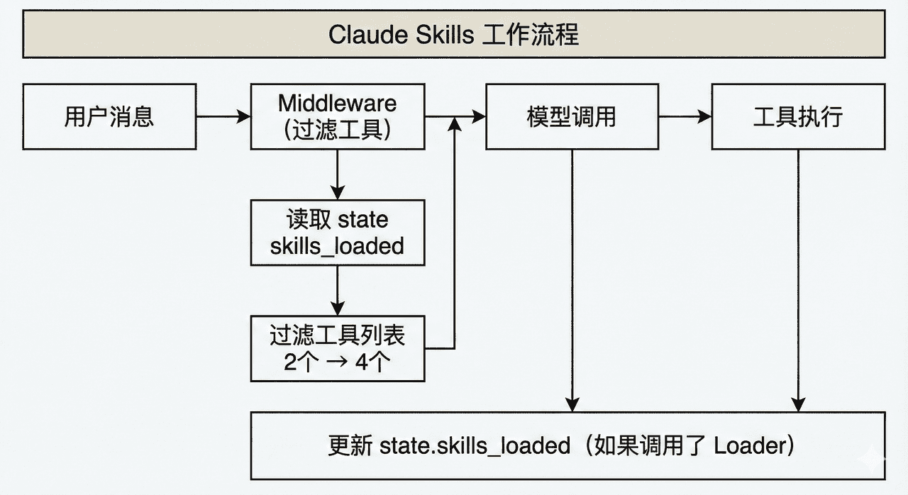

从图中可以看到，Middleware 是整个系统的核心。它在模型调用之前拦截请求，根据当前状态（skills_loaded）动态过滤工具列表，然后将过滤后的请求传递给模型。

# 3. 从零复现 Claude Skills 动态工具过滤

## 3.1 LangChain 1.1 本地运行与配置

首先，让我们导入实现 Claude Skills 所需的核心库。这里我们会用到 LangChain 1.1 的几个关键模块：

+   langchain.agents：提供 create_agent 和 Middleware 相关类

+   langchain_core.tools：工具定义的基类

+   typing_extensions：用于定义状态 Schema 的 TypedDict

执行如下代码：

```
%pip install -U langchain langgraph langchain-openai pdfplumber pandas numpy matplotlib python-dotenv
```

```
Looking in indexes: https://pypi.tuna.tsinghua.edu.cn/simple
Requirement already satisfied: langchain in /root/anaconda3/envs/langchainskill/lib/python3.12/site-packages (1.1.3)
Requirement already satisfied: langgraph in /root/anaconda3/envs/langchainskill/lib/python3.12/site-packages (1.1.4)
Collecting langchain-openai
  Downloading https://pypi.tuna.tsinghua.edu.cn/packages/1d/95/d65d3e187cd717baeb62988ae90a995f93564657f67518fb775af4090880/langchain_openai-1.1.1-py3-none-any.whl (84 kB)
Requirement already satisfied: pdfplumber in /root/anaconda3/envs/langchainskill/lib/python3.12/site-packages (0.11.8)
Requirement already satisfied: pandas in /root/anaconda3/envs/langchainskill/lib/python3.12/site-packages (2.3.3)
Requirement already satisfied: numpy in /root/anaconda3/envs/langchainskill/lib/python3.12/site-packages (2.3.5)
Requirement already satisfied: matplotlib in /root/anaconda3/envs/langchainskill/lib/python3.12/site-packages (3.10.8)
Requirement already satisfied: python-dotenv in /root/anaconda3/envs/langchainskill/lib/python3.12/site-packages (1.2.1)
Requirement already satisfied: langchain-core&lt;2.0.0,&gt;=1.1.2 in /root/anaconda3/envs/langchainskill/lib/python3.12/site-packages (from langchain) (1.1.3)
Requirement already satisfied: pydantic&lt;3.0.0,&gt;=2.7.4 in /root/anaconda3/envs/langchainskill/lib/python3.12/site-packages (from langchain) (2.12.5)
Requirement already satisfied: langgraph-checkpoint&lt;4.0.0,&gt;=2.1.0 in /root/anaconda3/envs/langchainskill/lib/python3.12/site-packages (from langgraph) (3.0.1)
Requirement already satisfied: langgraph-prebuilt&lt;1.1.0,&gt;=1.0.2 in /root/anaconda3/envs/langchainskill/lib/python3.12/site-packages (from langgraph) (1.0.5)
Requirement already satisfied: langgraph-sdk&lt;0.3.0,&gt;=0.2.2 in /root/anaconda3/envs/langchainskill/lib/python3.12/site-packages (from langgraph) (0.2.15)
Requirement already satisfied: xxhash&gt;=3.5.0 in /root/anaconda3/envs/langchainskill/lib/python3.12/site-packages (from langgraph) (3.6.0)
Requirement already satisfied: jsonpatch&lt;2.0.0,&gt;=1.33.0 in /root/anaconda3/envs/langchainskill/lib/python3.12/site-packages (from langchain-core&lt;2.0.0,&gt;=1.1.2-&gt;langchain) (1.33)
Requirement already satisfied: langsmith&lt;1.0.0,&gt;=0.3.45 in /root/anaconda3/envs/langchainskill/lib/python3.12/site-packages (from langchain-core&lt;2.0.0,&gt;=1.1.2-&gt;langchain) (0.4.59)
Requirement already satisfied: packaging&lt;26.0.0,&gt;=23.2.0 in /root/anaconda3/envs/langchainskill/lib/python3.12/site-packages (from langchain-core&lt;2.0.0,&gt;=1.1.2-&gt;langchain) (25.0)
Requirement already satisfied: pyyaml&lt;7.0.0,&gt;=5.3.0 in /root/anaconda3/envs/langchainskill/lib/python3.12/site-packages (from langchain-core&lt;2.0.0,&gt;=1.1.2-&gt;langchain) (6.0.3)
Requirement already satisfied: tenacity!=8.4.0,&lt;10.0.0,&gt;=8.1.0 in /root/anaconda3/envs/langchainskill/lib/python3.12/site-packages (from langchain-core&lt;2.0.0,&gt;=1.1.2-&gt;langchain) (9.1.2)
Requirement already satisfied: typing-extensions&lt;5.0.0,&gt;=4.7.0 in /root/anaconda3/envs/langchainskill/lib/python3.12/site-packages (from langchain-core&lt;2.0.0,&gt;=1.1.2-&gt;langchain) (4.15.0)
Requirement already satisfied: uuid-utils&lt;1.0,&gt;=0.12.0 in /root/anaconda3/envs/langchainskill/lib/python3.12/site-packages (from langchain-core&lt;2.0.0,&gt;=1.1.2-&gt;langchain) (0.12.0)
Requirement already satisfied: jsonpointer&gt;=1.9 in /root/anaconda3/envs/langchainskill/lib/python3.12/site-packages (from jsonpatch&lt;2.0.0,&gt;=1.33.0-&gt;langchain-core&lt;2.0.0,&gt;=1.1.2-&gt;langchain) (3.0.0)
Requirement already satisfied: ormsgpack&gt;=1.12.0 in /root/anaconda3/envs/langchainskill/lib/python3.12/site-packages (from langgraph-checkpoint&lt;4.0.0,&gt;=2.1.0-&gt;langgraph) (1.12.0)
Requirement already satisfied: httpx&gt;=0.25.2 in /root/anaconda3/envs/langchainskill/lib/python3.12/site-packages (from langgraph-sdk&lt;0.3.0,&gt;=0.2.2-&gt;langgraph) (0.28.1)
Requirement already satisfied: orjson&gt;=3.10.1 in /root/anaconda3/envs/langchainskill/lib/python3.12/site-packages (from langgraph-sdk&lt;0.3.0,&gt;=0.2.2-&gt;langgraph) (3.11.5)
Requirement already satisfied: requests-toolbelt&gt;=1.0.0 in /root/anaconda3/envs/langchainskill/lib/python3.12/site-packages (from langsmith&lt;1.0.0,&gt;=0.3.45-&gt;langchain-core&lt;2.0.0,&gt;=1.1.2-&gt;langchain) (1.0.0)
Requirement already satisfied: requests&gt;=2.0.0 in /root/anaconda3/envs/langchainskill/lib/python3.12/site-packages (from langsmith&lt;1.0.0,&gt;=0.3.45-&gt;langchain-core&lt;2.0.0,&gt;=1.1.2-&gt;langchain) (2.32.5)
Requirement already satisfied: zstandard&gt;=0.23.0 in /root/anaconda3/envs/langchainskill/lib/python3.12/site-packages (from langsmith&lt;1.0.0,&gt;=0.3.45-&gt;langchain-core&lt;2.0.0,&gt;=1.1.2-&gt;langchain) (0.25.0)
Requirement already satisfied: anyio in /root/anaconda3/envs/langchainskill/lib/python3.12/site-packages (from httpx&gt;=0.25.2-&gt;langgraph-sdk&lt;0.3.0,&gt;=0.2.2-&gt;langgraph) (4.12.0)
Requirement already satisfied: certifi in /root/anaconda3/envs/langchainskill/lib/python3.12/site-packages (from httpx&gt;=0.25.2-&gt;langgraph-sdk&lt;0.3.0,&gt;=0.2.2-&gt;langgraph) (2025.11.12)
Requirement already satisfied: httpcore==1.* in /root/anaconda3/envs/langchainskill/lib/python3.12/site-packages (from httpx&gt;=0.25.2-&gt;langgraph-sdk&lt;0.3.0,&gt;=0.2.2-&gt;langgraph) (1.0.9)
Requirement already satisfied: idna in /root/anaconda3/envs/langchainskill/lib/python3.12/site-packages (from httpx&gt;=0.25.2-&gt;langgraph-sdk&lt;0.3.0,&gt;=0.2.2-&gt;langgraph) (3.11)
Requirement already satisfied: h11&gt;=0.16 in /root/anaconda3/envs/langchainskill/lib/python3.12/site-packages (from httpcore==1.*-&gt;httpx&gt;=0.25.2-&gt;langgraph-sdk&lt;0.3.0,&gt;=0.2.2-&gt;langgraph) (0.16.0)
Requirement already satisfied: annotated-types&gt;=0.6.0 in /root/anaconda3/envs/langchainskill/lib/python3.12/site-packages (from pydantic&lt;3.0.0,&gt;=2.7.4-&gt;langchain) (0.7.0)
Requirement already satisfied: pydantic-core==2.41.5 in /root/anaconda3/envs/langchainskill/lib/python3.12/site-packages (from pydantic&lt;3.0.0,&gt;=2.7.4-&gt;langchain) (2.41.5)
Requirement already satisfied: typing-inspection&gt;=0.4.2 in /root/anaconda3/envs/langchainskill/lib/python3.12/site-packages (from pydantic&lt;3.0.0,&gt;=2.7.4-&gt;langchain) (0.4.2)
Requirement already satisfied: openai&lt;3.0.0,&gt;=1.109.1 in /root/anaconda3/envs/langchainskill/lib/python3.12/site-packages (from langchain-openai) (2.9.0)
Collecting tiktoken&lt;1.0.0,&gt;=0.7.0 (from langchain-openai)
  Using cached https://pypi.tuna.tsinghua.edu.cn/packages/f4/90/3dae6cc5436137ebd38944d396b5849e167896fc2073da643a49f372dc4f/tiktoken-0.12.0-cp312-cp312-manylinux_2_28_x86_64.whl (1.2 MB)
Requirement already satisfied: distro&lt;2,&gt;=1.7.0 in /root/anaconda3/envs/langchainskill/lib/python3.12/site-packages (from openai&lt;3.0.0,&gt;=1.109.1-&gt;langchain-openai) (1.9.0)
Requirement already satisfied: jiter&lt;1,&gt;=0.10.0 in /root/anaconda3/envs/langchainskill/lib/python3.12/site-packages (from openai&lt;3.0.0,&gt;=1.109.1-&gt;langchain-openai) (0.12.0)
Requirement already satisfied: sniffio in /root/anaconda3/envs/langchainskill/lib/python3.12/site-packages (from openai&lt;3.0.0,&gt;=1.109.1-&gt;langchain-openai) (1.3.1)
Requirement already satisfied: tqdm&gt;4 in /root/anaconda3/envs/langchainskill/lib/python3.12/site-packages (from openai&lt;3.0.0,&gt;=1.109.1-&gt;langchain-openai) (4.67.1)
Collecting regex&gt;=2022.1.18 (from tiktoken&lt;1.0.0,&gt;=0.7.0-&gt;langchain-openai)
  Using cached https://pypi.tuna.tsinghua.edu.cn/packages/84/bd/9ce9f629fcb714ffc2c3faf62b6766ecb7a585e1e885eb699bcf130a5209/regex-2025.11.3-cp312-cp312-manylinux2014_x86_64.manylinux_2_17_x86_64.manylinux_2_28_x86_64.whl (803 kB)
Requirement already satisfied: pdfminer.six==20251107 in /root/anaconda3/envs/langchainskill/lib/python3.12/site-packages (from pdfplumber) (20251107)
Requirement already satisfied: Pillow&gt;=9.1 in /root/anaconda3/envs/langchainskill/lib/python3.12/site-packages (from pdfplumber) (12.0.0)
Requirement already satisfied: pypdfium2&gt;=4.18.0 in /root/anaconda3/envs/langchainskill/lib/python3.12/site-packages (from pdfplumber) (5.1.0)
Requirement already satisfied: charset-normalizer&gt;=2.0.0 in /root/anaconda3/envs/langchainskill/lib/python3.12/site-packages (from pdfminer.six==20251107-&gt;pdfplumber) (3.4.4)
Requirement already satisfied: cryptography&gt;=36.0.0 in /root/anaconda3/envs/langchainskill/lib/python3.12/site-packages (from pdfminer.six==20251107-&gt;pdfplumber) (46.0.3)
Requirement already satisfied: python-dateutil&gt;=2.8.2 in /root/anaconda3/envs/langchainskill/lib/python3.12/site-packages (from pandas) (2.9.0.post0)
Requirement already satisfied: pytz&gt;=2020.1 in /root/anaconda3/envs/langchainskill/lib/python3.12/site-packages (from pandas) (2025.2)
Requirement already satisfied: tzdata&gt;=2022.7 in /root/anaconda3/envs/langchainskill/lib/python3.12/site-packages (from pandas) (2025.2)
Requirement already satisfied: contourpy&gt;=1.0.1 in /root/anaconda3/envs/langchainskill/lib/python3.12/site-packages (from matplotlib) (1.3.3)
Requirement already satisfied: cycler&gt;=0.10 in /root/anaconda3/envs/langchainskill/lib/python3.12/site-packages (from matplotlib) (0.12.1)
Requirement already satisfied: fonttools&gt;=4.22.0 in /root/anaconda3/envs/langchainskill/lib/python3.12/site-packages (from matplotlib) (4.61.0)
Requirement already satisfied: kiwisolver&gt;=1.3.1 in /root/anaconda3/envs/langchainskill/lib/python3.12/site-packages (from matplotlib) (1.4.9)
Requirement already satisfied: pyparsing&gt;=3 in /root/anaconda3/envs/langchainskill/lib/python3.12/site-packages (from matplotlib) (3.2.5)
Requirement already satisfied: cffi&gt;=2.0.0 in /root/anaconda3/envs/langchainskill/lib/python3.12/site-packages (from cryptography&gt;=36.0.0-&gt;pdfminer.six==20251107-&gt;pdfplumber) (2.0.0)
Requirement already satisfied: pycparser in /root/anaconda3/envs/langchainskill/lib/python3.12/site-packages (from cffi&gt;=2.0.0-&gt;cryptography&gt;=36.0.0-&gt;pdfminer.six==20251107-&gt;pdfplumber) (2.23)
Requirement already satisfied: six&gt;=1.5 in /root/anaconda3/envs/langchainskill/lib/python3.12/site-packages (from python-dateutil&gt;=2.8.2-&gt;pandas) (1.17.0)
Requirement already satisfied: urllib3&lt;3,&gt;=1.21.1 in /root/anaconda3/envs/langchainskill/lib/python3.12/site-packages (from requests&gt;=2.0.0-&gt;langsmith&lt;1.0.0,&gt;=0.3.45-&gt;langchain-core&lt;2.0.0,&gt;=1.1.2-&gt;langchain) (2.6.1)
Installing collected packages: regex, tiktoken, langchain-openai
   ━━━━━━━━━━━━━━━━━━━━━━━━━━━━━━━━━━━━━━━━ 3/3 [langchain-openai][langchain-openai]
Successfully installed langchain-openai-1.1.1 regex-2025.11.3 tiktoken-0.12.0
WARNING: Running pip as the &#x27;root&#x27; user can result in broken permissions and conflicting behaviour with the system package manager, possibly rendering your system unusable. It is recommended to use a virtual environment instead: https://pip.pypa.io/warnings/venv. Use the --root-user-action option if you know what you are doing and want to suppress this warning.
Note: you may need to restart the kernel to use updated packages.
```

```
! pip show langchain
```

```
Name: langchain
Version: 1.1.3
Summary: Building applications with LLMs through composability
Home-page: https://docs.langchain.com/
Author: 
Author-email: 
License: MIT
Location: /root/anaconda3/envs/langchainskill/lib/python3.12/site-packages
Requires: langchain-core, langgraph, pydantic
Required-by: 
```

```
# 基础库导入
import os
import sys
from pathlib import Path
from typing import List, Callable, Any, Optional
from typing_extensions import TypedDict

# 加载环境变量
from dotenv import load_dotenv
load_dotenv(override=True)

# LangChain 1.1 核心导入
from langchain.agents import create_agent
from langchain.agents.middleware import (
    AgentMiddleware,
    ModelRequest,
    ModelResponse,
)
from langchain_core.tools import BaseTool, tool
from langchain_core.messages import HumanMessage, AIMessage, BaseMessage

print(&quot;核心库导入成功&quot;)
```

```
核心库导入成功
```

上面的代码导入了我们需要的所有核心组件。特别注意 langchain.agents.middleware 模块，这是 LangChain 1.1 新增的关键模块，包含了：

+   **AgentMiddleware**：中间件基类，我们需要继承它；

+   **ModelRequest**：封装了模型调用请求的所有信息（消息、工具、状态等）；

+   **ModelResponse**：模型调用的响应；

## 3.2 配置 DeepSeek-v3.2 模型

在本教程中，我们使用 DeepSeek 的 deepseek-reasoner 模型作为底层 LLM。这个模型的特点是支持「推理过程」输出，可以让我们看到模型的思考过程。

> **提示**：你也可以替换为 OpenAI、Anthropic 或其他兼容 LangChain 的模型。核心的 Middleware 机制是通用的。

这里我们使用的是最新发布的 DeepSeek-v3.2 推理模型。但需要说明的是：因为 DeepSeek-v3.2 模型刚刚发布，其推理模式在langChian 1.1的新版本中存在兼容性问题，在进行工具调用过程中会报错如下：

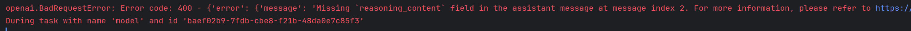

因此，我们团队也是完全重写了 DeepSeek-v3.2-reasoner 的模型适配器，大家扫码即可领取项目文件：

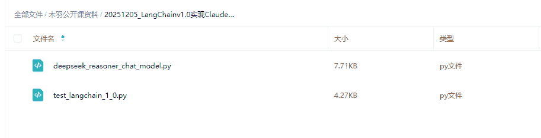


```
# 添加项目路径（用于导入自定义模型）
PROJECT_ROOT = Path.cwd()
sys.path.insert(0, str(PROJECT_ROOT))

# 导入自定义的 DeepSeek 模型适配器
from skill_system.models import DeepSeekReasonerChatModel

# 检查 API Key
api_key = os.getenv(&quot;DEEPSEEK_API_KEY&quot;)
if not api_key:
    print(&quot;未设置 DEEPSEEK_API_KEY&quot;)
    print(&quot;   请在 .env 文件中添加: DEEPSEEK_API_KEY=your-key&quot;)
else:
    print(f&quot;API Key 已配置 (前8位: {api_key[:8]}...)&quot;)

# 创建模型实例
model = DeepSeekReasonerChatModel(
    api_key=api_key,
    model_name=&quot;deepseek-reasoner&quot;,
    temperature=0.7
)

print(f&quot;DeepSeek 模型已创建&quot;)
```

```
API Key 已配置 (前8位: sk-705c5...)
DeepSeek 模型已创建
```

DeepSeekReasonerChatModel 是我们自定义的模型适配器，它继承自 LangChain 的 BaseChatModel，并添加了对 DeepSeek 推理模型的支持。关键特性是它会保留模型返回的 reasoning_content（推理过程），这对于调试和理解模型行为非常有帮助。

## 3.3 配置LangChain1.1 Middleware

中间件（Middleware）是一个非常常见的设计模式。它允许你在请求处理的过程中插入自定义逻辑，而不需要修改核心代码。

LangChain 1.1 引入的 Agent Middleware 遵循同样的理念：

```
    请求 ──▶ [中间件1] ──▶ [中间件2] ──▶ ... ──▶ [核心处理] ──▶ 响应
                │              │
                ▼              ▼
            可以修改请求    可以修改请求
```

在 Agent 的上下文中，Middleware 可以：

1.  **拦截模型调用请求**：在模型被调用之前获取请求信息

1.  **修改请求参数**：比如修改工具列表、系统提示等

1.  **传递给下一个处理器**：调用 handler(request) 继续执行

1.  **处理响应**：可以在返回之前修改响应（可选）

这正是实现动态工具过滤的关键！我们可以在 Middleware 中检查当前状态，然后只把相关的工具传递给模型。

在LangChain 1.1中AgentMiddleware 基类的结构如下：

```
    class AgentMiddleware:
        &quot;&quot;&quot;Agent 中间件基类&quot;&quot;&quot;
        
        def wrap_model_call(
            self,
            request: ModelRequest,
            handler: Callable[[ModelRequest], ModelResponse]
        ) -&gt; ModelResponse:
            &quot;&quot;&quot;同步版本 - 包装模型调用&quot;&quot;&quot;
            return handler(request)  # 默认直接传递
        
        async def awrap_model_call(
            self,
            request: ModelRequest,
            handler: Callable[[ModelRequest], ModelResponse]
        ) -&gt; ModelResponse:
            &quot;&quot;&quot;异步版本 - 包装模型调用&quot;&quot;&quot;
            return await handler(request)  # 默认直接传递
```

wrap_model_call 参数说明

| 参数名 | 类型 | 描述 | 说明 |
| --- | --- | --- | --- |
| request | ModelRequest | 模型调用请求 | 包含 messages, tools, state 等 |
| handler | Callable | 下一个处理器 | 调用它来继续执行链 |
| 返回值 | ModelResponse | 模型响应 | handler 执行后的结果 |

ModelRequest 是 Middleware 中最重要的对象，它封装了模型调用的所有信息：

```
    class ModelRequest:
        messages: List[BaseMessage]  # 消息历史
        tools: List[BaseTool]        # 可用工具列表
        state: Dict[str, Any]        # 当前状态（关键！）
        
        def override(self, **kwargs) -&gt; ModelRequest:
            &quot;&quot;&quot;创建一个修改了指定参数的新 Request&quot;&quot;&quot;
            # 返回新的 ModelRequest，保持不可变性
```

request.override() 是实现动态过滤的核心方法。它允许我们创建一个新的请求对象，其中某些参数被修改了，而其他参数保持不变。例如：

```
    # 只修改工具列表，其他参数保持不变
    filtered_request = request.override(tools=filtered_tools)
```

## 3.4 实现一个简单的日志 Middleware

在实现复杂的工具过滤之前，我们先写一个简单的日志 Middleware，帮助大家理解整个流程：

```
class LoggingMiddleware(AgentMiddleware):
    &quot;&quot;&quot;
    日志中间件 - 记录每次模型调用的信息
    
    这是一个最简单的 Middleware 示例，用于理解基本工作流程
    &quot;&quot;&quot;
    
    def __init__(self, name: str = &quot;Logger&quot;):
        super().__init__()
        self.name = name
        self.call_count = 0
    
    def wrap_model_call(
        self,
        request: ModelRequest,
        handler: Callable[[ModelRequest], ModelResponse]
    ) -&gt; ModelResponse:
        &quot;&quot;&quot;
        拦截模型调用，打印日志信息
        &quot;&quot;&quot;
        self.call_count += 1
        
        # 1. 调用前：记录请求信息
        print(f&quot;\n{&#x27;=&#x27;*60}&quot;)
        print(f&quot;[{self.name}] 第 {self.call_count} 次模型调用&quot;)
        print(f&quot;{&#x27;=&#x27;*60}&quot;)
        
        # 打印工具信息
        if hasattr(request, &#x27;tools&#x27;) and request.tools:
            tool_names = [t.name for t in request.tools]
            print(f&quot;可用工具 ({len(tool_names)}个): {tool_names}&quot;)
        
        # 打印状态信息
        if hasattr(request, &#x27;state&#x27;) and request.state:
            print(f&quot;当前状态: {request.state}&quot;)
        
        # 2. 调用下一个处理器（这里是实际的模型调用）
        response = handler(request)
        
        # 3. 调用后：可以处理响应（这里只是打印）
        print(f&quot;模型调用完成&quot;)
        print(f&quot;{&#x27;=&#x27;*60}\n&quot;)
        
        return response

print(&quot;LoggingMiddleware 类已定义&quot;)
```

```
LoggingMiddleware 类已定义
```

上面的 LoggingMiddleware 展示了 Middleware 的基本结构：

1.  **继承 ****AgentMiddleware**：这是必须的

1.  **重写 ****wrap_model_call**：这是核心方法

1.  **调用 **handler(request)：必须调用，否则模型不会被执行

1.  **返回响应**：必须返回 handler 的结果

> **注意**：如果你不调用 handler(request)，整个 Agent 链条就会中断！

## 3.5 定义工具与状态 Schema

**  在 LangChai**n 1.1 中，State Schema 用于定义 Agent 运行时需要追踪的状态信息。它使用 Python 的 TypedDict 来定义，提供类型安全和清晰的结构。

对于 Claude Skills，我们需要追踪一个关键状态：skills_loaded - 当前已加载的技能列表。这个状态会被 Middleware 读取，用于决定哪些工具应该暴露给模型。

```
# # 使用 MessagesState 而不是 TypedDict
from langgraph.graph import MessagesState
from typing import Annotated, List

# 第一种模式：替换模式
# # 定义 reducer 函数
# def skill_list_reducer(current: List[str], new: List[str]) -&gt; List[str]:
#     &quot;&quot;&quot;替换模式：用新列表替换旧列表&quot;&quot;&quot;
#     return new

# # 使用 MessagesState 作为基类
# class SkillState(MessagesState):
#     &quot;&quot;&quot;
#     Skill 状态 Schema
    
#     使用 MessagesState 作为基类，它已经包含了 messages 字段
#     我们只需要添加 skills_loaded 字段
#     &quot;&quot;&quot;
#     skills_loaded: Annotated[List[str], skill_list_reducer] = []


# 第二种模式：累计模式
# 修改 reducer 函数为累积模式
def skill_list_accumulator(current: List[str], new: List[str]) -&gt; List[str]:
    &quot;&quot;&quot;
    累积模式：合并已加载的 Skills
    保持所有已加载的技能，而不是替换
    &quot;&quot;&quot;
    if not current:
        return new
    # 合并并去重，保持顺序
    combined = current + [s for s in new if s not in current]
    return combined

# 使用累积模式的 reducer
class SkillState(MessagesState):
    &quot;&quot;&quot;
    Skill 状态 Schema
    &quot;&quot;&quot;
    skills_loaded: Annotated[List[str], skill_list_accumulator] = []  # 改为累积模式
```

SkillState 定义了两个关键字段：

1.  **messages**：消息历史，这是 LangChain Agent 的标准字段，用于存储对话历史；

1.  **skills_loaded**：已加载的技能列表，这是我们自定义的字段，用于追踪当前激活的技能；

> **重要**：TypedDict 在运行时本质上就是一个普通的 dict，所以在 Middleware 中我们使用 request.state.get("skills_loaded", []) 来访问它。

## 3.6 定义外部工具

现在，我们需要定义一组示例工具来实际展示动态过滤流程。我们会创建三类工具：

1.  **Loader 工具**（始终可见）：用于加载技能；

1.  **数据分析工具**：只有加载了 data_analysis 技能后才可见；

1.  **文本处理工具**：只有加载了 text_processing 技能后才可见；

执行如下代码：

```
# ==================== Loader 工具 ====================
# 这些工具始终可见，用于加载其他技能

from langgraph.types import Command
from langchain_core.messages import ToolMessage

@tool
def skill_data_analysis(runtime) -&gt; Command:
    &quot;&quot;&quot;
    加载数据分析技能。
    &quot;&quot;&quot;
    instructions = &quot;&quot;&quot;数据分析技能已成功加载！
    
现在你可以使用以下工具：
• calculate_statistics(numbers): 计算一组数字的统计信息
• generate_chart(data, chart_type): 生成数据图表

请继续使用这些工具完成用户的数据分析任务。&quot;&quot;&quot;
    
    return Command(
        update={
            &quot;messages&quot;: [ToolMessage(
                content=instructions,
                tool_call_id=runtime.tool_call_id
            )],
            &quot;skills_loaded&quot;: [&quot;data_analysis&quot;]  # 关键：直接更新状态
        }
    )


@tool
def skill_text_processing(runtime) -&gt; Command:
    &quot;&quot;&quot;
    加载文本处理技能。
    
    调用此工具后，你将获得以下文本处理相关的工具：
    - summarize_text: 生成文本摘要
    - extract_keywords: 提取关键词
    
    使用场景：当用户需要处理文本、生成摘要或提取关键信息时，
    请先调用此工具加载文本处理技能。
    &quot;&quot;&quot;
    instructions = &quot;&quot;&quot;文本处理技能已成功加载！
    
现在你可以使用以下工具：
• summarize_text(text, max_length): 生成文本摘要
• extract_keywords(text, num_keywords): 提取关键词

请继续使用这些工具完成用户的文本处理任务。&quot;&quot;&quot;
    
    return Command(
        update={
            &quot;messages&quot;: [ToolMessage(
                content=instructions,
                tool_call_id=runtime.tool_call_id
            )],
            &quot;skills_loaded&quot;: [&quot;text_processing&quot;]  # 关键：直接更新状态
        }
    )


# ==================== 数据分析工具 ====================
# 这些工具只有在加载了 data_analysis 技能后才可见
@tool
def calculate_statistics(numbers: List[float]) -&gt; str:
    &quot;&quot;&quot;
    计算一组数字的统计信息，包括平均值、最大值、最小值、标准差等。
    
    Args:
        numbers: 要分析的数字列表
    &quot;&quot;&quot;
    import statistics
    
    if not numbers:
        return &quot;错误: 数字列表为空&quot;
    
    result = {
        &quot;count&quot;: len(numbers),
        &quot;sum&quot;: sum(numbers),
        &quot;mean&quot;: statistics.mean(numbers),
        &quot;median&quot;: statistics.median(numbers),
        &quot;min&quot;: min(numbers),
        &quot;max&quot;: max(numbers),
    }
    
    if len(numbers) &gt; 1:
        result[&quot;stdev&quot;] = statistics.stdev(numbers)
    
    return f&quot;统计结果: {result}&quot;


@tool
def generate_chart(data: List[float], chart_type: str = &quot;bar&quot;) -&gt; str:
    &quot;&quot;&quot;
    根据数据生成图表（模拟）。
    
    Args:
        data: 数据列表
        chart_type: 图表类型 (bar, line, pie)
    &quot;&quot;&quot;
    return f&quot;已生成 {chart_type} 图表，包含 {len(data)} 个数据点&quot;


# ==================== 文本处理工具 ====================
# 这些工具只有在加载了 text_processing 技能后才可见

@tool
def summarize_text(text: str, max_length: int = 100) -&gt; str:
    &quot;&quot;&quot;
    生成文本摘要。
    
    Args:
        text: 要摘要的文本
        max_length: 摘要最大长度
    &quot;&quot;&quot;
    if len(text) &lt;= max_length:
        return f&quot;摘要: {text}&quot;
    return f&quot;摘要: {text[:max_length]}...&quot;


@tool
def extract_keywords(text: str, num_keywords: int = 5) -&gt; str:
    &quot;&quot;&quot;
    从文本中提取关键词。
    
    Args:
        text: 要分析的文本
        num_keywords: 要提取的关键词数量
    &quot;&quot;&quot;
    # 简单模拟：取前几个单词
    words = text.split()[:num_keywords]
    return f&quot;关键词: {&#x27;, &#x27;.join(words)}&quot;


# 组织工具
LOADER_TOOLS = [skill_data_analysis, skill_text_processing]
DATA_ANALYSIS_TOOLS = [calculate_statistics, generate_chart]
TEXT_PROCESSING_TOOLS = [summarize_text, extract_keywords]
ALL_TOOLS = LOADER_TOOLS + DATA_ANALYSIS_TOOLS + TEXT_PROCESSING_TOOLS

print(&quot;工具定义完成&quot;)
print(f&quot;   Loader 工具 ({len(LOADER_TOOLS)}): {[t.name for t in LOADER_TOOLS]}&quot;)
print(f&quot;   数据分析工具 ({len(DATA_ANALYSIS_TOOLS)}): {[t.name for t in DATA_ANALYSIS_TOOLS]}&quot;)
print(f&quot;   文本处理工具 ({len(TEXT_PROCESSING_TOOLS)}): {[t.name for t in TEXT_PROCESSING_TOOLS]}&quot;)
print(f&quot;   总计: {len(ALL_TOOLS)} 个工具&quot;)
```

```
工具定义完成
   Loader 工具 (2): [&#x27;skill_data_analysis&#x27;, &#x27;skill_text_processing&#x27;]
   数据分析工具 (2): [&#x27;calculate_statistics&#x27;, &#x27;generate_chart&#x27;]
   文本处理工具 (2): [&#x27;summarize_text&#x27;, &#x27;extract_keywords&#x27;]
   总计: 6 个工具
```

上面的代码定义了 6 个工具，分为三类：

1.  **Loader 工具**（2个）：skill_data_analysis, skill_text_processing

+   这些工具始终可见，因为用户需要通过它们来加载其他技能

1.  **数据分析工具**（2个）：calculate_statistics, generate_chart

+   只有当 skills_loaded 包含 "data_analysis" 时才可见

1.  **文本处理工具**（2个）：summarize_text, extract_keywords

+   只有当 skills_loaded 包含 "text_processing" 时才可见

> **关键洞察**：在传统 Agent 中，模型会一次性看到全部 6 个工具。但通过动态过滤，初始状态下模型只看到 2 个 Loader 工具。

## 3.7 定义工具映射

为了实现动态过滤，我们需要定义一个映射关系：哪些工具属于哪个技能。

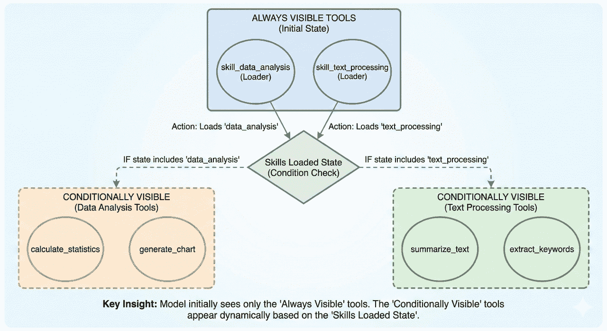

```
# 技能到工具的映射
SKILL_TOOL_MAPPING = {
    &quot;data_analysis&quot;: DATA_ANALYSIS_TOOLS,
    &quot;text_processing&quot;: TEXT_PROCESSING_TOOLS,
}

def get_tools_for_skills(skills_loaded: List[str]) -&gt; List[BaseTool]:
    &quot;&quot;&quot;
    根据已加载的技能列表，返回应该暴露给模型的工具
    
    核心逻辑：
    1. Loader 工具始终包含
    2. 根据 skills_loaded 添加对应的技能工具
    
    Args:
        skills_loaded: 已加载的技能名称列表
        
    Returns:
        过滤后的工具列表
    &quot;&quot;&quot;
    # 始终包含 Loader 工具
    tools = list(LOADER_TOOLS)
    
    # 根据已加载的技能添加对应工具
    for skill_name in skills_loaded:
        if skill_name in SKILL_TOOL_MAPPING:
            tools.extend(SKILL_TOOL_MAPPING[skill_name])
    
    return tools


# 测试工具过滤函数
print(&quot;测试 get_tools_for_skills 函数:&quot;)
print(f&quot;\n1. skills_loaded = []&quot;)
tools = get_tools_for_skills([])
print(f&quot;   返回 {len(tools)} 个工具: {[t.name for t in tools]}&quot;)

print(f&quot;\n2. skills_loaded = [&#x27;data_analysis&#x27;]&quot;)
tools = get_tools_for_skills([&#x27;data_analysis&#x27;])
print(f&quot;   返回 {len(tools)} 个工具: {[t.name for t in tools]}&quot;)

print(f&quot;\n3. skills_loaded = [&#x27;data_analysis&#x27;, &#x27;text_processing&#x27;]&quot;)
tools = get_tools_for_skills([&#x27;data_analysis&#x27;, &#x27;text_processing&#x27;])
print(f&quot;   返回 {len(tools)} 个工具: {[t.name for t in tools]}&quot;)
```

```
测试 get_tools_for_skills 函数:

1. skills_loaded = []
   返回 2 个工具: [&#x27;skill_data_analysis&#x27;, &#x27;skill_text_processing&#x27;]

2. skills_loaded = [&#x27;data_analysis&#x27;]
   返回 4 个工具: [&#x27;skill_data_analysis&#x27;, &#x27;skill_text_processing&#x27;, &#x27;calculate_statistics&#x27;, &#x27;generate_chart&#x27;]

3. skills_loaded = [&#x27;data_analysis&#x27;, &#x27;text_processing&#x27;]
   返回 6 个工具: [&#x27;skill_data_analysis&#x27;, &#x27;skill_text_processing&#x27;, &#x27;calculate_statistics&#x27;, &#x27;generate_chart&#x27;, &#x27;summarize_text&#x27;, &#x27;extract_keywords&#x27;]
```

从测试结果可以看到：

+   当没有加载任何技能时，只有 **2 个** Loader 工具可用

+   加载 data_analysis 后，变成 **4 个**工具（2 Loaders + 2 数据分析）

+   加载全部技能后，变成 **6 个**工具

这就是动态工具过滤的核心逻辑！接下来我们要做的，就是在 Middleware 中实现这个过滤。

## 3.8 实现 SkillMiddleware（核心）

**  现在我们来实现整个系统的核**心组件：SkillMiddleware。它的工作流程如下：

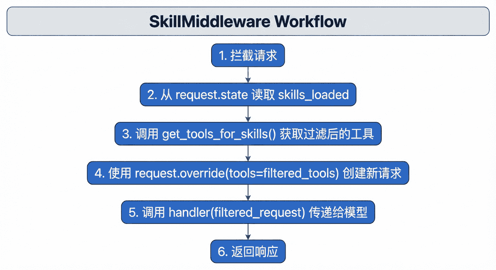

代码实现如下：

```
class SkillMiddleware(AgentMiddleware):
    &quot;&quot;&quot;
    Skill 中间件 - 实现动态工具过滤
    
    这是 Claude Skills 的核心组件！
    
    工作原理：
    1. 在每次模型调用前拦截请求
    2. 从 request.state 中读取 skills_loaded 列表
    3. 根据 skills_loaded 过滤工具列表
    4. 使用 request.override() 替换工具列表
    5. 传递给下一个 handler
    
    这样，模型在每次调用时只会看到相关的工具！
    &quot;&quot;&quot;
    
    def __init__(self, verbose: bool = True):
        &quot;&quot;&quot;
        初始化 SkillMiddleware
        
        Args:
            verbose: 是否打印详细日志（用于调试和演示）
        &quot;&quot;&quot;
        super().__init__()
        self.verbose = verbose
        self.call_count = 0
    
    def _get_skills_from_state(self, request: ModelRequest) -&gt; List[str]:
        &quot;&quot;&quot;
        从请求状态中提取 skills_loaded
        
        注意：AgentState 是 TypedDict，本质上是 dict
        所以我们使用字典方式访问
        &quot;&quot;&quot;
        skills_loaded = []
        
        if hasattr(request, &#x27;state&#x27;) and request.state is not None:
            # TypedDict 本质是 dict，使用 .get() 方法
            if isinstance(request.state, dict):
                skills_loaded = request.state.get(&quot;skills_loaded&quot;, [])
            else:
                # 兼容其他类型
                skills_loaded = getattr(request.state, &quot;skills_loaded&quot;, [])
        
        return skills_loaded
    
    def wrap_model_call(
        self,
        request: ModelRequest,
        handler: Callable[[ModelRequest], ModelResponse]
    ) -&gt; ModelResponse:
        &quot;&quot;&quot;
        【核心方法】拦截模型调用，动态过滤工具
        
        这是整个 Claude Skills 系统最关键的方法！
        &quot;&quot;&quot;
        self.call_count += 1
        
        # Step 1: 从状态中获取已加载的 Skills
        skills_loaded = self._get_skills_from_state(request)
        
        # Step 2: 获取过滤后的工具
        filtered_tools = get_tools_for_skills(skills_loaded)
        
        # Step 3: 打印日志
        if self.verbose:
            print(f&quot;\n{&#x27;─&#x27;*60}&quot;)
            print(f&quot;[SkillMiddleware] 第 {self.call_count} 次模型调用&quot;)
            print(f&quot;{&#x27;─&#x27;*60}&quot;)
            print(f&quot;skills_loaded: {skills_loaded}&quot;)
            print(f&quot;过滤后工具 ({len(filtered_tools)}个): {[t.name for t in filtered_tools]}&quot;)
            
            # 对比原始工具数量
            if hasattr(request, &#x27;tools&#x27;) and request.tools:
                original_count = len(request.tools)
                print(f&quot;工具数量变化: {original_count} → {len(filtered_tools)}&quot;)
        
        # Step 4: 【关键】使用 request.override() 替换工具列表
        # 这会创建一个新的 ModelRequest，其中 tools 被替换为过滤后的列表
        filtered_request = request.override(tools=filtered_tools)
        
        if self.verbose:
            print(f&quot;已将过滤后的工具传递给模型&quot;)
            print(f&quot;{&#x27;─&#x27;*60}\n&quot;)
        
        # Step 5: 调用下一个 handler（实际的模型调用）
        return handler(filtered_request)
    
    async def awrap_model_call(
        self,
        request: ModelRequest,
        handler: Callable[[ModelRequest], ModelResponse]
    ) -&gt; ModelResponse:
        &quot;&quot;&quot;
        异步版本 - 与同步版本逻辑相同
        
        LangChain 可能使用异步调用，所以需要同时实现两个版本
        &quot;&quot;&quot;
        self.call_count += 1
        
        skills_loaded = self._get_skills_from_state(request)
        filtered_tools = get_tools_for_skills(skills_loaded)
        
        if self.verbose:
            print(f&quot;\n{&#x27;─&#x27;*60}&quot;)
            print(f&quot;[SkillMiddleware] (async) 第 {self.call_count} 次模型调用&quot;)
            print(f&quot;skills_loaded: {skills_loaded}&quot;)
            print(f&quot;过滤后工具: {[t.name for t in filtered_tools]}&quot;)
            print(f&quot;{&#x27;─&#x27;*60}\n&quot;)
        
        filtered_request = request.override(tools=filtered_tools)
        return await handler(filtered_request)


print(&quot;SkillMiddleware 类已定义&quot;)
print(&quot;\n关键方法说明:&quot;)
print(&quot;  • wrap_model_call(): 同步拦截模型调用&quot;)
print(&quot;  • awrap_model_call(): 异步拦截模型调用&quot;)
print(&quot;  • request.override(): 创建修改后的请求对象&quot;)
```

```
SkillMiddleware 类已定义

关键方法说明:
  • wrap_model_call(): 同步拦截模型调用
  • awrap_model_call(): 异步拦截模型调用
  • request.override(): 创建修改后的请求对象
```

上面的 SkillMiddleware 实现了动态工具过滤的核心逻辑。需要重点理解几个关键点：

```
    # 1. 状态读取
    skills_loaded = request.state.get(&quot;skills_loaded&quot;, [])

    # 2. 工具过滤
    filtered_tools = get_tools_for_skills(skills_loaded)

    # 3. 请求修改，这是最关键的
    filtered_request = request.override(tools=filtered_tools)
```

这是整个系统最关键的一行代码！request.override() 方法会创建一个新的 ModelRequest 对象，其中 tools 参数被替换为我们过滤后的工具列表，而其他参数保持不变。

> **设计模式**：override() 方法遵循「不可变性」原则，它不会修改原始请求，而是返回一个新的请求对象。这是函数式编程的最佳实践。

## 3.9 创建 Agent 并测试

现在我们已经准备好了所有组件，接下来使用 LangChain 1.1 的 create_agent 函数来创建 Agent。这个函数接受以下关键参数：

create_agent 参数说明

| 参数名 | 类型 | 描述 | 必填 |
| --- | --- | --- | --- |
| model | BaseChatModel | 语言模型实例 | 是 |
| tools | List[BaseTool] | 工具列表 | 是 |
| middleware | Tuple[AgentMiddleware] | 中间件列表 | 否 |
| state_schema | TypedDict | 状态 Schema | 否 |
| system_prompt | str | 系统提示 | 否 |

```
# 创建 SkillMiddleware 实例
skill_middleware = SkillMiddleware(verbose=True)

# 定义系统提示
SYSTEM_PROMPT = &quot;&quot;&quot;
你是一个智能助手，可以使用各种技能来帮助用户完成任务。

## 工作方式

1. 你有两类工具：
   - **Skill Loader**（技能加载器）：用于加载特定技能，名称以 skill_ 开头
   - **功能工具**：执行具体任务的工具

2. 当用户请求某个功能时：
   - 首先检查是否有对应的功能工具
   - 如果没有，调用相应的 Skill Loader 加载技能
   - 加载后，使用新获得的工具完成任务

3. 可用的 Skill Loaders：
   - skill_data_analysis：加载数据分析相关工具
   - skill_text_processing：加载文本处理相关工具

请根据用户的需求，灵活使用工具完成任务。
&quot;&quot;&quot;

print(&quot;准备创建 Agent...&quot;)
print(f&quot;  模型: DeepSeek Reasoner&quot;)
print(f&quot;  工具数量: {len(ALL_TOOLS)}&quot;)
print(f&quot;  中间件: SkillMiddleware&quot;)
print(f&quot;  状态 Schema: SkillState&quot;)
```

```
准备创建 Agent...
  模型: DeepSeek Reasoner
  工具数量: 6
  中间件: SkillMiddleware
  状态 Schema: SkillState
```

```
# 创建 Agent
try:
    agent = create_agent(
        model=model,
        tools=ALL_TOOLS,  # 注册所有工具（但 Middleware 会动态过滤）
        middleware=(skill_middleware,),  # 关键：添加 SkillMiddleware
        state_schema=SkillState,  # 使用我们定义的状态 Schema
        system_prompt=SYSTEM_PROMPT,
    )
    print(&quot;\nAgent 创建成功！&quot;)
    print(&quot;\n关键配置:&quot;)
    print(f&quot;  • 注册工具总数: {len(ALL_TOOLS)}&quot;)
    print(f&quot;  • 初始可见工具: {len(LOADER_TOOLS)} (仅 Loaders)&quot;)
    print(f&quot;  • Middleware: SkillMiddleware (动态过滤)&quot;)
    
except TypeError as e:
    print(f&quot;创建时遇到参数问题: {e}&quot;)
    print(&quot;尝试简化版本...&quot;)
    agent = create_agent(
        model=model,
        tools=ALL_TOOLS,
        middleware=(skill_middleware,),
    )
    print(&quot;Agent 创建成功（简化版本）&quot;)
```

```
Agent 创建成功！

关键配置:
  • 注册工具总数: 6
  • 初始可见工具: 2 (仅 Loaders)
  • Middleware: SkillMiddleware (动态过滤)
```

Agent 创建完成！注意几个关键点：

1.  **tools 参数**：我们传入了所有 6 个工具，但这不代表模型会看到全部。Middleware 会在每次调用前过滤。

1.  **middleware 参数**：必须是一个元组（tuple），即使只有一个中间件也要写成 (middleware,)。

1.  **state_schema 参数**：告诉 Agent 我们的状态结构，这样它就知道如何管理 skills_loaded 字段。

# 4. LangChain Skills Agent运行测试

让我们先测试一个简单的问候，看看初始状态下模型能看到多少工具：

```
print(&quot;=&quot;*60)
print(&quot;测试场景 1：初始状态 - 简单问候&quot;)
print(&quot;=&quot;*60)
print(&quot;\n预期行为:&quot;)
print(&quot;   • skills_loaded: [] (空)&quot;)
print(&quot;   • 可见工具: 2 个 (仅 Loaders)&quot;)
print(&quot;\n&quot; + &quot;-&quot;*60)

# 构造输入 - 使用 HumanMessage 对象
from langchain_core.messages import HumanMessage

test_input = {
    &quot;messages&quot;: [HumanMessage(content=&quot;你好，请告诉我你现在有哪些工具可用？&quot;)],
    &quot;skills_loaded&quot;: []  # 初始状态：没有加载任何技能
}

# 调用 Agent
result = agent.invoke(test_input)

print(&quot;-&quot;*60)
print(&quot;\nAI 响应:&quot;)
for msg in result.get(&quot;messages&quot;, []):
    if msg.__class__.__name__ == &quot;AIMessage&quot; and msg.content:
        print(msg.content)
```

```
============================================================
测试场景 1：初始状态 - 简单问候
============================================================

预期行为:
   • skills_loaded: [] (空)
   • 可见工具: 2 个 (仅 Loaders)

------------------------------------------------------------

────────────────────────────────────────────────────────────
[SkillMiddleware] 第 1 次模型调用
────────────────────────────────────────────────────────────
skills_loaded: []
过滤后工具 (2个): [&#x27;skill_data_analysis&#x27;, &#x27;skill_text_processing&#x27;]
工具数量变化: 6 → 2
已将过滤后的工具传递给模型
────────────────────────────────────────────────────────────

------------------------------------------------------------

AI 响应:
目前我有两个技能加载器可用：

1. **skill_data_analysis** - 加载数据分析相关工具
2. **skill_text_processing** - 加载文本处理相关工具

这些是技能加载器，不是直接的功能工具。当您需要具体功能时，我会先调用相应的加载器来获取具体工具。

例如：
- 如果您需要文本摘要或提取关键词，我会先调用 `skill_text_processing`，然后获得具体的文本处理工具
- 如果您需要进行数据分析，我会先调用 `skill_data_analysis`，然后获得相应的数据分析工具

请问您需要什么帮助呢？我可以根据您的需求加载相应的技能工具来为您服务。
```

从上面的测试可以看到，Middleware 的日志显示 skills_loaded: []，所以模型只能看到 2 个 Loader 工具。这正是我们期望的行为！

现在让我们测试核心功能：当用户请求数据分析时，观察工具的动态加载过程。

```
print(&quot;=&quot;*60)
print(&quot;测试场景 2：动态加载数据分析技能&quot;)
print(&quot;=&quot;*60)
print(&quot;\n预期行为:&quot;)
print(&quot;   1. 第一次调用: skills_loaded=[] → 2 个工具&quot;)
print(&quot;   2. AI 调用 skill_data_analysis → 加载数据分析技能&quot;)
print(&quot;   3. 第二次调用: skills_loaded=[&#x27;data_analysis&#x27;] → 4 个工具&quot;)
print(&quot;   4. AI 使用 calculate_statistics 完成任务&quot;)
print(&quot;\n&quot; + &quot;-&quot;*60)

# 重置 Middleware 计数
skill_middleware.call_count = 0

# 构造输入 - 使用 HumanMessage 对象而不是字典格式
from langchain_core.messages import HumanMessage

test_input = {
    &quot;messages&quot;: [HumanMessage(content=&quot;我有一组销售数据 [150, 200, 180, 220, 190]，请帮我计算统计信息&quot;)],
    &quot;skills_loaded&quot;: []  # 初始状态：没有加载任何技能
}

# 调用 Agent
result = agent.invoke(test_input)

print(&quot;-&quot;*60)
print(&quot;\n最终状态:&quot;)
print(f&quot;   skills_loaded: {result.get(&#x27;skills_loaded&#x27;, [])}&quot;)

print(&quot;\nAI 响应:&quot;)
for msg in result.get(&quot;messages&quot;, []):
    if msg.__class__.__name__ == &quot;AIMessage&quot; and msg.content:
        print(msg.content)
```

```
============================================================
测试场景 2：动态加载数据分析技能
============================================================

预期行为:
   1. 第一次调用: skills_loaded=[] → 2 个工具
   2. AI 调用 skill_data_analysis → 加载数据分析技能
   3. 第二次调用: skills_loaded=[&#x27;data_analysis&#x27;] → 4 个工具
   4. AI 使用 calculate_statistics 完成任务

------------------------------------------------------------

────────────────────────────────────────────────────────────
[SkillMiddleware] 第 1 次模型调用
────────────────────────────────────────────────────────────
skills_loaded: []
过滤后工具 (2个): [&#x27;skill_data_analysis&#x27;, &#x27;skill_text_processing&#x27;]
工具数量变化: 6 → 2
已将过滤后的工具传递给模型
────────────────────────────────────────────────────────────


────────────────────────────────────────────────────────────
[SkillMiddleware] 第 2 次模型调用
────────────────────────────────────────────────────────────
skills_loaded: [&#x27;data_analysis&#x27;]
过滤后工具 (4个): [&#x27;skill_data_analysis&#x27;, &#x27;skill_text_processing&#x27;, &#x27;calculate_statistics&#x27;, &#x27;generate_chart&#x27;]
工具数量变化: 6 → 4
已将过滤后的工具传递给模型
────────────────────────────────────────────────────────────


────────────────────────────────────────────────────────────
[SkillMiddleware] 第 3 次模型调用
────────────────────────────────────────────────────────────
skills_loaded: [&#x27;data_analysis&#x27;]
过滤后工具 (4个): [&#x27;skill_data_analysis&#x27;, &#x27;skill_text_processing&#x27;, &#x27;calculate_statistics&#x27;, &#x27;generate_chart&#x27;]
工具数量变化: 6 → 4
已将过滤后的工具传递给模型
────────────────────────────────────────────────────────────

------------------------------------------------------------

最终状态:
   skills_loaded: [&#x27;data_analysis&#x27;]

AI 响应:
根据您提供的销售数据 `[150, 200, 180, 220, 190]`，我为您计算了以下统计信息：

## 📊 统计结果汇总
- **数据个数**: 5 个数据点
- **总和**: 940.0
- **平均值**: 188.0
- **中位数**: 190.0
- **最小值**: 150.0
- **最大值**: 220.0
- **标准差**: ≈ 25.88

## 📈 数据分析解读
1. **销售趋势**：平均销售额为188，最高销售额为220，最低为150，显示销售存在一定波动。
2. **数据分布**：中位数（190）略高于平均值（188），说明数据略向右偏，但整体分布相对均衡。
3. **波动性**：标准差约25.88，表示销售额围绕平均值的波动幅度适中。
4. **业绩表现**：最高值220比平均值高出约17%，而最低值150比平均值低约20%，建议关注低销售额日期的原因。

您是否需要我为您生成这组销售数据的可视化图表（如柱状图或折线图），以便更直观地查看趋势变化？
```

从测试结果可以清晰地看到动态工具过滤的工作过程：

1.  **第一次模型调用**：skills_loaded: []，模型只能看到 2 个 Loader 工具

1.  **AI 决策**：发现需要数据分析功能，调用 skill_data_analysis

1.  **技能加载**：skills_loaded 更新为 ['data_analysis']

1.  **第二次模型调用**：skills_loaded: ['data_analysis']，模型看到 4 个工具

1.  **任务完成**：使用 calculate_statistics 计算统计信息

这就是 Claude Skills 的核心价值：模型在每次调用时只看到相关的工具，大大减少了 token 消耗和错误率。

最后，再测试一个更复杂的场景：同时需要数据分析和文本处理。

```
print(&quot;=&quot;*60)
print(&quot;测试场景 3：多技能组合&quot;)
print(&quot;=&quot;*60)
print(&quot;\n预期行为:&quot;)
print(&quot;   • 加载多个技能&quot;)
print(&quot;   • 工具数量逐步增加: 2 → 4 → 6&quot;)
print(&quot;\n&quot; + &quot;-&quot;*60)

# 重置计数
skill_middleware.call_count = 0

# 构造输入 - 需要多种技能
test_input = {
    &quot;messages&quot;: [{
        &quot;role&quot;: &quot;user&quot;, 
        &quot;content&quot;: &quot;&quot;&quot;请帮我完成以下任务：
1. 计算这组数据的统计信息: [85, 92, 78, 95, 88]
2. 从这段文本中提取关键词: &quot;人工智能正在改变各行各业的工作方式&quot;
&quot;&quot;&quot;
    }],
    &quot;skills_loaded&quot;: []
}

# 调用 Agent
result = agent.invoke(test_input)

print(&quot;-&quot;*60)
print(&quot;\n最终状态:&quot;)
print(f&quot;   skills_loaded: {result.get(&#x27;skills_loaded&#x27;, [])}&quot;)

print(&quot;\nAI 响应:&quot;)
for msg in result.get(&quot;messages&quot;, []):
    if msg.__class__.__name__ == &quot;AIMessage&quot; and msg.content:
        print(msg.content)
```

```
============================================================
测试场景 3：多技能组合
============================================================

预期行为:
   • 加载多个技能
   • 工具数量逐步增加: 2 → 4 → 6

------------------------------------------------------------

────────────────────────────────────────────────────────────
[SkillMiddleware] 第 1 次模型调用
────────────────────────────────────────────────────────────
skills_loaded: []
过滤后工具 (2个): [&#x27;skill_data_analysis&#x27;, &#x27;skill_text_processing&#x27;]
工具数量变化: 6 → 2
已将过滤后的工具传递给模型
────────────────────────────────────────────────────────────


────────────────────────────────────────────────────────────
[SkillMiddleware] 第 2 次模型调用
────────────────────────────────────────────────────────────
skills_loaded: [&#x27;data_analysis&#x27;]
过滤后工具 (4个): [&#x27;skill_data_analysis&#x27;, &#x27;skill_text_processing&#x27;, &#x27;calculate_statistics&#x27;, &#x27;generate_chart&#x27;]
工具数量变化: 6 → 4
已将过滤后的工具传递给模型
────────────────────────────────────────────────────────────


────────────────────────────────────────────────────────────
[SkillMiddleware] 第 3 次模型调用
────────────────────────────────────────────────────────────
skills_loaded: [&#x27;data_analysis&#x27;]
过滤后工具 (4个): [&#x27;skill_data_analysis&#x27;, &#x27;skill_text_processing&#x27;, &#x27;calculate_statistics&#x27;, &#x27;generate_chart&#x27;]
工具数量变化: 6 → 4
已将过滤后的工具传递给模型
────────────────────────────────────────────────────────────


────────────────────────────────────────────────────────────
[SkillMiddleware] 第 4 次模型调用
────────────────────────────────────────────────────────────
skills_loaded: [&#x27;data_analysis&#x27;, &#x27;text_processing&#x27;]
过滤后工具 (6个): [&#x27;skill_data_analysis&#x27;, &#x27;skill_text_processing&#x27;, &#x27;calculate_statistics&#x27;, &#x27;generate_chart&#x27;, &#x27;summarize_text&#x27;, &#x27;extract_keywords&#x27;]
工具数量变化: 6 → 6
已将过滤后的工具传递给模型
────────────────────────────────────────────────────────────


────────────────────────────────────────────────────────────
[SkillMiddleware] 第 5 次模型调用
────────────────────────────────────────────────────────────
skills_loaded: [&#x27;data_analysis&#x27;, &#x27;text_processing&#x27;]
过滤后工具 (6个): [&#x27;skill_data_analysis&#x27;, &#x27;skill_text_processing&#x27;, &#x27;calculate_statistics&#x27;, &#x27;generate_chart&#x27;, &#x27;summarize_text&#x27;, &#x27;extract_keywords&#x27;]
工具数量变化: 6 → 6
已将过滤后的工具传递给模型
────────────────────────────────────────────────────────────

------------------------------------------------------------

最终状态:
   skills_loaded: [&#x27;data_analysis&#x27;, &#x27;text_processing&#x27;]

AI 响应:
我已经帮您完成了两个任务：

## 1. 数据统计信息计算
对于数据 `[85, 92, 78, 95, 88]`，统计结果如下：

- **数量**：5
- **总和**：438.0
- **平均值**：87.6
- **中位数**：88.0
- **最小值**：78.0
- **最大值**：95.0
- **标准差**：≈6.58

## 2. 文本关键词提取
从文本&quot;人工智能正在改变各行各业的工作方式&quot;中提取的关键词是：
**人工智能正在改变各行各业的工作方式**

（注：关键词提取工具将整个文本视为一个关键短语）
```

# 5.总结与最佳实践

通过本节课给大家介绍了如何使用 LangChain 1.1 的 Middleware 机制实现 Claude Skills 动态工具过滤。

核心概念如下：

1.  Middleware 机制

+   **作用**：在 Agent 执行流程中插入自定义逻辑

+   **核心方法**：wrap_model_call(request, handler)

+   **关键操作**：request.override(tools=filtered_tools)

1.  State Schema

+   **作用**：定义 Agent 运行时需要追踪的状态

+   **实现**：使用 TypedDict 定义结构

+   **访问**：通过 request.state.get("key") 获取

1.  动态工具过滤

+   **原理**：根据当前状态（skills_loaded）决定暴露哪些工具

+   **好处**：减少 token 消耗、降低错误率、提升响应速度

+   **实现**：在 Middleware 中过滤并替换工具列表

同时，我们也给大家提供了工业场景下真实应用落地的 LangChain 1.1 实现 Claude Skills 动态工具过滤的完整代码，大家可以直接下载使用。

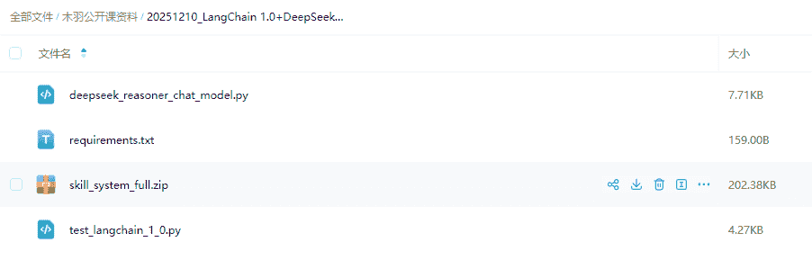


```

```