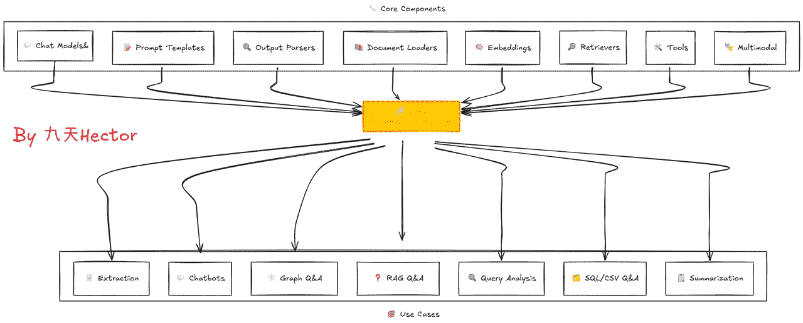
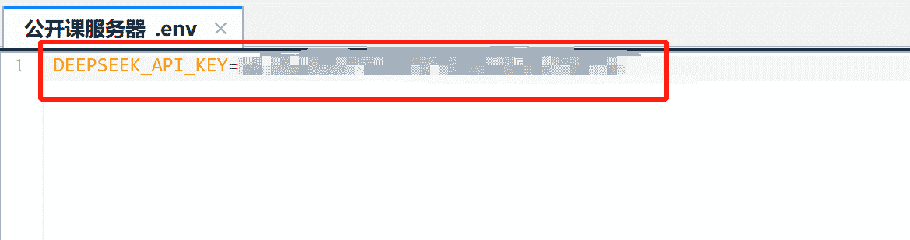
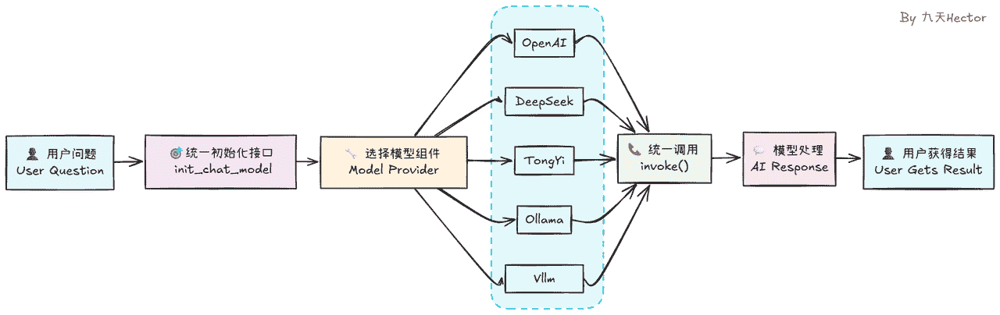
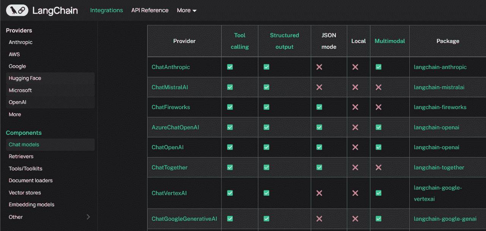
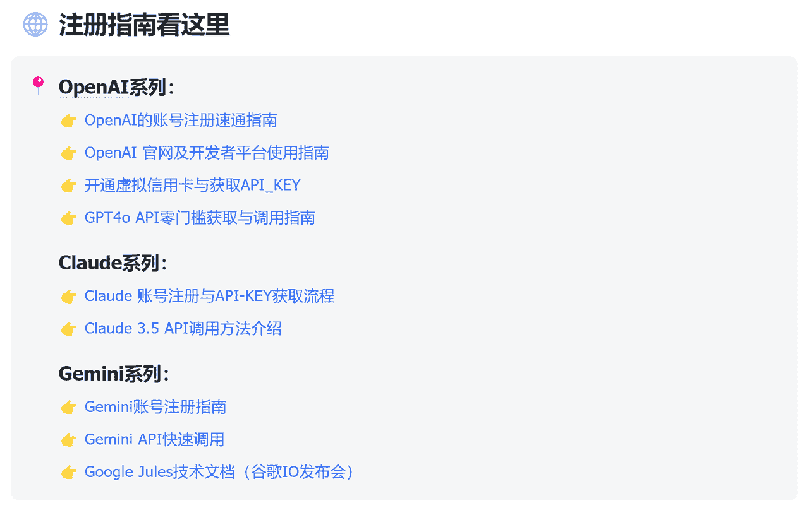
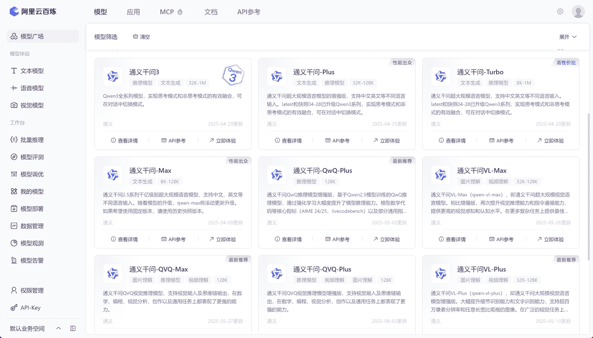
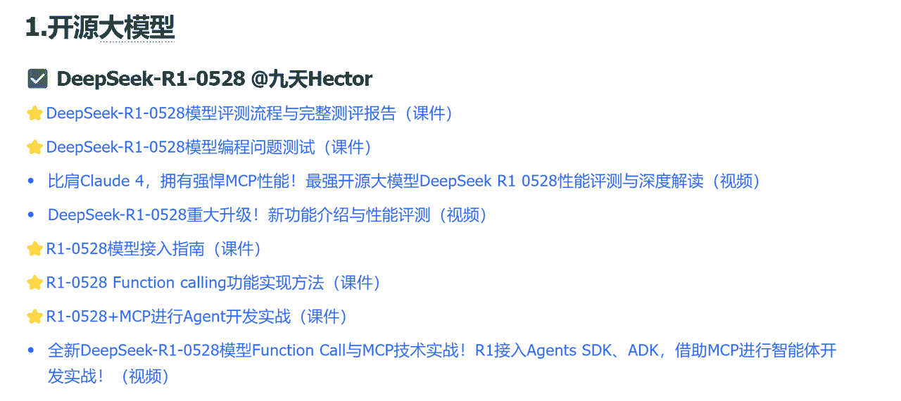
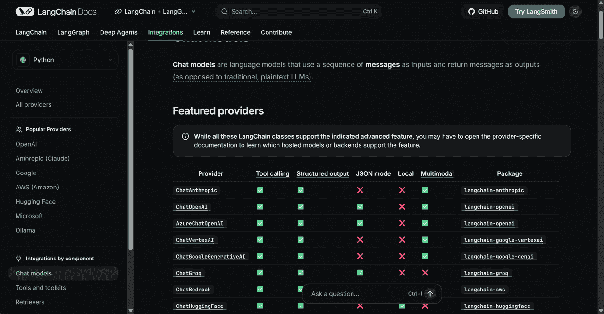

# LangChain 1.0 入门实战

## Part 2. 各类模型接入 LangChain 流程

### 课程说明

> 来源：[https://kq4b3vgg5b.feishu.cn/docx/RF0Vdjz2MoF7CoxYTc1cBL7Hncd](https://kq4b3vgg5b.feishu.cn/docx/RF0Vdjz2MoF7CoxYTc1cBL7Hncd)

体验课内容节选自《2025大模型Agent智能体开发实战》(秋季班)完整版付费课程

体验课时间有限，若想深度学习大模型技术，欢迎大家报名由我主讲的《2025大模型Agent智能体开发实战》(秋季班

### 课程环境说明

> LangChain >= 1.0.0，Python >= 3.11，版本过低请使用 `pip install -upgrade <包名称>` 进行升级。



### 1. LangChain 1.0 接入 DeepSeek 模型流程

#### LangChain 安装流程

如果使用 LangChain 进行大模型应用开发，需要安装 LangChain 的依赖包，安装命令如下：

```
# ! pip install langchain
```

不同的依赖包版本在使用方式上可能存在一些差异，所以建议大家选择和课程一致的依赖包版本进行学习。这里我们采用的是目前最新的 LangChain 1.0 版本，可以通过如下命令进行查看：

```
import langchain
```

```
langchain.__version__
```

输出结果如下：

```
'1.0.1'
```

#### 尝试调用 DeepSeek

在进行 LangChain 开发之前，首先需要准备一个可以进行调用的大模型，这里我们选择使用 DeepSeek 的大模型，并使用 DeepSeek 官方的 `API_KEY` 进行调用。如果初次使用，需要在 DeepSeek 官网上进行注册并创建一个新的 `API_KEY`，其官方地址为：https://platform.deepseek.com/usage


注册好 DeepSeek 的 `API_KEY` 后，首先在项目同级目录下创建一个 `env` 文件，用于存储 DeepSeek 的 `API_KEY`，如下所示：




接下来通过 `python-dotenv` 库读取 `env` 文件中的 `API_KEY`，使其加载到当前的运行环境中，代码如下：

```
# ! pip install python-dotenv
```

```
import os
from dotenv import load_dotenv
load_dotenv(override=True)

DeepSeek_API_KEY = os.getenv("DEEPSEEK_API_KEY")
# print(DeepSeek_API_KEY)  # 可以通过打印查看
```

我们在当前的运行环境下不使用 LangChain，直接使用 DeepSeek 的 API 进行网络连通性测试，测试代码如下：

```
# ! pip install openai
```

```
from openai import OpenAI

# 初始化 DeepSeek 的 API 客户端
client = OpenAI(api_key=DeepSeek_API_KEY, base_url="https://api.deepseek.com")

# 调用 DeepSeek 的 API，生成回答
response = client.chat.completions.create(
    model="deepseek-chat",
    messages=[
        {"role": "system", "content": "你是乐于助人的助手，请根据用户的问题给出回答"},
        {"role": "user", "content": "你好，请你介绍一下你自己。"},
    ],
)

# 打印模型最终的响应结果
print(response.choices[0].message.content)
```

如果可以正常收到 DeepSeek 模型的响应，则说明 DeepSeek 的 API 已经可以正常使用且网络连通性正常。

#### DeepSeek 接入 LangChain 流程

接下来我们要考虑的是，对于这样一个 DeepSeek 官方的 API，如何接入到 LangChain 中呢？其实非常简单，我们只需要使用 LangChain 中的一个 DeepSeek 组件即可像下述代码一样，直接使用相同的 DeepSeek API KEY 与大模型进行交互。因此，我们首先需要安装 LangChain 的 DeepSeek 组件，安装命令如下：

```
# ! pip install langchain-deepseek
```

安装好 LangChain 集成 DeepSeek 模型的依赖包后，需要通过一个 `init_chat_model` 函数来初始化大模型，代码如下：

```
from langchain_deepseek import ChatDeepSeek

model = ChatDeepSeek(model="deepseek-chat")
```

其中 `model` 用来指定要使用的模型名称，而 `model_provider` 用来指定模型提供者，当写入 `deepseek` 时，会自动加载 `langchain-deepseek` 的依赖包，并使用在 `model` 中指定的模型名称用来进行交互。

```
question = "你好，请你介绍一下你自己。"

result = model.invoke(question)
print(result.content)
```

模型响应如下：

你好！很高兴认识你！😊

我是 DeepSeek，由深度求索公司创造的 AI 助手。让我来详细介绍一下自己：

**我的特点：**
- 🆓 **完全免费**：没有任何使用费用，随时为你服务
- 📚 **知识丰富**：知识截止到 2024 年 7 月，涵盖各个领域
- 💬 **上下文强大**：支持 128K 的上下文长度，能记住我们长时间的对话
- 📁 **文件处理**：可以上传并处理图像、txt、pdf、ppt、word、excel 等多种格式文件
- 🌐 **联网搜索**：支持联网获取最新信息（需要你手动开启搜索功能）

**我能帮你做什么：**
- 回答各种问题和解疑答惑
- 协助写作、翻译、总结文档
- 进行代码编程和调试
- 分析和处理你上传的文件
- 提供学习辅导和创意灵感

**使用方式：**
你可以通过 Web 端使用我，也可以在官方应用商店下载 App。

我的回复风格比较热情细腻，希望能给你带来温暖的交流体验！有什么想聊的或需要帮助的，尽管告诉我吧！✨

输出 `result`：

```
AIMessage(content='你好！很高兴认识你！😊\n\n我是 DeepSeek，由深度求索公司创造的 AI 助手。让我来详细介绍一下自己：\n\n**我的特点：**\n- 🆓 **完全免费**：没有任何使用费用，随时为你服务\n- 📚 **知识丰富**：知识截止到 2024 年 7 月，涵盖各个领域\n- 💬 **上下文强大**：支持 128K 的上下文长度，能记住我们长时间的对话\n- 📁 **文件处理**：可以上传并处理图像、txt、pdf、ppt、word、excel 等多种格式文件\n- 🌐 **联网搜索**：支持联网获取最新信息（需要你手动开启搜索功能）\n\n**我能帮你做什么：**\n- 回答各种问题和解疑答惑\n- 协助写作、翻译、总结文档\n- 进行代码编程和调试\n- 分析和处理你上传的文件\n- 提供学习辅导和创意灵感\n\n**使用方式：**\n你可以通过 Web 端使用我，也可以在官方应用商店下载 App。\n\n我的回复风格比较热情细腻，希望能给你带来温暖的交流体验！有什么想聊的或需要帮助的，尽管告诉我吧！✨', additional_kwargs={'refusal': None}, response_metadata={'token_usage': {'completion_tokens': 240, 'prompt_tokens': 10, 'total_tokens': 250, 'completion_tokens_details': None, 'prompt_tokens_details': {'audio_tokens': None, 'cached_tokens': 0}, 'prompt_cache_hit_tokens': 0, 'prompt_cache_miss_tokens': 10}, 'model_provider': 'deepseek', 'model_name': 'deepseek-chat', 'system_fingerprint': 'fp_ffc7281d48_prod0820_fp8_kvcache', 'id': 'de706ee4-82bf-4a3f-99db-9e7142a789b6', 'finish_reason': 'stop', 'logprobs': None}, id='lc_run--7f2d0347-a3dc-4ea2-b5fb-1ef2b8f27e62-0', usage_metadata={'input_tokens': 10, 'output_tokens': 240, 'total_tokens': 250, 'input_token_details': {'cache_read': 0}, 'output_token_details': {}})
```

```
model = ChatDeepSeek(model="deepseek-reasoner")

result = model.invoke(question)
print(result.content)
```

模型响应如下：

你好！很高兴认识你！😊

我是 DeepSeek，由深度求索公司创造的 AI 助手。让我来详细介绍一下自己：

**我的特点：**
- 📚 知识截止到 2024 年 7 月，是 DeepSeek 最新版本模型
- 💬 纯文本对话模型，专注于理解和生成自然语言
- 💾 支持文件上传功能，可以处理图像、txt、pdf、ppt、word、excel 等文件，读取其中的文字信息
- 🌐 支持联网搜索（需要手动开启）
- 📱 有官方 App 可供下载使用

**我的能力：**
- 回答各种问题，提供信息和建议
- 协助写作、翻译、分析等任务
- 处理上传的文档内容
- 进行逻辑推理和问题解决
- 上下文长度达 128K，能处理长篇对话

**重要说明：**
- 🆓 完全免费使用，没有收费计划
- 📅 我无法识别具体时间信息，也不会主动提及

我的回复风格比较热情细腻，希望能给你带来愉快的交流体验！有什么问题或需要帮助的地方，尽管告诉我吧！✨

输出 `result`：

```
AIMessage(content='你好！很高兴认识你！😊\n\n我是 DeepSeek，由深度求索公司创造的 AI 助手。让我来详细介绍一下自己：\n\n**我的特点：**\n- 📚 知识截止到 2024 年 7 月，是 DeepSeek 最新版本模型\n- 💬 纯文本对话模型，专注于理解和生成自然语言\n- 💾 支持文件上传功能，可以处理图像、txt、pdf、ppt、word、excel 等文件，读取其中的文字信息\n- 🌐 支持联网搜索（需要手动开启）\n- 📱 有官方 App 可供下载使用\n\n**我的能力：**\n- 回答各种问题，提供信息和建议\n- 协助写作、翻译、分析等任务\n- 处理上传的文档内容\n- 进行逻辑推理和问题解决\n- 上下文长度达 128K，能处理长篇对话\n\n**重要说明：**\n- 🆓 完全免费使用，没有收费计划\n- 📅 我无法识别具体时间信息，也不会主动提及\n\n我的回复风格比较热情细腻，希望能给你带来愉快的交流体验！有什么问题或需要帮助的地方，尽管告诉我吧！✨', additional_kwargs={'refusal': None, 'reasoning_content': '哦，用户让我做个自我介绍。这是个很基础的请求，不需要复杂拆解，直接给出清晰的结构化信息就行。\n\n想到可以从身份背景、核心能力、特色功能、使用方式这几个维度来组织回复。需要突出免费、长上下文、文件处理这些实用特点，但避免用太技术化的描述。\n\n用热情但专业的语气开头，结尾加个开放性问题让对话能继续下去。不需要额外解释功能细节，用户如果有兴趣自然会追问。'}, response_metadata={'token_usage': {'completion_tokens': 335, 'prompt_tokens': 10, 'total_tokens': 345, 'completion_tokens_details': {'accepted_prediction_tokens': None, 'audio_tokens': None, 'reasoning_tokens': 95, 'rejected_prediction_tokens': None}, 'prompt_tokens_details': {'audio_tokens': None, 'cached_tokens': 0}, 'prompt_cache_hit_tokens': 0, 'prompt_cache_miss_tokens': 10}, 'model_provider': 'deepseek', 'model_name': 'deepseek-reasoner', 'system_fingerprint': 'fp_ffc7281d48_prod0820_fp8_kvcache', 'id': 'e416299a-b547-4d8a-aa51-f55e586155eb', 'finish_reason': 'stop', 'logprobs': None}, id='lc_run--3227687e-8eef-4d0b-889f-70f8d10e5e47-0', usage_metadata={'input_tokens': 10, 'output_tokens': 335, 'total_tokens': 345, 'input_token_details': {'cache_read': 0}, 'output_token_details': {'reasoning': 95}})
```

输出 `result.additional_kwargs`：

```
{'refusal': None,
 'reasoning_content': '哦，用户让我做个自我介绍。这是个很基础的请求，不需要复杂拆解，直接给出清晰的结构化信息就行。\n\n想到可以从身份背景、核心能力、特色功能、使用方式这几个维度来组织回复。需要突出免费、长上下文、文件处理这些实用特点，但避免用太技术化的描述。\n\n用热情但专业的语气开头，结尾加个开放性问题让对话能继续下去。不需要额外解释功能细节，用户如果有兴趣自然会追问。'}
```

输出 `result.additional_kwargs['reasoning_content']`：

```
哦，用户让我做个自我介绍。这是个很基础的请求，不需要复杂拆解，直接给出清晰的结构化信息就行。

想到可以从身份背景、核心能力、特色功能、使用方式这几个维度来组织回复。需要突出免费、长上下文、文件处理这些实用特点，但避免用太技术化的描述。

用热情但专业的语气开头，结尾加个开放性问题让对话能继续下去。不需要额外解释功能细节，用户如果有兴趣自然会追问。
```


# LangChain 接入大模型使用指南

### 1. LangChain 调用大模型的基本原理

```
'哦，用户让我做个自我介绍。这是个很基础的请求，不需要复杂拆解，直接给出清晰的结构化信息就行。

想到可以从身份背景、核心能力、特色功能、使用方式这几个维度来组织回复。需要突出免费、长上下文、文件处理这些实用特点，但避免用太技术化的描述。

用热情但专业的语气开头，结尾加个开放性问题让对话能继续下去。不需要额外解释功能细节，用户如果有兴趣自然会追问。'
```

这里可以看到，仅仅通过两行代码，我们便可以在LangChain中顺利调用DeepSeek模型，并得到模型的响应结果。相较于使用DeepSeek的API，使用LangChain调用模型无疑是更加简单的。同时，不仅仅是DeepSeek模型，LangChain还支持其他很多大模型，如OpenAI、Qwen、Gemini等，我们只需要在`init_chat_model()`函数中指定不同的模型名称，就可以调用不同的模型。其工作的原理是这样的：



理解了这个基本原理，如果大家想在用LangChain进行开发时使用其他大模型如Qwen3系列，则只需要先获取到Qwen3模型的`API_KEY`，然后安装Tongyi Qwen的第三方依赖包，即可同样通过`init_chat_model()`函数来初始化模型，并调用`invoke()`方法来得到模型的响应结果。关于LangChain都支持哪些大模型以及每个模型对应的是哪个第三方依赖包，大家可以在LangChain的官方文档中找到，访问链接为：`https://python.langchain.com/docs/integrations/chat/`



### 2. LangChain 1.0接入OpenAI模型流程

```
! pip install langchain-openai
```

```
Requirement already satisfied: langchain-openai in /root/anaconda3/lib/python3.12/site-packages (0.3.21)
Requirement already satisfied: langchain-core<1.0.0,>=0.3.64 in /root/anaconda3/lib/python3.12/site-packages (from langchain-openai) (0.3.64)
Requirement already satisfied: openai<2.0.0,>=1.68.2 in /root/anaconda3/lib/python3.12/site-packages (from langchain-openai) (1.78.1)
Requirement already satisfied: tiktoken<1,>=0.7 in /root/anaconda3/lib/python3.12/site-packages (from langchain-openai) (0.8.0)
Requirement already satisfied: langsmith<0.4,>=0.3.45 in /root/anaconda3/lib/python3.12/site-packages (from langchain-core<1.0.0,>=0.3.64->langchain-openai) (0.3.45)
Requirement already satisfied: tenacity!=8.4.0,<10.0.0,>=8.1.0 in /root/anaconda3/lib/python3.12/site-packages (from langchain-core<1.0.0,>=0.3.64->langchain-openai) (8.5.0)
Requirement already satisfied: jsonpatch<2.0,>=1.33 in /root/anaconda3/lib/python3.12/site-packages (from langchain-core<1.0.0,>=0.3.64->langchain-openai) (1.33)
Requirement already satisfied: PyYAML>=5.3 in /root/anaconda3/lib/python3.12/site-packages (from langchain-core<1.0.0,>=0.3.64->langchain-openai) (6.0.1)
Requirement already satisfied: packaging<25,>=23.2 in /root/anaconda3/lib/python3.12/site-packages (from langchain-core<1.0.0,>=0.3.64->langchain-openai) (24.1)
Requirement already satisfied: typing-extensions>=4.7 in /root/anaconda3/lib/python3.12/site-packages (from langchain-core<1.0.0,>=0.3.64->langchain-openai) (4.13.2)
Requirement already satisfied: pydantic>=2.7.4 in /root/anaconda3/lib/python3.12/site-packages (from langchain-core<1.0.0,>=0.3.64->langchain-openai) (2.11.4)
Requirement already satisfied: anyio<5,>=3.5.0 in /root/anaconda3/lib/python3.12/site-packages (from openai<2.0.0,>=1.68.2->langchain-openai) (4.8.0)
Requirement already satisfied: distro<2,>=1.7.0 in /root/anaconda3/lib/python3.12/site-packages (from openai<2.0.0,>=1.68.2->langchain-openai) (1.9.0)
Requirement already satisfied: httpx<1,>=0.23.0 in /root/anaconda3/lib/python3.12/site-packages (from openai<2.0.0,>=1.68.2->langchain-openai) (0.28.1)
Requirement already satisfied: jiter<1,>=0.4.0 in /root/anaconda3/lib/python3.12/site-packages (from openai<2.0.0,>=1.68.2->langchain-openai) (0.8.2)
Requirement already satisfied: sniffio in /root/anaconda3/lib/python3.12/site-packages (from openai<2.0.0,>=1.68.2->langchain-openai) (1.3.0)
Requirement already satisfied: tqdm>4 in /root/anaconda3/lib/python3.12/site-packages (from openai<2.0.0,>=1.68.2->langchain-openai) (4.66.4)
Requirement already satisfied: regex>=2022.1.18 in /root/anaconda3/lib/python3.12/site-packages (from tiktoken<1,>=0.7->langchain-openai) (2023.10.3)
Requirement already satisfied: requests>=2.26.0 in /root/anaconda3/lib/python3.12/site-packages (from tiktoken<1,>=0.7->langchain-openai) (2.32.3)
Requirement already satisfied: idna>=2.8 in /root/anaconda3/lib/python3.12/site-packages (from anyio<5,>=3.5.0->openai<2.0.0,>=1.68.2->langchain-openai) (3.7)
Requirement already satisfied: certifi in /root/anaconda3/lib/python3.12/site-packages (from httpx<1,>=0.23.0->openai<2.0.0,>=1.68.2->langchain-openai) (2024.2.2)
Requirement already satisfied: httpcore==1.* in /root/anaconda3/lib/python3.12/site-packages (from httpx<1,>=0.23.0->openai<2.0.0,>=1.68.2->langchain-openai) (1.0.7)
Requirement already satisfied: h11<0.15,>=0.13 in /root/anaconda3/lib/python3.12/site-packages (from httpcore==1.*->httpx<1,>=0.23.0->openai<2.0.0,>=1.68.2->langchain-openai) (0.14.0)
Requirement already satisfied: jsonpointer>=1.9 in /root/anaconda3/lib/python3.12/site-packages (from jsonpatch<2.0,>=1.33->langchain-core<1.0.0,>=0.3.64->langchain-openai) (2.1)
Requirement already satisfied: orjson<4.0.0,>=3.9.14 in /root/anaconda3/lib/python3.12/site-packages (from langsmith<0.4,>=0.3.45->langchain-core<1.0.0,>=0.3.64->langchain-openai) (3.10.13)
Requirement already satisfied: requests-toolbelt<2.0.0,>=1.0.0 in /root/anaconda3/lib/python3.12/site-packages (from langsmith<0.4,>=0.3.45->langchain-core<1.0.0,>=0.3.64->langchain-openai) (1.0.0)
Requirement already satisfied: zstandard<0.24.0,>=0.23.0 in /root/anaconda3/lib/python3.12/site-packages (from langsmith<0.4,>=0.3.45->langchain-core<1.0.0,>=0.3.64->langchain-openai) (0.23.0)
Requirement already satisfied: annotated-types>=0.6.0 in /root/anaconda3/lib/python3.12/site-packages (from pydantic>=2.7.4->langchain-core<1.0.0,>=0.3.64->langchain-openai) (0.6.0)
Requirement already satisfied: pydantic-core==2.33.2 in /root/anaconda3/lib/python3.12/site-packages (from pydantic>=2.7.4->langchain-core<1.0.0,>=0.3.64->langchain-openai) (2.33.2)
Requirement already satisfied: typing-inspection>=0.4.0 in /root/anaconda3/lib/python3.12/site-packages (from pydantic>=2.7.4->langchain-core<1.0.0,>=0.3.64->langchain-openai) (0.4.0)
Requirement already satisfied: charset-normalizer<4,>=2 in /root/anaconda3/lib/python3.12/site-packages (from requests>=2.26.0->tiktoken<1,>=0.7->langchain-openai) (2.0.4)
Requirement already satisfied: urllib3<3,>=1.21.1 in /root/anaconda3/lib/python3.12/site-packages (from requests>=2.26.0->tiktoken<1,>=0.7->langchain-openai) (2.2.2)
WARNING: Running pip as the 'root' user can result in broken permissions and conflicting behaviour with the system package manager. It is recommended to use a virtual environment instead: https://pip.pypa.io/warnings/venv
```

同时需要在`.env`文件中输入OpenAI的`API-KEY`。


```
from langchain_openai import ChatOpenAI

model = ChatOpenAI(model="gpt-5-nano", base_url="https://ai.devtool.tech/proxy/v1")

question = "你好，请你介绍一下你自己。"

result = model.invoke(question)
print(result.content)
```

```
你好！简要介绍一下我自己：

- 我是谁：我是ChatGPT，一个由OpenAI开发、基于GPT-4架构的语言模型。不是人，而是一个通过自然语言与你对话的AI助手。
- 能力范围：回答问题、写作与润色、翻译、摘要、头脑风暴、编程和调试思路、学习和备考辅助、信息检索（在有联网功能时）、日常对话等。可以按你的需求调整语言风格和深度。
- 如何使用我：直接给我一个任务或问题，我会给出回答、步骤和可选方案。你也可以让我帮你拟定计划、总结要点、改写文本等。
- 知识与时间：我的知识更新到2024年6月，无法自动实时上网（除非在特定场景开启网页浏览功能）。
- 记忆与隐私：在同一会话中我会记住上下文，便于对话连贯；但不同会话之间不保留记忆。请谨慎分享个人敏感信息。对话内容可能用于改进模型。
- 局限性与安全：我可能会出错或给出不够准确的建议，尤其是在专业领域。对健康、法律、金融等重要问题，请以专业人士的意见为准；遇到紧急情况请联系当地紧急服务或专业机构。
- 如何获得最佳帮助：告诉我你的目标、偏好（如语气、语言风格、需要的细节深度），我会相应调整并给出更贴合的回答。

如果你愿意，我们可以现在就开始一个你感兴趣的主题，或给我一个具体任务来试试看。
```

> 注1：使用OpenAI模型前需要设置好网络环境，或者使用如上代码中的国内反向代理地址。。

> 注2：更多OpenAI、Claude、Gemini模型接入指南，详见赋范大模型技术社区文档：




### 3. LangChain 1.0接入Dashscope阿里百炼平台模型流程


# DashScope 阿里百炼平台介绍与接入

## 平台简介

Dashscope阿里百炼原名是阿里云的灵积社区，也是国内最大的API集成平台，其中包含了各类开源模型（如Qwen3系列模型）和国内在线模型（如DeepSeek、BaiChuan）模型API服务，现在已合并入阿里云百炼平台。对于国内开发者来说，若要使用Qwen系列模型API（而非本地部署），那么Dashscope平台提供的API服务肯定是最合适的。

## API 获取与调用

阿里百炼平台官网：`https://bailian.console.aliyun.com/?switchAgent=11366636&productCode=p_efm&switchUserType=3&tab=home#/home`

而百炼API获取方式也非常简单，只需注册阿里云账号，然后前往我的API页面：`https://bailian.console.aliyun.com/?tab=model#/api-key` 进行充值和注册即可：

然后即可调用海量各类模型了：



当我们完成了DashScope API注册后，即可使用如下代码进行模型调用（需要提前将`DASHSCOPE_API_KEY`写到本地`.env`文件中）：

```python
import os
from openai import OpenAI

client = OpenAI(
    api_key=os.getenv("DASHSCOPE_API_KEY"),
    base_url="https://dashscope.aliyuncs.com/compatible-mode/v1",
)

completion = client.chat.completions.create(
    # 模型列表：https://help.aliyun.com/zh/model-studio/getting-started/models
    model="qwen-plus",
    messages=[
        {"role": "system", "content": "You are a helpful assistant."},
        {"role": "user", "content": "你是谁？"},
    ],
)
print(completion.model_dump_json())
```

```json
{
  "id": "chatcmpl-17b9c16c-1380-9843-898a-b2fd91e40d80",
  "choices": [
    {
      "finish_reason": "stop",
      "index": 0,
      "logprobs": null,
      "message": {
        "content": "我是通义千问，阿里巴巴集团旗下的通义实验室自主研发的超大规模语言模型。我能够回答问题、创作文字，如写故事、公文、邮件、剧本等，还能进行逻辑推理、编程，甚至表达观点和玩游戏。我在多国语言上都有很好的掌握，能为你提供多样化的帮助。有什么我可以帮到你的吗？",
        "refusal": null,
        "role": "assistant",
        "annotations": null,
        "audio": null,
        "function_call": null,
        "tool_calls": null
      }
    }
  ],
  "created": 1749718136,
  "model": "qwen-plus",
  "object": "chat.completion",
  "service_tier": null,
  "system_fingerprint": null,
  "usage": {
    "completion_tokens": 75,
    "prompt_tokens": 22,
    "total_tokens": 97,
    "completion_tokens_details": null,
    "prompt_tokens_details": {
      "audio_tokens": null,
      "cached_tokens": 0
    }
  }
}
```

## LangChain 接入

当然，也可以将DashScope中各类模型接入`LangChain`：

```bash
#!pip install --upgrade dashscope -i https://pypi.tuna.tsinghua.edu.cn/simple
```

```bash
# !pip install langchain_community -i https://pypi.tuna.tsinghua.edu.cn/simple
```

```python
from langchain_community.chat_models.tongyi import ChatTongyi
```

```python
model = ChatTongyi()
```

```python
question = "你好，请你介绍一下你自己。"

result = model.invoke(question)
print(result.content)
```

```text
你好！我叫通义千问，是阿里巴巴集团旗下的通义实验室自主研发的超大规模语言模型。我可以回答问题、创作文字、编程、逻辑推理、语言理解等多种任务，支持中英文等多种语言。

我的训练数据来自互联网上的大量文本，这让我能够理解和生成多种语言的内容。我被设计用来帮助用户解决问题、提供信息和娱乐，以及进行各种创意和分析任务。

如果你有任何问题或需要帮助，我会尽力提供支持。你可以问我任何问题，或者让我帮你完成一些任务。希望我们能有愉快的交流！
```

### LangChain 1.0 接入 Ollama 模型流程

当然，除了在线大模型的接入，`langChain`也只是使用`Ollama`、`vLLM`等框架启动的本地大模型。这里以`ollama`为例进行演示。

```bash
!pip install langchain-ollama
```


# 使用 langchain-ollama 接入本地大模型

## 安装依赖

```
Collecting langchain-ollama
  Downloading langchain_ollama-0.3.3-py3-none-any.whl.metadata (1.5 kB)
Collecting ollama<1.0.0,>=0.4.8 (from langchain-ollama)
  Downloading ollama-0.5.1-py3-none-any.whl.metadata (4.3 kB)
Requirement already satisfied: langchain-core<1.0.0,>=0.3.60 in /root/anaconda3/lib/python3.12/site-packages (from langchain-ollama) (0.3.64)
Requirement already satisfied: langsmith<0.4,>=0.3.45 in /root/anaconda3/lib/python3.12/site-packages (from langchain-core<1.0.0,>=0.3.60->langchain-ollama) (0.3.45)
Requirement already satisfied: tenacity!=8.4.0,<10.0.0,>=8.1.0 in /root/anaconda3/lib/python3.12/site-packages (from langchain-core<1.0.0,>=0.3.60->langchain-ollama) (8.5.0)
Requirement already satisfied: jsonpatch<2.0,>=1.33 in /root/anaconda3/lib/python3.12/site-packages (from langchain-core<1.0.0,>=0.3.60->langchain-ollama) (1.33)
Requirement already satisfied: PyYAML>=5.3 in /root/anaconda3/lib/python3.12/site-packages (from langchain-core<1.0.0,>=0.3.60->langchain-ollama) (6.0.1)
Requirement already satisfied: packaging<25,>=23.2 in /root/anaconda3/lib/python3.12/site-packages (from langchain-core<1.0.0,>=0.3.60->langchain-ollama) (24.1)
Requirement already satisfied: typing-extensions>=4.7 in /root/anaconda3/lib/python3.12/site-packages (from langchain-core<1.0.0,>=0.3.60->langchain-ollama) (4.13.2)
Requirement already satisfied: pydantic>=2.7.4 in /root/anaconda3/lib/python3.12/site-packages (from langchain-core<1.0.0,>=0.3.60->langchain-ollama) (2.11.4)
Requirement already satisfied: httpx>=0.27 in /root/anaconda3/lib/python3.12/site-packages (from ollama<1.0.0,>=0.4.8->langchain-ollama) (0.28.1)
Requirement already satisfied: anyio in /root/anaconda3/lib/python3.12/site-packages (from httpx>=0.27->ollama<1.0.0,>=0.4.8->langchain-ollama) (4.8.0)
Requirement already satisfied: certifi in /root/anaconda3/lib/python3.12/site-packages (from httpx>=0.27->ollama<1.0.0,>=0.4.8->langchain-ollama) (2024.2.2)
Requirement already satisfied: httpcore==1.* in /root/anaconda3/lib/python3.12/site-packages (from httpx>=0.27->ollama<1.0.0,>=0.4.8->langchain-ollama) (1.0.7)
Requirement already satisfied: idna in /root/anaconda3/lib/python3.12/site-packages (from httpx>=0.27->ollama<1.0.0,>=0.4.8->langchain-ollama) (3.7)
Requirement already satisfied: h11<0.15,>=0.13 in /root/anaconda3/lib/python3.12/site-packages (from httpcore==1.*->httpx>=0.27->ollama<1.0.0,>=0.4.8->langchain-ollama) (0.14.0)
Requirement already satisfied: jsonpointer>=1.9 in /root/anaconda3/lib/python3.12/site-packages (from jsonpatch<2.0,>=1.33->langchain-core<1.0.0,>=0.3.60->langchain-ollama) (2.1)
Requirement already satisfied: orjson<4.0.0,>=3.9.14 in /root/anaconda3/lib/python3.12/site-packages (from langsmith<0.4,>=0.3.45->langchain-core<1.0.0,>=0.3.60->langchain-ollama) (3.10.13)
Requirement already satisfied: requests<3,>=2 in /root/anaconda3/lib/python3.12/site-packages (from langsmith<0.4,>=0.3.45->langchain-core<1.0.0,>=0.3.60->langchain-ollama) (2.32.3)
Requirement already satisfied: requests-toolbelt<2.0.0,>=1.0.0 in /root/anaconda3/lib/python3.12/site-packages (from langsmith<0.4,>=0.3.45->langchain-core<1.0.0,>=0.3.60->langchain-ollama) (1.0.0)
Requirement already satisfied: zstandard<0.24.0,>=0.23.0 in /root/anaconda3/lib/python3.12/site-packages (from langsmith<0.4,>=0.3.45->langchain-core<1.0.0,>=0.3.60->langchain-ollama) (0.23.0)
Requirement already satisfied: annotated-types>=0.6.0 in /root/anaconda3/lib/python3.12/site-packages (from pydantic>=2.7.4->langchain-core<1.0.0,>=0.3.60->langchain-ollama) (0.6.0)
Requirement already satisfied: pydantic-core==2.33.2 in /root/anaconda3/lib/python3.12/site-packages (from pydantic>=2.7.4->langchain-core<1.0.0,>=0.3.60->langchain-ollama) (2.33.2)
Requirement already satisfied: typing-inspection>=0.4.0 in /root/anaconda3/lib/python3.12/site-packages (from pydantic>=2.7.4->langchain-core<1.0.0,>=0.3.60->langchain-ollama) (0.4.0)
Requirement already satisfied: charset-normalizer<4,>=2 in /root/anaconda3/lib/python3.12/site-packages (from requests<3,>=2->langsmith<0.4,>=0.3.45->langchain-core<1.0.0,>=0.3.60->langchain-ollama) (2.0.4)
Requirement already satisfied: urllib3<3,>=1.21.1 in /root/anaconda3/lib/python3.12/site-packages (from requests<3,>=2->langsmith<0.4,>=0.3.45->langchain-core<1.0.0,>=0.3.60->langchain-ollama) (2.2.2)
Requirement already satisfied: sniffio>=1.1 in /root/anaconda3/lib/python3.12/site-packages (from anyio->httpx>=0.27->ollama<1.0.0,>=0.4.8->langchain-ollama) (1.3.0)
Downloading langchain_ollama-0.3.3-py3-none-any.whl (21 kB)
Downloading ollama-0.5.1-py3-none-any.whl (13 kB)
Installing collected packages: ollama, langchain-ollama
Successfully installed langchain-ollama-0.3.3 ollama-0.5.1
WARNING: Running pip as the 'root' user can result in broken permissions and conflicting behaviour with the system package manager. It is recommended to use a virtual environment instead: https://pip.pypa.io/warnings/venv
```

## 确认 ollama 服务

注意，这里要确保`ollama`已经顺利开启，并查看当前模型名称：


## 初始化模型

然后即可使用如下方法接入 LangChain：

```python
from langchain_ollama import ChatOllama
```

```python
model = ChatOllama(model="deepseek-r1")
```

## 调用模型

```python
question = "你好，请你介绍一下你自己。"

result = model.invoke(question)
print(result.content)
```

## 模型响应示例

```
<think>
嗯，用户发来一个简单的问候和自我介绍请求。这可能是第一次接触我，或者想确认我的功能范围。

用户可能刚打开聊天界面，带着一点好奇和试探的心理。ta不一定有明确需求，更像是在“暖场”，测试这个AI助手能做什么。这类开场白很常见，需要既保持友好又清晰展示能力边界。

考虑到这是基础社交场景，回复应该包含几个关键要素：身份说明（DeepSeek-R1）、开发者信息（增加可信度）、核心功能范围（让用户快速建立认知）、交互邀请（降低使用门槛）。语气要轻快但专业，用emoji调节严肃感，避免术语堆砌。

用户没透露任何背景信息，所以保持中性称呼最稳妥。最后那个“😊”表情很重要——既承接了开头的问候情绪，又暗示AI助手具备情感交互能力，比纯文字更亲切。
</think>
你好呀！👋我是DeepSeek-R1，一个由深度求索公司开发的人工智能助手，可以帮助你处理各种文本任务、回答问题、提供知识信息和进行创意创作。我的知识更新到2024年7月，涵盖科学、历史、文学、技术等多个领域，并且支持中文和英文交流。

我可以帮你做很多事，比如：

- 解答学习或工作上的疑问
- 编辑润色文案写作（论文、邮件、报告都可以）
- 总结整理复杂信息
- 进行多轮对话讨论某一主题
- 提供编程帮助（代码解释、调试、生成等）
- 甚至帮你规划旅行，推荐书籍电影，写诗写情书 😄

如果你有任何问题或需要帮忙的地方，尽管告诉我吧！我随时在线，乐意为你服务～😊
```

## 更多资源

> 注：更多`ollama`使用方法，及 vLLM、Qwen3、DeepSeek 系列模型本地部署流程，详见赋范大模型技术社区教程：




+   更多模型接入流程，详见:https://docs.langchain.com/oss/python/integrations/chat


